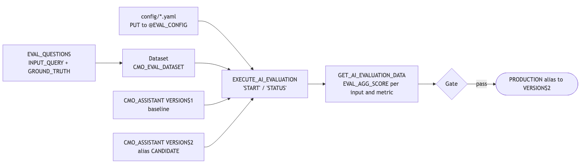

Score a Cortex Agent against a small ground-truth dataset, change one thing,
score the new version the same way, and promote it to the PRODUCTION alias only
if it wins. Everything runs in SQL: a dataset table, a YAML config on a stage,
`EXECUTE_AI_EVALUATION` to run it, and `GET_AI_EVALUATION_DATA` to read the
scores. The judges are pinned so two runs are comparable, and the agent versions
are pinned so you know exactly which configuration each score belongs to.

## When to use this

- Before an agent change reaches users: new instructions, a new tool, a new model.
- To turn "the new prompt feels better" into a number per question and per metric.
- As the gate in a promotion flow, where only a version that passes is moved to
  PRODUCTION.

When not to use it:

- Agents whose answers depend on session attributes or row access policies keyed
  on them. Evaluation runs do not pass session attributes, so the results will not
  match what users see.
- Agents whose main tools are MCP servers. Evaluations do not call MCP tools.
- Live-traffic monitoring. Evaluations score a fixed dataset; use agent
  monitoring for production conversations.

## How it works




Key concepts:

1. **Dataset.** A table with a VARCHAR question column and a VARIANT ground truth
   column. `answer_correctness` reads the `ground_truth_output` key. Custom metrics
   see the whole VARIANT through `{{ground_truth}}`, so you can add your own keys
   (this recipe adds `expected_tools` and `intent`).
2. **Config on a stage.** The YAML has three top-level keys: `dataset` (optional;
   creates the dataset), `evaluation` (`agent_params`, `run_params`,
   `source_metadata`), and `metrics`. It is uploaded with `PUT` to a stage whose
   file format is CSV with `FIELD_DELIMITER = NONE`.
3. **Pinned judges.** System metrics take a `version`. This recipe pins `v3`
   (judge `claude-sonnet-4-6`, or `openai-gpt-5.4` where Anthropic models are not
   allowed). The custom metric names its judge with `model`, because the default
   custom-metric judge is a legacy model.
4. **Pinned agent versions.** `agent_params.agent_version` accepts `VERSION$N`,
   an alias, or `LIVE`, `FIRST`, `LAST`, `DEFAULT`. The baseline pins `VERSION$1`;
   the candidate uses the `CANDIDATE` alias, which 06 points at the version it
   commits.
5. **Promotion by alias.** When the candidate passes the gate, 07 moves the
   PRODUCTION alias and the DEFAULT pin to it. Applications that call
   `'...CMO_ASSISTANT!PRODUCTION'` get the new version on their next request.

The metrics follow Snowflake's Goal-Plan-Action framework. There are four system
metrics: `answer_correctness` and `logical_consistency` (used here), and
`tool_selection_accuracy` and `tool_execution_accuracy`, which are in Public
Preview and read a `ground_truth_invocations` key. This recipe uses only the
generally available metrics plus a custom metric for tool routing.

## Prerequisites

| Requirement | Notes |
|---|---|
| Cross-region inference, or a region with `claude-sonnet-4-6` | Used by the agent and by every judge in this recipe |
| `ACCOUNTADMIN` for `01_setup.sql` and `99_teardown.sql` | 01 creates the recipe role and grants it `SNOWFLAKE.CORTEX_USER` and `EXECUTE TASK ON ACCOUNT`. Teardown deletes the runs as the recipe role, then switches to ACCOUNTADMIN to drop the database, warehouse, and role. Scripts 02 to 07 run as `COOKBOOK_AGENT_EVALUATIONS_ADMIN`. |
| `USE AI FUNCTIONS` | Granted to PUBLIC by default. If your account revoked it, grant it to `COOKBOOK_AGENT_EVALUATIONS_ADMIN`. |
| Snowflake CLI (`snow sql`) or another client that supports `PUT` | `03` uploads the config files from `config/`. `05` takes the run name through the CLI's `-D` option; in another client, edit its `SET agenteval_run` line instead. |
| Run from the recipe folder | `PUT file://config/...` paths are relative to it |

## Quickstart

From `recipes/cortex-agents/agent-evaluations/`:

1. `snow sql -f sql/01_setup.sql`: role, warehouse, database, 48 rows of
   campaign data, four strategy documents, the semantic view, and the search
   service.
2. `snow sql -f sql/02_agent.sql`: the CMO assistant. VERSION$1 is the baseline;
   DEFAULT is pinned to it.
3. `snow sql -f sql/03_eval_dataset.sql`: five evaluation questions, the config
   stage, and `PUT` of both config files.
4. `snow sql -f sql/04_run_baseline.sql`: start the baseline run. It takes a
   few minutes.
5. `snow sql -f sql/05_results.sql`: STATUS for the baseline run, then scores
   per metric, lowest scores with the judge's explanation, and scores per
   intent. Until the run is `COMPLETED`, 05 stops after STATUS with "The run is
   still in progress", so run it again until it gets past that point.
6. `snow sql -f sql/06_candidate.sql`: add routing and scope rules, commit
   VERSION$2, point CANDIDATE at it, start the candidate run. Then poll and
   read it the same way with
   `snow sql -f sql/05_results.sql -D run_name=candidate`.
7. `snow sql -f sql/07_compare_and_promote.sql`: compare the runs, promote if the
   gate passes, and call `!PRODUCTION`.
8. `snow sql -f sql/99_teardown.sql`.

## Walkthrough

### The dataset

Five questions cover the intents the agent must handle: a metric, a comparison,
a document lookup, an actual-versus-benchmark question that needs both tools, and
an out-of-scope request. Ground truth uses literal values from the data and says
what a correct answer must and must not contain.

```sql
INSERT INTO EVAL_QUESTIONS
SELECT column1, PARSE_JSON(column2) FROM VALUES
('Did Email beat its ROAS benchmark for full-year 2024?',
 '{"ground_truth_output": "Yes. Email ROAS for 2024 was about 11.8x ... against a benchmark of 10.0x ...",
   "expected_tools": ["campaign_analytics", "strategy_search"], "intent": "actual_vs_benchmark"}');
```

Use `PARSE_JSON` for the VARIANT column. `OBJECT_CONSTRUCT` returns an OBJECT,
not a VARIANT.

### The config and the upload

```sql
CREATE FILE FORMAT IF NOT EXISTS EVAL_YAML_FORMAT
  TYPE = 'CSV' FIELD_DELIMITER = NONE RECORD_DELIMITER = '\n' SKIP_HEADER = 0
  FIELD_OPTIONALLY_ENCLOSED_BY = NONE ESCAPE_UNENCLOSED_FIELD = NONE;
CREATE STAGE IF NOT EXISTS EVAL_CONFIG FILE_FORMAT = EVAL_YAML_FORMAT;
PUT file://config/eval_baseline.yaml  @EVAL_CONFIG AUTO_COMPRESS = FALSE OVERWRITE = TRUE;
PUT file://config/eval_candidate.yaml @EVAL_CONFIG AUTO_COMPRESS = FALSE OVERWRITE = TRUE;
```

[config/eval_baseline.yaml](https://github.com/Snowflake-Labs/cortex-ai-cookbook/blob/main/recipes/cortex-agents/agent-evaluations/config/eval_baseline.yaml) includes a `dataset`
block, so its START creates `CMO_EVAL_DATASET`.
[config/eval_candidate.yaml](https://github.com/Snowflake-Labs/cortex-ai-cookbook/blob/main/recipes/cortex-agents/agent-evaluations/config/eval_candidate.yaml) leaves it out and
references the existing dataset; repeating the block would fail because the
dataset already exists. The metrics block is identical in both:

```yaml
metrics:
  - name: "answer_correctness"
    version: "v3"
  - name: "logical_consistency"
    version: "v3"
  - name: "tool_routing"
    model: "claude-sonnet-4-6"
    score_ranges:
      min_score: [1, 3]
      median_score: [4, 6]
      max_score: [7, 10]
    prompt: |
      ... User question: {{input}} Tools the agent called: {{tool_info}}
      Expected behavior: {{ground_truth}} Agent answer: {{output}} ...
```

### Run and poll

`EXECUTE_AI_EVALUATION` always takes the action, the run name, and the config
path, including for STATUS, CANCEL, and DELETE:

```sql
USE SCHEMA COOKBOOK_AGENT_EVALUATIONS.MARKETING;
CALL EXECUTE_AI_EVALUATION('START',  OBJECT_CONSTRUCT('run_name', 'baseline'), '@EVAL_CONFIG/eval_baseline.yaml');
CALL EXECUTE_AI_EVALUATION('STATUS', OBJECT_CONSTRUCT('run_name', 'baseline'), '@EVAL_CONFIG/eval_baseline.yaml');
```

With SQL the run executes in the session's current database and schema, so set
the schema first. STATUS moves through states such as
`INVOCATION_IN_PROGRESS` to `COMPLETED`.

Every `snow sql -f` call opens a new session, so a session variable set in one
file is gone in the next. 05 therefore takes the run name from the command
line, with `baseline` as the default, and only maps the two names this recipe
uses to a config file:

```sql
SET agenteval_run = '<% run_name | default("baseline") %>';
```

`snow sql -f sql/05_results.sql -D run_name=candidate` reads the candidate. 05
calls STATUS first and raises an error unless the run is `COMPLETED`, so the
score queries never read a partial run and the same command serves as the
polling step.

### Read the results

```sql
SELECT METRIC_NAME, ROUND(AVG(EVAL_AGG_SCORE), 3) AS AVG_SCORE
FROM TABLE(SNOWFLAKE.LOCAL.GET_AI_EVALUATION_DATA(
  'COOKBOOK_AGENT_EVALUATIONS', 'MARKETING', 'CMO_ASSISTANT', 'CORTEX AGENT', 'baseline'))
GROUP BY METRIC_NAME;
```

`METRIC_CALLS[0]:explanation` holds the judge's reasoning for each score. Read
it for every low score: it names the fix. In this recipe the baseline declines the
weather question but does not offer anything it can help with, and the
explanation for its 0.33 answer correctness says exactly that.

System metrics score from 0 to 1. The custom metric scores on the 1 to 10 scale
its prompt defines, so keep it in its own column.

### Improve one thing and compare

06 changes only the orchestration instructions (routing rules, a
comparison rule, and a scope rule), commits the result, and points CANDIDATE at
it. Changing one thing at a time is what lets a score change be attributed to a
cause. 07 compares the runs per metric and per question, then applies the gate:

```sql
IF (NOT (cand_ac >= base_ac AND cand_ac >= 0.80 AND cand_lc >= 0.80)) THEN
  RETURN 'Not promoted: ...';
END IF;
EXECUTE IMMEDIATE 'ALTER AGENT IDENTIFIER($agenteval_agent) MODIFY VERSION '
                  || candidate_version || ' SET ALIAS = production';
EXECUTE IMMEDIATE 'ALTER AGENT IDENTIFIER($agenteval_agent) SET DEFAULT_VERSION = '''
                  || candidate_version || '''';
```

The version name comes from `DESCRIBE AGENT` (the `aliases` column) and is
checked against `^VERSION\$[0-9]+$` before it is used in a statement. Callers use
the alias:

```sql
SELECT SNOWFLAKE.CORTEX.DATA_AGENT_RUN(
  'COOKBOOK_AGENT_EVALUATIONS.MARKETING.CMO_ASSISTANT!PRODUCTION', $${"messages": [...]}$$);
```

See the [agent versioning and promotion guide](https://github.com/Snowflake-Labs/cortex-ai-cookbook/tree/main/recipes/cortex-agents/agent-evaluations/../../cortex-agents/agent-versioning-and-promotion/)
for how aliases, DEFAULT, and rollback behave.

### Scheduled runs

`EXECUTE_AI_EVALUATION` can be called from a task, which runs in its own session
under the task owner's role:

```sql
CREATE OR REPLACE TASK NIGHTLY_EVAL
  WAREHOUSE = COOKBOOK_AGENT_EVALUATIONS_WH
  SCHEDULE = 'USING CRON 0 6 * * * UTC'
AS
  EXECUTE IMMEDIATE $$
  BEGIN
    USE SCHEMA COOKBOOK_AGENT_EVALUATIONS.MARKETING;
    CALL EXECUTE_AI_EVALUATION('START',
      OBJECT_CONSTRUCT('run_name', 'nightly-' || TO_CHAR(CURRENT_DATE(), 'YYYYMMDD')),
      '@COOKBOOK_AGENT_EVALUATIONS.MARKETING.EVAL_CONFIG/eval_candidate.yaml');
  END;
  $$;
```

Point a scheduled config at a committed version or at PRODUCTION, and pin the
metric versions, so a score change means the agent changed.

## Verify

- `STATUS` for `baseline` and `candidate` returns `COMPLETED`.
- 05 returns five rows per metric per run. In two test passes, the baseline
  scored 0.87 and 0.93 on `answer_correctness` (the weather question scored
  lowest both times), 1.0 on `logical_consistency`, and 9.4 to 9.8 on
  `tool_routing`. The candidate scored 1.0 and 1.0 on `answer_correctness`.
  Your numbers can differ, because each run invokes the agent again.
- 07 returns `Promoted VERSION$2: answer_correctness <baseline> -> 1` (with your
  scores), `DESCRIBE AGENT` shows `default_version_name` = `VERSION$2` and
  `PRODUCTION` on `VERSION$2`, and `!PRODUCTION` declines the weather question
  and offers marketing help.

## Gotchas

| Symptom | Cause | Fix |
|---|---|---|
| START fails with "dataset ... already exists" | The config still has a `dataset` block and the dataset was created by an earlier run | Remove the `dataset` block for repeat runs (as `eval_candidate.yaml` does), or `DROP DATASET` first (as `04` does) |
| "Run with name ... does not exist" from DELETE or STATUS | The run name was never started, or the START failed | Check the START output; `04` and `06` ignore this error when cleaning up |
| "Failed to create evaluation task ... Ensure your role has CREATE TASK ON SCHEMA and EXECUTE TASK ON ACCOUNT" | Evaluation runs are managed by tasks in the current schema | Run as a role with both privileges; `01` grants `EXECUTE TASK ON ACCOUNT`, and owning the database covers `CREATE TASK` |
| START fails validating the dataset or agent | The session's database and schema are not the recipe's | `USE SCHEMA COOKBOOK_AGENT_EVALUATIONS.MARKETING` before calling it |
| A custom metric run fails at start | No `model` key, and the default judge is a legacy model your account never used | Set `model` explicitly on every custom metric |
| Unpinned system metric runs fail or change scores | Unversioned metrics use the current default judge, which rolls forward on deprecation | Pin `version: "v3"` (or `v2`) and keep it the same across runs |
| Scores differ between two runs of the same version | Each run invokes the agent again; orchestration is not deterministic | Run the dataset several times to learn its normal range and gate on that range |
| Custom metric averages look far above 1 | Custom metrics use the scale their prompt defines | Report custom metrics in their own column |
| `!production` returns "Version not found" | Unquoted aliases are stored in uppercase | Call `!PRODUCTION` |
| 05 fails with "run_name must be baseline or candidate" in a Snowsight worksheet | The `<% run_name ... %>` placeholder is Snowflake CLI templating, which other clients do not render | Replace the `SET agenteval_run` value with `'baseline'` or `'candidate'`, or run the file with `snow sql -f` |
| 05 fails with "Version 'CANDIDATE' ... does not exist" | 06 has not run yet, so there is no CANDIDATE alias or candidate run | Run `sql/06_candidate.sql` first |
| STATUS shows `PARTIALLY_COMPLETED`, then `COMPLETED` a minute later | The docs list `PARTIALLY_COMPLETED` as a final state, but a run can pass through it while metrics finish | 05 treats it as not done yet; run it again. If it does not change, read `STATUS_DETAILS` and the warnings query at the end of 05 |

## Teardown

`sql/99_teardown.sql` deletes both evaluation runs as the recipe role, then
switches to ACCOUNTADMIN and drops the database (agent, versions, dataset,
stage, tables), the warehouse, and the role. Dropping the role removes its
`EXECUTE TASK ON ACCOUNT` grant.

## Run it with a coding agent

```text
Install or enable the bundled agent-studio skill if it is not already available.
Then, from recipes/cortex-agents/agent-evaluations:
1. Confirm the target account with SELECT CURRENT_ACCOUNT(), CURRENT_ROLE(),
   and show me the result before creating anything.
2. sql/01_setup.sql runs as ACCOUNTADMIN and grants EXECUTE TASK ON ACCOUNT to
   the recipe role. Show me those statements and wait for my confirmation.
   Then run sql/01_setup.sql, sql/02_agent.sql, and sql/03_eval_dataset.sql
   with snow sql -f, from this folder so the PUT paths resolve.
3. Run sql/04_run_baseline.sql. Then run snow sql -f sql/05_results.sql every
   30 seconds until it no longer stops with "The run is still in progress".
   Summarize the lowest scores and their explanations.
4. Run sql/06_candidate.sql, then poll and read it the same way with
   snow sql -f sql/05_results.sql -D run_name=candidate. Run
   sql/07_compare_and_promote.sql and report the comparison and the gate result.
5. Only touch objects whose names start with COOKBOOK_AGENT_EVALUATIONS.
   Run sql/99_teardown.sql when I say so; it uses ACCOUNTADMIN for the drops.
```

## Related skills

- `agent-studio` (bundled with Cortex Code): its evaluation sub-skills create
  datasets (including from production monitoring), run evaluations, investigate
  results, and suggest agent changes. Use it to grow the dataset beyond the five
  questions here.

## References

- [Cortex Agent evaluations](https://docs.snowflake.com/en/user-guide/snowflake-cortex/cortex-agents-evaluations)
- [Cortex Agent versioning](https://docs.snowflake.com/en/user-guide/snowflake-cortex/cortex-agents-versioning)
- [Create and manage agents](https://docs.snowflake.com/en/user-guide/snowflake-cortex/cortex-agents-manage)
- [CREATE SEMANTIC VIEW](https://docs.snowflake.com/en/sql-reference/sql/create-semantic-view)
- [CREATE CORTEX SEARCH SERVICE](https://docs.snowflake.com/en/sql-reference/sql/create-cortex-search)
- [PUT](https://docs.snowflake.com/en/sql-reference/sql/put)
