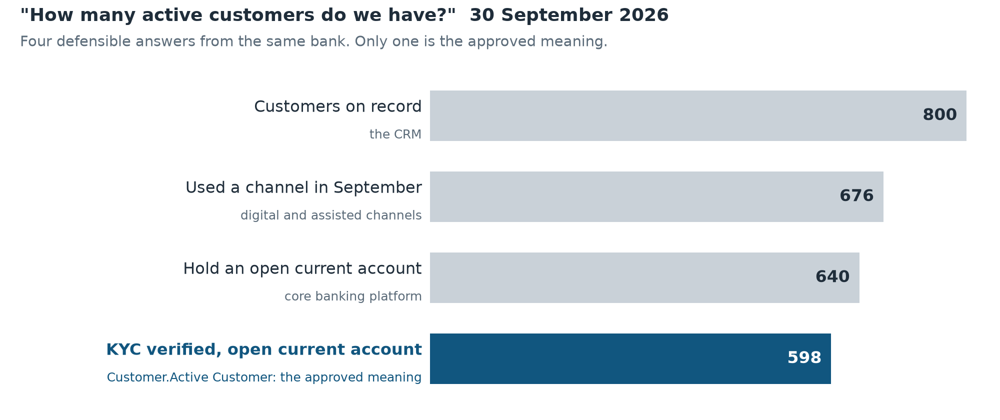
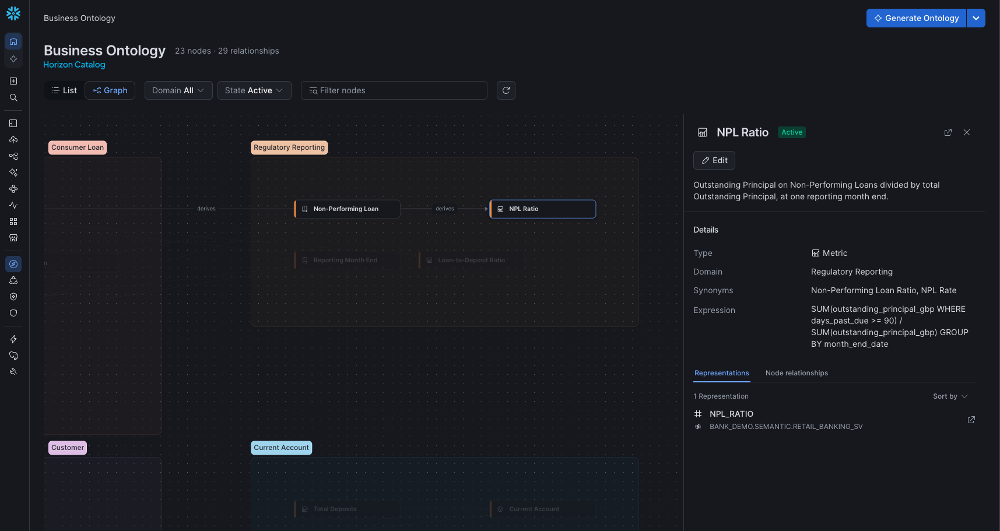
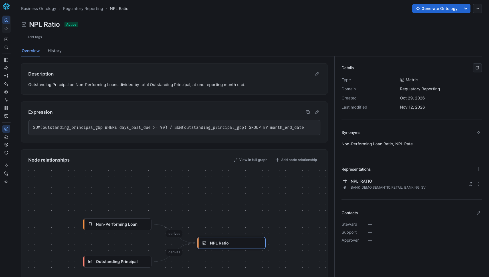
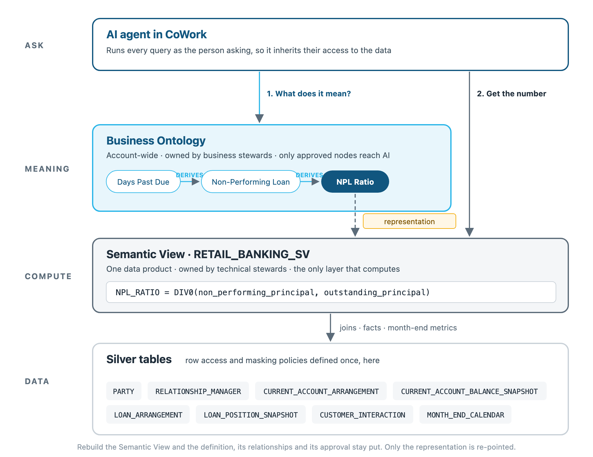
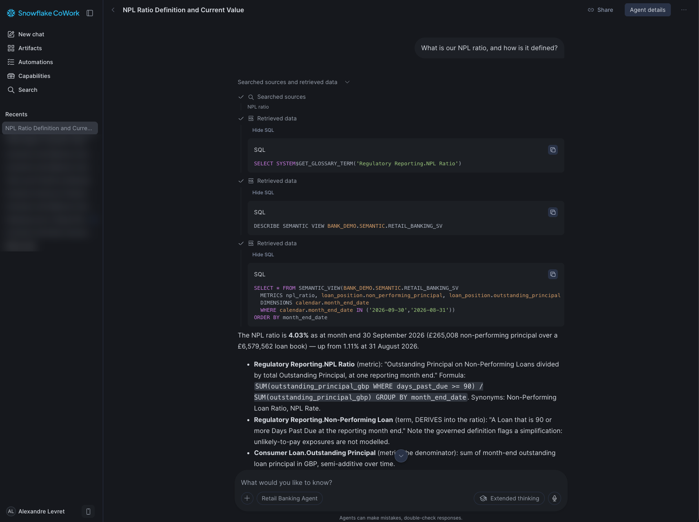
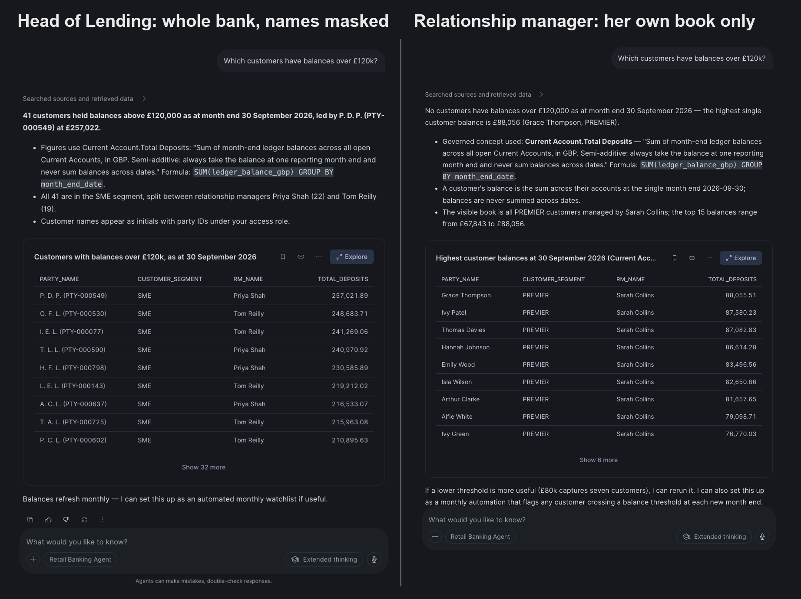
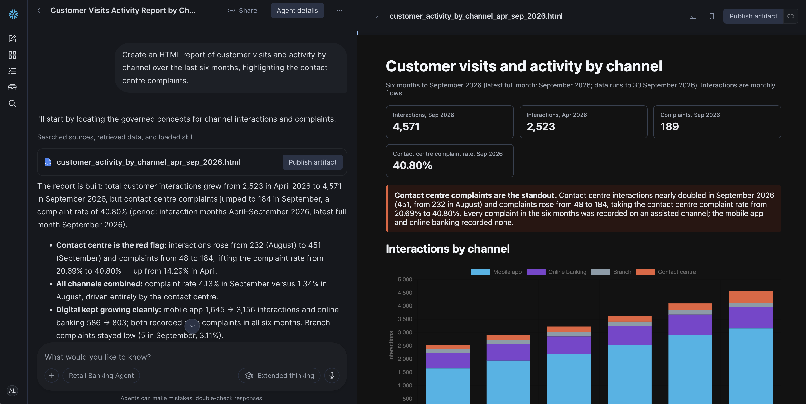
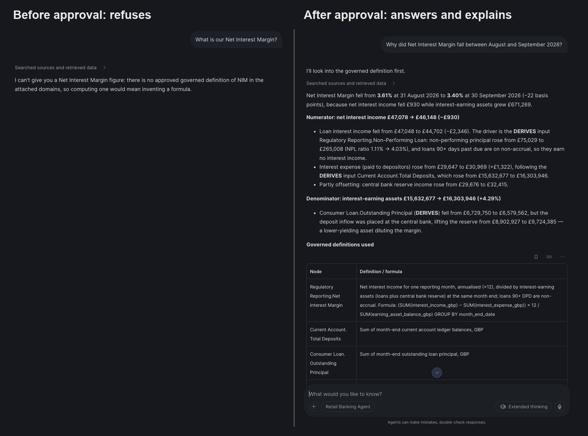

author: Alexandre Levret
id: build-a-business-ontology-for-a-bank
language: en
summary: Build a Business Ontology for a synthetic retail bank on Snowflake, bind it to a Semantic View, control who can change it, and give a Cortex Agent approved definitions to answer from.
categories: snowflake-site:taxonomy/solution-center/certification/quickstart, snowflake-site:taxonomy/product/ai, snowflake-site:taxonomy/industry/financial-services, snowflake-site:taxonomy/snowflake-feature/horizon, snowflake-site:taxonomy/snowflake-feature/compliance-security-discovery-governance, snowflake-site:taxonomy/snowflake-feature/snowflake-intelligence
environments: web
status: Published
feedback link: https://github.com/Snowflake-Labs/sfquickstarts/issues
fork repo link: https://github.com/Snowflake-Labs/sfquickstarts/raw/master/site/sfguides/src/build-a-business-ontology-for-a-bank/assets/bank-ontology-demo.zip

# Build a Business Ontology for a Bank, from Definitions to Agent
<!-- ------------------------ -->
## Overview

The word "ontology" comes up often in data and AI discussions, and it isn't always clear what it means in practice. This guide tries to make it concrete. Whether you're a data engineer, an architect or simply curious, you'll build a Business Ontology end to end for a small synthetic retail bank on Snowflake, and see what it changes for the people and the AI agents that use the data.

In this guide, a Business Ontology is three things, written down once for the whole business:

1. **What each concept means**, in plain language, approved by the team that owns it
2. **How the concepts relate to each other**, as typed relationships that read as sentences
3. **Where each concept is implemented in the data**, as a pointer to a table, a column or a metric

The rest of the guide shows each of these on the demo bank, and how an agent uses them.

> **Note:** Business Ontology is in **private preview** in Snowflake Horizon Catalog. To follow this guide, it must be enabled on your account, so please contact your Snowflake account team. Everything here was built and tested on a preview-enabled account in November 2026, and names and behaviour may change before general availability. All data in this guide is synthetic.

### What You'll Learn

- What a Business Ontology is, and how it differs from a Semantic View
- How to design domains around the teams that own the meaning
- How to write definitions, connect them with typed relationships and bind them to your data
- How to control who can propose, approve and read a definition
- How to build a Cortex Agent that reads the approved definition before it computes a number
- How to add a new data product and take a metric from refused to answered

### What You'll Build

- A synthetic UK retail bank: 8 Silver tables, including 32,035 customer interactions
- A Semantic View, `RETAIL_BANKING_SV`, for deposits, loans, the NPL and loan-to-deposit ratios and channel activity
- A Business Ontology with 5 domains, 23 approved nodes, 1 draft, 29 relationships and 33 representations
- Row access and masking policies for two personas: a relationship manager and the Head of Lending
- Two Cortex Agents, one with the ontology and one without, the first one listed in Snowflake CoWork

### What You'll Need

- A Snowflake account with **Business Ontology enabled** (private preview: contact your account team)
- The `ACCOUNTADMIN` role, or a role that can create a warehouse, a database, roles and ontology domains
- Access to Cortex Agents and `claude-opus-5`. If the model isn't available in your region, enable [cross-region inference](https://docs.snowflake.com/en/user-guide/snowflake-cortex/cross-region-inference)

### Prerequisites

- Familiarity with SQL and Snowsight worksheets
- A basic understanding of [Semantic Views](https://docs.snowflake.com/en/user-guide/views-semantic/overview) and [Cortex Agents](https://docs.snowflake.com/en/user-guide/snowflake-cortex/cortex-agents)

<!-- ------------------------ -->
## What Is a Business Ontology?

Let's start with a simple question for the demo bank: *"How many active customers do we have?"*



Each of these numbers is correct for its own definition. The CRM counts every customer on record, the channels team counts anyone who used a channel that month, the core banking platform counts open current accounts, and Compliance only counts customers whose identity checks (KYC) are verified. In most organisations, these definitions live in separate dashboards and spreadsheets, and an analyst knows which one to use.

An AI agent asked the same question doesn't have that knowledge. It has to choose a definition, and nothing tells it which one the business agreed on.

A Business Ontology is where that agreement is recorded. Snowflake describes it as *a business glossary with a pragmatic ontology underneath*: stewards write ordinary definitions, and a typed structure lets search and AI use them.

### The Three Building Blocks

Let's have a look at one concept from the bank, *Active Customer*, and what the ontology holds about it:

| Building block | What it is | Active Customer in the demo bank |
|---|---|---|
| **Node** | One concept, with one approved definition, in a domain | *Customer.Active Customer* (a metric): "Number of distinct Customers with KYC Status VERIFIED that hold at least one open Current Account at the reporting month end. Customers holding only a loan, or with PENDING or EXPIRED KYC, are not active customers." |
| **Relationship** | A typed link between two nodes | *KYC Status* **classifies** *Customer*; *Active Customer* **measures** *Customer* |
| **Representation** | A pointer from a node to the data that implements it | The `ACTIVE_CUSTOMERS` metric in `RETAIL_BANKING_SV` |

A node has a **kind**: term, metric, entity, dimension or policy. It can also carry synonyms (so *Balances* finds *Total Deposits*) and, for a metric, a recorded formula. A node starts as a **draft** and becomes official when a steward **approves** it. **Only approved nodes are served to AI.**

### Business Ontology and Semantic View

If you already use Semantic Views, a simple way to place the two is:

> The Semantic View is the calculator. The Business Ontology is the dictionary.

| | **Business Ontology** | **Semantic View** | **AI agent** |
|---|---|---|---|
| Answers | What does it mean? | How is it computed? | What does this user need? |
| Owner | Business steward | Technical steward | Platform team |
| Scope | Account-wide, by domain | One data product | One audience |
| Runs SQL? | No: a formula is documentation | Yes | Yes, as the user |

Two points follow from this. The Semantic View is the only layer that computes: the formula on a node describes the approved meaning, it doesn't run. And the ontology doesn't depend on a particular implementation: if you rebuild a Semantic View or replace a source system, the definition, its relationships and its approval stay the same, and you only update the representation.

### What It Isn't

Please note that a Business Ontology isn't a graph database. It holds **concepts** (*Customer*), not records (*customer PTY-000549*), and your data stays in tables. It has no graph query language and no automatic reasoning: it only contains what a steward wrote and approved.

<!-- ------------------------ -->
## Set Up the Bank

### Install in One Step

The whole setup is in one script, [INSTALL.sql](https://github.com/Snowflake-Labs/sfquickstarts/blob/master/site/sfguides/src/build-a-business-ontology-for-a-bank/assets/INSTALL.sql). It's about 560 KB, mostly synthetic data. Upload it to a Snowsight workspace (or open it in a SQL worksheet) and select **Run All** as `ACCOUNTADMIN`. It takes about three minutes.

Before creating anything, it checks two things and stops with a message if either fails:

- Business Ontology is enabled on the account
- None of the five domain names it uses already exists. Domains are account-wide, so the script won't write over existing ones.

At the end, it checks every figure in this guide against the raw tables. Every row should say **PASS**.

### Or Build It Step by Step

Download [bank-ontology-demo.zip](https://github.com/Snowflake-Labs/sfquickstarts/raw/master/site/sfguides/src/build-a-business-ontology-for-a-bank/assets/bank-ontology-demo.zip) and unzip it. It contains the same scripts as the installer, plus the live act, the persona switch, the reset and the teardown. Run each file in full, in one session, in this order:

| File | What it does |
|---|---|
| `sql/00_setup.sql` | Warehouse `BANK_DEMO_WH`, database `BANK_DEMO`, the two persona roles (granted to you), and a copy of your user defaults |
| `sql/01_silver_data.sql` | 8 Silver tables with deterministic synthetic data |
| `sql/02_semantic_view.sql` | `RETAIL_BANKING_SV` and its two input views |
| `sql/03_ontology.sql` | 5 domains, 24 nodes (1 left in draft), 29 relationships, 33 representations |
| `sql/04_agents.sql` | The two agents, and the first one listed in CoWork |
| `sql/05_governance.sql` | Row access and masking policies, and the data and ontology grants for both personas |
| `sql/06_verify.sql` | Checks the bank and both personas |

The data generator is deterministic, and the figures in this guide depend on it. If a verification row says FAIL, re-run the scripts unchanged rather than editing the expected values.

> **Note:** The ontology search index can take up to about six hours to reflect new approvals. The agent in this guide works before that, because it falls back to reading the approved list directly. To check the index, run `cortex search object "NPL ratio" --types=business-ontology` in Cortex Code: once it returns the node, search is up to date.

<!-- ------------------------ -->
## Step 1: Start From the Data

The bank has customers from a CRM, current accounts and loans from a core banking platform, and interactions from the mobile app, online banking, branches and the contact centre. The data lands in eight conformed **Silver** tables in `BANK_DEMO.SILVER`.

One Semantic View, `RETAIL_BANKING_SV`, sits on top and computes the metrics. Let's have a look at the main figures:

```sql
SELECT * FROM SEMANTIC_VIEW(BANK_DEMO.SEMANTIC.RETAIL_BANKING_SV
  DIMENSIONS calendar.month_end_date
  METRICS npl_ratio, loan_to_deposit_ratio, account_balance.total_deposits, account_balance.active_customers)
WHERE month_end_date >= '2026-08-31';
```

| Month end | NPL ratio | Loan-to-deposit ratio | Total deposits | Active customers |
|---|---:|---:|---:|---:|
| 31 Aug 2026 | 1.11% | 43.05% | £15,632,677 | 575 |
| 30 Sep 2026 | 4.03% | 40.36% | £16,303,946 | 598 |

This Semantic View contains:

- **Month-end metrics** such as deposits and outstanding principal, non-additive by month end, so balances are never summed across dates
- **Ratios** defined at model level: NPL ratio, loan-to-deposit ratio and complaint rate
- **Verified queries** for common questions, such as *"Which customers have balances over £120k?"*

Please note one design choice. The two snapshot tables are read through small input views, `ACCOUNT_BALANCE_INPUT` and `LOAN_POSITION_INPUT`, which add the account holder, KYC status, borrower and maturity date. This keeps every expression in the Semantic View within its own logical table. When a Cortex Agent uses a Semantic View through its Cortex Analyst tool, it currently leaves out facts, dimensions and metrics whose expression references another logical table. Without these views, the agent wouldn't see *Active Customers*.

The Semantic View is built on Silver so teams can work on each data product without waiting for a Gold layer. If your platform only exposes Gold, build it on Gold: the rest of the guide is the same.

<!-- ------------------------ -->
## Step 2: Design Domains Around the Teams That Own the Meaning

A domain is a group of nodes owned by one team. It's also the unit you grant access on, and where approval happens. For that reason, it's worth mapping each domain to the team that is accountable for its definitions, rather than to a source system or a schema.

The bank has five:

| Domain | Steward | Nodes |
|---|---|---|
| Customer | Customer Data Owner | Customer, Customer Identifier, Customer Segment, KYC Status, Active Customer, Relationship Manager |
| Current Account | Deposits Product Owner | Current Account, Total Deposits |
| Consumer Loan | Lending Product Owner | Loan, Days Past Due, Maturity Date, Outstanding Principal, Residual Maturity Bucket, Borrowers |
| Regulatory Reporting | Finance and Risk Reporting | Reporting Month End, Non-Performing Loan, NPL Ratio, Loan-to-Deposit Ratio, *Net Interest Margin (draft)* |
| Customer Engagement | Channels and Service Owner | Customer Interaction, Channel, Complaint, Complaint Rate, Digital Share |

You create a domain with one call. `03_ontology.sql` keeps each id in a session variable for the rest of the script:

```sql
SET d_regulatory_reporting = (SELECT PARSE_JSON(SYSTEM$CREATE_GLOSSARY_DOMAIN(
  'Regulatory Reporting',
  'Governed prudential ratios and reporting conventions. Steward: Finance and Risk Reporting. [bank-ontology-demo]'
)):domainId::STRING);
```

The `[bank-ontology-demo]` marker at the end of each description lets the teardown script recognise the domains it created. It doesn't delete a domain without it.

Please note that in this preview a domain can't be renamed, so it's worth agreeing on domain names before you start.

<!-- ------------------------ -->
## Step 3: Write the Definitions

Definitions are written for people first. Let's have a look at one that matters for risk reporting:

```sql
SET t_regulatory_reporting_non_performing_loan = (SELECT PARSE_JSON(SYSTEM$DRAFT_GLOSSARY_TERM('{
  "name": "Non-Performing Loan",
  "domainName": "Regulatory Reporting",
  "itemKind": "TERM",
  "description": "A Loan that is 90 or more Days Past Due at the reporting month end. Demo simplification: the full prudential non-performing exposure definition also includes unlikely-to-pay exposures, which are not modelled here.",
  "synonyms": ["NPL", "Defaulted Loan"],
  "sourceType": "MANUAL"
}')):termId::STRING);

SELECT SYSTEM$APPROVE_GLOSSARY_TERM($t_regulatory_reporting_non_performing_loan);
```

This definition contains:

- **A rule** that can be expressed in SQL: 90 or more days past due, at the month end
- **A caveat** that can't: the full prudential definition also includes unlikely-to-pay exposures, which this data doesn't hold. An agent that reads the definition can pass this on with the number.
- **Synonyms**, so a question about "NPL" or "defaulted loans" finds the same node
- **Two steps**: `DRAFT_GLOSSARY_TERM` proposes the node, and `APPROVE_GLOSSARY_TERM` publishes it

A few practices that helped in this build:

- **Refer to the concepts a definition depends on** with the same names as their nodes, for example *"divided by total Outstanding Principal"*
- **Write down the pitfalls.** *Total Deposits* says "never sum balances across dates". *Customer Identifier* says "the CRM Account Id must not be used to join across systems". This information isn't visible in the tables.
- **Put everyday words in synonyms** rather than in agent prompts. *Balances*, *Loan Portfolio* and *Visits* are synonyms here, so every agent and every search can use them.

One node is left in draft on purpose: *Net Interest Margin*. Finance hasn't reviewed it yet, and the bank has no interest data. You'll approve it in Step 8.

<!-- ------------------------ -->
## Step 4: Connect the Concepts

Relationships record how concepts depend on each other, including across teams. Each one reads as a sentence:

```sql
SELECT SYSTEM$CREATE_GLOSSARY_RELATIONSHIP($t_consumer_loan_days_past_due,
  $t_regulatory_reporting_non_performing_loan, 'DERIVES', '', 'MANUAL');
SELECT SYSTEM$CREATE_GLOSSARY_RELATIONSHIP($t_regulatory_reporting_non_performing_loan,
  $t_regulatory_reporting_npl_ratio, 'DERIVES', '', 'MANUAL');
```

*Days Past Due* **derives** *Non-Performing Loan*, which **derives** *NPL Ratio*. The bank uses six relationship types:

| Type | Meaning | Example |
|---|---|---|
| `DERIVES` | A is an input to B | Outstanding Principal derives Loan-to-Deposit Ratio |
| `MEASURES` | A metric quantifies an entity | Total Deposits measures Current Account |
| `CLASSIFIES` | A term groups or labels an entity | Channel classifies Customer Interaction |
| `SCOPES` | A term bounds where a metric applies | Reporting Month End scopes Outstanding Principal |
| `IDENTIFIED_BY` | An entity's key | Customer identified by Customer Identifier |
| `CUSTOM` | Anything else, with your own label | Customer *holds* Current Account |

In this bank, *NPL Ratio* is owned by Regulatory Reporting, but its inputs are owned by Consumer Loan. If the lending team changes how *Days Past Due* is counted, the relationships show which regulatory metrics are affected. This is impact analysis on definitions rather than on tables, and it works across data products.



You can explore it in Snowsight under **Catalog** » **Business Ontology** » **Graph**. Select *NPL Ratio* to see its inputs from Consumer Loan.

<!-- ------------------------ -->
## Step 5: Bind Each Concept to the Data

A representation links a node to a table, a column, or a metric or dimension of a Semantic View:

```sql
SELECT SYSTEM$CREATE_GLOSSARY_ASSOCIATION($t_regulatory_reporting_npl_ratio,
  '{"refType": "SEMANTIC_VIEW", "fqn": "BANK_DEMO.SEMANTIC.RETAIL_BANKING_SV",
    "subObjectType": "DERIVED_METRIC", "subObjectName": "NPL_RATIO"}',
  'RELATED_SEMANTIC_VIEW', 'MANUAL');

SELECT SYSTEM$CREATE_GLOSSARY_ASSOCIATION($t_customer_kyc_status,
  '{"refType": "COLUMN", "fqn": "BANK_DEMO.SILVER.PARTY", "dimensionName": "KYC_STATUS"}',
  'DESCRIBES', 'MANUAL');
```

The first binds *NPL Ratio* to the metric that computes it. The second points *KYC Status* at the column that holds it. The bank has 33 representations.



Together, the layers fit as follows:



Please note that the formula on the node and the expression in the Semantic View are two separate texts, and nothing checks yet that they match. It's worth including this check in the approval process.

<!-- ------------------------ -->
## Step 6: Control Who Can Propose, Approve and See

There are two separate access checks, and granting one doesn't grant the other.

**Access to definitions** is granted per domain:

| Privilege | Lets a role |
|---|---|
| `READ` | Read approved nodes, relationships and representations |
| `SUGGEST` | Propose new nodes and changes, without publishing them |
| `MODIFY` | Approve, edit and delete |

```sql
GRANT READ ON ONTOLOGY DOMAIN "Regulatory Reporting" TO ROLE BANK_RM;
```

With `SUGGEST` for analysts and `MODIFY` for stewards, a proposal has to be approved by someone else before it's published. Please note that a role with `MODIFY` can approve its own drafts, so this separation only holds if proposing and approving are given to different roles. Ontology grants also don't appear in `SHOW GRANTS`, so it helps to keep them in source control.

**Access to data** is defined once, on the Silver tables, with standard Snowflake policies (`05_governance.sql`):

- A row access policy limits the relationship manager, Sarah Collins (`BANK_RM`), to her own customers and their accounts, loans and interactions.
- A masking policy shows the Head of Lending (`BANK_HEAD_OF_LENDING`) the whole bank, with customer names reduced to initials plus the customer id.

Both personas can read every definition, and each sees only the data their role allows. The agent and the files it generates follow the same rules, because every query runs as the person asking.

<!-- ------------------------ -->
## Step 7: Build an Agent That Reads the Definitions First

### The Two Agents

`04_agents.sql` creates two agents with the same model, response instructions, and chart and file tools. They differ only in how they reach definitions and data:

| | `RETAIL_BANKING_AGENT` | `SV_ONLY_AGENT` |
|---|---|---|
| Finds definitions with | Business Ontology search | The Semantic View's descriptions |
| Gets numbers with | Read-only SQL on the objects bound to the node | Cortex Analyst on `RETAIL_BANKING_SV` |
| Listed in CoWork | Yes | No |

The first agent follows the pattern documented for this preview: ontology search to find the node, then a read-only SQL tool to read its definition and bindings and query the bound Semantic View. Let's have a look at the relevant parts of its specification:

```javascript
"experimental": {
  "EnableSnowscopeBusinessOntologySearch": true,
  "EnableStandaloneExecuteSqlTool": true,
  "FallbackWarehouse": "BANK_DEMO_WH"
},
"tools": [{"tool_spec": {"type": "snowscope_search", "name": "business_ontology"}}, ...],
"tool_resources": {"business_ontology": {"corpus": "businessOntology"}}
```

Its orchestration instructions follow four steps:

1. **Find the node** with `business_ontology`. If search returns nothing, the index may not be up to date, so list the approved nodes with `SYSTEM$GET_GLOSSARY_TERM_LIST` before concluding that nothing is defined.
2. **Read it** with `SYSTEM$GET_GLOSSARY_TERM`: definition, formula, synonyms and relationships.
3. **For a number**, read its bindings with `SYSTEM$GET_GLOSSARY_TERM_ASSETS` and query the bound Semantic View, rather than assuming which objects exist.
4. **For a "why" question**, follow the `DERIVES` relationships into the node and compare each input over the same periods.

The agent doesn't have one tool per Semantic View. It finds the bound objects from the ontology for each question, so if another data product binds its metrics to a node later, the agent can use them without changes.

### Ask Both the Same Questions

You can open both agents in the Snowsight agent playground (**AI & ML** » **Agents**). These are their answers on 18 November 2026, shortened.

**"How many active customers do we have, and how is that defined?"**

> **Semantic View only:** We have 598 active customers as at the month end of 30 September 2026. Metric used: `active_customers`, "Parties with KYC VERIFIED holding at least one open current account at month end".

> **With the ontology:** We have 598 active customers as at the reporting month end of 30 September 2026. Concept: **Customer.Active Customer** (governed metric). Definition: number of distinct customers with KYC Status VERIFIED that hold at least one open current account at the reporting month end. Customers holding only a loan, or with PENDING or EXPIRED KYC, are not active customers.

Both agents give the same number, because the Semantic View is well described. The difference is the source of the definition: a description written for this one Semantic View, or an approved definition with an owner that every Semantic View and agent in the account can use.

**"Which identifier should I use to join a customer across systems?"**

> **Semantic View only:** Use `party_id`, the Party primary key, as the customer join key across systems. Every customer-level table in the retail banking view joins back to Party on `party_id`.

> **With the ontology:** Use the **Customer Identifier** (`Customer.Customer Identifier`), the bank-assigned key in the format PTY-nnnnnn, implemented as `party_id`. Do not use the CRM Account Id: it is retained only as a source record id and must not be used to join across systems.

Both answers are correct. Only the second one mentions the CRM Account Id, because that rule isn't in any table or join: it's in the approved definition.

**"If the lending team changes how Days Past Due is defined, which reported metrics are affected?"**

> **Semantic View only:** Changing the Days Past Due definition would flow straight into four reported items in the retail banking semantic view, all of them downstream of the `days_past_due` field on month-end loan positions […]: days past due, the arrears bucket, non-performing principal and the NPL ratio. […] Unaffected: total deposits, active customers, borrowers, loans outstanding, loan-to-deposit ratio […]

> **With the ontology:** One reported metric is affected: **Regulatory Reporting.NPL Ratio**. […] Days Past Due **DERIVES** → Regulatory Reporting.Non-Performing Loan […] Non-Performing Loan **DERIVES** → Regulatory Reporting.NPL Ratio […] Not affected: Consumer Loan.Outstanding Principal and Consumer Loan.Borrowers.

Both answers are reasonable. The first is based on the SQL expressions in one Semantic View. The second follows the approved relationships and names the domain that owns each concept, which would also cover dependencies in other data products.

You can also ask *"What is our Net Interest Margin?"*. Both agents decline. The first agent says there's no approved definition in its five domains. A Net Interest Margin node does exist, but it's a draft, and drafts aren't served to AI.

In CoWork, the trace shows each step: the ontology search, the definition it read, and the query it ran.



### Same Question, Two People

To switch persona, run `sql/persona_switch.sql`, which sets your default role to `BANK_RM` or `BANK_HEAD_OF_LENDING`. Sign out of CoWork and back in, start a new chat, and ask *"Which customers have balances over £120k?"*



| 30 September 2026 | Head of Lending | Relationship manager |
|---|---|---|
| Customers over £120k | 41, all SME, names masked to initials | None: her book is Premier, top balance £88,056 |
| Total deposits | £16,303,946 | £3,924,640 |
| Definition used | *Current Account.Total Deposits* | *Current Account.Total Deposits* |

The data differs because the policies apply to the role asking, and the definition is the same because it's defined once. There's no separate report for the relationship manager and no access logic in the agent. The last block of `persona_switch.sql` restores your own defaults.

### Reports

The agent also has the code execution tool, so in CoWork it can generate an HTML, PDF, Word or PowerPoint report. The sandbox can't query tables, so the agent retrieves each figure through SQL first, as the user, and the policies apply to the file as well.



<!-- ------------------------ -->
## Step 8: Add a Data Product

In this step, you add one new data product, interest accruals, and take *Net Interest Margin* from refused to answered. Each layer is changed once, by its owner. In Cortex Code, connected to your account, use the prompts in `live/COCO_PROMPTS.md` from the zip. Each step also has a script (`live/10` to `12`) if you prefer to run it directly.

1. **Data engineering loads the table.** `INTEREST_ACCRUAL_MONTHLY` lands in Silver with the same row access policy as the other tables.
2. **The technical steward extends the Semantic View** with interest income, interest expense, earning assets and `NET_INTEREST_MARGIN`. If you ask the agent at this point, it still declines: the metric exists, but its definition isn't approved.
3. **Finance approves the definition.** With the business-ontology skill in Cortex Code, the steward updates the draft to match the new metric, approves it, adds `DERIVES` relationships from *Outstanding Principal*, *Total Deposits* and *Non-Performing Loan*, and binds it to the metric and the table.
4. **Ask again.** The agent answers **3.40%** at 30 September 2026, down from 3.61% in August, and explains the change from its inputs: more loans reached 90 days past due and stopped accruing interest (non-performing principal went from £75,029 to £265,008), the loan book decreased, and more deposits sat in the lower-yielding 4% central bank reserve.



The agent itself wasn't changed. It read the newly approved node directly, without waiting for the search index.

When you've finished, run `reset/90_reset_live.sql` to put Net Interest Margin back in draft, then `sql/06_verify.sql`: every row should say PASS.

<!-- ------------------------ -->
## Limits to Plan Around

This is a private preview, and a few limits are worth knowing:

| Area | What to know | What to do |
|---|---|---|
| Index freshness | Search can take up to about six hours to reflect new approvals and grant changes | Give the agent a fallback that reads the approved list, as here |
| Formula drift | The node's formula and the Semantic View expression are separate texts | Check that they match as part of approval |
| Cross-table members | An agent's Cortex Analyst tool currently omits Semantic View members whose expression references another logical table | Pre-join the columns in a view, as `02_semantic_view.sql` does |
| Grants | Ontology grants don't appear in `SHOW GRANTS`, and `MODIFY` can approve its own drafts | Keep grants in source control; give proposers `SUGGEST` only |
| Agent writes | The agent's read-only behaviour comes from its instructions, not from privileges | Give agent users `READ` only on ontology domains |
| CoWork profiles | If your account uses CoWork profiles, an attached agent appears as a separate entry | Add the agent to a profile's subagents instead |

A Business Ontology is probably not needed with one team, one data product and one audience: a Semantic View is enough. And for analysing connections between individual records, such as fraud networks, a dedicated tool is a better fit, as the ontology holds concepts rather than records.

<!-- ------------------------ -->
## Clean Up

Run `reset/99_teardown.sql` as `ACCOUNTADMIN`. It:

- deletes the five ontology domains, only if their description carries the `[bank-ontology-demo]` marker, and reports any domain with the same name that it left in place
- detaches the agent from CoWork
- restores the default role, warehouse and secondary roles saved at install
- drops `BANK_DEMO`, the two persona roles and `BANK_DEMO_WH`

<!-- ------------------------ -->
## Conclusion And Resources

In this guide, you built a Business Ontology for a small bank: five domains with stewards, definitions that include caveats a SQL expression can't hold, relationships across teams, and representations that tell an agent where each concept is implemented. You also compared an agent with and without it: both compute the same numbers, and the agent with the ontology adds the approved definition, the rules that aren't in the tables, and declines what hasn't been approved.

### What You Learned

- **A Business Ontology is three things written down once:** what each concept means, how concepts relate, and where each one is implemented in the data
- **A Semantic View computes, a Business Ontology records the meaning.** They have different owners and work well together
- **A domain is an organisational choice**, as it's both the access boundary and the approval boundary
- **Only approved nodes are served to AI**, and proposing a definition doesn't publish it
- **Access defined on the data also applies to the agent:** the same question gives each person the data they're allowed to see, with the same definition

### Apply It to Your Own Data

- **Start with one metric** whose inputs are owned by another team. A ratio is a good candidate.
- **Map domains to stewards**, then import the definitions you already have with the business-ontology skill in Cortex Code.
- **Write the pitfalls into the definitions**, and put everyday words in synonyms.
- **Bind the nodes to the Semantic Views you already have.** Approve the stable metrics and keep the ones still under discussion in draft.
- **Test with real roles**: a number, a definition, an unknown term, an unapproved draft, and the same question asked by two different people.

### Related Resources

- [Business Ontology documentation](https://docs.snowflake.com/en/LIMITEDACCESS/snowflake-horizon/business-ontology) (private preview), including [access control](https://docs.snowflake.com/en/LIMITEDACCESS/snowflake-horizon/business-ontology-access-control) and [use with Cortex Agents](https://docs.snowflake.com/en/LIMITEDACCESS/snowflake-horizon/business-ontology-agents)
- [Overview of Semantic Views](https://docs.snowflake.com/en/user-guide/views-semantic/overview)
- [Cortex Agents documentation](https://docs.snowflake.com/en/user-guide/snowflake-cortex/cortex-agents)
- [Document generation in Snowflake CoWork](https://docs.snowflake.com/en/user-guide/snowflake-cortex/snowflake-cowork/document-generation)
- [Project files (zip)](https://github.com/Snowflake-Labs/sfquickstarts/raw/master/site/sfguides/src/build-a-business-ontology-for-a-bank/assets/bank-ontology-demo.zip)
