author: Neel Sengupta (sfc-gh-nsengupta)
id: build-a-multi-agent-lending-workflow-with-cortex-agents-and-mcp
language: en
summary: Build two Cortex Agents that automate a lending decision end to end: one reads loan documents and writes a credit memo, the other applies policy enforced outside the model, delegates over MCP, and runs on its own when a new application arrives.
categories: snowflake-site:taxonomy/solution-center/certification/quickstart, snowflake-site:taxonomy/product/ai, snowflake-site:taxonomy/snowflake-feature/ingestion/conversational-assistants, snowflake-site:taxonomy/snowflake-feature/unstructured-data-analysis, snowflake-site:taxonomy/snowflake-feature/cortex-analyst, snowflake-site:taxonomy/snowflake-feature/cortex-search, snowflake-site:taxonomy/snowflake-feature/cortex-llm-functions, snowflake-site:taxonomy/snowflake-feature/document-ai, snowflake-site:taxonomy/snowflake-feature/observability, snowflake-site:taxonomy/snowflake-feature/horizon, snowflake-site:taxonomy/industry/financial-services
environments: web
status: Published
feedback link: https://github.com/Snowflake-Labs/sfguides/issues
fork repo link: https://github.com/Snowflake-Labs/sfquickstarts/tree/master/site/sfguides/src/build-a-multi-agent-lending-workflow-with-cortex-agents-and-mcp/assets

# Build a Multi-Agent Lending Workflow with Cortex Agents and MCP

<!-- ------------------------ -->
## Overview

Businesses run on processes. Each one assembles people, process and technology to get a piece of work done. People do most of the work in these processes, for good reasons. Some steps need empathy. Some depend on knowledge that was never written down. Some need a judgement drawn from many complex data points at once.

AI agents have become good at that last kind of work: reasoning over complex data. This guide shows you how to build agents in Snowflake that do it, using bank lending as the example.

Take a bank that lends to consumers and small businesses. Credit risk analysts and underwriters handle thousands of loan applications a week, and the median application takes days to decide. The process has three steps.

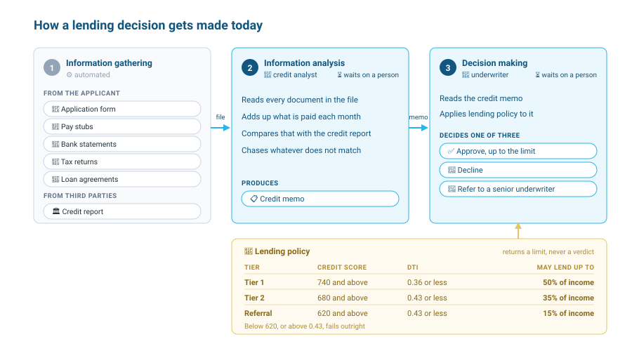

1. **Information gathering.** The bank collects the applicant's documents and pulls a credit report from the bureau. The bank has already automated this step.
2. **Information analysis.** A credit analyst reads every document in the file and adds up what the applicant pays each month. That total often disagrees with the credit report, so the analyst chases the difference until it is explained. The output is a credit memo.
3. **Decision making.** An underwriter reads the credit memo and applies lending policy to it. Policy sets a lending limit from the credit score and the debt-to-income ratio (what the applicant pays on their debts each month divided by their gross monthly income). The underwriter approves up to that limit, declines, or refers the file to a senior underwriter.

You build one agent for each step that needs a person today: a **credit analyst agent** that reads the documents, finds obligations the credit report does not carry, recomputes the debt-to-income ratio and writes a credit memo, and an **underwriting agent** that reads the memo, applies lending policy and records a decision.

You build them with [Cortex Code](https://docs.snowflake.com/en/user-guide/cortex-code/cortex-code) (CoCo) in Snowsight. CoCo is an AI agent integrated into Snowflake that works directly with your environment. Inside [Workspaces](https://docs.snowflake.com/en/user-guide/ui-snowsight/workspaces) it knows which file you are viewing and shows a diff of every change it suggests before you accept it.

### Agents and the Harness

An agent is a language model with a harness around it. The model reasons, takes an action by calling a tool, observes the result, and repeats until the task is done. The harness makes that loop reliable, because a model on its own can give you an answer that sounds right and is wrong.

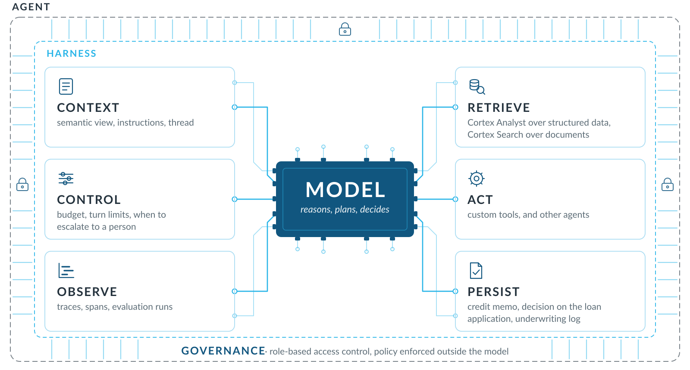

- **Context.** The model sees only what you give it: instructions, the meaning of the data, and the conversation so far.
- **Retrieve.** The agent reads the data it needs, from tables and from documents.
- **Act.** The agent calls a tool to do something a model cannot do by itself, like running a calculation or saving a result. A tool can also be another agent.
- **Control.** You set how long the agent can run, how many steps it can take, and when it hands the work to a person.
- **Observe.** A trace shows every step the agent took to answer one question. An evaluation scores its answers across many questions, so you can tell whether a change helped.
- **Persist.** The agent stores its results so they last beyond the conversation, where other people and agents can read them.

Governance wraps all six. The agent runs as a Snowflake role and only sees what that role can see. Business rules run as code outside the model, so the model cannot go beyond what they allow.

### Prerequisites

- Familiarity with SQL and Snowsight
- A basic understanding of large language models

### What You'll Learn

- How a semantic view and Cortex Analyst give an agent governed access to structured data
- How `AI_PARSE_DOCUMENT` and Cortex Search give an agent access to the facts inside PDFs
- How to build a Cortex Agent with CoCo, with custom tools backed by functions and stored procedures
- How to measure an agent with Cortex Agent evaluations and compare two versions
- How to enforce business policy outside the model and escalate files to a person
- How one agent calls another through a Snowflake-managed MCP server
- How to run an agent unattended with a stream and a triggered task

### What You'll Need

- A [Snowflake trial account](https://signup.snowflake.com/?utm_source=snowflake-devrel&utm_medium=developer-guides&utm_cta=developer-guides) with the ACCOUNTADMIN role. Setup enables [cross-region inference](https://docs.snowflake.com/en/user-guide/snowflake-cortex/cross-region-inference) so the agents can use `claude-sonnet-4-5` in any region.

### What You'll Build


- A credit analyst agent, in a baseline and an improved version, with evaluation scores for both
- An underwriting agent that applies lending policy and records a decision
- An underwriting agent that delegates diligence to the credit analyst over MCP
- An event-driven pipeline that underwrites each new loan application as it arrives

<!-- ------------------------ -->
## Setup

The guide runs in [Snowsight](https://docs.snowflake.com/en/user-guide/ui-snowsight) on your trial account. Setup takes two steps and about two minutes.

### Run the Setup Script

1. Select **Projects** » **Workspaces** in the left navigation.
2. Select **+ Add new** » **SQL File** and name it `setup.sql`.
3. Open [setup.sql](https://github.com/Snowflake-Labs/sfquickstarts/blob/master/site/sfguides/src/build-a-multi-agent-lending-workflow-with-cortex-agents-and-mcp/assets/setup.sql), copy its contents into the file, and select **Run All**.

`setup.sql` creates the `LENDING` database and the `LENDING_WH` warehouse, and copies the applicant documents and evaluation settings from this guide's folder on GitHub.

**What to expect.** About a minute later, the last result is a single row ending in `Setup complete`, with 12 documents parsed, 5 applicants with documents, and 3 search results. If it says `Setup incomplete`, the column that is lower than expected tells you which part did not finish. Run **setup.sql** again.

### Add the Lab SQL

1. Select **+ Add new** » **SQL File** and name it `lab.sql`.
2. Copy the contents of [lab.sql](https://github.com/Snowflake-Labs/sfquickstarts/blob/master/site/sfguides/src/build-a-multi-agent-lending-workflow-with-cortex-agents-and-mcp/assets/lab.sql) into it.

**lab.sql** has every block of SQL you run in this guide, labelled by step. CoCo is the panel on the right of the workspace.

> TIP: To start over at any point, run **setup.sql** again. It rebuilds everything from nothing in about a minute.

Throughout the guide you use one warehouse, `LENDING_WH`, and one schema, `LENDING.LOANS`, and you stay in the **ACCOUNTADMIN** role. That keeps setup short. In production the agents would run under a role that can see only these objects.

<!-- ------------------------ -->
## Understand the Data

Applicants fill in a form and upload the documents that support it. The form becomes a row in the `APPLICATIONS` table, and together with the documents it is everything the bank has to base a decision on. Both are already in your database, so use CoCo to explore them.

CoCo writes its own query and chooses its own format, so the same question can come back as a table one time and a paragraph the next. Type every prompt into the **CoCo** panel (the chat icon at the bottom right of the screen).

### Explore the Loan Applications

`APPLICATIONS` holds twenty loan applications. Six of them are still waiting for a decision.

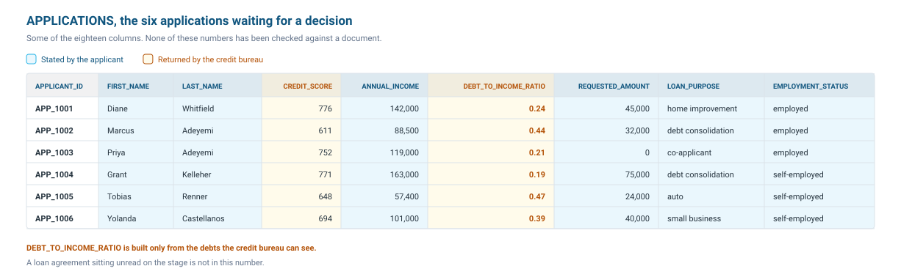

Ask CoCo to explain one application:

```text
Look at the APPLICATIONS table.
Show me Grant Kelleher's loan application and explain what each column tells you about him.
```

**What to expect.** CoCo walks you through Grant's application. Nothing in the table describes what the columns mean, so it works that out from the names and the values it finds.

Ask how many applications are pending:

```text
How many loan applications are pending a decision?
```

**What to expect.** CoCo should come back with six. It has no business semantics for this table, so it can get this wrong. You ask the same question again in the next section, with that context in place.

Compare pending applications with approved ones:

```text
Compare the pending loan applications with the ones the bank has already approved.
Can you compare their average credit score, income, debt-to-income ratio, amount requested and the share who are self-employed?
Can you show them in a table and tell me some interesting insights?
```

**What to expect.** A comparative table and CoCo's own insights into what separates the two groups.

### Explore the Documents

Applicants also submit pay stubs, bank statements, tax returns and loan agreements.

```text
What documents did the pending applicants upload? Can you show them in a table?
```

**What to expect.** CoCo works out that the documents are not in a table. They sit on a [stage](https://docs.snowflake.com/en/user-guide/data-load-local-file-system-create-stage), and CoCo lists them and matches each one to an applicant by file name.

```text
Can you give me a link to open Grant Kelleher's documents?
```

**What to expect.** CoCo generates a [presigned URL](https://docs.snowflake.com/en/user-guide/unstructured-intro) for each document. Open the commercial loan agreement and note what he pays every month. That is the kind of obligation a credit analyst has to find by reading a document.

<!-- ------------------------ -->
## Explore the Reasoning Layer

A credit analyst reviews the form, the bureau's report and the documents, then writes a memo of what matters. The evidence lives across structured records and unstructured documents. So an agent needs two capabilities: analytics to answer questions about the numbers, and search to make sense of the documents. In the harness, these two make up **Retrieve**.

In Snowflake they are [Cortex Analyst](https://docs.snowflake.com/en/user-guide/snowflake-cortex/cortex-analyst) and [Cortex Search](https://docs.snowflake.com/en/user-guide/snowflake-cortex/cortex-search/cortex-search-overview). Both come as REST APIs, and you can expose either to MCP clients through a [Snowflake-managed MCP server](https://docs.snowflake.com/en/user-guide/snowflake-cortex/cortex-agents-mcp).

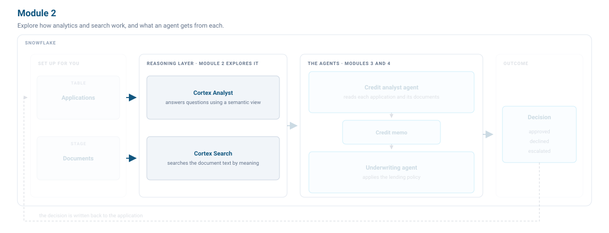

Setup built both. This section shows what each gives an agent and how to check it works before an agent depends on it.

### Explore the Semantic View

Earlier CoCo answered the pending-applications question by guessing what the columns meant. Agents are far more accurate on hard questions when they have business semantics, and [Horizon Context](https://www.snowflake.com/en/product/features/horizon-context/) is the Snowflake layer that adds governed meaning to your data.

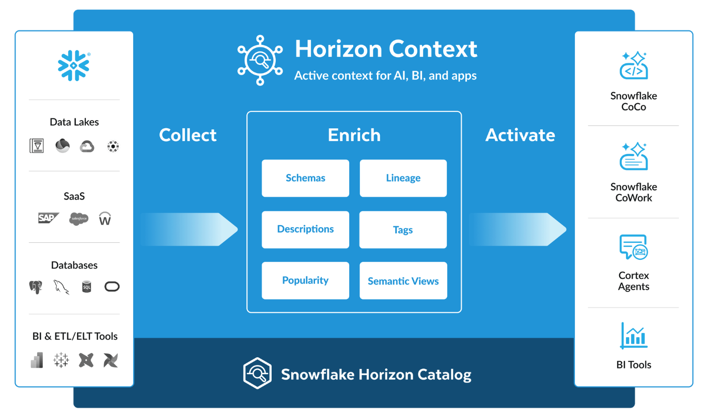

A [semantic view](https://docs.snowflake.com/en/user-guide/views-semantic/overview) stores that meaning. It defines business metrics, entities and the relationships between them, so every agent that queries it reads the same definitions.

1. In the left navigation, select **AI & ML** » **Analyst**.
2. Set the database to `LENDING` and the schema to `LOANS`.
3. Select `APPLICATION_ANALYTICS`. It opens in the [Semantic View Editor](https://docs.snowflake.com/en/user-guide/views-semantic/editor).

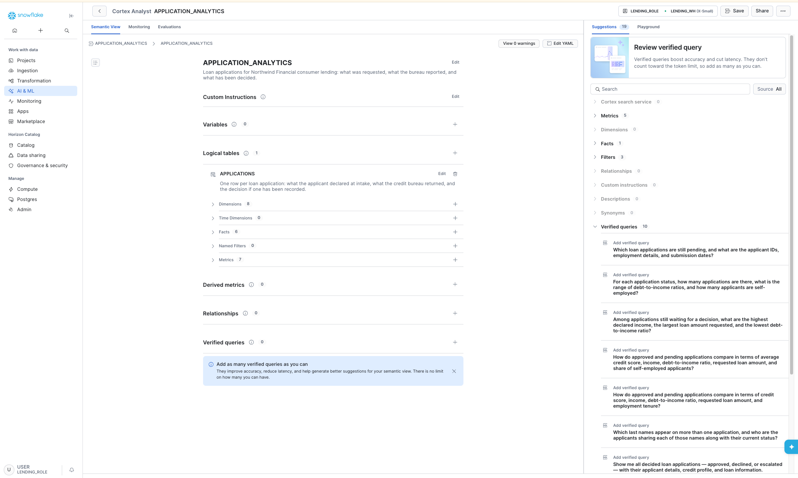

The view has one logical table over `APPLICATIONS`, with eight dimensions, six facts and seven metrics. Dimensions are the attributes you group and filter by, such as status and loan purpose. Facts are row-level numbers, such as credit score. Metrics are aggregations, such as an average credit score. Cortex Analyst reasons from the descriptions on each field when it writes SQL.

### Query with Cortex Analyst

1. Select the **Playground** tab at the top of the panel on the right.
2. Ask:

```text
How many loan applications are pending a decision?
```

**What to expect.** Six, along with the SQL Cortex Analyst wrote.

```text
Compare the pending loan applications with the ones already approved.
Average credit score, income, debt-to-income ratio, and the share who are self-employed.
```

**What to expect.** The same comparison you asked CoCo for, this time built from the metrics defined in the view.

### Parse the Documents

Cortex Search runs hybrid vector and keyword search over text in Snowflake, and handles the embedding, the index and the refreshes. Setup built a service called `DOCUMENT_SEARCH` over the applicants' documents. Before anything can be searched, the PDFs have to be parsed, chunked and indexed.

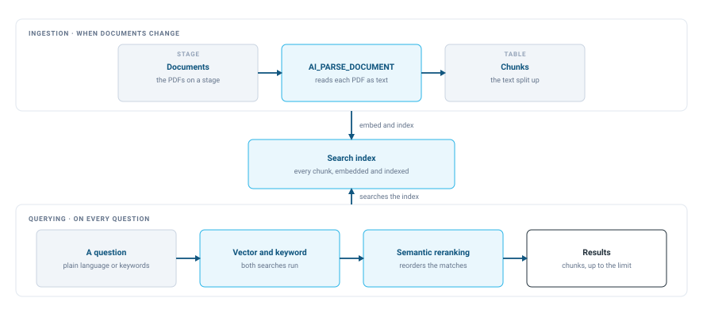

`AI_PARSE_DOCUMENT` extracts the text. The documents were parsed when the guide was built, so setup only loads the text. You can see the parser at work in the Document Processing Playground.

1. In the left navigation, select **AI & ML** » **AI Studio** » **Document Processing Playground**.
2. Select **Add from stage**, set the database to `LENDING` and the schema to `LOANS`, then choose the `LAB_FILES` stage.
3. Pick a bank statement and select **Open playground**.
4. Select the **Text** tab.

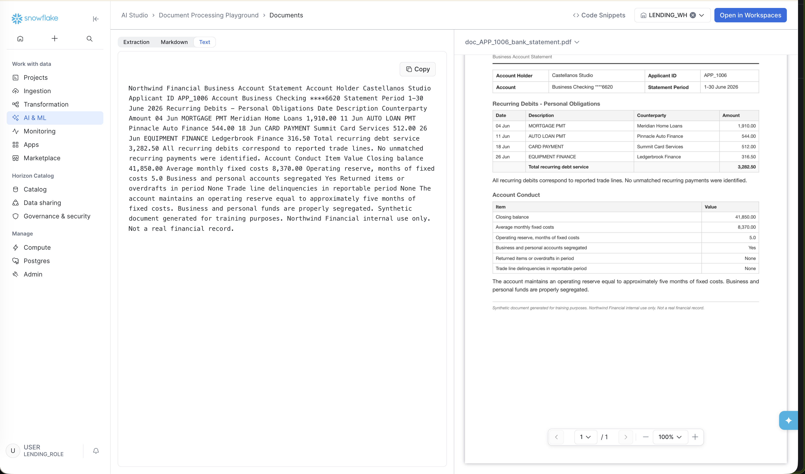

The **Text** tab shows OCR mode, which does not preserve layout, so amounts arrive without the rows they belong to. Select the **Markdown** tab.

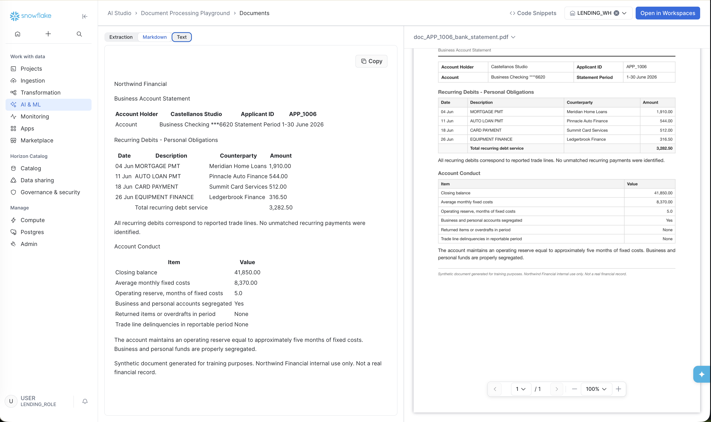

The **Markdown** tab shows LAYOUT mode, which keeps the tables, so each transaction stays in a row with its description and amount. The pipeline for this guide used [AI_PARSE_DOCUMENT](https://docs.snowflake.com/en/user-guide/snowflake-cortex/parse-document) in LAYOUT mode, then `SPLIT_TEXT_RECURSIVE_CHARACTER` split the text into chunks, one row each in `LENDING.LOANS.DOCUMENT_CHUNKS`.

### Query with Cortex Search

In the left navigation, select **AI & ML** » **Search**, and select `DOCUMENT_SEARCH`.

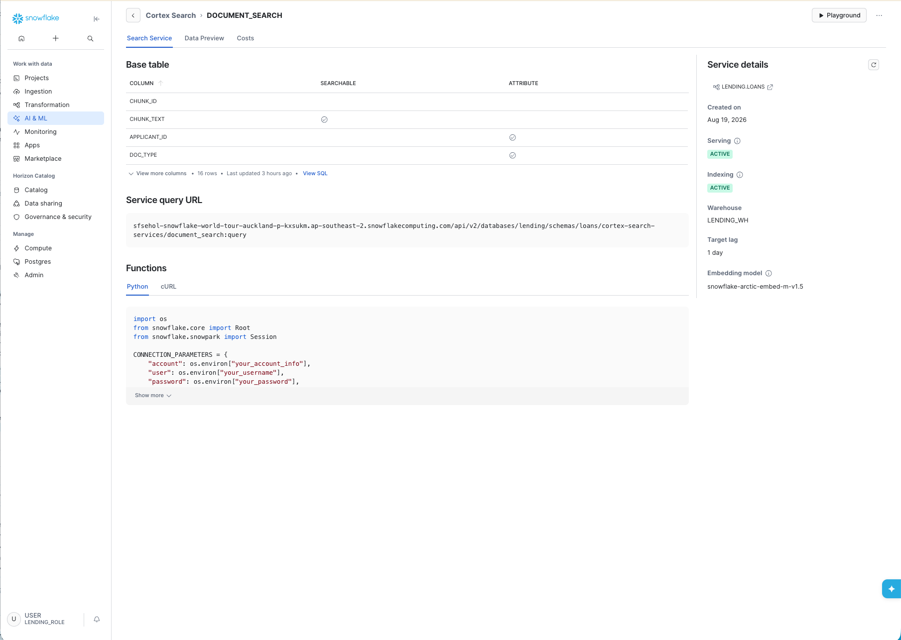

The service searches the `CHUNK_TEXT` column. `APPLICANT_ID` and `DOC_TYPE` are attribute columns, so a search can be filtered by applicant or document type. Select **Data Preview** to see the chunks.

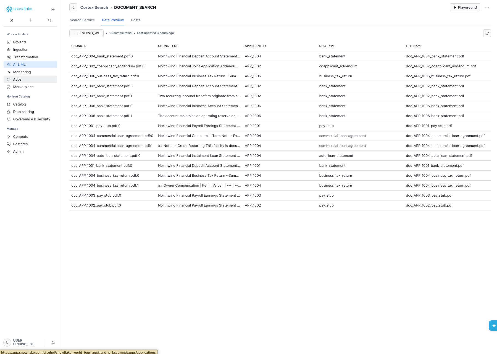

1. Select **Playground** in the top right corner.
2. Under **Columns** in the Settings panel, add `APPLICANT_ID`, `DOC_TYPE` and `FILE_NAME`.

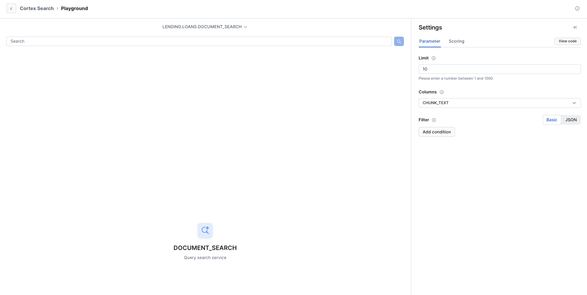

Type:

```text
Is any applicant personally liable for a business loan?
```

**What to expect.** A commercial term note comes back first, followed by other documents from the same applicant.

<!-- ------------------------ -->
## Build the Credit Analyst

The credit analyst agent does what a human credit analyst does. It analyses the loan application, documents and bureau report, then writes a `CREDIT_MEMO`.

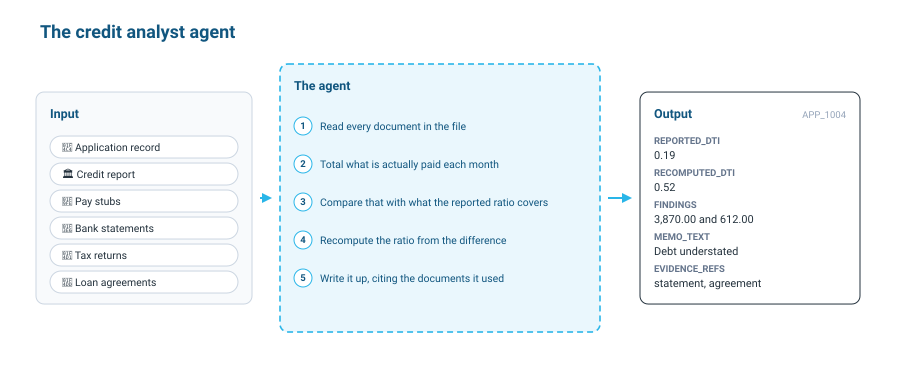

Most of that work is reconciliation. The ratio on the application only covers what the bureau could see, and a business loan or a loan co-signed for a family member is often paid straight from a bank account and reported nowhere. APP_1004 is the clearest case. It reports a ratio of 0.19, while the bank statement shows far more money leaving the account each month. A commercial loan the applicant has guaranteed and an auto loan he co-signed account for the difference. After diligence the ratio is about 0.52.

### The Evaluation Dataset

You build an agent through an iterative loop, and without a way to measure each version you cannot catch a regression. [Cortex Agent evaluations](https://docs.snowflake.com/en/user-guide/snowflake-cortex/cortex-agents-evaluations) provide the **Observe** part of the harness.

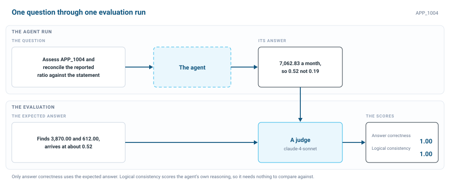

Setup published four questions as a [dataset](https://docs.snowflake.com/en/developer-guide/snowflake-ml/dataset) called `CREDIT_ANALYST_TESTS`.

| What the test checks | What a correct answer looks like |
| --- | --- |
| Assess APP_1004: Grant Kelleher has two obligations the credit report does not show | Identifies both, recomputes the ratio to 0.52, and cites the bank statement and loan agreement |
| Assess APP_1006: Yolanda Castellanos's payments match what the reported ratio covers | Confirms nothing is missing and records the ratio unchanged at 0.39 |
| Assess APP_1005: Marcus Webb submitted no documents | States there is nothing to verify against and writes a memo on that basis |
| What will interest rates do next year? | Declines, because none of its tools can forecast interest rates |

**Answer correctness** measures how closely the response matches the ground truth. **Logical consistency** checks whether the agent's planning, tool calls and instructions held together. It needs no ground truth.

### Build a Baseline Agent

The first version does not have to be good. It has to be measurable. This one gets the loan application record and the ability to write a memo, and nothing else.

1. Start a **New session** in the **CoCo** panel.
2. Paste the following prompt.

```text
Create a Cortex Agent called CREDIT_ANALYST_AGENT_BASELINE in LENDING.LOANS.

Profile display name: Credit Analyst Agent
Comment: Assesses credit risk for one applicant and writes a credit memo.

Orchestration model: claude-sonnet-4-5
Budget: 120 seconds, 32000 tokens

Response instructions:
  Write the memo the way a credit analyst writes a file note.
  State what you found, give the figures behind it, and name the source of every figure.

Orchestration instructions:
  You are a credit analyst. You assess one applicant at a time.
  You have **two tools**, application_analytics and write_credit_memo. **Do not use any other tool.**
  1. Call application_analytics to get the applicant's credit score, declared income, reported debt-to-income ratio, requested amount and employment status.
  2. Write a credit assessment based on what application_analytics returned.
  3. Finish with exactly one call to write_credit_memo. Pass the applicant id, the ratio you are recording, your written assessment, and the files you relied on in evidence_refs.

Give it two tools. The semantic view and the procedure already exist, so do not create or alter either of them.
1. A Cortex Analyst tool named `application_analytics` over the semantic view `LENDING.LOANS.APPLICATION_ANALYTICS`, running on warehouse `LENDING_WH` with a 60 second query timeout.
   Take the tool description from the comment on the semantic view.
2. A custom tool named `write_credit_memo`. In the tool spec its type is `generic`. It is backed by the stored procedure `LENDING.LOANS.WRITE_CREDIT_MEMO`, so in tool_resources its type is `procedure`.
   It runs on warehouse `LENDING_WH` with a 60 second query timeout.
   Take the tool description and the parameters from the procedure's own comment and signature.
   In the tool's input schema, mark every parameter required except `P_FINDINGS`.

Save the definition to `CREDIT_ANALYST_AGENT_BASELINE.agent.yaml` in this workspace. Create the agent by running `CREATE AGENT` directly in SQL.
Then run DESCRIBE AGENT and show me the result.
Check that `application_analytics` has the type `cortex_analyst_text_to_sql`, and that `write_credit_memo` has the type `generic` in tools and the type `procedure` in tool_resources.
Then run one quick test: ask the agent 'Assess APP_1005 for credit risk and write a credit memo.' Show me the response.
```

**What to expect.** The agent is live in `LENDING.LOANS` with two tools. APP_1005 has no documents, so the test memo passes the reported ratio through unchanged, which is the right result for an agent with no search tool.

That prompt set up five parts of the harness. The instructions and semantic view give it context, the budget controls it, it retrieves through `application_analytics`, acts through `write_credit_memo`, and the memo row persists its findings.

> NOTE: If the agent does not respond or returns an error, open `CREDIT_ANALYST_AGENT_BASELINE.agent.yaml` in your workspace (or create it with **+ Add new** » **File**), replace its contents with the spec below, and select **Deploy** in the top right corner of the editor. If a dialog appears, set the agent name to `CREDIT_ANALYST_AGENT_BASELINE`, the target to `default`, and the database and schema to `LENDING` and `LOANS`.

```yaml
models:
  orchestration: "claude-sonnet-4-5"

orchestration:
  budget:
    seconds: 120
    tokens: 32000

instructions:
  response: "Write the memo the way a credit analyst writes a file note. State what you found, give the figures behind it, and name the source of every figure."
  orchestration: |
    You are a credit analyst. You assess one applicant at a time.
    You have **two tools**, application_analytics and write_credit_memo. **Do not use any other tool.**

    1. Call application_analytics to get the applicant's credit score, declared income, reported debt-to-income ratio, requested amount and employment status.

    2. Write a credit assessment based on what application_analytics returned.

    3. Finish with exactly one call to write_credit_memo. Pass the applicant id, the ratio you are recording, your written assessment, and the files you relied on in evidence_refs.

tools:
  - tool_spec:
      type: "cortex_analyst_text_to_sql"
      name: "application_analytics"
      description: "Loan applications for Northwind Financial consumer lending: what was requested, what the bureau reported, and what has been decided."
  - tool_spec:
      type: "generic"
      name: "write_credit_memo"
      description: "Records the credit memo for an applicant: the ratio diligence arrived at, the findings behind it as a JSON string, the written assessment, and the documents relied on. Does not decide the loan application."
      input_schema:
        type: "object"
        properties:
          P_APPLICANT_ID:
            type: "string"
            description: "The applicant identifier."
          P_RECOMPUTED_DTI:
            type: "number"
            description: "The debt-to-income ratio diligence arrived at."
          P_FINDINGS:
            type: "string"
            description: "The findings behind the ratio as a JSON string."
          P_MEMO_TEXT:
            type: "string"
            description: "The written credit assessment."
          P_EVIDENCE_REFS:
            type: "string"
            description: "The documents relied on."
        required:
          - "P_APPLICANT_ID"
          - "P_RECOMPUTED_DTI"
          - "P_MEMO_TEXT"
          - "P_EVIDENCE_REFS"

tool_resources:
  application_analytics:
    semantic_view: "LENDING.LOANS.APPLICATION_ANALYTICS"
    execution_environment:
      type: "warehouse"
      warehouse: "LENDING_WH"
      query_timeout: 60
  write_credit_memo:
    type: "procedure"
    identifier: "LENDING.LOANS.WRITE_CREDIT_MEMO"
    execution_environment:
      type: "warehouse"
      warehouse: "LENDING_WH"
      query_timeout: 60
```

### Try the Baseline Agent

1. In the left navigation, select **AI & ML** » **Agents** » `CREDIT_ANALYST_AGENT_BASELINE`.
2. Select the **Configuration** tab, then **Instructions**, and read the orchestration instructions you just wrote.
3. Select **Tools**. You should see `APPLICATION_ANALYTICS` under Query structured data and `WRITE_CREDIT_MEMO` under Custom tools.
4. Select the **Preview** tab and ask:

```text
Assess APP_1004 for credit risk and write a credit memo.
```

**What to expect.** The memo looks competent, but the answer is wrong. It records the ratio as **0.19, the figure reported at intake**. Nothing was reconciled against a document, because the agent has no way to read one.

### Evaluate the Baseline

In the **CoCo** panel, ask:

```text
Start an evaluation run for `CREDIT_ANALYST_AGENT_BASELINE` using the config at `@LENDING.LOANS.LAB_STAGE/credit_analyst_baseline_eval.yaml`. Name the run `baseline_` followed by the current datetime in the format `YYYYMMDD_HHMMSS`.
```

The evaluation runs in the background. If CoCo cannot start it, run the **Step 3.1.3** block in **lab.sql**:

```sql
CALL EXECUTE_AI_EVALUATION(
  'START',
  OBJECT_CONSTRUCT('run_name', 'baseline_' || TO_CHAR(CURRENT_TIMESTAMP(), 'YYYYMMDD_HH24MISS')),
  '@LENDING.LOANS.LAB_STAGE/credit_analyst_baseline_eval.yaml'
);
```

<!-- ------------------------ -->
## Improve the Credit Analyst

The baseline cannot search the documents, and it has to work out the ratio itself. The improved agent adds two tools: Cortex Search over the documents, which extends **Retrieve**, and the `RECOMPUTE_DTI` function, which extends **Act**. A function or stored procedure given to an agent becomes a [custom tool](https://docs.snowflake.com/en/user-guide/snowflake-cortex/cortex-agents-manage), which is how you put your own logic within an agent's reach. Grant Kelleher's loan agreement names his company as the borrower, so the agent also has to know that a personal guarantee is a personal debt.

The improved agent is already in your account.

### Explore the Improved Agent

1. In the left navigation, select **AI & ML** » **Agents** » `CREDIT_ANALYST_AGENT_IMPROVED`.
2. Select **Configuration**, then **Instructions**. Compare them with the baseline: notice the reconciliation logic, the rules about personal liability, and the constraints on how the ratio is computed.
3. Select **Tools**. You should see `APPLICATION_ANALYTICS`, `DOCUMENT_SEARCH`, `RECOMPUTE_DTI` and `WRITE_CREDIT_MEMO`.

### Ask About Grant Kelleher Again

Select the **Preview** tab, start a **New thread**, and ask:

```text
Assess APP_1004 for credit risk.
Reconcile the reported debt-to-income ratio against the bank statement and write a credit memo.
```

**What to expect.** It finds far more money leaving the account than the reported ratio accounts for, names the commercial loan payment under a personal guarantee and the co-signed auto payment, calls `recompute_dti`, and arrives at **0.52**. It cites the bank statement and the loan agreement by file name.

Select **Show Traces** to see how it got there. Each search, function call and procedure call is a span with its input and output. A new thread starts with no memory of the last one, but the memo persists because it went into a table.

### Evaluate the Improved Agent

In **lab.sql**, run the **Step 3.2.3** block:

```sql
CALL EXECUTE_AI_EVALUATION(
  'START',
  OBJECT_CONSTRUCT('run_name', 'improved_' || TO_CHAR(CURRENT_TIMESTAMP(), 'YYYYMMDD_HH24MISS')),
  '@LENDING.LOANS.LAB_STAGE/credit_analyst_eval.yaml'
);
```

The call returns straight away and the run takes several minutes. Move on to the next section and compare the scores at the end.

<!-- ------------------------ -->
## Explore the Underwriter

A memo is not a decision. The underwriting agent reads the credit memo, tests it against policy, and records a decision.

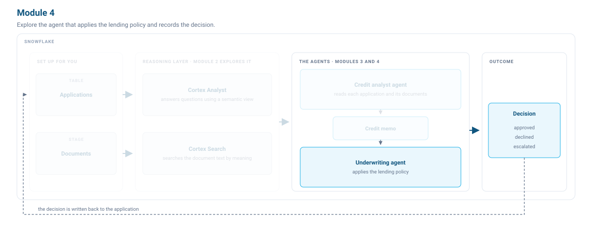

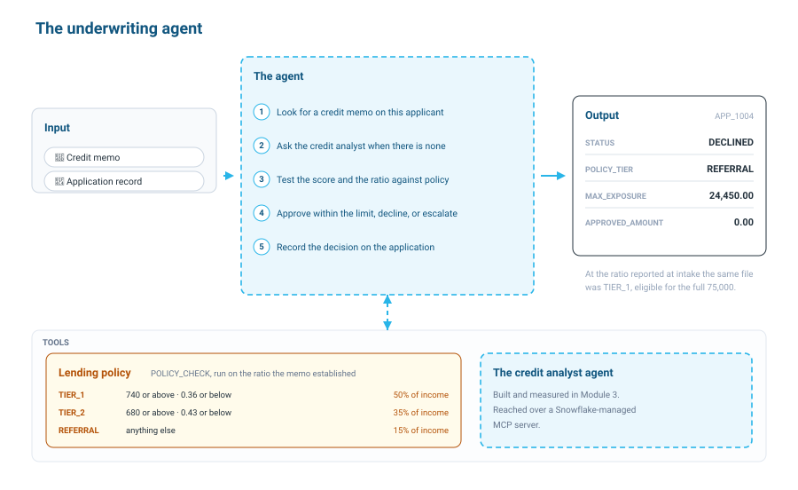

The `POLICY_CHECK` function turns the credit score and ratio into a tier, and the tier caps lending at a share of income.

| Tier | Requires | Lending limit |
| --- | --- | --- |
| `TIER_1` | a score of 740 or above and a ratio of 0.36 or below | 50% of income |
| `TIER_2` | a score of 680 or above and a ratio of 0.43 or below | 35% of income |
| `REFERRAL` | anything that meets neither | 15% of income |

Two checks fail a file outright: a score below 620, or a ratio above 0.43. The agent records every outcome with `RECORD_DECISION`, which runs the policy check itself. That is **Control**: the rules are code, and the model cannot go further than they allow.

### Reset the Applications

In **lab.sql**, run the **MODULE 4: Before you start** block. It resets both applications, clears Diane Whitfield's memo, and sets Grant Kelleher's memo to the correct diligence result.

```sql
UPDATE LENDING.LOANS.APPLICATIONS
SET STATUS = 'PENDING', POLICY_TIER = NULL, APPROVED_AMOUNT = NULL,
    MAX_EXPOSURE = NULL, ESCALATION_QUESTION = NULL, PROCESSED_AT = NULL
WHERE APPLICANT_ID IN ('APP_1001', 'APP_1004');

DELETE FROM LENDING.LOANS.CREDIT_MEMO WHERE APPLICANT_ID = 'APP_1001';

CALL LENDING.LOANS.WRITE_CREDIT_MEMO(
  'APP_1004',
  0.52,
  '{"guaranteed_commercial_loan_monthly": 3870.00, "cosigned_auto_loan_monthly": 612.00}',
  'Bank statement shows a commercial loan payment under a personal guarantee and a co-signed auto loan payment, neither on the credit report. Both are personal obligations, so the ratio after diligence is 0.52 against 0.19 reported.',
  'doc_APP_1004_bank_statement.pdf,doc_APP_1004_commercial_loan_agreement.pdf,doc_APP_1004_auto_loan_statement.pdf'
);
```

### Read the Configuration

1. In the left navigation, select **AI & ML** » **Agents** » `UNDERWRITING_AGENT`.
2. Select the **Configuration** tab and read the four tools.

- `get_credit_memo` (**Retrieve**) reads the memo the credit analyst wrote. If it returns `found = false`, diligence has not been done.
- `application_analytics` (**Retrieve**) reads the application record. This is bureau data, not verified data.
- `policy_check` (**Act**) converts the verified ratio into a tier and a lending cap.
- `record_decision` (**Persist**) writes the outcome and re-runs the policy check, so no approval above the cap can be recorded.

The instructions tell the agent to escalate when no memo exists, so it never approves a file that has not been through diligence.

### Underwrite Grant Kelleher

Select **Preview** and ask:

```text
Underwrite APP_1004 against our lending policy.
Record the decision on the loan application.
```

**What to expect.** It declines. The memo puts his ratio above the policy maximum, so he falls to the referral tier and the cap is far below the amount he asked for. The rationale names the guaranteed commercial loan and the co-signed auto loan.

Select **Show Traces** and work through the steps. Each tool call is a `Custom Tool` span with its input and output. Then check the record by running the **Step 4.1.2** block in **lab.sql**:

```sql
SELECT APPLICANT_ID, STATUS, APPROVED_AMOUNT, POLICY_TIER, MAX_EXPOSURE
FROM LENDING.LOANS.APPLICATIONS
WHERE APPLICANT_ID = 'APP_1004';
```

On the ratio reported at intake, this file would have cleared the top tier for the full amount.

### Underwrite Diane Whitfield

Start a **New thread** and ask:

```text
Underwrite APP_1001 against our lending policy.
Record the decision on the loan application.
```

**What to expect.** It escalates and writes a question back to the file asking for credit diligence and a verified ratio. Without a verified ratio, the agent stops and hands the file to a person rather than deciding something it cannot verify.

> NOTE: If she already has a memo because you asked the credit analyst about her earlier, clear it with `DELETE FROM LENDING.LOANS.CREDIT_MEMO WHERE APPLICANT_ID = 'APP_1001';` and ask again.

<!-- ------------------------ -->
## Delegate Over MCP

The credit analyst can do the diligence Diane's file needs. A Snowflake-managed MCP server, `CREDIT_ANALYST_MCP`, wraps `CREDIT_ANALYST_AGENT_IMPROVED` as a named tool that any MCP client can call: another agent in this account, Claude, or Cursor. `UNDERWRITER_WITH_DELEGATION_AGENT` is wired to that server, which extends **Act**: the underwriter can now act through the credit analyst.

### Open the Delegation Agent

1. In the left navigation, select **AI & ML** » **Agents** » `UNDERWRITER_WITH_DELEGATION_AGENT`.
2. Select **Configuration**, then **MCP**.

The agent lists `CREDIT_ANALYST_MCP` as an MCP server. Everything else matches `UNDERWRITING_AGENT`. The only change is the no-memo branch: this version asks the credit analyst for diligence, then calls `get_credit_memo` again before deciding.

### Underwrite Diane Whitfield Again

Select **Preview**, start a **New thread**, and ask:

```text
Underwrite APP_1001 against our lending policy.
Record the decision on the loan application.
```

**What to expect.** It approves the full amount. Her bank statement shows a mortgage, an auto loan and a card, all already on the credit report. Nothing was hidden, so the ratio stands and policy puts her in the top tier.

Select **Show Traces**. The agent finds no memo, calls the credit analyst over MCP, then records the approval. The MCP call appears as a `Custom Tool` span like any other tool. Some steps run in parallel, so your order may differ.

Check both decisions by running the **Step 4.2.2** block in **lab.sql**:

```sql
SELECT APPLICANT_ID, STATUS, APPROVED_AMOUNT, POLICY_TIER, MAX_EXPOSURE
FROM LENDING.LOANS.APPLICATIONS
WHERE APPLICANT_ID IN ('APP_1001', 'APP_1004')
ORDER BY APPLICANT_ID;
```

<!-- ------------------------ -->
## Automate Underwriting

Both agents are reactive: a person has to ask. In a real business, a loan application arrives and the assessment starts on its own. You build that with a stream and a triggered task. Run each block from the **Optional Step 4.3.x** sections of **lab.sql**.

### Create a Stream

An append-only stream records new rows inserted into the table.

```sql
CREATE OR REPLACE STREAM LENDING.LOANS.NEW_APPLICATIONS
  ON TABLE LENDING.LOANS.APPLICATIONS
  APPEND_ONLY = TRUE;
```

### Create a Triggered Task

`UNDERWRITE_ARRIVALS`, already in your schema, reads the stream and asks the underwriting agent to decide each application it finds. A triggered task runs whenever the stream has data, so it needs no schedule.

```sql
CREATE OR REPLACE TASK LENDING.LOANS.UNDERWRITE_ON_ARRIVAL
  WAREHOUSE = LENDING_WH
  WHEN SYSTEM$STREAM_HAS_DATA('LENDING.LOANS.NEW_APPLICATIONS')
AS
  CALL LENDING.LOANS.UNDERWRITE_ARRIVALS();

ALTER TASK LENDING.LOANS.UNDERWRITE_ON_ARRIVAL RESUME;
```

### Submit an Application

```sql
DELETE FROM LENDING.LOANS.APPLICATIONS WHERE APPLICANT_ID = 'APP_2001';
DELETE FROM LENDING.LOANS.UNDERWRITING_LOG WHERE APPLICANT_ID = 'APP_2001';

INSERT INTO LENDING.LOANS.APPLICATIONS
    (APPLICANT_ID, FIRST_NAME, LAST_NAME, CREDIT_SCORE, ANNUAL_INCOME,
     DEBT_TO_INCOME_RATIO, REQUESTED_AMOUNT, LOAN_PURPOSE,
     EMPLOYMENT_STATUS, YEARS_EMPLOYED, APPLICATION_DATE, STATUS)
VALUES
    ('APP_2001', 'Ana', 'Ferreira', 775, 135000, 0.19, 40000,
     'home improvement', 'employed', 8, CURRENT_DATE(), 'PENDING');
```

Run this query until `DECIDED_AT` fills in:

```sql
SELECT l.APPLICANT_ID, l.ARRIVED_AT, l.DECIDED_AT,
       a.STATUS, a.POLICY_TIER, a.APPROVED_AMOUNT
FROM LENDING.LOANS.UNDERWRITING_LOG l
JOIN LENDING.LOANS.APPLICATIONS a
  ON a.APPLICANT_ID = l.APPLICANT_ID
ORDER BY l.ARRIVED_AT DESC;
```

**What to expect.** Ana Ferreira is escalated. She submitted no documents, so no memo exists and the agent cannot verify her ratio. It records a specific question: whether bureau data alone supports a TIER_1 approval, or whether income documents are required first. The agent holds its ground even when no person is watching.

Suspend the task when you are done:

```sql
ALTER TASK LENDING.LOANS.UNDERWRITE_ON_ARRIVAL SUSPEND;
```

<!-- ------------------------ -->
## Compare the Evaluations

Both evaluation runs have finished by now.

1. In the left navigation, select **AI & ML** » **Agents** » `CREDIT_ANALYST_AGENT_BASELINE`.
2. On the **Evaluations** tab, note the scores on your `baseline_` run.
3. Open `CREDIT_ANALYST_AGENT_IMPROVED`, select **Evaluations**, and note the scores on your `improved_` run.

**What to expect.** The improved agent scores at or near the top on both metrics. The baseline scores lower because it never searched a document. That gap is what lets you change an agent with confidence: change the instructions, the tools or the model, run the same evaluation, and compare.

<!-- ------------------------ -->
## Clean Up

Run [teardown.sql](https://github.com/Snowflake-Labs/sfquickstarts/blob/master/site/sfguides/src/build-a-multi-agent-lending-workflow-with-cortex-agents-and-mcp/assets/teardown.sql), or run:

```sql
USE ROLE ACCOUNTADMIN;

DROP DATABASE IF EXISTS LENDING;
DROP WAREHOUSE IF EXISTS LENDING_WH;
```

Then remove the integration setup used to read this guide's files from GitHub, and delete the `setup.sql`, `lab.sql` and agent YAML files from your workspace:

```sql
DROP API INTEGRATION IF EXISTS LENDING_GUIDE_GIT_API;
```

<!-- ------------------------ -->
## Conclusion And Resources

Congratulations! A loan application that took days to decide is now handled by two agents. The credit analyst reads the documents and reconciles the debt-to-income ratio. The underwriter tests the memo against lending policy and records the decision, and a file the policy cannot clear goes to a senior underwriter with the question attached.

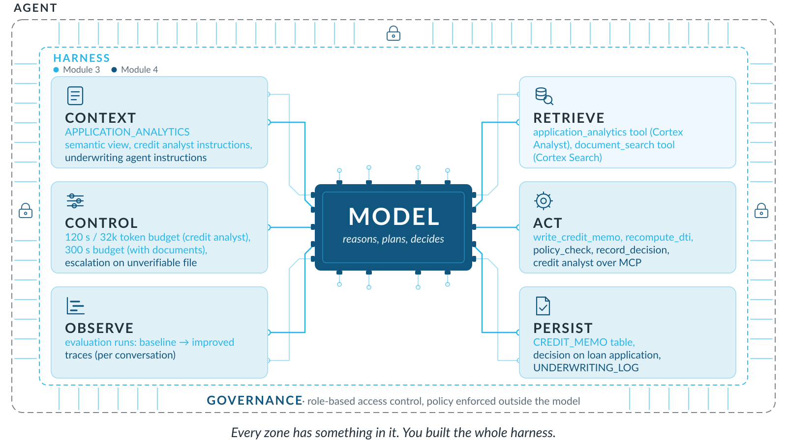

You used every part of the harness. The semantic view and instructions give context. The budget and escalation control the agents. They retrieve with Cortex Analyst and Cortex Search, act through custom tools and the credit analyst over MCP, and persist the credit memo, the decision and the underwriting log. Evaluations and traces let you observe them.

### What You Learned

- **Managed.** [Cortex Agents](https://docs.snowflake.com/en/user-guide/snowflake-cortex/cortex-agents) plan the work, call tools and reason over structured and unstructured data in one governed workflow.
- **Reusable.** An agent bundles the model, tools, orchestration settings and instructions into a single securable object you can version and update.
- **Composable.** The underwriter uses the credit analyst as a tool. An agent can also inherit another agent's tools through [agent toolsets](https://docs.snowflake.com/en/user-guide/snowflake-cortex/cortex-agents-toolsets).
- **Interoperable.** The credit analyst is published on a [Snowflake-managed MCP server](https://docs.snowflake.com/en/user-guide/snowflake-cortex/cortex-agents-mcp), so an external client such as Claude or Cursor can call it too.
- **Observable and measurable.** The baseline wrote a memo that read well and was wrong. The [trace](https://docs.snowflake.com/en/user-guide/snowflake-cortex/cortex-agents-monitor) showed why, the evaluation scored it, and the next version was built on both.
- **Governed.** An agent runs with the privileges of the querying user's role. See [access control and authentication](https://docs.snowflake.com/en/user-guide/snowflake-cortex/cortex-agents-setup) and [AI cost management and governance](https://docs.snowflake.com/en/user-guide/snowflake-cortex/governance-and-availability/ai-cost-management-and-governance).

The guide uses `claude-sonnet-4-5` because both agents reason over multi-step evidence. For simpler tasks you can use a lighter model, or set the model to `"auto"` and let Snowflake choose. Either way, run the evaluation again and compare.

### Related Resources

- [Files for this guide](https://github.com/Snowflake-Labs/sfquickstarts/tree/master/site/sfguides/src/build-a-multi-agent-lending-workflow-with-cortex-agents-and-mcp/assets)
- [Create and manage Cortex Agents](https://docs.snowflake.com/en/user-guide/snowflake-cortex/cortex-agents-manage)
- [Cortex Agent evaluations](https://docs.snowflake.com/en/user-guide/snowflake-cortex/cortex-agents-evaluations)
- [Cortex Agent versioning](https://docs.snowflake.com/en/user-guide/snowflake-cortex/cortex-agents-versioning)
- [Overview of semantic views](https://docs.snowflake.com/en/user-guide/views-semantic/overview)
- [Cortex Search](https://docs.snowflake.com/en/user-guide/snowflake-cortex/cortex-search/cortex-search-overview)
- [AI_PARSE_DOCUMENT](https://docs.snowflake.com/en/sql-reference/functions/ai_parse_document)
- [Best Practices for Building Cortex Agents](https://www.snowflake.com/en/developers/guides/best-practices-to-building-cortex-agents/)
- [Best Practices for Evaluating Cortex Agents](https://www.snowflake.com/en/developers/guides/best-practices-for-evaluating-cortex-agents/)
