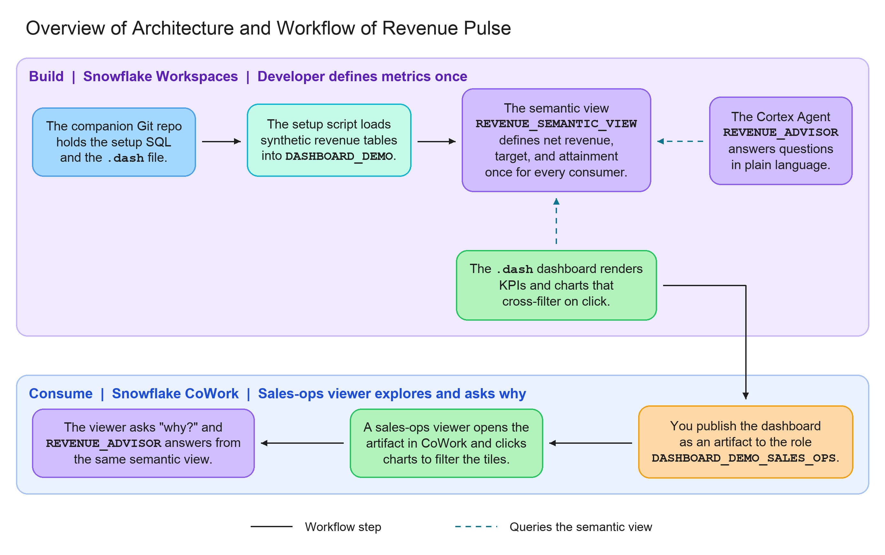
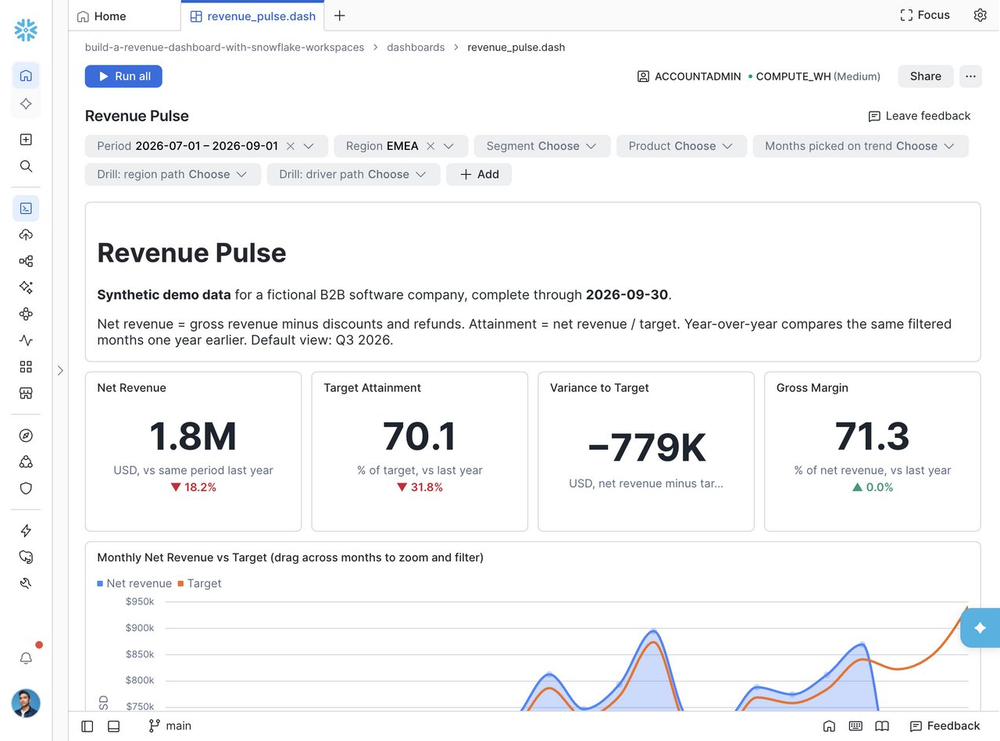
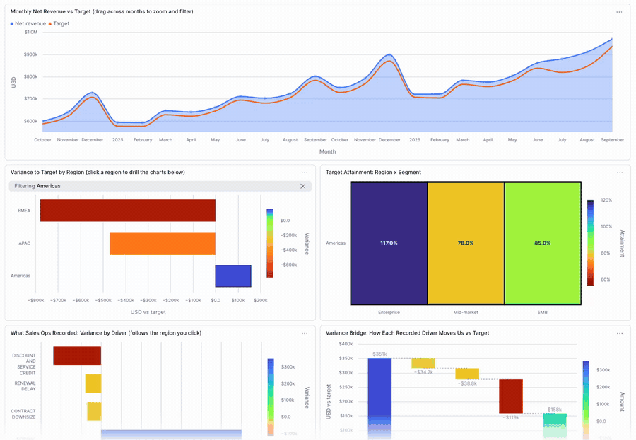
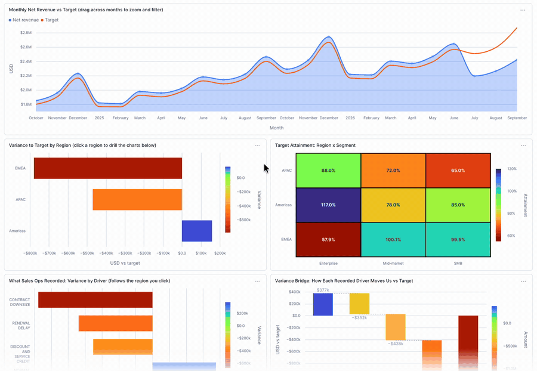
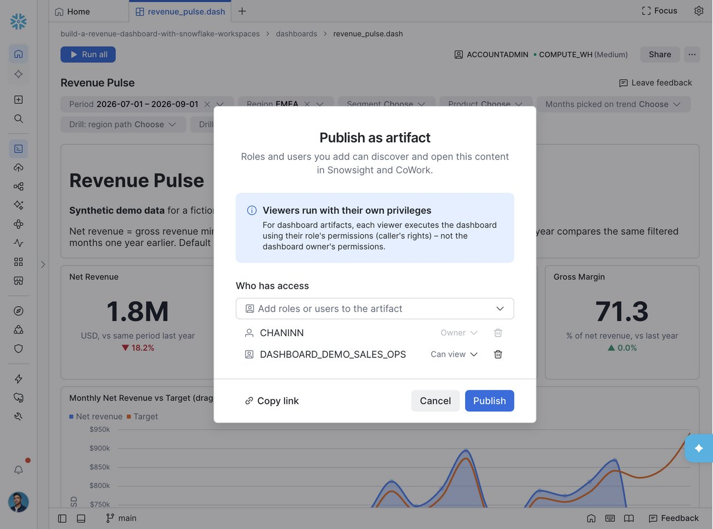
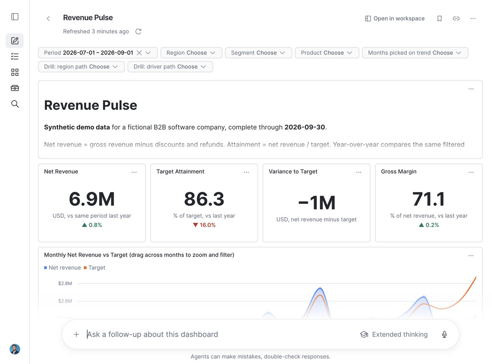

author: Chanin Nantasenamat
id: build-a-revenue-dashboard-with-snowflake-workspaces
categories: snowflake-site:taxonomy/solution-center/certification/quickstart, snowflake-site:taxonomy/product/analytics, snowflake-site:taxonomy/product/ai
language: en
summary: Build a native Workspaces dashboard on a semantic view, publish it to a role, and ask why the numbers moved in Snowflake CoWork.
environments: web
status: Published
feedback link: https://github.com/Snowflake-Labs/sfquickstarts/issues
fork repo link: https://github.com/sfc-gh-cnantasenamat/build-a-revenue-dashboard-with-snowflake-workspaces

# Build a Revenue Dashboard with Snowflake Workspaces and CoWork

## Overview

It's Monday morning and revenue is behind target. The BI dashboard says attainment is 86%, the AI assistant says 84%, and the sales-ops spreadsheet says something else. Each tool has its own copy of the metric logic, so the team spends the meeting reconciling numbers instead of asking why the quarter is slipping. Even once the numbers agree, finding the cause means paging through a multi-page dashboard and drilling down filter by filter.

This guide puts the metric definitions, the AI assistant, and the dashboard in one place in Snowflake. One semantic view defines the metrics. A Cortex Agent and a single-page dashboard both query that view, so they can't disagree. You publish the dashboard to a role, click its charts to drill in, and ask follow-up "why" questions in Snowflake CoWork.

An analyst already has a revenue [semantic view](https://docs.snowflake.com/en/user-guide/views-semantic/overview) and a [Cortex Agent](https://docs.snowflake.com/en/user-guide/snowflake-cortex/cortex-agents) that the sales team uses. The semantic view defines the revenue metrics (such as net revenue, target, and attainment), the dimensions to slice them by, and how the underlying tables join, so every query uses the same definitions. The Cortex Agent is an AI assistant that answers plain-language questions by turning them into SQL against that semantic view. What's missing is a shared view that the team checks every morning. In this guide, you use [Dashboards 2.0](https://docs.snowflake.com/en/LIMITEDACCESS/cowork-dashboards) to build that view as a native Workspaces dashboard (a `.dash` file) on the semantic view, publish it to a sales-ops role as an artifact, and then open it in [Snowflake CoWork](https://docs.snowflake.com/en/user-guide/snowflake-cortex/snowflake-cowork) and ask follow-up "why" questions about the numbers.

All data is synthetic: a fictional B2B software company with 54 accounts, 3 product lines, and 24 months of revenue through September 30, 2026. The data contains a story. Q3 2026 net revenue is barely up (0.8%) year over year and $1.09M behind target. EMEA Enterprise is the largest single miss, and APAC is behind too.

### When to Use Dashboards 2.0
Snowflake gives you several ways to present data, and each fits a different job:

- **HTML reports** suit one-off narrative analyses that are snapshots.
- **Streamlit** and **App Runtime** are for interactive tools and production apps, and they take more code to build and maintain.
- **Dashboards 2.0** sits in between. It is built for recurring KPI monitoring on live, governed queries, with filters, drilldown, and conversational follow-up, at a low build cost.

A morning revenue check fits that last description, so this guide uses a dashboard.


### What You'll Learn
- How to model revenue, targets, and margin as a semantic view with additive metrics
- How to create a Cortex Agent with a Cortex Analyst tool over that semantic view
- How a `.dash` file defines tiles, filters, layout, and SQL datasources
- How to publish a dashboard as an artifact to a single role, with caller's rights
- How to ask follow-up questions about a dashboard in CoWork, and keep recorded drivers separate from hypotheses

### What You'll Build
An end-to-end revenue workflow in which every number comes from one definition:

- **A semantic view** (`REVENUE_SEMANTIC_VIEW`) that defines net revenue, target, variance, and attainment once, on top of synthetic revenue tables.
- **A Cortex Agent** (`REVENUE_ADVISOR`) that answers plain-language revenue questions by querying that semantic view.
- **A "Revenue Pulse" dashboard**, built as a `.dash` file in Snowflake Workspaces, that queries the same semantic view. It shows KPIs, trends, and variance breakdowns on one page, and you can filter it or click its charts to cross-filter.
- **A shared artifact**: you publish the dashboard as an artifact and share it with a sales-ops role, so anyone in that role can open it.
- **A CoWork chat session** where a viewer opens the dashboard and asks follow-up "why" questions. The agent answers from the same semantic view, so the chat and the dashboard agree.



### Prerequisites
- Access to a [Snowflake account](https://signup.snowflake.com/?utm_source=snowflake-devrel&utm_medium=developer-guides&utm_cta=developer-guides)
- A role that can create databases, API integrations, semantic views, agents, and roles (this guide uses `ACCOUNTADMIN`)
- Access to Workspaces dashboards and Snowflake CoWork in your account
- A role with the `MANAGE ACCESS ON DASHBOARD ARTIFACTS` privilege, which is needed to publish dashboards as artifacts and choose who can view them. It is [granted to `PUBLIC` by default](https://docs.snowflake.com/en/release-notes/bcr-bundles/un-bundled/bcr-manage-access-dashboard-artifacts) unless your administrator revoked it

Everything in this guide runs in Snowsight. You don't need Python, a CLI, or a local copy of the code. The [companion repository](https://github.com/sfc-gh-cnantasenamat/build-a-revenue-dashboard-with-snowflake-workspaces) holds the SQL, the synthetic data, and the dashboard file, and Snowflake reads them directly from GitHub.

## Setup

### Connect Snowflake to the Companion Repository

In Snowsight, open **Projects > Workspaces**. In **My Workspace**, select **+ Add new > SQL File**. Set the role to `ACCOUNTADMIN` and the warehouse to `COMPUTE_WH`, then paste and run this script (it is also `sql/00_bootstrap.sql` in the repository):

```sql
USE ROLE ACCOUNTADMIN;

CREATE DATABASE IF NOT EXISTS REVENUE_PULSE_DB
  COMMENT = 'Revenue Pulse developer guide (synthetic data). Safe to drop after the guide.';

CREATE SCHEMA IF NOT EXISTS REVENUE_PULSE_DB.DASHBOARD_DEMO
  COMMENT = 'Revenue Pulse Dashboards 2.0 demo (synthetic data)';

CREATE API INTEGRATION IF NOT EXISTS REVENUE_PULSE_GIT_API
  API_PROVIDER = git_https_api
  API_ALLOWED_PREFIXES = ('https://github.com/sfc-gh-cnantasenamat/')
  ENABLED = TRUE
  COMMENT = 'Read access to the public Revenue Pulse companion repo';

CREATE GIT REPOSITORY IF NOT EXISTS REVENUE_PULSE_DB.DASHBOARD_DEMO.REVENUE_PULSE_REPO
  API_INTEGRATION = REVENUE_PULSE_GIT_API
  ORIGIN = 'https://github.com/sfc-gh-cnantasenamat/build-a-revenue-dashboard-with-snowflake-workspaces.git';

ALTER GIT REPOSITORY REVENUE_PULSE_DB.DASHBOARD_DEMO.REVENUE_PULSE_REPO FETCH;

LS @REVENUE_PULSE_DB.DASHBOARD_DEMO.REVENUE_PULSE_REPO/branches/main/sql/;
```

The last statement lists the scripts in the repository. Every object in this guide lives in `REVENUE_PULSE_DB`, so you can remove them all with one statement at the end. The API integration and the viewer role sit outside the database and are dropped separately.

If your warehouse isn't `COMPUTE_WH`, use your own warehouse in the SQL file. Later, instead of running `sql/03_agent.sql` and `sql/04_viewer_role.sql` from the repository, copy each one from the repository into your SQL file, replace `COMPUTE_WH` with your warehouse, and run it there.

### About the Data

The repository's `data/` folder holds three CSV files: `customers.csv`, `products.csv`, and `revenue_monthly.csv`. They were produced by a deterministic generator (seed 42) that stores money as integer cents, so totals reconcile exactly. Every revenue row carries a `RECORDED_DRIVER` value: `NORMAL_TRADING`, `RECORDED_RENEWAL_DELAY`, `RECORDED_CONTRACT_DOWNSIZE`, or `RECORDED_DISCOUNT_AND_SERVICE_CREDIT`. These stand in for reasons a sales-ops team logged against each account.

## Load the Data

### Run the Setup Script

Run `sql/01_setup.sql` straight from the repository:

```sql
EXECUTE IMMEDIATE FROM @REVENUE_PULSE_DB.DASHBOARD_DEMO.REVENUE_PULSE_REPO/branches/main/sql/01_setup.sql;
```

The script creates the tables and an internal stage, copies the CSVs from the Git repository into the stage with `COPY FILES`, and loads each table with `COPY INTO ... MATCH_BY_COLUMN_NAME`. It truncates each table before loading, so rerunning it is safe:

```sql
CREATE TABLE IF NOT EXISTS REVENUE_PULSE_DB.DASHBOARD_DEMO.CUSTOMERS (
  CUSTOMER_ID VARCHAR NOT NULL PRIMARY KEY,
  CUSTOMER_NAME VARCHAR NOT NULL,
  REGION VARCHAR NOT NULL,
  SEGMENT VARCHAR NOT NULL
) COMMENT = 'Synthetic customer accounts';

CREATE TABLE IF NOT EXISTS REVENUE_PULSE_DB.DASHBOARD_DEMO.PRODUCTS (
  PRODUCT_ID VARCHAR NOT NULL PRIMARY KEY,
  PRODUCT_NAME VARCHAR NOT NULL
) COMMENT = 'Synthetic product lines';

CREATE TABLE IF NOT EXISTS REVENUE_PULSE_DB.DASHBOARD_DEMO.REVENUE_MONTHLY (
  REVENUE_ID VARCHAR NOT NULL PRIMARY KEY,
  MONTH DATE NOT NULL,
  CUSTOMER_ID VARCHAR NOT NULL,
  PRODUCT_ID VARCHAR NOT NULL,
  GROSS_REVENUE_CENTS NUMBER(18,0) NOT NULL,
  DISCOUNT_CENTS NUMBER(18,0) NOT NULL,
  REFUND_CENTS NUMBER(18,0) NOT NULL,
  COST_CENTS NUMBER(18,0) NOT NULL,
  TARGET_CENTS NUMBER(18,0) NOT NULL,
  RECORDED_DRIVER VARCHAR NOT NULL
) COMMENT = 'Synthetic revenue at account x product x month grain';

-- The revenue CSV carries extra denormalized columns; MATCH_BY_COLUMN_NAME loads only the table's columns.
CREATE OR REPLACE STAGE REVENUE_PULSE_DB.DASHBOARD_DEMO.LOAD_STAGE
  FILE_FORMAT = (TYPE = CSV PARSE_HEADER = TRUE FIELD_OPTIONALLY_ENCLOSED_BY = '"'
                 ERROR_ON_COLUMN_COUNT_MISMATCH = FALSE);

-- Copy the committed CSVs from the Git repository into the internal stage.
COPY FILES INTO @REVENUE_PULSE_DB.DASHBOARD_DEMO.LOAD_STAGE/
  FROM @REVENUE_PULSE_DB.DASHBOARD_DEMO.REVENUE_PULSE_REPO/branches/main/data/
  PATTERN = '.*[.]csv';

TRUNCATE TABLE REVENUE_PULSE_DB.DASHBOARD_DEMO.CUSTOMERS;
COPY INTO REVENUE_PULSE_DB.DASHBOARD_DEMO.CUSTOMERS
  FROM @REVENUE_PULSE_DB.DASHBOARD_DEMO.LOAD_STAGE/customers.csv
  MATCH_BY_COLUMN_NAME = CASE_INSENSITIVE FORCE = TRUE ON_ERROR = ABORT_STATEMENT;

TRUNCATE TABLE REVENUE_PULSE_DB.DASHBOARD_DEMO.PRODUCTS;
COPY INTO REVENUE_PULSE_DB.DASHBOARD_DEMO.PRODUCTS
  FROM @REVENUE_PULSE_DB.DASHBOARD_DEMO.LOAD_STAGE/products.csv
  MATCH_BY_COLUMN_NAME = CASE_INSENSITIVE FORCE = TRUE ON_ERROR = ABORT_STATEMENT;

TRUNCATE TABLE REVENUE_PULSE_DB.DASHBOARD_DEMO.REVENUE_MONTHLY;
COPY INTO REVENUE_PULSE_DB.DASHBOARD_DEMO.REVENUE_MONTHLY
  FROM @REVENUE_PULSE_DB.DASHBOARD_DEMO.LOAD_STAGE/revenue_monthly.csv
  MATCH_BY_COLUMN_NAME = CASE_INSENSITIVE FORCE = TRUE ON_ERROR = ABORT_STATEMENT;

SELECT
  (SELECT COUNT(*) FROM REVENUE_PULSE_DB.DASHBOARD_DEMO.CUSTOMERS) AS CUSTOMERS,
  (SELECT COUNT(*) FROM REVENUE_PULSE_DB.DASHBOARD_DEMO.PRODUCTS) AS PRODUCTS,
  (SELECT COUNT(*) FROM REVENUE_PULSE_DB.DASHBOARD_DEMO.REVENUE_MONTHLY) AS REVENUE_ROWS;
```

The final query should return 54 `CUSTOMERS`, 3 `PRODUCTS`, and 3,888 `REVENUE_ROWS`.

## Create the Semantic View

Run `sql/02_semantic_view.sql` from the repository:

```sql
EXECUTE IMMEDIATE FROM @REVENUE_PULSE_DB.DASHBOARD_DEMO.REVENUE_PULSE_REPO/branches/main/sql/02_semantic_view.sql;
```

It defines facts in USD, dimensions such as region, segment, and recorded driver, and metrics for net revenue, target, variance, attainment, and margin. Ratio metrics use `DIV0NULL` so an empty slice returns null instead of an error.

```sql
CREATE OR REPLACE SEMANTIC VIEW REVENUE_PULSE_DB.DASHBOARD_DEMO.REVENUE_SEMANTIC_VIEW
  TABLES (
    revenue AS REVENUE_PULSE_DB.DASHBOARD_DEMO.REVENUE_MONTHLY PRIMARY KEY (REVENUE_ID)
      COMMENT = 'Monthly revenue, target, and cost per customer and product. Synthetic.',
    customers AS REVENUE_PULSE_DB.DASHBOARD_DEMO.CUSTOMERS PRIMARY KEY (CUSTOMER_ID)
      WITH SYNONYMS = ('accounts', 'clients') COMMENT = 'Customer accounts with sales region and segment',
    products AS REVENUE_PULSE_DB.DASHBOARD_DEMO.PRODUCTS PRIMARY KEY (PRODUCT_ID)
      WITH SYNONYMS = ('product lines') COMMENT = 'Product lines'
  )
  RELATIONSHIPS (
    revenue_to_customers AS revenue (CUSTOMER_ID) REFERENCES customers,
    revenue_to_products AS revenue (PRODUCT_ID) REFERENCES products
  )
  FACTS (
    revenue.gross_revenue_usd AS GROSS_REVENUE_CENTS / 100 COMMENT = 'List revenue before discounts and refunds, USD',
    revenue.discount_usd AS DISCOUNT_CENTS / 100 COMMENT = 'Discounts granted, USD',
    revenue.refund_usd AS REFUND_CENTS / 100 COMMENT = 'Refunds and service credits, USD',
    revenue.cost_usd AS COST_CENTS / 100 COMMENT = 'Cost of revenue, USD',
    revenue.target_usd AS TARGET_CENTS / 100 COMMENT = 'Revenue target, USD',
    revenue.net_revenue_usd AS (GROSS_REVENUE_CENTS - DISCOUNT_CENTS - REFUND_CENTS) / 100
      COMMENT = 'Gross revenue minus discounts and refunds, USD'
  )
  DIMENSIONS (
    revenue.month AS MONTH WITH SYNONYMS = ('period', 'date') COMMENT = 'First day of the revenue month',
    revenue.quarter AS DATE_TRUNC('QUARTER', MONTH) COMMENT = 'First day of the calendar quarter',
    revenue.year AS YEAR(MONTH) COMMENT = 'Calendar year',
    revenue.recorded_driver AS RECORDED_DRIVER
      COMMENT = 'Driver recorded by sales ops: NORMAL_TRADING, RECORDED_CONTRACT_DOWNSIZE, RECORDED_DISCOUNT_AND_SERVICE_CREDIT, RECORDED_RENEWAL_DELAY',
    customers.customer_id AS CUSTOMER_ID COMMENT = 'Customer identifier',
    customers.customer_name AS CUSTOMER_NAME WITH SYNONYMS = ('account name') COMMENT = 'Customer account name',
    customers.region AS REGION WITH SYNONYMS = ('geo', 'territory') COMMENT = 'Sales region: Americas, EMEA, APAC',
    customers.segment AS SEGMENT COMMENT = 'Customer segment: Enterprise, Mid-market, SMB',
    products.product_name AS PRODUCT_NAME WITH SYNONYMS = ('product') COMMENT = 'Product line name'
  )
  METRICS (
    revenue.net_revenue AS SUM(revenue.net_revenue_usd) WITH SYNONYMS = ('revenue', 'sales')
      COMMENT = 'Net revenue in USD: gross minus discounts and refunds',
    revenue.gross_revenue AS SUM(revenue.gross_revenue_usd) COMMENT = 'Gross revenue in USD',
    revenue.total_discounts AS SUM(revenue.discount_usd) COMMENT = 'Total discounts in USD',
    revenue.total_refunds AS SUM(revenue.refund_usd) COMMENT = 'Total refunds and service credits in USD',
    revenue.revenue_target AS SUM(revenue.target_usd) WITH SYNONYMS = ('quota', 'plan')
      COMMENT = 'Revenue target in USD',
    revenue.target_variance AS SUM(revenue.net_revenue_usd) - SUM(revenue.target_usd)
      WITH SYNONYMS = ('gap', 'shortfall') COMMENT = 'Net revenue minus target in USD; negative means behind target',
    revenue.target_attainment AS DIV0NULL(SUM(revenue.net_revenue_usd), SUM(revenue.target_usd))
      COMMENT = 'Net revenue divided by target, as a ratio (0.92 = 92%)',
    revenue.gross_profit AS SUM(revenue.net_revenue_usd) - SUM(revenue.cost_usd) COMMENT = 'Net revenue minus cost in USD',
    revenue.gross_margin AS DIV0NULL(SUM(revenue.net_revenue_usd) - SUM(revenue.cost_usd), SUM(revenue.net_revenue_usd))
      COMMENT = 'Gross profit divided by net revenue, as a ratio; null when net revenue is zero'
  )
  COMMENT = 'Revenue Pulse: synthetic B2B revenue vs target by month, region, segment, account, and product. Data through 2026-09-30.'
  AI_SQL_GENERATION 'Data is monthly and complete through September 2026. Last quarter or Q3 means months 2026-07-01 through 2026-09-01. Ratios are 0-1; present as percentages. Year-over-year compares the same months one year earlier.';
```

The `AI_SQL_GENERATION` clause tells Cortex Analyst what "Q3" and "last quarter" mean for this data, so natural-language questions resolve to the right months.

## Create the Agent

### Agent Spec

`sql/03_agent.sql` creates the agent with `CREATE AGENT ... FROM SPECIFICATION`, wrapping the spec below in `$$`. The Revenue Advisor agent has one Cortex Analyst tool over the semantic view. Its response instructions require it to separate recorded drivers from hypotheses and to quantify each contribution so the parts reconcile to the total.

```yaml
models:
  orchestration: auto
instructions:
  system: "You are Revenue Advisor, a sales analytics assistant for the Revenue Pulse dashboard. All data is synthetic demo data for a fictional B2B software company, complete through September 30, 2026."
  orchestration: "Use revenue_analytics for every question about revenue, targets, attainment, variance, discounts, refunds, margin, regions, segments, accounts, or products. For why questions, break the variance down by region, segment, then account, and query RECORDED_DRIVER to see what sales ops recorded."
  response: "Lead with the number. Format currency as $1.23M or $45.6K and ratios as percentages. Always state the period. When explaining causes, separate recorded drivers (from RECORDED_DRIVER) from hypotheses, and quantify each contribution so the parts reconcile to the total gap. Never present correlation as a confirmed cause."
  sample_questions:
    - question: "What were Q3 2026 revenue and target attainment?"
    - question: "Why is EMEA Enterprise behind target in Q3?"
    - question: "Which accounts contributed most to the Q3 shortfall?"
    - question: "How much of the Q3 gap is associated with discounts and refunds?"
    - question: "Is the EMEA shortfall concentrated in one month or persistent?"
tools:
  - tool_spec:
      type: cortex_analyst_text_to_sql
      name: revenue_analytics
      description: "Queries monthly net revenue, targets, variance, attainment, discounts, refunds, cost, and gross margin by month, quarter, region (Americas, EMEA, APAC), segment (Enterprise, Mid-market, SMB), customer account, product line, and recorded driver. Synthetic data from October 2024 through September 2026. Use for any revenue performance or shortfall question. Not for pipeline, forecasts, or data after September 2026."
tool_resources:
  revenue_analytics:
    execution_environment:
      type: warehouse
      warehouse: COMPUTE_WH
    semantic_view: REVENUE_PULSE_DB.DASHBOARD_DEMO.REVENUE_SEMANTIC_VIEW
```

### Create the Agent

```sql
EXECUTE IMMEDIATE FROM @REVENUE_PULSE_DB.DASHBOARD_DEMO.REVENUE_PULSE_REPO/branches/main/sql/03_agent.sql;
```

Then create the viewer role the dashboard is published to (covered in [Publish to a Role](#publish-to-a-role)):

```sql
EXECUTE IMMEDIATE FROM @REVENUE_PULSE_DB.DASHBOARD_DEMO.REVENUE_PULSE_REPO/branches/main/sql/04_viewer_role.sql;
```

## Build the Dashboard

### How the File Works

A `.dash` file is JSON (spec version 2). It holds tiles (text, chart, or table), filters, a 12-column grid layout, and SQL datasources. The repository includes a ready-made file, `dashboards/revenue_pulse.dash`, generated by `scripts/build_dashboard.py`. You don't need to run the script. The excerpts below show how the file is put together. For the full reference on tiles, filters, and layout, see [Dashboards in Snowflake CoWork](https://docs.snowflake.com/en/LIMITEDACCESS/cowork-dashboards).

Every datasource reads additive metrics from the semantic view at month, region, segment, and product grain. Filters are applied outside the view through `{{ filter('ID') }}` macros (see [filter template syntax](https://docs.snowflake.com/en/LIMITEDACCESS/cowork-dashboards)). Each row also carries drill-path columns (for example `EMEA › Enterprise`), so a chart click can filter every tile, and the trend brush (`BRUSH_MONTH`) replaces the Period while months are picked:

```python
def base(extra_dims=", revenue.recorded_driver, customers.customer_name", shift_year=False, metrics="revenue.net_revenue, revenue.revenue_target, "
         "revenue.gross_profit, revenue.total_discounts, revenue.total_refunds"):
    month = "DATEADD(YEAR, 1, MONTH) AS MONTH" if shift_year else "MONTH"
    # Drill paths: a bar click emits one path ("EMEA › Enterprise"); the drill filters match it
    # against these prefix columns.
    paths = ", ".join(f"{expr} AS {name}" for name, expr in DRILL_PATHS)
    return (f"SELECT *, {paths} FROM (\n    SELECT {month}, * EXCLUDE (MONTH) FROM SEMANTIC_VIEW(\n        {SV}\n"
            f"        DIMENSIONS revenue.month, customers.region, customers.segment, products.product_name{extra_dims}\n"
            f"        METRICS {metrics}))")


BRUSH = "{{ filter('BRUSH_MONTH', 'MONTH') }}"
# TRUE only while months are brushed: an empty filter renders TRUE, so no 1900 date fails it.
BRUSH_SET = f"EXISTS (SELECT 1 FROM (SELECT DATE '1900-01-01' AS MONTH) WHERE NOT ({BRUSH}))"


def where(ids=FILTERS, brush=True):
    # The trend brush is its own filter so an action never shadows the Period chip; while it is
    # set it replaces the Period (otherwise a brush outside the Period leaves every tile empty).
    clauses = [f"({{{{ filter('{i}') }}}} OR {BRUSH_SET})" if brush and i == "MONTH"
               else f"{{{{ filter('{i}') }}}}" for i in ids]
    if brush:
        clauses.append(BRUSH)
    for d, cols in DRILLS.items():
        clauses.append("(" + " OR ".join(f"{{{{ filter('{d}', '{d}_{i + 1}') }}}}" for i in range(len(cols))) + ")")
    return "WHERE " + "\n    AND ".join(clauses)
```

Ratios such as attainment and margin are computed after aggregation (`DIV0NULL(SUM(NET), SUM(TGT))`), so filtered totals stay correctly weighted. For year-over-year comparison, `shift_year=True` moves each month forward one year. The prior-year rows then pass through the same Period filter as the current rows.

KPI tiles are Vega-Lite charts marked as scorecards. They compare `CURRENT_VALUE` with `PRIOR_VALUE`:

```python
def scorecard(title, label, decimals=1, increases_better=True, compare=True):
    return {"title": title, "type": "chart", "spec": {
        "$schema": "https://vega.github.io/schema/vega-lite/v5.json", "data": {"name": "values"},
        "usermeta": {"snowflake": {"chartType": "scorecard", "scorecardConfig": {
            "format": "decimal", "decimals": decimals, "abbreviate": True,
            "deltaColorMode": "increasesBetter" if increases_better else "decreasesBetter",
            "comparisonMode": "manual", "comparisonEnabled": compare,
            "prevColumn": "PRIOR_VALUE", "currentColumn": "CURRENT_VALUE",
            "displayFormat": "change", "sparklineEnabled": False,
            "labelEnabled": True, "labelField": "", "labelText": label}}}}}
```

The Variance to Target card turns off comparison (`compare=False`). Its value changes sign from last year, so a percent change would be meaningless.

Filters are a date range defaulting to Q3 2026, plus multi-selects whose options come from table columns:

```python
    "filters": {
        "MONTH": {"label": "Period", "mode": "range", "valueType": "DATE",
                  "default_values": ["2026-07-01", "2026-09-01"]},
        "REGION": {"label": "Region", "mode": "multi_select", "valueType": "STRING", "options": options("CUSTOMERS", "REGION")},
        "SEGMENT": {"label": "Segment", "mode": "multi_select", "valueType": "STRING", "options": options("CUSTOMERS", "SEGMENT")},
        "PRODUCT_NAME": {"label": "Product", "mode": "multi_select", "valueType": "STRING",
                         "options": options("PRODUCTS", "PRODUCT_NAME")}},
```

The trend tile binds every filter except Period. That way the selected quarter is always shown against the full 24 months.

The charts use the Turbo colour scheme. The heatmap uses a reversed Turbo scale fixed on 55% to 120% attainment: deep misses are dark red, cells near 90% are yellow-green, and cells beating target are blue. A colour bar at the right edge shows the scale:

```python
HEATMAP_SCALE = {"scheme": "turbo", "reverse": True, "domain": [0.55, 1.2], "clamp": True}
```

The waterfall's SQL does the stacking, so the Vega-Lite spec only draws floating bars from `START_VALUE` to `END_VALUE`. A running window sum walks through each recorded driver's variance, and a final row closes on the total gap:

```sql
SUM(V) OVER (ORDER BY V DESC ROWS BETWEEN UNBOUNDED PRECEDING AND CURRENT ROW) AS END_VALUE
```

### Open the Dashboard in a Git Workspace

Create a workspace from the companion repository so the dashboard file appears in Workspaces:

1. In **Workspaces**, select **+** (Create new workspace) at the top of the file tree, then select **Git workspace**.
2. For **Repository URL**, paste `https://github.com/sfc-gh-cnantasenamat/build-a-revenue-dashboard-with-snowflake-workspaces`. The workspace name fills in from the URL.
3. For **API integration**, select `REVENUE_PULSE_GIT_API`. The dialog may preselect a different integration, so check this field.
4. Select **Public repository**, then select **Create**.

The new workspace contains every file in the repository. Open `dashboards/revenue_pulse.dash`. The dashboard toolbar shows its own role and warehouse. Set them to `ACCOUNTADMIN` and `COMPUTE_WH` if they differ.

## Explore with Filters

With the dashboard open, select **Run all**.

With the default Q3 2026 period, the KPI row shows net revenue of **$6.9M**, up 0.8% year over year. Attainment is **86.3%**, which is **$1.09M behind target**, and gross margin is 71%. The trend line tracked target for 21 months, then fell below it in July. In the heatmap, the darkest red cell is **EMEA Enterprise at 57.9%**. Five more cells miss target: APAC SMB (65.0%), APAC Mid-market (72.0%), Americas Mid-market (78.0%), Americas SMB (85.0%), and APAC Enterprise (88.0%). EMEA Mid-market and SMB are on target, and Americas Enterprise (117.0%) is the only cell well above it. The variance waterfall starts at target and walks to the total gap. Normal trading adds $376.7K, and discounts and credits (−$351.6K), contract downsize (−$677.1K), and renewal delay (−$438.1K) take it down to **−$1.09M**. In the bubble chart, most Americas Enterprise accounts and some EMEA Mid-market and SMB accounts sit on or above the dashed 100% line, and most APAC and Americas accounts sit below it. Five EMEA Enterprise accounts with the largest targets sit well below it, and one of them is at 0%.

Set **Region = EMEA**, or click the EMEA bar in **Variance to Target by Region**. Every other tile re-queries: net revenue is $1.8M, attainment 70%, and variance −$779.1K.



The **Region** chip in the filter bar now reads **EMEA**, and the KPI row has re-queried for that region alone. Net revenue is $1.8M, down 18.2% year over year. Attainment fell to 70.1%, down from 86.3% for all regions. Variance to target is −$779K, while gross margin holds at 71.3%. Below the KPIs, the trend chart redraws on an EMEA scale: net revenue stays close to target until it drops sharply in July.

Add **Segment = Enterprise** and look at the account table. One account has zero revenue in the quarter, and four others are well under target. The drivers chart shows what sales ops recorded for EMEA Enterprise in Q3:

| Recorded driver | Variance |
|---|---|
| Renewal delay (1 account) | −$348.7K |
| Contract downsize (2 accounts) | −$258.7K |
| Discount and service credit (2 accounts) | −$182.0K |
| Normal trading (1 account) | +$10.7K |

Together these sum to the segment's −$778.7K gap. Chart clicks appear as filter chips (**Drill: region path**, **Months picked on trend**); clear a chip to drill back up. Clear the filters before you publish.

### Chart Actions

You can also filter by clicking the charts themselves.

**1. Brush a time range.** Drag across a range of months on the trend chart to zoom in. Every other tile re-queries for just that slice of time:



**2. Click a bar.** Click a bar in **Variance to Target by Region** to filter the rest of the dashboard to that region:


**3. Click a heatmap cell.** Click a cell in the heatmap to focus on that region and segment combination:



## Publish to a Role

### Create the Viewer Role

`sql/04_viewer_role.sql`, which you ran earlier, creates a read-only role with only the grants the dashboard and agent need. It does not grant the role to any user.

```sql
-- Dedicated viewer role for the Revenue Pulse demo. Read-only, least privilege.
-- Granted to no users by this script; add demo viewers explicitly.
USE ROLE ACCOUNTADMIN;
CREATE ROLE IF NOT EXISTS DASHBOARD_DEMO_SALES_OPS COMMENT = 'Viewer role for Revenue Pulse dashboard demo (synthetic data)';
GRANT USAGE ON DATABASE REVENUE_PULSE_DB TO ROLE DASHBOARD_DEMO_SALES_OPS;
GRANT USAGE ON SCHEMA REVENUE_PULSE_DB.DASHBOARD_DEMO TO ROLE DASHBOARD_DEMO_SALES_OPS;
GRANT SELECT ON TABLE REVENUE_PULSE_DB.DASHBOARD_DEMO.CUSTOMERS TO ROLE DASHBOARD_DEMO_SALES_OPS;
GRANT SELECT ON TABLE REVENUE_PULSE_DB.DASHBOARD_DEMO.PRODUCTS TO ROLE DASHBOARD_DEMO_SALES_OPS;
GRANT SELECT ON TABLE REVENUE_PULSE_DB.DASHBOARD_DEMO.REVENUE_MONTHLY TO ROLE DASHBOARD_DEMO_SALES_OPS;
GRANT SELECT ON SEMANTIC VIEW REVENUE_PULSE_DB.DASHBOARD_DEMO.REVENUE_SEMANTIC_VIEW TO ROLE DASHBOARD_DEMO_SALES_OPS;
GRANT USAGE ON AGENT REVENUE_PULSE_DB.DASHBOARD_DEMO.REVENUE_ADVISOR TO ROLE DASHBOARD_DEMO_SALES_OPS;
GRANT USAGE ON WAREHOUSE COMPUTE_WH TO ROLE DASHBOARD_DEMO_SALES_OPS;
GRANT DATABASE ROLE SNOWFLAKE.CORTEX_USER TO ROLE DASHBOARD_DEMO_SALES_OPS;
```

To let someone view the dashboard, grant them the role:

```sql
GRANT ROLE DASHBOARD_DEMO_SALES_OPS TO USER <name>;
```

### Publish as an Artifact

In the dashboard toolbar, choose **Share > Publish as artifact**. The dialog notes that viewers run the dashboard with their own privileges ([caller's rights](https://docs.snowflake.com/en/LIMITEDACCESS/cowork-dashboards)), not the owner's. The role's grants decide what each viewer sees.

Add **DASHBOARD_DEMO_SALES_OPS** with **Can view** access. When this guide was tested, the role search box sometimes already contained `PUBLIC`. Clear it so the dashboard is shared only with the sales-ops role. Then select **Publish**.



The blue box at the top restates the security model: each viewer runs the dashboard with their own role's permissions. Under **Who has access**, your user is listed as **Owner**, and **DASHBOARD_DEMO_SALES_OPS** has **Can view**. Nothing is shared until you select **Publish**.

A confirmation appears, and the toolbar button changes to **Publish changes**. Open **Share** again and check **Who has access**. During testing, `PUBLIC` was granted **Can view** on publish even though the dialog didn't show it beforehand. If `PUBLIC` is listed, select its trash icon so only the owner and **DASHBOARD_DEMO_SALES_OPS** remain.

After publishing, make edits in the Workspaces editor and use **Publish changes** to push them.

## Ask Why in CoWork

### Open the Artifact

In Snowflake CoWork, open **Artifacts**, select the **All** tab, and open **Revenue Pulse**. It shows the same tiles and filters as in Workspaces, with a follow-up box below. The docs describe what viewers can and can't do here in [Consuming a dashboard in Cowork](https://docs.snowflake.com/en/LIMITEDACCESS/cowork-dashboards).



The artifact opens with the same filter chips and KPI tiles you built in Workspaces, running on the default Q3 2026 period: $6.9M net revenue at 86.3% of target. The header shows when the artifact was last refreshed and has an **Open in workspace** link back to the source. The **Ask a follow-up about this dashboard** box sits at the bottom of the page.

### Ask a Follow-up Question

Publishing saved the dashboard as an artifact, so you can ask follow-up questions about the data it shows. Each follow-up starts a new conversation that carries the artifact's data and context, and it stays private to you ([Artifacts in Snowflake CoWork](https://docs.snowflake.com/en/user-guide/snowflake-cortex/snowflake-cowork/artifacts)). In the follow-up box, ask:

```text
Why is EMEA Enterprise behind target in Q3 2026? Quantify the drivers.
```

CoWork opens a chat with the dashboard docked beside it. It answers from the dashboard's executed tile results: the heatmap and account table datasources.


The chat runs on the left, and the dashboard stays docked on the right, so you can check the answer against the tiles. The answer starts with the same numbers the heatmap shows: $1.07M of net revenue against a $1.85M target, a −$778.7K shortfall at 57.9% attainment. It then breaks the gap down by the driver sales ops recorded: a renewal delay at one account that booked $0 (≈ −$348.7K), contract downsizes at two accounts (≈ −$258.7K), discounts and service credits at two more (≈ −$182.0K), offset slightly by the one account above target (≈ +$10.7K).

Verified against SQL, the expected answer is:

- A $778.7K shortfall at 57.9% attainment
- Renewal delay: −$348.7K
- Contract downsize: −$258.7K
- Discount and service credit: −$182.0K
- Normal trading offset: +$10.7K

The parts sum to the total. Because the drivers come from `RECORDED_DRIVER`, they are recorded reasons, not inferred causes. A question such as "Will the renewal-delayed revenue recover in Q4?" can only be answered as a hypothesis, because the data ends in September 2026.

For questions beyond what the tiles hold, open the Revenue Advisor agent in CoWork. It queries the semantic view directly and returns the same breakdown.

## Clean Up

Remove the published dashboard and the workspace first:

1. Open the dashboard's **Share** dialog and remove every role from **Who has access**.
2. Delete the artifact from CoWork (**Artifacts**, open it, **More options > Delete**). During testing, the CoWork delete returned an error. With every role removed, the artifact stays visible only to you.
3. In **Workspaces**, switch to the Git workspace, select **...** (More options) next to its name, select **Delete**, and confirm.

Then run `sql/99_cleanup.sql`. Paste it into your SQL file rather than running it from the repository, because it drops the database that holds the Git repository object. Dropping `REVENUE_PULSE_DB` removes the schema, tables, stage, Git repository, semantic view, and agent. The script also drops the viewer role and the API integration, which sit outside the database. No script runs this file for you.

```sql
-- Teardown for the Revenue Pulse guide. NOT run by any script; run it yourself at the end.
-- First remove every role from the dashboard's Share dialog and delete the artifact in CoWork,
-- and delete the Git-synced workspace in Snowsight (... next to the workspace name > Delete).
-- Every guide object (schema, tables, stage, Git repository, semantic view, agent) lives in
-- REVENUE_PULSE_DB, so dropping the database removes them all. The role and API integration live outside it.
USE ROLE ACCOUNTADMIN;
DROP DATABASE IF EXISTS REVENUE_PULSE_DB;
DROP ROLE IF EXISTS DASHBOARD_DEMO_SALES_OPS;
DROP API INTEGRATION IF EXISTS REVENUE_PULSE_GIT_API;
```

## Conclusion And Resources

Congratulations! You've successfully built a native Workspaces dashboard on a governed semantic view, published it to a single least-privilege role, and asked why the numbers moved from CoWork. The semantic layer, the agent, and the dashboard now live in one place. Every tile queries the same semantic view the agent uses, so both use the same metric definitions and access controls.

### What You Learned
- Keep semantic view metrics additive and compute ratios after aggregation, so filtered totals stay correct
- Bind dashboard filters to SQL datasources with `{{ filter('ID') }}` macros
- Shift months by one year to get year-over-year KPIs under identical filters
- Publish dashboards to a specific role. Viewers run them with caller's rights
- Separate recorded drivers from hypotheses when explaining a variance

### Related Resources
- [Dashboards in Snowflake CoWork](https://docs.snowflake.com/en/LIMITEDACCESS/cowork-dashboards)
- [Snowflake semantic views](https://docs.snowflake.com/en/user-guide/views-semantic/overview)
- [Cortex Agents](https://docs.snowflake.com/en/user-guide/snowflake-cortex/cortex-agents)
- [Cortex Analyst](https://docs.snowflake.com/en/user-guide/snowflake-cortex/cortex-analyst)
- [Artifacts in Snowflake CoWork](https://docs.snowflake.com/en/user-guide/snowflake-cortex/snowflake-cowork/artifacts)
- [MANAGE ACCESS privileges on Artifacts](https://docs.snowflake.com/en/release-notes/bcr-bundles/un-bundled/bcr-manage-access-dashboard-artifacts)
