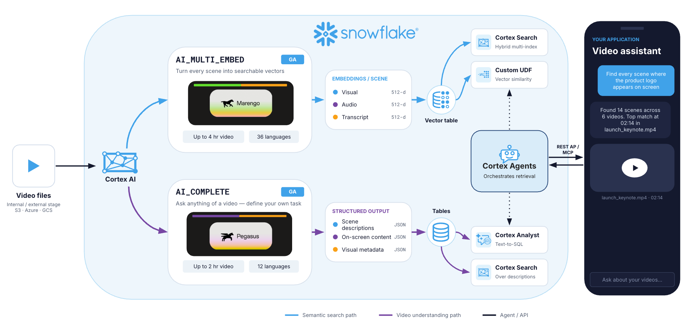
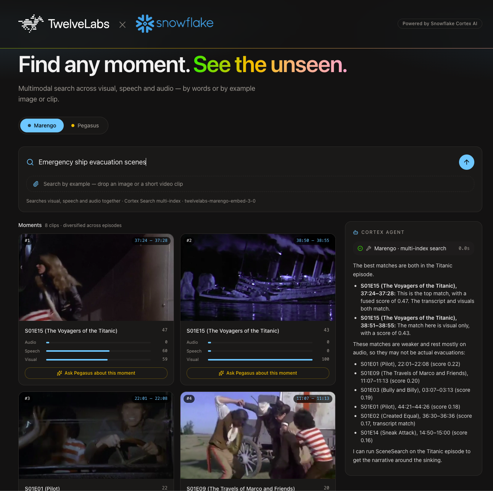
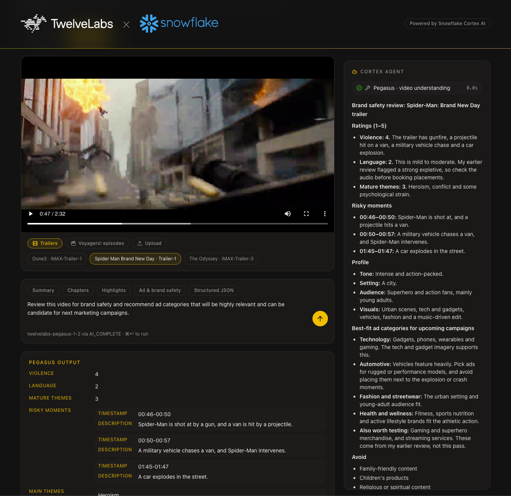

author: Akhil Ramasagaram
id: build-a-video-search-app-with-twelve-labs
language: en
summary: Build an end-to-end video search and analysis app on Snowflake with Twelve Labs Marengo 3.0, Pegasus 1.5, multi-index Cortex Search, and Snowflake App Runtime.
categories: snowflake-site:taxonomy/solution-center/certification/quickstart, snowflake-site:taxonomy/product/ai, snowflake-site:taxonomy/product/applications-and-collaboration, snowflake-site:taxonomy/snowflake-feature/cortex-search, snowflake-site:taxonomy/snowflake-feature/cortex-llm-functions
environments: web
status: Published
feedback link: https://github.com/Snowflake-Labs/sfguides/issues

# Build a Video Search App with Twelve Labs on Snowflake
<!-- ------------------------ -->
## Overview

In this guide you'll turn a folder of video files into an app that lets you:

- **Search** every video by typing a description or dropping in an image, across what's **seen**, **heard**, and **said**, and jump straight to the matching moment.
- **Analyze** any video with a plain-language prompt and get structured answers back with **Pegasus 1.5**.

The whole pipeline runs inside Snowflake. No video leaves your account, and every model call is a SQL function.



### What You'll Build
| Step | What it does | Snowflake surface |
|---|---|---|
| 1. Stage | Point Snowflake at your videos | Stage + directory table |
| 2. Embed | Turn each video into time-stamped vectors | `AI_MULTI_EMBED` with **Marengo 3.0** |
| 3. Index | Make visual, audio, and transcript vectors searchable | **Cortex Search** (multi-index) |
| 4. Search | Query one or all modalities at once | `multi_index_query` |
| 5. Analyze | Ask questions about a video | `AI_COMPLETE` with **Pegasus 1.5** |
| 6. App | Put it all behind a UI | **Snowflake App Runtime** (Next.js) |

### What You'll Learn
- How to embed video, text, and images into one shared vector space with `AI_MULTI_EMBED`
- How to build a Cortex Search service with **multiple vector indexes**, one per modality
- How to search them with `multi_index_query`
- How to ask questions about a video with `AI_COMPLETE` and Pegasus 1.5
- How to deploy the app on Snowflake App Runtime

### What You'll Need
- A Snowflake account in a region that supports `twelvelabs-marengo-embed-3-0`, or with cross-region inference enabled. See [AI_MULTI_EMBED regional availability](https://docs.snowflake.com/en/sql-reference/functions/ai_multi_embed).
- A role with `SNOWFLAKE.CORTEX_USER` and privileges to create a database, stage, and Cortex Search service
- A few `.mp4` files (a handful of short clips is enough to start)
- Node.js 20+ and the Snowflake CLI to run and deploy the app

<!-- ------------------------ -->
## Stage Your Videos

Create a database, a schema, and a stage with a directory table. The directory table is what lets you list and reference files from SQL.

```sql
CREATE DATABASE IF NOT EXISTS TWELVE_LABS_DEMO;
CREATE SCHEMA IF NOT EXISTS TWELVE_LABS_DEMO.VIDEO_INTELLIGENCE;
USE SCHEMA TWELVE_LABS_DEMO.VIDEO_INTELLIGENCE;

CREATE STAGE IF NOT EXISTS VIDEO_STAGE
  DIRECTORY  = (ENABLE = TRUE)
  ENCRYPTION = (TYPE = 'SNOWFLAKE_SSE');
```

Upload your videos to the stage in Snowsight (**Data » Add Data » Load files into a Stage**), or from the CLI:

```bash
snow stage copy ./videos/*.mp4 @TWELVE_LABS_DEMO.VIDEO_INTELLIGENCE.VIDEO_STAGE
```

Then refresh the directory table:

```sql
ALTER STAGE VIDEO_STAGE REFRESH;
SELECT RELATIVE_PATH, SIZE FROM DIRECTORY(@VIDEO_STAGE);
```

> aside positive
> **Already have video in S3, GCS, or Azure?** Create an external stage on a storage integration instead. The rest of this guide works the same with either kind of stage.

We also need a small internal stage where the app uploads images for image-to-video search and caches clips for Pegasus:

```sql
CREATE STAGE IF NOT EXISTS SEARCH_UPLOADS
  DIRECTORY  = (ENABLE = TRUE)
  ENCRYPTION = (TYPE = 'SNOWFLAKE_SSE');
```

<!-- ------------------------ -->
## Embed Videos with Marengo

`AI_MULTI_EMBED` with Marengo watches each video and returns a list of segments. Each segment has a 512-dimensional vector for one modality (`visual`, `audio`, or `transcription`) plus its start and end time.

Flatten that output into one row per segment:

```sql
CREATE OR REPLACE TABLE VIDEO_EMBEDDINGS AS
WITH raw AS (
    SELECT
        REPLACE(RELATIVE_PATH, '.mp4', '') AS episode,
        AI_MULTI_EMBED(
            'twelvelabs-marengo-embed-3-0',
            TO_FILE('@VIDEO_STAGE', RELATIVE_PATH)
        ) AS emb
    FROM DIRECTORY(@VIDEO_STAGE)
)
SELECT
    episode,
    f.value['embedding']::VECTOR(FLOAT, 512) AS embedding_vec,
    f.value['embedding_option']::STRING      AS modality,
    f.value['start_sec']::FLOAT              AS start_sec,
    f.value['end_sec']::FLOAT                AS end_sec
FROM raw, LATERAL FLATTEN(input => raw.emb['value']) f;
```

Check what you got:

```sql
SELECT modality, COUNT(*) AS segments, COUNT(DISTINCT episode) AS videos
FROM VIDEO_EMBEDDINGS
GROUP BY modality;
```

> aside positive
> Marengo puts text, images, and video in the **same vector space**. That's why a text query or an uploaded photo can be matched directly against video segments.

Now pivot to **one row per segment** with a column per modality, so each modality can get its own index:

```sql
CREATE OR REPLACE TABLE VIDEO_SEGMENT_VECTORS AS
SELECT
    episode || '_' || start_sec::STRING AS segment_id,
    episode, start_sec, end_sec,
    MAX(IFF(modality = 'visual',        embedding_vec, NULL)) AS visual_vec,
    MAX(IFF(modality = 'audio',         embedding_vec, NULL)) AS audio_vec,
    MAX(IFF(modality = 'transcription', embedding_vec, NULL)) AS transcript_vec
FROM VIDEO_EMBEDDINGS
GROUP BY episode, start_sec, end_sec;
```

<!-- ------------------------ -->
## Index with Multi-Index Cortex Search

Create one Cortex Search service with **three vector indexes**. Setting `query_model` tells the service which model produced the vectors, so you can query each index independently or together.

```sql
CREATE OR REPLACE CORTEX SEARCH SERVICE VIDEO_MULTI_SEARCH_SVC
  VECTOR INDEXES
    VISUAL_VEC     (query_model = 'twelvelabs-marengo-embed-3-0'),
    AUDIO_VEC      (query_model = 'twelvelabs-marengo-embed-3-0'),
    TRANSCRIPT_VEC (query_model = 'twelvelabs-marengo-embed-3-0')
  PRIMARY KEY (SEGMENT_ID)
  ATTRIBUTES  EPISODE
  WAREHOUSE   = <your_warehouse>
  TARGET_LAG  = '1 day'
AS (
    SELECT SEGMENT_ID, EPISODE, START_SEC, END_SEC,
           VISUAL_VEC, AUDIO_VEC, TRANSCRIPT_VEC
    FROM VIDEO_SEGMENT_VECTORS
);
```

<!-- ------------------------ -->
## Search with multi_index_query

Embed the query with the same Marengo model, then pass the vector to the index you want to search:

```python
from snowflake.core import Root

svc = (Root(session).databases["TWELVE_LABS_DEMO"]
       .schemas["VIDEO_INTELLIGENCE"]
       .cortex_search_services["VIDEO_MULTI_SEARCH_SVC"])

query_vec = session.sql("""
  SELECT AI_MULTI_EMBED('twelvelabs-marengo-embed-3-0',
         'Find me a scene where a ship is burning at night'):value[0]['embedding']::ARRAY
""").collect()[0][0]

results = svc.search(
    multi_index_query={"visual_vec": [{"vector": query_vec}]},
    columns=["episode", "start_sec", "end_sec"],
    limit=5,
)
```

To search what's **seen, heard, and said** in one request, pass the same vector to every index:

```python
results = svc.search(
    multi_index_query={
        "visual_vec":     [{"vector": query_vec}],
        "audio_vec":      [{"vector": query_vec}],
        "transcript_vec": [{"vector": query_vec}],
    },
    columns=["episode", "start_sec", "end_sec"],
    limit=5,
)
```

> aside positive
> **Image search** works the same way: upload the image to `SEARCH_UPLOADS` and embed it with `AI_MULTI_EMBED('twelvelabs-marengo-embed-3-0', TO_FILE('@SEARCH_UPLOADS', '<image>.jpg'))`. `multi_index_query` accepts text or vectors, so always embed files first.

> aside negative
> Raw Marengo similarity scores are on different scales per modality (transcript matches typically score much higher than visual or audio). If you want to weight modalities yourself, query each index separately, min-max normalize the scores, and combine them. The sample app does this in its `MARENGO_SEARCH` procedure.

<!-- ------------------------ -->
## Analyze Video with Pegasus 1.5

Pegasus 1.5 is a video understanding model, available in `AI_COMPLETE`. Give it a staged video and a natural-language prompt to summarize it, answer questions about it, or extract structured information:

```sql
SELECT AI_COMPLETE(
    'twelvelabs-pegasus-1-5',
    'Summarize this video in 3 bullets, then return JSON with the main characters and the timestamp each first appears.',
    TO_FILE('@VIDEO_STAGE', '<your_video>.mp4')
) AS analysis;
```

There's no frame extraction and no transcription step.

> aside positive
> Pegasus 1.5 accepts MP4, MOV, AVI, MKV, and WebM files up to **2 hours** and **2 GB**. See the [release note](https://docs.snowflake.com/en/release-notes/2026/other/2026-11-16-ai-complete-pegasus-1-5-preview) and [Cortex AI Functions: Multimodal](https://docs.snowflake.com/en/user-guide/snowflake-cortex/ai-multimodal).

> aside positive
> **Pair it with search.** To analyze just one search hit, cut its `start_sec`/`end_sec` range to a clip and send the clip to Pegasus. The sample app's `PEGASUS_ANALYZE` procedure does this, caching clips in `SEARCH_UPLOADS/clips/`.

<!-- ------------------------ -->
## Deploy the App on Snowflake App Runtime

The front end is a Next.js app that runs on **Snowflake App Runtime (SAR)**. It's a thin layer over the SQL you just wrote:

- **Search**: embeds the text or image query with Marengo, runs `multi_index_query` against `VIDEO_MULTI_SEARCH_SVC`, and plays each hit at its timestamp with a presigned URL.
- **Analyze**: sends a video (or a search hit's time range) and a prompt to Pegasus 1.5.





Clone the repo, point it at your objects, and deploy:

```bash
git clone <REPO_URL>
cd tl-video-studio
npm install
npm run dev            # run locally against your default Snowflake connection
snow app deploy        # deploy to Snowflake App Runtime
```

See the repo README for the setup script (stored procedures, stage, and service) and configuration.

### Try it
- **Search:** *"Find me a scene where a ship is burning at night"*, or upload a photo of a location or character.
- **Analyze:** open a hit and ask *"Return JSON with a summary, the main characters, and any historical references."*

<!-- ------------------------ -->
## Conclusion and Resources

You built a video search and analysis app with SQL functions and a small front end on Snowflake App Runtime:

- **Marengo 3.0** (`AI_MULTI_EMBED`) turned your videos into time-stamped visual, audio, and transcript vectors.
- **Multi-index Cortex Search** made every modality searchable by text or image in one service.
- **Pegasus 1.5** (`AI_COMPLETE`) answered questions about any video or moment.

### What You Learned
- How to embed video, text, and images into one shared vector space with Marengo
- How to build and query a multi-index Cortex Search service with `multi_index_query`
- How to analyze a video, or a single search hit, with Pegasus

### Next Steps
- Run Pegasus over your whole library with a JSON schema and store the output as a metadata table you can join to your business data.
- Wrap search and analysis as tools on a Cortex Agent.

### Related Resources
- [Sample app source](<REPO_URL>)
- [AI_MULTI_EMBED documentation](https://docs.snowflake.com/en/sql-reference/functions/ai_multi_embed)
- [AI_COMPLETE documentation](https://docs.snowflake.com/en/sql-reference/functions/ai_complete)
- [Cortex AI Functions: Multimodal](https://docs.snowflake.com/en/user-guide/snowflake-cortex/ai-multimodal)
- [Cortex Search overview](https://docs.snowflake.com/en/user-guide/snowflake-cortex/cortex-search/cortex-search-overview)
- [Twelve Labs](https://www.twelvelabs.io)
