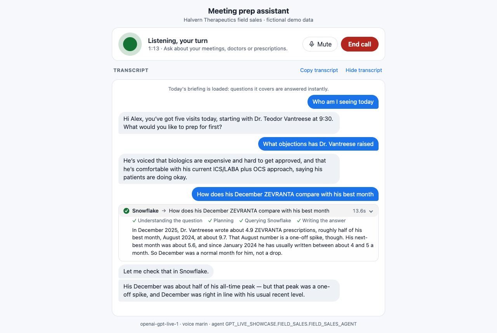
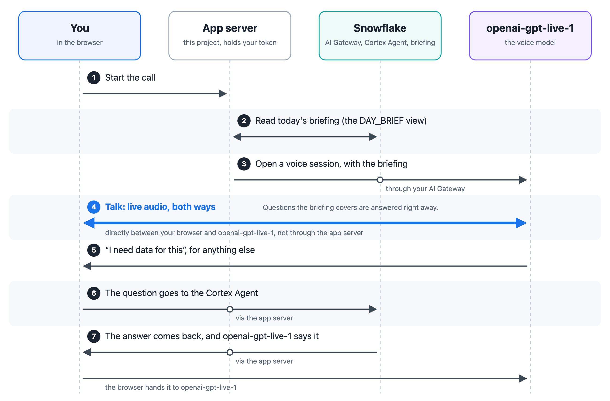

author: Jakub Swiatkowski
id: build-a-voice-assistant-with-gpt-live-and-cortex-agents
language: en
summary: Build a hands-free voice assistant that talks with openai-gpt-live-1 in the browser and answers data questions with a Snowflake Cortex Agent.
categories: snowflake-site:taxonomy/solution-center/certification/quickstart, snowflake-site:taxonomy/product/ai, snowflake-site:taxonomy/snowflake-feature/ingestion/conversational-assistants, snowflake-site:taxonomy/snowflake-feature/cortex-analyst, snowflake-site:taxonomy/industry/healthcare-and-life-sciences
environments: web
status: Published
feedback link: https://github.com/Snowflake-Labs/sfguides/issues

# Build a Voice Assistant with openai-gpt-live-1 and Cortex Agents
<!-- ------------------------ -->
## Overview

> **Note:** `openai-gpt-live-1` is currently in Private Preview. Contact your Snowflake account team to request access.

> **Sample code, not production code.** This app shows how `openai-gpt-live-1` and Cortex Agents fit together. It isn't a supported Snowflake product and isn't hardened for production: review it, and add what your organization needs, before you use it with real data.

A sales rep has two minutes in the car before meeting a doctor. They don't want
to open a dashboard. They want to ask "Who am I seeing today?" and hear the answer.

In this guide you build that assistant. You talk to it in the browser, hands-free.
Two Snowflake services share the work:

- **`openai-gpt-live-1`** is the voice. It listens, takes turns and speaks.
- A **Cortex Agent** is the data expert. When a question needs your data, `openai-gpt-live-1`
  hands it to the agent, and then says the agent's answer in its own words.

All data in this guide is synthetic. Halvern Therapeutics, its products, the
doctors and the sales figures are invented.



### Prerequisites
- A Snowflake account where you can use the **ACCOUNTADMIN** role
- Access to the `openai-gpt-live-1` model for that account (see [Enable openai-gpt-live-1](#enable-openai-gpt-live-1))
- [Cross-region inference](https://docs.snowflake.com/en/user-guide/snowflake-cortex/cross-region-inference) that includes Azure US, where `openai-gpt-live-1` runs.
  It's an account-wide setting that applies to every model (see [Enable openai-gpt-live-1](#enable-openai-gpt-live-1))
- Basic familiarity with SQL and a terminal

### What You'll Learn
- How a voice model hands questions to your app (**client delegation**)
- How to start an `openai-gpt-live-1` session through your account's **AI Gateway**, with no
  OpenAI or Azure key
- How to stream a **Cortex Agent** answer back into a live conversation
- How to mix **precomputed insights**, answered instantly, with **on-demand
  insights** looked up live

### What You'll Need
- [Node.js](https://nodejs.org/) 20.12 or later
- Chrome, Edge, Safari or Firefox
- Optional, to deploy the app for your team: Docker with `buildx` and the
  [Snowflake CLI](https://docs.snowflake.com/developer-guide/snowflake-cli/index)

### What You'll Build
- Sample sales data, a semantic view, a Cortex Agent and a view of today's
  precomputed insights, from one SQL script
- A small web app: start a call, talk, and watch each Snowflake lookup happen
  in a live transcript

<!-- ------------------------ -->
## Enable openai-gpt-live-1

The `openai-gpt-live-1` model is in Private Preview, so it needs to be enabled
for your account first. The app reaches it through your account's **AI Gateway**
(usually named `snowflake`), which gives apps governed access to models, so you
never handle an Azure key.

**1. Request access.** Ask your Snowflake account team for access. Your
organization accepts the Private Preview terms, and Snowflake enables the
`openai-gpt-live-1` model for your account.

**2. Check that the model is listed.** Once they confirm, check whether the
model is in your account:

```sql
SHOW MODELS LIKE '%GPT-LIVE%' IN SCHEMA SNOWFLAKE.MODELS;
```

If `OPENAI-GPT-LIVE-1` is listed, you're done with this step. If it isn't, run
this as ACCOUNTADMIN, then run the check again. Or wait: the list also refreshes
on its own within 24 hours.

```sql
USE WAREHOUSE <any_warehouse>;   -- the refresh needs one
CALL SNOWFLAKE.MODELS.CORTEX_BASE_MODELS_REFRESH();
```

Voice calls fail with a 401 until the model is listed.

**3. Allow cross-region inference.** `openai-gpt-live-1` runs in Azure East US 2, and the
models the agent uses may not be offered in your region either. Unless your
account is in Azure East US 2, check the
[cross-region inference](https://docs.snowflake.com/en/user-guide/snowflake-cortex/cross-region-inference)
setting:

```sql
SHOW PARAMETERS LIKE 'CORTEX_ENABLED_CROSS_REGION' IN ACCOUNT;
```

If it shows `DISABLED`, or a region group that doesn't include Azure US (for
example `AWS_US`), `openai-gpt-live-1` can't be reached. `ANY_REGION` fixes that, but it
means requests for every model may be processed in a region other than your
account's. Check your data-sovereignty requirements before you change it.

```sql
ALTER ACCOUNT SET CORTEX_ENABLED_CROSS_REGION = 'ANY_REGION';
```

No model grant is needed by default. Model access uses
[role-based access control](https://docs.snowflake.com/en/user-guide/snowflake-cortex/aisql-privileges-and-access#control-model-access),
and by default every role can use every model: Snowflake grants the
`SNOWFLAKE."CORTEX-MODEL-ROLE-ALL"` application role to `SNOWFLAKE.PUBLIC`.
If your account limits model access, then after you run `setup.sql` in the next
section, grant the `openai-gpt-live-1` model role to `GPT_LIVE_SHOWCASE_ROLE`:

```sql
GRANT APPLICATION ROLE SNOWFLAKE."CORTEX-MODEL-ROLE-OPENAI-GPT-LIVE-1" TO ROLE GPT_LIVE_SHOWCASE_ROLE;
```

The agent also needs one model it may use: if lookups then fail with "None of the
preferred models are authorized", grant one of the models it lists the same way.

<!-- ------------------------ -->
## Set Up Snowflake

Download the app and unzip it:
[gpt_live_agents_showcase.zip](https://github.com/Snowflake-Labs/sfquickstarts/blob/master/site/sfguides/src/build-a-voice-assistant-with-gpt-live-and-cortex-agents/assets/gpt_live_agents_showcase.zip).
All the commands below run from the unzipped `gpt-live-agents-showcase` folder.

**1. Create the objects.** Run `snowflake/setup.sql` as ACCOUNTADMIN. Paste it
into a Snowsight worksheet and choose **Run All**, or use the
[Snowflake CLI](https://docs.snowflake.com/developer-guide/snowflake-cli/index),
where `<your-connection>` is a connection you created with `snow connection add`.

```bash
snow sql -c <your-connection> --role ACCOUNTADMIN -f snowflake/setup.sql
```

The script creates everything below. You can run it again at any time; it
rebuilds the same objects.

| Object | Name |
|---|---|
| Role | `GPT_LIVE_SHOWCASE_ROLE` |
| Warehouse | `GPT_LIVE_SHOWCASE_WH` |
| Database and schema | `GPT_LIVE_SHOWCASE.FIELD_SALES` |
| Table of sample data | `HCP_EVENTS`: 960 rows of a rep's schedule, prescriptions, meetings, objections and payer coverage |
| Semantic view | `FIELD_SALES_SV` |
| Cortex Agent | `FIELD_SALES_AGENT` |
| Briefing view | `DAY_BRIEF`: today's precomputed insights, one short paragraph per visit |
| OAuth integration | `GPT_LIVE_SHOWCASE_OAUTH`: lets the app sign you in with Snowflake. The script prints its client ID, which you need later. |

The data is synthetic. Every company, product, doctor and payer name is made up.

**2. Grant access.** As ACCOUNTADMIN, give yourself the role:

```sql
GRANT ROLE GPT_LIVE_SHOWCASE_ROLE TO USER <your_user>;
```

**3. Test the agent.** Before adding voice, check that the agent answers. In
Snowsight, open **AI & ML → Agents → FIELD_SALES_AGENT** and ask:

```
How much ZEVRANTA did Dr. Vantreese prescribe in December?
```

The answer should be about 4.9 prescriptions.

<!-- ------------------------ -->
## Run the App Locally

**1. Add your settings.** Copy the example settings file:

```bash
cp .env.example .env
```

Open `.env` and fill in the two required values:

```bash
SNOWFLAKE_ACCOUNT_URL=https://<org>-<account>.snowflakecomputing.com
SNOWFLAKE_OAUTH_CLIENT_ID=<the client ID setup.sql printed>
```

The client ID isn't a secret. The app has no password or token of its own: you
sign in with Snowflake when you open it. To see the client ID again, run:

```sql
SELECT PARSE_JSON(SYSTEM$SHOW_OAUTH_CLIENT_SECRETS('GPT_LIVE_SHOWCASE_OAUTH')):OAUTH_CLIENT_ID::STRING;
```

You don't need to change anything else. These optional settings have working
defaults, and the agent settings match the objects from `setup.sql`:

| Setting | Default | What it controls |
|---|---|---|
| `AI_GATEWAY_NAME` | `snowflake` | The AI Gateway that starts `openai-gpt-live-1` sessions |
| `GPT_LIVE_MODEL` | `openai-gpt-live-1` | The voice model |
| `GPT_LIVE_VOICE` | `marin` | The assistant's voice, for example `marin`, `cedar`, `alloy`, `coral` or `verse` |
| `AGENT_DATABASE` | `GPT_LIVE_SHOWCASE` | Where the agent lives |
| `AGENT_SCHEMA` | `FIELD_SALES` | Where the agent lives |
| `AGENT_NAME` | `FIELD_SALES_AGENT` | Which agent answers questions |
| `AGENT_TIMEOUT_MS` | `120000` | How long one lookup may take, in milliseconds |
| `BRIEF_VIEW` | `GPT_LIVE_SHOWCASE.FIELD_SALES.DAY_BRIEF` | The view with today's precomputed briefing. `off` turns it off |
| `SNOWFLAKE_WAREHOUSE` | `GPT_LIVE_SHOWCASE_WH` | The warehouse that reads the briefing |
| `SNOWFLAKE_ROLE` | `GPT_LIVE_SHOWCASE_ROLE` | The role the sign-in asks for, which also reads the briefing. `off` uses your default role |
| `LISTEN_PORT` | `3000` | The local port. If you change it, change the OAuth integration's redirect URI to match: `ALTER SECURITY INTEGRATION GPT_LIVE_SHOWCASE_OAUTH SET OAUTH_REDIRECT_URI = 'http://127.0.0.1:<port>/oauth/callback';` |

If you change `.env` later, restart the app: it reads the file when it starts.

**2. Start the app.**

```bash
npm install
npm run dev
```

Open [http://127.0.0.1:3000](http://127.0.0.1:3000), press **Sign in with
Snowflake** and sign in with your user. The app asks only for
`GPT_LIVE_SHOWCASE_ROLE`. Your Snowflake token stays in the app server's memory:
it is never written to disk and never reaches the browser, and only the browser
you signed in with can use it. Stopping the server
makes the app forget it; the tokens expire on their own.

> **Keep this sign-in.** AI Gateway accepts the Snowflake OAuth token this sign-in gives the app. It doesn't currently accept a session from a driver's `externalbrowser` (SSO) login, so don't swap the sign-in for that.

<!-- ------------------------ -->
## Have a Conversation

Press **Start call** and allow the microphone. The assistant greets you, and
the transcript notes that today's briefing is loaded. The sample data is set on
Friday 16 January 2026, so that is "today" for the assistant. Try both kinds of
question.

**Precomputed insights** are in today's briefing, so `openai-gpt-live-1` answers them at once:

- "Who am I seeing today?"
- "What's the focus for my meeting with Dr. Vantreese?"
- "How much ZEVRANTA did he prescribe in December?"
- "What objections has he raised?"
- "Which payer covers most of his patients?"

**On-demand insights** need a live lookup, so the Cortex Agent answers them in
15 to 20 seconds, with a Snowflake row in the transcript:

- "How does his December ZEVRANTA compare with his best month?"
- "How has his ZEVRANTA trend looked over the last six months?"
- "What happened on my last visit with him?"

Not every question goes to Snowflake. For small talk, or a follow-up that the
last answer already covers ("What time was the first one?"), `openai-gpt-live-1` answers
straight away.

While you talk, the screen shows:

- **A status line.** It tells you who is talking or what is happening, such as
  "You're speaking", "Looking it up in Snowflake…" or "Listening, your turn",
  and, under it, what you can do now, such as "Talk any time to interrupt".
- **A live transcript** of both sides.
- **A Snowflake row** for each question sent to the agent. It shows the question
  and a timer. Click it to see the agent's steps and full answer.
- **A Mute button.** You can also press **M**. Mute only turns your microphone
  off: the call stays connected. **End call** closes the session, and
  **Start call** opens a new one.
- **Copy transcript**, which copies the whole conversation, including each
  lookup's question and answer.

If the sign-in fails, check that you opened `http://127.0.0.1:3000` and that
your user has `GPT_LIVE_SHOWCASE_ROLE`. If the call doesn't start, the page
shows why, and the terminal running `npm run dev` has the full error. A **401**
usually means `openai-gpt-live-1` isn't enabled for the account yet, or
`GPT_LIVE_SHOWCASE_ROLE` can't use it: see [Enable openai-gpt-live-1](#enable-openai-gpt-live-1).
If lookups fail with "None of the preferred
models are authorized or available in your region", turn on
[cross-region inference](https://docs.snowflake.com/en/user-guide/snowflake-cortex/cross-region-inference).
Now and then the voice service refuses a
single call (a 400 or 500): press **Try again**. If the assistant cuts itself
off, it is hearing itself through your speakers: use headphones, or turn the
volume down.

Each call opens an `openai-gpt-live-1` session and each lookup runs the Cortex Agent; both
use credits (see the [Snowflake Service Consumption Table](https://www.snowflake.com/legal-files/CreditConsumptionTable.pdf)).
The app server lets each user start at most 6 calls and 20 lookups a minute.

<!-- ------------------------ -->
## How It Works

Read the diagram from top to bottom. Each row is one step, and each arrow shows
who sends what to whom.



1. **You press Start call.** The browser asks the app server to start a voice session.
2. **The server reads today's briefing.** The `DAY_BRIEF` view turns the data
   into one short paragraph per visit: its focus, the latest prescribing, the
   top payer, open objections and the next best action. These are the
   **precomputed insights**.
3. **The server opens the session through the AI Gateway.** The server asks
   your account's AI Gateway to open an `openai-gpt-live-1` session, with the briefing in
   its instructions. The server holds your token, and the gateway holds the
   model provider's key, so neither reaches the browser.
4. **You and `openai-gpt-live-1` talk directly.** Your voice and its voice travel straight
   between the browser and `openai-gpt-live-1`, at the model provider. They don't pass
   through the app server. When the briefing covers a question, `openai-gpt-live-1`
   answers at once.
5. **`openai-gpt-live-1` asks for data.** For anything else, the **on-demand insights**,
   `openai-gpt-live-1` tells the browser, and the browser sends the conversation so far
   to the server. This hand-off is called **client delegation**: `openai-gpt-live-1` has
   no tools of its own, so your app answers its data questions.
6. **The server asks the Cortex Agent.** The agent turns the question into SQL
   over the semantic view and finds the answer.
7. **`openai-gpt-live-1` says the answer.** The answer goes back through the browser to
   `openai-gpt-live-1`, which says it in its own words.

The `DAY_BRIEF` view is plain SQL over the data, so it gives the same answers
every time. To change what is precomputed, edit the view in
`snowflake/setup.sql`. The server caches the briefing for 10 minutes, so restart
`npm run dev` to see an edit at once. If the view is missing, calls still work:
every data question goes to the agent.

### Precomputed vs on-demand insights

| | Precomputed insights | On-demand insights |
|---|---|---|
| Where they come from | The `DAY_BRIEF` view, read when the call starts | The Cortex Agent, at question time |
| Speed | Instant: `openai-gpt-live-1` already knows them | About 15 seconds |
| What they cover | A fixed set: each visit's focus, latest prescribing, top payer, open objections, next best action | Anything the semantic view can answer |
| In the transcript | Only the spoken answer | A Snowflake row with the steps and the agent's full answer |
| To change them | Edit the view in `snowflake/setup.sql` | Edit the agent or the semantic view |

### Which one answered

`openai-gpt-live-1` decides, from its instructions in `server/src/persona.ts`, whether the
briefing covers a question. To see which one answered:

- **In the app:** each answer from the Cortex Agent has a Snowflake row in the
  transcript. No row means `openai-gpt-live-1` answered on its own, from the briefing or
  the conversation.
- **In the server log:** each lookup logs `Delegation started` and
  `Delegation answered`, with its time and the tools the agent used.
- **In code:** a lookup begins when the browser receives `openai-gpt-live-1`'s
  `session.delegation.created` event (`web/app.js`).

<!-- ------------------------ -->
## Deploy to SPCS

This step is optional. So far the app runs on your machine. To share it with
your team, run it as one container in your account with
[Snowpark Container Services](https://docs.snowflake.com/en/developer-guide/snowpark-container-services/overview)
(SPCS). Everyone opens it at one URL after signing in to Snowflake. It needs no
token or `.env`: the app uses the token Snowflake mounts in the container.

You need Docker with `buildx`, and a Snowflake CLI connection whose user can use
both ACCOUNTADMIN and `GPT_LIVE_SHOWCASE_ROLE`. From the app folder, create the
compute pool and grants, build and push the image under a tag of your choice
(here `v1`), then create the service:

```bash
snow sql -c <your-connection> --role ACCOUNTADMIN -f spcs/01_spcs_objects.sql
spcs/push-image.sh <your-connection> v1
snow sql -c <your-connection> --role GPT_LIVE_SHOWCASE_ROLE -f spcs/02_service.sql -D image_tag=v1
```

As ACCOUNTADMIN, let each person in:

```sql
GRANT ROLE GPT_LIVE_SHOWCASE_USER TO USER <app_user>;
```

Then take back the two rights `GPT_LIVE_SHOWCASE_ROLE` needed only to create the
service. The app runs with that role's rights, so without them it can't create
other services. To create the service again from scratch, run
`spcs/01_spcs_objects.sql` again first.

```sql
REVOKE CREATE SERVICE, CREATE IMAGE REPOSITORY ON SCHEMA GPT_LIVE_SHOWCASE.FIELD_SALES
  FROM ROLE GPT_LIVE_SHOWCASE_ROLE;
```

After a minute or two, open the `ingress_url` from
`SHOW ENDPOINTS IN SERVICE GPT_LIVE_SHOWCASE.FIELD_SALES.GPT_LIVE_SHOWCASE_SERVICE;`
and sign in.

Every call runs as `GPT_LIVE_SHOWCASE_ROLE`, so every app user can ask, through
the agent, about anything that role can read. Grant it only data that all app
users may see.

The service costs compute until you suspend it: the compute pool doesn't suspend
on its own while the service runs. When you're done, as ACCOUNTADMIN:

```sql
ALTER SERVICE GPT_LIVE_SHOWCASE.FIELD_SALES.GPT_LIVE_SHOWCASE_SERVICE SUSPEND;
ALTER COMPUTE POOL GPT_LIVE_SHOWCASE_POOL SUSPEND;
```

The README's *Deploy to SPCS* section covers starting it again, shipping a new
version and troubleshooting.

<!-- ------------------------ -->
## Clean Up

To remove everything this guide created, run as ACCOUNTADMIN. The first four
lines only matter if you deployed to SPCS; they do nothing otherwise.

```sql
DROP SERVICE IF EXISTS GPT_LIVE_SHOWCASE.FIELD_SALES.GPT_LIVE_SHOWCASE_SERVICE;
ALTER COMPUTE POOL IF EXISTS GPT_LIVE_SHOWCASE_POOL STOP ALL;
DROP COMPUTE POOL IF EXISTS GPT_LIVE_SHOWCASE_POOL;
DROP ROLE IF EXISTS GPT_LIVE_SHOWCASE_USER;
DROP DATABASE IF EXISTS GPT_LIVE_SHOWCASE;
DROP WAREHOUSE IF EXISTS GPT_LIVE_SHOWCASE_WH;
DROP ROLE IF EXISTS GPT_LIVE_SHOWCASE_ROLE;
DROP SECURITY INTEGRATION IF EXISTS GPT_LIVE_SHOWCASE_OAUTH;
```

<!-- ------------------------ -->
## Conclusion And Resources

You built a voice assistant that holds a natural, hands-free conversation and
answers questions from your data in Snowflake. `openai-gpt-live-1` handles the voice, a
Cortex Agent handles the data, and you never handle a model key.

### What You Learned
- How to start an `openai-gpt-live-1` session through the Snowflake AI Gateway
- How client delegation lets a voice model hand data questions to your app
- How to stream a Cortex Agent's answer back into a live conversation
- How precomputed insights answer common questions instantly, while the agent
  handles the rest

### Related Resources
- [Download the app](https://github.com/Snowflake-Labs/sfquickstarts/blob/master/site/sfguides/src/build-a-voice-assistant-with-gpt-live-and-cortex-agents/assets/gpt_live_agents_showcase.zip)
- [Cortex Agents documentation](https://docs.snowflake.com/en/user-guide/snowflake-cortex/cortex-agents)
- [Semantic views documentation](https://docs.snowflake.com/en/user-guide/views-semantic/overview)
- [Build a Cortex Agent from Scratch with Snowflake](https://www.snowflake.com/en/developers/guides/build-a-cortex-agent-from-scratch-with-snowflake/)
- [Intro to Snowpark Container Services](https://www.snowflake.com/en/developers/guides/intro-to-snowpark-container-services/)
