author: Emil Hvitfeldt
id: build-and-deploy-an-interactive-python-dashboard-with-posit-team-and-cortex
language: en
summary: Build and deploy an interactive Shiny for Python dashboard using the Posit Team Native App, exploring the data with Posit Assistant backed by Snowflake Cortex AI
categories: snowflake-site:taxonomy/solution-center/certification/quickstart, snowflake-site:taxonomy/product/ai, snowflake-site:taxonomy/product/data-engineering, snowflake-site:taxonomy/snowflake-feature/cortex-llm-functions, snowflake-site:taxonomy/industry/financial-services
environments: web
status: Published
feedback link: https://github.com/Snowflake-Labs/sfguides/issues

# Build and Deploy an Interactive Python Dashboard with the Posit Team Native App and Snowflake Cortex AI

<!-- ------------------------ -->
## Overview

In this guide, we will use the Posit Team Native App to build an interactive Python dashboard over Home Mortgage Disclosure Act (HMDA) data. In Posit Workbench you will open the Positron Pro IDE, connect to Snowflake with Ibis, and use Posit Assistant with a Snowflake Cortex AI model to explore the data. Then you will build a Shiny for Python dashboard and publish it to Posit Connect with one-click deployment, so your whole team can use it.


The deployed dashboard respects Snowflake's own security and authorization settings. Because you attach Connect's Snowflake integration to the content before publishing, each viewer's queries run under their own Snowflake identity, so they see only the data they have been granted.

By the end you will have a working dashboard where users filter mortgage applications by loan type, state, and loan amount, and see the resulting distribution of loan amounts, three headline metrics, and a year-over-year trend.

This guide is the Python counterpart to [Build and Deploy an Interactive Shiny Dashboard with the Posit Team Native App and Snowflake Cortex AI](https://www.snowflake.com/en/developers/guides/build-and-deploy-interactive-dashboard-with-posit-team-and-cortex/), which covers the same process within R.

### Prerequisites

- Familiarity with SQL and Python
- Some exposure to reactive dashboards is helpful but not required

### What You'll Learn

- How to connect to Snowflake from Positron Pro in Workbench using Workbench-managed credentials, with no secrets in your code
- How to query Snowflake from Python with Ibis, keeping the work in the database
- How to use Posit Assistant with a Snowflake Cortex AI model for exploratory data analysis and for refining app code
- How to build an interactive Shiny for Python dashboard over a Snowflake table
- How to publish that dashboard to Connect and have it query Snowflake under each viewer's own credentials

### What You'll Need

- A [Snowflake account](https://signup.snowflake.com/?utm_source=snowflake-devrel&utm_medium=developer-guides&utm_cta=developer-guides) with Cortex AI enabled
- The [Posit Team Native App](https://app.snowflake.com/marketplace/listing/GZTSZMCB9S/posit-pbc-posit-team), already installed and configured by an administrator with the `accountadmin` role, and access granted to you
- Access to the [`SNOWFLAKE_PUBLIC_DATA_FREE` database](https://app.snowflake.com/marketplace/listing/GZTSZ290BV255/snowflake-public-data-products-snowflake-public-data-free)
- A running warehouse you can use for compute. This guide uses `DEFAULT_WH`

### What You'll Build

- An interactive Shiny for Python dashboard for exploring HMDA mortgage data, published on Connect in the Posit Team Native App and querying Snowflake as each viewer

<!-- ------------------------ -->
## Check Your Access to the Data

In this guide we will use the HMDA dataset from Snowflake's free public database. It holds mortgage application and origination records: loan types, applicant demographics, property characteristics, loan amounts, and outcomes, across U.S. geographic areas.

The table is at:

- **Database:** `SNOWFLAKE_PUBLIC_DATA_FREE`
- **Schema:** `PUBLIC_DATA_FREE`
- **Table:** `HOME_MORTGAGE_DISCLOSURE_ATTRIBUTES`

In Snowsight, click **+** > **SQL File** and run:

```sql
SELECT *
FROM SNOWFLAKE_PUBLIC_DATA_FREE.PUBLIC_DATA_FREE.HOME_MORTGAGE_DISCLOSURE_ATTRIBUTES
LIMIT 10;
```

Ten rows should come back. If they do not, ask your account administrator to grant you access to the database.

<!-- ------------------------ -->
## Launch Posit Workbench from the Posit Team Native App

### Open the Native App

In Snowsight, click **Apps** in the left sidebar, select the **Posit Team Native App**, then click **Launch app**.

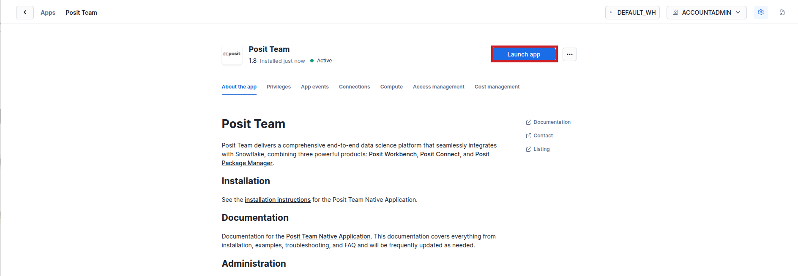

If you do not see the app, ask your Snowflake account administrator to install the [Posit Team Native App](https://app.snowflake.com/marketplace/listing/GZTSZMCB9S/posit-pbc-posit-team) from the Marketplace, [configure](https://docs.posit.co/partnerships/snowflake/posit-team/) it, and grant you access.

From the Posit Team landing page, click **Posit Workbench**.

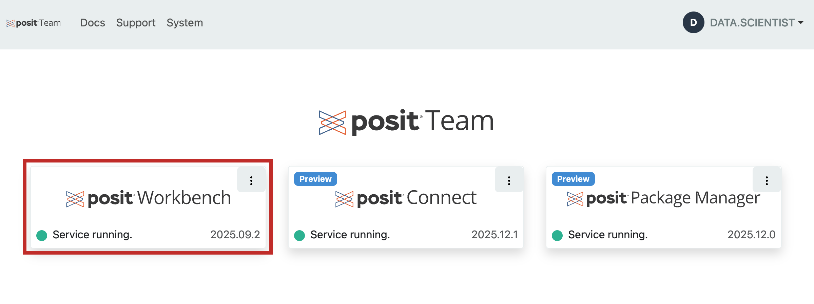

You may be prompted to sign in to Snowflake with your usual credentials.

### Start a Positron Pro Session

Workbench offers several IDEs, including Positron Pro, VS Code, RStudio Pro Jupyter Notebook, and JupyterLab. This guide uses Positron Pro, Posit's data science IDE for Python and R.

1. Click **+ New Session**.

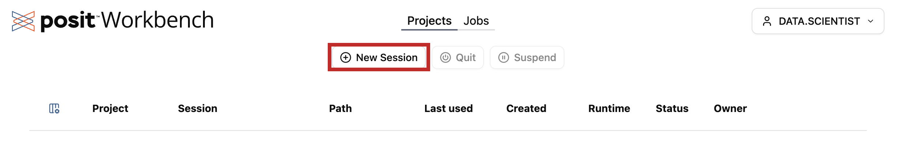

2. Select the **Positron Pro** IDE. You can give the session a name.

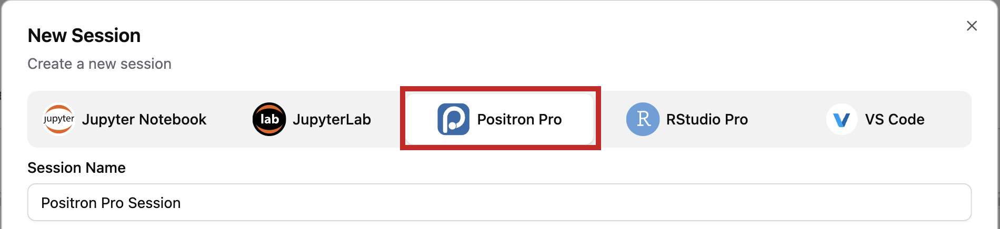

3. Check the Snowflake credential under **Session Credentials**. It is listed by account and role, and it is selected when it shows a check mark. If a lock is displayed instead, click it and complete the sign-in prompts. To use a different role, open the drop-down arrow on the right of the credential and choose one that is signed in. Pick a role that can read `SNOWFLAKE_PUBLIC_DATA_FREE` and use the `DEFAULT_WH` warehouse. Your session then inherits that role, so your queries use your own identity and grants. See [Workbench-managed credentials](https://docs.posit.co/ide/server-pro/user/posit-workbench/managed-credentials/managed-credentials.html#starting-a-session-with-workbench-managed-credentials) and [Workbench-managed Snowflake credentials](https://docs.posit.co/ide/server-pro/user/posit-workbench/managed-credentials/snowflake.html) for how this works.

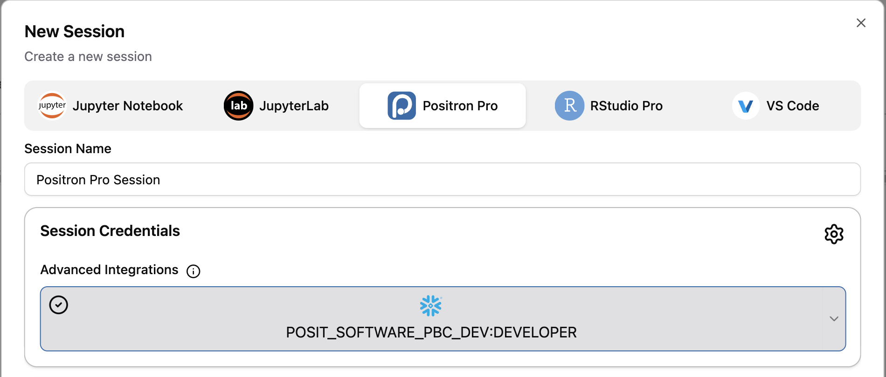

4. Click **Launch**.

### Confirm You Have the Right Extensions

This guide uses three extensions, all shipped with Positron as [bootstrapped extensions](https://positron.posit.co/extensions.html#bootstrapped-extensions), so they should already be present:

- The [Shiny extension](https://open-vsx.org/extension/posit/shiny), for running Shiny apps from the editor
- [Posit Publisher](https://docs.posit.co/connect/user/publishing-positron-vscode/), for one-click deployment to Connect
- [Posit Assistant](https://positron.posit.co/assistant.html), used in the next section

Open the Extensions view from the activity bar and search for each by name. An installed and enabled extension shows a gear icon; otherwise click **Install**. If they are disabled and you cannot enable them, ask your administrator.

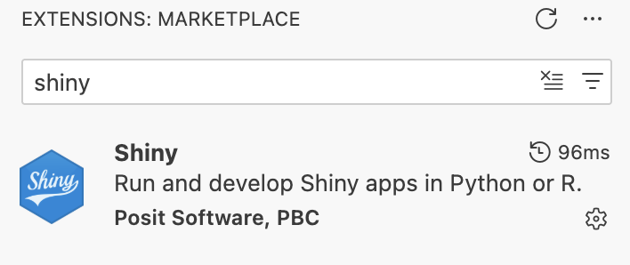

You can also confirm that the extensions loaded from the activity bar. Posit Assistant and Posit Publisher each add an icon there, highlighted below.

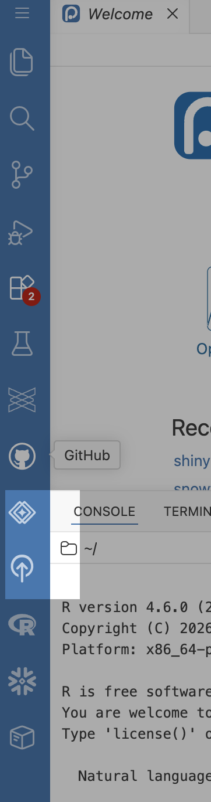

### Set Up Posit Assistant

[Posit Assistant](https://positron.posit.co/assistant.html) is Positron's AI assistant for data science. Beyond being able to read your active files, selected code, and project structure, it uses context from your interactive work: loaded data, plots, and console history. That is what makes it useful for exploratory analysis rather than only for writing code. The agent works in the same session as you, in much the same way as you would.

Positron's AI features use a bring-your-own-key model, and **Snowflake Cortex** is one of the available providers. We don't need to manage any credentials because we opened our Workbench session through the Posit Team Native App. Positron will read those credentials, derive your Cortex endpoint from your account, and authenticate the provider for you. Your prompts and your data go to Cortex inside your own Snowflake account, under the same identity your queries use.

Open Posit Assistant, which appears in the sidebar or as an editor panel depending on your configuration. Then open the model selector in the chat input area and choose a **Snowflake Cortex** model. Models from other providers appear in the same list and display names repeat across providers, so pick deliberately rather than relying on whichever model is selected by default. When the chat form is narrow the selector collapses into an overflow (`...`) menu, where the models are grouped under each provider's name.

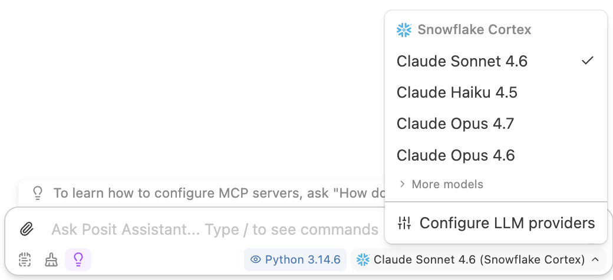

> **Note:** If Snowflake Cortex is missing from the list, the provider may have been turned off. Provider configuration lives in `~/.posit/ai/providers.json` — see the [Posit Assistant Get Started guide](https://positron.posit.co/assistant-getting-started.html) — and changes require restarting Positron. On a managed Workbench installation this may be your administrator's call.

<!-- ------------------------ -->
## Get the Guide's Materials

The code in this guide lives at <https://github.com/posit-dev/snowflake-posit-python-dashboard-cortex>.

1. Open a terminal in Positron. If one is not already open, use the Command Palette (`Ctrl/Cmd+Shift+P`) and select **Terminal: Create New Terminal**.

2. Clone the repository:

   ```bash
   git clone https://github.com/posit-dev/snowflake-posit-python-dashboard-cortex/
   ```

   > **Note:** This uses HTTPS for git authentication, so your standard git credentials apply.

3. Open the folder: Command Palette > **File: Open Folder** > `snowflake-posit-python-dashboard-cortex`.

### Install the Python Packages

The analysis uses [Ibis](https://ibis-project.org/) for querying Snowflake, [plotnine](https://plotnine.org/) for plots, [Shiny for Python](https://shiny.posit.co/py/) for the dashboard, and [posit-sdk](https://github.com/posit-dev/posit-sdk-py) for the Connect credential exchange. They are listed in `requirements.txt`.

Run the following commands in the Positron terminal (not in a Quarto chunk). Create a virtual environment and install the packages:

```bash
python -m venv .venv
source .venv/bin/activate
python -m pip install -r requirements.txt
```

Then select that interpreter in Positron: Command Palette > **Python: Select Interpreter** > the `.venv` entry.

> **Note:** If installation fails to resolve a package, your Workbench session may point at a package mirror that predates it. Ask your administrator, or add `--extra-index-url https://pypi.org/simple` to `requirements.txt` if your organization's policy allows it.

### A Word on Quarto

The narrative version of this analysis is a Quarto document, [quarto.qmd](https://github.com/posit-dev/snowflake-posit-python-dashboard-cortex/blob/main/quarto.qmd). Think of it as a Markdown document that can also run code. Click **Run Cell** above any chunk to execute it, or click **Preview** to render the whole document to HTML. Learn more at <https://quarto.org/>.

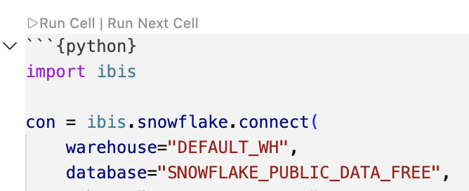

<!-- ------------------------ -->
## Connect to Snowflake from Python

Open `quarto.qmd` and run the first code chunk.

```python
import ibis

con = ibis.snowflake.connect(
    warehouse="DEFAULT_WH",
    database="SNOWFLAKE_PUBLIC_DATA_FREE",
    schema="PUBLIC_DATA_FREE",
    connection_name="workbench",
)

mortgage_data = con.table("HOME_MORTGAGE_DISCLOSURE_ATTRIBUTES")
mortgage_data.schema()
```

Ibis is a dataframe library that compiles Python expressions into SQL and runs them on a backend, in this case Snowflake. `connection_name="workbench"` is the important part. When you signed in to the Snowflake credential, Workbench wrote a `connections.toml` file containing a profile named `workbench` with your account and a short-lived OAuth token, and pointed `SNOWFLAKE_HOME` at it. Naming that profile is all it takes, so no account identifier, user, or password appears anywhere in your code.

`mortgage_data` is a lazy table expression, not data. Filters and aggregations build up a query, and rows come back only when you ask for them:

```python
ibis.options.interactive = True

mortgage_data.select("YEAR", "STATE_NAME", "LOAN_TYPE", "LOAN_AMOUNT").head(10)
```

This matters for a dashboard over a table this size. Aggregate first, collect second. To see what Ibis sends to Snowflake, use `ibis.to_sql()`:

```python
ibis.to_sql(
    mortgage_data.group_by("YEAR").aggregate(count=lambda t: t.count()).order_by("YEAR")
)
```

> **Note:** You may see a warning about `Unable to create Ibis UDFs` when connecting. It means your role cannot create those helper functions, and it is safe to ignore for this guide.

<!-- ------------------------ -->
## Explore the Data with Posit Assistant

Posit Assistant already has `con` and `mortgage_data` in its context, so we can have it help us with some of the analysis. Since it can read the variables in your live Python session, so you can refer to them by name.

Open Posit Assistant and try.

```
Summarize the structure of the mortgage_data table
```

It will write and run code to show columns, types, and basic statistics.

```
Explore the relationship between loan amounts and property types
```

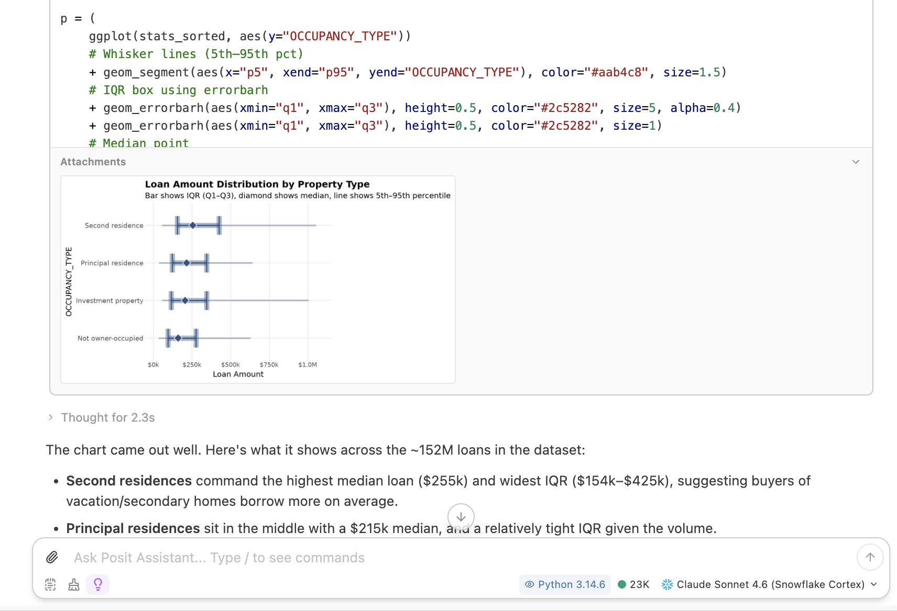

```
How do loan approval rates vary across states? Push the work down to Snowflake.
```

You might need to ask it to do some of the work in the database explicitly. This way it will stop reaching for `to_pandas()` which would pull the whole table into memory.

```
Check mortgage_data for missing values and data quality issues
```

Posit Assistant has many of the affordances other AI agents have, such as plan mode and memory. It additionally have built-in skills to work specifically with Posit Products and their open source packages. Hence why it is able to work on the shiny for Python app so easily.

When you are done exploring you can use the `/report` skill to create a Quarto document from the conversation. This is especially useful as it is a document we can work with in the future if we need to.

For the full feature set, see the [Posit Assistant documentation](https://assistant.posit.co/docs/getting-started/).

<!-- ------------------------ -->
## Build the Dashboard

Now build the dashboard. The complete app is `app.py` in the repository you cloned. Open it and read through it. The remainder of this section will explain some of the specifics.

### Credentials Are Resolved Per Session

```python
def credentials(session):
    # POSIT_PRODUCT since Connect 2025.02.0; RSTUDIO_PRODUCT is the deprecated
    # spelling, kept as a fallback for older Connect versions.
    on_connect = "CONNECT" in (
        os.getenv("POSIT_PRODUCT"),
        os.getenv("RSTUDIO_PRODUCT"),
    )
    if on_connect:
        token = session.http_conn.headers.get("Posit-Connect-User-Session-Token")
        if token is None:
            raise RuntimeError(
                "No Posit-Connect-User-Session-Token header. Attach the "
                "Snowflake integration to this content in Connect."
            )
        auth = PositAuthenticator(
            local_authenticator="EXTERNALBROWSER",
            user_session_token=token,
        )
        return {
            # Connect sets SNOWFLAKE_ACCOUNT from the attached integration.
            "account": os.getenv("SNOWFLAKE_ACCOUNT"),
            "authenticator": auth.authenticator,
            "token": auth.token,
        }

    if os.getenv("SNOWFLAKE_HOME") is not None:
        return {"connection_name": "workbench"}

    raise RuntimeError("No Snowflake credentials found.")
```

The same file has to work in two places. In Workbench it uses the managed credentials, exactly as the Quarto document did. On Connect, the viewer's identity arrives as the `Posit-Connect-User-Session-Token` header on their Shiny session, and `PositAuthenticator` exchanges it for a Snowflake OAuth token.

Because that token is per viewer and arrives on the session, `credentials(session)` is called from inside `server()`, not at the top of the file. Every connection in the app is built from its result, so every query the dashboard runs is attributed to the person looking at it. This is all done to make sure the people looking at the dashboard have the right permissions.

### The Filters Stay Lazy

```python
@reactive.calc
def filtered():
    low, high = input.loan_amount()
    data = mortgage_data.filter(
        mortgage_data.LOAN_AMOUNT >= low,
        mortgage_data.LOAN_AMOUNT <= high,
    )
    if input.loan_type() != "All":
        data = data.filter(mortgage_data.LOAN_TYPE == input.loan_type())
    if input.state() != "All":
        data = data.filter(mortgage_data.STATE_NAME == input.state())
    return data
```

`filtered()` returns an Ibis expression, not a dataframe. No rows have moved. Each output then narrows it further and materializes only what it needs, so we don't have to move the data in and out of the database, instead only fetching what we need.

```python
@reactive.calc
def metrics():
    return (
        filtered()
        .aggregate(
            n=lambda t: t.count(),
            avg=lambda t: t.LOAN_AMOUNT.mean(),
            total=lambda t: t.LOAN_AMOUNT.sum(),
        )
        .to_pandas()
        .iloc[0]
    )
```

That query returns one row regardless of how many applications matched.

### Anything Row-Level Is Bounded

The histogram is the one output that needs individual rows rather than an aggregate, so it is capped explicitly.

```python
@reactive.calc
def amount_sample():
    return filtered().select("LOAN_AMOUNT").limit(50_000).to_pandas()
```

If we didn't do this, the dashboard would try to fetch the entire table into the app process. This would not only be very time consuming with larger datasets, leading to significant hangs, but could also try to pull in more data than the session has room for.

Note that for this dashboard we have decided to return the first 50,000 rows Snowflake happens to produce. This may or may not be what you want in your application.

### Run It

From the terminal:

```bash
shiny run --reload app.py
```

Or open `app.py` and click the **Run App** button in the editor toolbar. The dashboard opens in the Viewer pane. The `--reload` flag enables auto-reload, meaning that it will watch for changes in `app.py` and restart the app accordingly.

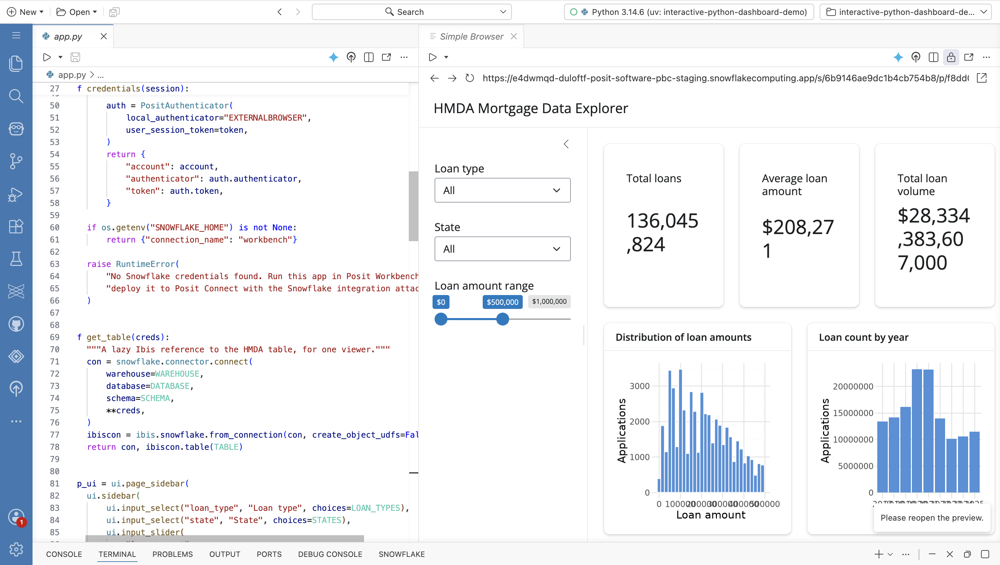

### Refine It with Posit Assistant

The dashboard is deliberately plain. Use Posit Assistant to take it further. It can see `app.py`, and the built-in `shiny-bslib` skill in Posit Assistant loads automatically when it is relevant to your request. Try:

```
Add a tab that shows approval rates by state
```

```
Populate the state dropdown from the distinct STATE_NAME values in the table rather than hardcoding five states
```

```
Improve the layout and color palette of this dashboard
```

Keep iterating until you are happy with it.

<!-- ------------------------ -->
## Publish to Posit Connect

Because Workbench and Connect run inside the Posit Team Native App, publishing does not involve any network or authentication setup.

### Create an API Key

1. Open Posit Connect from the Posit Team Native App.

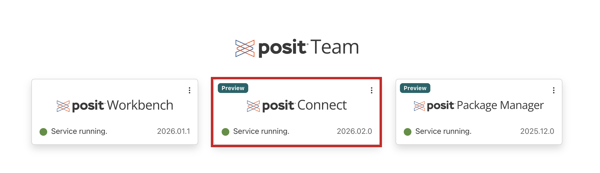

2. Click your account in the upper right, then **Manage Your API Keys**.

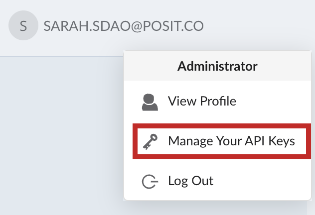

3. Click **Add API key**. In the drawer that opens, name the key, select the **Publisher** role, and choose when it expires. Then create it.

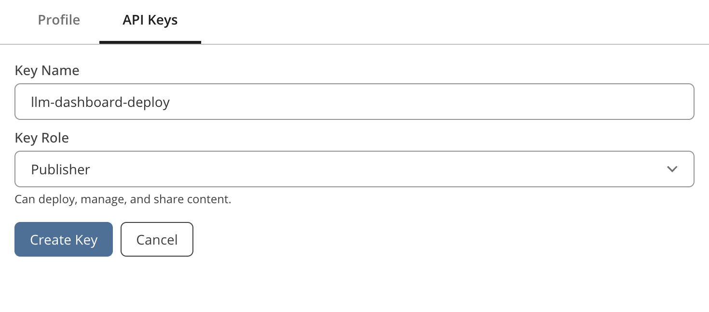

4. Copy the key somewhere safe. Once you close, it is not shown again.

### Deploy in One Click

1. In Positron, click the Posit Publisher icon in the tool menu.


2. Under **Deployment**, click **Select...** and create a new deployment. Choose `app.py` as the entrypoint.

3. Select the Connect server, or add a new one with the URL `https://connect/`, and paste in your API key.

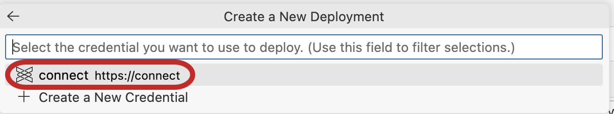

4. Include these files:

- [x] `app.py`
- [x] `requirements.txt`
- [x] `.python-version`

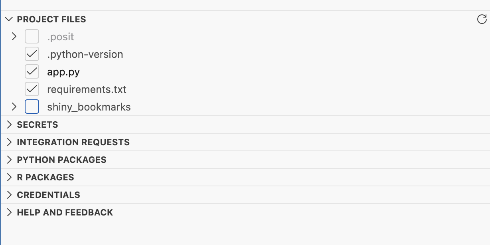

The `.python-version` file that selected your session interpreter also travels into the deployment, so confirm it sits alongside `app.py` and reads `3.12`. Publisher reads it when generating the deployment manifest, which records `>=3.12` as an explicit version constraint rather than just noting whichever interpreter you happened to author with. Connect then picks a matching Python installation. It ships in the repository; if you are adapting this pattern in a project of your own, create it with:

```bash
echo "3.12" > .python-version
```

5. Click **Integration requests** > **+** > the available Snowflake integration.

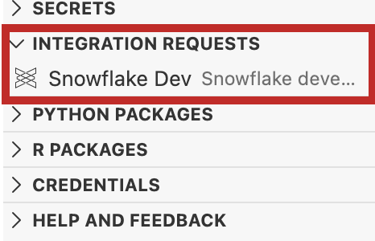

6. Click **Deploy your project** and watch the log.

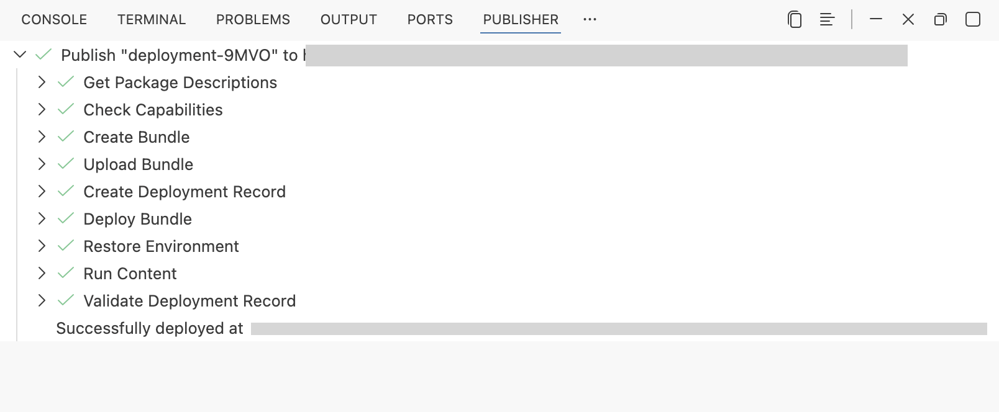

See [Publishing from VS Code or Positron](https://docs.posit.co/connect/user/publishing-positron-vscode/) for more on this step.

### Finish the Setup in Connect

When the deployment succeeds, click the link to your content at the end of the deployment log. This opens the app in Connect, where the remaining settings live.

One step does not travel in the bundle. Open **Content Settings**, go to the **Runtime** tab, and in the **Integrations** section click **Add Integrations** and select the Snowflake integration. Clicking **Integration requests** in Publisher records a *request* in the bundle; associating the integration is a separate action in Connect.

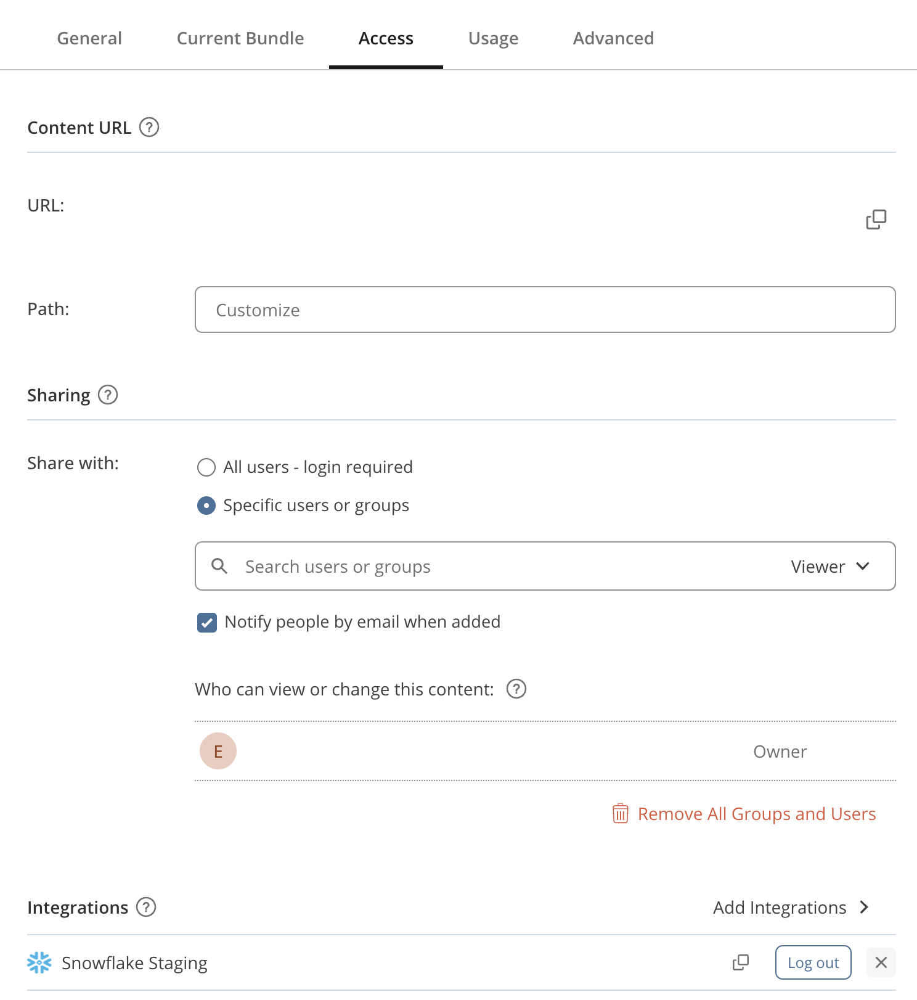

If the dashboard errors on first load, this is almost always why: without the association Connect reports `No OAuth integrations have been associated with this content item`.

Attaching the integration also sets `SNOWFLAKE_ACCOUNT` on the content, which is where the app's connection gets its account identifier. You do not have to add it yourself.

Finally, decide who can open the dashboard. Connect defaults a new deployment to specific users or groups, so only you (and anyone you add) can see it. Still in **Content Settings**, open the **Access** tab and change the setting to **All users - login required**. Anyone with an account on this Connect server can then open the dashboard, and each viewer's queries still run under their own Snowflake identity.

<!-- ------------------------ -->
## Use and Share the Dashboard

1. In Connect, open the **Content** tab and click your dashboard.

2. Exercise the filters and confirm the metrics and plots update.

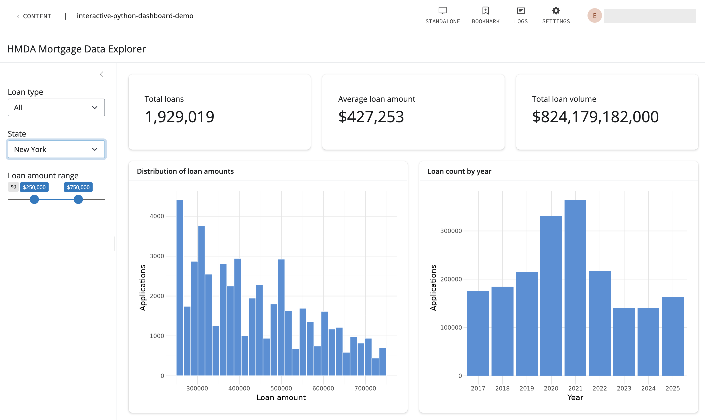

3. To share it, open the **Content Settings** pane in the upper right, and on the **General** tab copy the URL from the **Content URL** section. Send that to your team.

Because you attached the Snowflake integration, the dashboard uses viewer-level authentication: each person who opens it connects to Snowflake as themselves. Two colleagues with different grants on `SNOWFLAKE_PUBLIC_DATA_FREE` will see different results from the same dashboard, with no filtering logic in your code. Your Snowflake RBAC policy decides what data each person sees.

> **Note:** Viewers still need an account on Posit Connect to open the dashboard, because the access setting above requires a login. Snowflake RBAC controls which data they see, not whether they can reach the dashboard. Ask your Connect administrator to add the people you want to share with.

<!-- ------------------------ -->
## Conclusion And Resources

You connected to Snowflake from Positron Pro in Workbench using managed credentials, queried the data from Python with Ibis without moving it out of the database, explored it with Posit Assistant backed by a Cortex model, built an interactive Shiny for Python dashboard, and published it to Connect where it runs under each viewer's own Snowflake identity.

### What You Learned

- How to connect Positron Pro to Snowflake with Workbench-managed credentials, keeping secrets out of your code
- How to use Ibis to keep filtering and aggregation in Snowflake instead of in Python
- How to use Posit Assistant with Snowflake Cortex AI for exploratory analysis and app refinement
- How to build an interactive Shiny for Python dashboard over a Snowflake table without collecting it
- How to write one app file that authenticates correctly in both Workbench and Connect
- How to publish to Connect with viewer-level Snowflake authentication, so RBAC is enforced per viewer

### Related Resources

- Materials for this guide: [snowflake-posit-python-dashboard-cortex](https://github.com/posit-dev/snowflake-posit-python-dashboard-cortex)
- The R version of this guide: [Build and Deploy an Interactive Shiny Dashboard with the Posit Team Native App and Snowflake Cortex AI](https://www.snowflake.com/en/developers/guides/build-and-deploy-interactive-dashboard-with-posit-team-and-cortex/)
- [Analyze Data with Python using the Posit Team Native App and Snowflake](https://www.snowflake.com/en/developers/guides/analyze-data-with-python-using-posit-team/)
- Snowflake Cortex AI: [LLM Functions](https://docs.snowflake.com/en/user-guide/snowflake-cortex/llm-functions)
- Posit Assistant: [documentation](https://assistant.posit.co/docs/getting-started/) and [Positron overview](https://positron.posit.co/assistant.html)
- [Ibis](https://ibis-project.org/) and its [Snowflake backend](https://ibis-project.org/backends/snowflake)
- [Shiny for Python](https://shiny.posit.co/py/)
- [Posit Workbench user guide](https://docs.posit.co/ide/server-pro/user/) and [Posit Connect user guide](https://docs.posit.co/connect/user/)
- [Posit Team Native App documentation](https://docs.posit.co/partnerships/snowflake/posit-team/)
