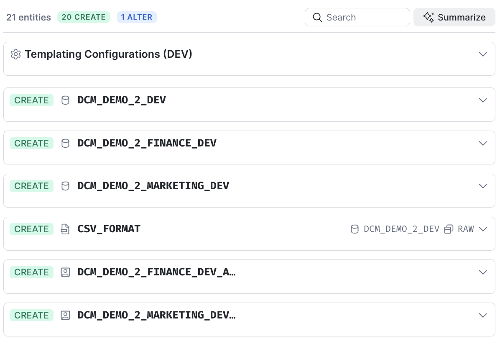
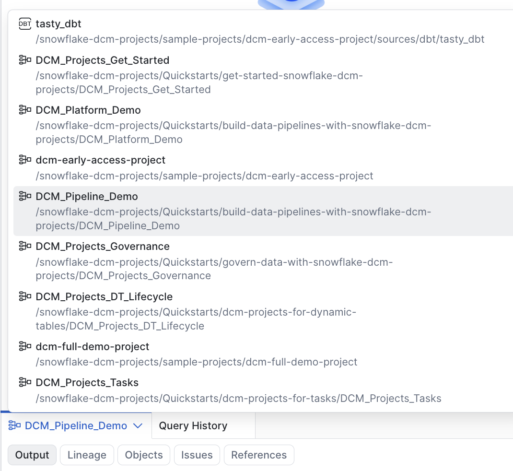
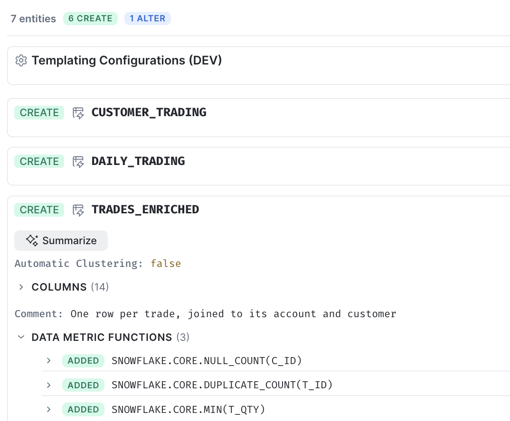

author: Jan Sommerfeld, Gilberto Hernandez, Yoav Ostrinsky
id: build-data-pipelines-with-snowflake-dcm-projects
summary: Split platform infrastructure and a data pipeline into two DCM Projects, catch bad data with expectations, evolve a dynamic table without rewriting history, and serve it through a semantic view.
categories: snowflake-site:taxonomy/solution-center/certification/quickstart, snowflake-site:taxonomy/product/platform, snowflake-site:taxonomy/product/data-engineering, snowflake-site:taxonomy/snowflake-feature/dynamic-tables
environments: web
status: Published
language: en
feedback link: https://github.com/Snowflake-Labs/sfguides/issues
fork repo link: https://github.com/Snowflake-Labs/snowflake-dcm-projects

# Build Data Pipelines with Snowflake DCM Projects
<!-- ------------------------ -->
## Overview

In [Get Started with Snowflake DCM Projects](https://www.snowflake.com/en/developers/guides/get-started-snowflake-dcm-projects/) you defined Snowflake infrastructure as code in one project, then planned and deployed it from a Snowsight Workspace. Real platforms rarely fit in one project. A platform team owns the shared raw data, the warehouses and the roles; each data team builds its own pipeline on top, on its own schedule.

This guide works with **two DCM Projects** that do exactly that:

- **DCM_Platform_Demo** is owned by the platform. It defines a shared raw database with three staging tables, a stage, a file format and a load task, and a warehouse, a database and a role for each team.
- **DCM_Pipeline_Demo** is owned by the Finance team. It reads the platform's raw tables and defines a silver and a gold layer of dynamic tables, data quality expectations, and a semantic view over the gold layer.

Once both are running, you will go through the two moments every pipeline meets sooner or later. First, bad data arrives: a trade on an account nobody has loaded yet. An expectation catches it before anyone reads a wrong number, and you fix it. Second, the business asks for a new column. You add it to a dynamic table, and the plan shows a single ALTER rather than a rebuild, because a frozen region keeps settled history from being recomputed.

### Prerequisites
- Familiarity with DCM Projects concepts (complete [Get Started with Snowflake DCM Projects](https://www.snowflake.com/en/developers/guides/get-started-snowflake-dcm-projects/) first)

### What You'll Learn
- How to split infrastructure into separate DCM Projects with different owners
- How to give each team its own warehouse, database and role from one Jinja loop
- How to build silver and gold dynamic tables on top of another project's tables
- How to attach data quality expectations and run them with TEST ALL
- How to add a column to a dynamic table without recomputing its history
- How to declare a semantic view in the same project as the tables it describes

### What You'll Need
- A [Snowflake account](https://signup.snowflake.com/?utm_source=snowflake-devrel&utm_medium=developer-guides&utm_cta=developer-guides) with ACCOUNTADMIN access, for the one-time setup script
- (Optional) [Snowflake CLI](https://docs.snowflake.com/en/developer-guide/snowflake-cli/installation/installation) 3.24 or later, if you prefer a terminal to the Snowsight UI

### What You'll Build
- A Platform project: one raw database with three staging tables, an ingestion stage and load task, and a warehouse, database and role for the Finance and Marketing teams
- A Pipeline project: one silver and two gold dynamic tables, three data quality expectations, and a semantic view

<!-- ------------------------ -->
## Create a Workspace from Git

If you want to work in Snowsight rather than locally, create a Snowsight Workspace linked to the sample repository on GitHub.

1. Navigate to **Projects > Workspaces** in Snowsight.
2. Click **Create** (+) and select **Git repository**.
3. Enter the repository URL: https://github.com/Snowflake-Labs/snowflake-dcm-projects
4. Select an API Integration for GitHub ([create one if needed](https://docs.snowflake.com/en/user-guide/ui-snowsight/workspaces-git#label-create-a-git-workspace)).
5. Select **Public repository**.


Screenshot placeholder: the Create Workspace from Git repository dialog with the snowflake-dcm-projects URL filled in, taken just before clicking Create.

Once the workspace is created you will see the repository files in the file explorer. Navigate to **Quickstarts/build-data-pipelines-with-snowflake-dcm-projects** to find four directories.

DCM_Platform_Demo/ and DCM_Pipeline_Demo/ are the two DCM Projects. sample_data/ holds three small CSV files. scripts/ holds numbered SQL files that you run in Snowsight worksheets at different stages of this guide. They live outside the project directories, so nothing in them is ever picked up by a plan.

| File | When to run |
|---|---|
| scripts/01_pre_deploy.sql | Once, before the first plan |
| scripts/02_platform_post_deploy.sql | After the Platform project is deployed |
| scripts/03_pipeline_post_deploy.sql | After the Pipeline project is deployed |
| scripts/04_schema_change.sql | After the Pipeline project is deployed a second time |
| scripts/05_cleanup.sql | When you are finished |

Every operational step in this guide is given twice: once for Snowsight, and once for the [Snowflake CLI](https://docs.snowflake.com/en/developer-guide/snowflake-cli/installation/installation) if you would rather drive the project from a terminal against your own copy of the repository.

**With the Snowflake CLI:** clone the repository and work from the guide's folder. Run the snow dcm commands from inside DCM_Platform_Demo or DCM_Pipeline_Demo, and the snow sql commands from the guide's folder.

```bash
git clone https://github.com/Snowflake-Labs/snowflake-dcm-projects.git
cd snowflake-dcm-projects/Quickstarts/build-data-pipelines-with-snowflake-dcm-projects
```

<!-- ------------------------ -->
## Set Up Roles and Permissions

Run the first script. **In Snowsight:** open scripts/01_pre_deploy.sql in a worksheet and run it from top to bottom. **With the Snowflake CLI:**

```bash
snow sql -f scripts/01_pre_deploy.sql
```

The script is the same in every guide of this series. It runs as ACCOUNTADMIN and is safe to run again: if you already ran it for another guide, running it now changes nothing. It has six numbered sections.

**1. Role.** It creates the DCM_DEVELOPER role and grants it to you and to SYSADMIN. Every guide in this series uses this role as the project owner.

**2. Inherited grants opt-in.** It turns on inherited grants for the account.

**3. Account-level privileges.** A project cannot grant account-level privileges to its own owner, so they all happen here, before the first plan. DCM_DEVELOPER gets the privileges that the guides in this series need together, one grant per line, each with a comment naming the guide or feature that uses it. Some are checked at plan time, so a missing one fails the first plan rather than the deploy.

**4. Series container.** It creates the DCM_DEMO database and the DCM_DEMO.PROJECTS schema that holds the project objects of the series, and grants DCM_DEVELOPER USAGE on both and CREATE DCM PROJECT on the schema. A project cannot define the database or schema it lives in.

**5. Project object (alternative path only).** Commented out. The first plan creates the project object for you; the SQL is there if the prompt does not appear, or if you prefer to create it yourself.

**6. Values for the manifest.** The last query returns your account identifier and user name.

**Inherited grants.** An inherited grant covers current *and* future objects of a type inside a container. GRANT ON ALL snapshots what exists right now; GRANT ON FUTURE covers only what comes later. An inherited grant covers both, as one grant rather than one per object, which is why it is the recommended pattern in DCM Projects. It is a one-time opt-in per account ([release note](https://docs.snowflake.com/en/release-notes/2026/other/2026-09-10-inherited-grants-ga)), which the setup script turns on:

```sql
ALTER ACCOUNT SET FEATURE_RBAC_INHERITED_GRANTS = 'ENABLED';
```

An inherited grant cannot be combined with WITH GRANT OPTION, `CASCADE` or `RESTRICT`.

The Platform project uses one to let each team read every table in the shared RAW schema, including tables added later.

Two grants in section 3 are there for the Finance team's expectations: EXECUTE DATA METRIC FUNCTION and the SNOWFLAKE.DATA_QUALITY_MONITORING_VIEWER application role. The Platform project passes both on to the Finance role, and a role can only pass on a privilege it holds WITH GRANT OPTION, which is why the script grants EXECUTE DATA METRIC FUNCTION that way. Without it, the first plan fails with "Grant not executed: Insufficient privileges".

The Platform project object lives in DCM_DEMO.PROJECTS. The Pipeline project object will live somewhere else: in a PROJECTS schema inside the Finance team's own database, which the Platform project creates.

Paste ACCOUNT_IDENTIFIER into the account_identifier line of the DCM_DEV target, line 11, in both DCM_Platform_Demo/manifest.yml and DCM_Pipeline_Demo/manifest.yml. Both lines carry the comment "# update to your account names".

<!-- ------------------------ -->
## Explore the Platform Project

Navigate into **DCM_Platform_Demo/**. This is the project that plan and deploy read.

### Manifest

```yaml
targets:
  DCM_DEV:
    account_identifier: MYORG-MY_DEV_ACCOUNT        # update to your account names
    project_name: DCM_DEMO.PROJECTS.DCM_PLATFORM_DEV
    project_owner: DCM_DEVELOPER
    templating_config: DEV

  DCM_PROD:
    account_identifier: MYORG-MY_PROD_ACCOUNT       # update to your account names
    project_name: DCM_DEMO.PROJECTS.DCM_PLATFORM
    project_owner: DCM_PROD_DEPLOYER
    templating_config: PROD

templating:
  defaults:
    wh_size: "X-SMALL"

  configurations:
    DEV:
      env_suffix: "_DEV"
      project_owner_role: "DCM_DEVELOPER"
      teams:
        - name: "Finance"
          raw_access: "READ"
        - name: "Marketing"
          raw_access: "READ"

    PROD:
      env_suffix: ""
      project_owner_role: "DCM_PROD_DEPLOYER"
      wh_size: "MEDIUM"
      teams:
        - name: "Finance"
          raw_access: "READ"
        - name: "Marketing"
          raw_access: "READ"
        - name: "IT"
          raw_access: "WRITE"
        - name: "HR"
          raw_access: "NONE"
```

The teams list drives a loop in the definitions. DEV has two teams and PROD has four; each team's raw_access value decides how much of the shared raw data that team can use. PROD also gets bigger warehouses through wh_size.

### Definition files

| File | What it defines |
|---|---|
| raw.sql | The shared database DCM_DEMO_2_DEV, its RAW schema and three staging tables |
| ingest.sql | The platform warehouse, a stage, a file format and the load task |
| wh_roles_and_grants.sql | A warehouse, a database and a role for each team, and the team's access to RAW |

#### Raw tables

raw.sql defines CUSTOMER_STG, ACCOUNT_STG and TRADE_STG: customers, their brokerage accounts, and the trades placed on those accounts. Each table sets CHANGE_TRACKING = TRUE so that the Pipeline project's dynamic tables can track what changed between refreshes:

```sql
DEFINE TABLE DCM_DEMO_2{{env_suffix}}.RAW.TRADE_STG (
    T_ID           NUMBER(15,0)     COMMENT 'Trade identifier',
    T_DTS          TIMESTAMP_NTZ(9) COMMENT 'Date and time of the trade',
    T_ST_ID        VARCHAR(4)       COMMENT 'Status: CMPT (completed) or CNCL (cancelled)',
    T_TT_ID        VARCHAR(3)       COMMENT 'Trade type: TMB (market buy) or TMS (market sell)',
    T_S_SYMB       VARCHAR(15)      COMMENT 'Security symbol',
    T_QTY          NUMBER(6,0)      COMMENT 'Quantity of securities traded',
    T_TRADE_PRICE  NUMBER(8,2)      COMMENT 'Unit price the security traded at',
    T_CHRG         NUMBER(10,2)     COMMENT 'Fee charged for placing the trade',
    T_COMM         NUMBER(10,2)     COMMENT 'Commission earned on the trade',
    T_CA_ID        NUMBER(38,0)     COMMENT 'Customer account identifier'
)
CHANGE_TRACKING = TRUE
COMMENT = 'Trades, one row per trade';
```

#### Ingestion

ingest.sql defines the platform's warehouse, a stage with a directory table, a CSV file format, and a task that copies the three files into the three tables:

```sql
DEFINE STAGE DCM_DEMO_2{{env_suffix}}.RAW.DCM_SAMPLE_DATA
    DIRECTORY = (ENABLE = TRUE)
    COMMENT = 'CSV files with sample data for the DCM Build Data Pipelines Quickstart';

DEFINE TASK DCM_DEMO_2{{env_suffix}}.RAW.LOAD_NEW_DATA
    WAREHOUSE = DCM_DEMO_2_PLATFORM_WH{{env_suffix}}
    SCHEDULE = 'USING CRON 15 8-18 * * MON-FRI Europe/Berlin'
    COMMENT = 'Loads the staged CSV files into the raw staging tables'
AS
BEGIN
    COPY INTO DCM_DEMO_2{{env_suffix}}.RAW.CUSTOMER_STG
        FROM @DCM_DEMO_2{{env_suffix}}.RAW.DCM_SAMPLE_DATA/CUSTOMER_STG.csv
        FILE_FORMAT = (FORMAT_NAME = 'DCM_DEMO_2{{env_suffix}}.RAW.CSV_FORMAT');
    -- ... the same for ACCOUNT_STG and TRADE_STG ...
    CALL SYSTEM$SET_RETURN_VALUE('raw dataset loaded into all staging tables');
END;
```

The task runs on a warehouse, like every scheduled and refreshing object in this guide, so there is one compute model to reason about. Its CRON schedule would load new files every hour of the working day. DCM creates new tasks suspended, so in this guide the schedule never fires and you run the task once by hand instead.

#### Per-team infrastructure

wh_roles_and_grants.sql is one loop over the teams in the manifest:

```sql

    

    DEFINE WAREHOUSE DCM_DEMO_2_{{team_name}}_WH{{env_suffix}}
    WITH
        WAREHOUSE_SIZE = '{{wh_size}}'
        AUTO_SUSPEND = 60
        COMMENT = 'Compute for the {{team.name}} team in the DCM Build Data Pipelines Quickstart';

    DEFINE DATABASE DCM_DEMO_2_{{team_name}}{{env_suffix}}
        COMMENT = 'Database owned by the {{team.name}} team';

    DEFINE SCHEMA DCM_DEMO_2_{{team_name}}{{env_suffix}}.PUBLIC
        COMMENT = 'Default schema, declared so DCM manages it';

    DEFINE SCHEMA DCM_DEMO_2_{{team_name}}{{env_suffix}}.PROJECTS
        COMMENT = 'Hosts the DCM projects of the {{team.name}} team';

    {{ create_team_role(team_name) }}

    
        GRANT USAGE ON DATABASE DCM_DEMO_2{{env_suffix}} TO ROLE DCM_DEMO_2_{{team_name}}{{env_suffix}}_ADMIN;
        GRANT USAGE ON SCHEMA DCM_DEMO_2{{env_suffix}}.RAW TO ROLE DCM_DEMO_2_{{team_name}}{{env_suffix}}_ADMIN;
        GRANT INHERITED SELECT ON ALL TABLES IN SCHEMA DCM_DEMO_2{{env_suffix}}.RAW TO ROLE DCM_DEMO_2_{{team_name}}{{env_suffix}}_ADMIN;
    
    
        GRANT INHERITED INSERT, UPDATE, DELETE ON ALL TABLES IN SCHEMA DCM_DEMO_2{{env_suffix}}.RAW TO ROLE DCM_DEMO_2_{{team_name}}{{env_suffix}}_ADMIN;
    

    
        GRANT EXECUTE DATA METRIC FUNCTION ON ACCOUNT TO ROLE DCM_DEMO_2_{{team_name}}{{env_suffix}}_ADMIN;
        GRANT APPLICATION ROLE SNOWFLAKE.DATA_QUALITY_MONITORING_VIEWER TO ROLE DCM_DEMO_2_{{team_name}}{{env_suffix}}_ADMIN;
    

```

Every team gets the same footprint: a warehouse, a database with a PROJECTS schema for the team's own DCM projects, and a role. A team with READ or WRITE access can read every table in RAW; NONE skips those grants. Finance also gets the data quality privileges its pipeline needs.

The role comes from a macro in sources/macros/grants_macro.sql:

```sql

    DEFINE ROLE DCM_DEMO_2_{{team}}{{env_suffix}}_ADMIN
        COMMENT = 'Owner role for the {{team}} team and its DCM projects';

    GRANT USAGE ON WAREHOUSE DCM_DEMO_2_{{team}}_WH{{env_suffix}} TO ROLE DCM_DEMO_2_{{team}}{{env_suffix}}_ADMIN;
    GRANT USAGE ON DATABASE DCM_DEMO_2_{{team}}{{env_suffix}} TO ROLE DCM_DEMO_2_{{team}}{{env_suffix}}_ADMIN;
    GRANT CREATE SCHEMA ON DATABASE DCM_DEMO_2_{{team}}{{env_suffix}} TO ROLE DCM_DEMO_2_{{team}}{{env_suffix}}_ADMIN;
    GRANT USAGE ON SCHEMA DCM_DEMO_2_{{team}}{{env_suffix}}.PROJECTS TO ROLE DCM_DEMO_2_{{team}}{{env_suffix}}_ADMIN;
    GRANT CREATE DCM PROJECT ON SCHEMA DCM_DEMO_2_{{team}}{{env_suffix}}.PROJECTS TO ROLE DCM_DEMO_2_{{team}}{{env_suffix}}_ADMIN;

    GRANT ROLE DCM_DEMO_2_{{team}}{{env_suffix}}_ADMIN TO ROLE {{project_owner_role}};

```

The team role owns everything the team's projects deploy, so it gets what a project owner needs inside the team database: create schemas, and create DCM projects in PROJECTS. The last grant rolls each team role up to the Platform project's owner, so you can act as the Finance team later without any extra setup.

<!-- ------------------------ -->
## Deploy the Platform Project

### Plan

**In Snowsight:** the DCM control panel is the first tab in the bottom panel of your workspace. Select the project **build-data-pipelines-with-snowflake-dcm-projects/DCM_Platform_Demo** and the **DCM_DEV** target. Until the DCM Project object named in the manifest exists, the status indicator next to **Target** is red. Click the play button to the right of **Plan**. Snowsight asks you to confirm creating the DCM Project object with the name and owner role defined for that target in the manifest; confirm, and the plan runs.


Screenshot placeholder: the DCM control panel with project build-data-pipelines-with-snowflake-dcm-projects/DCM_Platform_Demo and target DCM_DEV selected and the red status indicator, taken just before clicking Plan.

**With the Snowflake CLI:** from inside the DCM_Platform_Demo folder of your clone, create the project object for the target, then plan. Pass the manifest's owner role for that target with --role. The CLI creates the object as the session role, so without it the object can end up owned by ACCOUNTADMIN or DCM_DEVELOPER instead of the manifest owner.

```bash
snow dcm create --target DCM_DEV --role DCM_DEVELOPER
snow dcm plan --target DCM_DEV --role DCM_DEVELOPER --save-output
```

**With SQL:** if the prompt does not appear, or you prefer to create the object yourself, run this as the project owner role before the first plan.

```sql
CREATE DCM PROJECT IF NOT EXISTS DCM_DEMO.PROJECTS.DCM_PLATFORM_DEV
    COMMENT = 'for testing DCM Projects Quickstarts';
```

Nothing exists yet, so the plan is almost all CREATEs: 21 entities, 20 to create and 1 to alter.


Screenshot placeholder: the Platform plan result listing 20 CREATE operations and 1 ALTER on ROLE DCM_DEVELOPER.

| Operation | Entities |
|---|---|
| CREATE DATABASE | DCM_DEMO_2_DEV, DCM_DEMO_2_FINANCE_DEV, DCM_DEMO_2_MARKETING_DEV |
| CREATE SCHEMA | RAW, both PROJECTS schemas, and PUBLIC in each of the three databases |
| CREATE TABLE | ACCOUNT_STG, CUSTOMER_STG, TRADE_STG |
| CREATE STAGE, FILE_FORMAT, TASK | DCM_SAMPLE_DATA, CSV_FORMAT, LOAD_NEW_DATA |
| CREATE WAREHOUSE | DCM_DEMO_2_PLATFORM_WH_DEV, DCM_DEMO_2_FINANCE_WH_DEV, DCM_DEMO_2_MARKETING_WH_DEV |
| CREATE ROLE | DCM_DEMO_2_FINANCE_DEV_ADMIN, DCM_DEMO_2_MARKETING_DEV_ADMIN |
| ALTER ROLE | DCM_DEVELOPER, which takes ownership of the new objects and receives the two team roles |

### Deploy

When the changeset matches what you expected, deploy it.

**In Snowsight:** in the DCM control panel, set the operation to **Deploy** instead of **Plan**, add a deployment alias such as initial-platform, and run it.


Screenshot placeholder: the Deploy confirmation dialog with the alias initial-platform entered, taken before confirming.

**With the Snowflake CLI:**

```bash
snow dcm deploy --target DCM_DEV --role DCM_DEVELOPER --alias initial-platform
```

The deploy reports 21 entities: 20 created, 1 altered. In the Database Explorer you now see DCM_DEMO_2_DEV, DCM_DEMO_2_FINANCE_DEV and DCM_DEMO_2_MARKETING_DEV.

<!-- ------------------------ -->
## Load Sample Data

The tables exist but are empty. Open scripts/02_platform_post_deploy.sql in a Snowsight worksheet and run it. It runs as DCM_DEVELOPER, which owns the raw tables, on the platform warehouse.

### Copy the CSV files to the stage

The sample_data/ folder holds one file per staging table. The script copies them from your workspace into the stage in one statement:

```sql
COPY FILES INTO @DCM_DEMO_2_DEV.RAW.DCM_SAMPLE_DATA
FROM 'snow://workspace/USER$.PUBLIC."snowflake-dcm-projects"/versions/live/Quickstarts/build-data-pipelines-with-snowflake-dcm-projects/sample_data'
DETAILED_OUTPUT = TRUE;
```

The path assumes the workspace name that Snowsight derives from the repository URL, snowflake-dcm-projects. If you gave your workspace a different name, replace snowflake-dcm-projects in the path with your workspace name.

If you run the script with the Snowflake CLI instead, replace that statement with the PUT shown in the script's comment, pointing at your local clone. You can also upload the three files in Snowsight ([Staging files using Snowsight](https://docs.snowflake.com/en/user-guide/data-load-local-file-system-stage-ui)): select **Ingestion > Add Data > Load files into a Stage**, pick the stage DCM_DEMO_2_DEV.RAW.DCM_SAMPLE_DATA, and skip the COPY FILES statement.

### Run the load task

```sql
EXECUTE TASK DCM_DEMO_2_DEV.RAW.LOAD_NEW_DATA;
CALL SYSTEM$WAIT(15);
```

EXECUTE TASK runs the suspended task once. It runs asynchronously, so the script waits a few seconds before checking the result.

### Add today's trades

```sql
INSERT INTO DCM_DEMO_2_DEV.RAW.TRADE_STG
    (T_ID, T_DTS, T_ST_ID, T_TT_ID, T_S_SYMB, T_QTY, T_TRADE_PRICE, T_CHRG, T_COMM, T_CA_ID)
VALUES
    (2021, CURRENT_TIMESTAMP(), 'CMPT', 'TMB', 'SNOW', 40, 150.10, 9.95, 6.00, 1001),
    (2022, CURRENT_TIMESTAMP(), 'CMPT', 'TMS', 'ACME', 75,  41.30, 4.95, 3.10, 1006);
```

The files hold trades from the last week of October 2026. These two trades are stamped with `CURRENT_TIMESTAMP()`, so they are always from today, whenever you run this guide. That difference matters later on.

### Verify

| TABLE_NAME | ROW_COUNT |
|---|---|
| CUSTOMER_STG | 6 |
| ACCOUNT_STG | 8 |
| TRADE_STG | 22 |

<!-- ------------------------ -->
## Explore the Pipeline Project

Navigate into **DCM_Pipeline_Demo/**. This project belongs to the Finance team.

### Manifest

```yaml
targets:
  DCM_DEV:
    account_identifier: MYORG-MY_DEV_ACCOUNT        # update to your account names
    project_name: DCM_DEMO_2_FINANCE_DEV.PROJECTS.FINANCE_PIPELINE
    project_owner: DCM_DEMO_2_FINANCE_DEV_ADMIN
    templating_config: DEV
```

The project object lives in the Finance team's own database, DCM_DEMO_2_FINANCE_DEV.PROJECTS, not in the shared DCM_DEMO.PROJECTS. Its owner is the Finance role the Platform project created. The Finance team can plan and deploy its pipeline without asking an account administrator for anything: everything it needs, the Platform project granted.

### Definition files

| File | What it defines |
|---|---|
| silver_layer.sql | The SILVER schema and TRADES_ENRICHED, one row per trade |
| gold_layer.sql | The GOLD schema and two aggregates, DAILY_TRADING and CUSTOMER_TRADING |
| expectations.sql | Three data quality expectations on TRADES_ENRICHED |
| semantic_view.sql | TRADING_ANALYTICS, a semantic view over the two gold tables |

#### Silver layer

```sql
DEFINE DYNAMIC TABLE DCM_DEMO_2_FINANCE{{env_suffix}}.SILVER.TRADES_ENRICHED
    WAREHOUSE = DCM_DEMO_2_FINANCE_WH{{env_suffix}}
    TARGET_LAG = 'DOWNSTREAM'
    INITIALIZE = 'ON_SCHEDULE'
    DATA_METRIC_SCHEDULE = 'TRIGGER_ON_CHANGES'
    COMMENT = 'One row per trade, joined to its account and customer'
AS
SELECT
    T.T_ID,
    T.T_DTS,
    T.T_S_SYMB,
    T.T_TT_ID,
    T.T_QTY,
    T.T_TRADE_PRICE,
    T.T_QTY * T.T_TRADE_PRICE AS TRADE_VALUE,
    T.T_CHRG,
    T.T_COMM,
    T.T_CA_ID,
    A.CA_NAME,
    C.C_ID,
    C.C_F_NAME || ' ' || C.C_L_NAME AS CUSTOMER_NAME,
    C.C_TIER
FROM DCM_DEMO_2{{env_suffix}}.RAW.TRADE_STG T
LEFT JOIN DCM_DEMO_2{{env_suffix}}.RAW.ACCOUNT_STG A
    ON T.T_CA_ID = A.CA_ID
LEFT JOIN DCM_DEMO_2{{env_suffix}}.RAW.CUSTOMER_STG C
    ON A.CA_C_ID = C.C_ID
WHERE T.T_ST_ID = 'CMPT';
```

This is the cross-project link: a dynamic table in the Pipeline project reads three tables from the Platform project. It works because the Platform project granted the Finance role read access to RAW.

A few properties are worth a look:

- TARGET_LAG = 'DOWNSTREAM' gives this table no schedule of its own. It refreshes whenever a gold table needs it.
- INITIALIZE = 'ON_SCHEDULE' skips the refresh at creation, which keeps deployments fast. You run the first refresh yourself.
- DATA_METRIC_SCHEDULE = 'TRIGGER_ON_CHANGES' evaluates the expectations attached to this table after each refresh.
- The joins are LEFT joins on purpose. A trade whose account has not arrived yet still shows up, with an empty customer, instead of silently disappearing from every total.

#### Gold layer

DAILY_TRADING and CUSTOMER_TRADING aggregate the silver table by day and by customer:

```sql
DEFINE DYNAMIC TABLE DCM_DEMO_2_FINANCE{{env_suffix}}.GOLD.DAILY_TRADING
    WAREHOUSE = DCM_DEMO_2_FINANCE_WH{{env_suffix}}
    TARGET_LAG = '1 hour'
    INITIALIZE = 'ON_SCHEDULE'
    COMMENT = 'Trading volume and value per day'
AS
SELECT
    T_DTS::DATE         AS TRADE_DATE,
    COUNT(*)            AS TRADE_COUNT,
    SUM(T_QTY)          AS TOTAL_QUANTITY,
    SUM(TRADE_VALUE)    AS TOTAL_VALUE
FROM DCM_DEMO_2_FINANCE{{env_suffix}}.SILVER.TRADES_ENRICHED
GROUP BY TRADE_DATE;
```

The gold tables hold the pipeline's only real TARGET_LAG. Because the silver table is DOWNSTREAM, this one hour drives the whole graph: change it here and the silver layer follows.

#### Data quality expectations

```sql
ATTACH DATA METRIC FUNCTION SNOWFLAKE.CORE.NULL_COUNT
    TO DYNAMIC TABLE DCM_DEMO_2_FINANCE{{env_suffix}}.SILVER.TRADES_ENRICHED
    ON (C_ID)
    EXPECTATION EVERY_TRADE_HAS_A_CUSTOMER (value = 0);

ATTACH DATA METRIC FUNCTION SNOWFLAKE.CORE.DUPLICATE_COUNT
    TO DYNAMIC TABLE DCM_DEMO_2_FINANCE{{env_suffix}}.SILVER.TRADES_ENRICHED
    ON (T_ID)
    EXPECTATION NO_DUPLICATE_TRADES (value = 0);

ATTACH DATA METRIC FUNCTION SNOWFLAKE.CORE.MIN
    TO DYNAMIC TABLE DCM_DEMO_2_FINANCE{{env_suffix}}.SILVER.TRADES_ENRICHED
    ON (T_QTY)
    EXPECTATION QUANTITY_IS_POSITIVE (value > 0);
```

Each statement attaches a system data metric function to a column and names the condition its result must meet. They all sit on TRADES_ENRICHED, the one table every gold number is built from:

- **EVERY_TRADE_HAS_A_CUSTOMER**: every trade resolves to a customer. A NULL means the trade's account is missing.
- **NO_DUPLICATE_TRADES**: one row per trade. A duplicate means a join fanned out.
- **QUANTITY_IS_POSITIVE**: a completed trade moves at least one share.

#### Semantic view

```sql
DEFINE SEMANTIC VIEW DCM_DEMO_2_FINANCE{{env_suffix}}.GOLD.TRADING_ANALYTICS
  TABLES (
    daily AS DCM_DEMO_2_FINANCE{{env_suffix}}.GOLD.DAILY_TRADING
      PRIMARY KEY (TRADE_DATE)
      WITH SYNONYMS = ('daily trading', 'trading by day')
      COMMENT = 'One row per trading day',
    customers AS DCM_DEMO_2_FINANCE{{env_suffix}}.GOLD.CUSTOMER_TRADING
      WITH SYNONYMS = ('customer trading', 'trading by customer')
      COMMENT = 'One row per customer'
  )
  DIMENSIONS (
    daily.TRADE_DATE AS TRADE_DATE
      WITH SYNONYMS = ('date', 'day')
      COMMENT = 'Calendar day the trades were placed',
    customers.CUSTOMER_NAME AS CUSTOMER_NAME
      WITH SYNONYMS = ('customer', 'client')
      COMMENT = 'Full name of the customer',
    customers.CUSTOMER_TIER AS C_TIER
      WITH SYNONYMS = ('tier')
      COMMENT = 'Customer tier, 1 to 3'
  )
  METRICS (
    daily.TOTAL_TRADES AS SUM(TRADE_COUNT)
      WITH SYNONYMS = ('trades', 'number of trades')
      COMMENT = 'Number of completed trades',
    daily.TOTAL_TRADE_VALUE AS SUM(TOTAL_VALUE)
      WITH SYNONYMS = ('trading value', 'volume in dollars')
      COMMENT = 'Quantity times trade price, summed',
    customers.CUSTOMER_TRADE_VALUE AS SUM(TOTAL_VALUE)
      WITH SYNONYMS = ('value by customer')
      COMMENT = 'Trading value attributed to customers'
  )
  COMMENT = 'Semantic layer over the Finance gold tables';
```

A [semantic view](https://docs.snowflake.com/en/user-guide/views-semantic/overview) names the business concepts in your data, its dimensions and metrics, so that SQL users and Cortex Analyst ask for "total trade value by day" instead of writing the aggregation. Declaring it in the same project as the gold tables means the vocabulary is versioned and reviewed with the pipeline that produces the numbers: rename a metric here and the rename shows up in the next plan. Each deployment reconciles the full definition.

<!-- ------------------------ -->
## Deploy the Pipeline Project

### Plan

**In Snowsight:** the DCM control panel is the first tab in the bottom panel of your workspace. Select the project **build-data-pipelines-with-snowflake-dcm-projects/DCM_Pipeline_Demo** and the **DCM_DEV** target. Until the DCM Project object named in the manifest exists, the status indicator next to **Target** is red. Click the play button to the right of **Plan**. Snowsight asks you to confirm creating the DCM Project object with the name and owner role defined for that target in the manifest; confirm, and the plan runs.


Screenshot placeholder: the DCM control panel with project build-data-pipelines-with-snowflake-dcm-projects/DCM_Pipeline_Demo and target DCM_DEV selected and the red status indicator, taken just before clicking Plan.

**With the Snowflake CLI:** from inside the DCM_Pipeline_Demo folder of your clone, create the project object for the target, then plan. Pass the manifest's owner role for that target with --role. The CLI creates the object as the session role, so without it the object can end up owned by ACCOUNTADMIN or DCM_DEVELOPER instead of the manifest owner.

```bash
snow dcm create --target DCM_DEV --role DCM_DEMO_2_FINANCE_DEV_ADMIN
snow dcm plan --target DCM_DEV --role DCM_DEMO_2_FINANCE_DEV_ADMIN --save-output
```

The project_owner in this manifest is the Finance role, not DCM_DEVELOPER, so the **role** option is required on every CLI command for this project. Without it, the create command makes the object as your session role (for example DCM_DEVELOPER) and only prints a role-mismatch warning.

**With SQL:** if the prompt does not appear, or you prefer to create the object yourself, run this as the project owner role before the first plan.

```sql
USE ROLE DCM_DEMO_2_FINANCE_DEV_ADMIN;
CREATE DCM PROJECT IF NOT EXISTS DCM_DEMO_2_FINANCE_DEV.PROJECTS.FINANCE_PIPELINE
    COMMENT = 'for testing DCM Projects Quickstarts';
```

The plan shows 7 entities, 6 to create and 1 to alter:


Screenshot placeholder: the Pipeline plan result with 6 CREATE operations and 1 ALTER on ROLE DCM_DEMO_2_FINANCE_DEV_ADMIN, with TRADES_ENRICHED expanded to show its three data metric functions.

| Operation | Entities |
|---|---|
| CREATE SCHEMA | SILVER, GOLD |
| CREATE DYNAMIC_TABLE | SILVER.TRADES_ENRICHED, GOLD.DAILY_TRADING, GOLD.CUSTOMER_TRADING |
| CREATE SEMANTIC_VIEW | GOLD.TRADING_ANALYTICS |
| ALTER ROLE | DCM_DEMO_2_FINANCE_DEV_ADMIN, which takes ownership of the new objects |

The three expectations do not get lines of their own: expand TRADES_ENRICHED and you find them under its data metric functions.

### Deploy

When the changeset matches what you expected, deploy it.

**In Snowsight:** in the DCM control panel, set the operation to **Deploy** instead of **Plan**, add a deployment alias such as initial-pipeline, and run it.

**With the Snowflake CLI:**

```bash
snow dcm deploy --target DCM_DEV --role DCM_DEMO_2_FINANCE_DEV_ADMIN --alias initial-pipeline
```

The deploy reports 7 entities: 6 created, 1 altered. SILVER and GOLD now exist inside DCM_DEMO_2_FINANCE_DEV, and the dynamic tables are empty until their first refresh.

<!-- ------------------------ -->
## Query the Pipeline and Test It

Open scripts/03_pipeline_post_deploy.sql in a Snowsight worksheet. It runs as the Finance role, on the Finance warehouse. Run sections 1 to 5 for now.

### Refresh

```sql
ALTER DYNAMIC TABLE DCM_DEMO_2_FINANCE_DEV.GOLD.DAILY_TRADING,
                    DCM_DEMO_2_FINANCE_DEV.GOLD.CUSTOMER_TRADING REFRESH;
```

Listing both gold tables in one statement refreshes the silver table they read first, once, and lands all three on the same data timestamp. The result reports refreshed_dt_count 3.

### Read the gold layer

```sql
SELECT * FROM DCM_DEMO_2_FINANCE_DEV.GOLD.CUSTOMER_TRADING ORDER BY TOTAL_VALUE DESC;
```

| C_ID | CUSTOMER_NAME | C_TIER | TRADE_COUNT | TOTAL_VALUE | LAST_TRADE_TS |
|---|---|---|---|---|---|
| 101 | Janeta Kaus | 1 | 6 | 56950.30 | ... |
| 105 | Lena Vogel | 2 | 5 | 19462.90 | ... |
| 102 | Samual Enos | 2 | 2 | 19347.50 | 2026-10-28 11:44:00 |
| 104 | Marta Okafor | 1 | 3 | 17380.70 | 2026-10-30 15:35:00 |
| 103 | Edric Salem | 3 | 3 | 15272.65 | 2026-10-30 13:25:00 |
| 106 | Ravi Mehta | 2 | 1 | 1193.90 | 2026-10-29 13:53:00 |
| NULL | NULL | NULL | 1 | 868.40 | 2026-10-30 11:31:00 |

Look at the last row. One trade worth 868.40 belongs to nobody.

### Ask the semantic view

```sql
SELECT * FROM SEMANTIC_VIEW(
    DCM_DEMO_2_FINANCE_DEV.GOLD.TRADING_ANALYTICS
    METRICS daily.TOTAL_TRADES, daily.TOTAL_TRADE_VALUE
    DIMENSIONS daily.TRADE_DATE
)
ORDER BY TRADE_DATE;
```

| TOTAL_TRADES | TOTAL_TRADE_VALUE | TRADE_DATE |
|---|---|---|
| 4 | 29335.80 | 2026-10-26 |
| 3 | 19618.40 | 2026-10-27 |
| 4 | 20501.80 | 2026-10-28 |
| 4 | 15999.70 | 2026-10-29 |
| 4 | 35919.15 | 2026-10-30 |
| 2 | 9101.50 | ... |

You asked for two metrics by one dimension, by name; the semantic view supplied the aggregation. The last row is today's two trades. October 27 has 3 trades rather than 4 because the cancelled trade on that day is filtered out in the silver layer.

### Run the expectations

```sql
EXECUTE DCM PROJECT DCM_DEMO_2_FINANCE_DEV.PROJECTS.FINANCE_PIPELINE TEST ALL;
```

TEST ALL evaluates every expectation the project defines and returns one JSON document. Its status is FAILED:

| expectation_name | value | expectation_expression | expectation_violated |
|---|---|---|---|
| EVERY_TRADE_HAS_A_CUSTOMER | 1 | value = 0 | true |
| NO_DUPLICATE_TRADES | 0 | value = 0 | false |
| QUANTITY_IS_POSITIVE | 10 | value > 0 | false |

The pipeline deployed cleanly and refreshed without an error, and it is still wrong. That gap is what expectations are for.

### Find the trade

```sql
SELECT T_ID, T_DTS, T_CA_ID, C_ID, CUSTOMER_NAME
FROM DCM_DEMO_2_FINANCE_DEV.SILVER.TRADES_ENRICHED
WHERE C_ID IS NULL;
```

| T_ID | T_DTS | T_CA_ID | C_ID | CUSTOMER_NAME |
|---|---|---|---|---|
| 2018 | 2026-10-30 11:31:00 | 1009 | NULL | NULL |

Trade 2018 was placed on account 1009, and ACCOUNT_STG has no account 1009. The trade arrived before its account did: a late-arriving dimension, one of the most common defects in a real feed.

<!-- ------------------------ -->
## Fix the Data and Test Again

Run sections 6 and 7 of scripts/03_pipeline_post_deploy.sql.

### Load the missing account

The raw tables belong to the platform, and the Finance role can read them but not write them. So the late account is loaded as DCM_DEVELOPER, the Platform project's owner:

```sql
USE ROLE DCM_DEVELOPER;
INSERT INTO DCM_DEMO_2_DEV.RAW.ACCOUNT_STG (CA_ID, CA_C_ID, CA_NAME, CA_TAX_ST, CA_ST_ID)
VALUES (1009, 106, 'Mehta Retirement', 1, 'ACTV');
```

### Refresh and test again

```sql
USE ROLE DCM_DEMO_2_FINANCE_DEV_ADMIN;
ALTER DYNAMIC TABLE DCM_DEMO_2_FINANCE_DEV.GOLD.DAILY_TRADING,
                    DCM_DEMO_2_FINANCE_DEV.GOLD.CUSTOMER_TRADING REFRESH;

EXECUTE DCM PROJECT DCM_DEMO_2_FINANCE_DEV.PROJECTS.FINANCE_PIPELINE TEST ALL;
```

The status is now SUCCESSFUL, and EVERY_TRADE_HAS_A_CUSTOMER reports value 0. Trade 2018 now belongs to Ravi Mehta, and the anonymous row is gone from CUSTOMER_TRADING.

### Take note of this table

The last query of the script lists the four newest trades, and whether each one sits in a frozen region:

```sql
SELECT T_ID, T_DTS, TRADE_VALUE, METADATA$IS_FROZEN AS IS_FROZEN
FROM DCM_DEMO_2_FINANCE_DEV.SILVER.TRADES_ENRICHED
ORDER BY T_DTS DESC
LIMIT 4;
```

| T_ID | T_DTS | TRADE_VALUE | IS_FROZEN |
|---|---|---|---|
| 2022 | ... | 3097.50 | FALSE |
| 2021 | ... | 6004.00 | FALSE |
| 2020 | 2026-10-30 15:35:00 | 14935.00 | FALSE |
| 2019 | 2026-10-30 13:25:00 | 2165.75 | FALSE |

Today's two trades on top, last October's below, and nothing frozen. Remember this shape.

<!-- ------------------------ -->
## Evolve the Silver Layer

The Finance team now wants net value: what a trade was worth after its fee and commission. That is one more column on TRADES_ENRICHED.

Adding a column to a dynamic table normally means recomputing every row. Here that is wasteful, and in a larger pipeline it is expensive: last October's trades are settled and will never change. The analysts need net value for trades going forward, not a rewrite of history.

A **frozen region** says exactly that. FROZEN WHERE declares a predicate over the dynamic table's own rows; rows that match are frozen, and every later refresh skips them. Adding a frozen region does not reinitialize the table ([Frozen regions and backfill](https://docs.snowflake.com/en/user-guide/dynamic-tables/frozen-regions)). Here the predicate freezes every trade older than one day, so only today's trades are recomputed when the column arrives.

Open DCM_Pipeline_Demo/sources/definitions/silver_layer.sql and make two changes to TRADES_ENRICHED:

1. Add a FROZEN WHERE line after COMMENT, before AS.
2. Add NET_VALUE as the **last** column of the SELECT, after C_TIER (add a comma after C_TIER). A dynamic table ALTER cannot reorder columns, so a new column must be appended; inserting it anywhere else fails the deploy.

```sql
DEFINE DYNAMIC TABLE DCM_DEMO_2_FINANCE{{env_suffix}}.SILVER.TRADES_ENRICHED
    WAREHOUSE = DCM_DEMO_2_FINANCE_WH{{env_suffix}}
    TARGET_LAG = 'DOWNSTREAM'
    INITIALIZE = 'ON_SCHEDULE'
    DATA_METRIC_SCHEDULE = 'TRIGGER_ON_CHANGES'
    COMMENT = 'One row per trade, joined to its account and customer'
    FROZEN WHERE (T_DTS < CURRENT_TIMESTAMP() - INTERVAL '1 day')
AS
SELECT
    T.T_ID,
    T.T_DTS,
    T.T_S_SYMB,
    T.T_TT_ID,
    T.T_QTY,
    T.T_TRADE_PRICE,
    T.T_QTY * T.T_TRADE_PRICE AS TRADE_VALUE,
    T.T_CHRG,
    T.T_COMM,
    T.T_CA_ID,
    A.CA_NAME,
    C.C_ID,
    C.C_F_NAME || ' ' || C.C_L_NAME AS CUSTOMER_NAME,
    C.C_TIER,
    T.T_QTY * T.T_TRADE_PRICE - T.T_CHRG - T.T_COMM AS NET_VALUE
FROM DCM_DEMO_2{{env_suffix}}.RAW.TRADE_STG T
LEFT JOIN DCM_DEMO_2{{env_suffix}}.RAW.ACCOUNT_STG A
    ON T.T_CA_ID = A.CA_ID
LEFT JOIN DCM_DEMO_2{{env_suffix}}.RAW.CUSTOMER_STG C
    ON A.CA_C_ID = C.C_ID
WHERE T.T_ST_ID = 'CMPT';
```

| | Before | After |
|---|---|---|
| Frozen region | none | trades older than one day |
| Last column | C_TIER | NET_VALUE |

The predicate uses T_DTS, a column of the dynamic table itself; a frozen region cannot reference base-table columns that the table does not output. After one refresh you will see both behaviors in one result: today's trades with a net value, last October's frozen and without one.

<!-- ------------------------ -->
## Redeploy and Verify

### Plan the change

**In Snowsight:** in the DCM control panel, select the project **build-data-pipelines-with-snowflake-dcm-projects/DCM_Pipeline_Demo** and the **DCM_DEV** target, then click the play button to the right of **Plan**.

**With the Snowflake CLI:**

```bash
snow dcm plan --target DCM_DEV --role DCM_DEMO_2_FINANCE_DEV_ADMIN --save-output
```

Instead of CREATEs, the plan holds a single ALTER:

```text
ALTER    DYNAMIC_TABLE        DCM_DEMO_2_FINANCE_DEV.SILVER.TRADES_ENRICHED
├─ set FROZEN_WHERE: T_DTS < CURRENT_TIMESTAMP() - INTERVAL '1 day'
├─ changed QUERY: …ME, C.C_TIER FROM DCM_DEMO_2_DEV.RAW.TRADE_ST… → …ME, C.C_TIER, T.T_QTY * T.T_TRADE_PRICE - T.T_CHRG…
└─ columns
   └─ added NET_VALUE
      └─ set DATATYPE: NUMBER(16,2)

Planned 1 entity (0 to create, 1 to alter, 0 to drop).
```


Screenshot placeholder: the second Pipeline plan showing only ALTER DYNAMIC_TABLE TRADES_ENRICHED with FROZEN_WHERE set and NET_VALUE added.

DCM compared the definition with the deployed table and found the difference. The gold tables and the semantic view are untouched, because nothing they read changed.

### Deploy

When the changeset matches what you expected, deploy it.

**In Snowsight:** in the DCM control panel, set the operation to **Deploy** instead of **Plan**, add a deployment alias such as frozen-region-net-value, and run it.

**With the Snowflake CLI:**

```bash
snow dcm deploy --target DCM_DEV --role DCM_DEMO_2_FINANCE_DEV_ADMIN --alias frozen-region-net-value
```

### Verify

Open scripts/04_schema_change.sql and run it. First, as DCM_DEVELOPER, it adds one more trade stamped with `CURRENT_TIMESTAMP()`, so at least one trade is in the active region however long ago you loaded the sample data:

```sql
INSERT INTO DCM_DEMO_2_DEV.RAW.TRADE_STG
    (T_ID, T_DTS, T_ST_ID, T_TT_ID, T_S_SYMB, T_QTY, T_TRADE_PRICE, T_CHRG, T_COMM, T_CA_ID)
VALUES
    (2023, CURRENT_TIMESTAMP(), 'CMPT', 'TMB', 'SNOW', 25, 152.40, 4.95, 2.50, 1002);
```

Then, as the Finance role, it refreshes the pipeline once and queries the newest five trades:

```sql
SELECT T_ID, T_DTS, TRADE_VALUE, NET_VALUE, METADATA$IS_FROZEN AS IS_FROZEN
FROM DCM_DEMO_2_FINANCE_DEV.SILVER.TRADES_ENRICHED
ORDER BY T_DTS DESC
LIMIT 5;
```

| T_ID | T_DTS | TRADE_VALUE | NET_VALUE | IS_FROZEN |
|---|---|---|---|---|
| 2023 | ... | 3810.00 | 3802.55 | FALSE |
| 2022 | ... | 3097.50 | 3089.45 | FALSE |
| 2021 | ... | 6004.00 | 5988.05 | FALSE |
| 2020 | 2026-10-30 15:35:00 | 14935.00 | NULL | TRUE |
| 2019 | 2026-10-30 13:25:00 | 2165.75 | NULL | TRUE |

The trades from the last day are in the active region, so the refresh computed their net value. Last October's trades are frozen: the refresh skipped them, so they keep NULL rather than being recomputed. Trade 2023 always lands in the active region, because the script inserts it just before the refresh. If more than a day passed since you ran 02_platform_post_deploy.sql, trades 2021 and 2022 have aged into the frozen region too, and show NULL and TRUE like the October rows.

The script's last query reads the frozen_where column of SHOW DYNAMIC TABLES, which shows the predicate now on the table.

<!-- ------------------------ -->
## Cleanup

Before tearing anything down, know that there is a gentler option. DROP DCM PROJECT on its own, without a `PURGE` first, removes the project and its deployment history and leaves every entity, grant and attachment in place as an ordinary unmanaged object. To release a single entity, call SYSTEM$UNMANAGE_ENTITY_FROM_DCM_PROJECT with its type and name; to release grants or attachments, pass the rendered statements to SYSTEM$UNMANAGE_FROM_DCM_PROJECT. Then remove the matching statements from your definitions, or the next deploy takes them back.

To remove everything this guide created, open scripts/05_cleanup.sql and run it. It is irreversible. In order, it:

1. **Purge the projects.** `PURGE` drops every entity a project manages, revokes its grants and removes its attachments, including the three expectations. Order matters: the Pipeline project goes first, as the Finance role, while the Finance database that hosts it still exists, because the Platform purge drops that database.
2. **Drop the Pipeline project object**, which `PURGE` leaves behind.
3. **Purge the Platform project and drop its project object**, as DCM_DEVELOPER. This drops the raw and team databases, the warehouses and the team roles.

    ```sql
    USE ROLE DCM_DEMO_2_FINANCE_DEV_ADMIN;
    EXECUTE DCM PROJECT DCM_DEMO_2_FINANCE_DEV.PROJECTS.FINANCE_PIPELINE PURGE;
    DROP DCM PROJECT IF EXISTS DCM_DEMO_2_FINANCE_DEV.PROJECTS.FINANCE_PIPELINE;

    USE ROLE DCM_DEVELOPER;
    EXECUTE DCM PROJECT DCM_DEMO.PROJECTS.DCM_PLATFORM_DEV PURGE;
    DROP DCM PROJECT IF EXISTS DCM_DEMO.PROJECTS.DCM_PLATFORM_DEV;
    ```

4. **Objects created outside the projects.** None: the sample files lived in a stage the Platform project managed.
5. **Series-shared objects, left commented.** DCM_DEMO, DCM_DEMO.PROJECTS and DCM_DEVELOPER are shared by every guide in this series. Check what else the shared schema holds before you drop any of them; the drops run as ACCOUNTADMIN, which owns the container:

    ```sql
    SHOW DCM PROJECTS IN SCHEMA DCM_DEMO.PROJECTS;
    -- USE ROLE ACCOUNTADMIN;
    -- DROP SCHEMA IF EXISTS DCM_DEMO.PROJECTS;
    -- DROP DATABASE IF EXISTS DCM_DEMO;
    -- DROP ROLE IF EXISTS DCM_DEVELOPER;
    ```

6. **Inherited grants, left commented.** The line to turn the opt-in off is commented out:

    ```sql
    -- ALTER ACCOUNT SET FEATURE_RBAC_INHERITED_GRANTS = 'DISABLED';
    ```

7. **Verify.** SHOW statements for the databases, warehouses and roles whose names start with DCM_DEMO_2 all come back empty. The final SHOW DCM PROJECTS IN SCHEMA DCM_DEMO.PROJECTS no longer lists DCM_PLATFORM_DEV, but it still lists the project objects of any other guide in this series that you deployed. If a `PURGE` ever fails, the script's comments show how to suspend the load task and the three dynamic tables first, so nothing keeps consuming credits while you investigate.

<!-- ------------------------ -->
## Conclusion and Resources

In this guide, you:

- **Split infrastructure across two DCM Projects** with different owners: a platform project that owns shared raw data, compute and roles, and a team project that builds on it
- **Gave each team the same footprint** from one Jinja loop and one macro, sized differently per environment
- **Built silver and gold dynamic tables** that read another project's tables, with the freshness declared once at the gold layer
- **Caught bad data with expectations** and TEST ALL, fixed it, and proved the fix
- **Added a column without rewriting history**, with a frozen region that turned the change into a single ALTER
- **Declared a semantic view** next to the tables it describes, so the business vocabulary is versioned with the pipeline

### What's Next

- [Get Started with Snowflake DCM Projects](https://www.snowflake.com/en/developers/guides/get-started-snowflake-dcm-projects/)
- [DCM Projects for Dynamic Tables](https://www.snowflake.com/en/developers/guides/dcm-projects-for-dynamic-tables/)
- [Govern Data with Snowflake DCM Projects](https://www.snowflake.com/en/developers/guides/govern-data-with-snowflake-dcm-projects/)
- [DCM Projects for Tasks](https://www.snowflake.com/en/developers/guides/dcm-projects-for-tasks/)

### Related Resources
- [DCM Projects documentation](https://docs.snowflake.com/en/user-guide/dcm-projects/dcm-projects-overview)
- [Frozen regions and backfill](https://docs.snowflake.com/en/user-guide/dynamic-tables/frozen-regions)
- [Semantic views](https://docs.snowflake.com/en/user-guide/views-semantic/overview)
- [Sample DCM Projects repository](https://github.com/Snowflake-Labs/snowflake-dcm-projects)
