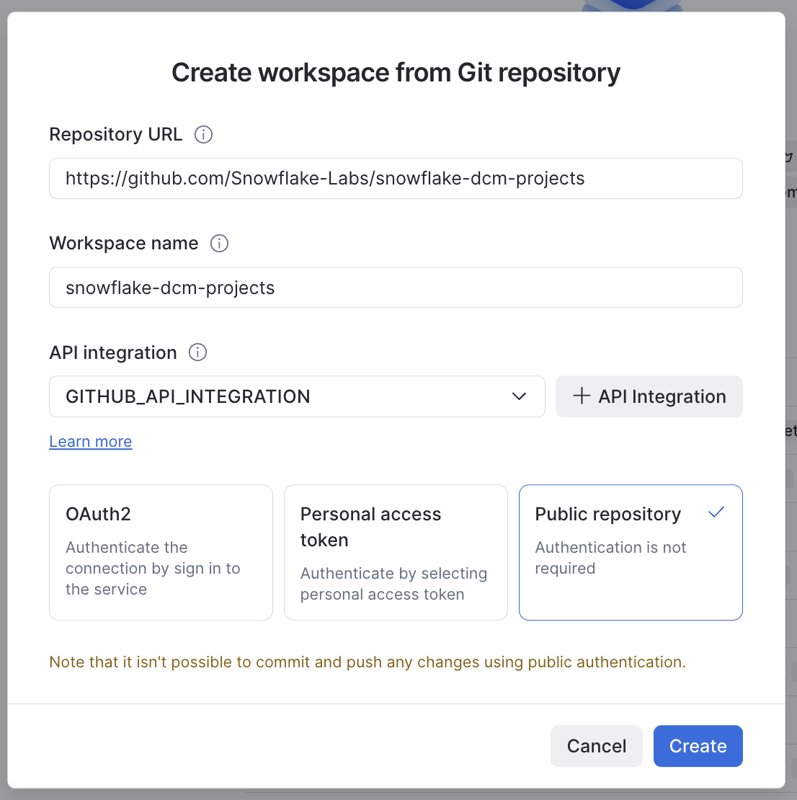
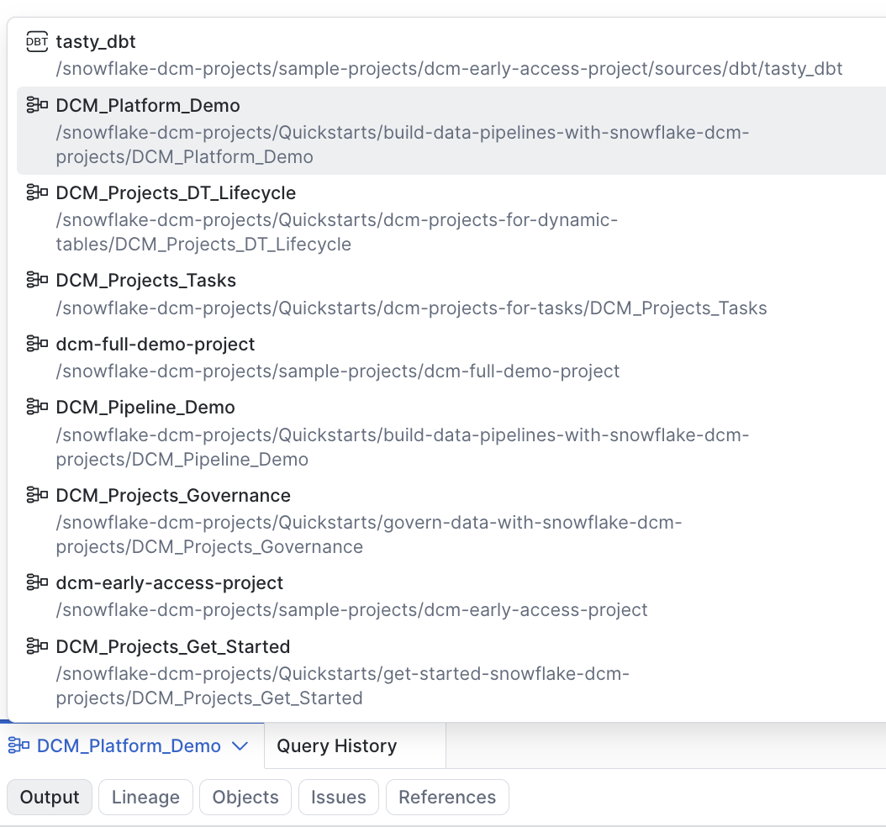
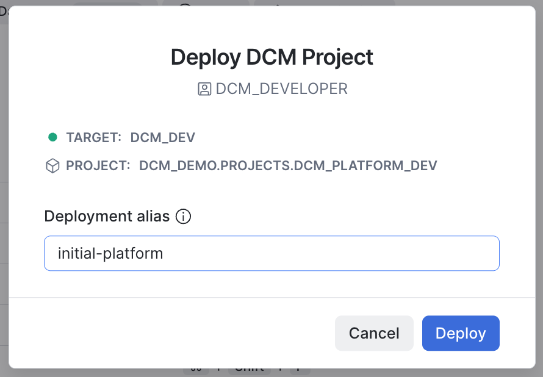
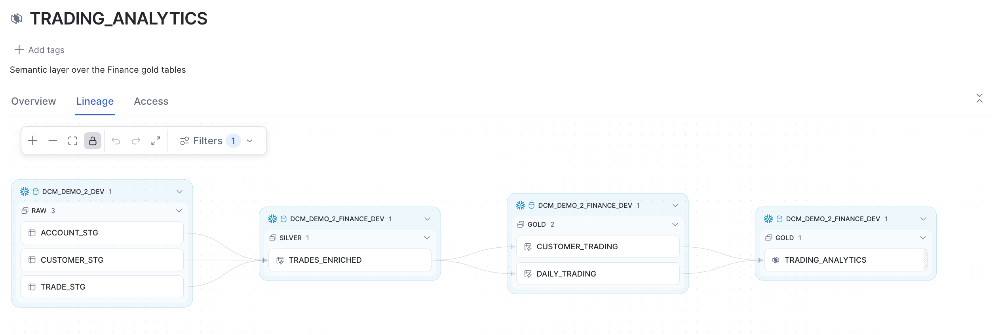

author: Jan Sommerfeld, Gilberto Hernandez, Yoav Ostrinsky
id: build-data-pipelines-with-snowflake-dcm-projects
summary: Split a data platform into four DCM Projects and build a gated dynamic table pipeline, a semantic view, an agent, a Spark task graph and streaming pipes that transform records as they land.
categories: snowflake-site:taxonomy/solution-center/certification/quickstart, snowflake-site:taxonomy/product/platform, snowflake-site:taxonomy/product/data-engineering, snowflake-site:taxonomy/snowflake-feature/dynamic-tables
environments: web
status: Published
language: en
feedback link: https://github.com/Snowflake-Labs/sfguides/issues
fork repo link: https://github.com/Snowflake-Labs/snowflake-dcm-projects

# Build Data Pipelines with Snowflake DCM Projects
<!-- ------------------------ -->
## Overview

In [Get Started with Snowflake DCM Projects](https://www.snowflake.com/en/developers/guides/get-started-snowflake-dcm-projects/) you defined Snowflake infrastructure as code in one project, then planned and deployed it from a Snowsight Workspace. Real platforms rarely fit in one project. A platform team owns the shared raw data, the warehouses and the roles; each data team builds its own pipeline on top, on its own schedule.

This guide works with **four DCM Projects** that do exactly that. Each one is planned and deployed once.

- **DCM_Platform_Demo** is owned by the platform. It defines a shared raw database with three staging tables, a stage filled from the project's own sample files, a file format and a load task, and a warehouse, a database and roles for each team.
- **DCM_Finance_Demo** is owned by the Finance team. It reads the platform's raw tables and defines a silver and a gold layer of dynamic tables, data quality expectations that gate the refreshes, a semantic view, an alert and an agent.
- **DCM_Marketing_Demo** is owned by the Marketing team. It defines a table, a Spark job shipped with the project, and a task graph that runs the job and writes rows into that table.
- **DCM_InfoSec_Demo** is owned by the InfoSec team. It defines two streaming pipes that filter, enrich and redact records as they are ingested, joining the platform's raw tables, and two low-latency dynamic tables on top.

The three teams are completely separate. Each reads the shared raw layer and nothing else of the others'. Everything is declared in DCM and created by a deploy. Code, a Spark job or a task, only writes rows into tables that DCM created; it never runs a CREATE.

### Prerequisites
- Familiarity with DCM Projects concepts (complete [Get Started with Snowflake DCM Projects](https://www.snowflake.com/en/developers/guides/get-started-snowflake-dcm-projects/) first)

### What You'll Learn
- How to split infrastructure into separate DCM Projects with different owners
- How to give each team its own warehouse, database, role and read-only role from one Jinja loop
- How to watch every pipeline style with an alert template: expectations, dynamic table refreshes, tasks and streaming pipes
- How to ship sample files and a Spark job with a project as assets
- How to build silver and gold dynamic tables on top of another project's tables
- How data quality expectations gate downstream refreshes, and how to see the gates
- How to declare a semantic view, an alert and an agent in the same project as the tables they describe, with the agent's specification in a YAML file
- How to run a task graph that writes into an Iceberg table DCM created, with a PyPI package in the Spark job
- How to add a failure branch to a task graph with advanced branching
- How to ship a Streamlit dashboard in the same project as the table it reads
- How to define streaming pipes that filter, enrich and redact records in flight, joining another project's tables
- How to build low-latency dynamic tables with a 15 second target lag

### What You'll Need
- A Snowflake account with ACCOUNTADMIN access, for the one-time setup script
- (Optional) [Snowflake CLI](https://docs.snowflake.com/en/developer-guide/snowflake-cli/installation/installation) 3.24 or later, if you prefer a terminal to the Snowsight UI

### What You'll Build
- A Platform project: one raw database with three staging tables, an ingestion stage and load task, and a warehouse, database, role and read-only role for the Finance, Marketing and InfoSec teams
- A Finance project: one silver and two gold dynamic tables, five data quality expectations that act as gates, a semantic view, two alerts and an agent
- A Marketing project: a customer segments Iceberg table, a Spark code bundle with a PyPI dependency, a task graph with four tasks and a failure branch, a Streamlit dashboard and an alert on failing tasks
- An InfoSec project: two SQL functions, two streaming pipes with their target tables, two low-latency dynamic tables and two alerts on the pipes

<!-- ------------------------ -->
## Create a Workspace from Git

If you want to work in Snowsight rather than locally, create a Snowsight Workspace linked to the sample repository on GitHub.

1. Navigate to **Workspaces > Workspaces** in Snowsight.
2. Click **Create** (+) and select **Git repository**.
3. Enter the repository URL: https://github.com/Snowflake-Labs/snowflake-dcm-projects
4. Select an API Integration for GitHub ([create one if needed](https://docs.snowflake.com/en/user-guide/ui-snowsight/workspaces-git#label-create-a-git-workspace)).
5. Select **Public repository**.



Once the workspace is created you will see the repository files in the file explorer. Navigate to **Quickstarts/build-data-pipelines-with-snowflake-dcm-projects** to find five directories.

DCM_Platform_Demo/, DCM_Finance_Demo/, DCM_Marketing_Demo/ and DCM_InfoSec_Demo/ are the four DCM Projects. scripts/ holds numbered SQL files that you run in Snowsight worksheets at different stages of this guide. They live outside the project directories, so nothing in them is ever picked up by a plan.

| File | When to run |
|---|---|
| scripts/01_pre_deploy.sql | Once, before the first plan |
| scripts/02_platform_post_deploy.sql | After the Platform project is deployed |
| scripts/03_finance_post_deploy.sql | After the Finance project is deployed |
| scripts/04_marketing_post_deploy.sql | After the Marketing project is deployed |
| scripts/05_cleanup.sql | When you are finished |

Every operational step in this guide is given twice: once for Snowsight, and once for the [Snowflake CLI](https://docs.snowflake.com/en/developer-guide/snowflake-cli/installation/installation) if you would rather drive the project from a terminal against your own copy of the repository.

**With the Snowflake CLI:** clone the repository and work from the guide's folder. Run the snow dcm commands from inside the project folder you are working on (DCM_Platform_Demo, DCM_Finance_Demo, DCM_Marketing_Demo or DCM_InfoSec_Demo), and the snow sql commands from the guide's folder.

```bash
git clone https://github.com/Snowflake-Labs/snowflake-dcm-projects.git
cd snowflake-dcm-projects/Quickstarts/build-data-pipelines-with-snowflake-dcm-projects
```

<!-- ------------------------ -->
## Set Up Roles and Permissions

Run the first script. **In Snowsight:** open scripts/01_pre_deploy.sql in a worksheet and run it from top to bottom. **With the Snowflake CLI:**

```bash
snow sql -f scripts/01_pre_deploy.sql
```

The script is the same in every guide of this series. It runs as ACCOUNTADMIN and is safe to run again: if you already ran it for another guide, running it now changes nothing. It has six numbered sections.

**1. Role.** It creates the DCM_DEVELOPER role and grants it to you and to SYSADMIN. Every guide in this series uses this role as the project owner.

**2. Inherited grants opt-in.** It turns on inherited grants for the account.

**3. Account-level privileges.** A project cannot grant account-level privileges to its own owner, so they all happen here, before the first plan. DCM_DEVELOPER gets the privileges that the guides in this series need together, one grant per line, each with a comment naming the guide or feature that uses it. Some are checked at plan time, so a missing one fails the first plan rather than the deploy.

**4. Series container.** It creates the DCM_DEMO database and the DCM_DEMO.PROJECTS schema that holds the platform project object of each guide in the series, and grants DCM_DEVELOPER USAGE on both and CREATE DCM PROJECT on the schema. A project cannot define the database or schema it lives in.

**5. Project object.** It creates the Platform project object, DCM_DEMO.PROJECTS.DCM_PLATFORM_DEV, as DCM_DEVELOPER. This is the only section that differs between the guides.

**6. Values for the manifest.** The last query returns your account identifier and user name.

When the script finishes, refresh your browser so the DCM control panel lists the new project object.

**Inherited grants.** An inherited grant covers current *and* future objects of a type inside a container. GRANT ON ALL snapshots what exists right now; GRANT ON FUTURE covers only what comes later. An inherited grant covers both, as one grant rather than one per object, which is why it is the recommended pattern in DCM Projects. It is a one-time opt-in per account ([release note](https://docs.snowflake.com/en/release-notes/2026/other/2026-09-10-inherited-grants-ga)), which the setup script turns on:

```sql
ALTER ACCOUNT SET FEATURE_RBAC_INHERITED_GRANTS = 'ENABLED';
```

An inherited grant cannot be combined with WITH GRANT OPTION, CASCADE or RESTRICT.

The Platform project uses them to let each team read every table in the shared RAW schema, including tables added later, and to give each team a read-only role.

Four grants in section 3 are there so the Platform project can hand privileges on to the teams. The script comments say why: EXECUTE DATA METRIC FUNCTION and the SNOWFLAKE.DATA_QUALITY_MONITORING_VIEWER application role are for the Finance team's expectations, EXECUTE ALERT and the SNOWFLAKE.EVENTS_VIEWER application role are for the teams' template alerts, and EXECUTE TASK is for the Marketing team's task graph. A role can only pass on a privilege it holds WITH GRANT OPTION, which is why the script grants EXECUTE DATA METRIC FUNCTION, EXECUTE ALERT and EXECUTE TASK that way. Without the grant option on EXECUTE DATA METRIC FUNCTION, the first plan fails with "Grant not executed: Insufficient privileges".

The Platform project object lives in DCM_DEMO.PROJECTS. The Finance, Marketing and InfoSec project objects will live somewhere else: in a DCM schema inside the platform database, which the Platform project creates.

**Update the manifests before the first plan.** Copy ACCOUNT_IDENTIFIER from the last query of scripts/01_pre_deploy.sql into the account_identifier line of the DCM_DEV target in all four manifests: DCM_Platform_Demo/manifest.yml, DCM_Finance_Demo/manifest.yml, DCM_Marketing_Demo/manifest.yml and DCM_InfoSec_Demo/manifest.yml (line 11 in each, marked "# update to your account names").

<!-- ------------------------ -->
## Explore the Platform Project

Navigate into **DCM_Platform_Demo/**. This is the project the platform team owns.

### Manifest

The DEV target and its configuration (the manifest also defines a DCM_PROD target and a PROD configuration):

```yaml
targets:
  DCM_DEV:
    account_identifier: MYORG-MY_DEV_ACCOUNT        # update to your account names
    project_name: DCM_DEMO.PROJECTS.DCM_PLATFORM_DEV
    project_owner: DCM_DEVELOPER
    templating_config: DEV

templating:
  defaults:
    # Every warehouse is adaptive: Snowflake sizes each query up to this level.
    wh_perf_level: "XSMALL"

  configurations:
    DEV:
      env_suffix: "_DEV"
      project_owner_role: "DCM_DEVELOPER"
      teams:
        - name: "Finance"
          raw_access: "READ"
        - name: "Marketing"
          raw_access: "READ"
        - name: "InfoSec"
          raw_access: "READ"
```

The teams list drives a loop in the definitions. DEV has three teams. The PROD configuration in the same manifest lists five teams with different raw_access values (READ, WRITE and NONE) and a higher wh_perf_level; you only deploy DEV in this guide.

The manifest also declares an asset, the folder of sample files that ships with the project:

```yaml
assets:
  sample_data:
    path: 'sample_data/**/*'
```

### Definition files

| File | What it defines |
|---|---|
| raw.sql | The shared database DCM_DEMO_2_DEV, its RAW schema and three staging tables, and the DCM schema for the team projects |
| ingest.sql | The platform warehouse, a stage filled from the sample_data asset, a file format and the load task |
| wh_roles_and_grants.sql | A warehouse, a database and a role for each team, and the team's access to RAW |
| sources/macros/grants_macro.sql | The team role and the read-only READER role, as a macro |

#### Raw tables

raw.sql defines CUSTOMER_STG, ACCOUNT_STG and TRADE_STG: customers, their brokerage accounts, and the trades placed on those accounts. Each table sets CHANGE_TRACKING = TRUE (lines 39, 49 and 64) so that the Finance project's dynamic tables can track what changed between refreshes.

CUSTOMER_STG and ACCOUNT_STG also declare their primary key with RELY (lines 30 and 43):

```sql
    C_ID          NUMBER(38,0) PRIMARY KEY RELY COMMENT 'Customer identifier',
```

The InfoSec project's streaming pipes join these two tables as records arrive. A pipe treats a joined table as a key-value lookup, and it only accepts one whose RELY primary key exactly covers the join condition; the plan of the InfoSec project fails otherwise. Snowflake does not enforce a primary key, so RELY is a promise that the key is unique. The sample data keeps it.

#### Ingestion

The stage is filled by the deploy itself. FROM 'asset://sample_data/' points at the sample_data asset declared in the manifest, so the CSV files ship with the project and land on the stage when it deploys (ingest.sql, lines 25 to 28):

```sql
DEFINE STAGE DCM_DEMO_2{{env_suffix}}.RAW.DCM_SAMPLE_DATA
    FROM 'asset://sample_data/'
    DIRECTORY = (ENABLE = TRUE)
    COMMENT = 'CSV files with sample data for the DCM Build Data Pipelines Quickstart';
```

DCM owns the stage's contents: a file uploaded by hand, or removed from the folder, is deleted on the next deploy.

The load task (ingest.sql, lines 40 to 60) copies the three files into the three tables. It runs on the platform warehouse, like every scheduled and refreshing object in this guide, so there is one compute model to reason about. Its CRON schedule would load new files every hour of the working day. The task declares SUSPENDED, last before AS, so the schedule never fires and you run the task once by hand instead. Without a target state DCM creates a new task suspended but leaves a deployed task in whatever state it is in; SUSPENDED makes every deploy put it back.

#### Per-team infrastructure

wh_roles_and_grants.sql is one loop over the teams in the manifest. Every team gets the same footprint: a warehouse, a database, and a team role from the macro. A team with READ or WRITE access can read every table in RAW through an inherited grant; NONE skips those grants.

Every warehouse in this guide is an [adaptive warehouse](https://docs.snowflake.com/en/user-guide/warehouses-adaptive) (lines 16 to 20):

```sql
    DEFINE WAREHOUSE DCM_DEMO_2_{{team_name}}_WH{{env_suffix}}
    WITH
        WAREHOUSE_TYPE = 'ADAPTIVE'
        MAX_QUERY_PERFORMANCE_LEVEL = {{wh_perf_level}}
        COMMENT = 'Compute for the {{team.name}} team in the DCM Build Data Pipelines Quickstart';
```

An adaptive warehouse has no size, cluster count or auto-suspend setting to tune. Snowflake allocates compute per query, up to MAX_QUERY_PERFORMANCE_LEVEL, so the manifest sets one ceiling per environment instead of a size. WAREHOUSE_SIZE and AUTO_SUSPEND aren't valid on an adaptive warehouse; a plan that includes them fails.

Each team database sets LOG_EVENT_LEVEL = WARN (lines 25 to 27), so the dynamic tables, tasks and pipes inside it log their warnings and failures to the account's event table. That is what the teams' alert templates read.

Each team also gets the account-level privileges its pipeline style needs (lines 46 to 59):

```sql
    GRANT EXECUTE ALERT ON ACCOUNT TO ROLE DCM_DEMO_2_{{team_name}}{{env_suffix}}_ADMIN;
    GRANT APPLICATION ROLE SNOWFLAKE.EVENTS_VIEWER TO ROLE DCM_DEMO_2_{{team_name}}{{env_suffix}}_ADMIN;

    
        GRANT EXECUTE DATA METRIC FUNCTION ON ACCOUNT TO ROLE DCM_DEMO_2_{{team_name}}{{env_suffix}}_ADMIN;
        GRANT APPLICATION ROLE SNOWFLAKE.DATA_QUALITY_MONITORING_VIEWER TO ROLE DCM_DEMO_2_{{team_name}}{{env_suffix}}_ADMIN;
    
    -- Marketing builds on Spark: it owns a task graph that runs its code bundle.
    
        GRANT EXECUTE TASK ON ACCOUNT TO ROLE DCM_DEMO_2_{{team_name}}{{env_suffix}}_ADMIN;
    
```

Every team owns at least one alert built from a template, and those templates read the event table, so every team gets EXECUTE ALERT and the SNOWFLAKE.EVENTS_VIEWER application role. Finance also attaches data quality expectations and reads their results. Marketing builds on Spark and owns a task graph. InfoSec needs nothing more: it owns its pipes and their target tables, and READ access to RAW covers the tables its pipes join.

The macro in sources/macros/grants_macro.sql creates the team role, DCM_DEMO_2_<TEAM>_DEV_ADMIN, with what a project owner needs inside the team database (create schemas), and the right to create DCM projects in the platform's DCM schema. It rolls each team role up to the Platform project's owner (line 18), so you can act as either team later without any extra setup.

The macro also defines a read-only role for the team's consumers, analysts and dashboards that query what the team publishes but never change it (lines 23 to 29):

```sql
DEFINE DATABASE ROLE DCM_DEMO_2_{{team}}{{env_suffix}}.READER
    COMMENT = 'Read-only access to everything the {{team}} team publishes';

GRANT USAGE ON DATABASE DCM_DEMO_2_{{team}}{{env_suffix}} TO DATABASE ROLE DCM_DEMO_2_{{team}}{{env_suffix}}.READER;
GRANT INHERITED USAGE ON ALL SCHEMAS IN DATABASE DCM_DEMO_2_{{team}}{{env_suffix}} TO DATABASE ROLE DCM_DEMO_2_{{team}}{{env_suffix}}.READER;
GRANT INHERITED SELECT ON ALL TABLES IN DATABASE DCM_DEMO_2_{{team}}{{env_suffix}} TO DATABASE ROLE DCM_DEMO_2_{{team}}{{env_suffix}}.READER;
GRANT INHERITED SELECT ON ALL DYNAMIC TABLES IN DATABASE DCM_DEMO_2_{{team}}{{env_suffix}} TO DATABASE ROLE DCM_DEMO_2_{{team}}{{env_suffix}}.READER;
```

READER is a database role, so it lives inside the team database. The inherited grants cover every schema and table the team's own projects create later, so the platform never needs to know their names. The team admin role holds READER too and hands it out.

<!-- ------------------------ -->
## Deploy the Platform Project

### Plan

**In Snowsight:** the DCM control panel is the first tab in the bottom panel of your workspace. Select the project **build-data-pipelines-with-snowflake-dcm-projects/DCM_Platform_Demo**. On the right side of the same bar, select the **DCM_DEV** target and click the play button to the right of **Plan**.



**With the Snowflake CLI:** from inside the DCM_Platform_Demo folder of your clone, pass the manifest's owner role for the target with --role.

```bash
snow dcm plan --target DCM_DEV --role DCM_DEVELOPER --save-output
```

Nothing exists yet, so the plan is almost all CREATEs: databases, schemas, tables, the stage, file format and task, warehouses, the team roles and the READER database roles.

### Deploy

When the changeset matches what you expected, deploy it.

**In Snowsight:** in the DCM control panel, set the operation to **Deploy** instead of **Plan**, add a deployment alias such as initial-platform, and run it.



**With the Snowflake CLI:**

```bash
snow dcm deploy --target DCM_DEV --role DCM_DEVELOPER --alias initial-platform
```

The deploy reports "Deployed 27 entities (26 created, 1 altered, 0 dropped)." In the Database Explorer you now see DCM_DEMO_2_DEV, DCM_DEMO_2_FINANCE_DEV, DCM_DEMO_2_MARKETING_DEV and DCM_DEMO_2_INFOSEC_DEV.

<!-- ------------------------ -->
## Load Sample Data

The tables exist but are empty. The deploy already put the three CSV files on the stage, because the stage is defined from the sample_data asset. Open scripts/02_platform_post_deploy.sql in a Snowsight worksheet and run it. It runs as DCM_DEVELOPER, which owns the raw tables, on the platform warehouse. It has five steps.

**1. Check the files.** LIST shows what the deploy put on the stage:

```sql
LIST @DCM_DEMO_2_DEV.RAW.DCM_SAMPLE_DATA;
```

**2. Run the load task.**

```sql
EXECUTE TASK DCM_DEMO_2_DEV.RAW.LOAD_NEW_DATA;
CALL SYSTEM$WAIT(15);
```

EXECUTE TASK runs the suspended task once. It runs asynchronously, so the script waits a few seconds before checking the result.

**3. Add today's trades.**

```sql
INSERT INTO DCM_DEMO_2_DEV.RAW.TRADE_STG
    (T_ID, T_DTS, T_ST_ID, T_TT_ID, T_S_SYMB, T_QTY, T_TRADE_PRICE, T_CHRG, T_COMM, T_CA_ID)
VALUES
    (2021, CURRENT_TIMESTAMP(), 'CMPT', 'TMB', 'SNOW', 40, 150.10, 9.95, 6.00, 1001),
    (2022, CURRENT_TIMESTAMP(), 'CMPT', 'TMS', 'ACME', 75,  41.30, 4.95, 3.10, 1006);
```

**4. Verify.**

| TABLE_NAME | ROW_COUNT |
|---|---|
| CUSTOMER_STG | 6 |
| ACCOUNT_STG | 9 |
| TRADE_STG | 22 |

The trade file holds 20 trades, one of them cancelled (T_ST_ID is CNCL). Add the two trades inserted today and TRADE_STG has 22 rows.

**5. Create the team projects.** The Finance, Marketing and InfoSec project objects live in DCM_DEMO_2_DEV.DCM, a schema the platform deploy just created, so 01_pre_deploy.sql couldn't create them. Each is created by its team role, which owns it. Refresh your browser afterwards so the DCM control panel lists all three.

```sql
USE ROLE DCM_DEMO_2_FINANCE_DEV_ADMIN;
CREATE DCM PROJECT IF NOT EXISTS DCM_DEMO_2_DEV.DCM.FINANCE_PIPELINE
    COMMENT = 'DEV Finance project of the Build Data Pipelines with Snowflake DCM Projects quickstart';

USE ROLE DCM_DEMO_2_MARKETING_DEV_ADMIN;
CREATE DCM PROJECT IF NOT EXISTS DCM_DEMO_2_DEV.DCM.MARKETING_PIPELINE
    COMMENT = 'DEV Marketing project of the Build Data Pipelines with Snowflake DCM Projects quickstart';

USE ROLE DCM_DEMO_2_INFOSEC_DEV_ADMIN;
CREATE DCM PROJECT IF NOT EXISTS DCM_DEMO_2_DEV.DCM.INFOSEC_PIPELINE
    COMMENT = 'DEV InfoSec project of the Build Data Pipelines with Snowflake DCM Projects quickstart';
```

<!-- ------------------------ -->
## Explore the Finance Project

Navigate into **DCM_Finance_Demo/**. This project belongs to the Finance team.

### Manifest

The DEV target and its configuration (the manifest also defines a DCM_PROD target and a PROD configuration):

```yaml
targets:
  DCM_DEV:
    account_identifier: MYORG-MY_DEV_ACCOUNT        # update to your account names
    project_name: DCM_DEMO_2_DEV.DCM.FINANCE_PIPELINE
    project_owner: DCM_DEMO_2_FINANCE_DEV_ADMIN
    templating_config: DEV
```

The project object lives in DCM_DEMO_2_DEV.DCM, the DCM schema of the platform database, next to the raw data the pipeline builds on, not in the series-wide DCM_DEMO.PROJECTS. Both teams create their projects in that one schema, but each project is owned by its team role, so neither team can see or deploy the other's. Its owner is the Finance role the Platform project created. The Finance team can plan and deploy its pipeline without asking an account administrator for anything: everything it needs, the Platform project granted.

### Definition files

| File | What it defines |
|---|---|
| silver_layer.sql | The SILVER schema and TRADES_ENRICHED, one row per trade |
| gold_layer.sql | The GOLD schema and two aggregates, DAILY_TRADING and CUSTOMER_TRADING |
| expectations.sql | Five data quality expectations, three on TRADES_ENRICHED and one on each gold table, each acting as a gate |
| semantic_view.sql | TRADING_ANALYTICS, a semantic view over the two gold tables |
| alerts.sql | EXPECTATION_VIOLATIONS and REFRESH_FAILURES, two alerts from templates |
| agents.sql | TRADING_AGENT, an agent over the semantic view, with its specification in agents/ |

#### Silver layer

silver_layer.sql (lines 14 to 45) defines one dynamic table that joins the three raw staging tables into one row per trade:

```sql
DEFINE SCHEMA DCM_DEMO_2_FINANCE{{env_suffix}}.SILVER
    COMMENT = 'Cleaned and joined trade data';

DEFINE DYNAMIC TABLE DCM_DEMO_2_FINANCE{{env_suffix}}.SILVER.TRADES_ENRICHED
    WAREHOUSE = DCM_DEMO_2_FINANCE_WH{{env_suffix}}
    TARGET_LAG = 'DOWNSTREAM'
    REFRESH_MODE = ADAPTIVE
    INITIALIZE = 'ON_SCHEDULE'
    DATA_METRIC_SCHEDULE = 'TRIGGER_ON_CHANGES'
    COMMENT = 'One row per trade, joined to its account and customer'
AS
SELECT
    T.T_ID,
    T.T_DTS,
    T.T_S_SYMB,
    T.T_TT_ID,
    T.T_QTY,
    T.T_TRADE_PRICE,
    T.T_QTY * T.T_TRADE_PRICE AS TRADE_VALUE,
    T.T_CHRG,
    T.T_COMM,
    T.T_CA_ID,
    A.CA_NAME,
    C.C_ID,
    C.C_F_NAME || ' ' || C.C_L_NAME AS CUSTOMER_NAME,
    C.C_TIER
FROM DCM_DEMO_2{{env_suffix}}.RAW.TRADE_STG T
LEFT JOIN DCM_DEMO_2{{env_suffix}}.RAW.ACCOUNT_STG A
    ON T.T_CA_ID = A.CA_ID
LEFT JOIN DCM_DEMO_2{{env_suffix}}.RAW.CUSTOMER_STG C
    ON A.CA_C_ID = C.C_ID
WHERE T.T_ST_ID = 'CMPT';
```

This is the cross-project link: a dynamic table in the Finance project reads three tables from the Platform project. It works because the Platform project granted the Finance role read access to RAW.

A few properties are worth a look:

- TARGET_LAG = 'DOWNSTREAM' gives this table no schedule of its own. It refreshes whenever a gold table needs it.
- REFRESH_MODE = ADAPTIVE refreshes incrementally, and recomputes the whole table only for a refresh where so much changed that incremental work would cost more. Left at the default, AUTO, Snowflake chose FULL for this table ("This dynamic table contains a complex query"), and the two gold tables followed, since an incremental table can't read a full-refresh one. Every dynamic table in this guide declares ADAPTIVE.
- INITIALIZE = 'ON_SCHEDULE' skips the refresh at creation, which keeps deployments fast. The dynamic tables are empty until their first refresh, which you run yourself.
- DATA_METRIC_SCHEDULE = 'TRIGGER_ON_CHANGES' evaluates the expectations attached to this table after each refresh.
- The joins are LEFT joins on purpose. A trade whose account has not arrived yet still shows up, with an empty customer, instead of silently disappearing from every total.
- The WHERE clause keeps only completed trades, so cancelled trades never reach the gold layer.

#### Gold layer

gold_layer.sql defines two aggregates over the silver table, DAILY_TRADING by day and CUSTOMER_TRADING by customer. DAILY_TRADING (lines 10 to 24):

```sql
DEFINE DYNAMIC TABLE DCM_DEMO_2_FINANCE{{env_suffix}}.GOLD.DAILY_TRADING
    WAREHOUSE = DCM_DEMO_2_FINANCE_WH{{env_suffix}}
    TARGET_LAG = '1 hour'
    REFRESH_MODE = ADAPTIVE
    INITIALIZE = 'ON_SCHEDULE'
    DATA_METRIC_SCHEDULE = 'TRIGGER_ON_CHANGES'
    COMMENT = 'Trading volume and value per day'
AS
SELECT
    T_DTS::DATE         AS TRADE_DATE,
    COUNT(*)            AS TRADE_COUNT,
    SUM(T_QTY)          AS TOTAL_QUANTITY,
    SUM(TRADE_VALUE)    AS TOTAL_VALUE
FROM DCM_DEMO_2_FINANCE{{env_suffix}}.SILVER.TRADES_ENRICHED
GROUP BY TRADE_DATE;
```

The gold tables hold the pipeline's only real TARGET_LAG. Because the silver table is DOWNSTREAM, this one hour drives the whole graph. Like the silver table, each gold table sets DATA_METRIC_SCHEDULE = 'TRIGGER_ON_CHANGES', so its own expectations are evaluated after each refresh.

#### Data quality expectations

expectations.sql attaches three expectations to TRADES_ENRICHED, the one table every gold number is built from. Each statement attaches a system data metric function to a column, names the condition its result must meet, and names an action to take on violation:

```sql
-- Every trade must resolve to a customer. A NULL here means the trade's
-- account is missing from ACCOUNT_STG.
ATTACH DATA METRIC FUNCTION SNOWFLAKE.CORE.NULL_COUNT
    TO DYNAMIC TABLE DCM_DEMO_2_FINANCE{{env_suffix}}.SILVER.TRADES_ENRICHED
    ON (C_ID)
    EXPECTATION EVERY_TRADE_HAS_A_CUSTOMER (value = 0)
    ON_VIOLATION_ACTION = (TYPE = 'SKIP_DOWNSTREAM_DYNAMIC_TABLE_REFRESH');

-- One row per trade. A duplicate means a join fanned out.
ATTACH DATA METRIC FUNCTION SNOWFLAKE.CORE.DUPLICATE_COUNT
    TO DYNAMIC TABLE DCM_DEMO_2_FINANCE{{env_suffix}}.SILVER.TRADES_ENRICHED
    ON (T_ID)
    EXPECTATION NO_DUPLICATE_TRADES (value = 0)
    ON_VIOLATION_ACTION = (TYPE = 'SKIP_DOWNSTREAM_DYNAMIC_TABLE_REFRESH');

-- A completed trade always moves at least one share.
ATTACH DATA METRIC FUNCTION SNOWFLAKE.CORE.MIN
    TO DYNAMIC TABLE DCM_DEMO_2_FINANCE{{env_suffix}}.SILVER.TRADES_ENRICHED
    ON (T_QTY)
    EXPECTATION QUANTITY_IS_POSITIVE (value > 0)
    ON_VIOLATION_ACTION = (TYPE = 'SKIP_DOWNSTREAM_DYNAMIC_TABLE_REFRESH');
```

The ON_VIOLATION_ACTION lines (23, 30 and 37) turn each expectation into a **gate**. A gate works like this:

- While an expectation fails, every dynamic table downstream of TRADES_ENRICHED skips its refresh and keeps serving its last good contents.
- Nothing is suspended. Once a fresh measurement passes, the next refresh catches up on its own.
- A skipped refresh shows in the refresh history with STATE_CODE UPSTREAM_DATA_QUALITY_VIOLATION and the message "Skipped refreshing because an upstream object failed a data quality metric with SKIP_DOWNSTREAM_DYNAMIC_TABLE_REFRESH". The skipped table's LAST_TRIGGER_STATUS becomes DOWNSTREAM_DYNAMIC_TABLE_REFRESH_SKIPPED.
- It applies to manual and scheduled refreshes alike. A manual ALTER DYNAMIC TABLE ... REFRESH returns normally when it is skipped (refreshed_dt_count 0), so check the refresh history to see the skip.
- Because TRADES_ENRICHED sets DATA_METRIC_SCHEDULE = 'TRIGGER_ON_CHANGES', the gate waits for a measurement of the current data before it allows the refresh.

Put the action on every expectation of the monitored table, as the file does. An expectation without it currently stops the gate working. The sample data in this guide is clean, so you will not see a gate trigger; you will see how to inspect them in a later step.

The gold tables are what the semantic view, the agent and any dashboard read, so expectations.sql also checks them, one expectation each (lines 47 to 59):

```sql
-- One row per trading day.
ATTACH DATA METRIC FUNCTION SNOWFLAKE.CORE.DUPLICATE_COUNT
    TO DYNAMIC TABLE DCM_DEMO_2_FINANCE{{env_suffix}}.GOLD.DAILY_TRADING
    ON (TRADE_DATE)
    EXPECTATION ONE_ROW_PER_DAY (value = 0)
    ON_VIOLATION_ACTION = (TYPE = 'SKIP_DOWNSTREAM_DYNAMIC_TABLE_REFRESH');

-- Every customer row carries a name for the agent and dashboards to show.
ATTACH DATA METRIC FUNCTION SNOWFLAKE.CORE.NULL_COUNT
    TO DYNAMIC TABLE DCM_DEMO_2_FINANCE{{env_suffix}}.GOLD.CUSTOMER_TRADING
    ON (CUSTOMER_NAME)
    EXPECTATION EVERY_CUSTOMER_IS_NAMED (value = 0)
    ON_VIOLATION_ACTION = (TYPE = 'SKIP_DOWNSTREAM_DYNAMIC_TABLE_REFRESH');
```

They are gates too, but nothing is downstream of gold yet, so a failing gold check holds no refresh today. It starts holding refreshes as soon as a dynamic table is built on top of a gold table, with no change to this file. Step 4 of 03 evaluates them with the others, but the alert below watches only the SILVER schema.

#### Semantic view

semantic_view.sql (lines 10 to 42) declares TRADING_ANALYTICS over the two gold tables, with three dimensions (TRADE_DATE, CUSTOMER_NAME, CUSTOMER_TIER) and three metrics (TOTAL_TRADES, TOTAL_TRADE_VALUE, CUSTOMER_TRADE_VALUE). A [semantic view](https://docs.snowflake.com/en/user-guide/views-semantic/overview) names the business concepts in your data so that SQL users and Cortex Analyst ask for "total trade value by day" instead of writing the aggregation. Declaring it in the same project as the gold tables means the vocabulary is versioned and reviewed with the pipeline that produces the numbers, and a renamed metric shows up in a plan diff. It reads only the gold tables, so nobody who queries it touches raw data.

#### Alerts

alerts.sql (lines 14 to 24) watches the expectations:

```sql
DEFINE ALERT DCM_DEMO_2_FINANCE{{env_suffix}}.SILVER.EXPECTATION_VIOLATIONS
    FROM TEMPLATE DQ_EXPECTATION_VIOLATIONS
    WAREHOUSE = DCM_DEMO_2_FINANCE_WH{{env_suffix}}
    SCHEDULE = '5 MINUTE'
    COMMENT = 'Notifies when an expectation on the silver layer fails'
    TEMPLATE_PARAMS = '{"template_variables": {
        "SCOPE_ACTIVE": "SCHEMA",
        "SCOPE_DATABASE": "DCM_DEMO_2_FINANCE{{env_suffix}}",
        "SCOPE_SCHEMA": "SILVER",
        "NOTIFICATION_MODE": "IN_APP"}}'
    STARTED;
```

An alert template is a ready-made condition and action that Snowflake renders into an alert from a few parameters. DQ_EXPECTATION_VIOLATIONS checks for failed expectations on a schedule and notifies when it finds one, so you do not write the monitoring query yourself. FROM TEMPLATE generates the condition and the action; TEMPLATE_PARAMS only says what to watch (the SILVER schema, where the expectations live) and how to notify. IN_APP sends the notification to the Snowsight user who deployed the alert, so no notification integration is needed.

STARTED, last in the statement, makes DCM deploy the alert running, so there is nothing to resume after the deploy.

The second alert, REFRESH_FAILURES (lines 35 to 44), comes from the DT_REFRESH_FAILURE template. It reads the event table and notifies when any dynamic table in the Finance database fails to refresh, across the whole database rather than one schema:

```sql
    TEMPLATE_PARAMS = '{"template_variables": {
        "SCOPE_ACTIVE": "DATABASE",
        "SCOPE_DATABASE": "DCM_DEMO_2_FINANCE{{env_suffix}}",
        "NOTIFICATION_MODE": "IN_APP"}}'
```

The two alerts cover different failures. A refresh that a data quality gate skips is not a refresh failure: EXPECTATION_VIOLATIONS reports the failing check that caused it. REFRESH_FAILURES reports refreshes that fail outright, for example because an upstream table changed shape. It sees them because the Platform project set LOG_EVENT_LEVEL = WARN on the Finance database.

#### Agent

agents.sql (lines 13 to 18) defines TRADING_AGENT, an agent that answers trading questions in plain language. Its one tool is Cortex Analyst over TRADING_ANALYTICS, so it reads the same gold numbers, with the same names, as everyone else:

```sql
DEFINE AGENT DCM_DEMO_2_FINANCE{{env_suffix}}.GOLD.TRADING_AGENT
    COMMENT = 'Answers questions about trading activity from the gold layer'
    SPECIFICATION
        FROM 'asset://trading_agent/{{agent_spec}}.yaml'
    PROFILE
        FROM 'asset://agent_profile';
```

The specification is a YAML file in the agents/ folder, in the same format Agent Studio reads and writes, so you can open it in Agent Studio, change it there and copy it back into the project. The manifest declares the folder as two assets:

```yaml
assets:
  trading_agent:
    path: 'agents/trading_agent/**/*'
  agent_profile:
    path: 'agents/profile.json'
```

Jinja doesn't render inside specification files, and the specification names the semantic view and the warehouse, which carry the env_suffix. So each target has its own file with literal names, DEV.yaml and PROD.yaml, and the agent_spec variable in the manifest picks one. Jinja does render inside the FROM URI.

<!-- ------------------------ -->
## Deploy the Finance Project

The Finance project object, DCM_DEMO_2_DEV.DCM.FINANCE_PIPELINE, already exists: 02_platform_post_deploy.sql created it as the Finance role, which owns this project, once the platform deploy had created its schema. If the DCM control panel doesn't list it, refresh your browser.

### Plan

**In Snowsight:** the DCM control panel is the first tab in the bottom panel of your workspace. Select the project **build-data-pipelines-with-snowflake-dcm-projects/DCM_Finance_Demo**. On the right side of the same bar, select the **DCM_DEV** target and click the play button to the right of **Plan**.


**With the Snowflake CLI:** from inside the DCM_Finance_Demo folder of your clone, you can create the project object with the CLI instead of the SQL above, then plan:

```bash
snow dcm create --target DCM_DEV --role DCM_DEMO_2_FINANCE_DEV_ADMIN
snow dcm plan --target DCM_DEV --role DCM_DEMO_2_FINANCE_DEV_ADMIN --save-output
```

The project_owner in this manifest is the Finance role, not DCM_DEVELOPER, so the **role** option is required on every CLI command for this project. Without it, the create command makes the object as your session role (for example DCM_DEVELOPER) and only prints a role-mismatch warning.

The plan creates what the definition files declare:

| Definition | Entities |
|---|---|
| silver_layer.sql | SILVER schema, SILVER.TRADES_ENRICHED |
| gold_layer.sql | GOLD schema, GOLD.DAILY_TRADING, GOLD.CUSTOMER_TRADING |
| semantic_view.sql | GOLD.TRADING_ANALYTICS |
| alerts.sql | SILVER.EXPECTATION_VIOLATIONS, GOLD.REFRESH_FAILURES |
| agents.sql | GOLD.TRADING_AGENT |


### Deploy

When the changeset matches what you expected, deploy it.

**In Snowsight:** in the DCM control panel, set the operation to **Deploy** instead of **Plan**, add a deployment alias such as initial-finance, and run it. The dialog shows the Finance role, the project owner, rather than DCM_DEVELOPER.

**With the Snowflake CLI:**

```bash
snow dcm deploy --target DCM_DEV --role DCM_DEMO_2_FINANCE_DEV_ADMIN --alias initial-finance
```

The deploy reports "Deployed 10 entities (9 created, 1 altered, 0 dropped)." The dynamic tables are empty until their first refresh. The alerts are already running.

<!-- ------------------------ -->
## Query, Test and Inspect the Gates

Open scripts/03_finance_post_deploy.sql in a Snowsight worksheet. It runs as the Finance role, on the Finance warehouse. Run steps 1 to 5 now; step 6 is the next section.

### Check the alerts

```sql
SHOW ALERTS IN DATABASE DCM_DEMO_2_FINANCE_DEV;
SELECT "name", "state", "schedule" FROM TABLE(RESULT_SCAN(LAST_QUERY_ID()));
```

SHOW ALERTS reports EXPECTATION_VIOLATIONS and REFRESH_FAILURES as started. Each checks every five minutes and notifies you in Snowsight (the bell icon) when its condition is met.

### Refresh the pipeline

```sql
ALTER DYNAMIC TABLE DCM_DEMO_2_FINANCE_DEV.GOLD.DAILY_TRADING,
                    DCM_DEMO_2_FINANCE_DEV.GOLD.CUSTOMER_TRADING REFRESH;
```

Listing both gold tables in one statement refreshes the silver table they read first, once, and lands all three on the same data timestamp. The result reports refreshed_dt_count 3, with 6 inserted rows for each of the two gold tables.

In the Database Explorer, open DCM_DEMO_2_FINANCE_DEV.GOLD.DAILY_TRADING and select the **Graph** tab to see the pipeline: the three raw tables, TRADES_ENRICHED, and the two gold tables that read from it.


### Read the gold layer

```sql
SELECT * FROM DCM_DEMO_2_FINANCE_DEV.GOLD.CUSTOMER_TRADING ORDER BY TOTAL_VALUE DESC;
```

| C_ID | CUSTOMER_NAME | C_TIER | TRADE_COUNT | TOTAL_VALUE | LAST_TRADE_TS |
|---|---|---|---|---|---|
| 101 | Janeta Kaus | 1 | 6 | 56950.30 | ... |
| 105 | Lena Vogel | 2 | 5 | 19462.90 | ... |
| 102 | Samual Enos | 2 | 2 | 19347.50 | 2026-10-28 11:44:00 |
| 104 | Marta Okafor | 1 | 3 | 17380.70 | 2026-10-30 15:35:00 |
| 103 | Edric Salem | 3 | 3 | 15272.65 | 2026-10-30 13:25:00 |
| 106 | Ravi Mehta | 2 | 2 | 2062.30 | 2026-10-30 11:31:00 |

The gold layer counts 21 trades, not 22: the silver table keeps only completed trades, and one trade in the file is cancelled. The two top rows have today's timestamps because the two trades inserted today belong to those customers.

### Ask the semantic view

```sql
SELECT * FROM SEMANTIC_VIEW(
    DCM_DEMO_2_FINANCE_DEV.GOLD.TRADING_ANALYTICS
    METRICS daily.TOTAL_TRADES, daily.TOTAL_TRADE_VALUE
    DIMENSIONS daily.TRADE_DATE
)
ORDER BY TRADE_DATE;
```

| TOTAL_TRADES | TOTAL_TRADE_VALUE | TRADE_DATE |
|---|---|---|
| 4 | 29335.80 | 2026-10-26 |
| 3 | 19618.40 | 2026-10-27 |
| 4 | 20501.80 | 2026-10-28 |
| 4 | 15999.70 | 2026-10-29 |
| 4 | 35919.15 | 2026-10-30 |
| 2 | 9101.50 | ... |

You asked for two metrics by one dimension, by name; the semantic view supplied the aggregation. The last row is today's two trades.

In the Database Explorer, open TRADING_ANALYTICS and select the **Lineage** tab to see the whole chain across both projects: the Platform's raw tables, the silver and gold dynamic tables, and the semantic view.



### Run the expectations

```sql
SELECT 'TRADES_ENRICHED' AS TABLE_NAME, EXPECTATION_NAME, VALUE, EXPECTATION_EXPRESSION, EXPECTATION_VIOLATED
FROM TABLE(SYSTEM$EVALUATE_DATA_QUALITY_EXPECTATIONS(
    REF_ENTITY_NAME => 'DCM_DEMO_2_FINANCE_DEV.SILVER.TRADES_ENRICHED'))
UNION ALL
SELECT 'DAILY_TRADING', EXPECTATION_NAME, VALUE, EXPECTATION_EXPRESSION, EXPECTATION_VIOLATED
FROM TABLE(SYSTEM$EVALUATE_DATA_QUALITY_EXPECTATIONS(
    REF_ENTITY_NAME => 'DCM_DEMO_2_FINANCE_DEV.GOLD.DAILY_TRADING'))
UNION ALL
SELECT 'CUSTOMER_TRADING', EXPECTATION_NAME, VALUE, EXPECTATION_EXPRESSION, EXPECTATION_VIOLATED
FROM TABLE(SYSTEM$EVALUATE_DATA_QUALITY_EXPECTATIONS(
    REF_ENTITY_NAME => 'DCM_DEMO_2_FINANCE_DEV.GOLD.CUSTOMER_TRADING'));
```

SYSTEM$EVALUATE_DATA_QUALITY_EXPECTATIONS evaluates the expectations on one table now and returns a row for each. All five pass on the sample data, so EXPECTATION_VIOLATED is false on every row.

### See the gates

Step 5 of the script shows the gates on the table. The first query lists the data metric functions attached to TRADES_ENRICHED, with the action each one carries:

```sql
SELECT METRIC_NAME,
       PARSE_JSON(REF_ARGUMENTS)[0]:name::STRING   AS COLUMN_NAME,
       VIOLATION_ACTION:type::STRING                AS ACTION,
       VIOLATION_ACTION:last_trigger_status::STRING AS LAST_TRIGGER_STATUS
FROM TABLE(DCM_DEMO_2_FINANCE_DEV.INFORMATION_SCHEMA.DATA_METRIC_FUNCTION_REFERENCES(
    REF_ENTITY_NAME   => 'DCM_DEMO_2_FINANCE_DEV.SILVER.TRADES_ENRICHED',
    REF_ENTITY_DOMAIN => 'DYNAMIC TABLE'));
```

| METRIC_NAME | COLUMN_NAME | ACTION | LAST_TRIGGER_STATUS |
|---|---|---|---|
| DUPLICATE_COUNT | T_ID | SKIP_DOWNSTREAM_DYNAMIC_TABLE_REFRESH | NOT_TRIGGERED |
| MIN | T_QTY | SKIP_DOWNSTREAM_DYNAMIC_TABLE_REFRESH | NOT_TRIGGERED |
| NULL_COUNT | C_ID | SKIP_DOWNSTREAM_DYNAMIC_TABLE_REFRESH | NOT_TRIGGERED |

All three expectations carry the action, and LAST_TRIGGER_STATUS reads NOT_TRIGGERED while the checks pass. The second query reads the refresh history of the three dynamic tables:

```sql
SELECT NAME, STATE, STATE_CODE, DATA_TIMESTAMP
FROM TABLE(DCM_DEMO_2_FINANCE_DEV.INFORMATION_SCHEMA.DYNAMIC_TABLE_REFRESH_HISTORY(
    NAME_PREFIX => 'DCM_DEMO_2_FINANCE_DEV.'))
ORDER BY DATA_TIMESTAMP DESC
LIMIT 3;
```

All three dynamic tables show STATE SUCCEEDED and STATE_CODE SUCCESS. If a gate had triggered, the downstream rows would show STATE_CODE UPSTREAM_DATA_QUALITY_VIOLATION instead, and the tables would keep their previous contents.

<!-- ------------------------ -->
## Ask the Agent

Step 6 of scripts/03_finance_post_deploy.sql asks the agent a question. **In Snowsight:** go to **AI & ML > Agents > Trading Assistant** and ask "Which customers traded the most by value?". Or from SQL:

```sql
SELECT SNOWFLAKE.CORTEX.DATA_AGENT_RUN(
    'DCM_DEMO_2_FINANCE_DEV.GOLD.TRADING_AGENT',
    '{"messages": [{"role": "user", "content": [{"type": "text", "text": "Which customers traded the most by value?"}]}]}'
) AS RESPONSE;
```

The agent answers from the semantic view. When we ran it, it named Janeta Kaus (Tier 1) first, about three times the next customer, then Lena Vogel ($19,462.90) and Samual Enos. Those are the same numbers as the CUSTOMER_TRADING table above.

<!-- ------------------------ -->
## Explore the Marketing Project

Navigate into **DCM_Marketing_Demo/**. This project belongs to the Marketing team. It has nothing in common with the Finance project except the raw layer both read.

### Manifest

The DEV target and its configuration (the manifest also defines a DCM_PROD target and a PROD configuration):

```yaml
targets:
  DCM_DEV:
    account_identifier: MYORG-MY_DEV_ACCOUNT        # update to your account names
    project_name: DCM_DEMO_2_DEV.DCM.MARKETING_PIPELINE
    project_owner: DCM_DEMO_2_MARKETING_DEV_ADMIN
    templating_config: DEV
```

The manifest also declares two assets: the Spark job, and the files of the Streamlit dashboard. The code bundle's asset folder becomes the root of the bundle, so code_bundle.yml and the entry point sit at its top:

```yaml
assets:
  segments:
    path: 'code_bundles/segments/**/*'
  segments_dashboard:
    path: 'streamlit/segments_dashboard/**/*'
```

### Definition files

| File | What it defines |
|---|---|
| sources/definitions/segments.sql | The SEGMENTS schema and the CUSTOMER_SEGMENTS Iceberg table |
| sources/definitions/pipeline.yml | The code bundle and a task graph with four tasks |
| sources/definitions/dashboard.sql | SEGMENTS_DASHBOARD, a Streamlit app over the segments |
| sources/definitions/alerts.sql | TASK_FAILURES, an alert from a template |
| code_bundles/segments/ | The Spark job: code_bundle.yml, pyproject.toml and segments.py |
| streamlit/segments_dashboard/ | The dashboard: streamlit_app.py and environment.yml |

#### The table

segments.sql (lines 12 to 27) is the table the Spark job fills. DCM creates it, with its columns, so the table is reviewed and versioned like every other object; the job only writes rows into it and never creates or replaces it:

```sql
DEFINE SCHEMA DCM_DEMO_2_MARKETING{{env_suffix}}.SEGMENTS
    COMMENT = 'Customer segments built by the Marketing Spark job';

DEFINE ICEBERG TABLE DCM_DEMO_2_MARKETING{{env_suffix}}.SEGMENTS.CUSTOMER_SEGMENTS (
    C_ID              NUMBER(38,0)     COMMENT 'Customer identifier',
    CUSTOMER_NAME     VARCHAR          COMMENT 'First and last name',
    TRADE_COUNT       NUMBER(18,0)     COMMENT 'Completed trades across all of the customer''s accounts',
    TOTAL_VALUE       NUMBER(18,2)     COMMENT 'Quantity times trade price, summed',
    ACTIVITY_TIER     VARCHAR          COMMENT 'ACTIVE, OCCASIONAL or DORMANT',
    PREFERRED_CHANNEL VARCHAR          COMMENT 'Synthetic marketing channel, generated with Faker',
    CONTACT_EMAIL     VARCHAR          COMMENT 'Synthetic contact email, generated with Faker',
    SEGMENTED_AT      TIMESTAMP_NTZ(6) COMMENT 'When the Spark job wrote this row'
)
    CATALOG = 'SNOWFLAKE'
    EXTERNAL_VOLUME = 'SNOWFLAKE_MANAGED'
    COMMENT = 'One row per customer, rewritten on every run of the Marketing pipeline';
```

CUSTOMER_SEGMENTS is an Apache Iceberg table with Snowflake as its catalog. EXTERNAL_VOLUME = 'SNOWFLAKE_MANAGED' keeps its data and metadata in Snowflake storage, so there is no bucket or external volume to set up, and other engines can still read the segments through the Iceberg REST catalog. A few things differ from a standard table:

- The column types are Iceberg types: VARCHAR without a length, and TIMESTAMP_NTZ(6), because Iceberg stores timestamps in microseconds.
- BASE_LOCATION isn't accepted with Snowflake-managed storage; Snowflake chooses the location.
- EXTERNAL_VOLUME can't change after the table is created, so moving the table to your own bucket later means recreating it.

#### The Spark job

code_bundle.yml describes the bundle, and where its Python dependencies come from:

```yaml
bundle:
  type: spark
  compute_type: warehouse
  language: python
  compute_options:
    runtime_version: "1.29"
  properties:
    # PyPI dependencies come from pyproject.toml and install from the default
    # artifact repository, a PyPI proxy, so no external access integration is
    # needed. Paths are relative to the bundle root.
    python_dependencies:
      requirements_files:
        - pyproject.toml
```

The job's one dependency, the [Faker](https://pypi.org/project/Faker/) library, is pinned in pyproject.toml:

```toml
dependencies = [
    "faker==40.54.0",
]
```

When the bundle runs, Snowflake installs it from PyPI through the default artifact repository, so the job needs no external access integration and no network rules.

segments.py reads the shared raw tables from the platform, counts each customer's completed trades across all of their accounts, and assigns an activity tier: ACTIVE for four or more trades, OCCASIONAL for one or more, DORMANT for none. It then uses Faker to give each customer a synthetic preferred channel and contact email. Faker is seeded with the customer ID, so the same customer gets the same values on every run. The important part is how it writes (lines 90 to 97):

```python
    # Same column order as the table definition in segments.sql. Overwrite mode
    # would recreate the table with CREATE OR REPLACE, dropping what DCM
    # declared, so empty it and append instead.
    spark.sql(f"TRUNCATE TABLE {target}")
    segments.select(
        "C_ID", "CUSTOMER_NAME", "TRADE_COUNT", "TOTAL_VALUE", "ACTIVITY_TIER",
        "PREFERRED_CHANNEL", "CONTACT_EMAIL", "SEGMENTED_AT"
    ).write.insertInto(target)
```

The job empties the table and appends the new rows, so the Iceberg table itself, with its columns and comments, is never replaced.

#### The task graph

pipeline.yml declares the code bundle and a task graph (lines 1 to 23):

```yaml
definitions:
  # The Spark job, built from the segments asset declared in manifest.yml.
  - resource: code_bundle
    name: DCM_DEMO_2_MARKETING{{env_suffix}}.SEGMENTS.SEGMENTS_JOB
    from:
      type: asset
      asset: segments
    comment: Spark job that writes CUSTOMER_SEGMENTS from the shared raw tables

  # Four tasks in one graph: check the inputs, run the job, then branch on how
  # the run went. REPORT_SEGMENTS runs only when everything succeeded;
  # ON_FAILURE uses advanced branching and runs only when a step failed.
  # The graph deploys suspended; the guide runs it with EXECUTE TASK GRAPH.
  - resource: task_graph_object
    name: DCM_DEMO_2_MARKETING{{env_suffix}}.SEGMENTS.SEGMENTS_PIPELINE
    roots:
      - DCM_DEMO_2_MARKETING{{env_suffix}}.SEGMENTS.CHECK_INPUTS
    schedule:
      type: interval
      value: 24
      unit: hours
    state: suspended
    comment: Builds the Marketing customer segments once a day
```

The four tasks:

| Task | Runs after | What it does |
|---|---|---|
| CHECK_INPUTS | (root) | Counts the rows in the raw trades table and fails the run if there are none |
| BUILD_SEGMENTS | CHECK_INPUTS | Runs the Spark job, as a code bundle task |
| REPORT_SEGMENTS | BUILD_SEGMENTS | Summarises the segments the job wrote |
| ON_FAILURE | BUILD_SEGMENTS | Records which step stopped the run, and runs only when one did |

BUILD_SEGMENTS (lines 43 to 59) is the task that runs the job:

```yaml
  - resource: task
    name: DCM_DEMO_2_MARKETING{{env_suffix}}.SEGMENTS.BUILD_SEGMENTS
    warehouse: DCM_DEMO_2_MARKETING_WH{{env_suffix}}
    predecessors:
      - DCM_DEMO_2_MARKETING{{env_suffix}}.SEGMENTS.CHECK_INPUTS
    comment: Runs the Spark job
    # A code bundle task: the graph runs the bundle declared above directly,
    # with no SQL wrapper.
    definition:
      type: code_bundle
      name: DCM_DEMO_2_MARKETING{{env_suffix}}.SEGMENTS.SEGMENTS_JOB
      entrypoint: segments.py
      arguments:
        - --raw-db
        - DCM_DEMO_2{{env_suffix}}
        - --target-db
        - DCM_DEMO_2_MARKETING{{env_suffix}}
```

Its definition type is code_bundle, not sql: it names the SEGMENTS_JOB bundle declared at the top of the file, the entry point, and the arguments, and DCM turns that into an EXECUTE CODE BUNDLE task. In the Pipeline Builder canvas it shows as a code bundle node, with the bundle's specification one click away. Because there is no SQL body, the task sets no return value of its own.

The graph deploys suspended, so its daily schedule never fires. You run it on demand.

#### A failure branch

By default, a task runs only when all of its predecessors succeeded. If CHECK_INPUTS fails, nothing after it is scheduled, and the run simply stops. ON_FAILURE (lines 80 to 97) changes that with [advanced branching](https://docs.snowflake.com/en/user-guide/tasks-graphs#label-task-graph-advanced-branching):

```yaml
  - resource: task
    name: DCM_DEMO_2_MARKETING{{env_suffix}}.SEGMENTS.ON_FAILURE
    warehouse: DCM_DEMO_2_MARKETING_WH{{env_suffix}}
    predecessors:
      - DCM_DEMO_2_MARKETING{{env_suffix}}.SEGMENTS.BUILD_SEGMENTS
    # Advanced branching: runs when BUILD_SEGMENTS failed, or was skipped
    # because CHECK_INPUTS failed before it.
    condition: SYSTEM$PREDECESSORS_STATE('ALL_DONE') AND SYSTEM$TASK_COMPLETION_STATE('BUILD_SEGMENTS') != 'SUCCEEDED'
    comment: Records which step stopped the run
```

The condition becomes the task's WHEN clause. It uses two functions:

- SYSTEM$PREDECESSORS_STATE('ALL_DONE') lets the task run however its predecessor finished, instead of only after a success.
- SYSTEM$TASK_COMPLETION_STATE('BUILD_SEGMENTS') returns how one named task finished: SUCCEEDED, FAILED or SKIPPED. ON_FAILURE runs only when it isn't SUCCEEDED, and its body reads the same function for both earlier tasks to say which one stopped the run.

As soon as one task in a graph calls either function, the whole graph uses advanced branching: every task is scheduled on every run, and a task whose condition isn't met is recorded as SKIPPED instead of being left out of the history. REPORT_SEGMENTS has no condition, so it keeps the default and runs only when BUILD_SEGMENTS succeeded. CHECK_INPUTS raises an exception when the raw trades table is empty, which is what sends a run down the ON_FAILURE branch.

#### The dashboard

dashboard.sql defines a Streamlit app for the Marketing team:

```sql
DEFINE STREAMLIT DCM_DEMO_2_MARKETING{{env_suffix}}.SEGMENTS.SEGMENTS_DASHBOARD
    FROM 'asset://segments_dashboard/'
    MAIN_FILE = 'streamlit_app.py'
    QUERY_WAREHOUSE = DCM_DEMO_2_MARKETING_WH{{env_suffix}}
    RUNTIME_NAME = 'SYSTEM$WAREHOUSE_RUNTIME'
    TITLE = 'Customer segments'
    COMMENT = 'Customer segments by activity tier and channel, for the Marketing team';
```

The app's files ship with the project as the segments_dashboard asset, so the dashboard is versioned and deployed with the table it reads. RUNTIME_NAME = 'SYSTEM$WAREHOUSE_RUNTIME' runs it on the Marketing warehouse, with streamlit as its one dependency in environment.yml. Jinja doesn't render inside streamlit_app.py, so the app finds its own database with CURRENT_DATABASE() and reads CUSTOMER_SEGMENTS from there. It shows the customers per activity tier and per preferred channel.


#### The alert

alerts.sql (lines 11 to 22) defines TASK_FAILURES from the TASKS_ERROR_RATE template:

```sql
DEFINE ALERT DCM_DEMO_2_MARKETING{{env_suffix}}.SEGMENTS.TASK_FAILURES
    FROM TEMPLATE TASKS_ERROR_RATE
    WAREHOUSE = DCM_DEMO_2_MARKETING_WH{{env_suffix}}
    SCHEDULE = '30 MINUTE'
    COMMENT = 'Notifies when too many task runs in the SEGMENTS schema fail'
    TEMPLATE_PARAMS = '{"template_variables": {
        "ERROR_RATE_THRESHOLD": 0.15,
        "SCOPE_ACTIVE": "SCHEMA",
        "SCOPE_DATABASE": "DCM_DEMO_2_MARKETING{{env_suffix}}",
        "SCOPE_SCHEMA": "SEGMENTS",
        "NOTIFICATION_MODE": "IN_APP"}}'
    STARTED;
```

It reads task failures from the event table and notifies when more than 15 percent of the task runs in the SEGMENTS schema fail. The failure branch and the alert do different jobs: ON_FAILURE records why a run stopped, and TASK_FAILURES tells someone that runs keep stopping.

<!-- ------------------------ -->
## Deploy the Marketing Project

The Marketing project object, DCM_DEMO_2_DEV.DCM.MARKETING_PIPELINE, was created by 02_platform_post_deploy.sql as the Marketing role, which owns this project.

### Plan

**In Snowsight:** the DCM control panel is the first tab in the bottom panel of your workspace. Select the project **build-data-pipelines-with-snowflake-dcm-projects/DCM_Marketing_Demo**. On the right side of the same bar, select the **DCM_DEV** target and click the play button to the right of **Plan**.


**With the Snowflake CLI:** from inside the DCM_Marketing_Demo folder of your clone:

```bash
snow dcm create --target DCM_DEV --role DCM_DEMO_2_MARKETING_DEV_ADMIN
snow dcm plan --target DCM_DEV --role DCM_DEMO_2_MARKETING_DEV_ADMIN --save-output
```

As with Finance, the project_owner is the team role, so --role is required on every command.

The plan creates what the definition files declare:

| Definition | Entities |
|---|---|
| segments.sql | SEGMENTS schema, SEGMENTS.CUSTOMER_SEGMENTS (an Iceberg table) |
| pipeline.yml | The SEGMENTS_JOB code bundle, the SEGMENTS_PIPELINE task graph, and the CHECK_INPUTS, BUILD_SEGMENTS, REPORT_SEGMENTS and ON_FAILURE tasks |
| dashboard.sql | SEGMENTS.SEGMENTS_DASHBOARD |
| alerts.sql | SEGMENTS.TASK_FAILURES |

### Deploy

When the changeset matches what you expected, deploy it.

**In Snowsight:** in the DCM control panel, set the operation to **Deploy** instead of **Plan**, add a deployment alias such as initial-marketing, and run it. The dialog shows the Marketing role, the project owner.

**With the Snowflake CLI:**

```bash
snow dcm deploy --target DCM_DEV --role DCM_DEMO_2_MARKETING_DEV_ADMIN --alias initial-marketing
```

The deploy reports "Deployed 11 entities (10 created, 1 altered, 0 dropped)." The task graph exists but is suspended, CUSTOMER_SEGMENTS is empty, and the alert is running.

<!-- ------------------------ -->
## Run the Task Graph and Read the Segments

Open scripts/04_marketing_post_deploy.sql in a Snowsight worksheet. It runs as the Marketing role, on the Marketing warehouse. Its first lines are:

```sql
USE ROLE DCM_DEMO_2_MARKETING_DEV_ADMIN;
USE WAREHOUSE DCM_DEMO_2_MARKETING_WH_DEV;
```

Run steps 1 and 2.

### Run the task graph once

```sql
EXECUTE TASK GRAPH DCM_DEMO_2_MARKETING_DEV.SEGMENTS.SEGMENTS_PIPELINE;

SELECT NAME, STATE, RETURN_VALUE, ERROR_MESSAGE, SCHEDULED_TIME
FROM TABLE(DCM_DEMO_2_MARKETING_DEV.INFORMATION_SCHEMA.TASK_HISTORY(
    SCHEDULED_TIME_RANGE_START => DATEADD(hour, -1, CURRENT_TIMESTAMP())))
WHERE DATABASE_NAME = 'DCM_DEMO_2_MARKETING_DEV'
ORDER BY SCHEDULED_TIME DESC;
```

EXECUTE TASK GRAPH runs CHECK_INPUTS, then BUILD_SEGMENTS (the Spark job), then REPORT_SEGMENTS. It runs asynchronously, and the Spark job takes about two minutes. Rerun the history query until all four tasks have a state:

| NAME | STATE | RETURN_VALUE |
|---|---|---|
| REPORT_SEGMENTS | SUCCEEDED | segments: ACTIVE=2 OCCASIONAL=4 |
| ON_FAILURE | SKIPPED | |
| BUILD_SEGMENTS | SUCCEEDED | |
| CHECK_INPUTS | SUCCEEDED | raw trades available: 22 |

ON_FAILURE appears in the history even though it didn't run: the graph uses advanced branching, so every task is scheduled, and ON_FAILURE's condition evaluated to false. Its ERROR_MESSAGE reads "Conditional expression for task evaluated to false."

When the raw trades table is empty, the same graph takes the other branch. We emptied TRADE_STG and ran it once to show the result (you don't need to do this; it means reloading the raw data afterwards):

| NAME | STATE | RETURN_VALUE |
|---|---|---|
| ON_FAILURE | SUCCEEDED | segments not rebuilt: CHECK_INPUTS FAILED, BUILD_SEGMENTS SKIPPED |
| REPORT_SEGMENTS | SKIPPED | |
| BUILD_SEGMENTS | SKIPPED | |
| CHECK_INPUTS | FAILED | |

CHECK_INPUTS raised its exception, BUILD_SEGMENTS and REPORT_SEGMENTS were skipped because their default condition needs every predecessor to succeed, and ON_FAILURE ran and recorded which step stopped the run. CUSTOMER_SEGMENTS kept the segments from the last good run.

The run also shows in Snowsight: open the SEGMENTS_PIPELINE task in DCM_DEMO_2_MARKETING_DEV.SEGMENTS and select **Run History**.


### Read the segments

```sql
SELECT * FROM DCM_DEMO_2_MARKETING_DEV.SEGMENTS.CUSTOMER_SEGMENTS ORDER BY TOTAL_VALUE DESC;

SELECT TABLE_NAME, IS_ICEBERG, COMMENT, CREATED, ROW_COUNT
FROM DCM_DEMO_2_MARKETING_DEV.INFORMATION_SCHEMA.TABLES
WHERE TABLE_NAME = 'CUSTOMER_SEGMENTS';
```

CUSTOMER_SEGMENTS has 6 rows, one per customer, each with a PREFERRED_CHANNEL and CONTACT_EMAIL from Faker. The second query shows the table is the one DCM created:

- IS_ICEBERG is YES.
- COMMENT is the comment from segments.sql: "One row per customer, rewritten on every run of the Marketing pipeline".
- CREATED is the time of your deploy, before the Spark job ran.
- ROW_COUNT is 6.

The Spark job did not recreate the table. It only replaced its rows.

### Open the dashboard

**In Snowsight:** go to **Projects > Streamlit** and open **Customer segments**. It filters the customers by activity tier and shows their count, their total trading value, the number of customers per preferred channel, and the customer list. The dashboard reads CUSTOMER_SEGMENTS directly, so it shows whatever the last good run of the task graph wrote.

<!-- ------------------------ -->
## Explore the InfoSec Project

Navigate into **DCM_InfoSec_Demo/**. This project belongs to the InfoSec team. It ingests two event streams from the brokerage's trading app with [Snowpipe Streaming](https://docs.snowflake.com/en/user-guide/snowpipe-streaming/snowpipe-streaming-high-performance-overview), and transforms every record inside the pipe, before it lands. There is no landing table to clean up afterwards: the pipe is the transformation.

### Manifest

The manifest has the same shape as Finance's: a DEV and a PROD target, each owned by the team role, and an env_suffix per configuration.

```yaml
targets:
  DCM_DEV:
    account_identifier: MYORG-MY_DEV_ACCOUNT        # update to your account names
    project_name: DCM_DEMO_2_DEV.DCM.INFOSEC_PIPELINE
    project_owner: DCM_DEMO_2_INFOSEC_DEV_ADMIN
    templating_config: DEV
```

### Definition files

| File | What it defines |
|---|---|
| sources/definitions/streaming.sql | The SECURITY schema, two SQL functions, two target tables, two streaming pipes and two low-latency dynamic tables |
| sources/definitions/alerts.sql | STREAMING_ROW_ERRORS and PIPE_ERRORS, two alerts from templates |

#### Functions called from the pipes

A pipe can call SQL and JavaScript scalar functions, in its SELECT list or its WHERE clause. CLASSIFY_SEVERITY (lines 24 to 38) turns an event type and an account status into HIGH, MEDIUM or LOW. HASH_PII (lines 40 to 47) returns a salted SHA-256 of a lowercased value, so the same email address always hashes the same way and the raw value never reaches a table.

#### The access events pipe

ACCESS_EVENTS_PIPE (lines 68 to 87) lands every login, order and API call against a brokerage account in ACCESS_EVENTS:

```sql
DEFINE PIPE DCM_DEMO_2_INFOSEC{{env_suffix}}.SECURITY.ACCESS_EVENTS_PIPE
    COMMENT = 'Streams access events: drops health checks, adds the account owner and status, classifies severity'
AS
COPY INTO DCM_DEMO_2_INFOSEC{{env_suffix}}.SECURITY.ACCESS_EVENTS (
    EVENT_TS, EVENT_TYPE, CA_ID, C_ID, ACCOUNT_STATUS, SRC_IP, SEVERITY
)
FROM (
    SELECT
        E.$1:ts::TIMESTAMP_NTZ,
        E.$1:event_type::VARCHAR,
        E.$1:ca_id::NUMBER,
        A.CA_C_ID,
        A.CA_ST_ID,
        E.$1:src_ip::VARCHAR,
        DCM_DEMO_2_INFOSEC{{env_suffix}}.SECURITY.CLASSIFY_SEVERITY(E.$1:event_type::VARCHAR, A.CA_ST_ID)
    FROM TABLE(DATA_SOURCE(TYPE => 'STREAMING')) E
    LEFT OUTER JOIN DCM_DEMO_2{{env_suffix}}.RAW.ACCOUNT_STG A
        ON E.$1:ca_id::NUMBER = A.CA_ID
    WHERE E.$1:event_type::VARCHAR <> 'health_check'
);
```

Three transformations happen in flight:

- **Filter.** The WHERE clause drops health checks before they land. A dropped record never appears in the table or the load history.
- **Enrich.** The LEFT OUTER JOIN reads ACCOUNT_STG from the Platform project and adds the owning customer and the account status. This is the cross-project link for InfoSec, and the reason ACCOUNT_STG declares its primary key with RELY. An event for an account the platform has never heard of still lands, with an empty customer and status.
- **Classify.** CLASSIFY_SEVERITY marks activity on an inactive account, or on an unknown one, as HIGH.

The pipe reads the joined table from a snapshot that it refreshes periodically while it is ingesting, so a change to ACCOUNT_STG can take a few minutes to show up in new events. That suits slow-moving reference data like accounts.

#### The contact changes pipe

CONTACT_CHANGES_PIPE (lines 107 to 125) lands customers changing the email address or phone number on their profile. The raw values never reach a table:

```sql
    SELECT
        E.$1:ts::TIMESTAMP_NTZ,
        E.$1:c_id::NUMBER,
        DCM_DEMO_2_INFOSEC{{env_suffix}}.SECURITY.HASH_PII(E.$1:email::VARCHAR),
        CONCAT('***-***-', RIGHT(E.$1:phone::VARCHAR, 4)),
        C.C_TIER,
        C.C_CTRY
    FROM TABLE(DATA_SOURCE(TYPE => 'STREAMING')) E
    LEFT OUTER JOIN DCM_DEMO_2{{env_suffix}}.RAW.CUSTOMER_STG C
        ON E.$1:c_id::NUMBER = C.C_ID
    WHERE E.$1:consent::BOOLEAN = TRUE
```

Records of customers who did not give consent are dropped, the email is hashed, the phone number is masked to its last four digits, and the customer's tier and country come from CUSTOMER_STG.

Both target tables set ERROR_LOGGING = TRUE, so a record that can't be ingested, for example one whose timestamp doesn't parse, is written to the table's error table instead of being lost.

A pipe's definition can't be changed in place. Only its comment is mutable, so changing a transformation means removing the DEFINE PIPE, deploying, and defining the new pipe.

#### Low-latency dynamic tables

Two dynamic tables sit on the pipes' target tables with TARGET_LAG = '15 seconds', so they stay within seconds of the streams:

- SUSPICIOUS_ACTIVITY (lines 133 to 155) keeps the HIGH-severity events and adds when that customer last changed their contact details. A takeover often starts with a contact change, followed by activity on the account.
- ACCOUNT_RISK (lines 157 to 171) counts each account's events by severity and keeps the time of its last event.

Both declare REFRESH_MODE = ADAPTIVE. A short target lag only pays off with incremental refreshes, so check REFRESH_MODE after a deploy. A non-deterministic function such as ANY_VALUE, or a range join, makes a dynamic table fall back to full refreshes, each of which recomputes the whole table every 15 seconds.

#### Alerts on the pipes

alerts.sql defines two alerts from templates, both scoped to the SECURITY schema:

- STREAMING_ROW_ERRORS (lines 19 to 31), from SNOWPIPE_STREAMING_ROW_ERROR_RATE, notifies when more than 10 percent of the streamed rows fail to ingest. Those rows are in the target tables' error tables. MIN_ROWS_PARSED = 100 keeps a few bad rows in a quiet period from firing it.
- PIPE_ERRORS (lines 33 to 43), from SNOWPIPE_PIPE_ERROR, notifies when a pipe stops or enters an error state. A pipe stops, for example, if its owner loses SELECT on a raw table it joins, so this is also the alert that notices a change in the Platform project.

```sql
DEFINE ALERT DCM_DEMO_2_INFOSEC{{env_suffix}}.SECURITY.STREAMING_ROW_ERRORS
    FROM TEMPLATE SNOWPIPE_STREAMING_ROW_ERROR_RATE
    WAREHOUSE = DCM_DEMO_2_INFOSEC_WH{{env_suffix}}
    SCHEDULE = '5 MINUTE'
    COMMENT = 'Notifies when more than 10 percent of streamed rows fail to ingest'
    TEMPLATE_PARAMS = '{"template_variables": {
        "ERROR_RATE_THRESHOLD": 0.1,
        "MIN_ROWS_PARSED": 100,
        "SCOPE_ACTIVE": "SCHEMA",
        "SCOPE_DATABASE": "DCM_DEMO_2_INFOSEC{{env_suffix}}",
        "SCOPE_SCHEMA": "SECURITY",
        "NOTIFICATION_MODE": "IN_APP"}}'
    STARTED;
```

<!-- ------------------------ -->
## Deploy the InfoSec Project

The InfoSec project object, DCM_DEMO_2_DEV.DCM.INFOSEC_PIPELINE, was created by 02_platform_post_deploy.sql as the InfoSec role, which owns this project.

### Plan

**In Snowsight:** in the DCM control panel, select the project **build-data-pipelines-with-snowflake-dcm-projects/DCM_InfoSec_Demo**, select the **DCM_DEV** target and run **Plan**.

**With the Snowflake CLI:** from inside the DCM_InfoSec_Demo folder of your clone:

```bash
snow dcm plan --target DCM_DEV --role DCM_DEMO_2_INFOSEC_DEV_ADMIN --save-output
```

The plan creates what the two definition files declare: the SECURITY schema, the CLASSIFY_SEVERITY and HASH_PII functions, the ACCESS_EVENTS and CONTACT_CHANGES tables, the two pipes, the two dynamic tables and the two alerts.

### Deploy

**In Snowsight:** set the operation to **Deploy**, add a deployment alias such as initial-infosec, and run it. The dialog shows the InfoSec role, the project owner.

**With the Snowflake CLI:**

```bash
snow dcm deploy --target DCM_DEV --role DCM_DEMO_2_INFOSEC_DEV_ADMIN --alias initial-infosec
```

The deploy reports "Deployed 12 entities (11 created, 1 altered, 0 dropped)."

### Check the pipes and dynamic tables

Run these as the InfoSec role:

```sql
USE ROLE DCM_DEMO_2_INFOSEC_DEV_ADMIN;
SHOW PIPES IN SCHEMA DCM_DEMO_2_INFOSEC_DEV.SECURITY;
SHOW DYNAMIC TABLES IN SCHEMA DCM_DEMO_2_INFOSEC_DEV.SECURITY;
```

Both pipes show KIND STREAMING and an empty INVALID_REASON. Both dynamic tables show TARGET_LAG 15 seconds and REFRESH_MODE ADAPTIVE. SHOW ALERTS IN SCHEMA DCM_DEMO_2_INFOSEC_DEV.SECURITY reports STREAMING_ROW_ERRORS and PIPE_ERRORS as started.

The pipes are ready for a Snowpipe Streaming client. This guide doesn't send records to them, so the tables stay empty.

Because they refresh every 15 seconds, the two dynamic tables consume credits even with no new data. Stop their scheduling when you are not using them:

```sql
ALTER DYNAMIC TABLE DCM_DEMO_2_INFOSEC_DEV.SECURITY.SUSPICIOUS_ACTIVITY SET SCHEDULER = DISABLE;
ALTER DYNAMIC TABLE DCM_DEMO_2_INFOSEC_DEV.SECURITY.ACCOUNT_RISK SET SCHEDULER = DISABLE;
```

The next deploy of the project sets SCHEDULER back to ENABLE and TARGET_LAG back to 15 seconds, because that is what the definition declares; its plan lists both as changes.

<!-- ------------------------ -->
## Cleanup

To remove everything this guide created, open scripts/05_cleanup.sql and run it. It is irreversible. In order, it:

1. **Purge the team projects.** PURGE drops every entity a project manages, revokes its grants and removes its attachments, including the three expectations. Each team project is purged by the team role that owns it, while the team's host database still exists, because the Platform purge drops those databases.
2. **Drop the team project objects**, which PURGE leaves behind.
3. **Purge the Platform project and drop its project object**, as DCM_DEVELOPER. This drops the raw and team databases, the warehouses, the team roles and the READER database roles.

    ```sql
    USE ROLE DCM_DEMO_2_FINANCE_DEV_ADMIN;
    EXECUTE DCM PROJECT DCM_DEMO_2_DEV.DCM.FINANCE_PIPELINE PURGE;

    USE ROLE DCM_DEMO_2_MARKETING_DEV_ADMIN;
    EXECUTE DCM PROJECT DCM_DEMO_2_DEV.DCM.MARKETING_PIPELINE PURGE;

    USE ROLE DCM_DEMO_2_INFOSEC_DEV_ADMIN;
    EXECUTE DCM PROJECT DCM_DEMO_2_DEV.DCM.INFOSEC_PIPELINE PURGE;

    DROP DCM PROJECT IF EXISTS DCM_DEMO_2_DEV.DCM.INFOSEC_PIPELINE;

    USE ROLE DCM_DEMO_2_MARKETING_DEV_ADMIN;
    DROP DCM PROJECT IF EXISTS DCM_DEMO_2_DEV.DCM.MARKETING_PIPELINE;

    USE ROLE DCM_DEMO_2_FINANCE_DEV_ADMIN;
    DROP DCM PROJECT IF EXISTS DCM_DEMO_2_DEV.DCM.FINANCE_PIPELINE;

    USE ROLE DCM_DEVELOPER;
    EXECUTE DCM PROJECT DCM_DEMO.PROJECTS.DCM_PLATFORM_DEV PURGE;
    DROP DCM PROJECT IF EXISTS DCM_DEMO.PROJECTS.DCM_PLATFORM_DEV;
    ```

4. **Objects created outside the projects.** None: the sample files lived in a stage the Platform project manages, so its purge removed them.
5. **Series-shared objects, left commented.** DCM_DEMO, DCM_DEMO.PROJECTS and DCM_DEVELOPER are shared by every guide in this series. Check what else the shared schema holds before you drop any of them; the drops run as ACCOUNTADMIN, which owns the container:

    ```sql
    SHOW DCM PROJECTS IN SCHEMA DCM_DEMO.PROJECTS;
    -- USE ROLE ACCOUNTADMIN;
    -- DROP SCHEMA IF EXISTS DCM_DEMO.PROJECTS;
    -- DROP DATABASE IF EXISTS DCM_DEMO;
    -- DROP ROLE IF EXISTS DCM_DEVELOPER;
    ```

6. **Inherited grants, left commented.** The line to turn the opt-in off is commented out:

    ```sql
    -- ALTER ACCOUNT SET FEATURE_RBAC_INHERITED_GRANTS = 'DISABLED';
    ```

7. **Verify.** SHOW statements for the databases, warehouses and roles whose names start with DCM_DEMO_2 all come back empty. The final SHOW DCM PROJECTS IN SCHEMA DCM_DEMO.PROJECTS no longer lists DCM_PLATFORM_DEV, but it still lists the project objects of any other guide in this series that you deployed. If a PURGE ever fails, the script's comments show how to suspend the load task, the alerts and the dynamic tables first, so nothing keeps consuming credits while you investigate:

    ```sql
    USE ROLE DCM_DEVELOPER;
    ALTER TASK DCM_DEMO_2_DEV.RAW.LOAD_NEW_DATA SUSPEND;
    USE ROLE DCM_DEMO_2_FINANCE_DEV_ADMIN;
    ALTER ALERT DCM_DEMO_2_FINANCE_DEV.SILVER.EXPECTATION_VIOLATIONS SUSPEND;
    ALTER ALERT DCM_DEMO_2_FINANCE_DEV.GOLD.REFRESH_FAILURES SUSPEND;
    ALTER DYNAMIC TABLE DCM_DEMO_2_FINANCE_DEV.GOLD.DAILY_TRADING SUSPEND;
    ALTER DYNAMIC TABLE DCM_DEMO_2_FINANCE_DEV.GOLD.CUSTOMER_TRADING SUSPEND;
    ALTER DYNAMIC TABLE DCM_DEMO_2_FINANCE_DEV.SILVER.TRADES_ENRICHED SUSPEND;
    USE ROLE DCM_DEMO_2_MARKETING_DEV_ADMIN;
    ALTER ALERT DCM_DEMO_2_MARKETING_DEV.SEGMENTS.TASK_FAILURES SUSPEND;
    USE ROLE DCM_DEMO_2_INFOSEC_DEV_ADMIN;
    ALTER ALERT DCM_DEMO_2_INFOSEC_DEV.SECURITY.STREAMING_ROW_ERRORS SUSPEND;
    ALTER ALERT DCM_DEMO_2_INFOSEC_DEV.SECURITY.PIPE_ERRORS SUSPEND;
    ALTER DYNAMIC TABLE DCM_DEMO_2_INFOSEC_DEV.SECURITY.SUSPICIOUS_ACTIVITY SUSPEND;
    ALTER DYNAMIC TABLE DCM_DEMO_2_INFOSEC_DEV.SECURITY.ACCOUNT_RISK SUSPEND;
    ```

<!-- ------------------------ -->
## Conclusion and Resources

In this guide, you:

- **Split a platform across four DCM Projects** with different owners: a platform project that owns shared raw data, compute, roles and read-only roles, and three team projects that build on it and on nothing else
- **Gave each team the same footprint** from one Jinja loop and one macro, with the privileges each team's pipeline style needs passed on through grant options
- **Shipped sample files and a Spark job with the projects** as assets, so the deploy fills the stage and the code only writes rows into tables DCM created
- **Built silver and gold dynamic tables** that read another project's tables, with the freshness declared once at the gold layer
- **Gated the refreshes with expectations** on the silver and gold layers, saw the gates with a query, and learned to put the action on every expectation of the monitored table
- **Declared a semantic view, alerts and an agent** next to the tables they describe, with the agent's specification in a YAML file Agent Studio can open
- **Ran a Spark task graph** into a DCM-created Iceberg table, with a PyPI package installed from pyproject.toml and a failure branch built with advanced branching
- **Shipped a Streamlit dashboard** with the table it reads, on adaptive warehouses throughout
- **Defined streaming pipes** that filter, enrich and redact records in flight, joining the platform's raw tables, with low-latency dynamic tables on top

### What's Next

- [Get Started with Snowflake DCM Projects](https://www.snowflake.com/en/developers/guides/get-started-snowflake-dcm-projects/)
- [DCM Projects for Dynamic Tables](https://www.snowflake.com/en/developers/guides/dcm-projects-for-dynamic-tables/)
- [Govern Data with Snowflake DCM Projects](https://www.snowflake.com/en/developers/guides/govern-data-with-snowflake-dcm-projects/)
- [DCM Projects for Tasks](https://www.snowflake.com/en/developers/guides/dcm-projects-for-tasks/)

### Related Resources
- [DCM Projects documentation](https://docs.snowflake.com/en/user-guide/dcm-projects/dcm-projects-overview)
- [Semantic views](https://docs.snowflake.com/en/user-guide/views-semantic/overview)
- [Snowpipe Streaming with high-performance architecture](https://docs.snowflake.com/en/user-guide/snowpipe-streaming/snowpipe-streaming-high-performance-overview)
- [Sample DCM Projects repository](https://github.com/Snowflake-Labs/snowflake-dcm-projects)
