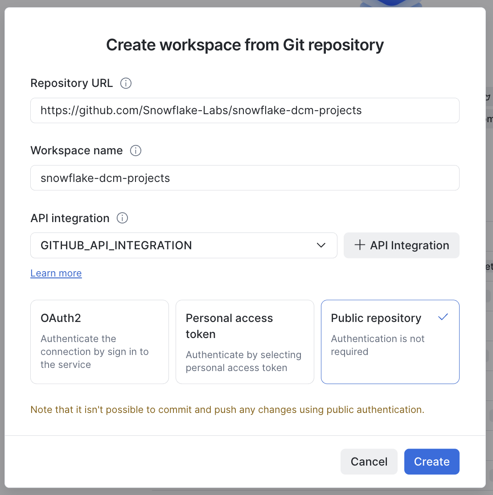
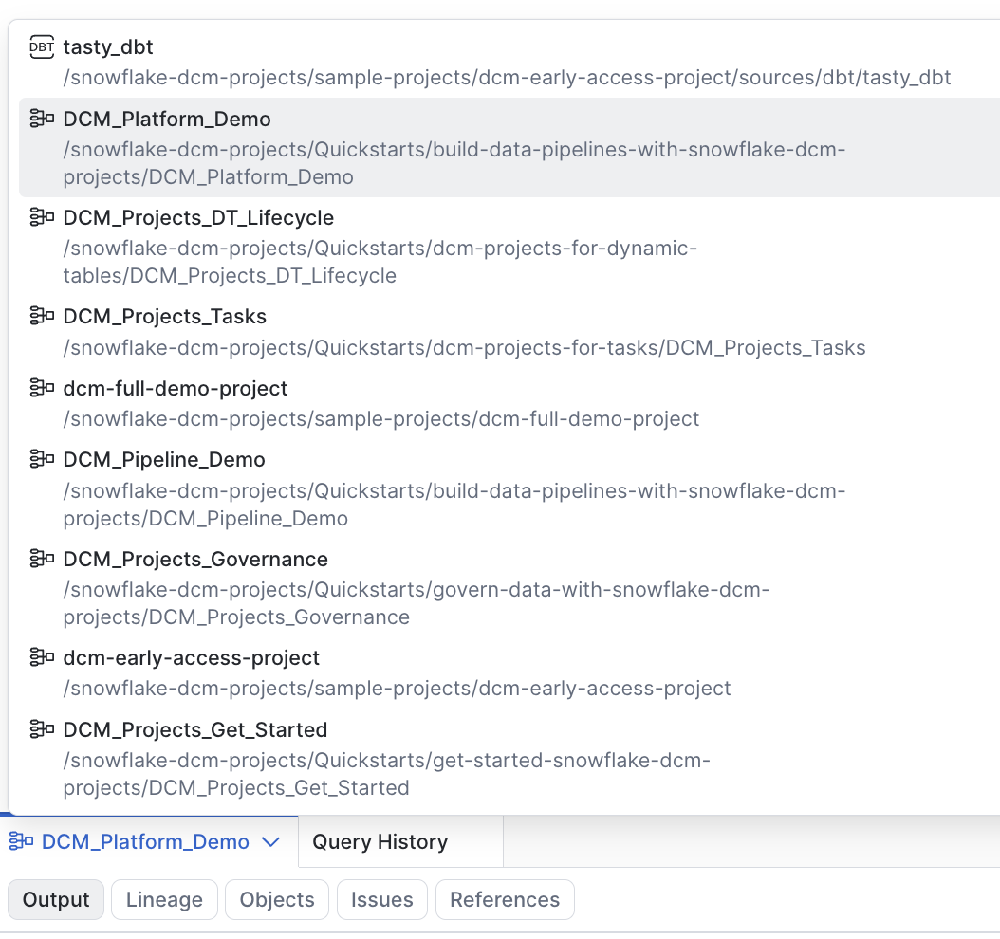
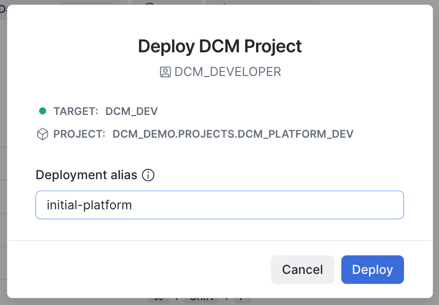

author: Jan Sommerfeld, Gilberto Hernandez, Yoav Ostrinsky
id: build-data-pipelines-with-snowflake-dcm-projects
summary: Split a data platform into three DCM Projects and build a gated dynamic table pipeline, a semantic view, an agent and a Spark task graph.
categories: snowflake-site:taxonomy/solution-center/certification/quickstart, snowflake-site:taxonomy/product/platform, snowflake-site:taxonomy/product/data-engineering, snowflake-site:taxonomy/snowflake-feature/dynamic-tables
environments: web
status: Published
language: en
feedback link: https://github.com/Snowflake-Labs/sfguides/issues
fork repo link: https://github.com/Snowflake-Labs/snowflake-dcm-projects

# Build Data Pipelines with Snowflake DCM Projects
<!-- ------------------------ -->
## Overview

In [Get Started with Snowflake DCM Projects](https://www.snowflake.com/en/developers/guides/get-started-snowflake-dcm-projects/) you defined Snowflake infrastructure as code in one project, then planned and deployed it from a Snowsight Workspace. Real platforms rarely fit in one project. A platform team owns the shared raw data, the warehouses and the roles; each data team builds its own pipeline on top, on its own schedule.

This guide works with **three DCM Projects** that do exactly that. Each one is planned and deployed once.

- **DCM_Platform_Demo** is owned by the platform. It defines a shared raw database with three staging tables, a stage filled from the project's own sample files, a file format and a load task, and a warehouse, a database and roles for each team.
- **DCM_Finance_Demo** is owned by the Finance team. It reads the platform's raw tables and defines a silver and a gold layer of dynamic tables, data quality expectations that gate the refreshes, a semantic view, an alert and an agent.
- **DCM_Marketing_Demo** is owned by the Marketing team. It defines a table, a Spark job shipped with the project, and a task graph that runs the job and writes rows into that table.

The two teams are completely separate. Each reads the shared raw layer and nothing else of the other's. Everything is declared in DCM and created by a deploy. Code, a Spark job or a task, only writes rows into tables that DCM created; it never runs a CREATE.

### Prerequisites
- Familiarity with DCM Projects concepts (complete [Get Started with Snowflake DCM Projects](https://www.snowflake.com/en/developers/guides/get-started-snowflake-dcm-projects/) first)

### What You'll Learn
- How to split infrastructure into separate DCM Projects with different owners
- How to give each team its own warehouse, database, role and read-only role from one Jinja loop
- How to ship sample files and a Spark job with a project as assets
- How to build silver and gold dynamic tables on top of another project's tables
- How data quality expectations gate downstream refreshes, and how to see the gates
- How to declare a semantic view, an alert and an agent in the same project as the tables they describe
- How to run a task graph that writes into a table DCM created
- How to check that two teams are separated

### What You'll Need
- A Snowflake account with ACCOUNTADMIN access, for the one-time setup script
- (Optional) [Snowflake CLI](https://docs.snowflake.com/en/developer-guide/snowflake-cli/installation/installation) 3.24 or later, if you prefer a terminal to the Snowsight UI

### What You'll Build
- A Platform project: one raw database with three staging tables, an ingestion stage and load task, and a warehouse, database, role and read-only role for the Finance and Marketing teams
- A Finance project: one silver and two gold dynamic tables, three data quality expectations that act as gates, a semantic view, an alert and an agent
- A Marketing project: a customer segments table, a Spark code bundle and a task graph with three tasks

<!-- ------------------------ -->
## Create a Workspace from Git

If you want to work in Snowsight rather than locally, create a Snowsight Workspace linked to the sample repository on GitHub.

1. Navigate to **Projects > Workspaces** in Snowsight.
2. Click **Create** (+) and select **Git repository**.
3. Enter the repository URL: https://github.com/Snowflake-Labs/snowflake-dcm-projects
4. Select an API Integration for GitHub ([create one if needed](https://docs.snowflake.com/en/user-guide/ui-snowsight/workspaces-git#label-create-a-git-workspace)).
5. Select **Public repository**.



Once the workspace is created you will see the repository files in the file explorer. Navigate to **Quickstarts/build-data-pipelines-with-snowflake-dcm-projects** to find four directories.

DCM_Platform_Demo/, DCM_Finance_Demo/ and DCM_Marketing_Demo/ are the three DCM Projects. scripts/ holds numbered SQL files that you run in Snowsight worksheets at different stages of this guide. They live outside the project directories, so nothing in them is ever picked up by a plan.

| File | When to run |
|---|---|
| scripts/01_pre_deploy.sql | Once, before the first plan |
| scripts/02_platform_post_deploy.sql | After the Platform project is deployed |
| scripts/03_finance_post_deploy.sql | After the Finance project is deployed |
| scripts/04_marketing_post_deploy.sql | After the Marketing project is deployed |
| scripts/05_cleanup.sql | When you are finished |

Every operational step in this guide is given twice: once for Snowsight, and once for the [Snowflake CLI](https://docs.snowflake.com/en/developer-guide/snowflake-cli/installation/installation) if you would rather drive the project from a terminal against your own copy of the repository.

**With the Snowflake CLI:** clone the repository and work from the guide's folder. Run the snow dcm commands from inside the project folder you are working on (DCM_Platform_Demo, DCM_Finance_Demo or DCM_Marketing_Demo), and the snow sql commands from the guide's folder.

```bash
git clone https://github.com/Snowflake-Labs/snowflake-dcm-projects.git
cd snowflake-dcm-projects/Quickstarts/build-data-pipelines-with-snowflake-dcm-projects
```

<!-- ------------------------ -->
## Set Up Roles and Permissions

Run the first script. **In Snowsight:** open scripts/01_pre_deploy.sql in a worksheet and run it from top to bottom. **With the Snowflake CLI:**

```bash
snow sql -f scripts/01_pre_deploy.sql
```

The script is the same in every guide of this series. It runs as ACCOUNTADMIN and is safe to run again: if you already ran it for another guide, running it now changes nothing. It has six numbered sections.

**1. Role.** It creates the DCM_DEVELOPER role and grants it to you and to SYSADMIN. Every guide in this series uses this role as the project owner.

**2. Inherited grants opt-in.** It turns on inherited grants for the account.

**3. Account-level privileges.** A project cannot grant account-level privileges to its own owner, so they all happen here, before the first plan. DCM_DEVELOPER gets the privileges that the guides in this series need together, one grant per line, each with a comment naming the guide or feature that uses it. Some are checked at plan time, so a missing one fails the first plan rather than the deploy.

**4. Series container.** It creates the DCM_DEMO database and the DCM_DEMO.PROJECTS schema that holds the project objects of the series, and grants DCM_DEVELOPER USAGE on both and CREATE DCM PROJECT on the schema. A project cannot define the database or schema it lives in.

**5. Project object.** It creates the Platform project object, DCM_DEMO.PROJECTS.DCM_PLATFORM_DEV, as DCM_DEVELOPER. This is the only section that differs between the guides.

**6. Values for the manifest.** The last query returns your account identifier and user name.

When the script finishes, refresh your browser so the DCM control panel lists the new project object.

**Inherited grants.** An inherited grant covers current *and* future objects of a type inside a container. GRANT ON ALL snapshots what exists right now; GRANT ON FUTURE covers only what comes later. An inherited grant covers both, as one grant rather than one per object, which is why it is the recommended pattern in DCM Projects. It is a one-time opt-in per account ([release note](https://docs.snowflake.com/en/release-notes/2026/other/2026-09-10-inherited-grants-ga)), which the setup script turns on:

```sql
ALTER ACCOUNT SET FEATURE_RBAC_INHERITED_GRANTS = 'ENABLED';
```

An inherited grant cannot be combined with WITH GRANT OPTION, CASCADE or RESTRICT.

The Platform project uses them to let each team read every table in the shared RAW schema, including tables added later, and to give each team a read-only role.

Four grants in section 3 are there so the Platform project can hand privileges on to the teams. The script comments say why: EXECUTE DATA METRIC FUNCTION and the SNOWFLAKE.DATA_QUALITY_MONITORING_VIEWER application role are for the Finance team's expectations, EXECUTE ALERT is for Finance's alert, and EXECUTE TASK is for the Marketing team's task graph. A role can only pass on a privilege it holds WITH GRANT OPTION, which is why the script grants EXECUTE DATA METRIC FUNCTION, EXECUTE ALERT and EXECUTE TASK that way. Without the grant option on EXECUTE DATA METRIC FUNCTION, the first plan fails with "Grant not executed: Insufficient privileges".

The Platform project object lives in DCM_DEMO.PROJECTS. The Finance and Marketing project objects will live somewhere else: each in a PROJECTS schema inside the team's own database, which the Platform project creates.

**Update the manifests before the first plan.** Copy ACCOUNT_IDENTIFIER from the last query of scripts/01_pre_deploy.sql into the account_identifier line of the DCM_DEV target in all three manifests: DCM_Platform_Demo/manifest.yml, DCM_Finance_Demo/manifest.yml and DCM_Marketing_Demo/manifest.yml (line 11 in each, marked "# update to your account names").

<!-- ------------------------ -->
## Explore the Platform Project

Navigate into **DCM_Platform_Demo/**. This is the project the platform team owns.

### Manifest

The DEV target and its configuration (the manifest also defines a DCM_PROD target and a PROD configuration):

```yaml
targets:
  DCM_DEV:
    account_identifier: MYORG-MY_DEV_ACCOUNT        # update to your account names
    project_name: DCM_DEMO.PROJECTS.DCM_PLATFORM_DEV
    project_owner: DCM_DEVELOPER
    templating_config: DEV

templating:
  defaults:
    wh_size: "X-SMALL"

  configurations:
    DEV:
      env_suffix: "_DEV"
      project_owner_role: "DCM_DEVELOPER"
      teams:
        - name: "Finance"
          raw_access: "READ"
        - name: "Marketing"
          raw_access: "READ"
```

The teams list drives a loop in the definitions. DEV has two teams. The PROD configuration in the same manifest lists four teams with different raw_access values (READ, WRITE and NONE) and a larger wh_size; you only deploy DEV in this guide.

The manifest also declares an asset, the folder of sample files that ships with the project:

```yaml
assets:
  sample_data:
    path: 'sample_data/**/*'
```

### Definition files

| File | What it defines |
|---|---|
| raw.sql | The shared database DCM_DEMO_2_DEV, its RAW schema and three staging tables |
| ingest.sql | The platform warehouse, a stage filled from the sample_data asset, a file format and the load task |
| wh_roles_and_grants.sql | A warehouse, a database and a role for each team, and the team's access to RAW |
| sources/macros/grants_macro.sql | The team role and the read-only READER role, as a macro |

#### Raw tables

raw.sql defines CUSTOMER_STG, ACCOUNT_STG and TRADE_STG: customers, their brokerage accounts, and the trades placed on those accounts. Each table sets CHANGE_TRACKING = TRUE (lines 29, 39 and 54) so that the Finance project's dynamic tables can track what changed between refreshes.

#### Ingestion

The stage is filled by the deploy itself. FROM 'asset://sample_data/' points at the sample_data asset declared in the manifest, so the CSV files ship with the project and land on the stage when it deploys (ingest.sql, lines 23 to 26):

```sql
DEFINE STAGE DCM_DEMO_2{{env_suffix}}.RAW.DCM_SAMPLE_DATA
    FROM 'asset://sample_data/'
    DIRECTORY = (ENABLE = TRUE)
    COMMENT = 'CSV files with sample data for the DCM Build Data Pipelines Quickstart';
```

DCM owns the stage's contents: a file uploaded by hand, or removed from the folder, is deleted on the next deploy.

The load task (ingest.sql, lines 38 to 57) copies the three files into the three tables. It runs on the platform warehouse, like every scheduled and refreshing object in this guide, so there is one compute model to reason about. Its CRON schedule would load new files every hour of the working day. DCM creates new tasks suspended, so in this guide the schedule never fires and you run the task once by hand instead.

#### Per-team infrastructure

wh_roles_and_grants.sql is one loop over the teams in the manifest. Every team gets the same footprint: a warehouse, a database with a PROJECTS schema for the team's own DCM projects, and a team role from the macro. A team with READ or WRITE access can read every table in RAW through an inherited grant; NONE skips those grants.

Each team also gets the account-level privileges its pipeline style needs (lines 48 to 56):

```sql
    
        GRANT EXECUTE DATA METRIC FUNCTION ON ACCOUNT TO ROLE DCM_DEMO_2_{{team_name}}{{env_suffix}}_ADMIN;
        GRANT APPLICATION ROLE SNOWFLAKE.DATA_QUALITY_MONITORING_VIEWER TO ROLE DCM_DEMO_2_{{team_name}}{{env_suffix}}_ADMIN;
        GRANT EXECUTE ALERT ON ACCOUNT TO ROLE DCM_DEMO_2_{{team_name}}{{env_suffix}}_ADMIN;
    
    -- Marketing builds on Spark: it owns a task graph that runs its code bundle.
    
        GRANT EXECUTE TASK ON ACCOUNT TO ROLE DCM_DEMO_2_{{team_name}}{{env_suffix}}_ADMIN;
    
```

Finance builds on dynamic tables: it attaches data quality expectations, reads their results, and owns an alert that watches them. Marketing builds on Spark and owns a task graph.

The macro in sources/macros/grants_macro.sql creates the team role, DCM_DEMO_2_<TEAM>_DEV_ADMIN, with what a project owner needs inside the team database: create schemas, and create DCM projects in PROJECTS. It rolls each team role up to the Platform project's owner (line 16), so you can act as either team later without any extra setup.

The macro also defines a read-only role for the team's consumers, analysts and dashboards that query what the team publishes but never change it (lines 23 to 29):

```sql
DEFINE DATABASE ROLE DCM_DEMO_2_{{team}}{{env_suffix}}.READER
    COMMENT = 'Read-only access to everything the {{team}} team publishes';

GRANT USAGE ON DATABASE DCM_DEMO_2_{{team}}{{env_suffix}} TO DATABASE ROLE DCM_DEMO_2_{{team}}{{env_suffix}}.READER;
GRANT INHERITED USAGE ON ALL SCHEMAS IN DATABASE DCM_DEMO_2_{{team}}{{env_suffix}} TO DATABASE ROLE DCM_DEMO_2_{{team}}{{env_suffix}}.READER;
GRANT INHERITED SELECT ON ALL TABLES IN DATABASE DCM_DEMO_2_{{team}}{{env_suffix}} TO DATABASE ROLE DCM_DEMO_2_{{team}}{{env_suffix}}.READER;
GRANT INHERITED SELECT ON ALL DYNAMIC TABLES IN DATABASE DCM_DEMO_2_{{team}}{{env_suffix}} TO DATABASE ROLE DCM_DEMO_2_{{team}}{{env_suffix}}.READER;
```

READER is a database role, so it lives inside the team database. The inherited grants cover every schema and table the team's own projects create later, so the platform never needs to know their names. The team admin role holds READER too and hands it out.

<!-- ------------------------ -->
## Deploy the Platform Project

### Plan

**In Snowsight:** the DCM control panel is the first tab in the bottom panel of your workspace. Select the project **build-data-pipelines-with-snowflake-dcm-projects/DCM_Platform_Demo**. On the right side of the same bar, select the **DCM_DEV** target and click the play button to the right of **Plan**.



**With the Snowflake CLI:** from inside the DCM_Platform_Demo folder of your clone, pass the manifest's owner role for the target with --role.

```bash
snow dcm plan --target DCM_DEV --role DCM_DEVELOPER --save-output
```

Nothing exists yet, so the plan is almost all CREATEs: databases, schemas, tables, the stage, file format and task, warehouses, the team roles and the READER database roles.

### Deploy

When the changeset matches what you expected, deploy it.

**In Snowsight:** in the DCM control panel, set the operation to **Deploy** instead of **Plan**, add a deployment alias such as initial-platform, and run it.



**With the Snowflake CLI:**

```bash
snow dcm deploy --target DCM_DEV --role DCM_DEVELOPER --alias initial-platform
```

The deploy reports "Deployed 23 entities (22 created, 1 altered, 0 dropped)." In the Database Explorer you now see DCM_DEMO_2_DEV, DCM_DEMO_2_FINANCE_DEV and DCM_DEMO_2_MARKETING_DEV.

<!-- ------------------------ -->
## Load Sample Data

The tables exist but are empty. The deploy already put the three CSV files on the stage, because the stage is defined from the sample_data asset. Open scripts/02_platform_post_deploy.sql in a Snowsight worksheet and run it. It runs as DCM_DEVELOPER, which owns the raw tables, on the platform warehouse. It has four steps.

**1. Check the files.** LIST shows what the deploy put on the stage:

```sql
LIST @DCM_DEMO_2_DEV.RAW.DCM_SAMPLE_DATA;
```

**2. Run the load task.**

```sql
EXECUTE TASK DCM_DEMO_2_DEV.RAW.LOAD_NEW_DATA;
CALL SYSTEM$WAIT(15);
```

EXECUTE TASK runs the suspended task once. It runs asynchronously, so the script waits a few seconds before checking the result.

**3. Add today's trades.**

```sql
INSERT INTO DCM_DEMO_2_DEV.RAW.TRADE_STG
    (T_ID, T_DTS, T_ST_ID, T_TT_ID, T_S_SYMB, T_QTY, T_TRADE_PRICE, T_CHRG, T_COMM, T_CA_ID)
VALUES
    (2021, CURRENT_TIMESTAMP(), 'CMPT', 'TMB', 'SNOW', 40, 150.10, 9.95, 6.00, 1001),
    (2022, CURRENT_TIMESTAMP(), 'CMPT', 'TMS', 'ACME', 75,  41.30, 4.95, 3.10, 1006);
```

**4. Verify.**

| TABLE_NAME | ROW_COUNT |
|---|---|
| CUSTOMER_STG | 6 |
| ACCOUNT_STG | 9 |
| TRADE_STG | 22 |

The trade file holds 20 trades, one of them cancelled (T_ST_ID is CNCL). Add the two trades inserted today and TRADE_STG has 22 rows.

<!-- ------------------------ -->
## Explore the Finance Project

Navigate into **DCM_Finance_Demo/**. This project belongs to the Finance team.

### Manifest

The DEV target and its configuration (the manifest also defines a DCM_PROD target and a PROD configuration):

```yaml
targets:
  DCM_DEV:
    account_identifier: MYORG-MY_DEV_ACCOUNT        # update to your account names
    project_name: DCM_DEMO_2_FINANCE_DEV.PROJECTS.FINANCE_PIPELINE
    project_owner: DCM_DEMO_2_FINANCE_DEV_ADMIN
    templating_config: DEV
```

The project object lives in the Finance team's own database, DCM_DEMO_2_FINANCE_DEV.PROJECTS, not in the shared DCM_DEMO.PROJECTS. Its owner is the Finance role the Platform project created. The Finance team can plan and deploy its pipeline without asking an account administrator for anything: everything it needs, the Platform project granted.

### Definition files

| File | What it defines |
|---|---|
| silver_layer.sql | The SILVER schema and TRADES_ENRICHED, one row per trade |
| gold_layer.sql | The GOLD schema and two aggregates, DAILY_TRADING and CUSTOMER_TRADING |
| expectations.sql | Three data quality expectations on TRADES_ENRICHED, each acting as a gate |
| semantic_view.sql | TRADING_ANALYTICS, a semantic view over the two gold tables |
| alerts.sql | EXPECTATION_VIOLATIONS, an alert from a template |
| agents.sql | TRADING_AGENT, an agent over the semantic view |

#### Silver layer

silver_layer.sql (lines 14 to 44) defines one dynamic table that joins the three raw staging tables into one row per trade:

```sql
DEFINE SCHEMA DCM_DEMO_2_FINANCE{{env_suffix}}.SILVER
    COMMENT = 'Cleaned and joined trade data';

DEFINE DYNAMIC TABLE DCM_DEMO_2_FINANCE{{env_suffix}}.SILVER.TRADES_ENRICHED
    WAREHOUSE = DCM_DEMO_2_FINANCE_WH{{env_suffix}}
    TARGET_LAG = 'DOWNSTREAM'
    INITIALIZE = 'ON_SCHEDULE'
    DATA_METRIC_SCHEDULE = 'TRIGGER_ON_CHANGES'
    COMMENT = 'One row per trade, joined to its account and customer'
AS
SELECT
    T.T_ID,
    T.T_DTS,
    T.T_S_SYMB,
    T.T_TT_ID,
    T.T_QTY,
    T.T_TRADE_PRICE,
    T.T_QTY * T.T_TRADE_PRICE AS TRADE_VALUE,
    T.T_CHRG,
    T.T_COMM,
    T.T_CA_ID,
    A.CA_NAME,
    C.C_ID,
    C.C_F_NAME || ' ' || C.C_L_NAME AS CUSTOMER_NAME,
    C.C_TIER
FROM DCM_DEMO_2{{env_suffix}}.RAW.TRADE_STG T
LEFT JOIN DCM_DEMO_2{{env_suffix}}.RAW.ACCOUNT_STG A
    ON T.T_CA_ID = A.CA_ID
LEFT JOIN DCM_DEMO_2{{env_suffix}}.RAW.CUSTOMER_STG C
    ON A.CA_C_ID = C.C_ID
WHERE T.T_ST_ID = 'CMPT';
```

This is the cross-project link: a dynamic table in the Finance project reads three tables from the Platform project. It works because the Platform project granted the Finance role read access to RAW.

A few properties are worth a look:

- TARGET_LAG = 'DOWNSTREAM' gives this table no schedule of its own. It refreshes whenever a gold table needs it.
- INITIALIZE = 'ON_SCHEDULE' skips the refresh at creation, which keeps deployments fast. The dynamic tables are empty until their first refresh, which you run yourself.
- DATA_METRIC_SCHEDULE = 'TRIGGER_ON_CHANGES' evaluates the expectations attached to this table after each refresh.
- The joins are LEFT joins on purpose. A trade whose account has not arrived yet still shows up, with an empty customer, instead of silently disappearing from every total.
- The WHERE clause keeps only completed trades, so cancelled trades never reach the gold layer.

#### Gold layer

gold_layer.sql defines two aggregates over the silver table, DAILY_TRADING by day and CUSTOMER_TRADING by customer. DAILY_TRADING (lines 10 to 22):

```sql
DEFINE DYNAMIC TABLE DCM_DEMO_2_FINANCE{{env_suffix}}.GOLD.DAILY_TRADING
    WAREHOUSE = DCM_DEMO_2_FINANCE_WH{{env_suffix}}
    TARGET_LAG = '1 hour'
    INITIALIZE = 'ON_SCHEDULE'
    COMMENT = 'Trading volume and value per day'
AS
SELECT
    T_DTS::DATE         AS TRADE_DATE,
    COUNT(*)            AS TRADE_COUNT,
    SUM(T_QTY)          AS TOTAL_QUANTITY,
    SUM(TRADE_VALUE)    AS TOTAL_VALUE
FROM DCM_DEMO_2_FINANCE{{env_suffix}}.SILVER.TRADES_ENRICHED
GROUP BY TRADE_DATE;
```

The gold tables hold the pipeline's only real TARGET_LAG. Because the silver table is DOWNSTREAM, this one hour drives the whole graph.

#### Data quality expectations

expectations.sql attaches three expectations to TRADES_ENRICHED, the one table every gold number is built from. Each statement attaches a system data metric function to a column, names the condition its result must meet, and names an action to take on violation:

```sql
-- Every trade must resolve to a customer. A NULL here means the trade's
-- account is missing from ACCOUNT_STG.
ATTACH DATA METRIC FUNCTION SNOWFLAKE.CORE.NULL_COUNT
    TO DYNAMIC TABLE DCM_DEMO_2_FINANCE{{env_suffix}}.SILVER.TRADES_ENRICHED
    ON (C_ID)
    EXPECTATION EVERY_TRADE_HAS_A_CUSTOMER (value = 0)
    ON_VIOLATION_ACTION = (TYPE = 'SKIP_DOWNSTREAM_DYNAMIC_TABLE_REFRESH');

-- One row per trade. A duplicate means a join fanned out.
ATTACH DATA METRIC FUNCTION SNOWFLAKE.CORE.DUPLICATE_COUNT
    TO DYNAMIC TABLE DCM_DEMO_2_FINANCE{{env_suffix}}.SILVER.TRADES_ENRICHED
    ON (T_ID)
    EXPECTATION NO_DUPLICATE_TRADES (value = 0)
    ON_VIOLATION_ACTION = (TYPE = 'SKIP_DOWNSTREAM_DYNAMIC_TABLE_REFRESH');

-- A completed trade always moves at least one share.
ATTACH DATA METRIC FUNCTION SNOWFLAKE.CORE.MIN
    TO DYNAMIC TABLE DCM_DEMO_2_FINANCE{{env_suffix}}.SILVER.TRADES_ENRICHED
    ON (T_QTY)
    EXPECTATION QUANTITY_IS_POSITIVE (value > 0)
    ON_VIOLATION_ACTION = (TYPE = 'SKIP_DOWNSTREAM_DYNAMIC_TABLE_REFRESH');
```

The ON_VIOLATION_ACTION lines (23, 30 and 37) turn each expectation into a **gate**. A gate works like this:

- While an expectation fails, every dynamic table downstream of TRADES_ENRICHED skips its refresh and keeps serving its last good contents.
- Nothing is suspended. Once a fresh measurement passes, the next refresh catches up on its own.
- A skipped refresh shows in the refresh history with STATE_CODE UPSTREAM_DATA_QUALITY_VIOLATION and the message "Skipped refreshing because an upstream object failed a data quality metric with SKIP_DOWNSTREAM_DYNAMIC_TABLE_REFRESH". The skipped table's LAST_TRIGGER_STATUS becomes DOWNSTREAM_DYNAMIC_TABLE_REFRESH_SKIPPED.
- It applies to manual and scheduled refreshes alike. A manual ALTER DYNAMIC TABLE ... REFRESH returns normally when it is skipped (refreshed_dt_count 0), so check the refresh history to see the skip.
- Because TRADES_ENRICHED sets DATA_METRIC_SCHEDULE = 'TRIGGER_ON_CHANGES', the gate waits for a measurement of the current data before it allows the refresh.

Put the action on every expectation of the monitored table, as the file does. An expectation without it currently stops the gate working. The sample data in this guide is clean, so you will not see a gate trigger; you will see how to inspect them in a later step.

#### Semantic view

semantic_view.sql (lines 10 to 42) declares TRADING_ANALYTICS over the two gold tables, with three dimensions (TRADE_DATE, CUSTOMER_NAME, CUSTOMER_TIER) and three metrics (TOTAL_TRADES, TOTAL_TRADE_VALUE, CUSTOMER_TRADE_VALUE). A [semantic view](https://docs.snowflake.com/en/user-guide/views-semantic/overview) names the business concepts in your data so that SQL users and Cortex Analyst ask for "total trade value by day" instead of writing the aggregation. Declaring it in the same project as the gold tables means the vocabulary is versioned and reviewed with the pipeline that produces the numbers, and a renamed metric shows up in a plan diff. It reads only the gold tables, so nobody who queries it touches raw data.

#### Alert

alerts.sql (lines 14 to 23) watches the expectations:

```sql
DEFINE ALERT DCM_DEMO_2_FINANCE{{env_suffix}}.SILVER.EXPECTATION_VIOLATIONS
    FROM TEMPLATE DQ_EXPECTATION_VIOLATIONS
    WAREHOUSE = DCM_DEMO_2_FINANCE_WH{{env_suffix}}
    SCHEDULE = '5 MINUTE'
    COMMENT = 'Notifies when an expectation on the silver layer fails'
    TEMPLATE_PARAMS = '{"template_variables": {
        "SCOPE_ACTIVE": "SCHEMA",
        "SCOPE_DATABASE": "DCM_DEMO_2_FINANCE{{env_suffix}}",
        "SCOPE_SCHEMA": "SILVER",
        "NOTIFICATION_MODE": "IN_APP"}}';
```

An alert template is a ready-made condition and action that Snowflake renders into an alert from a few parameters. DQ_EXPECTATION_VIOLATIONS checks for failed expectations on a schedule and notifies when it finds one, so you do not write the monitoring query yourself. FROM TEMPLATE generates the condition and the action; TEMPLATE_PARAMS only says what to watch (the SILVER schema, where the expectations live) and how to notify. IN_APP sends the notification to the Snowsight user who deployed the alert, so no notification integration is needed.

A template alert deploys suspended, and STARTED is not accepted on DEFINE ALERT ... FROM TEMPLATE, so the post-deploy script resumes it.

#### Agent

agents.sql (lines 11 to 39) defines TRADING_AGENT, an agent that answers trading questions in plain language. Its one tool is Cortex Analyst over TRADING_ANALYTICS, so it reads the same gold numbers, with the same names, as everyone else. The specification is inline, between $$ delimiters, because the database and warehouse names carry the env_suffix variable: Jinja renders inline specifications, not specification files.

<!-- ------------------------ -->
## Deploy the Finance Project

The Finance project object lives in DCM_DEMO_2_FINANCE_DEV.PROJECTS, a schema the platform deploy just created, so 01_pre_deploy.sql couldn't create it. Create it now as the Finance role, which owns this project, then refresh your browser so the DCM control panel lists it:

```sql
USE ROLE DCM_DEMO_2_FINANCE_DEV_ADMIN;
CREATE DCM PROJECT IF NOT EXISTS DCM_DEMO_2_FINANCE_DEV.PROJECTS.FINANCE_PIPELINE
    COMMENT = 'DEV Finance project of the Build Data Pipelines with Snowflake DCM Projects quickstart';
```

### Plan

**In Snowsight:** the DCM control panel is the first tab in the bottom panel of your workspace. Select the project **build-data-pipelines-with-snowflake-dcm-projects/DCM_Finance_Demo**. On the right side of the same bar, select the **DCM_DEV** target and click the play button to the right of **Plan**.


**With the Snowflake CLI:** from inside the DCM_Finance_Demo folder of your clone, you can create the project object with the CLI instead of the SQL above, then plan:

```bash
snow dcm create --target DCM_DEV --role DCM_DEMO_2_FINANCE_DEV_ADMIN
snow dcm plan --target DCM_DEV --role DCM_DEMO_2_FINANCE_DEV_ADMIN --save-output
```

The project_owner in this manifest is the Finance role, not DCM_DEVELOPER, so the **role** option is required on every CLI command for this project. Without it, the create command makes the object as your session role (for example DCM_DEVELOPER) and only prints a role-mismatch warning.

The plan creates what the definition files declare:

| Definition | Entities |
|---|---|
| silver_layer.sql | SILVER schema, SILVER.TRADES_ENRICHED |
| gold_layer.sql | GOLD schema, GOLD.DAILY_TRADING, GOLD.CUSTOMER_TRADING |
| semantic_view.sql | GOLD.TRADING_ANALYTICS |
| alerts.sql | SILVER.EXPECTATION_VIOLATIONS |
| agents.sql | GOLD.TRADING_AGENT |


### Deploy

When the changeset matches what you expected, deploy it.

**In Snowsight:** in the DCM control panel, set the operation to **Deploy** instead of **Plan**, add a deployment alias such as initial-finance, and run it.

**With the Snowflake CLI:**

```bash
snow dcm deploy --target DCM_DEV --role DCM_DEMO_2_FINANCE_DEV_ADMIN --alias initial-finance
```

The deploy reports "Deployed 9 entities (8 created, 1 altered, 0 dropped)." The dynamic tables are empty until their first refresh, and the alert is suspended until you resume it.

<!-- ------------------------ -->
## Query, Test and Inspect the Gates

Open scripts/03_finance_post_deploy.sql in a Snowsight worksheet. It runs as the Finance role, on the Finance warehouse. Run steps 1 to 5 now; step 6 is the next section.

### Start the alert

```sql
ALTER ALERT DCM_DEMO_2_FINANCE_DEV.SILVER.EXPECTATION_VIOLATIONS RESUME;
```

The alert now checks the silver layer's expectations every five minutes and notifies you in Snowsight (the bell icon) if one fails.

### Refresh the pipeline

```sql
ALTER DYNAMIC TABLE DCM_DEMO_2_FINANCE_DEV.GOLD.DAILY_TRADING,
                    DCM_DEMO_2_FINANCE_DEV.GOLD.CUSTOMER_TRADING REFRESH;
```

Listing both gold tables in one statement refreshes the silver table they read first, once, and lands all three on the same data timestamp. The result reports refreshed_dt_count 3, with 6 inserted rows for each of the two gold tables.

In the Database Explorer, open DCM_DEMO_2_FINANCE_DEV.GOLD.DAILY_TRADING and select the **Graph** tab to see the pipeline: the three raw tables, TRADES_ENRICHED, and the two gold tables that read from it.


### Read the gold layer

```sql
SELECT * FROM DCM_DEMO_2_FINANCE_DEV.GOLD.CUSTOMER_TRADING ORDER BY TOTAL_VALUE DESC;
```

| C_ID | CUSTOMER_NAME | C_TIER | TRADE_COUNT | TOTAL_VALUE | LAST_TRADE_TS |
|---|---|---|---|---|---|
| 101 | Janeta Kaus | 1 | 6 | 56950.30 | ... |
| 105 | Lena Vogel | 2 | 5 | 19462.90 | ... |
| 102 | Samual Enos | 2 | 2 | 19347.50 | 2026-10-28 11:44:00 |
| 104 | Marta Okafor | 1 | 3 | 17380.70 | 2026-10-30 15:35:00 |
| 103 | Edric Salem | 3 | 3 | 15272.65 | 2026-10-30 13:25:00 |
| 106 | Ravi Mehta | 2 | 2 | 2062.30 | 2026-10-30 11:31:00 |

The gold layer counts 21 trades, not 22: the silver table keeps only completed trades, and one trade in the file is cancelled. The two top rows have today's timestamps because the two trades inserted today belong to those customers.

### Ask the semantic view

```sql
SELECT * FROM SEMANTIC_VIEW(
    DCM_DEMO_2_FINANCE_DEV.GOLD.TRADING_ANALYTICS
    METRICS daily.TOTAL_TRADES, daily.TOTAL_TRADE_VALUE
    DIMENSIONS daily.TRADE_DATE
)
ORDER BY TRADE_DATE;
```

| TOTAL_TRADES | TOTAL_TRADE_VALUE | TRADE_DATE |
|---|---|---|
| 4 | 29335.80 | 2026-10-26 |
| 3 | 19618.40 | 2026-10-27 |
| 4 | 20501.80 | 2026-10-28 |
| 4 | 15999.70 | 2026-10-29 |
| 4 | 35919.15 | 2026-10-30 |
| 2 | 9101.50 | ... |

You asked for two metrics by one dimension, by name; the semantic view supplied the aggregation. The last row is today's two trades.

### Run the expectations

```sql
EXECUTE DCM PROJECT DCM_DEMO_2_FINANCE_DEV.PROJECTS.FINANCE_PIPELINE TEST ALL;
```

TEST ALL evaluates every expectation the project defines and returns one JSON document. Its status is SUCCESSFUL: all three expectations pass on the sample data.

### See the gates

Step 5 of the script shows the gates on the table. The first query lists the data metric functions attached to TRADES_ENRICHED, with the action each one carries:

```sql
SELECT METRIC_NAME,
       PARSE_JSON(REF_ARGUMENTS)[0]:name::STRING   AS COLUMN_NAME,
       VIOLATION_ACTION:type::STRING                AS ACTION,
       VIOLATION_ACTION:last_trigger_status::STRING AS LAST_TRIGGER_STATUS
FROM TABLE(DCM_DEMO_2_FINANCE_DEV.INFORMATION_SCHEMA.DATA_METRIC_FUNCTION_REFERENCES(
    REF_ENTITY_NAME   => 'DCM_DEMO_2_FINANCE_DEV.SILVER.TRADES_ENRICHED',
    REF_ENTITY_DOMAIN => 'DYNAMIC TABLE'));
```

| METRIC_NAME | COLUMN_NAME | ACTION | LAST_TRIGGER_STATUS |
|---|---|---|---|
| DUPLICATE_COUNT | T_ID | SKIP_DOWNSTREAM_DYNAMIC_TABLE_REFRESH | NOT_TRIGGERED |
| MIN | T_QTY | SKIP_DOWNSTREAM_DYNAMIC_TABLE_REFRESH | NOT_TRIGGERED |
| NULL_COUNT | C_ID | SKIP_DOWNSTREAM_DYNAMIC_TABLE_REFRESH | NOT_TRIGGERED |

All three expectations carry the action, and LAST_TRIGGER_STATUS reads NOT_TRIGGERED while the checks pass. The second query reads the refresh history of the three dynamic tables:

```sql
SELECT NAME, STATE, STATE_CODE, DATA_TIMESTAMP
FROM TABLE(DCM_DEMO_2_FINANCE_DEV.INFORMATION_SCHEMA.DYNAMIC_TABLE_REFRESH_HISTORY(
    NAME_PREFIX => 'DCM_DEMO_2_FINANCE_DEV.'))
ORDER BY DATA_TIMESTAMP DESC
LIMIT 3;
```

All three dynamic tables show STATE SUCCEEDED and STATE_CODE SUCCESS. If a gate had triggered, the downstream rows would show STATE_CODE UPSTREAM_DATA_QUALITY_VIOLATION instead, and the tables would keep their previous contents.

<!-- ------------------------ -->
## Ask the Agent

Step 6 of scripts/03_finance_post_deploy.sql asks the agent a question. **In Snowsight:** go to **AI & ML > Agents > Trading Assistant** and ask "Which customers traded the most by value?". Or from SQL:

```sql
SELECT SNOWFLAKE.CORTEX.DATA_AGENT_RUN(
    'DCM_DEMO_2_FINANCE_DEV.GOLD.TRADING_AGENT',
    '{"messages": [{"role": "user", "content": [{"type": "text", "text": "Which customers traded the most by value?"}]}]}'
) AS RESPONSE;
```

The agent answers from the semantic view. When we ran it, it named Janeta Kaus (Tier 1) first, about three times the next customer, then Lena Vogel ($19,462.90) and Samual Enos. Those are the same numbers as the CUSTOMER_TRADING table above.

<!-- ------------------------ -->
## Explore the Marketing Project

Navigate into **DCM_Marketing_Demo/**. This project belongs to the Marketing team. It has nothing in common with the Finance project except the raw layer both read.

### Manifest

The DEV target and its configuration (the manifest also defines a DCM_PROD target and a PROD configuration):

```yaml
targets:
  DCM_DEV:
    account_identifier: MYORG-MY_DEV_ACCOUNT        # update to your account names
    project_name: DCM_DEMO_2_MARKETING_DEV.PROJECTS.MARKETING_PIPELINE
    project_owner: DCM_DEMO_2_MARKETING_DEV_ADMIN
    templating_config: DEV
```

The manifest also declares the Spark job as an asset. The asset folder becomes the root of the code bundle, so code_bundle.yml and the entry point sit at its top:

```yaml
assets:
  segments:
    path: 'code_bundles/segments/**/*'
```

### Definition files

| File | What it defines |
|---|---|
| sources/definitions/segments.sql | The SEGMENTS schema and the CUSTOMER_SEGMENTS table |
| sources/definitions/pipeline.yml | The code bundle and a task graph with three tasks |
| code_bundles/segments/ | The Spark job: code_bundle.yml, pyproject.toml and segments.py |

#### The table

segments.sql (lines 7 to 18) is the table the Spark job fills. DCM creates it, with its columns, so the table is reviewed and versioned like every other object; the job only writes rows into it and never creates or replaces it:

```sql
DEFINE SCHEMA DCM_DEMO_2_MARKETING{{env_suffix}}.SEGMENTS
    COMMENT = 'Customer segments built by the Marketing Spark job';

DEFINE TABLE DCM_DEMO_2_MARKETING{{env_suffix}}.SEGMENTS.CUSTOMER_SEGMENTS (
    C_ID           NUMBER(38,0)     COMMENT 'Customer identifier',
    CUSTOMER_NAME  VARCHAR(50)      COMMENT 'First and last name',
    TRADE_COUNT    NUMBER(18,0)     COMMENT 'Completed trades across all of the customer''s accounts',
    TOTAL_VALUE    NUMBER(18,2)     COMMENT 'Quantity times trade price, summed',
    ACTIVITY_TIER  VARCHAR(10)      COMMENT 'ACTIVE, OCCASIONAL or DORMANT',
    SEGMENTED_AT   TIMESTAMP_NTZ(9) COMMENT 'When the Spark job wrote this row'
)
COMMENT = 'One row per customer, rewritten on every run of the Marketing pipeline';
```

#### The Spark job

code_bundle.yml describes the bundle:

```yaml
bundle:
  type: spark
  compute_type: warehouse
  language: python
  compute_options:
    runtime_version: "1.29"
```

segments.py reads the shared raw tables from the platform, counts each customer's completed trades across all of their accounts, and assigns an activity tier: ACTIVE for four or more trades, OCCASIONAL for one or more, DORMANT for none. The important part is how it writes (lines 61 to 67):

```python
    # Same column order as the table definition in segments.sql. Overwrite mode
    # would recreate the table with CREATE OR REPLACE, dropping what DCM
    # declared, so empty it and append instead.
    spark.sql(f"TRUNCATE TABLE {target}")
    segments.select(
        "C_ID", "CUSTOMER_NAME", "TRADE_COUNT", "TOTAL_VALUE", "ACTIVITY_TIER", "SEGMENTED_AT"
    ).write.insertInto(target)
```

The job empties the table and appends the new rows, so the table itself, with its columns and comments, is never replaced.

#### The task graph

pipeline.yml declares the code bundle and a task graph (lines 1 to 21):

```yaml
definitions:
  # The Spark job, built from the segments asset declared in manifest.yml.
  - resource: code_bundle
    name: DCM_DEMO_2_MARKETING{{env_suffix}}.SEGMENTS.SEGMENTS_JOB
    from:
      type: asset
      asset: segments
    comment: Spark job that writes CUSTOMER_SEGMENTS from the shared raw tables

  # Three tasks in one graph: check the inputs, run the job, report the result.
  # The graph deploys suspended; the guide runs it once with EXECUTE TASK GRAPH.
  - resource: task_graph_object
    name: DCM_DEMO_2_MARKETING{{env_suffix}}.SEGMENTS.SEGMENTS_PIPELINE
    roots:
      - DCM_DEMO_2_MARKETING{{env_suffix}}.SEGMENTS.CHECK_INPUTS
    schedule:
      type: interval
      value: 24
      unit: hours
    state: suspended
    comment: Builds the Marketing customer segments once a day
```

The three tasks run in order:

| Task | What it does |
|---|---|
| CHECK_INPUTS | Counts the rows in the raw trades table and returns early if there are none |
| BUILD_SEGMENTS | Runs the Spark job with EXECUTE CODE BUNDLE |
| REPORT_SEGMENTS | Summarises the segments the job wrote |

BUILD_SEGMENTS (lines 39 to 53) is the task that runs the job:

```yaml
  - resource: task
    name: DCM_DEMO_2_MARKETING{{env_suffix}}.SEGMENTS.BUILD_SEGMENTS
    warehouse: DCM_DEMO_2_MARKETING_WH{{env_suffix}}
    predecessors:
      - DCM_DEMO_2_MARKETING{{env_suffix}}.SEGMENTS.CHECK_INPUTS
    comment: Runs the Spark job
    definition:
      type: sql
      value: |
        BEGIN
            EXECUTE CODE BUNDLE DCM_DEMO_2_MARKETING{{env_suffix}}.SEGMENTS.SEGMENTS_JOB
                ENTRYPOINT = 'segments.py'
                ARGUMENTS = ('--raw-db', 'DCM_DEMO_2{{env_suffix}}', '--target-db', 'DCM_DEMO_2_MARKETING{{env_suffix}}');
            CALL SYSTEM$SET_RETURN_VALUE('Spark job finished');
        END
```

The graph deploys suspended, so its daily schedule never fires. You run it once on demand.


<!-- ------------------------ -->
## Deploy the Marketing Project

Create the Marketing project object as the Marketing role, which owns this project, then refresh your browser so the DCM control panel lists it:

```sql
USE ROLE DCM_DEMO_2_MARKETING_DEV_ADMIN;
CREATE DCM PROJECT IF NOT EXISTS DCM_DEMO_2_MARKETING_DEV.PROJECTS.MARKETING_PIPELINE
    COMMENT = 'DEV Marketing project of the Build Data Pipelines with Snowflake DCM Projects quickstart';
```

### Plan

**In Snowsight:** the DCM control panel is the first tab in the bottom panel of your workspace. Select the project **build-data-pipelines-with-snowflake-dcm-projects/DCM_Marketing_Demo**. On the right side of the same bar, select the **DCM_DEV** target and click the play button to the right of **Plan**.


**With the Snowflake CLI:** from inside the DCM_Marketing_Demo folder of your clone:

```bash
snow dcm create --target DCM_DEV --role DCM_DEMO_2_MARKETING_DEV_ADMIN
snow dcm plan --target DCM_DEV --role DCM_DEMO_2_MARKETING_DEV_ADMIN --save-output
```

As with Finance, the project_owner is the team role, so --role is required on every command.

The plan creates what the definition files declare:

| Definition | Entities |
|---|---|
| segments.sql | SEGMENTS schema, SEGMENTS.CUSTOMER_SEGMENTS |
| pipeline.yml | The SEGMENTS_JOB code bundle, the SEGMENTS_PIPELINE task graph, and the CHECK_INPUTS, BUILD_SEGMENTS and REPORT_SEGMENTS tasks |

### Deploy

When the changeset matches what you expected, deploy it.

**In Snowsight:** in the DCM control panel, set the operation to **Deploy** instead of **Plan**, add a deployment alias such as initial-marketing, and run it.

**With the Snowflake CLI:**

```bash
snow dcm deploy --target DCM_DEV --role DCM_DEMO_2_MARKETING_DEV_ADMIN --alias initial-marketing
```

The deploy reports "Deployed 8 entities (7 created, 1 altered, 0 dropped)." The task graph exists but is suspended, and CUSTOMER_SEGMENTS is empty.

<!-- ------------------------ -->
## Run the Task Graph and Read the Segments

Open scripts/04_marketing_post_deploy.sql in a Snowsight worksheet. It runs as the Marketing role, on the Marketing warehouse. Its first lines are:

```sql
USE ROLE DCM_DEMO_2_MARKETING_DEV_ADMIN;
USE SECONDARY ROLES NONE;
USE WAREHOUSE DCM_DEMO_2_MARKETING_WH_DEV;
```

USE SECONDARY ROLES NONE makes every statement run with the team role alone. Without it, secondary roles granted to your user (often ACCOUNTADMIN) add their privileges, and the checks in the next section would all pass for the wrong reason. Run steps 1 and 2 now.

### Run the task graph once

```sql
EXECUTE TASK GRAPH DCM_DEMO_2_MARKETING_DEV.SEGMENTS.SEGMENTS_PIPELINE;

SELECT NAME, STATE, RETURN_VALUE, ERROR_MESSAGE, SCHEDULED_TIME
FROM TABLE(DCM_DEMO_2_MARKETING_DEV.INFORMATION_SCHEMA.TASK_HISTORY(
    SCHEDULED_TIME_RANGE_START => DATEADD(hour, -1, CURRENT_TIMESTAMP())))
WHERE DATABASE_NAME = 'DCM_DEMO_2_MARKETING_DEV'
ORDER BY SCHEDULED_TIME DESC;
```

EXECUTE TASK GRAPH runs CHECK_INPUTS, then BUILD_SEGMENTS (the Spark job), then REPORT_SEGMENTS. It runs asynchronously, and the Spark job takes about two minutes. Rerun the history query until all three tasks show SUCCEEDED:

| NAME | STATE | RETURN_VALUE |
|---|---|---|
| REPORT_SEGMENTS | SUCCEEDED | segments: ACTIVE=2 OCCASIONAL=4 |
| BUILD_SEGMENTS | SUCCEEDED | Spark job finished |
| CHECK_INPUTS | SUCCEEDED | raw trades available: 22 |

The run also shows in Snowsight: open the SEGMENTS_PIPELINE task in DCM_DEMO_2_MARKETING_DEV.SEGMENTS and select **Run History**.


### Read the segments

```sql
SELECT * FROM DCM_DEMO_2_MARKETING_DEV.SEGMENTS.CUSTOMER_SEGMENTS ORDER BY TOTAL_VALUE DESC;

SELECT TABLE_NAME, COMMENT, CREATED, ROW_COUNT
FROM DCM_DEMO_2_MARKETING_DEV.INFORMATION_SCHEMA.TABLES
WHERE TABLE_NAME = 'CUSTOMER_SEGMENTS';
```

CUSTOMER_SEGMENTS has 6 rows, one per customer. The second query shows the table is the one DCM created:

- COMMENT is the comment from segments.sql: "One row per customer, rewritten on every run of the Marketing pipeline".
- CREATED is the time of your deploy, before the Spark job ran.
- ROW_COUNT is 6.

The Spark job did not recreate the table. It only replaced its rows.

<!-- ------------------------ -->
## Check Team Separation and the READER Role

Steps 3 and 4 of scripts/04_marketing_post_deploy.sql check that the two teams are separate. Keep USE SECONDARY ROLES NONE in effect and run each statement of step 3 on its own. The first succeeds; the other two fail.

| Statement | Result |
|---|---|
| SELECT COUNT(*) FROM DCM_DEMO_2_DEV.RAW.TRADE_STG | 22. Both teams read the shared raw layer. |
| SELECT COUNT(*) FROM DCM_DEMO_2_FINANCE_DEV.GOLD.DAILY_TRADING | Error 002003: does not exist or not authorized. Marketing cannot see the Finance database at all. |
| INSERT INTO DCM_DEMO_2_DEV.RAW.TRADE_STG (T_ID) VALUES (9999) | Error 003001: insufficient privileges. No team writes to the platform's raw layer. |

Without USE SECONDARY ROLES NONE, the default secondary roles of your user (often ACCOUNTADMIN) make every check pass.

### The READER role

Each team database has a READER database role for consumers. Step 4 shows what it grants:

```sql
SHOW GRANTS TO DATABASE ROLE DCM_DEMO_2_MARKETING_DEV.READER;
```

The role has USAGE on the database, USAGE on the schemas (inherited), and SELECT on the tables and dynamic tables (inherited). Because the grants are inherited, it reads everything the team publishes, including tables created after the grant, and changes nothing. The team admin role holds it and hands it out.

<!-- ------------------------ -->
## Cleanup

Before tearing anything down, know that there is a gentler option. DROP DCM PROJECT on its own, without a PURGE first, removes the project and its deployment history and leaves every entity, grant and attachment in place as an ordinary unmanaged object. To release a single entity, call SYSTEM$UNMANAGE_ENTITY_FROM_DCM_PROJECT with its type and name; to release grants or attachments, pass the rendered statements to SYSTEM$UNMANAGE_FROM_DCM_PROJECT. Then remove the matching statements from your definitions, or the next deploy takes them back.

To remove everything this guide created, open scripts/05_cleanup.sql and run it. It is irreversible. In order, it:

1. **Purge the team projects.** PURGE drops every entity a project manages, revokes its grants and removes its attachments, including the three expectations. Each team project is purged by the team role that owns it, while the team's host database still exists, because the Platform purge drops those databases.
2. **Drop the team project objects**, which PURGE leaves behind.
3. **Purge the Platform project and drop its project object**, as DCM_DEVELOPER. This drops the raw and team databases, the warehouses, the team roles and the READER database roles.

    ```sql
    USE ROLE DCM_DEMO_2_FINANCE_DEV_ADMIN;
    EXECUTE DCM PROJECT DCM_DEMO_2_FINANCE_DEV.PROJECTS.FINANCE_PIPELINE PURGE;

    USE ROLE DCM_DEMO_2_MARKETING_DEV_ADMIN;
    EXECUTE DCM PROJECT DCM_DEMO_2_MARKETING_DEV.PROJECTS.MARKETING_PIPELINE PURGE;

    DROP DCM PROJECT IF EXISTS DCM_DEMO_2_MARKETING_DEV.PROJECTS.MARKETING_PIPELINE;

    USE ROLE DCM_DEMO_2_FINANCE_DEV_ADMIN;
    DROP DCM PROJECT IF EXISTS DCM_DEMO_2_FINANCE_DEV.PROJECTS.FINANCE_PIPELINE;

    USE ROLE DCM_DEVELOPER;
    EXECUTE DCM PROJECT DCM_DEMO.PROJECTS.DCM_PLATFORM_DEV PURGE;
    DROP DCM PROJECT IF EXISTS DCM_DEMO.PROJECTS.DCM_PLATFORM_DEV;
    ```

4. **Objects created outside the projects.** None: the sample files lived in a stage the Platform project manages, so its purge removed them.
5. **Series-shared objects, left commented.** DCM_DEMO, DCM_DEMO.PROJECTS and DCM_DEVELOPER are shared by every guide in this series. Check what else the shared schema holds before you drop any of them; the drops run as ACCOUNTADMIN, which owns the container:

    ```sql
    SHOW DCM PROJECTS IN SCHEMA DCM_DEMO.PROJECTS;
    -- USE ROLE ACCOUNTADMIN;
    -- DROP SCHEMA IF EXISTS DCM_DEMO.PROJECTS;
    -- DROP DATABASE IF EXISTS DCM_DEMO;
    -- DROP ROLE IF EXISTS DCM_DEVELOPER;
    ```

6. **Inherited grants, left commented.** The line to turn the opt-in off is commented out:

    ```sql
    -- ALTER ACCOUNT SET FEATURE_RBAC_INHERITED_GRANTS = 'DISABLED';
    ```

7. **Verify.** SHOW statements for the databases, warehouses and roles whose names start with DCM_DEMO_2 all come back empty. The final SHOW DCM PROJECTS IN SCHEMA DCM_DEMO.PROJECTS no longer lists DCM_PLATFORM_DEV, but it still lists the project objects of any other guide in this series that you deployed. If a PURGE ever fails, the script's comments show how to suspend the load task, the alert and the three dynamic tables first, so nothing keeps consuming credits while you investigate:

    ```sql
    USE ROLE DCM_DEVELOPER;
    ALTER TASK DCM_DEMO_2_DEV.RAW.LOAD_NEW_DATA SUSPEND;
    USE ROLE DCM_DEMO_2_FINANCE_DEV_ADMIN;
    ALTER ALERT DCM_DEMO_2_FINANCE_DEV.SILVER.EXPECTATION_VIOLATIONS SUSPEND;
    ALTER DYNAMIC TABLE DCM_DEMO_2_FINANCE_DEV.GOLD.DAILY_TRADING SUSPEND;
    ALTER DYNAMIC TABLE DCM_DEMO_2_FINANCE_DEV.GOLD.CUSTOMER_TRADING SUSPEND;
    ALTER DYNAMIC TABLE DCM_DEMO_2_FINANCE_DEV.SILVER.TRADES_ENRICHED SUSPEND;
    ```

<!-- ------------------------ -->
## Conclusion and Resources

In this guide, you:

- **Split a platform across three DCM Projects** with different owners: a platform project that owns shared raw data, compute, roles and read-only roles, and two team projects that build on it and on nothing else
- **Gave each team the same footprint** from one Jinja loop and one macro, with the privileges each team's pipeline style needs passed on through grant options
- **Shipped sample files and a Spark job with the projects** as assets, so the deploy fills the stage and the code only writes rows into tables DCM created
- **Built silver and gold dynamic tables** that read another project's tables, with the freshness declared once at the gold layer
- **Gated the refreshes with expectations**, saw the gates with a query, and learned to put the action on every expectation of the monitored table
- **Declared a semantic view, an alert and an agent** next to the tables they describe
- **Ran a Spark task graph** into a DCM-created table, and checked that the two teams are separate

### What's Next

- [Get Started with Snowflake DCM Projects](https://www.snowflake.com/en/developers/guides/get-started-snowflake-dcm-projects/)
- [DCM Projects for Dynamic Tables](https://www.snowflake.com/en/developers/guides/dcm-projects-for-dynamic-tables/)
- [Govern Data with Snowflake DCM Projects](https://www.snowflake.com/en/developers/guides/govern-data-with-snowflake-dcm-projects/)
- [DCM Projects for Tasks](https://www.snowflake.com/en/developers/guides/dcm-projects-for-tasks/)

### Related Resources
- [DCM Projects documentation](https://docs.snowflake.com/en/user-guide/dcm-projects/dcm-projects-overview)
- [Semantic views](https://docs.snowflake.com/en/user-guide/views-semantic/overview)
- [Sample DCM Projects repository](https://github.com/Snowflake-Labs/snowflake-dcm-projects)
