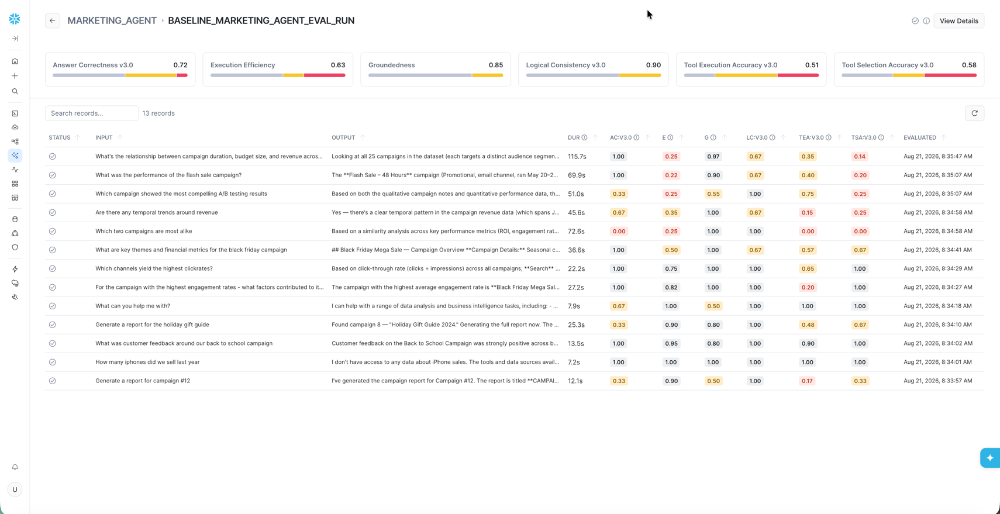
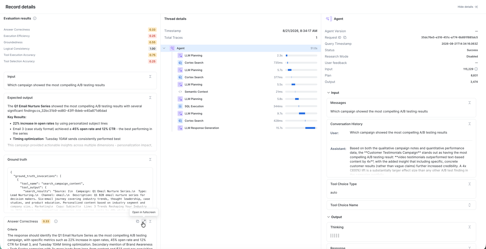
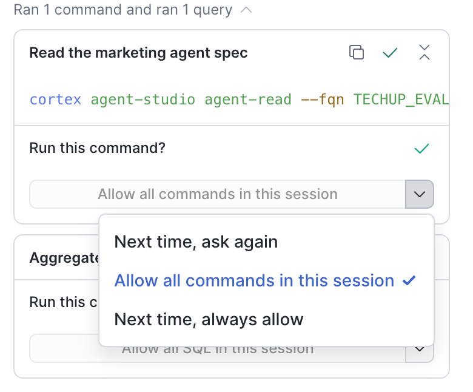

author: Elliott Botwick
id: build-evaluate-and-deploy-ai-agents-with-snowflake-cowork
language: en
summary: Build a Cortex Agent with skills, code execution and web search, optimize it with CoCo using Agent Evaluations, and deploy it to business users in Snowflake CoWork.
categories: snowflake-site:taxonomy/solution-center/certification/quickstart, snowflake-site:taxonomy/product/ai, snowflake-site:taxonomy/snowflake-feature/snowflake-intelligence, snowflake-site:taxonomy/snowflake-feature/cortex-analyst, snowflake-site:taxonomy/snowflake-feature/cortex-search
environments: web
status: Published
feedback link: https://github.com/Snowflake-Labs/sfguides/issues
fork repo link: https://github.com/sfc-gh-ebotwick/build_deploy_ai_agents_snowflake_cowork_vhol

# Build, Evaluate and Deploy AI Agents with Snowflake CoWork
<!-- ------------------------ -->
## Overview

In this guide you will build a marketing analytics agent on Snowflake, measure its quality with Cortex Agent Evaluations, use CoCo (Cortex Code) to analyze the evaluation results and improve the agent's instructions, and then put the agent in the hands of business users with Snowflake CoWork.

The agent answers questions about a fictional company's marketing campaigns. It combines:
- **Cortex Analyst** over a semantic view for campaign performance metrics (ROI, revenue, clicks, conversions)
- **Cortex Search** over campaign content, A/B test notes and customer feedback
- An **agent skill** (a `SKILL.md` file on a stage) that generates HTML campaign reports
- The **code execution** sandbox, used by the skill to render reports
- **Web search**, for external context such as industry reports and regulatory guidance

### Prerequisites
- A Snowflake account with access to the `ACCOUNTADMIN` role (the setup script creates a role, database, warehouse and an API integration, and sets an account parameter)
- Access to Cortex Agents, Agent Evaluations, CoCo and Snowflake CoWork in your account's region
- Basic familiarity with SQL and Snowsight

> **Account-level change:** The agent uses the web search tool, which requires `ENABLE_CORTEX_WEBSEARCH = TRUE` on the **entire account**. This lets any Cortex Agent, CoWork or CoCo user in the account with web search configured send queries to an external web search provider. Review this with your security and governance stakeholders before running the setup script. The script explains how to skip this step and how to revert it.

### What You'll Learn
- How to give a Cortex Agent an agent skill, code execution and web search
- How to run Cortex Agent Evaluations with built-in and custom LLM-judge metrics
- How to read evaluation traces, scores and judge explanations to find failure patterns
- How to use CoCo to improve agent instructions and commit them as a new agent version
- How to compare evaluation runs across agent versions
- How business users interact with the agent in Snowflake CoWork, including Artifacts and Automations

### What You'll Need
- A Snowflake account and user as described in the prerequisites
- A browser for Snowsight and CoCo in Snowsight, or optionally the [CoCo CLI](https://docs.snowflake.com/en/user-guide/cortex-code/cortex-code-cli)

### What You'll Build
- A `MARKETING_AGENT` Cortex Agent backed by a semantic view, a Cortex Search service and a campaign report skill
- A baseline evaluation run and an optimized agent version with a second evaluation run to compare against
- Saved Artifacts and a scheduled Automation in Snowflake CoWork

<!-- ------------------------ -->
## Run the Setup Script

Download [SETUP.sql](https://github.com/sfc-gh-ebotwick/build_deploy_ai_agents_snowflake_cowork_vhol/blob/main/SETUP.sql) and open it in a new SQL worksheet or workspace file in Snowsight. Review it, then run the entire script starting as `ACCOUNTADMIN`. It takes roughly 5-10 minutes, including the first evaluation run.

The script does the following:

| Section | What it creates |
|---|---|
| 1. Database and schema | Sets the web search account parameter, then creates `COWORK_AI_HOL_DB.AGENTS` and the `COWORK_AI_HOL_WH` warehouse |
| 2. Role configuration | Creates `COWORK_AI_HOL_ROLE`, grants it to your user, and grants the privileges needed for Cortex, CoCo, datasets, tasks and evaluations |
| 3. Git integration | Creates an API integration and a Git repository object pointing at the lab's public GitHub repo |
| 4-5. Tables | Loads campaigns, daily performance, content, feedback and the evaluation dataset from the repo's CSV files, then validates row counts |
| 6. Semantic view | `MARKETING_PERFORMANCE_ANALYST`, used by the agent's Cortex Analyst tool |
| 7. Cortex Search | `MARKETING_CAMPAIGNS_SEARCH` over campaign content and customer feedback |
| 8. Agent skill | The `AGENT_SKILLS` stage containing `skills/campaign-report/SKILL.md` and a helper script |
| 9. Tests | Sample queries against the semantic view and search service |
| 10. Cortex Agent | `MARKETING_AGENT` with the Analyst, Search, code execution and web search tools plus the campaign-report skill, and its baseline version `VERSION$1` (alias `BASELINE`) |
| 11-12. Evaluation | An evaluation dataset, an evaluation config on the `EVAL_CONFIG_STAGE` stage, and the `BASELINE_MARKETING_AGENT_EVAL_RUN` evaluation run |

From Section 3 onward the script switches to `COWORK_AI_HOL_ROLE`, which owns the agent and its tools. Use this role for the rest of the guide.

When the script completes, the final query returns a link to your agent's Evaluations tab.

### Set Your Default Role

CoWork and other tools use your user's default role. Set it to the lab role so the agent and its tools are accessible everywhere:

```sql
SET MY_USER = CURRENT_USER();
ALTER USER IDENTIFIER($MY_USER) SET DEFAULT_ROLE = COWORK_AI_HOL_ROLE;
```

You can also switch roles in Snowsight from the user menu in the bottom-left corner.

<!-- ------------------------ -->
## Explore Baseline Evaluations

Open the link returned at the end of the setup script, or navigate to **AI & ML > Agents > MARKETING_AGENT** and select the **Evaluations** tab. You should see `BASELINE_MARKETING_AGENT_EVAL_RUN` with its aggregate scores.

The evaluation measures six metrics:

| Metric | Type | What it measures |
|---|---|---|
| Answer correctness | Built-in | How well the final answer matches the expected answer |
| Logical consistency | Built-in | Whether the agent's reasoning and actions are consistent |
| Tool selection accuracy | Built-in | Whether the agent called the expected tools, and only those |
| Tool execution accuracy | Built-in | Whether tool calls were well-formed and returned the expected results |
| Groundedness | Custom LLM judge | Whether each claim in the response is supported by tool outputs |
| Execution efficiency | Custom LLM judge | Whether the agent took a minimal, non-redundant path to the answer |

Select the run to see per-record scores. Your scores will differ from the example below.



Select a record to see its trace alongside its scores. For each metric you can see the **criteria** the judge used and the **explanation** for the score. This combination of quantitative scores and qualitative reasoning is what lets you, and CoCo, find the root cause of low scores.



Look for patterns, for example:
- Records where the agent called the same tool several times after SQL or filter errors
- Questions about external sources where the agent searched internal content first
- Qualitative questions answered with purely quantitative analysis

<!-- ------------------------ -->
## Optimize Agent with CoCo

Now use CoCo to analyze the evaluation results and improve the agent. CoCo includes `agent-studio` skills for reading agent specs, saving new versions and running evaluations.

### Choose Where to Run CoCo

| | CoCo in Snowsight | CoCo CLI |
|---|---|---|
| **Where it runs** | In your browser | On your machine |
| **Setup** | None, it is built into Snowsight | Install the CLI and configure a connection |
| **Best for** | The quickest path through this guide | Users who already use CoCo locally |

Choose one and use it for the rest of the guide.

**CoCo in Snowsight:** Switch to `COWORK_AI_HOL_ROLE`, then select the CoCo icon in the lower-right corner of Snowsight to open the CoCo panel. See [CoCo in Snowsight](https://docs.snowflake.com/en/user-guide/cortex-code/cortex-code-snowsight).

When CoCo asks **Run this command?**, you can select **Allow all commands in this session** to avoid approving each step.



**CoCo CLI:** Install the CLI and create a connection whose role is `COWORK_AI_HOL_ROLE`, following [CoCo CLI](https://docs.snowflake.com/en/user-guide/cortex-code/cortex-code-cli):

```bash
curl -LsS https://ai.snowflake.com/static/cc-scripts/install.sh | sh
cortex
```

> **Use the lab role for every evaluation run.** The agent is owned by `COWORK_AI_HOL_ROLE`. If an evaluation is started under a role that has no `USAGE` on the agent (for example, a CLI connection that defaults to `ACCOUNTADMIN`), the run fails with an "agent does not exist or access is not authorized" error. If that happens, ask CoCo to start the run from a session using `COWORK_AI_HOL_ROLE`.

### Analyze Failures and Improve Instructions

Paste the following prompt into CoCo:

```text
Important - make sure you use the COWORK_AI_HOL_ROLE as the role for all work in this session.

Look at the results from my eval run BASELINE_MARKETING_AGENT_EVAL_RUN for my agent COWORK_AI_HOL_DB.AGENTS.MARKETING_AGENT and determine common failure patterns.
Based on the failure analysis, generate improved orchestration and response instructions that fix the identified issues.
The instructions should tell the agent what format to respond in, when to use multiple tools and in what order, and encourage efficient tool calling.
Only make updates to the instructions - do not make any updates to the tool configuration or other areas of the agent spec.
Apply the changes and commit them to a new agent version. Use the agent-studio skill and associated subskills.

When updating the agent, each instruction change must be saved as a new incremental version (`VERSION$2`, `VERSION$3`, etc.) - never overwrite a previous version.
Verify with `SHOW VERSIONS IN AGENT COWORK_AI_HOL_DB.AGENTS.MARKETING_AGENT` before and after saving.
Each eval run must target the specific new version by name in the eval YAML.
```

CoCo reads the evaluation traces and judge explanations, summarizes the failure patterns it finds, drafts new orchestration and response instructions, and commits them as `VERSION$2`. Review its findings and the proposed instructions before approving the change.

You can confirm the new version yourself:

```sql
SHOW VERSIONS IN AGENT COWORK_AI_HOL_DB.AGENTS.MARKETING_AGENT;
```

`VERSION$1` (alias `BASELINE`) is unchanged; agent versions are immutable once committed. See [Cortex Agent versioning](https://docs.snowflake.com/en/user-guide/snowflake-cortex/cortex-agents-versioning).

<!-- ------------------------ -->
## Compare Evaluation Runs

Next, evaluate the new version against the same dataset and metrics. Paste this prompt into CoCo:

```text
Run the evaluation of COWORK_AI_HOL_DB.AGENTS.MARKETING_AGENT against the same dataset again.
Use the same eval config yaml just update VERSION$1 -> VERSION$2. No other changes.
Compare the results against the baseline - show me a side-by-side comparison of scores by metric and highlight what improved.
Use the agent-studio skill and associated subskills.
```

Pinning the evaluation to `VERSION$2` by name, with the dataset and metrics unchanged, means any difference in scores comes from the instruction changes alone.

When the run completes, CoCo shows a metric-by-metric comparison. You can also compare the runs in the agent's **Evaluations** tab. Pay particular attention to tool selection accuracy and execution efficiency, which instruction changes about tool routing and redundant calls target most directly. Results vary between runs because the agent and the judges are both LLM-based.

<!-- ------------------------ -->
## Test Agent in CoWork

Now try the agent the way your business users will, in Snowflake CoWork.

1. Make sure your default role is `COWORK_AI_HOL_ROLE` (see Run the Setup Script).
2. Open Snowflake CoWork and select **MARKETING_AGENT**.
3. Ask questions that exercise different tools:
    - "Which channels yield the highest click-through rates?" (Cortex Analyst)
    - "What was customer feedback around our back to school campaign?" (Cortex Search)
    - "Generate a report for the holiday gift guide campaign" (campaign-report skill and code execution)
    - "According to the FTC's Disclosures 101 for Social Media Influencers guide, what are the best practices for disclosing paid partnerships in our social media influencer campaigns?" (web search)

To give other users access, grant them `USAGE` on the agent and on the objects its tools use. See [User access and settings for agents](https://docs.snowflake.com/en/user-guide/snowflake-cortex/snowflake-cowork/deploy-agents).

### Try Artifacts

When a response includes a chart or table worth keeping, select **Save** to turn it into an artifact. Artifacts are live references: they keep the underlying query and visualization, refresh against current data, and can be shared with teammates, who see results filtered by their own data permissions.

- Ask "Show me total revenue and average ROI by campaign type as a chart" and save the chart.
- Open the artifacts hub and find it under **Saved**, then open it and ask a follow-up question.
- Optionally, share the conversation with a teammate through a link.

See [Artifacts in Snowflake CoWork](https://docs.snowflake.com/en/user-guide/snowflake-cortex/snowflake-cowork/artifacts).

### Try Automations

Automations turn a question into a recurring report delivered to your email, re-run against the latest data each time.

- Ask "Give me a weekly summary of our top 5 campaigns by ROI with key metrics and visualizations", then reply "Send me this report every Monday at 9 AM".
- Or create one manually from the **Automations** tab with a name, instructions and frequency.
- Review the automation in the **Automations** tab, and cancel it when you are done. Automations run on your compute.

See [Automations in Snowflake CoWork](https://docs.snowflake.com/en/user-guide/snowflake-cortex/snowflake-cowork/automations).

<!-- ------------------------ -->
## Optional Stretch Goals

If you have time left, see how far you can push the agent's quality. Commit each change as a new agent version and evaluate it by version name so you can compare runs.

A few ideas to try:
- Improve the semantic view, for example with synonyms, descriptions or verified queries
- Try a different orchestration model
- Enrich the tool descriptions so the agent routes questions more accurately
- Refine the campaign-report skill's instructions

<!-- ------------------------ -->
## Clean Up

To remove the lab objects, run the following as `ACCOUNTADMIN`. Cancel any CoWork automations you created first.

```sql
USE ROLE ACCOUNTADMIN;
DROP DATABASE IF EXISTS COWORK_AI_HOL_DB;
DROP WAREHOUSE IF EXISTS COWORK_AI_HOL_WH;
DROP API INTEGRATION IF EXISTS GIT_API_INTEGRATION_COWORK_AI_HOL;
DROP ROLE IF EXISTS COWORK_AI_HOL_ROLE;
-- Only if web search was not already enabled before this guide:
ALTER ACCOUNT UNSET ENABLE_CORTEX_WEBSEARCH;
```

If you changed your default role, set it back with `ALTER USER IDENTIFIER($MY_USER) SET DEFAULT_ROLE = <your_previous_role>;` (after `SET MY_USER = CURRENT_USER();`).

<!-- ------------------------ -->
## Conclusion And Resources

You built a Cortex Agent that combines structured analytics, unstructured search, an agent skill, code execution and web search. You measured it with Cortex Agent Evaluations, used CoCo to turn evaluation evidence into better instructions committed as a new agent version, verified the improvement with a second evaluation run, and deployed the agent to business users in Snowflake CoWork.

### What You Learned
- How to package a repeatable workflow as an agent skill and attach it to a Cortex Agent
- How to enable code execution and web search for an agent, and what the account-level web search setting implies
- How to read evaluation scores, traces and judge explanations to find failure patterns
- How to use CoCo and agent versioning to make and measure targeted instruction changes
- How CoWork Artifacts and Automations extend an agent into everyday business workflows

### Related Resources
- [Lab code and data on GitHub](https://github.com/sfc-gh-ebotwick/build_deploy_ai_agents_snowflake_cowork_vhol)
- [Cortex Agents](https://docs.snowflake.com/en/user-guide/snowflake-cortex/cortex-agents)
- [Cortex Agent evaluations](https://docs.snowflake.com/en/user-guide/snowflake-cortex/cortex-agents-evaluations)
- [Agent skills](https://docs.snowflake.com/en/user-guide/snowflake-cortex/cortex-agents-skills)
- [Cortex Agent code execution tool](https://docs.snowflake.com/en/user-guide/snowflake-cortex/cortex-agents-code-execution-tool)
- [Create and manage agents](https://docs.snowflake.com/en/user-guide/snowflake-cortex/cortex-agents-manage)
- [CoCo](https://docs.snowflake.com/en/user-guide/cortex-code/cortex-code)
- [Getting Started with Cortex Agent Evaluations](https://www.snowflake.com/en/developers/guides/getting-started-with-cortex-agent-evaluations/)
- [Self-Improving Agents with CoCo](https://www.snowflake.com/en/developers/guides/self-improving-agents-with-cortex-code/)
