author: Kamesh Sampath
id: build-full-stack-apps-with-snowflake-app-runtime
summary: Build and deploy three types of Snowflake App Runtime apps — from an interactive dashboard to a workflow app to an AI-powered agentic experience — using structured prompts in Cortex Code Desktop.
categories: snowflake-site:taxonomy/solution-center/certification/quickstart,snowflake-site:taxonomy/product/applications-and-collaboration,snowflake-site:taxonomy/product/ai,snowflake-site:taxonomy/snowflake-feature/build
environments: web
status: Published
language: en
duration: 90
feedback link: https://github.com/Snowflake-Labs/sfguides/issues
fork repo link: <https://github.com/Snowflake-Labs/sfguide-build-full-stack-apps-with-snowflake-app-runtime>

# Build Full-Stack Apps with Snowflake App Runtime
<!-- ------------------------ -->
## Overview

**Three prompts. Three apps. Zero infrastructure.**

You will build **ChurnGuard**, a customer retention app, by describing what you want to Cortex Code Desktop. Each iteration adds one prompt and one kind of app:

| Iteration | What You Build | Snowflake Features |
|-----------|---------------|-------------------|
| **1 — Explore your data** | A churn dashboard you can pivot and drill into. *See the risk. Explore the why.* | Application Service, *querySnowflake*, *app.yml* |
| **2 — Run the workflow** | An Action Board where teams flag customers, assign actions, and track them to resolution. *Turn insight into action.* | Snowflake tables, dynamic tables, alerts |
| **3 — Bring AI into the app** | A Cortex Agent inside the app that answers questions and proposes actions for you to approve. *Ask your data. Get a next step.* | Cortex Agent, semantic view, serverless task, MCP server |

Snowflake App Runtime runs the app on Snowflake as an **APPLICATION SERVICE**. You don't build Docker images, manage a registry, or set up a pipeline. One command deploys it.

Each iteration ends with a working app. Session leaders can stop after any of them.

### Prompt Approach

Each iteration uses an [Intent-Driven Development (IDD)](https://dev.to/kameshsampath/series/41588) prompt. It tells Cortex Code *what* you want, not *how* to build it:

| Section | Purpose |
|---------|---------|
| **Goal** | The outcome you want |
| **Requirements** | What the app must do |
| **UI** | Look, layout, and interactions |
| **Constraints** | Scope and safety rules |
| **Output** | What success looks like |

### What You'll Learn

The three iterations map to the three kinds of app Snowflake App Runtime is built for:

- **Advanced data exploration:** build an interactive app on governed data, with full control of the UI, that queries Snowflake without managing credentials
- **Workflow apps:** read and write governed data with shared state and approvals. Write operational data to a Snowflake table and let dynamic tables and alerts carry the logic so the app stays thin
- **AI apps and agents:** embed a Cortex Agent that reasons over your data and calls your app's tools, and expose those tools as an MCP server for agentic automation
- **The App Runtime lifecycle:** the describe, build, deploy, iterate loop, the *app.yml* manifest, and in-place upgrades at a stable URL

### What You'll Need

> **Important:** In a hands-on lab, use the Snowflake account your lab provides. Otherwise, you need an account where Snowflake App Runtime is enabled. Iteration 3 uses Cortex AI, which is off by default on self-service [trial accounts](https://docs.snowflake.com/en/user-guide/admin-trial-account) until you add a credit card.

- A [Snowflake account](https://signup.snowflake.com/?utm_source=snowflake-devrel&utm_medium=developer-guides&utm_cta=developer-guides) with Snowflake App Runtime enabled.
- **ACCOUNTADMIN** access for the setup scripts, which:
  - Create a custom role and database
  - Grant **BIND SERVICE ENDPOINT** so the app gets a URL
  - Grant **EXECUTE ALERT** for the escalation alert (iteration 2)
  - Grant **EXECUTE MANAGED TASK** for the daily staging task (iteration 3)
  - Grant the **SNOWFLAKE.CORTEX_USER** database role for the Cortex Agent (iteration 3)

  After setup, you work as the dedicated **SFQUICKSTART_CHURNGUARD_ROLE**.

You probably have Git and Node.js already. The table lists every tool so you can check versions. The Cortex Code CLI is optional:

| Tool | Version | Used for | Get it |
|------|---------|----------|--------|
| Cortex Code Desktop | Latest | Running the prompts that build the app | [Download](https://docs.snowflake.com/en/user-guide/cortex-code/cortex-code-desktop) |
| Cortex Code CLI | Latest | Optional: calling the app's MCP server (iteration 3) | [Install](https://docs.snowflake.com/en/user-guide/cortex-code/cortex-code-cli) |
| Snowflake CLI | 3.26.0+ | Running scripts and deploying the app | [Install](https://docs.snowflake.com/developer-guide/snowflake-cli/installation/installation) |
| Node.js and npm | 20+ | Building the app locally | [Download](https://nodejs.org/en/download) |
| Git | Any recent | Cloning the repo and switching iterations | [Download](https://git-scm.com/downloads) |

If you want to try the MCP server in iteration 3, install the Cortex Code CLI:

```bash
# macOS, Linux, or WSL
curl -LsS https://ai.snowflake.com/static/cc-scripts/install.sh | sh

# Windows (PowerShell)
irm https://ai.snowflake.com/static/cc-scripts/install.ps1 | iex
```

<!-- ------------------------ -->
## Environment Setup

### Verify Tools

Check the required tools. Snowflake CLI must be 3.26.0 or later and Node.js 20 or later:

```bash
# Check the required and optional tools
snow --version
node --version
git --version

# optional tool
cortex --version
```

### Clone the Repository

The repo holds the setup scripts and the prompt for each iteration:

```bash
# Clone the companion repo
git clone https://github.com/Snowflake-Labs/sfguide-build-full-stack-apps-with-snowflake-app-runtime.git
cd sfguide-build-full-stack-apps-with-snowflake-app-runtime
```

> **Tip:** The [solution branch](https://github.com/Snowflake-Labs/sfguide-build-full-stack-apps-with-snowflake-app-runtime/tree/solution) has the finished ChurnGuard app through iteration 3. Use it to compare your app or to skip ahead, but don't merge it into ***my-app***. Once you have ***my-app*** (below), compare at any point with:

```bash
git diff my-app origin/solution -- churnguard/
```

### Add a Snowflake CLI Connection

Add a ***quickstart*** connection and test it:

```bash
# Add the quickstart connection, then test it
snow connection add --connection-name quickstart \
  --account <your_account> --user <your_user> \
  --authenticator 'OAUTH_AUTHORIZATION_CODE' \
  --client-store-temporary-credential \
  --no-interactive

snow connection test --connection quickstart
```

The command writes the connection to your Snowflake config file. Replace *your_account* and *your_user* with your values. Cortex Code Desktop and the Cortex Code CLI read the same file.

The connection doesn't set a warehouse yet, because **SFQUICKSTART_CHURNGUARD_WH** doesn't exist until *setup.sql* creates it. A connection test with a missing warehouse fails. You add the warehouse and role to the connection after the setup scripts run.

> **Note:** The guide uses the connection name ***quickstart***. If you use another name, change it in *.env*, *AGENTS.md*, and every ***--connection*** flag (including ***cortex mcp add*** in iteration 3).

### Run the Setup Scripts

Run the three setup scripts in order:

```bash
# Run the setup scripts in order
snow sql -f scripts/setup.sql --connection quickstart       # database and TPC-DS check
snow sql -f scripts/grants.sql --connection quickstart      # quickstart role and grants
snow sql -f scripts/setup-data.sql --connection quickstart  # sample data (usually under a minute)
```

What each one does:

- *setup.sql* creates the **SFQUICKSTART_CHURNGUARD** database and the **SFQUICKSTART_CHURNGUARD_WH** warehouse (X-Small, suspends after 60 seconds idle), and checks for the TPC-DS sample data (about 65 million rows). If your account doesn't have it, the script creates it from the Snowflake share. You can also get it from [Snowflake Marketplace](https://docs.snowflake.com/en/user-guide/sample-data-tpcds#getting-tpc-ds-data-from-snowflake-marketplace).
- *grants.sql* creates **SFQUICKSTART_CHURNGUARD_ROLE** and grants it to you. The role owns the quickstart database and can deploy apps, use the warehouse, and read the sample data. Each iteration adds its own grants when you rerun the script (the escalation alert in iteration 2, Cortex AI and tasks in iteration 3).
- *setup-data.sql* samples the TPC-DS 10 TB dataset once into two small tables, **CHURN_METRICS** (about 30,000 customers) and **CHURN_TRENDS** (monthly totals), so dashboard queries return in under a second. It samples with *TABLESAMPLE SYSTEM* instead of scanning the 29-billion-row fact tables.

Check the tables:

```bash
snow sql --connection quickstart --role SFQUICKSTART_CHURNGUARD_ROLE \
  --warehouse SFQUICKSTART_CHURNGUARD_WH -q "
  SELECT 'CHURN_METRICS' AS tbl, COUNT(*) AS row_count
    FROM SFQUICKSTART_CHURNGUARD.PUBLIC.CHURN_METRICS
  UNION ALL
  SELECT 'CHURN_TRENDS', COUNT(*)
    FROM SFQUICKSTART_CHURNGUARD.PUBLIC.CHURN_TRENDS"
```

Expect about 30,000 rows in **CHURN_METRICS** and 12 rows (one per month) in **CHURN_TRENDS**. TPC-DS is a benchmark dataset, so its dates come from the early 2000s rather than this year.

### Prepare Your Working Directory

Create your own working branch, ***my-app***, from the iteration 1 branch:

```bash
# Create my-app from the iteration 1 branch
git fetch origin
git checkout -b my-app origin/iteration-1/data-exploration
```

The branch includes [AGENTS.md](https://github.com/Snowflake-Labs/sfguide-build-full-stack-apps-with-snowflake-app-runtime/blob/iteration-1/data-exploration/AGENTS.md), which tells Cortex Code your connection, role, database, and conventions. Cortex Code reads it automatically.

**Set the default connection and role.** The branch also includes *.env.example*, which makes ***quickstart*** your default connection and **SFQUICKSTART_CHURNGUARD_ROLE** its role. Load it now that *grants.sql* has created the role:

```bash
# Load the default connection and role
cp .env.example .env

# with direnv (https://direnv.net)
echo dotenv > .envrc && direnv allow
# or, without direnv, run this instead in each new terminal:
# set -a; source .env; set +a

snow connection test   # should show quickstart with SFQUICKSTART_CHURNGUARD_ROLE
```

**Set the connection's default role and warehouse.** ***snow app deploy*** uses the connection's default role, not ***--role*** or *.env*, so set it in your Snowflake config file (*~/.snowflake/connections.toml*). Add these two lines to the ***[quickstart]*** block, or update them if they're already there:

```toml
role = "SFQUICKSTART_CHURNGUARD_ROLE"
warehouse = "SFQUICKSTART_CHURNGUARD_WH"
```

The setup scripts still switch to **ACCOUNTADMIN** themselves, so you can rerun *grants.sql* later without changing anything.

Snowflake CLI commands, the Cortex Code CLI, and ***npm run dev*** started from this terminal now use that connection and role. The files hold no secrets, and the repo's *.gitignore* keeps *.env* and *.envrc* out of your commits.

Open the repo directory in Cortex Code Desktop. Your account name should appear in the status bar.

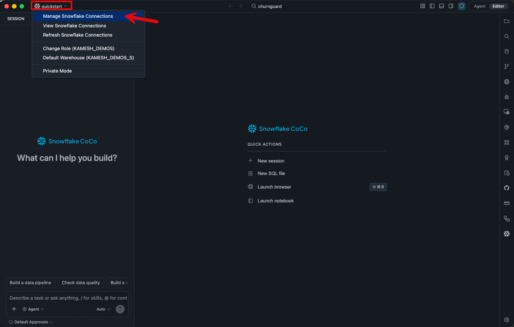

**How your app carries over.** Cortex Code generates the app in *churnguard/* on your ***my-app*** branch. Each iteration branch adds only that iteration's prompts and scripts, so at the start of the next iteration you commit your app and merge the next branch in. Edit only files in *churnguard/* and every merge stays conflict-free.

<!-- ------------------------ -->
## Iteration 1: Build the Data Explorer

*See the risk. Explore the why.*

A static report shows you numbers. An explorer lets you ask why. In this iteration one prompt builds a churn dashboard you can pivot and drill into, and deploys it.

### The Prompt

Open the prompt file [01-build-explorer.md](https://github.com/Snowflake-Labs/sfguide-build-full-stack-apps-with-snowflake-app-runtime/blob/iteration-1/data-exploration/prompts/01-build-explorer.md) and paste it into Cortex Code Desktop. Here it is in full, so you can see how an IDD prompt is put together:

```text
/snowflake-apps

Goal: Build a customer churn risk dashboard called ChurnGuard
that helps retention teams identify and prioritize at-risk customers.

Requirements:
- KPI cards: total customers, churn rate, revenue at risk, avg return rate
- Segment chart: churn risk distribution by credit rating (High/Medium/Low)
- Trend chart: active customers vs churn indicator over time
- Customer details table showing individual high-risk customers
  with 10-per-page pagination and risk level filter tabs
- Drill down: clicking a segment in the churn-risk chart filters the
  customer table to that segment; a "Clear filter" button resets it
- Pivot: a dimension selector above the segment chart lets users switch
  the grouping column (credit rating, marital status, education level,
  or gender) and the chart re-aggregates on selection
- Query the pre-computed tables in SFQUICKSTART_CHURNGUARD.PUBLIC:
  CHURN_METRICS (customer-level data) and CHURN_TRENDS (monthly aggregates)

UI:
- Modern card-based layout with generous spacing and subtle shadows
- Professional color palette (blues and grays with accent colors for risk levels)
- Responsive grid that works well on wide screens
- Smooth loading states and transitions
- Data-dense but not cluttered -- prioritize readability

Constraints:
- Query only the local CHURN_METRICS and CHURN_TRENDS tables
  (do NOT query SNOWFLAKE_SAMPLE_DATA directly -- the fact tables are too large)
- Add the usage marker from AGENTS.md (APP_ORIGIN in app.yml)

Output:
- Deployed interactive dashboard at the Application Service URL
- Clean Next.js project structure ready for iteration
```

**How the prompt is built:**

- ***/snowflake-apps*** loads the skill that knows how to build App Runtime apps
- **Goal** is the outcome, in one sentence
- **Requirements** say what the app must do
- **UI** describes the look and feel, not components
- **Constraints** set scope and safety rules
- **Output** says how you know it worked

The prompt never names a framework, a chart library, or a file. Those choices are left to Cortex Code. The later prompts follow the same structure.

### What Happens

The build and deploy take a few minutes, so follow along in the chat. Cortex Code generates code with an LLM, so layout, chart styles, and colors vary between runs; your app will do the same things as the screenshots but may not look identical.

*AGENTS.md* tells Cortex Code where to deploy, so it works through the whole lifecycle:

**1. Scaffold.** Cortex Code copies the Next.js App Runtime starter and runs ***npm install***.

**2. Manifest and code.** It runs ***snow app setup*** to generate the *app.yml* manifest, then writes:

- **API routes** that query **CHURN_METRICS** and **CHURN_TRENDS**
- **A React frontend** with KPI cards, a segment chart with drill-down, a trend chart, a pivot selector, and a customer table with risk badges
- **Styling** that follows the prompt's UI section

**3. Deploy.** Cortex Code runs ***snow app deploy***, watches the build, and gives you the App URL once the service is **RUNNING**.

### Key Concepts

- **Owner's rights** means the app's queries run as the service's own role, so the code holds no credentials and you don't grant anything per user. See [Query Snowflake](https://docs.snowflake.com/en/developer-guide/snowflake-app-runtime/query-snowflake).

### Verify

> **Tip:** Cortex Code shows the App URL when the deploy finishes, so you can click it, or ask Cortex Code to open the app. It runs ***snow app open --connection quickstart***, which you can also run yourself: add ***--print-only*** to print the URL, or ***--watch*** while a deploy is still finishing.

Open the App URL. Click a segment in the churn-risk chart to filter the customer table, then switch the pivot to another dimension.

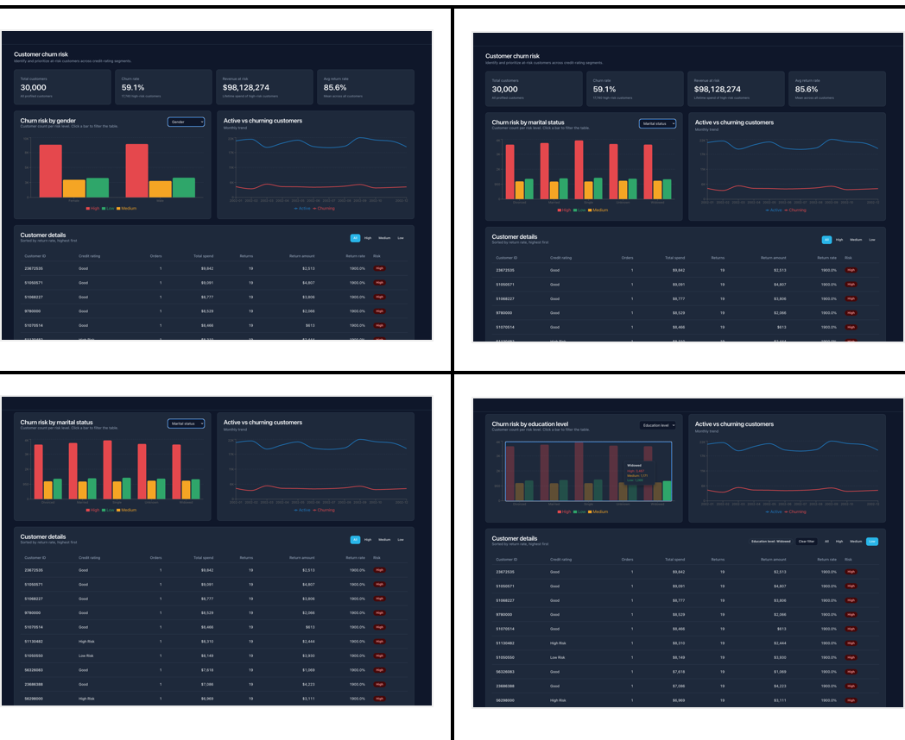

> **Note:** The tables come from sampled TPC-DS data, so your numbers may differ if you rerun *setup-data.sql*.

The URL stays the same when you redeploy. The service upgrades in place, with no downtime.

> **Note:** ***SHOW APPLICATION SERVICES*** may report **SUSPENDED** right after a deploy. That's normal: the service suspends when idle and resumes on the first request, so just open the URL.

**Checkpoint:** the dashboard filters by segment and pivots by dimension. You're ready for iteration 2.

### Test Locally (Optional)

Start the dev server from *churnguard/*, then open [http://localhost:3000](http://localhost:3000). It connects to Snowflake with your CLI credentials.

```bash
npm run dev
```

<!-- ------------------------ -->
## Understanding app.yml

Open *app.yml* in your project root. ***snow app setup*** (Snowflake CLI 3.26.0+) generates it, and every App Runtime app uses it as its manifest. Cortex Code runs ***snow app setup*** for you; run it yourself only when you bring existing app code.

> **Tip:** Have a project that uses snowflake.yml? See [Migrate from snowflake.yml to app.yml](https://docs.snowflake.com/en/developer-guide/snowflake-app-runtime/migrate-to-app-yml).

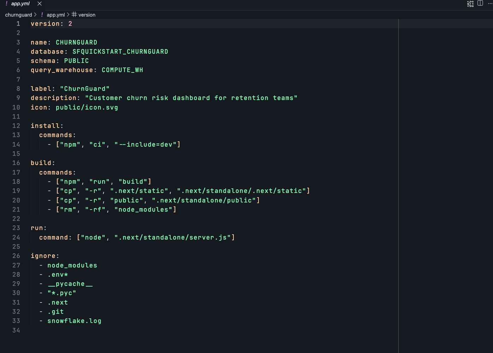

For every field, see the [app.yml reference](https://docs.snowflake.com/en/developer-guide/snowflake-app-runtime/app-yml).

### Key Fields

| Field | Purpose |
|-------|---------|
| **version: 2** | Required. Without it the CLI ignores the deployment keys |
| **name** | Name of the **APPLICATION SERVICE** object |
| **database / schema** | Where the app object lives. Both must exist |
| **query_warehouse** | Warehouse for the app's SQL queries |
| **label / description / icon** | How the app is presented |
| **ignore** | Files left out of the upload |
| **auto_resume** | Resume the service when a request arrives (default *true*) |
| **auto_suspend_secs** | Idle seconds before the service suspends (default *0*, never; minimum *300*) |
| **environment_variables** | Plain (non-secret) settings for the app. ChurnGuard sets *APP_ORIGIN* here (see the note below) |

Each ***snow app deploy*** applies the whole manifest. In the later iterations only the app code changes: the app reaches its new tables through the same owner's rights connection, so the manifest stays the same.

> **Note:** ChurnGuard carries one anonymous usage marker: *APP_ORIGIN* in *app.yml*. It tells Snowflake DevRel that an app started from this guide. It holds no customer data, and the app works the same without it. To opt out, delete it. *AGENTS.md* in the companion repo describes it.

> **Tip:** With the default *auto_suspend_secs* of *0*, the app never suspends and keeps consuming credits while idle. For a lab, set it to *300* (five minutes), or run the cleanup when you finish. See [Scale and suspend apps](https://docs.snowflake.com/en/developer-guide/snowflake-app-runtime/scale-and-suspend).

<!-- ------------------------ -->
## Iteration 2: Add Workflow Capabilities

*Turn insight into action.*

A dashboard tells you who is at risk. It doesn't help you do anything about it. In this iteration ChurnGuard becomes a workflow app: teams flag customers, assign retention actions, and track them to resolution.

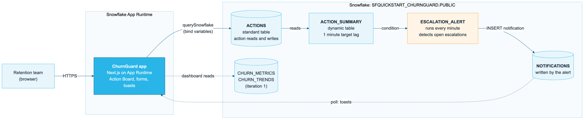

The app reads and writes actions in the **ACTIONS** table, so the Action Board always shows the latest state. Separately, a dynamic table and an alert turn those actions into notifications. The only thing the app reads from that pipeline is the **NOTIFICATIONS** table.

### Setup

Commit your iteration 1 work if you haven't already, then merge in iteration 2:

```bash
# Commit iteration 1, then merge in iteration 2
git add -A && git commit -m "Iteration 1 done"
git fetch origin && git merge --no-edit origin/iteration-2/workflow-app
```

**Step 1 — Rerun grants.** This adds the alert privilege:

```bash
snow sql -f scripts/grants.sql --connection quickstart
```

**Step 2 — Create the actions table, dynamic table, notifications table, and alert:**

```bash
snow sql -f scripts/iteration-2-setup.sql --connection quickstart
```

This creates the **ACTIONS** table that the app writes to and the **ACTION_SUMMARY** dynamic table that reads it, plus the **NOTIFICATIONS** table and **ESCALATION_ALERT**.

> **Note:** From here on, some objects use credits while they run: the dynamic table and alert (both every minute) and, in iteration 3, a daily task. Run [Cleanup](#cleanup) when you're done.

### The Prompt

Open the prompt file [02-add-workflow.md](https://github.com/Snowflake-Labs/sfguide-build-full-stack-apps-with-snowflake-app-runtime/blob/iteration-2/workflow-app/prompts/02-add-workflow.md) and paste it into Cortex Code Desktop, or copy it from here. It asks for an Action Board that writes to the **ACTIONS** table with bind variables, and toast notifications driven by a Snowflake alert.

```text
/snowflake-apps

Goal: Add retention workflow capabilities to ChurnGuard so teams
can act on churn insights -- flag customers, assign tasks, and
track resolution -- writing to a Snowflake table, with a dynamic
table and an alert turning those writes into notifications.

Requirements:
- "Flag for Retention" action button on high-risk customer rows
- Retention action form: assignee, action type
  (Call / Email / Offer / Escalate), notes field
- Write flagged actions to SFQUICKSTART_CHURNGUARD.PUBLIC.ACTIONS
  (created by iteration-2-setup.sql; columns ACTION_ID, CUSTOMER_KEY,
  ASSIGNED_TO, ACTION_TYPE, STATUS, NOTES, CREATED_AT, UPDATED_AT,
  CREATED_BY) with querySnowflake and ? bind variables
- One open action per customer: POST /api/actions creates the action
  with a single MERGE ... WHEN NOT MATCHED THEN INSERT that matches the
  customer's actions that aren't Resolved, using an ACTION_ID generated
  in the app (crypto.randomUUID()). If the MERGE inserts no row, look up
  the open action and return HTTP 409 with "already flagged: <action_id>".
  The form shows that message as a toast instead of creating a duplicate
- Read the action list from the ACTIONS table
- Action Board page: all tasks with status badges
  (New / In Progress / Resolved)
- Status update controls to move tasks through the workflow
  (UPDATE ACTIONS, setting UPDATED_AT)
- Summary KPI cards on the Action Board computed from the
  ACTIONS table (same source as the action list -- no sync delay)
- Global toast notifications from the NOTIFICATIONS table
  (populated by ESCALATION_ALERT -- the alert reads the
  ACTION_SUMMARY dynamic table; the DT exists solely to power
  the Snowflake alert pipeline)

Architecture:
- App reads and writes the ACTIONS table (action list, KPI summaries,
  status transitions -- all through querySnowflake)
- Alert pipeline (Snowflake-only): ACTION_SUMMARY DT reads ACTIONS
  (1 minute target lag) -> ESCALATION_ALERT fires on open escalations ->
  writes to NOTIFICATIONS table
- App reads NOTIFICATIONS and displays them as global toasts

UI:
- Action Board as a clean list/table with status pill badges
  and 25-per-page pagination
- Summary metric cards above the action table
- Global toast notifications for escalation alerts (visible on any page)
- Slide-over or modal form for creating actions -- not a separate page
- Inline status transitions (click badge to advance)
- Table action columns use icon buttons with the label as tooltip/alt text
- Visual distinction between action statuses using color coding
- Consistent design language with the existing explorer dashboard

Constraints:
- Use ? bind variables for every query that takes a value
- Use owner's rights for all Snowflake queries (the default)
- Snowflake doesn't enforce primary keys or CHECK constraints on
  standard tables: validate action types and statuses in the API
- Return timestamps to the browser as ISO 8601 strings
- app.yml doesn't change in this iteration: no secrets or
  external access integrations are needed
- Keep the existing dashboard views working. Adding the Flag for
  Retention column to the customer table is the only dashboard change
- Keep the APP_ORIGIN usage marker from AGENTS.md

Output:
- Updated app with a new Action Board page
- Snowflake writes for action CRUD operations
- Action summaries computed from the ACTIONS table (no sync delay)
- Global toast notifications from Snowflake alerts
- Redeploy to the same Application Service URL
```

### What Happens

Cortex Code changes the existing app. It doesn't start over.

**1. Write routes.** New API routes insert and update actions in **ACTIONS** with *querySnowflake* and bind variables:

```typescript
await querySnowflake(
  `MERGE INTO SFQUICKSTART_CHURNGUARD.PUBLIC.ACTIONS t
   USING (SELECT ? AS ACTION_ID, ? AS CUSTOMER_KEY, ? AS ASSIGNED_TO, ? AS ACTION_TYPE, ? AS NOTES) s
     ON t.CUSTOMER_KEY = s.CUSTOMER_KEY AND t.STATUS <> 'Resolved'
   WHEN NOT MATCHED THEN
     INSERT (ACTION_ID, CUSTOMER_KEY, ASSIGNED_TO, ACTION_TYPE, NOTES)
     VALUES (s.ACTION_ID, s.CUSTOMER_KEY, s.ASSIGNED_TO, s.ACTION_TYPE, s.NOTES)`,
  { binds: [id, customerKey, assignedTo, actionType, notes] },
)
```

The action list and its KPI cards read **ACTIONS** too, so a new action shows up the moment you save it. A customer can have only one open action: when one exists, the *MERGE* inserts nothing, and the form shows *already flagged* instead of creating a duplicate.

**2. Summaries.** **ACTION_SUMMARY** reads **ACTIONS** and refreshes within a minute. The app never queries it.

**3. Notifications.** **ESCALATION_ALERT** runs every minute. When the dynamic table shows open escalations, it writes a row to **NOTIFICATIONS**. The app polls that table and shows a toast. No email or webhook needed.

**4. Redeploy.** *app.yml* doesn't change, because the app reaches the new tables through the same connection as the dashboard. The app upgrades in place at the same URL.

### Key Concepts

- **Snowflake tables for app writes.** The app writes actions to a standard table with bind variables, through the same owner's rights connection it uses for reads. Snowflake doesn't enforce primary keys or unique constraints on standard tables, so the app validates its input, and the *MERGE* keeps one open action per customer. See [Query Snowflake from your app](https://docs.snowflake.com/en/developer-guide/snowflake-app-runtime/query-snowflake).
- **Dynamic tables** keep a query result up to date. **ACTION_SUMMARY** refreshes within a minute, so the alert reads totals instead of raw rows. See [Dynamic tables](https://docs.snowflake.com/en/user-guide/dynamic-tables-about).
- **Alerts** run a check on a schedule and act when it's true. **ESCALATION_ALERT** keeps notification logic in Snowflake, not in the app. See [Alerts](https://docs.snowflake.com/en/user-guide/alerts).

### Verify

Open the app and run through the workflow:

1. Find a high-risk customer in the customer table.
2. Click **Flag** and choose **Escalate** as the action type.
3. Open the **Action Board**. The new action and its KPI cards appear right away, because both read the **ACTIONS** table.
4. Wait 1–2 minutes while the dynamic table refreshes and the alert runs. A toast appears for the escalation. Dismiss it.
5. Click the status badge to move the action from New to In Progress to Resolved.

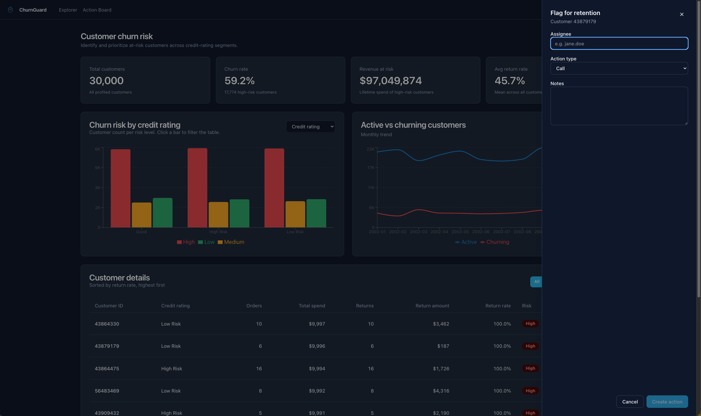

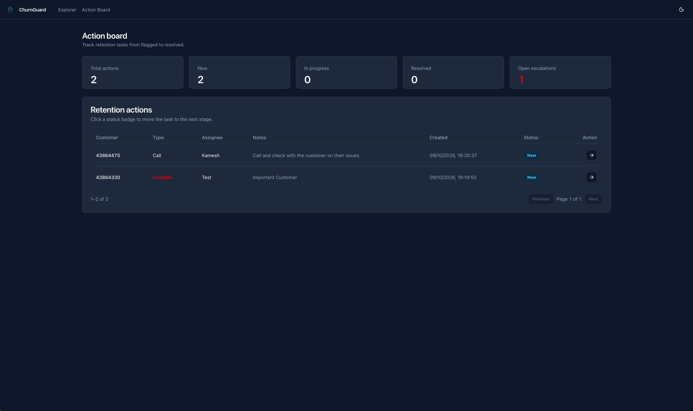

**Checkpoint:** you can flag a customer, move the action through its statuses, and see an escalation toast. You're ready for iteration 3.

<!-- ------------------------ -->
## Iteration 3: Make ChurnGuard Intelligent

*Ask your data. Get a next step.*

In this iteration ChurnGuard gets an agent. You ask a question from any page, and a Cortex Agent explores the data, explains what it finds, and recommends what to do. Overnight, a serverless task stages recommendations, so proposals wait for you in the morning. An MCP server lets other agents, such as the Cortex Code CLI, use ChurnGuard without opening a browser.

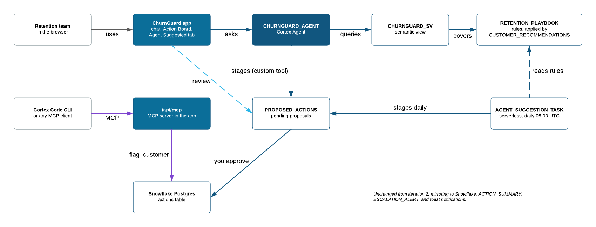

*AI proposes. You approve.* Three design choices keep a person in control:

- **The playbook decides what to do.** **RETENTION_PLAYBOOK** holds ordered rules, such as *High risk and spend over $7,000 → Offer*. The **CUSTOMER_RECOMMENDATIONS** view applies them, so the same customer always gets the same action and you can see which rule produced it. The agent chooses which customers to look at, and the playbook chooses the action.
- **The agent proposes, and the app writes.** The agent can't write actions. Its custom tool stages proposals in **PROPOSED_ACTIONS**. You review them on the **Agent Suggested** tab, and approving one goes through the same *POST /api/actions* route as a manual action.
- **A task stages proposals daily.** **AGENT_SUGGESTION_TASK** calls the staging procedure at 08:00 UTC.

### Setup

Commit your iteration 2 work if you haven't already, then merge in iteration 3:

```bash
# Commit iteration 2, then merge in iteration 3
git add -A && git commit -m "Iteration 2 done"
git fetch origin && git merge --no-edit origin/iteration-3/ai-app
```

**Step 1 — Rerun grants.** This adds the privileges for the agent, the staging procedure, and the task:

```bash
snow sql -f scripts/grants.sql --connection quickstart
```

**Step 2 — Create the playbook, recommendations view, proposals table, staging procedure, and daily task:**

```bash
snow sql -f scripts/iteration-3-setup.sql --connection quickstart
```

The setup also runs the task once, so proposals are ready right away. See [iteration-3-setup.sql](https://github.com/Snowflake-Labs/sfguide-build-full-stack-apps-with-snowflake-app-runtime/blob/iteration-3/ai-app/scripts/iteration-3-setup.sql) for the full SQL.

The playbook starts with five rules:

| Priority | When | Action |
|---|---|---|
| 1 | High churn risk and credit rating "High Risk" | Escalate |
| 2 | High churn risk, spend over $7,000 | Offer |
| 3 | High churn risk, return rate over 40% | Call |
| 4 | High churn risk (any other) | Email |
| 5 | Medium churn risk, return rate over 25% | Email |

### The Prompts

Iteration 3 uses two prompts, like iteration 2.

**1. Semantic view and agent.** Open the prompt file [03-agent-setup.md](https://github.com/Snowflake-Labs/sfguide-build-full-stack-apps-with-snowflake-app-runtime/blob/iteration-3/ai-app/prompts/03-agent-setup.md) and paste it into Cortex Code Desktop. It uses */agent-studio* to create the **CHURNGUARD_SV** semantic view and the **CHURNGUARD_AGENT** agent, then tests the agent. You can also copy it from here:

```text
/agent-studio

Goal: Give ChurnGuard a Cortex Agent that explores churn data, recommends
retention actions from the RETENTION_PLAYBOOK, and stages proposals via a
custom tool.

Requirements:

1. Create semantic view CHURNGUARD_SV over:
   - CHURN_METRICS (customer-level orders, spend, returns, churn risk)
   - CHURN_TRENDS (monthly active vs churning customers)
   - CUSTOMER_RECOMMENDATIONS (recommended action, rule, reason,
     open-action flag per customer)
   - ACTION_SUMMARY and NOTIFICATIONS (action counts, escalations)
   Add synonyms (at-risk, churner, retention action, playbook) and
   verified queries for: top high-risk customers by spend, churn risk
   by credit rating, monthly churn trend, high-risk customers with no
   open action.

2. Create agent CHURNGUARD_AGENT (model auto, display name "ChurnGuard")
   with tools:
   - Cortex Analyst on CHURNGUARD_SV, warehouse SFQUICKSTART_CHURNGUARD_WH
   - Data to Chart for trends and comparisons

3. Register a custom tool `stage_retention_actions` backed by stored
   procedure STAGE_RETENTION_PROPOSALS. The tool writes proposals to
   PROPOSED_ACTIONS and returns the count of staged proposals.

4. Instructions:
   - Recommend actions only from CUSTOMER_RECOMMENDATIONS; cite the
     rule REASON. Never invent an action type.
   - Skip customers where HAS_OPEN_ACTION is true
   - At most 5 proposals per turn
   - When the user asks to flag or stage actions, call
     stage_retention_actions right away with max_proposals = 5. Don't
     list candidates or ask for confirmation first: proposals are only
     suggestions, and people approve them on the app's Agent Suggested
     tab, which the next prompt (03-add-agent.md) adds. Until then they
     wait in PROPOSED_ACTIONS. Summarize what was staged.
   - Be concise; prefer a table for lists of customers

5. Test the agent with these questions, in the Snowsight agent playground
   or through the agent's REST API:
   - "Who are the top 5 high-risk customers by spend and what should we do?"
   - "Show the monthly churn trend as a chart"
   - "Flag high-risk customers for retention" (should call the tool)

Constraints:
- Use role SFQUICKSTART_CHURNGUARD_ROLE; create objects in
  SFQUICKSTART_CHURNGUARD.PUBLIC

Output:
- CHURNGUARD_SV semantic view with verified queries
- CHURNGUARD_AGENT answering the test questions, with the custom tool
  staging proposals into PROPOSED_ACTIONS
```

**2. Agent in the app.** Open the prompt file [03-add-agent.md](https://github.com/Snowflake-Labs/sfguide-build-full-stack-apps-with-snowflake-app-runtime/blob/iteration-3/ai-app/prompts/03-add-agent.md) and paste it into Cortex Code Desktop. It uses */snowflake-apps* to add the chat drawer, the Agent Suggested tab, the approve flow, and the MCP server, then redeploys. You can also copy it from here:

```text
/snowflake-apps

Goal: Make ChurnGuard agent-assisted with proactive recommendations,
an MCP server for external automation, and consistent UI polish.

Requirements:
- API route streaming the agent:run REST API (SSE) for CHURNGUARD_AGENT,
  one thread per conversation
- Chat drawer opened from the header and Cmd+K; thread survives page
  navigation, with a "New conversation" action
- Contextual entry points that pre-fill context: details row "Ask about
  this customer", segment bar "Explain this segment", High-risk KPI
  "Why?", Action Board card "Suggest next step", escalation toast
- Page-aware suggested prompts in an empty drawer
- Render agent tables and charts inline; when the agent calls
  stage_retention_actions, show the staged count and link to the
  Agent Suggested tab
- "Agent Suggested" tab on Action Board reading PROPOSED_ACTIONS
  (pending) via querySnowflake: each card shows customer key, action
  type, and rule reason. "Approve All" button above the list;
  per-card Approve / Dismiss. Approve writes to ACTIONS via
  POST /api/actions, assigned to "Retention team", and sets
  PROPOSED_ACTIONS.STATUS = 'approved'.
  If POST /api/actions answers 409 "already flagged", mark the
  proposal 'dismissed' with STATUS_REASON set to that message instead
  of failing. Approve All
  approves the rest and reports how many were skipped as duplicates.
  Tab badge showing pending count.
- Toast notification when pending proposals exist on page load
- MCP server at /api/mcp exposing tools: flag_customer, list_actions,
  get_customer_risk, get_churn_summary. Auth via Snowflake ingress.
  flag_customer uses the same one-open-action-per-customer rule as
  POST /api/actions and returns "already flagged: <action_id>" as a
  tool error instead of creating a duplicate.

UI:
- Multi-phase loading: thinking indicator, live status steps from the
  stream, shimmer, then the streamed answer
- All agent entry points (header button, contextual row/card actions,
  Agent Suggested tab) use the same sparkle/wand icon for consistency
- Table/list action columns: icon buttons with label as tooltip
- Approval buttons (Approve, Dismiss, Approve All): icon + label
- Action cards show customer, action, and rule reason
- Consistent with the existing ChurnGuard design language

Constraints:
- The agent never writes directly; Approve calls POST /api/actions
- Keep Dashboard and Action Board working; Action Board refreshes
  after approve
- MCP server shares the same auth as the app's API routes
- Keep the APP_ORIGIN usage marker from AGENTS.md

Output:
- Agent-assisted ChurnGuard with Agent Suggested tab, MCP server,
  redeployed to the same Application Service URL
```

### What Happens

**In Snowflake**

**1. Semantic view.** **CHURNGUARD_SV** covers **CHURN_METRICS**, **CHURN_TRENDS**, **CUSTOMER_RECOMMENDATIONS**, **ACTION_SUMMARY**, and **NOTIFICATIONS**, with synonyms and verified queries. The agent can answer questions such as "which high-risk customers have no open action?"

**2. Cortex Agent.** **CHURNGUARD_AGENT** has:

- **Cortex Analyst** on the semantic view, to answer data questions with SQL
- **Data to Chart**, to answer with charts
- **A custom tool**, *stage_retention_actions*, backed by the **STAGE_RETENTION_PROPOSALS** procedure, to stage proposals
- **Instructions** to take actions only from **CUSTOMER_RECOMMENDATIONS** and to skip customers who already have an open action

**3. Daily proposals.** **AGENT_SUGGESTION_TASK** runs at 08:00 UTC. It stages up to 20 proposals, highest risk and spend first, for customers with no open action and no pending proposal.

**In the app**

**4. Chat in the app.** Open the chat drawer from the header or with *Cmd+K*. The conversation stays open as you move between pages. Each screen also offers a shortcut that carries its context:

- Customer row: *Ask about this customer*
- Segment chart bar: *Explain this segment*
- High-risk KPI: *Why?*
- Action Board card: *Suggest next step*
- Escalation toast: *Explain this escalation*

An empty drawer suggests prompts for the current page.

**5. Streaming answers.** An API route streams the *agent:run* REST API. An answer takes about 30 seconds, so the chat shows a thinking indicator, then each tool call, then the answer with tables and charts. When the agent stages proposals, the chat shows how many and links to the Agent Suggested tab.

**6. Agent Suggested tab.** The Action Board gains a tab of pending proposals. Each card shows the customer, the action, and the playbook rule behind it. **Approve** writes the action to **ACTIONS**, **Dismiss** drops it, and **Approve All** handles every pending proposal. A badge shows how many are waiting. If a customer already has an open action, approving dismisses the proposal and tells you how many were skipped.

**7. Threads.** The app reuses one agent thread per conversation, so follow-up questions keep their context.

**8. MCP server.** The app serves an MCP server at ***/api/mcp*** with four tools: *flag_customer*, *list_actions*, *get_customer_risk*, and *get_churn_summary*. Snowflake authenticates every request as your user. The Cortex Code CLI connects with your Snowflake connection, not an API key; other MCP clients are redirected to the Snowflake login page.

### Key Concepts

- **Cortex Agents** plan, call tools, and answer in a single managed service. See [Cortex Agents](https://docs.snowflake.com/en/user-guide/snowflake-cortex/cortex-agents).
- **A lookup table grounds the agent.** Rules in a table make recommendations consistent and easy to explain. Change a threshold in **RETENTION_PLAYBOOK** and the next answer uses it, with no change to the agent.
- **Custom tools** connect an agent to a stored procedure. See [Custom tools](https://docs.snowflake.com/en/user-guide/snowflake-cortex/cortex-agents#custom-tools).
- **The agent:run REST API** streams the agent's work and keeps context in threads. See [Cortex Agents Run API](https://docs.snowflake.com/en/user-guide/snowflake-cortex/cortex-agents-run).
- **Serverless tasks** run on managed compute, so there's no warehouse to size or suspend.
- **Model Context Protocol (MCP)** lets other agents call your app's tools. See [Model Context Protocol](https://modelcontextprotocol.io).

### Verify

Open the app and try the agent:

1. Open the **Action Board** and switch to the **Agent Suggested** tab. You should see the proposals the setup staged.
2. Click **Approve All**. The actions move to the main Action Board.

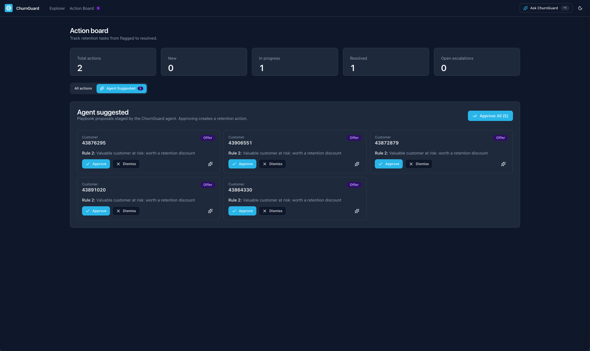

3. Open the chat drawer with *Cmd+K*.
4. Ask: *"Who are the top 5 high-risk customers by spend and what should we do?"*
5. The agent returns a table of 5 customers, each with an action and the playbook rule behind it.

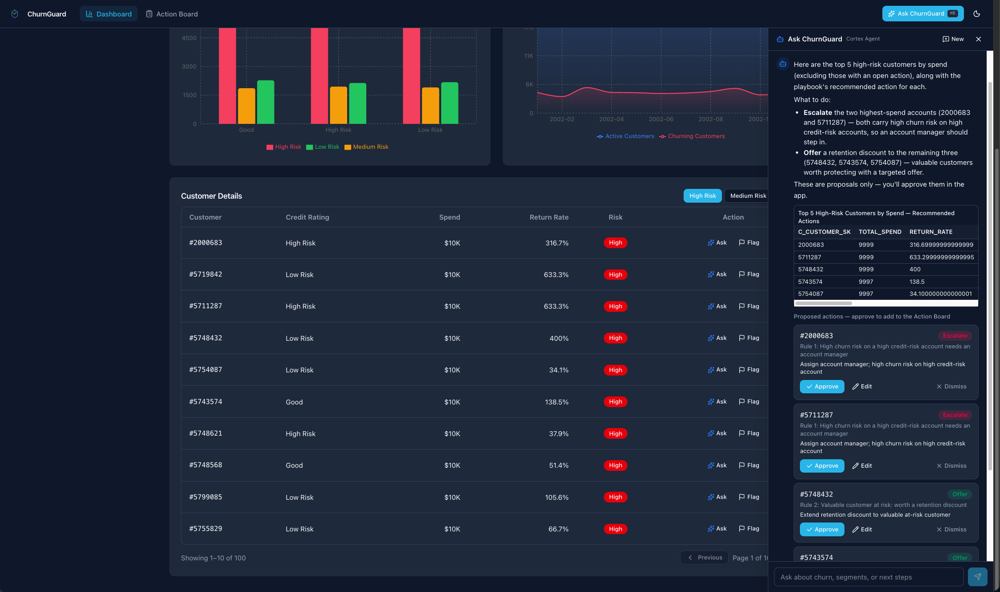

6. Ask: *"Flag high-risk customers for retention."* The agent calls *stage_retention_actions*, and new proposals appear on the Agent Suggested tab.
7. Ask: *"Show me the monthly churn trend as a chart with readable labels."* The agent answers with a chart.

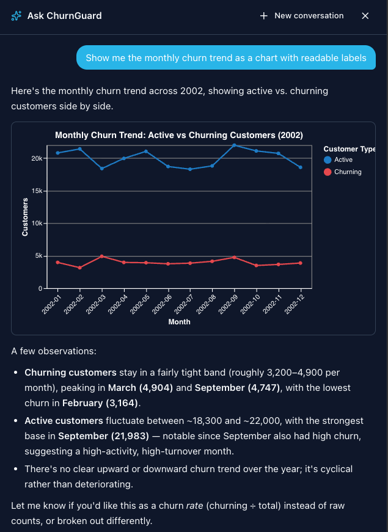

8. On the dashboard, open a customer row and choose **Ask about this customer**. The agent explains that customer's risk and suggests a next step.

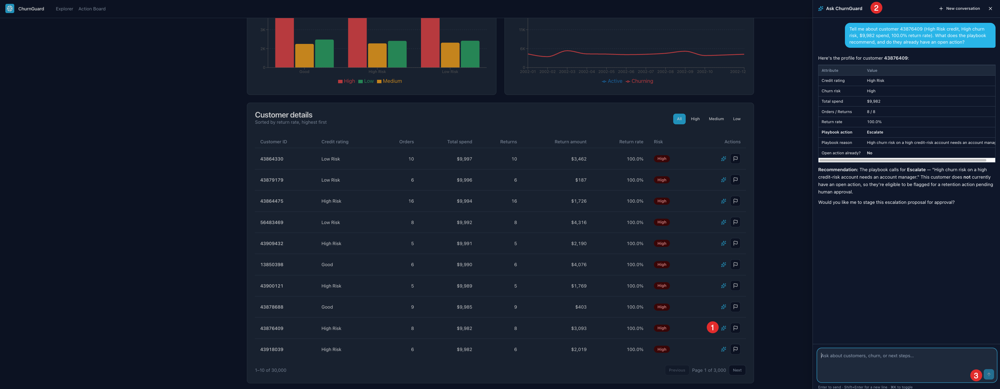

**Verify the MCP server with the Cortex Code CLI.** Add the server and start the CLI. Run this from the *churnguard/* folder; ***snow app open --print-only*** prints your App URL, and the command adds ***/api/mcp*** to it. The ***--snowflake-connection*** flag signs each request in as your Snowflake user.

```bash
# Add the ChurnGuard MCP server, then start the CLI
cd churnguard
cortex mcp add churnguard "$(snow app open --print-only --connection quickstart)/api/mcp" \
  --type http --snowflake-connection quickstart
cortex mcp reconnect churnguard   # should report 4 tools
cd ..
cortex
```

Then ask the CLI, one at a time (your results will differ):

| Ask the CLI | Tool it calls | Sample result |
|---|---|---|
| *Using the churnguard MCP server, list open retention actions.* | list_actions | 11 open actions: 10 Offer, 1 Call |
| *Find a high-risk customer with no open action and show their risk.* | get_churn_summary, get_customer_risk | Customer 56557609: High churn risk, $9,966 spend, 100% return rate. Recommended: Escalate (rule 1) |
| *Flag that customer with the recommended action.* | flag_customer | Created action 8d701687-… (Escalate, status New). Flag them again and the tool answers *already flagged*. |

Open the Action Board in your browser: the new action is at the top of **All actions**, and **Open escalations** goes up by one. Within 1–2 minutes, once the dynamic table refreshes and the alert runs, an escalation toast appears on every page.

**Checkpoint:** the agent answers questions, stages proposals you can approve, and the MCP server works from the CLI. ChurnGuard is complete.

<!-- ------------------------ -->
## Troubleshooting

Use the queries below, or paste the error into Cortex Code Desktop and ask *"Why am I seeing this?"*

| Symptom | Likely cause | Fix |
|---|---|---|
| *Insufficient privileges* on deploy | A grant is missing, or the connection's default role isn't the quickstart role | Rerun *grants.sql* as **ACCOUNTADMIN**, and set ***role = "SFQUICKSTART_CHURNGUARD_ROLE"*** for the connection (see [Prepare Your Working Directory](#prepare-your-working-directory)) |
| *Could not use warehouse* on ***snow connection test*** | The connection names **SFQUICKSTART_CHURNGUARD_WH** before *setup.sql* creates it | Remove ***warehouse*** from the connection, run the setup scripts, then add it back (see [Prepare Your Working Directory](#prepare-your-working-directory)) |
| *Refusing to merge unrelated histories* | Your clone has the iteration branches from before they were rebuilt | Run ***git fetch origin***, then merge again |
| *ACTIONS does not exist* (iteration 2) | *iteration-2-setup.sql* hasn't run | Run it with ***snow sql*** (iteration 2 setup, step 2) |
| No toast after an escalation | The dynamic table or alert hasn't refreshed, or the escalation is already resolved | Wait 1–2 minutes with the escalation open, then check the dynamic table refresh history and alert history |
| Cortex errors on a trial account (iteration 3) | AI features are off by default on self-service trials | Add a credit card to the account (see [trial accounts](https://docs.snowflake.com/en/user-guide/admin-trial-account)) |
| The chat shows errors (iteration 3) | The agent or semantic view is missing | Check both exist in the quickstart schema |
| The Agent Suggested tab is empty | The task hasn't run or is suspended | Check task history, resume it, or run it now |
| The MCP server won't connect | Wrong URL, connection, or role | The URL must be your App URL plus */api/mcp*; your connection test must pass; your role needs **USAGE** on the app. Use the Cortex Code CLI: other MCP clients are redirected to the Snowflake login |

The checks, grouped by area:

```sql
-- Grants
SHOW GRANTS TO ROLE SFQUICKSTART_CHURNGUARD_ROLE;

-- Actions, the dynamic table, and the alert
SELECT * FROM SFQUICKSTART_CHURNGUARD.PUBLIC.ACTIONS ORDER BY CREATED_AT DESC LIMIT 5;
SELECT * FROM SFQUICKSTART_CHURNGUARD.PUBLIC.ACTION_SUMMARY;
SELECT * FROM TABLE(INFORMATION_SCHEMA.DYNAMIC_TABLE_REFRESH_HISTORY(
    NAME => 'SFQUICKSTART_CHURNGUARD.PUBLIC.ACTION_SUMMARY'
)) ORDER BY REFRESH_END_TIME DESC LIMIT 5;
SELECT * FROM TABLE(INFORMATION_SCHEMA.ALERT_HISTORY(
    SCHEDULED_TIME_RANGE_START => DATEADD('hour', -1, CURRENT_TIMESTAMP())
)) ORDER BY SCHEDULED_TIME DESC LIMIT 5;
SELECT * FROM SFQUICKSTART_CHURNGUARD.PUBLIC.NOTIFICATIONS ORDER BY CREATED_AT DESC LIMIT 5;
```

```sql
-- Agent, semantic view, and the daily task
SHOW AGENTS IN SCHEMA SFQUICKSTART_CHURNGUARD.PUBLIC;
SHOW SEMANTIC VIEWS IN SCHEMA SFQUICKSTART_CHURNGUARD.PUBLIC;
SELECT * FROM TABLE(INFORMATION_SCHEMA.TASK_HISTORY(
    TASK_NAME => 'AGENT_SUGGESTION_TASK'
)) ORDER BY SCHEDULED_TIME DESC LIMIT 5;
SELECT * FROM PROPOSED_ACTIONS ORDER BY PROPOSED_AT DESC LIMIT 10;
SHOW TASKS LIKE 'AGENT_SUGGESTION_TASK';
ALTER TASK AGENT_SUGGESTION_TASK RESUME;   -- if suspended
EXECUTE TASK AGENT_SUGGESTION_TASK;        -- run it now
```

### Merge conflict when moving to the next iteration

A conflict means a file outside *churnguard/* was edited. Keep the iteration branch's version:

```bash
git checkout --theirs <file> && git add <file> && git commit --no-edit
```

### Anything else

Paste the error into Cortex Code Desktop and ask:

> *"I'm running the ChurnGuard quickstart and got this error: [paste error]. What's wrong and how do I fix it?"*

Cortex Code can run diagnostic queries in your account.

<!-- ------------------------ -->
## Cleanup

Run this when you're done, including any Build Your Own App prompts in the next section. It removes everything the guide created:

```bash
snow sql -f scripts/cleanup.sql --connection quickstart
```

It drops:

- The **APPLICATION SERVICE**
- The **SFQUICKSTART_CHURNGUARD** database and everything in it, including the dynamic table, alert, task, and agent
- The **SFQUICKSTART_CHURNGUARD_WH** warehouse and **SFQUICKSTART_CHURNGUARD_ROLE**

The script ends by listing anything left over; every list should be empty. If you followed an earlier version of this guide that used Snowflake Postgres, the script also removes the Postgres instance, data mirror, External Access Integration, and network policy.

Leave **SNOWFLAKE_SAMPLE_DATA** in place unless you're sure nothing else in your account uses it.

To clean up by hand:

```sql
-- Manual cleanup: run these in order
USE ROLE ACCOUNTADMIN;
DROP APPLICATION SERVICE IF EXISTS SFQUICKSTART_CHURNGUARD.PUBLIC.CHURNGUARD;
DROP DATABASE IF EXISTS SFQUICKSTART_CHURNGUARD;
DROP WAREHOUSE IF EXISTS SFQUICKSTART_CHURNGUARD_WH;
DROP ROLE IF EXISTS SFQUICKSTART_CHURNGUARD_ROLE;
```

To remove what the guide set up on your machine:

```bash
cortex mcp remove churnguard
```

Then set your connection's default ***role*** back to what it was: **SFQUICKSTART_CHURNGUARD_ROLE** no longer exists.

<!-- ------------------------ -->
## Conclusion And Resources

### What You Learned

You built one app in three iterations, and each one added a kind of app:

- **Explore your data.** A dashboard you can pivot and drill into, deployed with one command and no credentials in your code.
- **Run the workflow.** Operational writes to a Snowflake table, where a dynamic table and an alert drive notifications.
- **Bring AI into the app.** A Cortex Agent grounded in a playbook. It proposes actions, a person approves them, a task stages them daily, and an MCP server lets other agents use the app.

Every iteration followed the same loop:

1. **Describe** the outcome in an IDD prompt.
2. **Build:** Cortex Code scaffolds or changes the app.
3. **Deploy** with *snow app deploy* to the same URL, with no downtime.
4. **Verify** in the browser.
5. **Iterate** with another prompt.

To compare your app with the reference, see the [solution branch](https://github.com/Snowflake-Labs/sfguide-build-full-stack-apps-with-snowflake-app-runtime/tree/solution) of the companion repo.

### Build Your Own App

Keep going. Paste any of these prompts into Cortex Code Desktop and keep extending ChurnGuard. Each one follows the IDD structure, so edit the requirements to fit what you want.

**User profiles and role-based views**

```text
Goal: Personalize ChurnGuard for each signed-in user.

Requirements:
- Identify the signed-in user from the sf-context-current-user request header
  (or CURRENT_USER() in a query run with the callersRights: true option).
  Snowflake already handles login.
- Show the user's name and role in the header, with a profile menu
- Store preferences (default risk filter, default page) in a USER_PREFERENCES table
- Show "My actions" on the Action Board: actions assigned to the current user
- Only users with the CHURNGUARD_MANAGER role can see Approve All

Constraints:
- Check roles in the API route, not only in the UI
- Keep per-request identity in request scope, never in module-level variables

Output: Redeployed app with profile menu, saved preferences, and role-based approval.
```

**Export at-risk customers**

```text
Goal: Let users take a filtered customer list into a spreadsheet.

Requirements:
- Add an "Export CSV" button to the customer table
- Export the rows that match the current filters, not only the current page
- Name the file churnguard-<risk>-<date>.csv

Output: Redeployed app with CSV export.
```

More ideas to write as IDD prompts in the same shape:

| Idea | Goal | Key requirements |
|---|---|---|
| **Edit the playbook in the app** | Let managers change **RETENTION_PLAYBOOK** rules without writing SQL | A Playbook page to edit, reorder, and turn rules on or off; every change recorded in a **PLAYBOOK_AUDIT** table; parameterized writes |
| **Weekly churn digest** | Send the retention team a weekly summary without anyone opening the app | A serverless task every Monday at 08:00 UTC; new high-risk customers, open escalations, and resolved actions; email through a notification integration; a *Preview digest* button |
| **Cohort retention chart** | Show whether customers stay longer over time | Customers grouped by first purchase month or quarter; retention by month after; an *Explain this cohort* agent shortcut |
| **Dark mode and mobile layout** | Make ChurnGuard comfortable on any screen, day or night | A remembered dark/light toggle; tables become cards on narrow screens; full-screen chat drawer; WCAG AA contrast in both themes |

### Related Resources

- [Deploy targets](https://docs.snowflake.com/en/developer-guide/snowflake-app-runtime/deploy-targets): deploy the same app to dev and prod
- [Scale and suspend](https://docs.snowflake.com/en/developer-guide/snowflake-app-runtime/scale-and-suspend): control cost when the app is idle
- [Developing secure runtime apps](https://docs.snowflake.com/en/developer-guide/snowflake-app-runtime/secure-development): caller's rights, identity checks, and secrets
- [Cortex Code CLI](https://docs.snowflake.com/en/user-guide/cortex-code/cortex-code-cli): automate your app from the terminal with MCP
- [Snowflake App Runtime documentation](https://docs.snowflake.com/en/developer-guide/snowflake-app-runtime)
- [Getting started with Snowflake App Runtime](https://docs.snowflake.com/en/developer-guide/snowflake-app-runtime/getting-started)
- [app.yml manifest reference](https://docs.snowflake.com/en/developer-guide/snowflake-app-runtime/app-yml)
- [Query Snowflake from your app](https://docs.snowflake.com/en/developer-guide/snowflake-app-runtime/query-snowflake)
- [Access control for Snowflake App Runtime](https://docs.snowflake.com/en/developer-guide/snowflake-app-runtime/access-control)
- [Dynamic tables](https://docs.snowflake.com/en/user-guide/dynamic-tables-about)
- [Alerts](https://docs.snowflake.com/en/user-guide/alerts)
- [Cortex Agents](https://docs.snowflake.com/en/user-guide/snowflake-cortex/cortex-agents)
- [Cortex Agents Run API](https://docs.snowflake.com/en/user-guide/snowflake-cortex/cortex-agents-run)
- [Cortex Code Desktop](https://docs.snowflake.com/en/user-guide/cortex-code/cortex-code-desktop)
- [Snowflake CLI command reference](https://docs.snowflake.com/en/developer-guide/snowflake-cli/command-reference/overview)
- [TPC-DS sample data](https://docs.snowflake.com/en/user-guide/sample-data-tpcds)
- [Intent-Driven Development (IDD)](https://dev.to/kameshsampath/series/41588)

