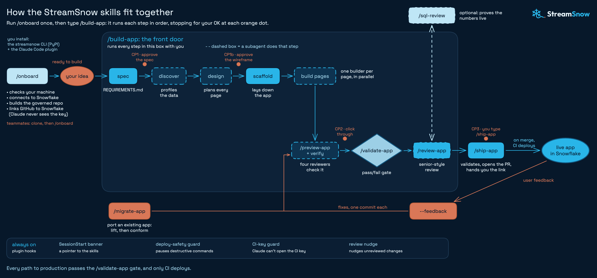
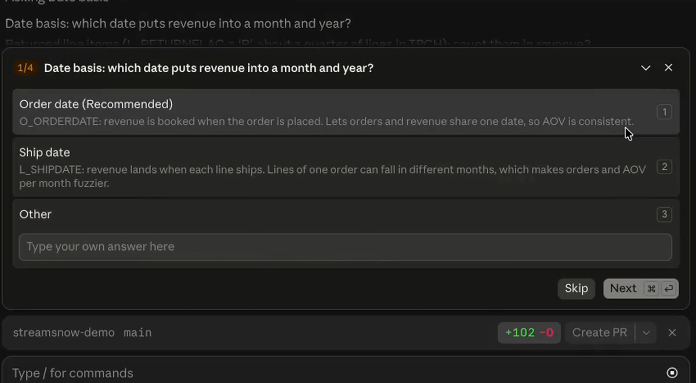
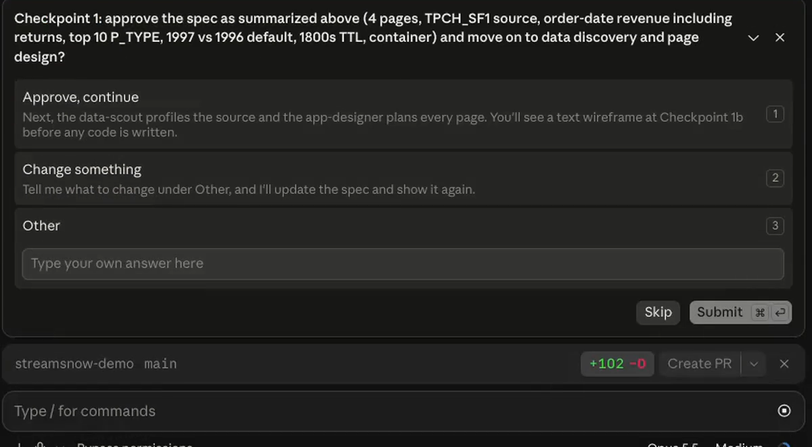
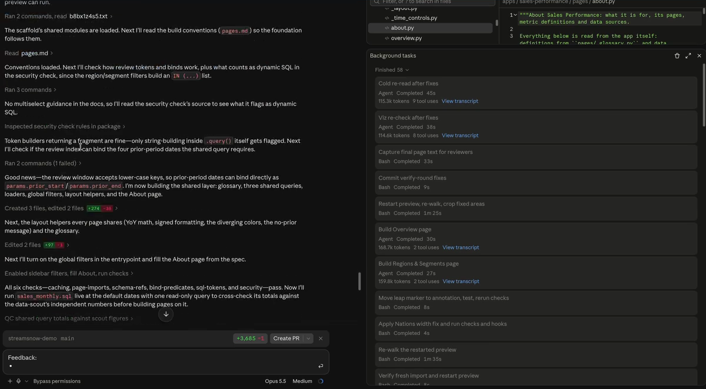
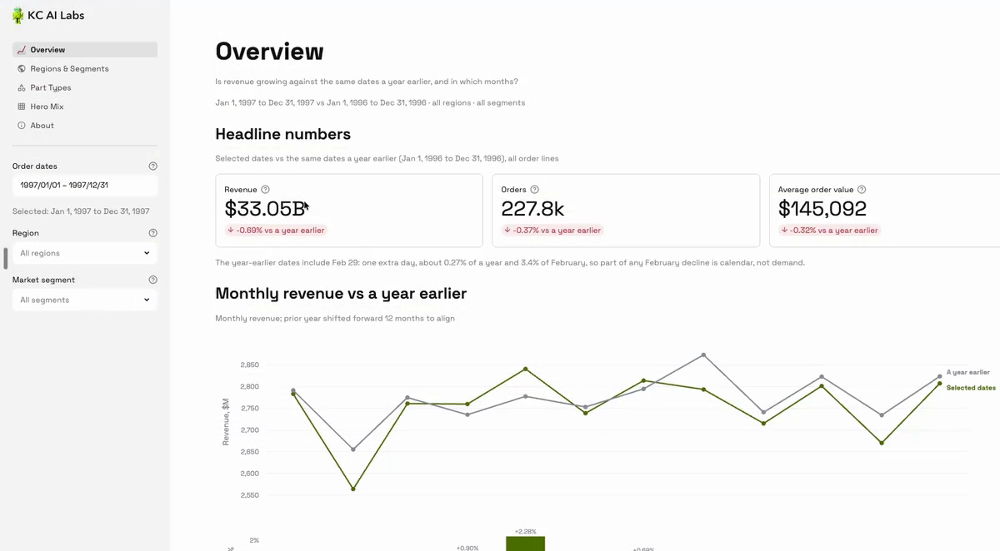
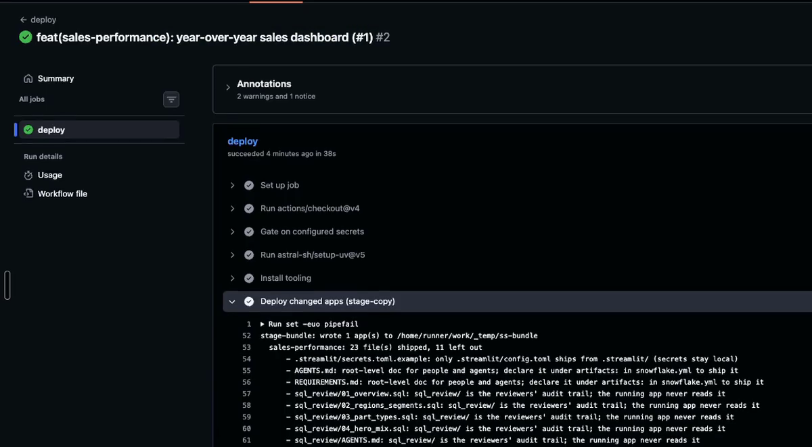
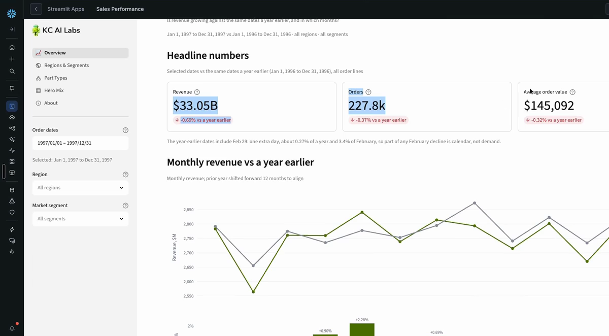

author: Kyle Chalmers
id: build-governed-streamlit-apps-with-claude-code-and-streamsnow
language: en
summary: Use the open-source StreamSnow plugin for Claude Code to build a Streamlit in Snowflake dashboard on TPC-H sample data, check its numbers with SQL, and deploy it through GitHub Actions.
categories: snowflake-site:taxonomy/solution-center/certification/quickstart, snowflake-site:taxonomy/product/applications-and-collaboration, snowflake-site:taxonomy/snowflake-feature/build, snowflake-site:taxonomy/snowflake-feature/business-intelligence
environments: web
status: Published
feedback link: https://github.com/Snowflake-Labs/sfquickstarts/issues
fork repo link: https://github.com/kyle-chalmers/streamsnow

# Build Governed Streamlit in Snowflake Apps with Claude Code and StreamSnow
<!-- ------------------------ -->
## Overview

[StreamSnow](https://github.com/kyle-chalmers/streamsnow) is a free, open-source (MIT) Claude Code plugin and Python CLI for building Streamlit in Snowflake apps with an AI coding agent. It was built and tested heavily in a production BI setting.

A coding agent can write a Streamlit app in minutes. The harder part is trusting what it wrote: which tables it reads, whether the numbers are right, and who deployed it. StreamSnow gives the agent a governed GitHub repository to work in. The repo holds the rules the agent reads, checks that run before anything merges, a runnable SQL file behind every metric, and a deploy that only GitHub Actions can run.

In this guide you install StreamSnow, connect it to your Snowflake account, build a sales dashboard on the TPC-H sample data, check one of its numbers against your own SQL, and ship it to Snowflake through a pull request.



To watch the whole flow first, see the [StreamSnow walkthrough on YouTube](https://www.youtube.com/watch?v=73jOT3-TW8Y).

### Prerequisites
- Basic SQL
- Basic familiarity with Git, GitHub pull requests and a terminal
- Access to Snowsight as a Snowflake admin, or an admin who can run one setup script for you

### What You'll Learn
- How to give an AI coding agent a governed repository for Streamlit in Snowflake apps
- How a key-pair service user lets GitHub Actions deploy to Snowflake without a password
- How to approve an agent's spec and wireframe before it writes code
- How to trace a number on a dashboard back to runnable SQL

### What You'll Need
- A Snowflake account. This guide uses the container runtime, which runs on a compute pool and needs a paid account. On a [free trial](https://signup.snowflake.com/), choose the warehouse runtime when asked.
- The admin script is run once with the SYSADMIN, USERADMIN, SECURITYADMIN and ACCOUNTADMIN roles, by you or your Snowflake admin.
- A GitHub account, and the [GitHub CLI](https://cli.github.com/) signed in with `gh auth login`. The commands below create the repository.
- [Claude Code](https://docs.anthropic.com/en/docs/claude-code/overview).
- macOS or Linux. On Windows, use WSL.
- Python 3.11+, `uv`, `git`, the Snowflake CLI (`snow`) and `pre-commit`. You don't need to install them first: setup checks for them and installs what is missing after you approve.
- Optional: Node.js 20+, so Claude can click through your app in a browser and screenshot each page.

### What You'll Build
- A governed GitHub repository for Streamlit in Snowflake apps, with checks on every pull request
- A key-pair CI user that deploys apps from GitHub Actions
- A multi-page sales dashboard on `SNOWFLAKE_SAMPLE_DATA.TPCH_SF1`, running in Snowsight

<!-- ------------------------ -->
## Install StreamSnow

Create a folder for your apps and make it a Git repository with a matching private GitHub repository:

```bash
mkdir streamsnow-demo && cd streamsnow-demo
git init -b main
gh repo create streamsnow-demo --private --source . --remote origin
```

Install the plugin at project scope. Both commands record it in the repository's `.claude/settings.json`, so teammates who clone the repo are offered the same plugin:

```bash
claude plugin marketplace add --scope project kyle-chalmers/streamsnow
claude plugin install --scope project streamsnow@streamsnow
```

You can also open Claude Code in the folder and paste this prompt, which runs the same steps and asks before installing anything:

```text
Read the install prompt in github.com/kyle-chalmers/streamsnow and follow it.
```

The dashboard in this guide reads the TPC-H sample database. If your account has no `SNOWFLAKE_SAMPLE_DATA` database, create it in Snowsight:

```sql
USE ROLE ACCOUNTADMIN;
CREATE DATABASE SNOWFLAKE_SAMPLE_DATA FROM SHARE SFC_SAMPLES.SAMPLE_DATA;
GRANT IMPORTED PRIVILEGES ON DATABASE SNOWFLAKE_SAMPLE_DATA TO ROLE PUBLIC;
```

<!-- ------------------------ -->
## Run Onboarding

Open Claude Code in the folder and run:

```
/onboard
```

If `/onboard` isn't listed, run `/reload-plugins` first. Onboarding works in four stages and explains each step before it takes it.

1. **Check and prepare.** It installs the `streamsnow` CLI, runs `streamsnow doctor`, and lists the Snowflake access you already have, such as a `snow` connection. It reads your account with read-only `SHOW` queries to suggest answers, then installs any missing tools after one approval.
2. **One round of questions.** Each question comes with an explanation and a recommended answer. For this guide:
   - **Snowflake connection:** let onboarding set up your local `snow` connection, or guide you through it. You approve the sign-in in your browser.
   - **Runtime:** container (or warehouse on a trial account).
   - **Sources apps may read:** pick `SNOWFLAKE_SAMPLE_DATA.TPCH_SF1`. In your own account, this is where you limit apps to curated reporting schemas.
   - **App data schema:** keep the recommendation.
   - **Schemas apps may not query:** keep the raw and working layers on the deny list.
   - **Deploy source:** stage copy. GitHub Actions uploads the app code to an internal stage. The Snowflake Git repository option also works but needs an API integration and, for a private repository, a GitHub token.
   - **Who runs the admin script:** you, if you are the admin.
   - **Viewer access:** the Snowflake roles that should open the apps.
   - **Remaining defaults:** onboarding lists the names it will use for the app database, warehouse, roles and integrations. Keep them to follow this guide.
3. **Build.** After you confirm, it writes `streamsnow.config.yaml` and the governed repository files: `AGENTS.md`, `CLAUDE.md`, pre-commit hooks, CI and deploy workflows, and a README.
4. **Finish.** It creates the CI key pair, writes the admin script to `.internal/admin-setup.sql`, and, once the script has run, stores the deploy secrets in GitHub.

When onboarding has committed the governed files, push them so GitHub has a `main` branch for pull requests:

```bash
git push -u origin main
```

`streamsnow.config.yaml` is now the single source of truth for your setup. It names the app database, warehouse, roles, allowed sources and deny list, and it holds no secrets. Every check, the CI pipeline and the agent read it.

<!-- ------------------------ -->
## Run the Admin Script

Onboarding stops once for the admin script. It copies `.internal/admin-setup.sql` to your clipboard. In Snowsight, open a new SQL worksheet, paste the script, choose **Run All**, and tell Claude it ran. Claude never runs the admin script itself.

The script is commented section by section. With the default names, it creates:

- the `STREAMSNOW_APPS` database with a `DASHBOARDS` schema for the apps, a `STREAMSNOW_REPORTING` schema for views built for them, and an auto-suspending X-Small warehouse, `STREAMSNOW_WH`
- `STREAMSNOW_DEPLOY_ROLE`, which deploys and owns the apps and reads the allowed sources
- `STREAMSNOW_VIEWER_ROLE`, which can open the apps, granted to you and to the roles you picked
- a CI service user that signs in with a key pair and has no password
- for the container runtime, a PyPI external access integration, with usage on it and on `SYSTEM_COMPUTE_POOL_CPU` for the deploy role
- the stage the apps deploy from, created by the deploy role in the script's last section

If someone else is your admin, onboarding writes a short note naming the file for you to forward. You can build and preview while you wait. Only deploys need the script.

The CI key never passes through Claude. `streamsnow ci-key create` makes the key pair on your machine. The public half goes into the admin script, and `streamsnow ci-key push` hands the private half to a GitHub secret through the GitHub CLI. The plugin also blocks Claude's tools from opening the key folder.


Save a copy of `~/.streamsnow-ci/streamsnow_ci_rsa_key.p8` in your password manager. If it is lost, make a new pair and run the admin script again.

Before it stores the secrets, onboarding offers to run `streamsnow ci-key verify`, which signs in from your machine as the CI user the way the deploy job does. At the end it offers to turn on GitHub's setting that deletes branches once their pull requests merge.

<!-- ------------------------ -->
## Build an App

Describe the dashboard you want:

```
/build-app A sales dashboard on SNOWFLAKE_SAMPLE_DATA.TPCH_SF1: revenue by month and by region, with a market-segment filter
```

`/build-app` starts with the spec. It asks a few questions about the data, each with a recommended answer and the reason for it.



In the walkthrough the answers were: order date as the revenue date, all line items included, the top 10 part types, and an 1800-second cache, so the app re-queries Snowflake at most every 30 minutes.

**Checkpoint 1** asks you to approve the spec, saved as `REQUIREMENTS.md`, before any code is written:



Then a subagent profiles the data and another plans every page. **Checkpoint 1b** shows a text wireframe for your approval. If you are unsure about a design choice, approve it here. You can change anything at the preview.

After that, `/build-app` scaffolds the app and runs one builder subagent per page in parallel, followed by reviewers. This is the longest stage, about half an hour in the walkthrough, and it needs nothing from you.



The app lands in `apps/<slug>/`:

```
apps/sales-performance/
  streamlit_app.py      # navigation entrypoint and branding
  pages/                # one file per page, plus shared filters and glossary
  queries/              # the SQL behind each page
  sql_review/           # runnable SQL that reproduces every metric
  snowflake.yml  pyproject.toml
```

Every app also gets an **About this app** page, built from the app itself: purpose, metric definitions and data sources. The documentation lives inside the dashboard, so it stays current as the agent changes the app.

<!-- ------------------------ -->
## Preview and Give Feedback

`/build-app` pauses at **Checkpoint 2** with the app running locally against live Snowflake, at `http://localhost:8501`. This is your click-through.



Click through every page as your stakeholders would. Then send feedback in plain words:

```
/build-app sales-performance --feedback "Fix the info icons on the Overview page, and add a page that ranks part type and region combinations by revenue gained versus last year"
```

StreamSnow sorts the feedback, builds the changes the same governed way with one commit per fix, and brings you back to the preview.

`/validate-app` is the gate every app must pass before it ships: a pass or fail check of required files, schema references against your allowed sources and deny list, security, caching and the SQL review files. `/review-app <slug> --auto` is advisory: a senior-style review by reviewers for SQL, data, UI, runtime and docs, which applies fixes and repeats until no new mechanical findings remain.

Brand settings you ask for, such as theme colors and fonts, go into `streamsnow.config.yaml`, so every future app in the repository starts with them.

<!-- ------------------------ -->
## Tie a Number Back to SQL

Every page has a runnable SQL file in `apps/<slug>/sql_review/`, with one section per metric in on-screen order. Open `01_overview.sql` in Snowsight or any SQL editor and run the revenue section. It should return the number on the Overview page.

You can also check the headline numbers with your own query:

```sql
SELECT YEAR(o.O_ORDERDATE) AS order_year,
       COUNT(DISTINCT o.O_ORDERKEY) AS orders,
       ROUND(SUM(l.L_EXTENDEDPRICE * (1 - l.L_DISCOUNT)), 2) AS revenue,
       ROUND(revenue / orders, 0) AS avg_order_value
FROM SNOWFLAKE_SAMPLE_DATA.TPCH_SF1.ORDERS o
JOIN SNOWFLAKE_SAMPLE_DATA.TPCH_SF1.LINEITEM l
  ON l.L_ORDERKEY = o.O_ORDERKEY
WHERE o.O_ORDERDATE >= '1996-01-01' AND o.O_ORDERDATE < '1998-01-01'
GROUP BY order_year
ORDER BY order_year;
```

For 1997 you should see 227,783 orders and revenue of about $33.05 billion, an average order value of $145,092. Against 1996 ($33.28 billion), revenue fell 0.69 percent, the same change the dashboard shows. If your dashboard used different spec answers, such as ship date instead of order date, your numbers will differ by the same rule.

When a number doesn't match, the `sql_review` file shows exactly which tables, filters and joins the app used. For a deeper check, `/sql-review <slug>` runs every section against live Snowflake as aggregates and writes a review log for a person to sign. Skip it when a change touches no metrics.

<!-- ------------------------ -->
## Ship the App

When you are happy with the preview, run this. It is **Checkpoint 3**, and only you start it:

```
/ship-app sales-performance
```

`/ship-app` runs the validation again, offers to review any changes made since the last review, opens a pull request and gives you the app link.

The pull request runs the same checks in GitHub Actions. When you merge it, the deploy workflow signs in as the CI user, uploads the app to the stage and creates the Streamlit app. Nothing else deploys.



The app appears in the Streamlit apps list in Snowsight, under `STREAMSNOW_APPS.DASHBOARDS` and owned by `STREAMSNOW_DEPLOY_ROLE`. `streamsnow app-url sales-performance` prints its Snowsight link.



To give a colleague access, grant them the viewer role. They sign in to Snowsight with their own Snowflake login and open the app.

Teammates who join later clone the repository, accept the plugin when Claude Code offers it, and run `/onboard`. It sees the existing setup and only prepares their machine.

<!-- ------------------------ -->
## Know the Limits

StreamSnow fits metrics you know you want and many people will open the same way, the job a traditional BI dashboard does. A few limits come with that.

**Compute cost.** Apps use Snowflake credits: the warehouse for queries and, on the container runtime, the compute pool. `SYSTEM_COMPUTE_POOL_CPU` packs three apps per node, and a container app's server stops after three days without viewers. A longer cache means fewer queries, and a frequently refreshed app costs more. See [Streamlit in Snowflake billing](https://docs.snowflake.com/en/developer-guide/streamlit/object-management/billing) and compare it with the per-user licenses of your current BI tool.

**Viewers need Snowflake logins.** Apps are for people inside your organization who can sign in to Snowsight. Dashboards for people without Snowflake logins need customization beyond what StreamSnow sets up.

**Queries run as the app's owner.** Apps run with [owner's rights](https://docs.snowflake.com/en/developer-guide/streamlit/object-management/owners-rights): queries run as the deploy role that owns the app, not the viewer's role, and viewers need only usage on the app. Masking and [row access policies](https://docs.snowflake.com/en/user-guide/security-row-intro) on the underlying data need Enterprise Edition or higher. StreamSnow's own guardrails are static checks and work on any edition.

StreamSnow builds and governs apps. It does not schedule data pipelines or replace a data catalog.

<!-- ------------------------ -->
## Clean Up

StreamSnow prints a teardown script for the objects the admin script created. It never runs it for you:

```bash
streamsnow deploy-setup --teardown > teardown.sql
```

Review every line, then run it in Snowsight as ACCOUNTADMIN. It drops the app database with every deployed app in it, the warehouse, the CI user, both roles and the PyPI integration, and it keeps your source databases and `SYSTEM_COMPUTE_POOL_CPU`. If any of those objects existed before StreamSnow and other work uses them, delete their lines first.

Then delete the local key folder and, if you made it only for this guide, the GitHub repository:

```bash
rm -rf ~/.streamsnow-ci
gh auth refresh -s delete_repo
gh repo delete streamsnow-demo
```

<!-- ------------------------ -->
## Conclusion And Resources

You set up a governed repository for Streamlit in Snowflake apps, connected GitHub Actions to Snowflake with a key-pair CI user, had Claude Code build a dashboard behind four human checkpoints, tied its revenue number back to SQL, and shipped it through a pull request. The same repository holds every future app your team builds, under the same rules.

StreamSnow is free and MIT licensed. Issues, discussions and pull requests are welcome in the repository.

### What You Learned
- How to install StreamSnow and run `/onboard` to set up a governed repository
- How a key-pair service user lets CI deploy without exposing the key to the agent
- How to approve an agent's spec, wireframe and preview before anything ships
- How to trace a dashboard number back to runnable SQL
- What Streamlit in Snowflake apps cost and who can open them

### Related Resources
- [StreamSnow on GitHub](https://github.com/kyle-chalmers/streamsnow)
- [StreamSnow walkthrough video](https://www.youtube.com/watch?v=73jOT3-TW8Y)
- [StreamSnow getting started](https://github.com/kyle-chalmers/streamsnow/blob/main/docs/getting-started.md)
- [About Streamlit in Snowflake](https://docs.snowflake.com/en/developer-guide/streamlit/about-streamlit)
- [Streamlit in Snowflake runtime environments](https://docs.snowflake.com/en/developer-guide/streamlit/app-development/runtime-environments)
- [Streamlit in Snowflake billing](https://docs.snowflake.com/en/developer-guide/streamlit/object-management/billing)
- [Owner's rights in Streamlit in Snowflake](https://docs.snowflake.com/en/developer-guide/streamlit/object-management/owners-rights)
- [Snowflake key-pair authentication](https://docs.snowflake.com/en/user-guide/key-pair-auth)
