author: James Cha-Earley
id: build-interactive-html-dashboards-with-cortex-code
language: en
summary: Use prompts in Cortex Code (CoCo) to build interactive, animated HTML dashboards and reports, then publish them as shareable Snowflake artifacts.
categories: snowflake-site:taxonomy/solution-center/certification/quickstart, snowflake-site:taxonomy/product/ai, snowflake-site:taxonomy/product/analytics
environments: web
status: Hidden
feedback link: https://github.com/Snowflake-Labs/sfguides/issues
tags: Getting Started, Cortex Code, CoCo, HTML Reports, Artifacts, Data Visualization, Snowsight, CoWork
fork repo link: https://github.com/sfc-gh-JCHAEARLEY/sfguide-build-interactive-html-dashboards-with-cortex-code

# Build Interactive HTML Dashboards with Cortex Code
<!-- ------------------------ -->
## Overview

HTML reports let you describe a dashboard in plain language and have Cortex Code (CoCo) write it for you as a single, self-contained `.html` file: charts, KPIs, tabs, sliders, slide decks, diagrams, even 3D. You then publish it as a **Report artifact** and share one link with the roles and users who need it.

This guide is **prompt-driven**. You won't write any HTML. Instead, each step gives you a prompt, explains *which words in the prompt* produce which feature or animation, and tells you what to check in the result. By the end you'll have a prompt vocabulary for the whole "realm of possible": from a simple meeting report to linked charts, animated counters, and a 3D chart you can orbit.

> **Naming note:** In Snowflake documentation this feature is called **HTML reports** (Preview). It is different from **Snowflake Dashboards** (`.dash` files with SQL-backed tiles). This guide uses "HTML dashboard" for an HTML report built to look and behave like a dashboard.

### What You'll Learn
- The anatomy of a prompt that produces a polished, interactive HTML report
- Which prompt phrases unlock specific interactions and animations
- How each Snowflake-vendored library (Chart.js, Plotly, Vega-Lite, D3, Three.js, Mermaid, KaTeX, Marked, highlight.js) maps to a kind of visual
- How to iterate with targeted edits, publish, share, refresh, and update a report
- What the report sandbox blocks, and how to prompt around it

### What You'll Build
- A meeting-ready revenue report with "View SQL" disclosures
- A click-through slide deck
- A designed spec with a working prototype
- A gallery of interactive and animated visuals, one per library
- A capstone: a full multi-section showcase page with sticky navigation, tabs, and light/dark mode

### Prerequisites
- A Snowflake account with access to CoCo in Snowsight Workspaces, CoCo Desktop, or Snowflake CoWork (CoWork needs an agent with the code execution tool)
- A role that can create a database and tables (for the sample data)
- To share reports: a role with `MANAGE ACCESS ON REPORT ARTIFACTS`

<!-- ------------------------ -->
## Choose the Right Tool: Dashboards, Streamlit, or HTML Reports

CoCo can build three kinds of visual data products in Snowflake. They coexist; each one is the best fit for a different job. Pick the tool before you write the prompt, because the right prompt looks different for each.

| | **Snowflake Dashboards** (`.dash`) | **Streamlit apps** | **HTML reports** (`.html`) |
|---|---|---|---|
| **What it is** | Multi-tile BI dashboard; each tile is a SQL query rendered as a chart, table, or markdown | A Python web app with widgets, logic, and pages | A self-contained, designed HTML document |
| **Best for** | Live metric tracking that many people slice their own way | Interactive tools and workflows: inputs, what-ifs, multi-step apps | Narrative reports, presentations, specs, and briefs |
| **Data freshness** | Live: tile queries run when viewed | Live: the app queries when it runs | Snapshot embedded at build time (refresh, then republish) |
| **Whose permissions** | The viewer's own privileges (caller's rights) | The app owner's rights by default | No queries at view time; viewers see whatever data is embedded |
| **Compute at view time** | Warehouse runs tile queries | Warehouse or compute pool runs the app | None |
| **Interactivity** | Filters, tabs, chart actions (click or drag to filter other tiles), drill-down | Anything Python and Streamlit can do, including user input and logic | Anything inline JavaScript and the vendored libraries can do, on embedded data |
| **Layout and design freedom** | Medium: 12-column tile grid, Vega-Lite charts | Medium: Streamlit layout components | Maximum: full HTML and CSS |
| **Where you build it** | Snowsight Workspaces | Snowsight Workspaces (or locally) | Workspaces, CoWork, or CoCo Desktop |
| **What viewers do** | Filter, click charts, ask follow-up questions on tiles in CoWork | Use the app | Read, interact, print to PDF, ask follow-up questions in CoWork |
| **Code you write** | None required (CoCo writes the SQL), or edit SQL directly | Python (CoCo can write it) | None (CoCo writes the HTML) |

### Use a Dashboard when...
- The numbers must be **current every time** someone opens it (weekly pipeline, daily usage, SLA tracking).
- Different viewers need to **slice the same view** with filters, such as region, segment, or date range, without you building a copy per audience.
- Viewers should only see data **their own role** can query.

### Use a Streamlit app when...
- Users need to **enter values or make choices** that drive logic: quota planners, what-if models, forecast tuners, data-entry or approval tools.
- You need **Python**: ML scoring, custom calculations, or packages.
- The experience is an **application with workflow**, not a single view.

### Use an HTML report when...
- You're **telling a story** with a point of view: a QBR, a findings brief, an exec update, a postmortem.
- **Design matters** more than live data: branded layout, slides, annotated charts, prototypes, diagrams, 3D, math.
- The data should be **frozen at a moment in time** and readable by people without access to the source tables or a warehouse.

### Same data, three tools

Take the `SALES` table from this guide. The question you're answering decides the tool:

| Need | Tool | Prompt to CoCo in Workspaces |
|---|---|---|
| "Sales ops checks revenue by region every Monday and filters by segment." | Dashboard | `Build a dashboard from HTML_REPORTS_QS.DEMO.SALES with a revenue scorecard, a weekly revenue trend, revenue by region, and a segment filter.` |
| "Regional leads want to type in next quarter's growth targets and see the projected total." | Streamlit | `Create a Streamlit app on HTML_REPORTS_QS.DEMO.SALES where I pick a region and enter a growth % per segment, and it shows projected next-quarter revenue against Q3 actuals.` |
| "The VP needs a polished Q3 review to send before Thursday's meeting." | HTML report | `Create an HTML report titled "Q3 FY26 Revenue Review" from HTML_REPORTS_QS.DEMO.SALES with animated KPIs, revenue by region, and a short executive summary.` |

> **Rule of thumb:** If it has to be **live**, build a Dashboard. If users have to **do something**, build a Streamlit app. If you have to **say something**, build an HTML report. The rest of this guide focuses on HTML reports.

<!-- ------------------------ -->
## Set Up Sample Data

Every prompt in this guide points at a small synthetic dataset in `HTML_REPORTS_QS.DEMO`. The [companion repo](https://github.com/sfc-gh-JCHAEARLEY/sfguide-build-interactive-html-dashboards-with-cortex-code) has this script as `setup.sql`, plus a finished example of every report in `reports/` that you can compare with your own.

Open a SQL worksheet (or a `.sql` file in Workspaces) and run the script below. It uses random values, so your numbers will differ from the screenshots and examples in this guide, and so may which region or segment comes out on top.

```sql
CREATE DATABASE IF NOT EXISTS HTML_REPORTS_QS;
CREATE SCHEMA IF NOT EXISTS HTML_REPORTS_QS.DEMO;
USE SCHEMA HTML_REPORTS_QS.DEMO;

-- 1. Orders for the revenue report and slide deck
CREATE OR REPLACE TABLE SALES AS
SELECT
  DATEADD(day, UNIFORM(0, 364, RANDOM()), '2026-01-01'::DATE)                     AS order_date,
  ARRAY_CONSTRUCT('North America', 'EMEA', 'APAC', 'LATAM')[UNIFORM(0, 3, RANDOM())]::STRING AS region,
  ARRAY_CONSTRUCT('Enterprise', 'Mid-market', 'SMB')[UNIFORM(0, 2, RANDOM())]::STRING       AS segment,
  ROUND(UNIFORM(500, 50000, RANDOM()) + UNIFORM(0, 99, RANDOM()) / 100, 2)        AS revenue_usd
FROM TABLE(GENERATOR(ROWCOUNT => 20000));

-- 2. Weekly active users for the Chart.js slider demo
CREATE OR REPLACE TABLE WEEKLY_ACTIVE_USERS AS
WITH w AS (
  SELECT ROW_NUMBER() OVER (ORDER BY SEQ4()) - 1 AS n
  FROM TABLE(GENERATOR(ROWCOUNT => 52))
)
SELECT
  DATEADD(week, n, '2025-11-03'::DATE)              AS week_start,
  1200 + n * 35 + UNIFORM(-120, 120, RANDOM())      AS active_users
FROM w;

-- 3. Query log for the Plotly and Vega-Lite demos
CREATE OR REPLACE TABLE QUERY_LOG AS
WITH q AS (
  SELECT
    ARRAY_CONSTRUCT('X-Small', 'Small', 'Medium', 'Large')[UNIFORM(0, 3, RANDOM())]::STRING      AS warehouse_size,
    ARRAY_CONSTRUCT('SELECT', 'INSERT', 'MERGE', 'CREATE TABLE AS')[UNIFORM(0, 3, RANDOM())]::STRING AS query_type,
    POW(10, UNIFORM(3, 8, RANDOM()) + UNIFORM(0, 99, RANDOM()) / 100)                          AS rows_scanned
  FROM TABLE(GENERATOR(ROWCOUNT => 2000))
)
SELECT
  warehouse_size,
  query_type,
  ROUND(rows_scanned) AS rows_scanned,
  GREATEST(1, ROUND(
    rows_scanned
    / DECODE(warehouse_size, 'X-Small', 200000, 'Small', 400000, 'Medium', 800000, 1600000)
    * 1000 * (0.5 + UNIFORM(0, 100, RANDOM()) / 100)
  )) AS duration_ms  -- at least 1 ms, so log-scale charts never see a zero
FROM q;

-- 4. Hourly warehouse credits for one week, for the 3D demo
CREATE OR REPLACE TABLE WAREHOUSE_CREDITS_HOURLY AS
WITH h AS (
  SELECT DATEADD(hour, ROW_NUMBER() OVER (ORDER BY SEQ4()) - 1, '2026-11-09 00:00:00'::TIMESTAMP_NTZ) AS hour_start
  FROM TABLE(GENERATOR(ROWCOUNT => 168))
)
SELECT
  hour_start,
  DAYNAME(hour_start) AS day_name,
  HOUR(hour_start)    AS hour_of_day,
  ROUND(
    IFF(HOUR(hour_start) BETWEEN 8 AND 18 AND DAYNAME(hour_start) NOT IN ('Sat', 'Sun'), 4, 0.8)
    + UNIFORM(0, 100, RANDOM()) / 50, 2
  ) AS credits
FROM h;

-- 5. Object dependencies for the D3 network demo
CREATE OR REPLACE TABLE OBJECT_DEPENDENCIES AS
SELECT
  column1::STRING AS source_name,
  column2::STRING AS source_type,
  column3::STRING AS target_name,
  column4::STRING AS target_type
FROM VALUES
  ('RAW.ORDERS',        'Source table', 'Q3 Revenue Report', 'Report'),
  ('RAW.CUSTOMERS',     'Source table', 'Q3 Revenue Report', 'Report'),
  ('RAW.PIPELINE',      'Source table', 'Pipeline Review',   'Report'),
  ('RAW.CUSTOMERS',     'Source table', 'Pipeline Review',   'Report'),
  ('Q3 Revenue Report', 'Report',       'SALES_LEADERSHIP',  'Role'),
  ('Q3 Revenue Report', 'Report',       'FINANCE_ANALYST',   'Role'),
  ('Pipeline Review',   'Report',       'SALES_LEADERSHIP',  'Role'),
  ('Pipeline Review',   'Report',       'Jordan Patel',      'User'),
  ('SALES_LEADERSHIP',  'Role',         'Avery Chen',        'User'),
  ('SALES_LEADERSHIP',  'Role',         'Sam Rivera',        'User'),
  ('FINANCE_ANALYST',   'Role',         'Priya Nair',        'User');
```

> Query results are **embedded** in the published report. Anyone who can view the report sees that data, even without access to the source tables. Use sample or appropriately scoped data when you share.

<!-- ------------------------ -->
## The Anatomy of a Dashboard Prompt

CoCo already knows the sandbox rules and the approved libraries through its `html-authoring` skill. It builds responsive, light/dark-aware reports by default. Your job is to describe **what** to show and **how it should behave**. The most reliable prompts cover six ingredients:

| Ingredient | What to say | Example phrase |
|---|---|---|
| **1. Data** | Table or query, filter, time window, metric | "from `HTML_REPORTS_QS.DEMO.SALES`, Q3 2026, revenue by region" |
| **2. Structure** | Sections, layout, order | "a KPI row, then a two-column grid of charts, then a summary table" |
| **3. Visual** | Chart type, and optionally the library | "a Plotly scatter", "a D3 force graph", "a Mermaid flowchart" |
| **4. Interaction** | *Control* + *verb* + *effect* | "a **slider** that **changes** the time window" |
| **5. Motion** | What animates, when, how long, which easing | "KPIs **count up from 0 over ~1 second** with ease-out on load" |
| **6. Polish** | Theme, responsiveness, navigation, print | "sticky nav that highlights the current section as I scroll" |

### Interaction and motion vocabulary

Specific verbs get specific behavior. If you only say "make it interactive", you'll get hover tooltips at best.

| You want | Say this | Usually built with |
|---|---|---|
| Animated KPI numbers | "count up from 0 to the value over 1.2s with an ease-out curve when the page loads" | Inline JS (`requestAnimationFrame`) |
| Smooth chart updates | "animate the transition (about 500ms) when the data or chart type changes" | Chart.js |
| Change the time window | "a range slider that sets how many weeks are shown, with the current value labeled" | Chart.js |
| Switch chart type | "a toggle button that switches between line and bar" | Chart.js |
| Resample demo data | "a Randomize button that resamples the data; use a seeded random generator so it's stable until clicked" | Inline JS |
| Zoom, pan, hover | "zoomable and pannable, with hover tooltips" | Plotly |
| Add or hide series | "an Add cohort button that layers a new trace; clicking a legend item hides it" | Plotly |
| Cross-filtering | "drag a brush on the scatter to filter the bar chart below; double-click to clear" | Vega-Lite |
| Draggable network | "drag nodes; hovering a node highlights its neighbors and dims the rest" | D3 |
| "Wake up" a layout | "a Shake it button that re-energizes the force layout" | D3 |
| Rotate in 3D | "drag to orbit, hover a bar to see its value, auto-rotate slowly when idle" | Three.js |
| Grow-in animation | "bars grow from zero to their height when first shown" | Three.js, Chart.js |
| Slide navigation | "full-bleed slides with prev/next arrows, clickable dots, and a 'Slide N of M' label that wraps around" | Inline JS + CSS |
| Tab transitions | "tabs that fade and slide in slightly when switched" | CSS `@keyframes` |
| Section tracking | "a sticky top nav that highlights the section I'm currently reading" | Inline JS (scroll listener) |
| Show your work | "a collapsed 'View SQL' toggle under each chart with the exact query" | HTML `<details>` |
| Live editors | "a text area that re-renders the preview on every keystroke" | KaTeX, Marked |

> **Tip:** You don't have to name a library. Naming one ("use Vega-Lite") is useful when you want a specific behavior that library is good at, like linked brushing.

<!-- ------------------------ -->
## Build Your First Report

Start with the most common use case: a report you send before a meeting.

### Create it

**Snowsight Workspaces:** Go to **Projects » Workspaces**, open a workspace, and either choose **Report** from the new-file menu or open the CoCo panel.
**CoWork:** Start a chat. The report comes back as an HTML file tile you can preview.
**CoCo Desktop:** Ask CoCo in your project. It saves the `.html` file locally. Open the file to preview it.

Enter this prompt:

```text
Create an HTML report titled "Q3 FY26 Revenue Review" using
HTML_REPORTS_QS.DEMO.SALES for July 1 to September 30, 2026.

Structure:
- A header with the title, date range, and a one-sentence executive summary.
- A KPI row: total revenue (in $M, one decimal), order count, average order value
  (whole dollars), and top region with its revenue underneath.
  Animate each number counting up from 0 over about 1 second with an ease-out curve.
- A two-column grid: a bar chart of revenue by region (sorted descending) and a
  doughnut chart of revenue share by segment.
- Under each chart, a collapsed "View SQL" toggle showing the exact query used.
- A summary table of region x segment revenue with a totals row.

Make it responsive (one column on narrow screens) and readable in light and dark mode.
Save it to my workspace.
```

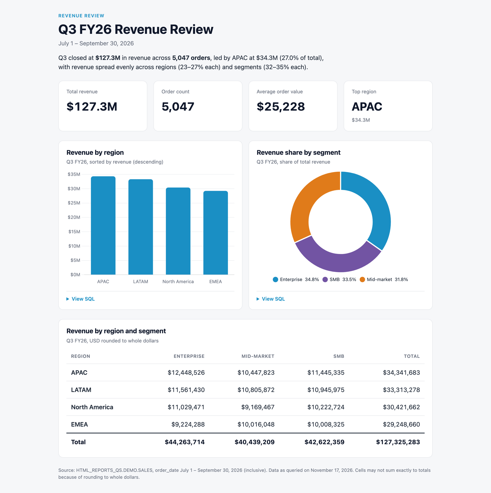

### What each part produced

- **"KPI row… count up from 0… ease-out"**: animated counters on load. Without the motion sentence you get static numbers.
- **"in $M, one decimal"**: number formats. Without them CoCo picks its own, and a full-precision dollar total can be too wide for its card.
- **"two-column grid… one column on narrow screens"**: a responsive layout that still works in a narrow side panel or on a phone.
- **"collapsed 'View SQL' toggle"**: disclosure widgets that let reviewers check your numbers. This is one of the most trusted features in shared reports.
- **"light and dark mode"**: theme-aware colors (CoCo does this by default, but saying it helps).

### Check for
- The KPI numbers animate once on load and land on the formats you asked for. If your OS has reduced motion turned on, a well-built report skips the animation and shows the final values.
- Each **View SQL** expands to show a query that matches the chart.
- Resize the preview narrow: the grid stacks to one column.

<!-- ------------------------ -->
## Iterate with Targeted Edits

You rarely get the final version in one prompt. Make edits small and specific.

**In Workspaces**, select part of the rendered report and choose **Reference in CoCo** to aim an edit at that element. For example, select the bar chart and ask:

```text
Highlight the top region's bar in the accent color, make the others a muted gray,
and add data labels in $M with one decimal above each bar.
```

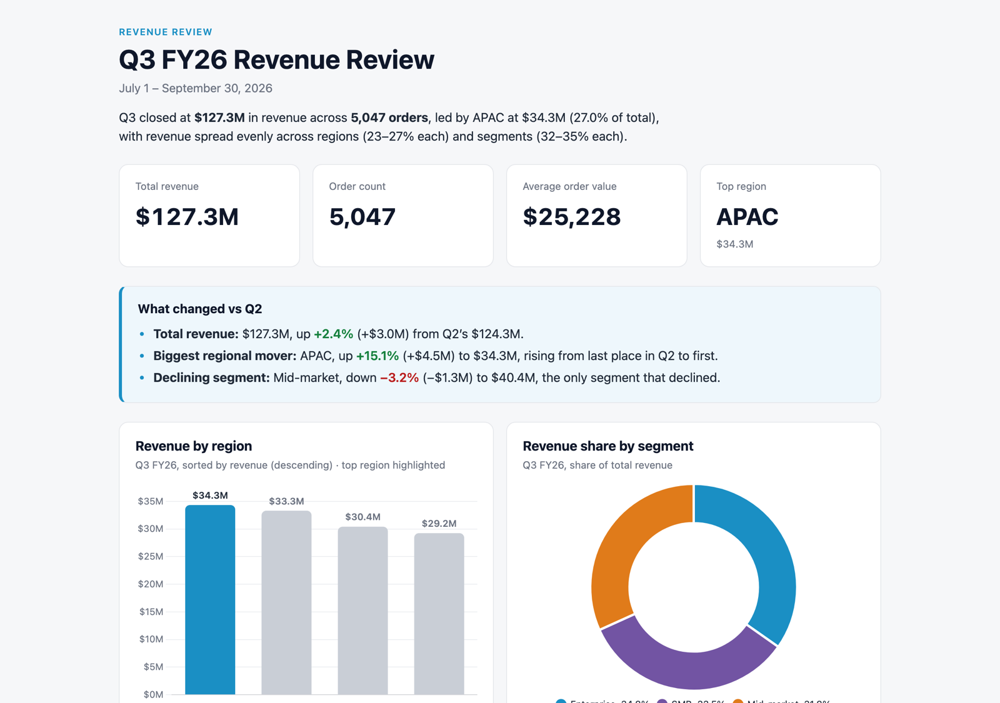

More edits worth trying:

```text
Add a short "What changed vs Q2" callout box under the KPI row with three bullets
comparing Q3 with Q2 (April 1 to June 30, 2026): total revenue, the biggest regional
mover, and any segment that declined.
```

```text
Make the summary table sortable by clicking a column header, with an arrow showing
the sort direction.
```

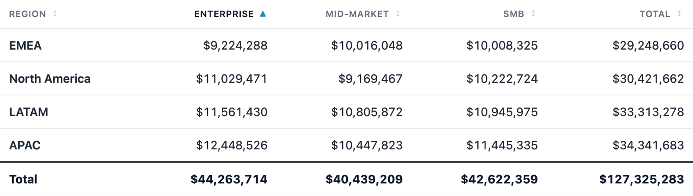

You can also edit directly: open the report, select **Edit**, and choose **Preview** (edit text in the rendered page), **No JavaScript** (edit content that scripts would otherwise replace), or **Code** (edit HTML/CSS/JS). Saving updates the workspace file only. Published viewers see changes after you publish again.

<!-- ------------------------ -->
## Turn Findings into a Slide Deck

HTML reports can click through like slides, which works well for async executive updates.

```text
Create an HTML report formatted as a 4-slide deck from HTML_REPORTS_QS.DEMO.SALES
comparing Q3 (July 1 to September 30, 2026) with Q2 (April 1 to June 30, 2026).

Slides:
1. Title slide: "Quarterly business review", subtitle "Example Corp · Q3 FY26 · sample data".
2. One giant number: total Q3 revenue, with "+X% vs Q2" underneath (compute X from the data).
3. "Highlights": three bullets about the fastest-growing region, top segment, and
   average order value trend.
4. "Next quarter": three recommended actions, each tied to a specific number from the data.

Behavior:
- Each slide is a full-bleed card; only one is visible at a time.
- Prev/next arrow buttons on either side of a row of clickable dots, under the slide.
- A "Slide N of 4" label in the corner.
- Navigation wraps around (next on the last slide goes to the first).
- Left and right arrow keys also change slides.
- Crossfade between slides over about 300ms.
```

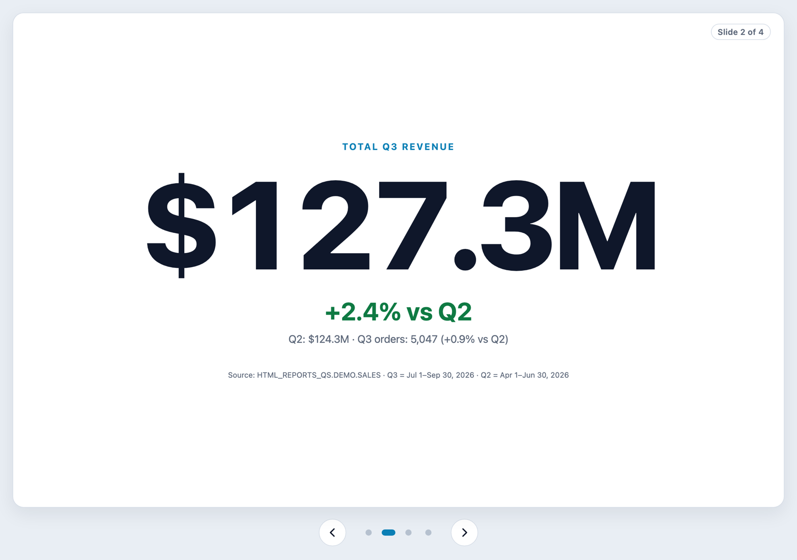

> **Note:** The recommendations on slide 4 come from synthetic data, so treat them as illustrative. Asking for each action to cite a number keeps CoCo from writing generic advice.

### Ingredients that make it work
- **"full-bleed card; only one visible at a time"**: the slide layout itself.
- **"arrow buttons… clickable dots… Slide N of 4"**: three ways to navigate, plus a sense of where you are.
- **"wraps around"**: modulo navigation instead of disabled buttons at the ends.
- **"arrow keys"**: keyboard support (handlers are attached in a script, which the sandbox allows).
- **"crossfade over about 300ms"**: the transition. Leave it out and slides switch instantly.

<!-- ------------------------ -->
## Build a Designed Spec with a Prototype

Replace a wall-of-text doc with a designed page that reviewers can click through.

```text
Create an HTML product spec titled "Weekly digest". Show requirement 2 of 4:
"Let users opt into a weekly digest".

Layout: two columns. Left column has the requirement text and three bullets:
"Off by default", "Delivery day: Monday to Friday", "Shows the top three reports by views".
Right column is a working prototype styled like a settings panel ("Settings · Notifications").

Prototype behavior:
- A toggle switch labeled "Weekly digest", off by default.
- While off, show the muted text "Turn on the digest to see delivery options."
- When on, reveal a segmented day picker (Mon, Tue, Wed, Thu, Fri) with Mon selected,
  and a line that updates live: "Next digest: Monday, 9:00 AM".
- Animate the toggle knob sliding and the options panel expanding.

On narrow screens, stack the prototype under the text.
```

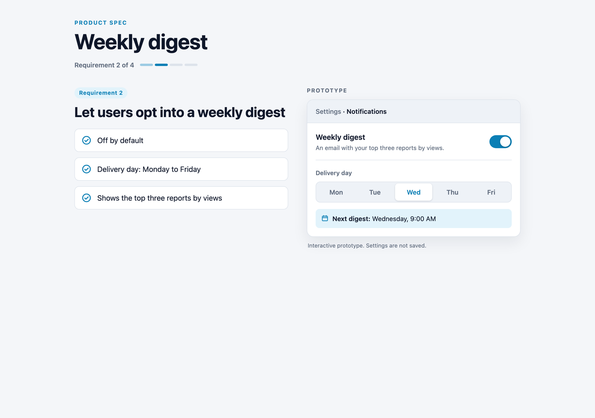

### Ingredients that make it work
- **"off by default" + the off-state text**: an empty state, which makes the prototype feel real.
- **"segmented day picker… line that updates live"**: state that drives visible output. This is what makes it a prototype instead of a picture.
- **"knob sliding… panel expanding"**: CSS transitions on state changes.

<!-- ------------------------ -->
## The Realm of Possible: Charts

The next three steps are a gallery. Each prompt targets one library and one interaction pattern. All of them run inside the same sandbox as your published reports, with no network calls at view time. All data is embedded.

### Chart.js: slider, toggle, and resample

```text
Create an HTML report that charts weekly active users from
HTML_REPORTS_QS.DEMO.WEEKLY_ACTIVE_USERS using Chart.js.

Controls above the chart:
- A range slider that sets how many recent weeks are shown (4 to 52), with a live
  label like "14 wks".
- A "Line / bar" toggle button that switches the chart type.
- A "Randomize" button that resamples the values for demo purposes, using a seeded
  random generator so the chart is stable until the button is clicked.

Animate every update over about 500ms. Use the accent color for the series.
```

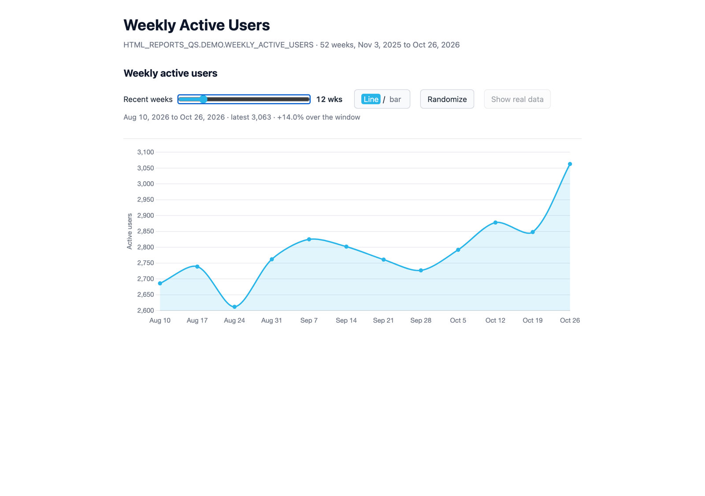

**Check for:** dragging the slider re-windows the chart smoothly, the toggle switches the chart type with an animation, and **Randomize** changes the values.

### Plotly: zoom, pan, and layered traces

```text
Create an HTML report with a Plotly scatter of duration_ms vs rows_scanned from
HTML_REPORTS_QS.DEMO.QUERY_LOG, both axes on log scales, starting with the
X-Small warehouse only.

- Built-in zoom, pan, and hover tooltips showing warehouse size, rows, and duration.
- An "Add cohort" button that adds the next warehouse size (Small, then Medium, then
  Large) as a new trace in a new color.
- A "Reset" button that returns to the single starting trace and clears any zoom.
- Clicking a legend item hides or shows that trace.
```

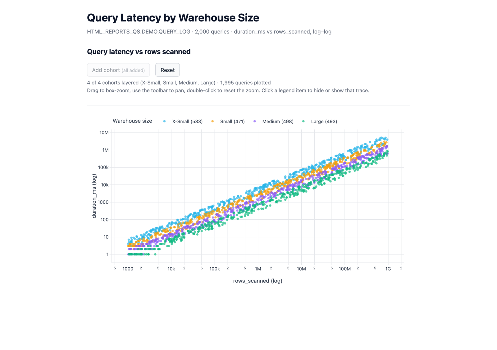

**Check for:** drag a box to zoom in, and double-click the plot to zoom back out. Add cohorts until all four sizes are layered, then select **Reset** to return to the single starting trace.

> The vendored Plotly is the **cartesian** build. Ask for scatter, line, bar, and similar 2D charts. For 3D, use Three.js (see below).

### Vega-Lite: brush to cross-filter

```text
Create an HTML report using Vega-Lite from HTML_REPORTS_QS.DEMO.QUERY_LOG:
- Top: a scatter of duration_ms vs rows_scanned on log scales, colored by warehouse_size.
- Bottom: a bar chart of query count by query_type.
- Dragging a rectangle (brush) on the scatter filters the bar chart to only the
  selected queries. Double-click clears the selection.
Add one line of instructions above the charts.
```

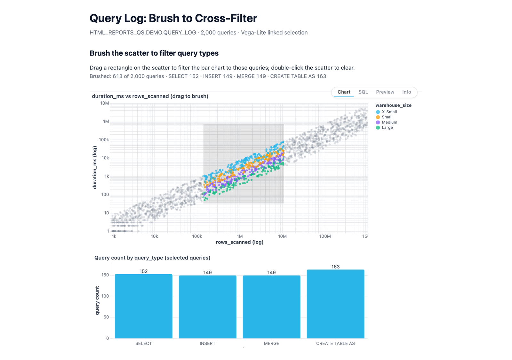

**Check for:** the bars update live as you drag the brush.

**Why it works:** "brush… filters" is the exact pattern Vega-Lite's selections are designed for. Naming the library steers CoCo to it.

<!-- ------------------------ -->
## The Realm of Possible: Networks, 3D, and Diagrams

### D3: draggable force-directed network

```text
Create an HTML report with an interactive D3 force-directed graph from
HTML_REPORTS_QS.DEMO.OBJECT_DEPENDENCIES showing how source tables feed reports,
how reports are shared with roles and users, and which users hold each role.

- Color nodes by type (Source table, Report, Role, User) with a legend.
- Drag any node; the layout reacts.
- Hovering or tapping a node highlights it, its direct neighbors, and the links
  between them, and dims everything else.
- A "Shake it" button that re-energizes the simulation so the layout re-settles.
- Labels on every node; the graph fits its container on any screen width.
- Lay the types out roughly left to right: Source table, Report, Role, User.
```

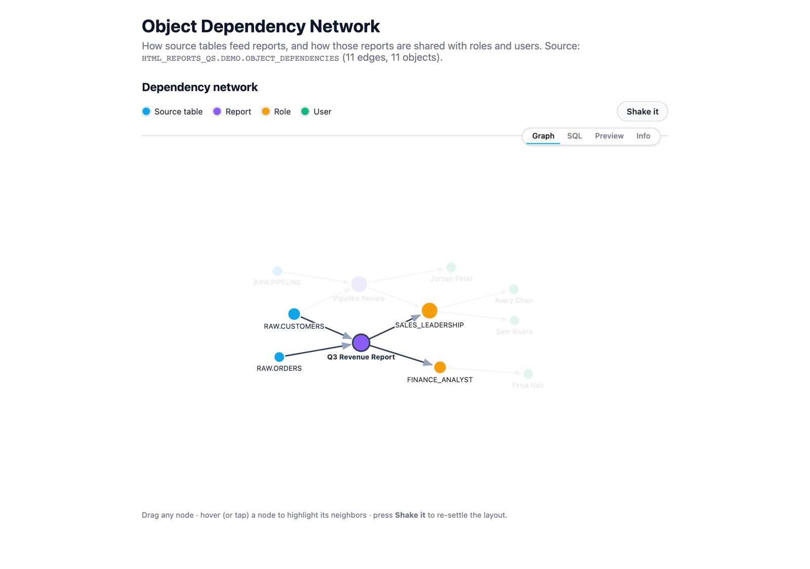

**Check for:** dragging works, hover dims non-neighbors, and **Shake it** animates the graph back into place.

### Three.js: a 3D skyline you can orbit

```text
Create an HTML report with a 3D bar chart using Three.js of credits from
HTML_REPORTS_QS.DEMO.WAREHOUSE_CREDITS_HOURLY: one bar per hour (24 columns)
per day (7 rows, Mon to Sun), with bar height = credits, color scaled by value, and
a small legend for the color scale.

Interaction and motion:
- Drag to orbit the camera; limit the vertical angle so you can't flip under the floor.
- Hovering or tapping a bar shows a tooltip with the day, hour, and credits.
- About 1.5 seconds after the user stops interacting, slowly auto-rotate. Stop
  rotating while a bar is hovered, so the tooltip stays put.
- Bars grow smoothly from zero to their height when the chart first appears.
- Pull the camera back on narrow screens so the whole grid stays in view.
- If WebGL isn't available, show the message "3D rendering isn't available in this
  browser. WebGL may be turned off." instead of a blank box.

Add a hint line: "Drag to orbit · hover or tap for values".
```

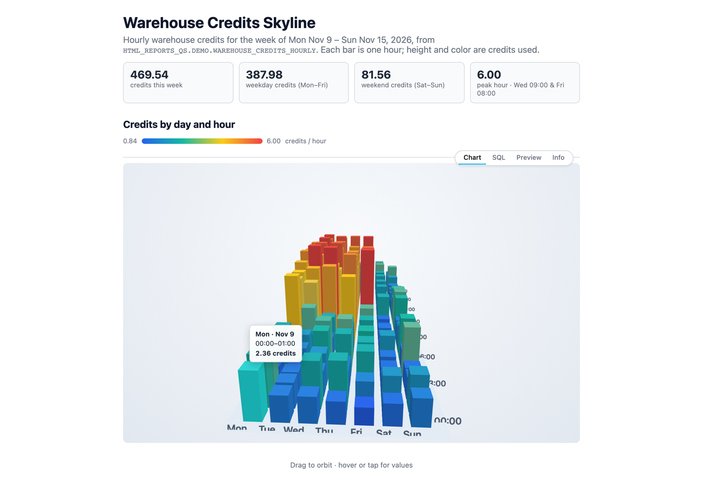

**Ingredients that make it work:**
- **"limit the vertical angle"**: keeps orbiting from getting disorienting.
- **"auto-rotate… stop rotating while a bar is hovered"**: draws attention without fighting the user. Without the pause, the bar slides out from under the cursor and the tooltip flickers.
- **"Mon to Sun"**: the table stores day names as text, so without an explicit order the rows sort alphabetically (Fri, Mon, Sat…).
- **"grow from zero"**: an entrance animation (each bar eases toward its target height every frame).
- **"WebGL fallback"**: a graceful message instead of an empty panel for viewers whose browsers can't render 3D.
- **No add-ons:** only the Three.js core module is vendored, not extras such as OrbitControls, so CoCo writes the orbit controls itself. You don't need to mention this, but it's why "limit the vertical angle" is worth spelling out.

### Mermaid: diagrams from plain text

```text
Create an HTML report that explains how an HTML report gets published, with two
Mermaid diagrams side by side (stacked on narrow screens):
1. A left-to-right flowchart: CoCo writes HTML -> Sanitize -> Renderer -> Sandbox -> Report.
2. A sequence diagram with three participants:
   You -> CoCo: Create a report
   CoCo -> Snowflake: Save the .html file
   You -> Snowflake: Publish artifact
   Snowflake --> You: One stable link
   You -> Snowflake: Publish changes
   Snowflake --> You: Same link, new version
Match the diagram colors to light or dark mode, and re-render if the mode changes.
```

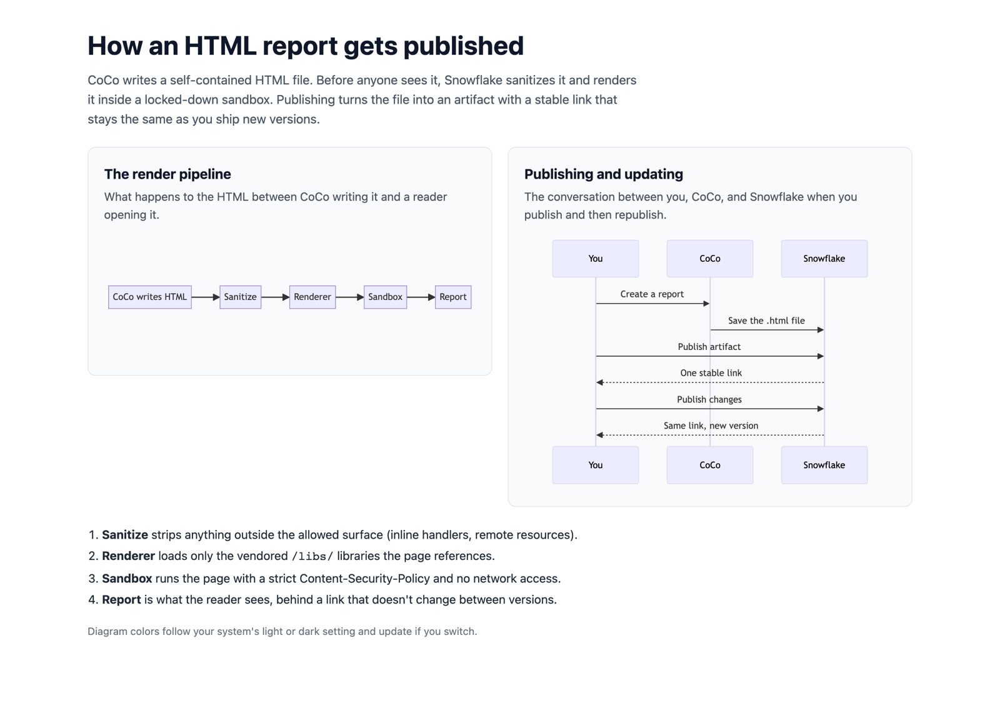

**Why it works:** Mermaid diagrams are plain text, so spelling out each arrow in the prompt gets you exactly the diagram you want. Mermaid can't follow CSS light/dark colors on its own, so asking it to "re-render if the mode changes" keeps the diagram readable when a viewer switches themes.

<!-- ------------------------ -->
## The Realm of Possible: Live Math and Markdown

These patterns are useful in analytical, scientific, or documentation-style reports.

### KaTeX: live math typesetting

```text
Create an HTML report with a live LaTeX editor using KaTeX:
- Left: a text area with LaTeX source. Right: the rendered math.
- Re-render on every keystroke. If the LaTeX is invalid, keep the last good render
  dimmed and show the error inline in a muted style instead of breaking the page.
- Preset buttons "Euler", "Gaussian", and "Binomial" that load Euler's identity,
  the Gaussian integral, and the binomial theorem.
```

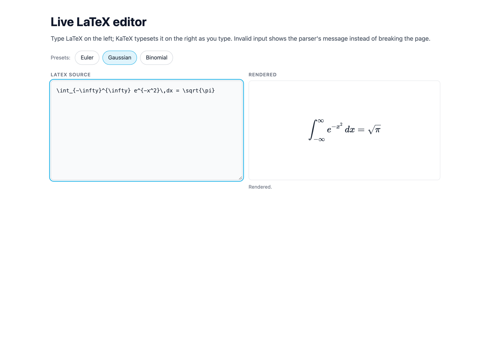

### Marked + highlight.js: live Markdown preview

```text
Create an HTML report with a live Markdown editor:
- Left: a text area prefilled with a short README that includes a heading, a list,
  a table, and a SQL code block.
- Right: the rendered preview using Marked, with code blocks syntax-highlighted by
  highlight.js. Make code readable in dark mode too.
- Update the preview on every keystroke.
- Sanitize the rendered HTML before showing it: remove script, iframe, and style tags,
  any on* attributes, and javascript: links.
```

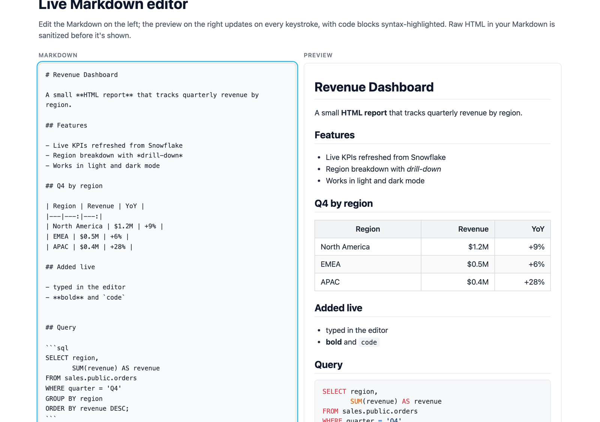

> **Note:** Any report that turns typed text into HTML needs the sanitize line. Marked doesn't sanitize its output, and no sanitizer library is vendored, so without that line the preview runs whatever HTML someone types. The vendored highlight.js theme is light-only, which is why the prompt asks for dark-mode code colors.

<!-- ------------------------ -->
## Capstone: A Full Showcase Page

Now put it all together: a long-form, multi-section page with the "page chrome" that makes a report feel like a product. It has a hero, sticky navigation with scroll tracking, tabbed demos, animated counters, and a sticky footer.

A page this size is too much for one prompt. In testing, generating it in a single response hit the model's output limit. Build it the way you'd build any large page: lay down the shell, then add one section per prompt. Each prompt below is a follow-up in the same CoCo chat.

### 1. The shell

```text
Create an HTML report titled "What you can build with HTML reports" that will use the
tables in HTML_REPORTS_QS.DEMO. Start with only the page shell:
- A hero with a small "Now in public preview" badge, a large title, a one-line pitch,
  and chips for "Snowsight Workspaces", "CoWork", and "Cortex Code Desktop".
- A sticky top nav with links to three sections: Examples, Showcase, and Tips. As I
  scroll, highlight the link for the section I'm reading. Jumping to a section must
  not hide its heading under the nav.
- A sticky footer bar with a one-line message.
- Empty Examples, Showcase, and Tips sections, each starting with a small uppercase
  label above its heading.
- Cards with rounded corners, soft shadows, and theme-aware colors (light and dark).
Make every grid collapse to one column below about 600px wide.
```

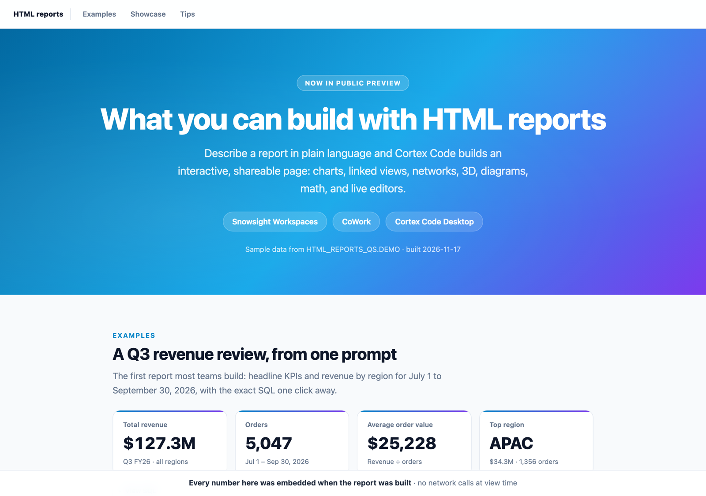

### 2. Examples

```text
Fill the Examples section with a KPI row (total revenue, order count, average order
value for Q3 2026 from SALES) that counts up on load, and a bar chart of revenue by
region with a collapsed "View SQL" toggle.
```

### 3. Showcase

```text
Fill the Showcase section. Start with a stats row of four numbers that count up from
0 the first time the row scrolls into view: 9 vendored libraries (count Vega, Vega-Lite,
and Vega-Embed as one), 3 places to create, 2 places to view, 0 network calls.

Below it, add tabs for Charts, Linked views, Network, 3D, Diagrams, Math, and Markdown.
Each tab holds a compact version of the matching demo from earlier in this chat
(Chart.js slider, Vega-Lite brush, D3 network, Three.js skyline, Mermaid, KaTeX,
Marked). Under each demo, add a "Try asking CoCo:" line with a prompt that would build it.
- Switching tabs fades and slides the new panel in over about 200ms.
- Render each demo only the first time its tab is shown, so it sizes to a visible
  container. Pause the 3D animation loop when its tab isn't active.
- For the Vega-Lite demo, embed a sample of about 400 query log rows, not all 2,000.
```

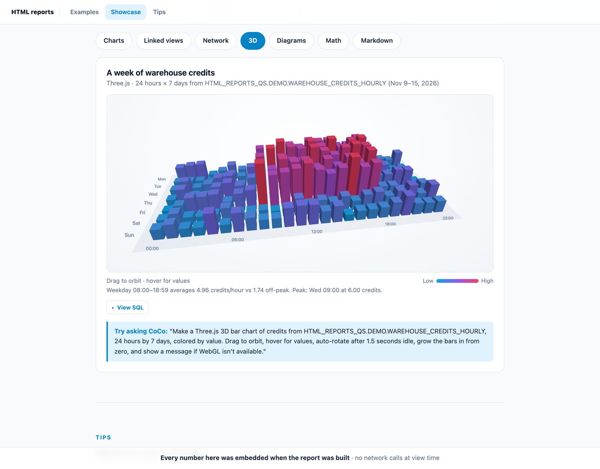

If CoCo stops partway through this step, ask it to continue, or add the tabs a few at a time ("Add the Charts and Linked views tabs", then the rest).

### 4. Tips

```text
Fill the Tips section with three icon cards: "Reports are snapshots", "Use the approved
libraries", and "Design for every screen and theme", each with two sentences.
```

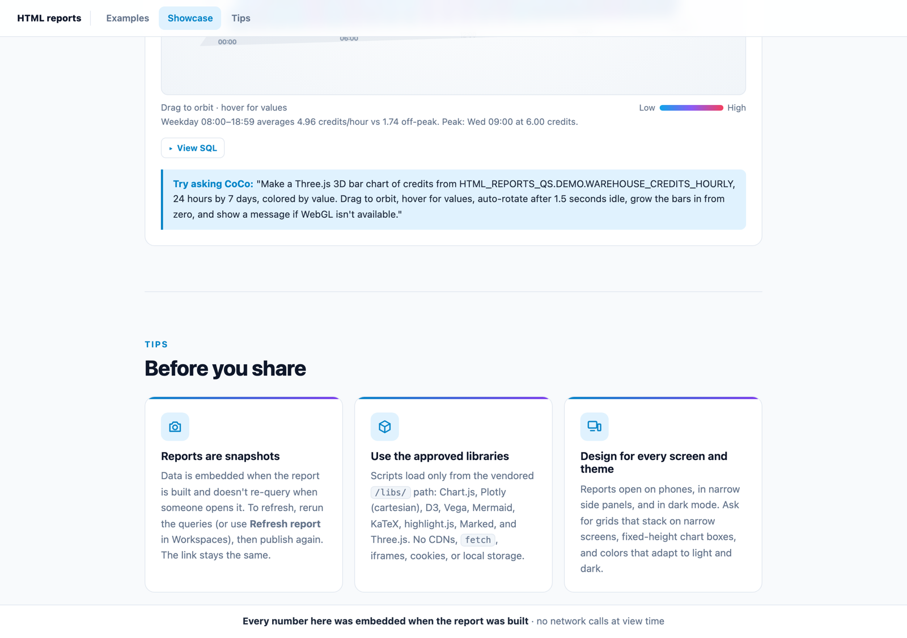

### Ingredients that make it work
- **One section per prompt**: keeps each response small enough to finish, and lets you check each part before moving on.
- **"the first time the row scrolls into view"**: an animation below the fold that runs on page load finishes before anyone sees it. Tying it to scrolling makes it play when the reader arrives.
- **"highlight the link for the section I'm reading"**: scroll-spy navigation.
- **"must not hide its heading under the nav"**: a sticky nav covers whatever you jump to unless the page leaves room for it.
- **"fades and slides the new panel in over about 200ms"**: a CSS keyframe on the active tab panel.
- **"Render each demo only the first time its tab is shown"**: charts drawn inside hidden tabs often measure zero width and render blank. Lazy rendering on first view avoids that.
- **"Pause the 3D animation loop when its tab isn't active"**: keeps the page responsive.
- **"a sample of about 400 rows"**: embedded data is part of the file, so sampling keeps the report small enough to publish.
- **"Try asking CoCo:" lines**: the page teaches readers how to make their own, which is a good habit for any showcase you share.

<!-- ------------------------ -->
## Publish, Share, and Update

### Publish and choose who has access
1. Publish from where you created the report:
   - **Workspaces:** open the `.html` file and select **Publish artifact** in the file toolbar.
   - **CoWork:** select **Publish artifact** on the file tile.
   - **CoCo Desktop:** open the HTML file and select **Publish artifact**.
2. Under **Who has access**, add roles or users and choose a permission for each:
   - **Can view**: read-only access to the report.
   - **Can publish**: can also publish updates, but can't change who has access.
   Neither permission grants access to your source file.
3. Publish, then copy the link. After publishing, the button becomes **Share**. When both are available, choose **Copy CoWork link** (best for business users) or **Copy Snowsight link** (best for technical editors).

Recipients need to sign in to the same Snowflake account and have access through a role or user grant. The link alone doesn't grant access. Granting **PUBLIC** lets everyone in the account view the report. Find everything you own or can open at **Projects » Artifacts** in Snowsight, or on the **Artifacts** page in CoWork.

### What recipients can do
- Use every chart, slider, tab, and 3D view exactly as you built it, in light or dark mode
- **Print** or save as PDF
- In CoWork, ask follow-up questions about the report

### Update and refresh
- **Reports are snapshots.** Data is embedded at build time and doesn't re-query when someone opens the report. To refresh the numbers in Workspaces, select **Refresh report**, review the refresh instructions, and select **Refresh**. You can also ask CoCo to rerun the queries.
- **Publish changes** after any edit or refresh. The link stays the same, so everyone sees the latest version the next time they open it.

<!-- ------------------------ -->
## Sandbox Rules and Prompt Troubleshooting

Reports run in a strict sandbox. Scripts load only from Snowflake's vendored `/libs/` path, and the report can't make network calls, load remote images or fonts, embed iframes, or use cookies or local storage. CoCo's `html-authoring` skill handles this for you, but it helps to know the rules when something looks off.

### Vendored libraries

| Library | Good for | Prompt hint |
|---|---|---|
| Chart.js 4.4.4 | Everyday bar, line, doughnut charts | Default choice for simple charts |
| Plotly 2.35.2 (cartesian) | Zoomable 2D charts | No 3D or maps |
| D3 7.9.0 | Custom visuals, networks, layouts | Name it for force graphs |
| Vega 6.2.0, Vega-Lite 6.4.3, Vega-Embed 7.1.0 | Declarative and linked charts | Needs `{ ast: true }` and a numeric width |
| Mermaid 10.9.6 | Flowcharts, sequence diagrams | Use `securityLevel: 'strict'` |
| Three.js 0.169.0 | 3D with WebGL | Loaded as an ES module |
| KaTeX 0.16.21 | Math typesetting | Includes a stylesheet |
| Marked 14.1.3 | Markdown to HTML | Pair with highlight.js |
| highlight.js 11.10.0 | Code highlighting | Includes a stylesheet |

### Symptom → follow-up prompt

| Symptom | Ask CoCo |
|---|---|
| A chart inside a tab is blank | "Render each chart the first time its tab becomes visible, not on page load." |
| Buttons do nothing, or Workspaces shows a **Fix in CoCo** banner | "Remove inline event handlers like `onclick=` and attach listeners with `addEventListener` in a script." Or select **Fix in CoCo**. |
| An image or logo doesn't load | "Embed the image as a data: URI instead of linking to a URL." |
| Custom web font doesn't appear | "Use the system font stack; remote fonts are blocked." |
| A Vega-Lite chart fails to render | "Use Vega-Embed with `{ ast: true }` and a numeric width." |
| The 3D view is empty | "Load Three.js as an ES module from `/libs/` and show a fallback message if WebGL is unavailable." |
| Report is too large to publish | "Reduce the embedded data (aggregate before embedding) and compress any images." |
| CoCo stops partway through a big page | Ask it to continue, or split the request: build the page shell first, then add one section per prompt. See the capstone step. |
| A chart on a log scale is missing points | "Leave out rows where the value is zero or negative, and say how many were left out." Log scales can't show zero. |
| A preview of typed Markdown or HTML runs scripts | "Sanitize the rendered HTML: remove script, iframe, and style tags, on* attributes, and javascript: links." |
| An external link doesn't open | Links to Snowflake sites open in a new tab directly. Other `https://` links ask **Open external link?** first. `javascript:`, `data:`, `//`-prefixed, and `user@host` links are disabled. |

<!-- ------------------------ -->
## Conclusion and Resources

You built a meeting report, a slide deck, a clickable spec, a gallery of interactive and animated visuals, and a full showcase page, all from prompts. Along the way you learned a prompt vocabulary: **data + structure + visual + interaction + motion + polish**, plus the specific verbs that unlock sliders, brushing, orbiting, count-ups, and transitions.

### What You Learned
- How to structure a prompt so CoCo builds the report you have in mind
- Which phrases produce which interactions and animations, and which library CoCo will reach for
- How to iterate with **Reference in CoCo**, then publish, share, refresh, and update a Report artifact
- What the sandbox blocks and how to prompt around it

### Clean up

Run `teardown.sql` from the companion repo, or:

```sql
DROP DATABASE IF EXISTS HTML_REPORTS_QS;
```

Published reports are separate artifacts and keep working after you drop the database, because their data is embedded. Delete any you no longer need from the **Share** dialog.

### Related Resources
- [HTML reports (Preview)](https://docs.snowflake.com/en/user-guide/ui-snowsight/reports)
- [Create and share a dashboard or HTML report](https://docs.snowflake.com/en/user-guide/snowflake-artifacts-create-share)
- [Snowflake Dashboards](https://docs.snowflake.com/en/user-guide/snowflake-dashboards)
- [Release note: HTML reports (Preview)](https://docs.snowflake.com/en/release-notes/2026/other/2026-11-04-html-reports-preview)
