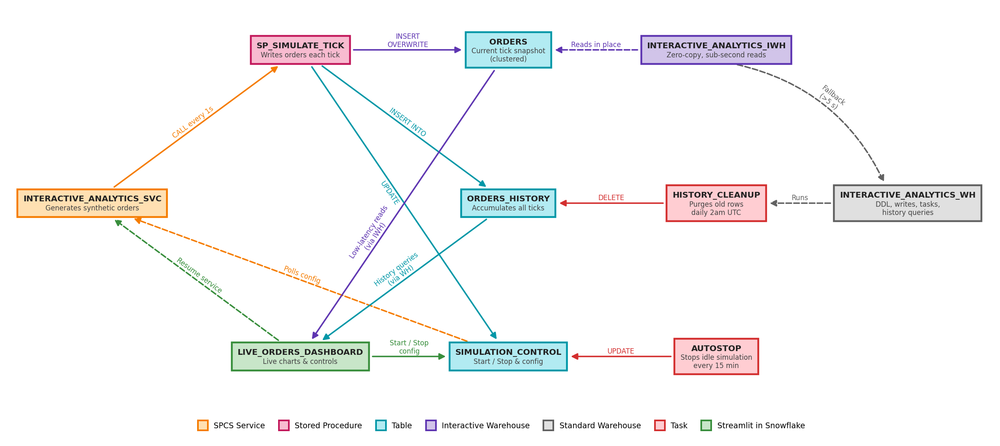
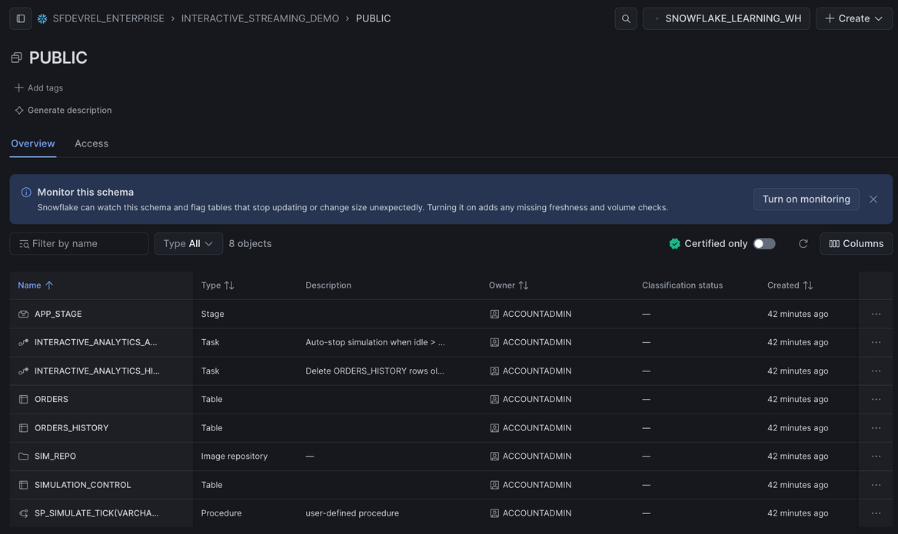
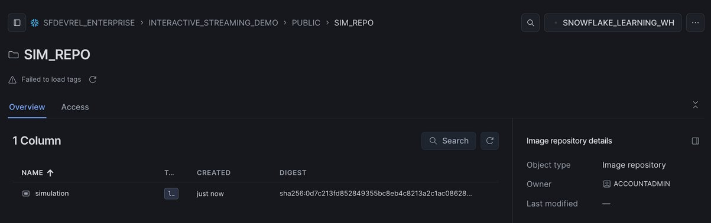
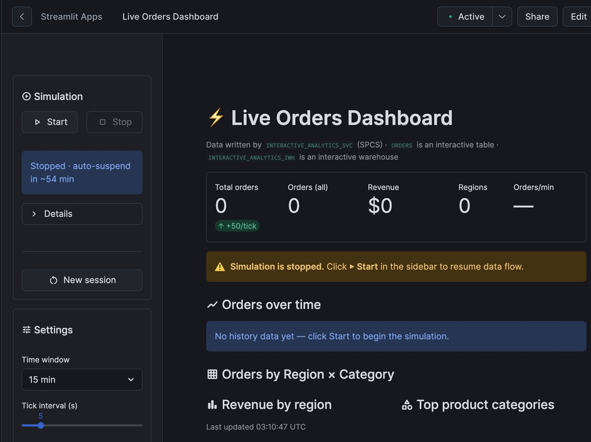
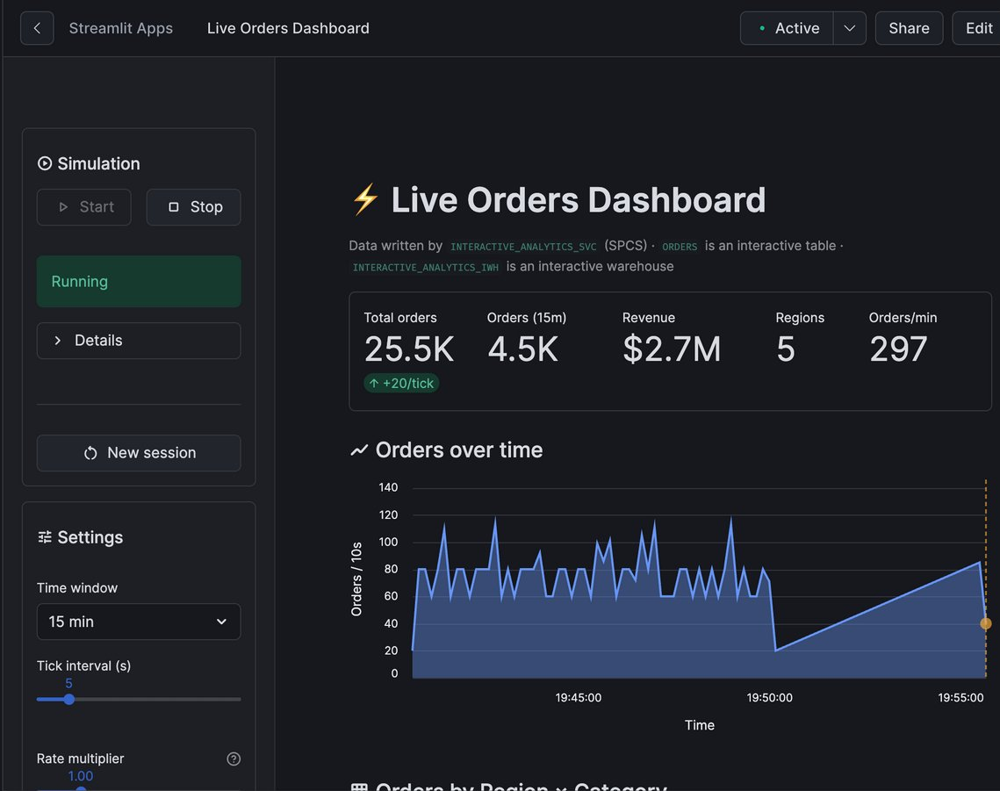
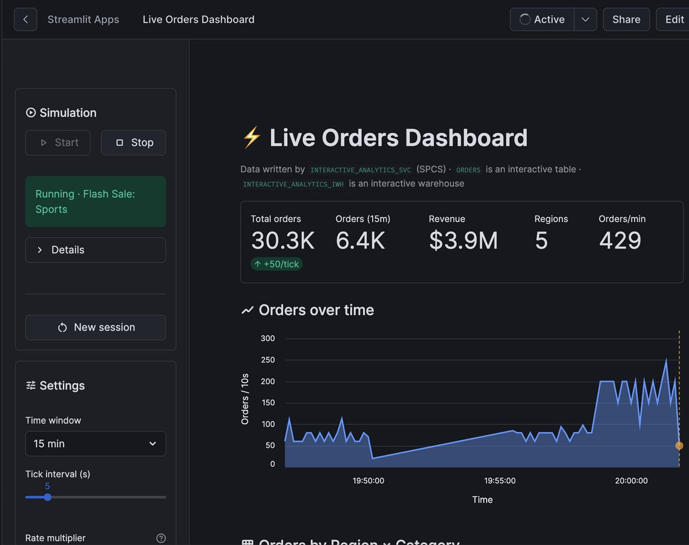
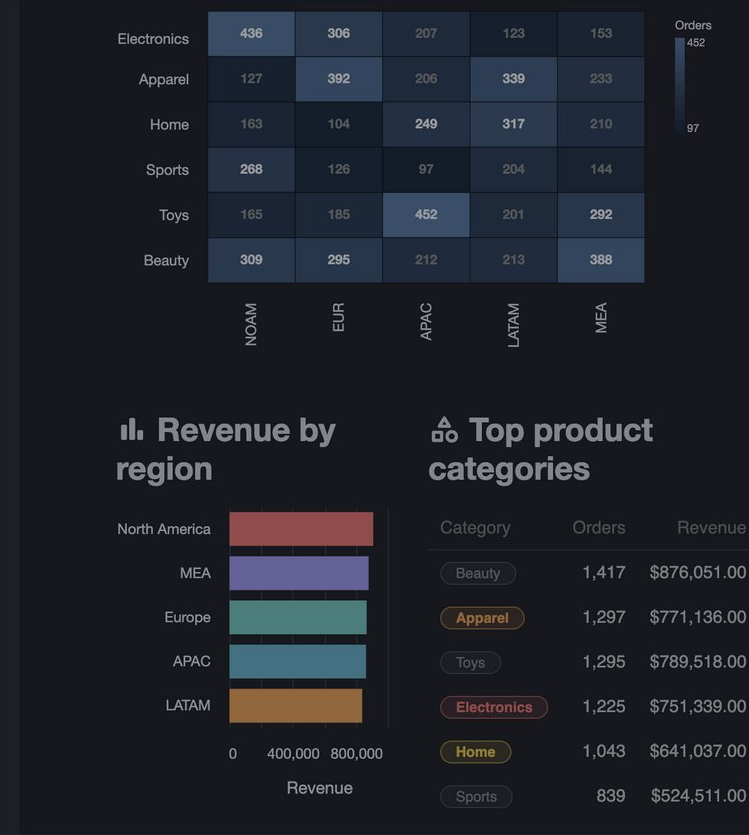

author: Chanin Nantasenamat
id: build-real-time-bi-dashboard-interactive-warehouses
summary: Build a live e-commerce BI dashboard on Snowflake using an interactive warehouse over a standard table, a Snowpark Container Services simulation service, and Streamlit in Snowflake.
categories: snowflake-site:taxonomy/solution-center/certification/quickstart, snowflake-site:taxonomy/product/analytics, snowflake-site:taxonomy/product/applications-and-collaboration, snowflake-site:taxonomy/snowflake-feature/interactive-analytics
environments: web
language: en
status: Published
feedback link: https://github.com/Snowflake-Labs/sfguides/issues

# Build a Real-Time BI Dashboard with Interactive Warehouses
<!-- ------------------------ -->
## Overview

Traditional analytical warehouses are optimized for large batch scans. When a dashboard needs to refresh every few seconds and answer sub-second queries at high concurrency, you need a different architecture. Snowflake's **interactive warehouses** close that gap: they maintain a warm in-memory cache tuned for selective, low-latency reads. They query standard tables directly, with no copy or conversion, an approach called zero-copy interactive analytics.

In this quickstart, you will build a complete real-time analytics system for a synthetic e-commerce store. A **Snowpark Container Services (SPCS)** container generates orders server-side at a configurable rate, writing each tick into a standard, clustered table through a stored procedure. An **interactive warehouse** keeps that table's cache warm and serves millisecond-latency queries to a **Streamlit in Snowflake** dashboard that refreshes automatically every few seconds.

Everything runs inside a single Snowflake account. No Kafka, no external message bus, no managed services outside Snowflake.



<!-- Editable source: quickstart/build-real-time-bi-dashboard-interactive-warehouses/assets/architecture_diagram.py in the companion repo (matplotlib) -->

### What You'll Learn
- How to cluster a standard table with a key tuned for dashboard queries
- How to query a standard table through an interactive warehouse at sub-second latency, with no data copy
- How to build and deploy a long-running Python service on Snowpark Container Services
- How to run a demo under a dedicated role instead of `ACCOUNTADMIN`
- How to use `EXECUTE AS OWNER` to give a service a single, narrow write path
- How to build an auto-refreshing dashboard with `st.fragment` in Streamlit in Snowflake

### What You'll Build
You will assemble five tightly integrated Snowflake objects into a single, self-contained real-time analytics system:
- An SPCS simulation service continuously generates synthetic e-commerce orders and writes them, via a stored procedure, into a clustered standard table
- An interactive warehouse keeps that table warm for sub-second dashboard queries
- A history table accumulates every tick for trend charts and heatmaps
- A control table acts as the command channel between the dashboard and the simulation service
- A Streamlit in Snowflake app ties everything together, giving you live KPI tiles, auto-refreshing charts, and full simulation controls in one interface

### What You'll Need
- Access to a [Snowflake account](https://signup.snowflake.com/?utm_source=snowflake-devrel&utm_medium=developer-guides&utm_cta=developer-guides) with `ACCOUNTADMIN`, used once to create the demo role. The account must be in a region that supports both [interactive warehouses](https://docs.snowflake.com/en/user-guide/interactive#region-availability) and [Snowpark Container Services](https://docs.snowflake.com/en/developer-guide/snowpark-container-services/overview#available-regions).
- [Docker Desktop](https://docs.docker.com/get-docker/) installed and running locally.
- [Git](https://git-scm.com/) installed.
- Basic familiarity with SQL and Python.

<!-- ------------------------ -->
## Clone the Repository

Fork and clone the companion repository:

```bash
git clone https://github.com/sfc-gh-cnantasenamat/build-real-time-bi-dashboard-interactive-warehouses.git
cd build-real-time-bi-dashboard-interactive-warehouses
```

The repository has the following structure:

```
├── scripts/
│   └── setup.sql             # Creates all Snowflake objects in one pass
├── spcs/
│   ├── Dockerfile            # Container definition for the simulation service
│   ├── requirements.txt      # Python dependencies (snowflake-connector-python)
│   ├── simulation_service.py # Long-running service loop
│   └── simulation_spec.yaml  # SPCS service specification
└── streamlit/
    ├── streamlit_app.py      # Live dashboard application
    └── environment.yml       # Streamlit in Snowflake Python environment
```

<!-- ------------------------ -->
## Create Snowflake Objects

All setup SQL is in `scripts/setup.sql`. Open a Snowsight worksheet and paste the blocks below, or run the full file in one shot. The script is idempotent, so it is safe to re-run.

Here is a summary of the Snowflake objects you will create:

| Object | Type | Purpose |
|---|---|---|
| `INTERACTIVE_ANALYTICS_ROLE` | Role | Owns every object below, including the service |
| `ORDERS` | Table (clustered) | Current tick snapshot of live orders |
| `ORDERS_HISTORY` | Table | Accumulates all historical ticks for charts and heatmaps |
| `SIMULATION_CONTROL` | Table | Command channel between the dashboard and the simulation service |
| `SP_SIMULATE_TICK` | Stored Procedure | Generates synthetic orders each tick |
| `INTERACTIVE_ANALYTICS_WH` | Virtual Warehouse | DDL, task execution, and general queries |
| `INTERACTIVE_ANALYTICS_IWH` | Interactive Warehouse | Sub-second query cache for the ORDERS table |
| `INTERACTIVE_ANALYTICS_POOL` | Compute Pool | SPCS node that runs the simulation container |
| `INTERACTIVE_ANALYTICS_SVC` | SPCS Service | Long-running simulation service |
| `INTERACTIVE_ANALYTICS_AUTOSTOP` | Task (serverless) | Clears a stale running flag when no ticks have landed for 1 hour |
| `INTERACTIVE_ANALYTICS_HISTORY_CLEANUP` | Task (warehouse) | Purges ORDERS_HISTORY rows older than 1 day |
| `LIVE_ORDERS_DASHBOARD` | Streamlit in Snowflake | Live dashboard with KPI tiles, charts, and simulation controls |

### Demo role

`ACCOUNTADMIN` is used only for this block. It creates `INTERACTIVE_ANALYTICS_ROLE` and grants it the account-level privileges it needs to create its own database, warehouses, compute pool, and tasks. Every other object in this guide is created and owned by that role, so the long-running SPCS service never holds an `ACCOUNTADMIN` session.

```sql
USE ROLE ACCOUNTADMIN;

CREATE ROLE IF NOT EXISTS INTERACTIVE_ANALYTICS_ROLE
  COMMENT = 'Owns all objects for the real-time BI dashboard demo';

GRANT CREATE DATABASE, CREATE WAREHOUSE, CREATE COMPUTE POOL,
      EXECUTE TASK, EXECUTE MANAGED TASK
  ON ACCOUNT TO ROLE INTERACTIVE_ANALYTICS_ROLE;

GRANT ROLE INTERACTIVE_ANALYTICS_ROLE TO ROLE SYSADMIN;

SET MY_USER = CURRENT_USER();
GRANT ROLE INTERACTIVE_ANALYTICS_ROLE TO USER IDENTIFIER($MY_USER);
```

### Database and schema

```sql
USE ROLE INTERACTIVE_ANALYTICS_ROLE;

CREATE DATABASE IF NOT EXISTS INTERACTIVE_STREAMING_DEMO;
CREATE SCHEMA   IF NOT EXISTS INTERACTIVE_STREAMING_DEMO.PUBLIC;
```

### Standard warehouse

The standard warehouse handles DDL, stored procedure execution, task runs, and the longer history queries. Interactive warehouses reject DML and `CALL` statements and cap queries at 5 seconds, so every write goes through this separate standard warehouse.

```sql
CREATE WAREHOUSE IF NOT EXISTS INTERACTIVE_ANALYTICS_WH
  WAREHOUSE_SIZE      = 'XSMALL'
  AUTO_SUSPEND        = 60
  AUTO_RESUME         = TRUE
  INITIALLY_SUSPENDED = TRUE;

USE WAREHOUSE INTERACTIVE_ANALYTICS_WH;
```

### Orders table

`ORDERS` holds the current tick snapshot: only the most recently generated set of orders. It is a regular table, because interactive warehouses query standard tables directly with no data copy or conversion. The `CLUSTER BY` key matches the dashboard's `WHERE` clause: a recent time window filtered by region. Truncating the timestamp to the minute keeps the clustering key low-cardinality and prunes efficiently for "last N minutes" queries.

```sql
CREATE OR REPLACE TABLE INTERACTIVE_STREAMING_DEMO.PUBLIC.ORDERS (
  ORDER_ID          STRING,
  ORDER_TS          TIMESTAMP_NTZ,
  REGION            STRING,
  PRODUCT_CATEGORY  STRING,
  QUANTITY          INT,
  AMOUNT            NUMBER(10,2)
)
CLUSTER BY (DATE_TRUNC('MINUTE', ORDER_TS), REGION);
```

### Interactive warehouse

Create the interactive warehouse and add `ORDERS` to it. Adding a table is optional, since an interactive warehouse can query any table, but it tells the warehouse to warm that table's data cache proactively instead of on the first dashboard query.

```sql
CREATE INTERACTIVE WAREHOUSE IF NOT EXISTS INTERACTIVE_ANALYTICS_IWH
  WAREHOUSE_SIZE      = 'XSMALL'
  AUTO_RESUME         = TRUE
  INITIALLY_SUSPENDED = TRUE;

ALTER WAREHOUSE INTERACTIVE_ANALYTICS_IWH RESUME IF SUSPENDED;

ALTER WAREHOUSE INTERACTIVE_ANALYTICS_IWH
  ADD TABLES (INTERACTIVE_STREAMING_DEMO.PUBLIC.ORDERS);

ALTER WAREHOUSE INTERACTIVE_ANALYTICS_IWH
  SET FALLBACK_WAREHOUSE = INTERACTIVE_ANALYTICS_WH;

-- Switch back: interactive warehouses cannot run INSERT, UPDATE or DELETE.
USE WAREHOUSE INTERACTIVE_ANALYTICS_WH;
```

Creating a warehouse makes it the current warehouse for your session. The final `USE WAREHOUSE` switches back to the standard warehouse, because an interactive warehouse rejects DML such as the `INSERT` statements in the next steps with `Cannot run statement type 'INSERT' on an interactive warehouse`.

> Interactive warehouses enforce a **5-second query timeout** and a **24-hour minimum auto-suspend**. The `FALLBACK_WAREHOUSE` setting re-runs any query that exceeds the timeout on the standard warehouse instead of failing it, which mainly matters while the cache is still cold right after a resume. Keep dashboard queries selective (narrow projections, filters aligned with the clustering key) for consistent sub-second latency.

### History and control tables

`ORDERS_HISTORY` accumulates every tick so the dashboard can display multi-minute time-series charts and a Region x Category heatmap. `SIMULATION_CONTROL` is the command channel between the dashboard and the SPCS service.

```sql
CREATE TABLE IF NOT EXISTS INTERACTIVE_STREAMING_DEMO.PUBLIC.ORDERS_HISTORY (
  ORDER_ID          STRING,
  ORDER_TS          TIMESTAMP_NTZ,
  REGION            STRING,
  PRODUCT_CATEGORY  STRING,
  QUANTITY          NUMBER,
  AMOUNT            NUMBER(10,2),
  TICK_AT           TIMESTAMP_NTZ DEFAULT CURRENT_TIMESTAMP()
);

CREATE OR REPLACE TABLE INTERACTIVE_STREAMING_DEMO.PUBLIC.SIMULATION_CONTROL (
  is_running      BOOLEAN       NOT NULL DEFAULT FALSE,
  mode            VARCHAR       NOT NULL DEFAULT 'normal',
  flash_category  VARCHAR,
  rate_mult       FLOAT         NOT NULL DEFAULT 1.0,
  last_active_at  TIMESTAMP_NTZ NOT NULL DEFAULT CURRENT_TIMESTAMP(),
  total_orders    NUMBER        NOT NULL DEFAULT 0
);

INSERT INTO INTERACTIVE_STREAMING_DEMO.PUBLIC.SIMULATION_CONTROL
  (is_running, mode, flash_category, rate_mult, last_active_at, total_orders)
VALUES (FALSE, 'normal', NULL, 1.0, CURRENT_TIMESTAMP(), 0);
```

### Simulation stored procedure

`SP_SIMULATE_TICK` is the heart of the simulation. The SPCS service calls it every second. In a single round-trip it:

1. Replaces the `ORDERS` snapshot with `INSERT OVERWRITE`.
2. Appends the new rows to `ORDERS_HISTORY`.
3. Increments the `TOTAL_ORDERS` counter in `SIMULATION_CONTROL`.

The `EXECUTE AS OWNER` clause runs the writes with the privileges of the procedure's owner, `INTERACTIVE_ANALYTICS_ROLE`, so the procedure is the single path that modifies `ORDERS`, `ORDERS_HISTORY`, and `SIMULATION_CONTROL`.

```sql
CREATE OR REPLACE PROCEDURE INTERACTIVE_STREAMING_DEMO.PUBLIC.SP_SIMULATE_TICK(
    MODE           VARCHAR,
    FLASH_CATEGORY VARCHAR,
    NUM_ROWS       FLOAT,
    DOMINANT       VARCHAR,
    DOM_PCT        FLOAT
)
RETURNS VARCHAR
LANGUAGE JAVASCRIPT
EXECUTE AS OWNER
AS
$$
    var flash   = FLASH_CATEGORY || null;
    var numRows = Math.floor(NUM_ROWS);

    // ---- Tick categories ----
    // Pick 2-5 categories randomly for this tick.
    // If a Flash Sale is active, the promoted category is always included.
    var all_cats = ['Electronics','Apparel','Home','Beauty','Sports','Toys'];
    for (var i = all_cats.length - 1; i > 0; i--) {   // Fisher-Yates shuffle
        var j = Math.floor(Math.random() * (i + 1));
        var tmp = all_cats[i]; all_cats[i] = all_cats[j]; all_cats[j] = tmp;
    }
    var n_cats    = Math.floor(Math.random() * 4) + 2;
    var tick_cats = all_cats.slice(0, n_cats);
    if (MODE === 'flash_sale' && flash && tick_cats.indexOf(flash) === -1) {
        tick_cats[tick_cats.length - 1] = flash;
    }

    var n         = tick_cats.length;
    var quoted    = tick_cats.map(function(c) { return "'" + c + "'"; });
    var cat_array = 'ARRAY_CONSTRUCT(' + quoted.join(',') + ')';
    var cat_idx   = 'UNIFORM(0,' + (n - 1) + ',RANDOM())';

    var cat_sql, amount_sql;

    if (MODE === 'flash_sale' && flash) {
        // Flash Sale: 50 % of orders go to the promoted category; prices elevated.
        cat_sql    = "CASE WHEN UNIFORM(0,99,RANDOM()) < 50 THEN '" + flash + "'"
                   + " ELSE " + cat_array + "[" + cat_idx + "]::STRING END";
        amount_sql = "CASE WHEN PRODUCT_CATEGORY = '" + flash + "'"
                   + " THEN UNIFORM(50,800,RANDOM()) ELSE UNIFORM(5,400,RANDOM()) END";
    } else {
        // Each region has a preferred product category with a graduated
        // probability spectrum (28 % down to 8 %), creating a visible
        // diagonal gradient in the Region x Category heatmap.
        var rw = {
            'North America': {'Electronics':28,'Sports':22,'Beauty':18,'Home':14,'Toys':10,'Apparel':8},
            'Europe':        {'Apparel':28,'Electronics':22,'Beauty':20,'Toys':14,'Home':8,'Sports':8},
            'APAC':          {'Toys':28,'Home':22,'Electronics':18,'Beauty':14,'Apparel':10,'Sports':8},
            'LATAM':         {'Home':28,'Apparel':22,'Beauty':18,'Sports':14,'Toys':10,'Electronics':8},
            'MEA':           {'Beauty':28,'Toys':22,'Home':18,'Apparel':14,'Electronics':10,'Sports':8}
        };
        var regs   = ['North America','Europe','APAC','LATAM','MEA'];
        var rcases = [];
        for (var ri = 0; ri < regs.length; ri++) {
            var reg = regs[ri];
            var w   = rw[reg];
            var wl  = tick_cats.map(function(c) { return {cat: c, w: w[c] || 8}; });
            wl.sort(function(a, b) { return b.w - a.w; });
            var tot = 0;
            for (var wi = 0; wi < wl.length; wi++) { tot += wl[wi].w; }
            var cum = 0;
            var inn = [];
            for (var k = 0; k < wl.length - 1; k++) {
                cum += Math.round(wl[k].w * 100 / tot);
                inn.push('WHEN rv < ' + cum + " THEN '" + wl[k].cat + "'");
            }
            inn.push("ELSE '" + wl[wl.length - 1].cat + "'");
            // One UNIFORM draw per row via scalar subquery for accurate distribution.
            rcases.push(
                "WHEN REGION = '" + reg + "' THEN "
                + '(SELECT CASE ' + inn.join(' ') + ' END'
                + ' FROM (SELECT UNIFORM(0,99,RANDOM()) AS rv) _t)'
            );
        }
        rcases.push('ELSE ' + cat_array + '[' + cat_idx + ']::STRING');
        cat_sql    = 'CASE ' + rcases.join(' ') + ' END';
        amount_sql = 'UNIFORM(5,400,RANDOM())';
    }

    var sql = [
        'INSERT OVERWRITE INTO INTERACTIVE_STREAMING_DEMO.PUBLIC.ORDERS',
        'SELECT ORDER_ID, ORDER_TS, REGION, PRODUCT_CATEGORY, QUANTITY,',
        '       ROUND(UNIT_PRICE * QUANTITY, 2) AS AMOUNT',
        'FROM (',
        '  SELECT UUID_STRING() AS ORDER_ID,',
        "    DATEADD('second',-UNIFORM(0,300,RANDOM()),CURRENT_TIMESTAMP())",
        '      ::TIMESTAMP_NTZ AS ORDER_TS,',
        "    ARRAY_CONSTRUCT('North America','Europe','APAC','LATAM','MEA')",
        '      [UNIFORM(0,4,RANDOM())]::STRING AS REGION,',
        '    ' + cat_sql + ' AS PRODUCT_CATEGORY,',
        '    UNIFORM(1,5,RANDOM()) AS QUANTITY,',
        '    ' + amount_sql + ' AS UNIT_PRICE',
        '  FROM TABLE(GENERATOR(ROWCOUNT => ' + numRows + '))',
        ')'
    ];
    snowflake.execute({sqlText: sql.join(' ')});

    snowflake.execute({sqlText:
        'INSERT INTO INTERACTIVE_STREAMING_DEMO.PUBLIC.ORDERS_HISTORY'
        + ' (ORDER_ID, ORDER_TS, REGION, PRODUCT_CATEGORY, QUANTITY, AMOUNT, TICK_AT)'
        + ' SELECT ORDER_ID, ORDER_TS, REGION, PRODUCT_CATEGORY, QUANTITY, AMOUNT,'
        + ' CURRENT_TIMESTAMP() FROM INTERACTIVE_STREAMING_DEMO.PUBLIC.ORDERS'
    });

    snowflake.execute({sqlText:
        'UPDATE INTERACTIVE_STREAMING_DEMO.PUBLIC.SIMULATION_CONTROL'
        + ' SET TOTAL_ORDERS = COALESCE(TOTAL_ORDERS, 0) + ' + numRows
        + ',    LAST_ACTIVE_AT = CURRENT_TIMESTAMP()'
    });
    return 'OK';
$$;
```

### Compute pool and image repository

The SPCS service runs on a compute pool. The image repository is a Snowflake-managed private Docker registry.

```sql
CREATE COMPUTE POOL IF NOT EXISTS INTERACTIVE_ANALYTICS_POOL
  MIN_NODES         = 1
  MAX_NODES         = 1
  INSTANCE_FAMILY   = CPU_X64_XS
  AUTO_RESUME       = TRUE
  AUTO_SUSPEND_SECS = 3600;

CREATE IMAGE REPOSITORY IF NOT EXISTS INTERACTIVE_STREAMING_DEMO.PUBLIC.SIM_REPO;

-- Note the repository_url in the output; you will use it in the next step.
SHOW IMAGE REPOSITORIES LIKE 'SIM_REPO'
  IN SCHEMA INTERACTIVE_STREAMING_DEMO.PUBLIC;
```

### App stage

```sql
CREATE STAGE IF NOT EXISTS INTERACTIVE_STREAMING_DEMO.PUBLIC.APP_STAGE;
```

### Maintenance tasks

These tasks run in the background to manage costs. The autostop task is a safety net: if `is_running` is still TRUE but no tick has updated `last_active_at` for an hour (for example, the service crashed), it sets the flag back to FALSE. It does not stop a healthy simulation, because every tick refreshes `last_active_at`, so click **Stop** when you finish. The cleanup task deletes history rows older than one day to keep storage costs low.

```sql
CREATE OR REPLACE TASK INTERACTIVE_STREAMING_DEMO.PUBLIC.INTERACTIVE_ANALYTICS_AUTOSTOP
  SCHEDULE                                 = '15 MINUTE'
  USER_TASK_MANAGED_INITIAL_WAREHOUSE_SIZE = 'XSMALL'
  COMMENT                                  = 'Auto-stop simulation when idle > 1 h'
AS
  UPDATE INTERACTIVE_STREAMING_DEMO.PUBLIC.SIMULATION_CONTROL
  SET is_running = FALSE
  WHERE is_running = TRUE
    AND last_active_at < DATEADD('hour', -1, CURRENT_TIMESTAMP());

CREATE OR REPLACE TASK INTERACTIVE_STREAMING_DEMO.PUBLIC.INTERACTIVE_ANALYTICS_HISTORY_CLEANUP
  WAREHOUSE = INTERACTIVE_ANALYTICS_WH
  SCHEDULE  = 'USING CRON 0 2 * * * UTC'
  COMMENT   = 'Delete ORDERS_HISTORY rows older than 1 day'
AS
  DELETE FROM INTERACTIVE_STREAMING_DEMO.PUBLIC.ORDERS_HISTORY
  WHERE TICK_AT < DATEADD('day', -1, CURRENT_TIMESTAMP());

ALTER TASK INTERACTIVE_STREAMING_DEMO.PUBLIC.INTERACTIVE_ANALYTICS_AUTOSTOP RESUME;
ALTER TASK INTERACTIVE_STREAMING_DEMO.PUBLIC.INTERACTIVE_ANALYTICS_HISTORY_CLEANUP RESUME;
```

### Seed initial orders

Seed `ORDERS` with 2,000 rows so the dashboard renders immediately before the simulation starts.

```sql
INSERT OVERWRITE INTO INTERACTIVE_STREAMING_DEMO.PUBLIC.ORDERS
SELECT
  UUID_STRING()                                                       AS ORDER_ID,
  DATEADD('second', -UNIFORM(0, 1800, RANDOM()), CURRENT_TIMESTAMP())
    ::TIMESTAMP_NTZ                                                   AS ORDER_TS,
  ARRAY_CONSTRUCT('North America','Europe','APAC','LATAM','MEA')
    [UNIFORM(0, 4, RANDOM())]::STRING                                 AS REGION,
  ARRAY_CONSTRUCT('Electronics','Apparel','Home','Beauty','Sports','Toys')
    [UNIFORM(0, 5, RANDOM())]::STRING                                 AS PRODUCT_CATEGORY,
  UNIFORM(1, 5, RANDOM())                                             AS QUANTITY,
  ROUND(UNIFORM(5, 400, RANDOM()) * UNIFORM(1, 5, RANDOM()), 2)      AS AMOUNT
FROM TABLE(GENERATOR(ROWCOUNT => 2000));
```

### Verify the objects

Open **Catalog > Database Explorer > INTERACTIVE_STREAMING_DEMO > PUBLIC** in Snowsight. The schema should list eight objects:



`ORDERS` is listed as a regular **Table**: the interactive warehouse reads it in place, so there is no special table type or extra object to create. The warehouses and the compute pool are account-level objects, so they appear under **Compute** rather than in this list.

<!-- ------------------------ -->
## Build the Container

The simulation service is a lightweight Python container. It reads `SIMULATION_CONTROL` every few ticks and calls `SP_SIMULATE_TICK` in a tight loop, generating orders every second.

### How the service authenticates

When running inside SPCS, the container automatically receives an OAuth token from Snowflake at `/snowflake/session/token`. The service reads this token and uses it to connect, so no password or key-pair is needed. The session runs as the service's owner role, `INTERACTIVE_ANALYTICS_ROLE`.

```python
# spcs/simulation_service.py (key excerpt)
WAREHOUSE = os.environ.get("SNOWFLAKE_WAREHOUSE", "INTERACTIVE_ANALYTICS_WH")
ROLE = os.environ.get("SNOWFLAKE_ROLE", "INTERACTIVE_ANALYTICS_ROLE")
TOKEN_FILE = "/snowflake/session/token"

def connect():
    with open(TOKEN_FILE) as f:
        token = f.read().strip()
    return snowflake.connector.connect(
        host=os.environ["SNOWFLAKE_HOST"],
        account=os.environ["SNOWFLAKE_ACCOUNT"],
        authenticator="oauth",
        token=token,
        database="INTERACTIVE_STREAMING_DEMO",
        schema="PUBLIC",
        role=ROLE,
        warehouse=WAREHOUSE,
    )
```

### Get the registry URL

Run the following query and copy the `repository_url` value. It looks like:
`<orgname>-<accountname>.registry.snowflakecomputing.com/interactive_streaming_demo/public/sim_repo`

```sql
SHOW IMAGE REPOSITORIES LIKE 'SIM_REPO'
  IN SCHEMA INTERACTIVE_STREAMING_DEMO.PUBLIC;
```

### Log in to the registry

```bash
docker login <your_registry_url>
```

When prompted, enter your Snowflake username and password (or a [programmatic access token](https://docs.snowflake.com/en/user-guide/programmatic-access-tokens)).

> If you have the [Snowflake CLI](https://docs.snowflake.com/en/developer-guide/snowflake-cli/index) installed and a connection configured, `snow spcs image-registry login` logs Docker in to your account's registry using that connection, so you don't have to type a password.

### Build, tag, and push the image

From the root of the cloned repository:

```bash
docker build -t simulation ./spcs/

docker tag simulation \
  <your_registry_url>/simulation:latest

docker push <your_registry_url>/simulation:latest
```

> Building on Apple Silicon (arm64)? Add `--platform linux/amd64` to `docker build` so the image runs correctly on Snowflake's x86_64 compute pool nodes.

To confirm the push, open `SIM_REPO` in Snowsight under **Catalog > Database Explorer > INTERACTIVE_STREAMING_DEMO > PUBLIC > Image Repositories**. The `simulation` image should be listed with a fresh timestamp and its `sha256` digest, which matches the digest that `docker push` printed:



<!-- ------------------------ -->
## Deploy Everything

### Create the SPCS simulation service

The `simulation_spec.yaml` file in the repository defines the container environment. Create the service from the inline specification below (the image path uses the path relative to your registry, which Snowflake resolves automatically):

```sql
USE ROLE INTERACTIVE_ANALYTICS_ROLE;
USE WAREHOUSE INTERACTIVE_ANALYTICS_WH;

CREATE SERVICE IF NOT EXISTS
  INTERACTIVE_STREAMING_DEMO.PUBLIC.INTERACTIVE_ANALYTICS_SVC
  IN COMPUTE POOL INTERACTIVE_ANALYTICS_POOL
  FROM SPECIFICATION $$
  spec:
    container:
    - name: simulator
      image: /interactive_streaming_demo/public/sim_repo/simulation:latest
      env:
        SNOWFLAKE_WAREHOUSE: INTERACTIVE_ANALYTICS_WH
        SIM_INTERVAL: "1"
        IDLE_SUSPEND_SECS: "3600"
        ROWS_BASE: "100"
        CTRL_CACHE_TICKS: "5"
  $$
  MIN_INSTANCES = 1
  MAX_INSTANCES = 1;
```

Wait until the status column shows `RUNNING` (typically 30 to 60 seconds):

```sql
SHOW SERVICES LIKE 'INTERACTIVE_ANALYTICS_SVC'
  IN SCHEMA INTERACTIVE_STREAMING_DEMO.PUBLIC;
```

If the service takes longer or shows errors, inspect the container logs:

```sql
SELECT SYSTEM$GET_SERVICE_LOGS(
  'INTERACTIVE_STREAMING_DEMO.PUBLIC.INTERACTIVE_ANALYTICS_SVC',
  '0', 'simulator', 50
);
```

A healthy service logs its configuration, connects with the SPCS OAuth token, and resets the idle timer. It then waits quietly until you press **Start** in the dashboard:

```
INFO Simulation service starting (interval=1.0s, idle_suspend=3600s, rows_base=100, cache_ticks=5)
INFO Connecting to GLOBAL Snowflake domain
INFO Connected to Snowflake as INTERACTIVE_ANALYTICS_ROLE
INFO Idle timer reset
```

Once the simulation is running, a `tick N: ... rows` line appears for every call to `SP_SIMULATE_TICK`.

### Upload the Streamlit dashboard

Run these commands from the `streamlit/` directory using **SnowSQL** or the **Snowflake Python connector**:

```sql
USE ROLE INTERACTIVE_ANALYTICS_ROLE;

PUT file://streamlit_app.py
    @INTERACTIVE_STREAMING_DEMO.PUBLIC.APP_STAGE/streamlit/
    OVERWRITE=TRUE AUTO_COMPRESS=FALSE;

PUT file://environment.yml
    @INTERACTIVE_STREAMING_DEMO.PUBLIC.APP_STAGE/streamlit/
    OVERWRITE=TRUE AUTO_COMPRESS=FALSE;

CREATE OR REPLACE STREAMLIT INTERACTIVE_STREAMING_DEMO.PUBLIC.LIVE_ORDERS_DASHBOARD
  ROOT_LOCATION   = '@INTERACTIVE_STREAMING_DEMO.PUBLIC.APP_STAGE/streamlit'
  MAIN_FILE       = 'streamlit_app.py'
  QUERY_WAREHOUSE = INTERACTIVE_ANALYTICS_WH
  TITLE           = 'Live Orders Dashboard';
```

Open the app in Snowsight under **Projects > Streamlit > LIVE_ORDERS_DASHBOARD**. The first launch takes a minute or two while Snowflake builds the Python environment from `environment.yml`. That file pins `streamlit=1.52.2` from the Snowflake Anaconda channel because the dashboard's auto-refresh relies on `st.fragment(run_every=...)`, which the older default runtime does not support. Leave the pin in place unless you have tested the app on another version.

Before you start the simulation, the dashboard looks like this:



The sidebar status reads **Stopped**, with a countdown to the service's idle auto-suspend. The KPI tiles read zero because `ORDERS_HISTORY` is still empty. The 2,000 rows you seeded live only in `ORDERS`, which holds the current tick snapshot, so they don't count as history. The yellow banner and the empty chart areas both point you to the **Start** button.

<!-- ------------------------ -->
## Explore the Dashboard

### Start the simulation

In the sidebar, click **Start** in the **Simulation** section. If the SPCS service is suspended, the button reads **Start (resumes service)** and the app resumes the service automatically before enabling the data feed. Within a few seconds the status turns green and reads **Running**, and the **Orders over time** chart begins filling in as each tick arrives:



Each point on the chart is a 10-second bucket from `ORDERS_HISTORY`, and the orange dot marks the latest bucket. The flat ramp in the middle of this screenshot is a period when the simulation was stopped and later restarted, which shows that history survives a stop and start.

### KPI tiles

The top row shows five live metrics:

- **Total orders**: the cumulative order count since the last session reset, read from `SIMULATION_CONTROL`. The green badge underneath (for example **+20/tick**) is the size of the current tick, read from the `ORDERS` table through `INTERACTIVE_ANALYTICS_IWH`.
- **Orders (15m)**: the order count within the selected time window. The label follows the **Time window** setting, and reads **Orders (all)** when the window is **All time** or the simulation is stopped.
- **Revenue**: total revenue within the time window.
- **Regions**: the number of regions with orders in the window.
- **Orders/min**: the average order rate across the window.

Large values are shortened (for example 25.5K or $2.7M) so the tiles stay readable on narrow screens.

### Adjust settings

The **Settings** sidebar section exposes three controls:

- **Time window**: how far back the charts look (5 min, 15 min, 30 min, 60 min, or All time).
- **Tick interval**: how often the dashboard re-queries Snowflake (1 to 30 seconds).
- **Rate multiplier**: scales the order volume per tick (0.5× to 3×). Changes take effect within the next tick cycle.

### Flash Sale

Select a product category from the **Flash Sale category** dropdown and click **Start**. Half of all new orders go to the selected category, their unit prices are raised to simulate promotional pricing, and each tick generates about 2.5 times as many orders. The sidebar status changes to **Running · Flash Sale: <category>**:



The jump on the right of the chart is the Flash Sale taking effect: volume rises from roughly 80 to roughly 200 orders per 10-second bucket, and the tick badge goes from **+20/tick** to **+50/tick**. Because the service caches `SIMULATION_CONTROL` for five ticks, the change can take a few seconds to show. Click **Stop** next to the Flash Sale **Start** button to return to normal mode.

### Region x Category heatmap

The heatmap shows order volume for every region-category pair, with **Revenue by region** and **Top product categories** side by side below it. Each region has a preferred product category with a graduated probability spectrum, so the preferred category is roughly 3.5 times more common than the least-preferred one. Over a few minutes this produces a visible diagonal of bright cells:



| Region | Top category |
|---|---|
| North America | Electronics |
| Europe | Apparel |
| APAC | Toys |
| LATAM | Home |
| MEA | Beauty |

In this run, North America/Electronics (436), Europe/Apparel (392), APAC/Toys (452) and MEA/Beauty (388) are the brightest cells in their columns. LATAM's top two weights are close (Home 28 %, Apparel 22 %), and each tick only draws from a random subset of categories, so over a short window LATAM's second choice can briefly lead. In the **Top product categories** table, categories that appear in the current tick are highlighted in color, and the rest are grey.

### New session

Click **New session** at the bottom of the **Simulation** sidebar section, then click **Confirm** in the warning that appears. The app stops the simulation, waits a few seconds for in-flight ticks to land, clears `ORDERS_HISTORY`, and resets the total counter to zero. The dashboard returns to the empty, stopped state you saw when you first opened it, which is handy when switching audiences or rerunning the demo from scratch.

<!-- ------------------------ -->
## Clean Up

Remove all resources when finished to stop incurring costs.

> **Warning:** Interactive warehouses have a **24-hour minimum billing period** once created. Drop the warehouse as soon as you are done to avoid unexpected charges.

```sql
USE ROLE INTERACTIVE_ANALYTICS_ROLE;
USE WAREHOUSE INTERACTIVE_ANALYTICS_WH;

-- Stop the data feed before dropping objects.
UPDATE INTERACTIVE_STREAMING_DEMO.PUBLIC.SIMULATION_CONTROL
  SET is_running = FALSE;

ALTER TASK INTERACTIVE_STREAMING_DEMO.PUBLIC.INTERACTIVE_ANALYTICS_AUTOSTOP SUSPEND;
ALTER TASK INTERACTIVE_STREAMING_DEMO.PUBLIC.INTERACTIVE_ANALYTICS_HISTORY_CLEANUP SUSPEND;

DROP SERVICE      IF EXISTS INTERACTIVE_STREAMING_DEMO.PUBLIC.INTERACTIVE_ANALYTICS_SVC;
DROP STREAMLIT    IF EXISTS INTERACTIVE_STREAMING_DEMO.PUBLIC.LIVE_ORDERS_DASHBOARD;
DROP TASK         IF EXISTS INTERACTIVE_STREAMING_DEMO.PUBLIC.INTERACTIVE_ANALYTICS_AUTOSTOP;
DROP TASK         IF EXISTS INTERACTIVE_STREAMING_DEMO.PUBLIC.INTERACTIVE_ANALYTICS_HISTORY_CLEANUP;
DROP PROCEDURE    IF EXISTS INTERACTIVE_STREAMING_DEMO.PUBLIC.SP_SIMULATE_TICK(VARCHAR, VARCHAR, FLOAT, VARCHAR, FLOAT);
DROP WAREHOUSE    IF EXISTS INTERACTIVE_ANALYTICS_IWH;
DROP WAREHOUSE    IF EXISTS INTERACTIVE_ANALYTICS_WH;
DROP COMPUTE POOL IF EXISTS INTERACTIVE_ANALYTICS_POOL;
DROP DATABASE     IF EXISTS INTERACTIVE_STREAMING_DEMO;

-- Remove the demo role last.
USE ROLE ACCOUNTADMIN;
DROP ROLE         IF EXISTS INTERACTIVE_ANALYTICS_ROLE;
```

<!-- ------------------------ -->
## Conclusion And Resources

Congratulations! You built a complete real-time BI dashboard on Snowflake without any external infrastructure. You clustered a standard table for fast time-window queries, served it through an interactive warehouse for sub-second read latency with no data copy, deployed a containerized simulation service on Snowpark Container Services, and wired everything together through a live Streamlit in Snowflake dashboard with full simulation controls.

### What You Learned
- Clustering a standard table on `(DATE_TRUNC('MINUTE', ORDER_TS), REGION)` for fast "last N minutes by region" aggregations
- Querying a standard table zero-copy through an interactive warehouse, and adding it to the warehouse to keep its data cache warm for millisecond-latency queries
- Deploying a long-running Python service on SPCS with internal OAuth authentication, with no keys or passwords in the container
- Running every demo object, including the SPCS service, under a dedicated role instead of `ACCOUNTADMIN`
- Using `EXECUTE AS OWNER` so the stored procedure is the single write path for the simulation
- Building an auto-refreshing dashboard with `st.fragment(run_every=...)` that re-queries Snowflake on a configurable timer

### Related Resources

Documentation:
- [Snowflake interactive analytics](https://docs.snowflake.com/en/user-guide/interactive)
- [Performance for Snowflake interactive analytics](https://docs.snowflake.com/en/user-guide/interactive-performance)
- [Snowpark Container Services overview](https://docs.snowflake.com/en/developer-guide/snowpark-container-services/overview)
- [CREATE INTERACTIVE WAREHOUSE](https://docs.snowflake.com/en/sql-reference/sql/create-interactive-warehouse)
- [Streamlit in Snowflake](https://docs.snowflake.com/en/developer-guide/streamlit/about-streamlit)
- [st.fragment: Streamlit docs](https://docs.streamlit.io/develop/api-reference/execution-flow/st.fragment)
- [Snowflake Programmatic Access Tokens](https://docs.snowflake.com/en/user-guide/programmatic-access-tokens)

Additional Reading:
- [Zero-copy support for all table formats in interactive warehouses: release note](https://docs.snowflake.com/en/release-notes/2026/other/2026-09-14-interactive-zero-copy-ga)
- [Snowpark Container Services: Build and Deploy guide](https://docs.snowflake.com/en/developer-guide/snowpark-container-services/tutorials/tutorial-1)
