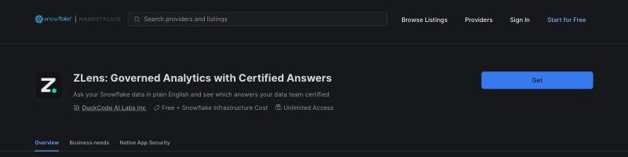
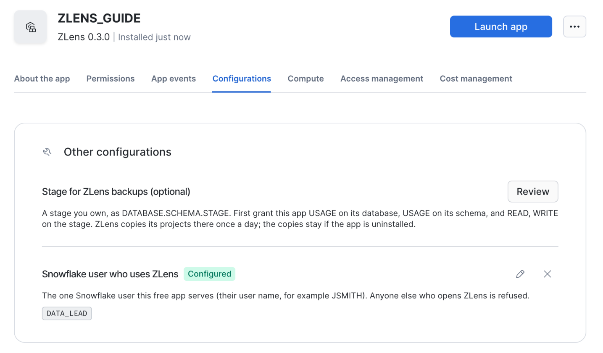
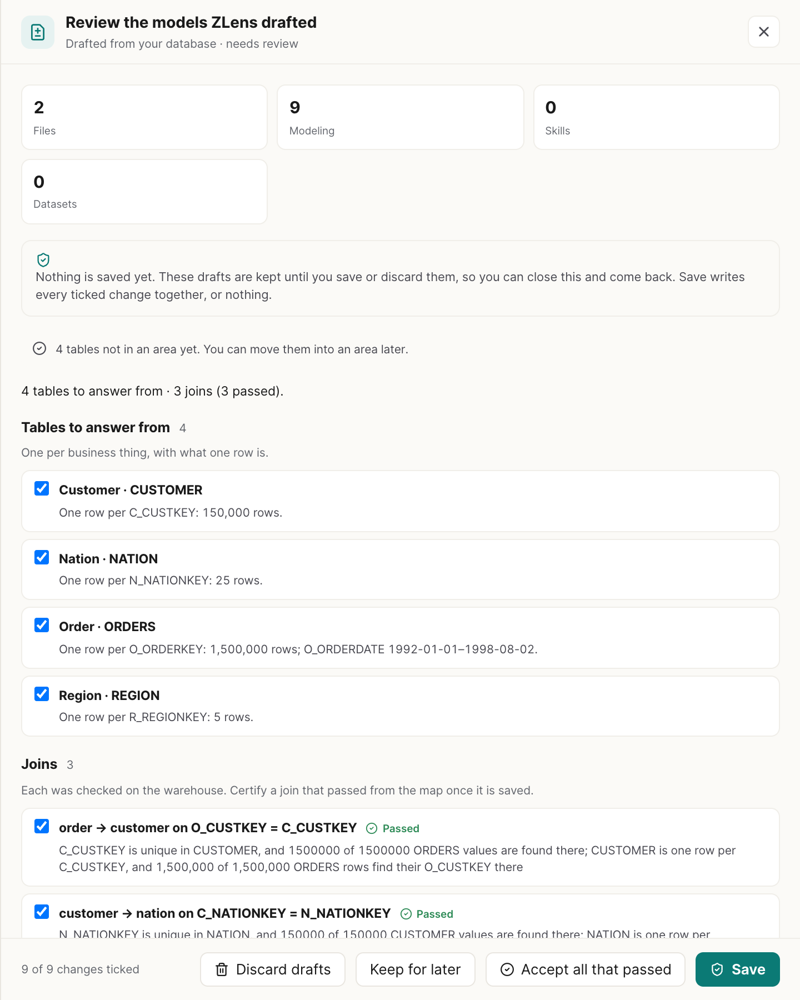
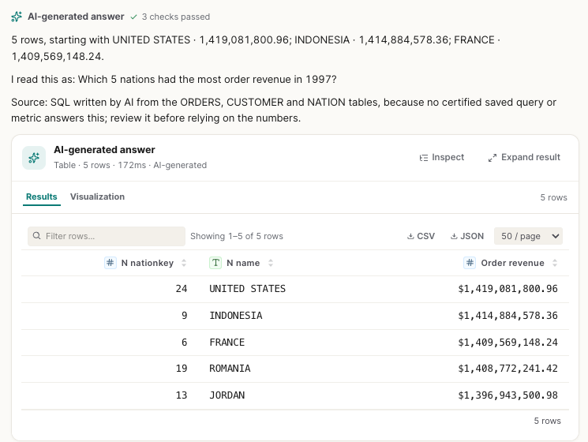
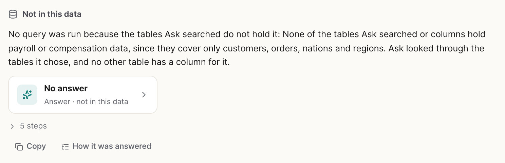
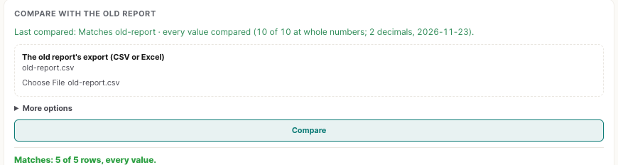
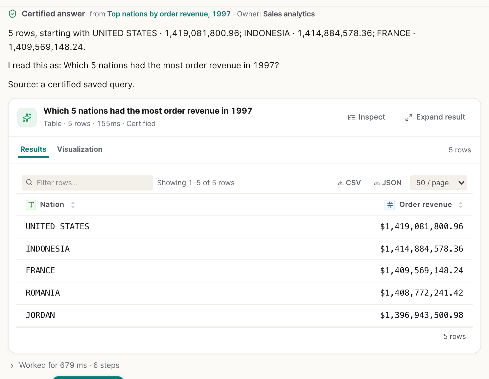

author: Kranthi Kondapaka
id: check-ai-answers-against-your-old-report-with-zlens
language: en
summary: Install the free ZLens Native App from Snowflake Marketplace, ask a question about TPC-H sample data in plain English, check the AI-generated answer against an old report's CSV export, and certify it.
categories: snowflake-site:taxonomy/solution-center/certification/quickstart, snowflake-site:taxonomy/product/analytics, snowflake-site:taxonomy/product/applications-and-collaboration, snowflake-site:taxonomy/snowflake-feature/business-intelligence, snowflake-site:taxonomy/snowflake-feature/native-apps, snowflake-site:taxonomy/snowflake-feature/cortex-llm-functions
environments: web
status: Published
feedback link: https://github.com/Snowflake-Labs/sfguides/issues
open in snowflake: https://app.snowflake.com/marketplace/listing/GZT1Z603GBK/duckcode-ai-labs-inc-zlens-governed-analytics-with-certified-answers

# Check AI Answers Against Your Old Report with the ZLens Native App
<!-- ------------------------ -->
## Overview

ZLens is a Snowflake Native App from DuckCode AI Labs Inc. One person asks questions about Snowflake data in plain English, and every answer says what it rests on:

- **Certified** when a saved query your data team certified answers it
- **From Metrics** when your metric definitions answer it
- **AI-generated** when Claude wrote new SQL for it through Snowflake Cortex

When the granted tables do not hold what a question needs, ZLens says **Not in this data** and runs no query.

AI-generated answers can be wrong. In this guide you check one the way teams check a new report: against the old report they trust. You save the answer as a saved query, compare it with the old report's CSV export, certify it, and ask again to get a **Certified** answer.

ZLens runs inside your Snowflake account with Snowpark Container Services. It reads only the database you grant it, with read-only queries on its own X-Small warehouse, and has no internet access. The app is free for one person. Snowflake bills your account for the compute pool, warehouse, Cortex and storage it uses.

### Prerequisites

- Basic SQL, and running statements in a Snowsight SQL worksheet
- Familiarity with Snowflake roles and grants

### What You'll Learn

- How to get a Snowflake Native App from Snowflake Marketplace and grant it one database
- How ZLens drafts models (tables, keys and joins) from the tables you grant
- How to read the **AI-generated**, **Not in this data** and **Certified** labels on an answer
- How to compare an answer with an old report's CSV export and certify it

### What You'll Need

- A paid [Snowflake account](https://signup.snowflake.com/?utm_source=snowflake-devrel&utm_medium=developer-guides&utm_cta=developer-guides) in an AWS commercial region. A trial account cannot run the app's container or Cortex without a card on file.
- The ACCOUNTADMIN role, or a role with the CREATE APPLICATION and IMPORT SHARE privileges that can also create a database
- Snowflake Cortex for the app. ZLens asks Claude Sonnet 5.5 through [Cortex cross-region inference](https://docs.snowflake.com/en/user-guide/snowflake-cortex/cross-region-inference), so your account's `CORTEX_ENABLED_CROSS_REGION` parameter must allow a region that offers it.
- Snowflake's TPC-H sample data (the `SNOWFLAKE_SAMPLE_DATA` database). The guide shows how to create it if your account does not have it.
- About 30 minutes. The first start after an install can take up to 20 of them.

### What You'll Build

- A certified ZLens saved query that answers "Which 5 nations had the most order revenue in 1997?", checked row by row against an old report's export

<!-- ------------------------ -->
## Get the App

1. In Snowsight, open the [ZLens listing](https://app.snowflake.com/marketplace/listing/GZT1Z603GBK/duckcode-ai-labs-inc-zlens-governed-analytics-with-certified-answers), or in the navigation menu select **Marketplace** » **Snowflake Marketplace** and search for ZLens.
2. Select **Get**.
3. Choose a warehouse for the install. You can also name the application. The SQL in this guide calls it `ZLENS_APP`: if your app has another name, use it wherever the SQL says `ZLENS_APP`. Snowsight shows the name under **Apps**.
4. Select **Get** again.



When you get the app, Snowflake gives it what it needs to run: a small compute pool, its own address, and an extra-small warehouse for its queries. ZLens starts by itself. The app's **Permissions** tab shows the three account privileges it asks for (`BIND SERVICE ENDPOINT`, `CREATE COMPUTE POOL` and `CREATE WAREHOUSE`) and the `SNOWFLAKE.CORTEX_USER` database role.

> **Note:** The **Get** dialog also lists privileges under **Future upgrades**. Snowflake shows that list for every app that asks for its privileges this way. ZLens asks for none of them; the [app's README](https://github.com/duckcode-ai-labs/zlens/blob/main/deploy/snowflake-app/app/README.md) explains the list.

Run the SQL in the next steps in Snowsight as ACCOUNTADMIN, or as the role that installed the app.

<!-- ------------------------ -->
## Name the ZLens User

The free app serves one person, named by their Snowflake user name. For this guide, name yourself.

1. Open **Apps** in Snowsight's left menu, then ZLens, then its **Configurations** tab.
2. Pick a warehouse at the top of the page first. Snowsight needs one to save.
3. Select **Review**, enter the Snowflake user name, and select **Save**.

When it is saved, the tab shows a green **Configured** badge with the name. If it still shows **Review**, open **Review** and save again.



Or in SQL, with the user name in place of `THEIR_USER`:

```sql
ALTER APPLICATION ZLENS_APP SET CONFIGURATION ZLENS_USER VALUE = 'THEIR_USER';
```

The role that installed the app can open it already. If the person you named works in another role, add that role on the app's **Access management** page, or run:

```sql
GRANT APPLICATION ROLE ZLENS_APP.app_user TO ROLE THEIR_ROLE;
```

<!-- ------------------------ -->
## Copy the Sample Data

ZLens ships no data. Copy four tables of Snowflake's [TPC-H sample data](https://docs.snowflake.com/en/user-guide/sample-data-tpch) into a database you own, about 1.7 million rows. In a SQL worksheet, select all the lines, then press **Run**. Snowsight's **Run** runs only the statement at the cursor.

```sql
CREATE DATABASE IF NOT EXISTS ZLENS_SAMPLE COMMENT = 'ZLens: copy of TPC-H SF1 sample data';
CREATE SCHEMA IF NOT EXISTS ZLENS_SAMPLE.TPCH;
CREATE OR REPLACE TABLE ZLENS_SAMPLE.TPCH.REGION   AS SELECT * FROM SNOWFLAKE_SAMPLE_DATA.TPCH_SF1.REGION;
CREATE OR REPLACE TABLE ZLENS_SAMPLE.TPCH.NATION   AS SELECT * FROM SNOWFLAKE_SAMPLE_DATA.TPCH_SF1.NATION;
CREATE OR REPLACE TABLE ZLENS_SAMPLE.TPCH.CUSTOMER AS SELECT * FROM SNOWFLAKE_SAMPLE_DATA.TPCH_SF1.CUSTOMER;
CREATE OR REPLACE TABLE ZLENS_SAMPLE.TPCH.ORDERS   AS SELECT * FROM SNOWFLAKE_SAMPLE_DATA.TPCH_SF1.ORDERS;
```

No `SNOWFLAKE_SAMPLE_DATA` database in your account? Create it from Snowflake's sample share first:

```sql
CREATE DATABASE SNOWFLAKE_SAMPLE_DATA FROM SHARE SFC_SAMPLES.SAMPLE_DATA;
```

<!-- ------------------------ -->
## Grant Access to ZLens

Grant the new database to ZLens. Select all the lines, then press **Run**:

```sql
GRANT USAGE ON DATABASE ZLENS_SAMPLE TO APPLICATION ZLENS_APP;
GRANT USAGE ON SCHEMA ZLENS_SAMPLE.TPCH TO APPLICATION ZLENS_APP;
GRANT SELECT ON ALL TABLES IN SCHEMA ZLENS_SAMPLE.TPCH TO APPLICATION ZLENS_APP;
```

ZLens asks Claude through Snowflake Cortex, and its **Ask** page needs the `SNOWFLAKE.CORTEX_USER` database role. If the app's **Permissions** tab does not show `CORTEX_USER` as granted yet, run:

```sql
GRANT DATABASE ROLE SNOWFLAKE.CORTEX_USER TO APPLICATION ZLENS_APP;
```

Without it, Ask is off and everything else works. The rest of this guide uses Ask.

ZLens picks up these changes within a minute, without a restart.

<!-- ------------------------ -->
## Open ZLens

1. On the app's page in Snowsight, press **Launch app**. It opens a small ZLens page inside Snowsight. If ZLens has stopped, the page starts it and shows the time so far. A start usually takes 2 to 3 minutes, and up to 20 minutes the first time after an install or update.
2. Once Snowflake reports ZLens ready, the page shows **Open ZLens**. Select it. ZLens opens in a new tab, where Snowflake asks you to sign in again; its sign-in page names it `SNOWSERVICES_INGRESS`.
3. Close the launcher tab once ZLens is open. While it stays open, it keeps two warehouses running.


> **Note:** If Snowsight asks you to select a warehouse before the page opens, pick `ZLENS_APP_WH` (your app's name followed by `_WH`), the app's own warehouse. If the page says **Set up ZLens first** or **One step is missing: grant ZLens a database**, it names the missing step: finish it, and the page moves on at its next check, or press **Check again**. A browser that blocks pop-ups blocks **Open ZLens** too; copy the address from the page instead.

<!-- ------------------------ -->
## Review the Drafted Models

Once it has the database, ZLens reads every schema in it that the app can see and drafts the models: entities, their keys and the joins between them. Within a minute or two, a strip at the top of ZLens says it read 4 tables in ZLENS_SAMPLE and drafted 4 models and 3 joins, and points to the drafts in **Modeling**. Nothing is saved until you review them.

1. Open the drafts from the strip.
2. Check the four tables (CUSTOMER, NATION, ORDERS and REGION) and the three joins. ZLens checked each join on the warehouse and marks the ones that passed.
3. Accept the drafts that passed (**Accept all that passed**), then select **Save**.



After you save, **Modeling** shows the four models (Order, Customer, Nation and Region) and the joins between them.

<!-- ------------------------ -->
## Ask a Question

On ZLens's **Ask** page, ask:

> Which 5 nations had the most order revenue in 1997?

No certified saved query or metric answers this yet, so Claude reads the question, picks tables and columns, and writes one read-only SQL query. ZLens checks it and runs it. The answer is labeled **AI-generated**: five rows, UNITED STATES first at 1,419,081,800.96.

Select **How it was answered** under the answer to see each step, the SQL that ran, and the checks it passed.



Review the SQL, or certify the query, before relying on an AI-generated answer. The next steps certify it.

<!-- ------------------------ -->
## Ask Outside the Data

Now ask a question the granted tables cannot answer:

> What was our payroll in 1997?

ZLens says **Not in this data** and runs no query. The answer's steps show that nothing ran on the warehouse.



<!-- ------------------------ -->
## Compare and Certify

The old report in this guide is a CSV export of the same five nations. With your own data, it is the export (CSV or Excel) of the report you trust today. Save these lines as `old-report.csv`:

```csv
N_NATIONKEY,N_NAME,ORDER_REVENUE
24,UNITED STATES,1419081800.96
9,INDONESIA,1414884578.36
6,FRANCE,1409569148.24
19,ROMANIA,1408772241.42
13,JORDAN,1396943500.98
```

ZLens already keeps every AI answer as an automatic draft for review. Saving it gives it a name and an owner.

1. On the nations answer, select **Save as saved query**. Keep the suggested name or type your own, enter an owner (an email, for example `sales-analytics@yourcompany.com`), and select **Save draft**. ZLens opens the saved query; later you find it under **Saved queries**.
2. In **Compare with the old report**, choose `old-report.csv` and select **Compare**. ZLens says **Matches: 5 of 5 rows, every value**.
3. Select **Certify**. Because AI wrote this saved query, ZLens first asks you to confirm you reviewed what AI wrote: check its SQL and its result, then select **I reviewed it — certify**.



ZLens matches the file's columns to the answer's by name, ignoring case, spaces and underscores. Claude wrote the answer's SQL, so its columns can be named differently; if they are, change the file's first line to match. When the old report disagrees, ZLens says **Differs** and names the row, the column and both values.

The saved query's receipt records who certified it, the checks it passed, and the comparison with the old report at that time.

<!-- ------------------------ -->
## Ask Again

Back on the **Ask** page, ask the first question again:

> Which 5 nations had the most order revenue in 1997?

The answer is now **Certified**. ZLens answers from certified saved queries first, so this answer comes from the saved query you certified, not from new SQL.



<!-- ------------------------ -->
## Clean Up

Drop the sample database:

```sql
DROP DATABASE ZLENS_SAMPLE;
```

ZLens stops by itself after 60 minutes with no one using it, and its compute pool suspends 10 minutes after that. To stop it now:

```sql
CALL ZLENS_APP.app_public.stop_app();
```

Uninstalling the app is optional. Uninstalling deletes ZLens's projects, history and in-app backups. In Snowsight, open **Apps** (under **Catalog** in the navigation menu), select **…** next to the app, then **Uninstall**. Or in SQL, where `CASCADE` also drops the objects the app owns, such as its compute pool and warehouse (see [DROP APPLICATION](https://docs.snowflake.com/en/sql-reference/sql/drop-application)):

```sql
DROP APPLICATION ZLENS_APP CASCADE;
```

<!-- ------------------------ -->
## Conclusion And Resources

You installed ZLens, granted it a copy of the TPC-H sample data and reviewed the models it drafted. You saw an **AI-generated** answer and a **Not in this data** answer. Then you compared the AI-generated answer with an old report's export, certified it, and got it back as **Certified**.

To try it on your own data, grant ZLens one of your databases (the app's README has the lines, including views) and compare the answers people rely on with the reports they use today.

### What You Learned

- How to get the ZLens Native App from Snowflake Marketplace, name its user and grant it a database
- How ZLens drafts models, keys and joins from the tables you grant, and how to review them
- How to read the **AI-generated**, **Not in this data** and **Certified** labels on an answer
- How to compare an answer with an old report's CSV export and certify it

### Related Resources

- [ZLens on Snowflake Marketplace](https://app.snowflake.com/marketplace/listing/GZT1Z603GBK/duckcode-ai-labs-inc-zlens-governed-analytics-with-certified-answers)
- [ZLens app README](https://github.com/duckcode-ai-labs/zlens/blob/main/deploy/snowflake-app/app/README.md): setup, operations, costs and privileges
- [ZLens architecture](https://github.com/duckcode-ai-labs/zlens/blob/main/deploy/snowflake-app/ARCHITECTURE.md): how every part of the app connects
- [Install an app from a listing](https://docs.snowflake.com/en/developer-guide/native-apps/ui-consumer-installing)
- [Manage and uninstall apps](https://docs.snowflake.com/en/developer-guide/native-apps/ui-consumer-managing-applications)
- [Cortex cross-region inference](https://docs.snowflake.com/en/user-guide/snowflake-cortex/cross-region-inference)
- [TPC-H sample data](https://docs.snowflake.com/en/user-guide/sample-data-tpch)
