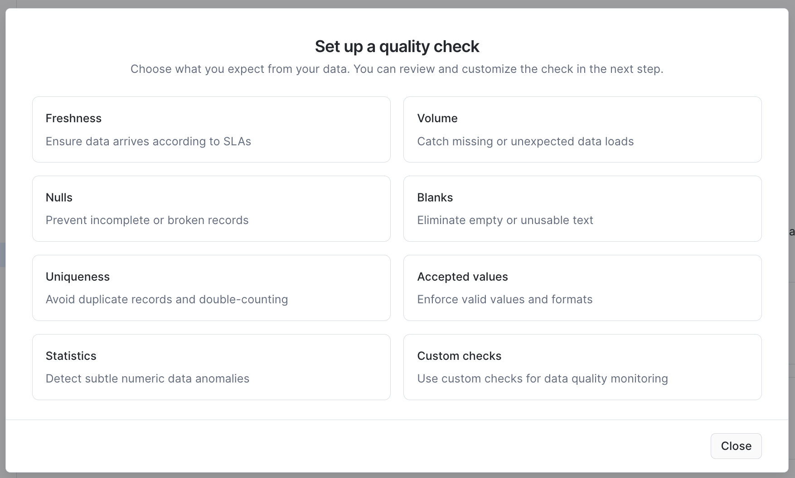
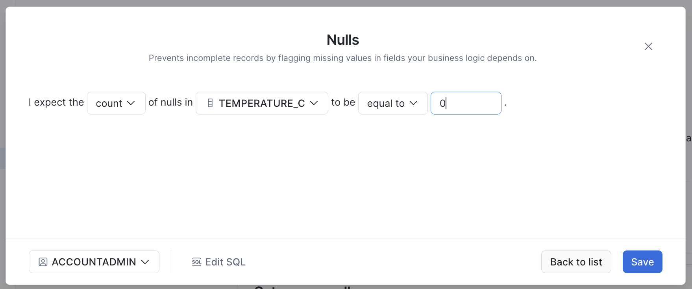
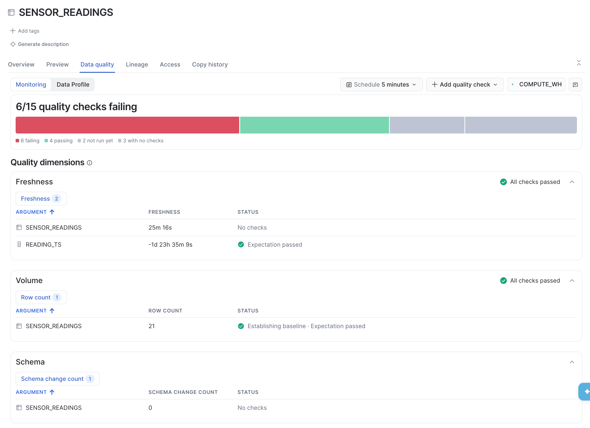
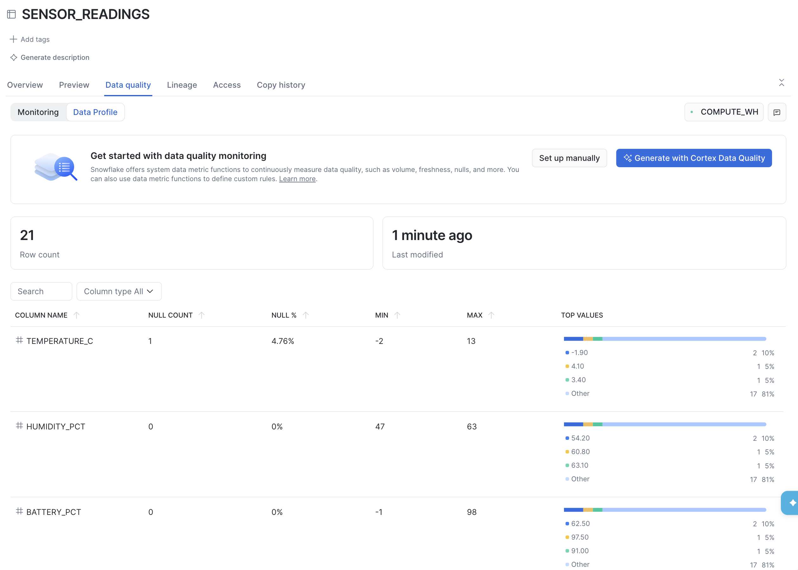
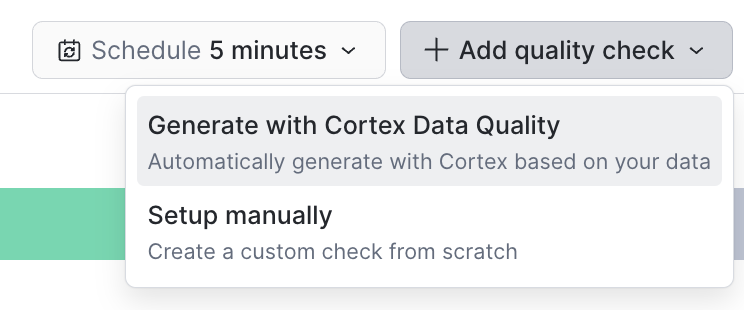
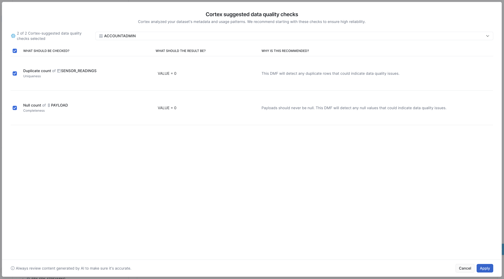
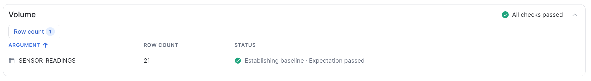
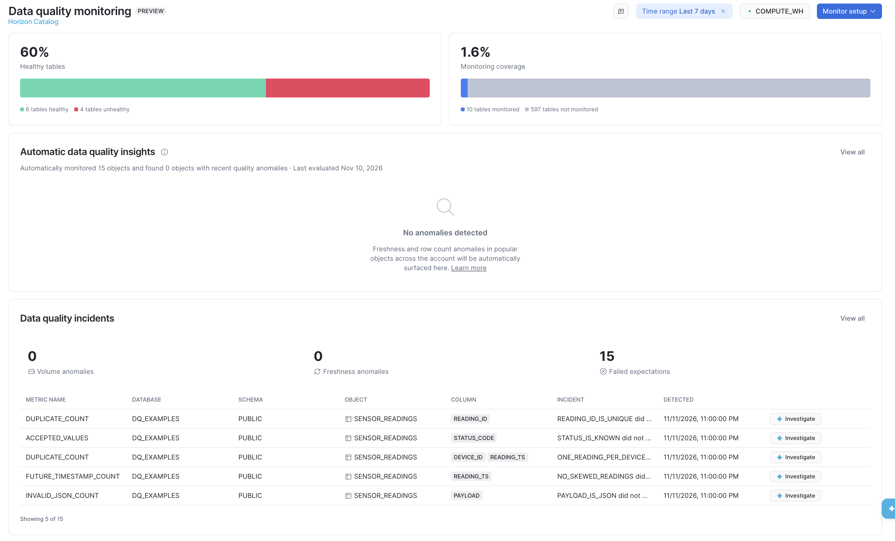
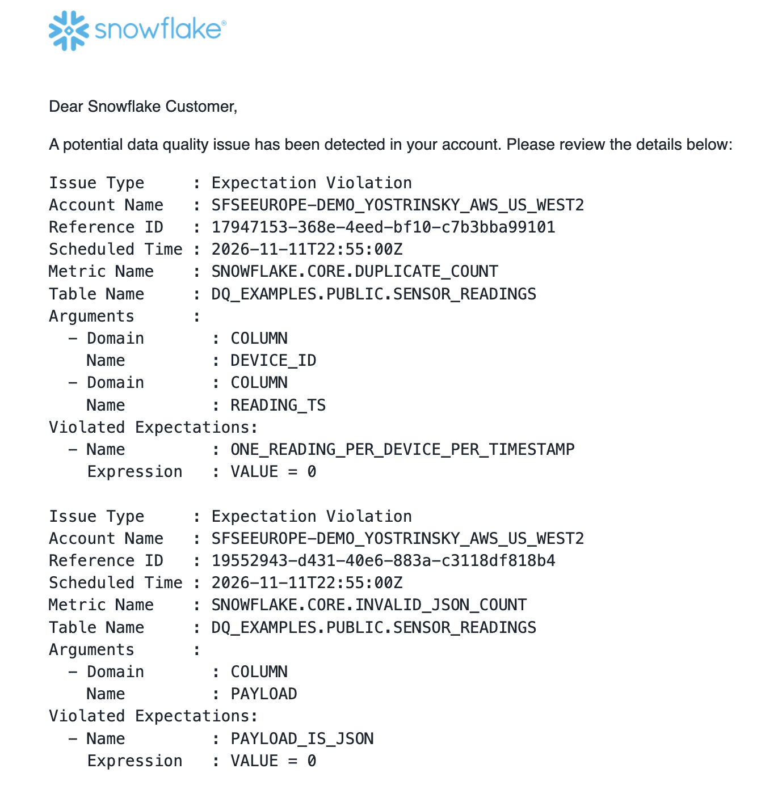
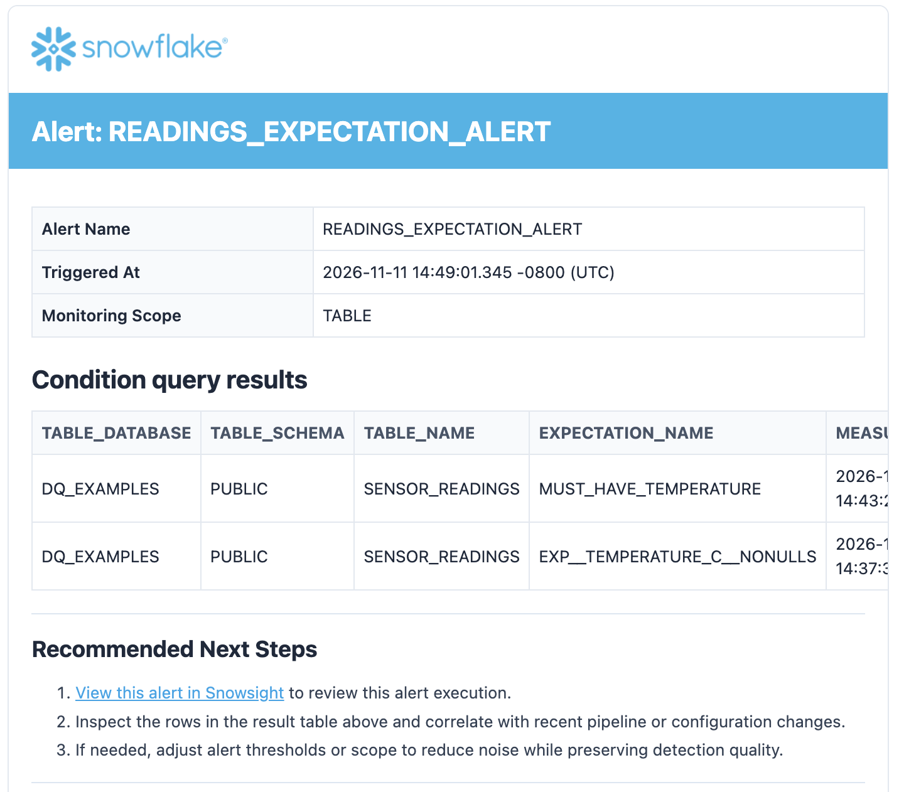

author: Yoav Ostrinsky
id: comprehensive-guide-to-data-quality-monitoring
summary: A cookbook of runnable examples for Snowflake data quality: system and custom DMFs, expectations, scoping, AI-suggested checks, anomaly detection, notifications, and quality as code.
categories: snowflake-site:taxonomy/product/data-engineering,snowflake-site:taxonomy/snowflake-feature/transformation
environments: web
status: Published
language: en
feedback link: https://github.com/Snowflake-Labs/sfquickstarts/issues
tags: Getting Started, Data Quality, Data Metric Functions, DMF, Data Engineering, Governance

# Comprehensive Guide to Snowflake Data Quality Monitoring
<!-- ------------------------ -->
## Overview

Data quality problems rarely announce themselves. A device clock drifts and stamps readings two days into the future. An upstream system swaps a missing battery level for -1. A firmware release emits truncated JSON. Nothing errors, and the dashboards keep rendering, on data that is quietly wrong.

Snowflake can check for these conditions natively, on a schedule, without moving data or standing up another tool. This guide explores what that makes possible.

### How to use this guide

Start with *The Example Data*, which creates everything the examples use. Each later section explores **one capability** and adds checks to the same table, so the sections are meant to be run in order; where a section relies on a check from an earlier one, it says so. Where something can be done both in SQL and in Snowsight, the section shows both. Profiling, AI-suggested checks, and the monitoring dashboard are Snowsight-only; everything else is shown in SQL.

### What You'll Learn

- How a check is assembled: metric, association, schedule, expectation, results
- Which system data metric function to reach for, given a column's shape
- Completeness, validity, timeliness, integrity, volume, drift and distribution checks
- How to scope a check with FILTER or compute it per group with WITHIN GROUP
- How to write a custom metric, cover a whole schema, and let Snowflake suggest checks and learn normal ranges
- How to find the offending rows, get notified natively or through an alert created from a template
- Where to place checks, how to keep them in code, and what monitoring costs

### What You'll Build

A set of quality checks on a small IoT sensor telemetry dataset: system and custom metrics, expectations, scoped and grouped checks, schema-level coverage, anomaly detection, and notifications that fire when a check fails.

### What You'll Need

- A Snowflake account on **Enterprise Edition or higher**. Data Quality Monitoring is not available on Standard Edition or on [trial accounts](https://docs.snowflake.com/en/user-guide/data-quality-intro#label-data-quality-limitations).
- A role that can create a database and a warehouse, and that holds:
  - EXECUTE DATA METRIC FUNCTION on the account, to attach and schedule metrics
  - MANAGE DATA QUALITY on the account, for schema-level checks and notifications
  - EXECUTE ALERT on the account, for the template alert in *Get Told, Don't Watch*
  - CREATE INTEGRATION on the account, for *Get Told, Don't Watch*

  ACCOUNTADMIN holds all of these. See [Access control for data quality](https://docs.snowflake.com/en/user-guide/data-quality-access-control).
- Familiarity with running SQL in a Snowsight worksheet.

### Use Cortex Code with this guide

With Cortex Code, the /data-quality skill can apply these workflows to your own tables: recommending metrics, scoring schema health, and investigating violations.

<!-- ------------------------ -->
## The Example Data

The examples use a small IoT dataset. Refrigerated sites report temperature and humidity from battery-powered sensors; readings land in a raw table keyed to a device inventory, with **deliberate defects** for the checks to find. Timestamps are relative to the current time.

```sql
CREATE DATABASE IF NOT EXISTS DQ_EXAMPLES;
USE DATABASE DQ_EXAMPLES;
USE SCHEMA PUBLIC;

CREATE WAREHOUSE IF NOT EXISTS DQ_EXAMPLES_WH
    WAREHOUSE_SIZE = XSMALL
    AUTO_SUSPEND = 60
    INITIALLY_SUSPENDED = TRUE;
USE WAREHOUSE DQ_EXAMPLES_WH;

CREATE OR REPLACE TABLE SITES (
    SITE_ID   VARCHAR(10),
    SITE_NAME VARCHAR(100),
    REGION    VARCHAR(50)
);

CREATE OR REPLACE TABLE DEVICES (
    DEVICE_ID    VARCHAR(20),
    SITE_ID      VARCHAR(10),
    MODEL        VARCHAR(50),
    INSTALLED_ON DATE,
    LABEL        VARCHAR(100)
);

CREATE OR REPLACE TABLE SENSOR_READINGS (
    READING_ID    NUMBER(10,0),
    DEVICE_ID     VARCHAR(20),
    READING_TS    TIMESTAMP_LTZ,
    INGESTED_AT   TIMESTAMP_LTZ,
    TEMPERATURE_C NUMBER(5,2),
    HUMIDITY_PCT  NUMBER(5,2),
    BATTERY_PCT   NUMBER(5,2),
    PAYLOAD       VARCHAR(500),
    STATUS_CODE   VARCHAR(20)
);

INSERT INTO SITES (SITE_ID, SITE_NAME, REGION) VALUES
    ('SITE-01', 'Rotterdam Cold Store',  'EMEA'),
    ('SITE-02', 'Dublin Distribution',   'EMEA'),
    ('SITE-03', 'Singapore Transit Hub', 'APAC');

INSERT INTO DEVICES (DEVICE_ID, SITE_ID, MODEL, INSTALLED_ON, LABEL) VALUES
    ('DEV-1001', 'SITE-01', 'TH-200',  '2025-03-14', 'Cold aisle A'),
    ('DEV-1002', 'SITE-01', 'TH-200',  '2025-03-14', 'Cold aisle B'),
    ('DEV-1003', 'SITE-02', 'TH-350',  '2025-07-02', '  Loading bay 1  '),
    ('DEV-1004', 'SITE-02', 'TH-350',  '2025-07-02', 'Loading bay 2'),
    ('DEV-1005', 'SITE-03', 'TH-350X', '2026-01-20', 'Transit chiller');

INSERT INTO SENSOR_READINGS
    (READING_ID, DEVICE_ID, READING_TS, INGESTED_AT, TEMPERATURE_C, HUMIDITY_PCT, BATTERY_PCT, PAYLOAD, STATUS_CODE)
SELECT 1001, 'DEV-1001', DATEADD(HOUR, -9, CURRENT_TIMESTAMP()), DATEADD(HOUR, -9, CURRENT_TIMESTAMP()),  3.90, 61.20, 98.00, '{"rssi":-71,"fw":"2.3.1"}', 'OK'
UNION ALL SELECT 1002, 'DEV-1001', DATEADD(HOUR, -8, CURRENT_TIMESTAMP()), DATEADD(HOUR, -8, CURRENT_TIMESTAMP()),  4.10, 60.80, 97.50, '{"rssi":-70,"fw":"2.3.1"}', 'OK'
UNION ALL SELECT 1003, 'DEV-1002', DATEADD(HOUR, -8, CURRENT_TIMESTAMP()), DATEADD(HOUR, -8, CURRENT_TIMESTAMP()),  3.40, 63.10, 91.00, '{"rssi":-77,"fw":"2.3.1"}', 'OK'
UNION ALL SELECT 1004, 'DEV-1002', DATEADD(HOUR, -7, CURRENT_TIMESTAMP()), DATEADD(HOUR, -7, CURRENT_TIMESTAMP()),  3.60, 62.40, 90.50, '{"rssi":-76,"fw":"2.3.1"}', 'OK'
UNION ALL SELECT 1005, 'DEV-1003', DATEADD(HOUR, -7, CURRENT_TIMESTAMP()), DATEADD(HOUR, -7, CURRENT_TIMESTAMP()), 12.80, 48.90, 76.00, '{"rssi":-65,"fw":"2.4.0"}', 'OK'
UNION ALL SELECT 1006, 'DEV-1003', DATEADD(HOUR, -6, CURRENT_TIMESTAMP()), DATEADD(HOUR, -6, CURRENT_TIMESTAMP()), 13.10, 47.60, 75.50, '{"rssi":-66,"fw":"2.4.0"}', 'OK'
UNION ALL SELECT 1007, 'DEV-1004', DATEADD(HOUR, -6, CURRENT_TIMESTAMP()), DATEADD(HOUR, -6, CURRENT_TIMESTAMP()), 11.90, 50.20, 88.00, '{"rssi":-69,"fw":"2.4.0"}', 'OK'
UNION ALL SELECT 1008, 'DEV-1004', DATEADD(HOUR, -5, CURRENT_TIMESTAMP()), DATEADD(HOUR, -5, CURRENT_TIMESTAMP()), 12.20, 49.70, 87.50, '{"rssi":-68,"fw":"2.4.0"}', 'OK'
UNION ALL SELECT 1009, 'DEV-1005', DATEADD(HOUR, -5, CURRENT_TIMESTAMP()), DATEADD(HOUR, -5, CURRENT_TIMESTAMP()), -2.40, 55.30, 64.00, '{"rssi":-81,"fw":"2.4.1"}', 'OK'
UNION ALL SELECT 1010, 'DEV-1005', DATEADD(HOUR, -4, CURRENT_TIMESTAMP()), DATEADD(HOUR, -4, CURRENT_TIMESTAMP()), -2.10, 54.80, 63.50, '{"rssi":-80,"fw":"2.4.1"}', 'OK'
UNION ALL SELECT 1011, 'DEV-1001', DATEADD(HOUR, -4, CURRENT_TIMESTAMP()), DATEADD(HOUR, -4, CURRENT_TIMESTAMP()),  4.30, 60.10, 96.00, '{"rssi":-72,"fw":"2.3.1"}', 'OK'
UNION ALL SELECT 1012, 'DEV-1002', DATEADD(HOUR, -3, CURRENT_TIMESTAMP()), DATEADD(HOUR, -3, CURRENT_TIMESTAMP()),  3.80, 61.90, 89.00, '{"rssi":-75,"fw":"2.3.1"}', 'OK'
UNION ALL SELECT 1013, 'DEV-1003', DATEADD(HOUR, -3, CURRENT_TIMESTAMP()), DATEADD(HOUR, -3, CURRENT_TIMESTAMP()), 13.40, 46.80, 74.00, '{"rssi":-64,"fw":"2.4.0"}', 'OK'
UNION ALL SELECT 1014, 'DEV-1004', DATEADD(HOUR, -2, CURRENT_TIMESTAMP()), DATEADD(HOUR, -2, CURRENT_TIMESTAMP()), 12.50, 49.10, 86.50, '{"rssi":-67,"fw":"2.4.0"}', 'OK'
UNION ALL SELECT 1015, 'DEV-1005', DATEADD(HOUR, -2, CURRENT_TIMESTAMP()), DATEADD(HOUR, -2, CURRENT_TIMESTAMP()), -1.90, 54.20, 62.50, '{"rssi":-79,"fw":"2.4.1"}', 'OK'
UNION ALL SELECT 1015, 'DEV-1005', DATEADD(HOUR, -2, CURRENT_TIMESTAMP()), DATEADD(HOUR, -2, CURRENT_TIMESTAMP()), -1.90, 54.20, 62.50, '{"rssi":-79,"fw":"2.4.1"}', 'OK'
UNION ALL SELECT 1016, 'DEV-1001', DATEADD(HOUR, -1, CURRENT_TIMESTAMP()), DATEADD(HOUR, -1, CURRENT_TIMESTAMP()), NULL,  59.70, 95.50, '{"rssi":-73,"fw":"2.3.1"}', 'OK'
UNION ALL SELECT 1017, 'DEV-9999', DATEADD(HOUR, -1, CURRENT_TIMESTAMP()), DATEADD(HOUR, -1, CURRENT_TIMESTAMP()),  5.20, 58.30, 80.00, '{"rssi":-74,"fw":"2.3.1"}', 'OK'
UNION ALL SELECT 1018, 'DEV-1003', DATEADD(MINUTE, -30, CURRENT_TIMESTAMP()), DATEADD(MINUTE, -30, CURRENT_TIMESTAMP()), 13.00, 47.10, -1.00, '{"rssi":-63,"fw":"2.4.0"}', 'BATT_UNKNOWN'
UNION ALL SELECT 1019, 'DEV-1004', DATEADD(MINUTE, -20, CURRENT_TIMESTAMP()), DATEADD(MINUTE, -20, CURRENT_TIMESTAMP()), 12.10, 49.40, 86.00, '{"rssi":-67,"fw":', 'OK'
UNION ALL SELECT 1020, 'DEV-1002', DATEADD(DAY, 2, CURRENT_TIMESTAMP()), DATEADD(MINUTE, -10, CURRENT_TIMESTAMP()),  3.70, 62.00, 88.50, '{"rssi":-75,"fw":"2.3.1"}', 'OK';
```

That is 21 rows across 5 devices and 3 sites. The timestamp columns are TIMESTAMP_LTZ on purpose: metrics that compare against the evaluation time (FRESHNESS and FUTURE_TIMESTAMP_COUNT) accept DATE, TIMESTAMP_LTZ and TIMESTAMP_TZ, but **not TIMESTAMP_NTZ**, Snowflake's default timestamp type.

### The defects, named openly

| Reading | Problem | The check that finds it |
|:--------|:--------|:------------------------|
| 1016 | TEMPERATURE_C is NULL | NULL_COUNT |
| 1020 | READING_TS is two days in the future (device clock skew) | FUTURE_TIMESTAMP_COUNT |
| 1019 | PAYLOAD is truncated and not valid JSON | INVALID_JSON_COUNT |
| 1018 | BATTERY_PCT is -1, a sentinel for "unknown"; STATUS_CODE is BATT_UNKNOWN | NEGATIVE_COUNT, ACCEPTED_VALUES |
| 1015 | Appears twice (duplicated on ingest) | DUPLICATE_COUNT |
| 1017 | DEVICE_ID is DEV-9999, which is not in DEVICES | REFERENTIAL_INTEGRITY_COUNT |
| DEVICES DEV-1003 | LABEL has leading and trailing spaces | UNTRIMMED_STRING_COUNT |

TEMPERATURE_C legitimately goes negative: DEV-1005 is a freezer. That is why the negative-value check targets BATTERY_PCT, not temperature.

<!-- ------------------------ -->
## Anatomy of a Check

A check has five parts:

1. A **data metric function (DMF)** measures something and returns a number. It makes no judgment.
2. An **association** attaches the DMF to a table and column.
3. A **schedule**, set on the table, governs how often every attached metric runs.
4. An **expectation** turns the number into a verdict. A metric without one is measured but never judged.
5. **Results** land in monitoring views you query or read in Snowsight.

This is the model the rest of the guide builds on. To set a schedule, then attach a metric with an expectation:

```sql
ALTER TABLE SENSOR_READINGS SET DATA_METRIC_SCHEDULE = '1440 MINUTE';

ALTER TABLE SENSOR_READINGS
    ADD DATA METRIC FUNCTION SNOWFLAKE.CORE.NULL_COUNT
    ON (TEMPERATURE_C)
    EXPECTATION MUST_HAVE_TEMPERATURE (VALUE = 0);
```

Each metric, table and column combination can have **only one association**. Adding the same combination again, even with a different filter or grouping, returns an error that points to MODIFY; to change a check, modify it, or drop and re-add it.

On a new table, you can declare checks in CREATE TABLE, after the column list, so the table and its guarantees arrive together. The bindings go inside parentheses, separated by commas; see [Use SQL to set up data quality checks](https://docs.snowflake.com/en/user-guide/data-quality-working) for the full syntax.

```sql
CREATE OR REPLACE TABLE SENSOR_READINGS_V2 (
    READING_ID    NUMBER(10,0),
    TEMPERATURE_C NUMBER(5,2)
)
WITH DATA METRIC FUNCTION (
    SNOWFLAKE.CORE.NULL_COUNT
        ON (TEMPERATURE_C)
        EXPECTATION MUST_HAVE_TEMPERATURE (VALUE = 0)
);
```

### Direct calls versus attached metrics

Metrics that **take a column argument** can be called directly in a SELECT, immediately and without a schedule. A direct call is not billed as Data Quality Monitoring; it runs on your warehouse like any other query:

```sql
SELECT SNOWFLAKE.CORE.NULL_COUNT(SELECT TEMPERATURE_C FROM SENSOR_READINGS) AS MISSING_TEMPERATURE;
```

Returns 1. Metrics that **take no column argument** (ROW_COUNT, SCHEMA_CHANGE_COUNT, REFERENTIAL_INTEGRITY_COUNT, FRESHNESS with no column, multi-column DUPLICATE_COUNT), and ACCEPTED_VALUES, work only once attached.

### Evaluating expectations now

You can evaluate every expectation on a table without waiting for the schedule:

```sql
SELECT METRIC_NAME, EXPECTATION_NAME, EXPECTATION_EXPRESSION, VALUE, EXPECTATION_VIOLATED
FROM TABLE(SYSTEM$EVALUATE_DATA_QUALITY_EXPECTATIONS('SENSOR_READINGS'));
```

| METRIC_NAME | EXPECTATION_NAME | EXPECTATION_EXPRESSION | VALUE | EXPECTATION_VIOLATED |
|:------------|:-----------------|:-----------------------|------:|:---------------------|
| NULL_COUNT | MUST_HAVE_TEMPERATURE | VALUE = 0 | 1 | TRUE |

This form returns a result without recording it. SYSTEM$EVALUATE_DATA_QUALITY_EXPECTATIONS_PERSIST_RESULT also writes it to monitoring history, which anything reading DATA_QUALITY_MONITORING_EXPECTATION_STATUS, such as an alert or your own queries, depends on. The Snowsight Monitoring page is different: it reports a check as not run yet until its first scheduled evaluation. Pass it the fully qualified table name: at the time of writing, with a bare name it returns the same result but records nothing, so an alert reading the status finds no violation.

### In Snowsight

The same check can be added from the table's **Data quality** tab. On a table with no checks yet, choose **Set up manually**, pick a check type such as **Nulls**, then a column and the expected value. A check created in Snowsight is visible to SQL and vice versa, but Snowsight names the expectation for you, here EXP__TEMPERATURE_C__NONULLS rather than MUST_HAVE_TEMPERATURE. See [Use Snowsight to set up data quality checks](https://docs.snowflake.com/en/user-guide/data-quality-ui-setup).





### Scheduling options

The schedule belongs to the table, not to a metric: every metric attached to a table runs on that table's schedule. There are three kinds. These are alternatives, not steps: the examples in this guide assume the daily '1440 MINUTE' schedule shown above.

```sql
-- Fixed interval: 5, 15, 30, 60, 720, or 1440 minutes
ALTER TABLE SENSOR_READINGS SET DATA_METRIC_SCHEDULE = '60 MINUTE';

-- Cron: here, 08:00 UTC on weekdays
ALTER TABLE SENSOR_READINGS SET DATA_METRIC_SCHEDULE = 'USING CRON 0 8 * * MON-FRI UTC';

-- On change: whenever DML modifies the table
ALTER TABLE SENSOR_READINGS SET DATA_METRIC_SCHEDULE = 'TRIGGER_ON_CHANGES';
```

The right interval matches how fast you would act. TRIGGER_ON_CHANGES suits tables loaded in batches; it works on regular, transient, temporary, dynamic, external and Iceberg tables but **not on views**, and reclustering does not trigger it. Cron runs in the time zone named in the expression, and a run is skipped if the previous one has not finished. See [Schedule the DMF to run](https://docs.snowflake.com/en/user-guide/data-quality-working).

To pause evaluations while keeping checks attached, set the schedule to an empty string:

```sql
ALTER TABLE SENSOR_READINGS SET DATA_METRIC_SCHEDULE = '';
```

UNSET is a trap: it reverts the table to the **default hourly** cadence, which multiplies a daily table's evaluations by twenty-four. The references show the current schedule; a blank SCHEDULE means suspended:

```sql
SELECT METRIC_NAME, SCHEDULE, SCHEDULE_STATUS
FROM TABLE(INFORMATION_SCHEMA.DATA_METRIC_FUNCTION_REFERENCES(
    REF_ENTITY_NAME   => 'DQ_EXAMPLES.PUBLIC.SENSOR_READINGS',
    REF_ENTITY_DOMAIN => 'table'));
```

If you tried the alternatives, restore the daily schedule before continuing:

```sql
ALTER TABLE SENSOR_READINGS SET DATA_METRIC_SCHEDULE = '1440 MINUTE';
```



<!-- ------------------------ -->
## Profile Before You Check

Before writing rules, look at the data. In Snowsight, open **DQ_EXAMPLES » PUBLIC » SENSOR_READINGS**, go to the **Data quality** tab and switch to **Data Profile** to see per-column statistics. This view is Snowsight-only.



Two things stand out: TEMPERATURE_C has a non-zero null share, and BATTERY_PCT has a minimum of -1. The scripted equivalent:

```sql
SELECT COUNT(*)                                            AS TOTAL_ROWS,
       COUNT(*) - COUNT(TEMPERATURE_C)                      AS MISSING_TEMPERATURE,
       MIN(BATTERY_PCT)                                     AS LOWEST_BATTERY,
       COUNT(DISTINCT DEVICE_ID)                            AS DEVICES_REPORTING,
       MAX(READING_TS)                                      AS LATEST_READING
FROM SENSOR_READINGS;
```

Profiling tells you what is unusual, not what is *wrong*; that judgment is yours.

<!-- ------------------------ -->
## Choosing a Check

Snowflake's system metrics live in SNOWFLAKE.CORE: more than 185 of them, grouped into categories. Start from the category that matches the column, then pick a metric:

| Category | Catches | Examples |
|:-----------------------|:--------|:---------|
| Completeness | Missing or empty values | NULL_COUNT, BLANK_COUNT, EMPTY_STRING_COUNT |
| Validity | Values that break a format or rule | ACCEPTED_VALUES, INVALID_JSON_COUNT, FUTURE_TIMESTAMP_COUNT, REFERENTIAL_INTEGRITY_COUNT |
| Consistency | Formatting regressions in text | UNTRIMMED_STRING_COUNT, CASE_FORMAT_VIOLATION_COUNT |
| Uniqueness | Double ingestion, broken grain | DUPLICATE_COUNT, UNIQUE_COUNT |
| Freshness | Stalled pipelines | FRESHNESS |
| Volume | Tables that stop growing or collapse | ROW_COUNT, TABLE_SIZE_BYTES |
| Schema | Columns added, dropped, renamed, retyped | SCHEMA_CHANGE_COUNT |
| Statistics | Drift no single row reveals; sentinel values | AVG, STDDEV, APPROX_QUANTILE_50, NEGATIVE_COUNT |
| Outliers | Values far outside the column's range | OUTLIER_IQR_COUNT, EXTREME_OUTLIER_ZSCORE_COUNT |
| Machine Learning | Model predictions drifting from actuals | ACCURACY, MAPE, R_SQUARED |

Most metrics come in a _COUNT and a _PERCENT form: _COUNT suits cases where any occurrence is a defect, and _PERCENT cases where proportion matters in a table whose size varies. For the current list, see [System data metric functions](https://docs.snowflake.com/en/user-guide/data-quality-system-dmfs).

<!-- ------------------------ -->
## Completeness and Validity

Every reading should carry a temperature (reading 1016 does not), a parseable payload (1019 does not), and a known status code (1018 does not). The column-argument metrics can be measured directly:

```sql
SELECT SNOWFLAKE.CORE.NULL_PERCENT(SELECT TEMPERATURE_C FROM SENSOR_READINGS) AS MISSING_PCT,
       SNOWFLAKE.CORE.INVALID_JSON_COUNT(SELECT PAYLOAD FROM SENSOR_READINGS) AS BAD_PAYLOADS,
       SNOWFLAKE.CORE.UNTRIMMED_STRING_COUNT(SELECT LABEL FROM DEVICES)       AS PADDED_LABELS;
```

| MISSING_PCT | BAD_PAYLOADS | PADDED_LABELS |
|------------:|-------------:|--------------:|
| 4.761900 | 1 | 1 |

One row in twenty-one has no temperature. The count form expresses a rule ("never"); the percentage form, a tolerance ("under 1%"). MUST_HAVE_TEMPERATURE from *Anatomy of a Check* is already the rule for temperature; the payload rule attaches the same way:

```sql
ALTER TABLE SENSOR_READINGS
    ADD DATA METRIC FUNCTION SNOWFLAKE.CORE.INVALID_JSON_COUNT
    ON (PAYLOAD)
    EXPECTATION PAYLOAD_IS_JSON (VALUE = 0);
```

| Case | DMF | Notes |
|:-----|:----|:------|
| Missing values | NULL_COUNT, NULL_PERCENT | Count for a rule, percent for a tolerance |
| Malformed JSON | INVALID_JSON_COUNT | Tests TRY_PARSE_JSON; NULLs are not counted as invalid |
| Text that will fail a numeric cast | INVALID_NUMERIC_TYPE_CAST_COUNT | Attach to staging columns you plan to cast |
| Sentinel or impossible numbers | NEGATIVE_COUNT, ZERO_COUNT | Apply only where the value is genuinely impossible; see *Scoping Checks* |
| Empty or padded strings | BLANK_COUNT, UNTRIMMED_STRING_COUNT | Finds the DEV-1003 label in DEVICES |
| Value outside a known set | ACCEPTED_VALUES | Takes a lambda; must be attached |

ACCEPTED_VALUES is the one pattern that differs. It takes a Boolean lambda and counts the rows that fail it:

```sql
ALTER TABLE SENSOR_READINGS
    ADD DATA METRIC FUNCTION SNOWFLAKE.CORE.ACCEPTED_VALUES
    ON (STATUS_CODE, STATUS_CODE -> STATUS_CODE IN ('OK', 'WARN'))
    EXPECTATION STATUS_IS_KNOWN (VALUE = 0);
```

Evaluating now with SYSTEM$EVALUATE_DATA_QUALITY_EXPECTATIONS shows STATUS_IS_KNOWN at 1 (reading 1018) and saves you writing a custom value-in-list metric.

<!-- ------------------------ -->
## Timeliness

FRESHNESS returns the seconds between the newest value in a timestamp column and the moment the check ran:

```sql
SELECT SNOWFLAKE.CORE.FRESHNESS(SELECT READING_TS FROM SENSOR_READINGS) AS STALENESS_SECONDS;
```

On the example data this returns something like -172700, which is **negative**. Reading 1020 is stamped two days ahead, so freshness reports data that has not happened yet, and an expectation like VALUE < 3600 would pass while the pipeline was dead. **A freshness check alone can be defeated by one bad timestamp.** Paired with a clock-skew check, it cannot be fooled:

```sql
ALTER TABLE SENSOR_READINGS
    ADD DATA METRIC FUNCTION SNOWFLAKE.CORE.FRESHNESS
    ON (READING_TS)
    EXPECTATION READINGS_ARE_RECENT (VALUE < 600);

ALTER TABLE SENSOR_READINGS
    ADD DATA METRIC FUNCTION SNOWFLAKE.CORE.FUTURE_TIMESTAMP_COUNT
    ON (READING_TS)
    EXPECTATION NO_SKEWED_READINGS (VALUE = 0);
```

| Case | Approach |
|:-----|:---------|
| Is the *data* current? | FRESHNESS on a timestamp column |
| Did the *pipeline* run? | FRESHNESS with ON (), which measures the last DML against the table |
| Is any row dated in the future? | FUTURE_TIMESTAMP_COUNT; prefer the count over FUTURE_TIMESTAMP_PERCENT |
| Business hours, per-source SLAs | A custom metric using SNOWFLAKE.CORE.DATA_METRIC_SCHEDULE_TIME(); see *Write Your Own Check* |

FUTURE_TIMESTAMP_COUNT compares against the evaluation time, so a row that passes today can fail on a rerun of history. That is correct: a backfill dated next Tuesday is wrong on both days.

<!-- ------------------------ -->
## Integrity and Uniqueness

Reading 1017 reports device DEV-9999, which is not in DEVICES; joins silently drop it. REFERENTIAL_INTEGRITY_COUNT replaces a hand-written NOT IN check. The second argument names the parent table and its matching column:

```sql
ALTER TABLE SENSOR_READINGS
    ADD DATA METRIC FUNCTION SNOWFLAKE.CORE.REFERENTIAL_INTEGRITY_COUNT
    ON (DEVICE_ID, TABLE(DEVICES(DEVICE_ID)))
    EXPECTATION NO_ORPHAN_READINGS (VALUE = 0);
```

For compound keys, the columns are listed in matching order on both sides. *Find the Bad Rows* shows how to retrieve reading 1017 itself.

Reading 1015 was ingested twice:

```sql
SELECT SNOWFLAKE.CORE.DUPLICATE_COUNT(SELECT READING_ID FROM SENSOR_READINGS) AS DUPLICATED_VALUES,
       SNOWFLAKE.CORE.UNIQUE_COUNT(SELECT READING_ID FROM SENSOR_READINGS)    AS DISTINCT_VALUES;
```

Returns 1 and 20. DUPLICATE_COUNT is the number of *values that have duplicates*, not excess rows; UNIQUE_COUNT is the number of *distinct* values, not values occurring once.

| Case | Approach |
|:-----|:---------|
| Single-column key | DUPLICATE_COUNT ON (READING_ID) with VALUE = 0 |
| Grain is a column combination | DUPLICATE_COUNT on a column list; must be attached |
| Orphaned foreign keys | REFERENTIAL_INTEGRITY_COUNT |

```sql
ALTER TABLE SENSOR_READINGS
    ADD DATA METRIC FUNCTION SNOWFLAKE.CORE.DUPLICATE_COUNT
    ON (READING_ID)
    EXPECTATION READING_ID_IS_UNIQUE (VALUE = 0);

ALTER TABLE SENSOR_READINGS
    ADD DATA METRIC FUNCTION SNOWFLAKE.CORE.DUPLICATE_COUNT
    ON (DEVICE_ID, READING_TS)
    EXPECTATION ONE_READING_PER_DEVICE_PER_TIMESTAMP (VALUE = 0);
```

Both measure 1: reading 1015's two copies share a reading ID and a device-and-timestamp pair. NULLs count as a value, so a nullable key reports duplicates once two rows are both NULL.

<!-- ------------------------ -->
## Volume, Drift and Distribution

Some failures are not bad rows: good data stops arriving, a column is renamed upstream, or a sensor recalibrated to Fahrenheit produces individually plausible readings with a shifted distribution.

ROW_COUNT takes no column, so you attach it and read the measurement once an evaluation has run. *Let Snowflake Learn Normal* builds on this association:

```sql
ALTER TABLE SENSOR_READINGS
    ADD DATA METRIC FUNCTION SNOWFLAKE.CORE.ROW_COUNT
    ON ()
    EXPECTATION ENOUGH_READINGS (VALUE > 15);

SELECT MEASUREMENT_TIME, TABLE_NAME, METRIC_NAME, VALUE
FROM TABLE(SNOWFLAKE.LOCAL.DATA_QUALITY_MONITORING_RESULTS(
    REF_ENTITY_NAME   => 'DQ_EXAMPLES.PUBLIC.SENSOR_READINGS',
    REF_ENTITY_DOMAIN => 'TABLE'))
WHERE METRIC_NAME = 'ROW_COUNT'
ORDER BY MEASUREMENT_TIME DESC;
```

Until the first scheduled run, the query returns no rows; evaluating now reports ENOUGH_READINGS at 21. A fixed floor like VALUE > 15 cannot express "less than usual"; anomaly detection can.

| Case | Approach | Notes |
|:-----|:---------|:------|
| Volume collapse | ROW_COUNT ON () | Prefer anomaly detection over a fixed floor |
| Schema drift | SCHEMA_CHANGE_COUNT ON () | Measures change since the previous evaluation; needs two evaluations and reports a delta, not a state |
| Distribution shift | AVG, MEDIAN, STDDEV, APPROX_QUANTILE_99 | Record without an expectation; MEDIAN is exact, APPROX_QUANTILE_50 is cheaper |
| Text truncation | STRING_LENGTH_MIN/AVG/MAX | The quickest way to catch a truncation regression |

```sql
ALTER TABLE SENSOR_READINGS
    ADD DATA METRIC FUNCTION SNOWFLAKE.CORE.SCHEMA_CHANGE_COUNT
    ON ();
```

This association records changes without judging them. At the time of writing, giving SCHEMA_CHANGE_COUNT an expectation makes SYSTEM$EVALUATE_DATA_QUALITY_EXPECTATIONS fail with a syntax error for the whole table, and the persisting form silently record nothing, so read schema changes from the monitoring results instead.

Statistics metrics measure shape rather than validity:

```sql
SELECT SNOWFLAKE.CORE.AVG(SELECT TEMPERATURE_C FROM SENSOR_READINGS)                AS MEAN_TEMP,
       SNOWFLAKE.CORE.MEDIAN(SELECT TEMPERATURE_C FROM SENSOR_READINGS)             AS MEDIAN_TEMP,
       SNOWFLAKE.CORE.STDDEV(SELECT TEMPERATURE_C FROM SENSOR_READINGS)             AS SPREAD_TEMP,
       SNOWFLAKE.CORE.APPROX_QUANTILE_99(SELECT TEMPERATURE_C FROM SENSOR_READINGS) AS P99_TEMP;
```

| MEAN_TEMP | MEDIAN_TEMP | SPREAD_TEMP | P99_TEMP |
|----------:|------------:|------------:|---------:|
| 6.235 | 4.2 | 5.836 | 13.343 |

Mean well above median, with a spread as large as the mean, is the signature of a mixed population: chilled sites and a freezer pooled in one table. Rather than inventing a threshold, attach the metric without an expectation to build history. It will not appear in SYSTEM$EVALUATE_DATA_QUALITY_EXPECTATIONS output:

```sql
ALTER TABLE SENSOR_READINGS
    ADD DATA METRIC FUNCTION SNOWFLAKE.CORE.AVG
    ON (TEMPERATURE_C);
```

<!-- ------------------------ -->
## Scoping Checks

Rules rarely apply to a whole table, and fleet-wide numbers hide per-device failures.

FILTER scopes a check to a subset of rows. A negative battery level is impossible, except that readings flagged BATT_UNKNOWN deliberately carry -1 as a sentinel. Unfiltered, the rule fails on reading 1018 forever:

```sql
SELECT SNOWFLAKE.CORE.NEGATIVE_COUNT(SELECT BATTERY_PCT FROM SENSOR_READINGS) AS NEGATIVE_BATTERY;
```

Returns 1. Excluding the sentinel rows by definition, rather than loosening the threshold to tolerate them:

```sql
ALTER TABLE SENSOR_READINGS
    ADD DATA METRIC FUNCTION SNOWFLAKE.CORE.NEGATIVE_COUNT
    ON (BATTERY_PCT)
    FILTER (STATUS_CODE = 'OK')
    EXPECTATION HEALTHY_DEVICES_REPORT_BATTERY (VALUE = 0);
```

Scheduled evaluations apply the filter, so this measures 0 and passes, and would still catch a -1 from a device that claims to be healthy. FILTER comes after the column and before the expectation, and takes multiple conditions. To change or clear the filter later, modify the association rather than adding the metric again:

```sql
ALTER TABLE SENSOR_READINGS
    MODIFY DATA METRIC FUNCTION SNOWFLAKE.CORE.NEGATIVE_COUNT
    ON (BATTERY_PCT)
    FILTER (STATUS_CODE = 'OK');
```

At the time of writing, on-demand evaluation does not apply the filter: SYSTEM$EVALUATE_DATA_QUALITY_EXPECTATIONS reports HEALTHY_DEVICES_REPORT_BATTERY at 1, the unfiltered count. Judge a filtered check by its scheduled results.

| Need | Clause | Notes |
|:-----|:-------|:------|
| Check a subset of rows | FILTER (condition) | See [Apply data quality checks to a subset of rows](https://docs.snowflake.com/en/user-guide/data-quality-filter) |
| Same metric per group, one association | WITHIN GROUP (columns) | Results carry GROUP_BY_INFO; SYSTEM$DATA_METRIC_SCAN accepts WITHIN_GROUP_VALUES |
| Wide grouping | GROUP LIMIT (number) | Between 1 and 1000; group by device or status, not by reading ID |

WITHIN GROUP computes the metric separately for each group from a single association, with no need for one association per group value. Here, every device must report humidity:

```sql
ALTER TABLE SENSOR_READINGS
    ADD DATA METRIC FUNCTION SNOWFLAKE.CORE.NULL_COUNT
    ON (HUMIDITY_PCT)
    WITHIN GROUP (DEVICE_ID)
    GROUP LIMIT 500
    EXPECTATION EVERY_DEVICE_REPORTS_HUMIDITY (VALUE = 0);
```

Evaluating now returns one row per device, each identified in GROUP_BY_VALUES. A grouped check raises at most one notification per evaluation, based on the worst group. WITHIN GROUP is not supported for FRESHNESS, REFERENTIAL_INTEGRITY_COUNT, or schema-level associations, and it disables anomaly detection on that association.

See [Apply data quality checks by group](https://docs.snowflake.com/en/user-guide/data-quality-group-by).

<!-- ------------------------ -->
## Write Your Own Check

When no system metric fits, you can write a DMF: a SQL function that takes a table argument and returns a number. This one counts readings with humidity outside a plausible range:

```sql
CREATE OR REPLACE DATA METRIC FUNCTION IMPLAUSIBLE_HUMIDITY(
    ARG_T TABLE (ARG_HUMIDITY NUMBER)
)
RETURNS NUMBER
AS
$$
    SELECT COUNT(*) FROM ARG_T WHERE ARG_HUMIDITY < 0 OR ARG_HUMIDITY > 100
$$;

SELECT IMPLAUSIBLE_HUMIDITY(SELECT HUMIDITY_PCT FROM SENSOR_READINGS) AS OUT_OF_RANGE;

ALTER TABLE SENSOR_READINGS
    ADD DATA METRIC FUNCTION IMPLAUSIBLE_HUMIDITY
    ON (HUMIDITY_PCT)
    EXPECTATION HUMIDITY_IN_RANGE (VALUE = 0);
```

The direct call returns 0. Calling a custom metric directly before attaching it is worthwhile: column validation inside a TABLE(...) argument is weaker than for single-column metrics, so mistakes in multi-table signatures can surface only at evaluation time. Custom metrics can take more than one table argument, and can use SNOWFLAKE.CORE.DATA_METRIC_SCHEDULE_TIME() for freshness rules the built-in cannot express. Check the catalog first: REFERENTIAL_INTEGRITY_COUNT and ACCEPTED_VALUES replace the two most commonly hand-rolled metrics. See [Custom data metric functions](https://docs.snowflake.com/en/user-guide/data-quality-custom-dmfs).

<!-- ------------------------ -->
## Cover a Whole Schema in One Statement

Volume and freshness apply to any table, so you can attach them at the schema level. Snowflake creates an association for every supported table-like object in the schema, including ones added later. Three metrics work this way: ROW_COUNT, FRESHNESS, and TABLE_SIZE_BYTES. TABLE_SIZE_BYTES covers tables only and does not support anomaly detection.

```sql
ALTER SCHEMA PUBLIC
    ADD DATA METRIC FUNCTION SNOWFLAKE.CORE.ROW_COUNT ON ()
    EXCLUDE_TABLE_TYPES = ('VIEW', 'MATERIALIZED_VIEW');

ALTER SCHEMA PUBLIC
    ADD DATA METRIC FUNCTION SNOWFLAKE.CORE.FRESHNESS ON ();
```

Zero-argument FRESHNESS skips views and external tables on its own. A schema's own schedule defaults to every 60 minutes and cannot be trigger-based; a table's schedule overrides it. The references tell schema-level from table-level associations; an association created at the schema level is detached at the schema level:

```sql
SELECT REF_ENTITY_NAME, METRIC_NAME, LEVEL, EXCLUDE_TABLE_TYPES
FROM SNOWFLAKE.ACCOUNT_USAGE.DATA_METRIC_FUNCTION_REFERENCES
WHERE REF_DATABASE_NAME = 'DQ_EXAMPLES';
```

ACCOUNT_USAGE views lag, so new associations can take a few hours to appear here. One statement across two hundred tables creates two hundred scheduled evaluations, so the schema's schedule deserves thought:

```sql
ALTER SCHEMA PUBLIC SET DATA_METRIC_SCHEDULE = '1440 MINUTE';
```

See [Monitor the data quality of a schema](https://docs.snowflake.com/en/user-guide/data-quality-schema-level).

<!-- ------------------------ -->
## Let Snowflake Propose the Checks

Cortex Data Quality reads a table's metadata and usage patterns and suggests checks. It runs inside Snowflake using AI_COMPLETE, so data does not leave the account, and it respects the caller's access control. This is Snowsight-only.

The role using it needs:

- **EXECUTE DATA METRIC FUNCTION** on the account, and the **SNOWFLAKE.DATA_METRIC_USER** database role.
- **The SNOWFLAKE.CORTEX_USER database role**, granted to PUBLIC by default.
- **Access to the mistral-7b and llama3.1-8b models.** Model access is governed by model role-based access control. By default, the CORTEX-MODEL-ROLE-ALL application role is granted to SNOWFLAKE.PUBLIC, so every role can use every model and suggestions work out of the box. If an administrator has restricted model access, the role needs the application roles for those two models. The data quality setup page still describes this requirement in terms of the CORTEX_MODELS_ALLOWLIST parameter, which is being deprecated in favor of model access control. See [Model access control](https://docs.snowflake.com/en/user-guide/snowflake-cortex/aisql-privileges-and-access).

To see which model roles PUBLIC holds:

```sql
SHOW GRANTS TO APPLICATION ROLE SNOWFLAKE.PUBLIC;
```

Suggestions start from the table's **Data quality** tab: choose **Generate with Cortex Data Quality**, which is a button on a table with no checks yet and an option under **Add quality check** once it has some.

 Expected values can be edited before accepting; an accepted suggestion is a real, billed, scheduled check. Generating suggestions is billed separately, as AI Services, plus the warehouse that runs Snowsight.



Suggestions are a first draft: the model sees metadata and usage, not your business rules, so review each one before accepting it.

Access is controlled through CORTEX_USER, which is not specific to data quality: revoking it from PUBLIC removes **every** Snowflake Cortex feature from users who received it through PUBLIC. To restrict suggestions, an administrator revokes it and then grants it back to the roles that should keep Cortex:

```sql
USE ROLE ACCOUNTADMIN;

REVOKE DATABASE ROLE SNOWFLAKE.CORTEX_USER FROM ROLE PUBLIC;

CREATE ROLE IF NOT EXISTS CORTEX_ACCESS_ROLE;
GRANT DATABASE ROLE SNOWFLAKE.CORTEX_USER TO ROLE CORTEX_ACCESS_ROLE;
```

<!-- ------------------------ -->
## Let Snowflake Learn Normal

The right row count for a Tuesday is not the right row count for a bank holiday. Anomaly detection learns the pattern from history and flags departures from it. It is available on ROW_COUNT and FRESHNESS. It can be switched on when a metric is added, by including ANOMALY_DETECTION = TRUE in the ADD statement, or on an existing association. Here it goes on the ROW_COUNT association from *Volume, Drift and Distribution*:

```sql
ALTER TABLE SENSOR_READINGS
    MODIFY DATA METRIC FUNCTION SNOWFLAKE.CORE.ROW_COUNT ON ()
    SET ANOMALY_DETECTION = TRUE;
```

Before it flags anything, the algorithm needs a **training period**: at least two weeks of measurements for a metric that runs frequently, or at least two data points for one that runs infrequently or on a trigger. Until then, the references report TRAINING_IN_PROGRESS:

```sql
SELECT METRIC_NAME, ANOMALY_DETECTION_STATUS
FROM TABLE(INFORMATION_SCHEMA.DATA_METRIC_FUNCTION_REFERENCES(
    REF_ENTITY_NAME   => 'DQ_EXAMPLES.PUBLIC.SENSOR_READINGS',
    REF_ENTITY_DOMAIN => 'table'))
WHERE METRIC_NAME = 'ROW_COUNT';
```

Detection runs on the measurements the association's schedule produces, so the schedule decides how quickly history accumulates. SENSITIVITY ('LOW', 'MEDIUM' or 'HIGH', default MEDIUM) trades false positives against missed anomalies, and is set with MODIFY in the same way. Anomaly detection is also available at the schema level, by adding ANOMALY_DETECTION = TRUE to the schema-level ADD. Expectations suit rules true by definition; anomaly detection suits quantities with a normal range you could not write down. See [Detecting anomalies in data quality](https://docs.snowflake.com/en/user-guide/data-quality-anomaly).



<!-- ------------------------ -->
## Find the Bad Rows

SYSTEM$DATA_METRIC_SCAN returns the records that fail an attached check, ready to quarantine or send back to the source team. This one uses the referential-integrity check from *Integrity and Uniqueness*:

```sql
SELECT * FROM TABLE(SYSTEM$DATA_METRIC_SCAN(
    REF_ENTITY_NAME => 'DQ_EXAMPLES.PUBLIC.SENSOR_READINGS',
    METRIC_NAME     => 'SNOWFLAKE.CORE.REFERENTIAL_INTEGRITY_COUNT',
    ARGUMENT_NAME   => 'DEVICE_ID'));
```

It returns one row, reading 1017, with all nine columns; the four that matter here:

| READING_ID | DEVICE_ID | TEMPERATURE_C | STATUS_CODE |
|-----------:|:----------|--------------:|:------------|
| 1017 | DEV-9999 | 5.20 | OK |

For ACCEPTED_VALUES, the same Boolean expression goes in ARGUMENT_EXPRESSION:

```sql
SELECT * FROM TABLE(SYSTEM$DATA_METRIC_SCAN(
    REF_ENTITY_NAME      => 'DQ_EXAMPLES.PUBLIC.SENSOR_READINGS',
    METRIC_NAME          => 'SNOWFLAKE.CORE.ACCEPTED_VALUES',
    ARGUMENT_NAME        => 'STATUS_CODE',
    ARGUMENT_EXPRESSION  => 'STATUS_CODE IN (''OK'', ''WARN'')'));
```

That returns reading 1018. AT_TIMESTAMP scans the table as of a point in time, and WITHIN_GROUP_VALUES narrows a grouped association to one group.

Measurements live in SNOWFLAKE.LOCAL.DATA_QUALITY_MONITORING_RESULTS (shown in *Volume, Drift and Distribution*); there is no ACCOUNT_USAGE version. For "what is failing", read verdicts directly rather than joining measurements to expectation definitions:

```sql
SELECT MEASUREMENT_TIME, METRIC_NAME, EXPECTATION_NAME, VALUE, EXPECTATION_VIOLATED
FROM SNOWFLAKE.LOCAL.DATA_QUALITY_MONITORING_EXPECTATION_STATUS
WHERE TABLE_DATABASE = 'DQ_EXAMPLES'
  AND TABLE_SCHEMA   = 'PUBLIC'
  AND TABLE_NAME     = 'SENSOR_READINGS'
ORDER BY MEASUREMENT_TIME DESC;
```

This returns rows only once an evaluation has been recorded, by the schedule or by the persisting evaluation shown in *Anatomy of a Check*.

In Snowsight, the table's **Data quality** tab shows the same, and the account-wide monitoring dashboard (preview) rolls it up across databases. **Impacted Assets** on the table's page shows what reads from it.

On a check's side panel, **View failed records** opens a new SQL file in your workspace containing the SYSTEM$DATA_METRIC_SCAN query for that check, ready to run or adapt.



See [Remediation of data quality issues](https://docs.snowflake.com/en/user-guide/data-quality-fixing) and [Using the data quality monitoring dashboard](https://docs.snowflake.com/en/user-guide/data-quality-centralized-dashboard).

<!-- ------------------------ -->
## Get Told, Don't Watch

A notification needs a destination: email, or a webhook for Slack and similar:

```sql
CREATE NOTIFICATION INTEGRATION DQ_EMAIL_INT
    TYPE = EMAIL
    ENABLED = TRUE
    ALLOWED_RECIPIENTS = ('you@example.com');

CREATE OR REPLACE SECRET SLACK_WEBHOOK_SECRET
    TYPE = GENERIC_STRING
    SECRET_STRING = 'T00000000/B00000000/XXXXXXXXXXXXXXXXXXXXXXXX';

CREATE OR REPLACE NOTIFICATION INTEGRATION DQ_SLACK_INT
    TYPE = WEBHOOK
    ENABLED = TRUE
    WEBHOOK_URL = 'https://hooks.slack.com/services/SNOWFLAKE_WEBHOOK_SECRET'
    WEBHOOK_SECRET = DQ_EXAMPLES.PUBLIC.SLACK_WEBHOOK_SECRET
    WEBHOOK_BODY_TEMPLATE = '{"text": "SNOWFLAKE_WEBHOOK_MESSAGE"}'
    WEBHOOK_HEADERS = ('Content-Type' = 'application/json');
```

The email recipients must be verified users in your account. Notifications are then switched on for the database, as YAML in a dollar-quoted string:

```sql
ALTER DATABASE DQ_EXAMPLES SET DATA_QUALITY_MONITORING_SETTINGS =
$$
notification:
  enabled: TRUE
  email_recipients: [ 'you@example.com' ]
  integrations:
    - DQ_SLACK_INT
  cooldown_hours: 24
  metadata_included: TRUE
$$;
```

Each violated expectation then arrives as its own entry in a notification email:



Without cooldown_hours, an hourly check against a week-long violation sends 168 identical messages. metadata_included adds the table, metric and measured value. Settings apply **per database**, and a single association can opt out. Here it is the AVG association from *Volume, Drift and Distribution*:

```sql
ALTER TABLE SENSOR_READINGS
    MODIFY DATA METRIC FUNCTION SNOWFLAKE.CORE.AVG ON (TEMPERATURE_C)
    SET DATA_QUALITY_NOTIFICATION = FALSE;
```

### An alert from a template

Native notifications are settings on a database, not an object: there is nothing to schedule, scope to one table, pause or audit on its own. When you want those, create a Snowflake **alert** from the DQ_EXPECTATION_VIOLATIONS template. The template supplies the condition, which reads expectation status, and the notification; you choose the scope, the schedule and the destination. Its variables, defaults and allowed values are listed here:

```sql
SELECT SYSTEM$GET_ALERT_TEMPLATE('DQ_EXPECTATION_VIOLATIONS');
```

This alert watches every expectation on SENSOR_READINGS and emails through the integration created above:

```sql
CREATE OR ALTER ALERT READINGS_EXPECTATION_ALERT
    FROM TEMPLATE DQ_EXPECTATION_VIOLATIONS
    WAREHOUSE = DQ_EXAMPLES_WH
    SCHEDULE = '60 MINUTE'
    COMMENT = 'Emails when any expectation on SENSOR_READINGS is violated'
    TEMPLATE_PARAMS = '{
      "template_variables": {
        "SCOPE_ACTIVE": "TABLE",
        "SCOPE_DATABASE": "DQ_EXAMPLES",
        "SCOPE_SCHEMA": "PUBLIC",
        "SCOPE_TABLE": "SENSOR_READINGS",
        "NOTIFICATION_MODE": "EMAIL",
        "EMAIL_NOTIFICATION_INTEGRATION": "DQ_EMAIL_INT"
      },
      "notification_config": {
        "notification_integration": "DQ_EMAIL_INT",
        "email_config": { "toAddress": ["you@example.com"] }
      }
    }';
```

For email, the integration goes in two places: EMAIL_NOTIFICATION_INTEGRATION, which the alert's action reads, and notification_config, which carries the recipients. EXPECTATION_NAMES narrows the alert to a comma-separated list, and NOTIFICATION_MODE also accepts WEBHOOK and IN_APP. The alert is created suspended. To test it without waiting, first record a verdict, so the expectation status has something recent:

```sql
SELECT * FROM TABLE(SYSTEM$EVALUATE_DATA_QUALITY_EXPECTATIONS_PERSIST_RESULT('DQ_EXAMPLES.PUBLIC.SENSOR_READINGS'));
```

The verdict takes a few seconds to reach the status. Then run the alert once:

```sql
EXECUTE ALERT READINGS_EXPECTATION_ALERT;
```

A minute later, check the run and the email:

```sql
SELECT SCHEDULED_TIME, STATE, SQL_ERROR_MESSAGE
FROM TABLE(INFORMATION_SCHEMA.ALERT_HISTORY(
    SCHEDULED_TIME_RANGE_START => DATEADD('HOUR', -1, CURRENT_TIMESTAMP())))
WHERE NAME = 'READINGS_EXPECTATION_ALERT'
ORDER BY SCHEDULED_TIME DESC;

SELECT CREATED, STATUS, ERROR_MESSAGE
FROM TABLE(INFORMATION_SCHEMA.NOTIFICATION_HISTORY(
    START_TIME => DATEADD('HOUR', -1, CURRENT_TIMESTAMP()),
    INTEGRATION_NAME => 'DQ_EMAIL_INT'))
ORDER BY CREATED DESC;
```

The alert should read TRIGGERED, because several expectations on SENSOR_READINGS are violated, and the email SUCCESS. The template's condition fires on any violation measured since its last successful run (on the first run, the past hour), whether recorded by the schedule or by the call above. ALTER ALERT READINGS_EXPECTATION_ALERT RESUME starts the hourly schedule.



The alert's owner role needs EXECUTE ALERT on the account, USAGE on the warehouse (or EXECUTE MANAGED ALERT for a serverless alert, which omits WAREHOUSE), USAGE on the email integration, and the SNOWFLAKE.DATA_QUALITY_MONITORING_VIEWER application role to read expectation status. Snowflake publishes templates for anomaly detection (DQ_ANOMALY_DETECTION) and for other products; SYSTEM$LIST_ALERT_TEMPLATES lists them.

See [Sending notifications for data quality issues](https://docs.snowflake.com/en/user-guide/data-quality-notifications) and [Creating an alert from a template with SQL](https://docs.snowflake.com/en/user-guide/alerts#label-alerts-create-from-template).

<!-- ------------------------ -->
## Operating Checks in Production

### Where to put your checks

The best place to check is where the defect exists, not where it hurts. Reading 1017 would be dropped by a silver-layer inner join, so a gold check passes *because* the bad row was discarded.

| Layer | Check for | Why here |
|:------|:----------|:---------|
| Bronze (raw) | Nulls, formats, duplicates, orphans, clock skew, volume, freshness | The only place the defect still exists |
| Silver (conformed) | Referential integrity, grain uniqueness, row counts against bronze | Where joins and dedup happen, so where rows go missing |
| Gold (serving) | Business invariants and totals | Catches logic errors row-level checks cannot see |

### Checks as code

For anything you intend to keep, checks can live in the same version-controlled definition as the table. Snowflake's declarative deployment model (DCM Projects) supports data metric functions and expectations as first-class definitions. Attaching a metric to a table you do not own needs an explicit executing role, and the deployment tooling can run every expectation as a **test step**, so a deployment fails when the data does not satisfy its own rules. A threshold change then shows up as a reviewable diff. For a worked example, with expectations declared with ATTACH DATA METRIC FUNCTION and run with TEST ALL as part of deployment, see [Build Data Pipelines with Snowflake DCM Projects](https://www.snowflake.com/en/developers/guides/build-data-pipelines-with-snowflake-dcm-projects/). For the syntax, see the [DCM Projects file reference](https://docs.snowflake.com/en/user-guide/dcm-projects/dcm-projects-files).

<!-- ------------------------ -->
## What It Costs

Scheduled evaluations run on serverless compute and bill under the **Data Quality Monitoring** category. Cost scales with associations × evaluation frequency × work per evaluation; a schema-level attachment across two hundred tables on an hourly schedule is 4,800 evaluations a day. Collecting the results into the event table bills separately, as **Logging**. Creating a metric and suspended schedules are not billed, and a direct call in a SELECT bills only the warehouse that runs it. Spend is visible here:

```sql
SELECT * FROM SNOWFLAKE.ACCOUNT_USAGE.DATA_QUALITY_MONITORING_USAGE_HISTORY
ORDER BY START_TIME DESC;
```

Across an organization, METERING_DAILY_HISTORY carries the same spend with SERVICE_TYPE = 'DATA_QUALITY_MONITORING'. Costs stay low when cadence matches how fast you would act, TRIGGER_ON_CHANGES is used where evaluating on data arrival fits, and schedules are suspended with an empty string rather than UNSET. Alerts, like the template alert, bill their own warehouse each time they run.

<!-- ------------------------ -->
## Clean Up

If you tried the examples, dropping the database removes its tables, their associations, custom metrics, the secret, the alert, and the database's monitoring settings. The warehouse and the notification integrations live at account level and outlive the database:

```sql
DROP DATABASE IF EXISTS DQ_EXAMPLES;
DROP WAREHOUSE IF EXISTS DQ_EXAMPLES_WH;
DROP INTEGRATION IF EXISTS DQ_EMAIL_INT;
DROP INTEGRATION IF EXISTS DQ_SLACK_INT;
```

To keep the objects but stop the billing, suspend everything that runs on a schedule: the alert and the table and schema schedules.

```sql
ALTER ALERT DQ_EXAMPLES.PUBLIC.READINGS_EXPECTATION_ALERT SUSPEND;
ALTER TABLE DQ_EXAMPLES.PUBLIC.SENSOR_READINGS SET DATA_METRIC_SCHEDULE = '';
ALTER TABLE DQ_EXAMPLES.PUBLIC.SENSOR_READINGS_V2 SET DATA_METRIC_SCHEDULE = '';
ALTER SCHEMA DQ_EXAMPLES.PUBLIC SET DATA_METRIC_SCHEDULE = '';
```

If you revoked CORTEX_USER from PUBLIC in *Let Snowflake Propose the Checks* and want the default back:

```sql
USE ROLE ACCOUNTADMIN;
GRANT DATABASE ROLE SNOWFLAKE.CORTEX_USER TO ROLE PUBLIC;
DROP ROLE IF EXISTS CORTEX_ACCESS_ROLE;
```

<!-- ------------------------ -->
## Conclusion and Resources

Data quality monitoring in Snowflake is a small vocabulary applied with judgment. A metric measures, an expectation judges, a schedule decides how often, and everything else is choosing well.

### What to take away

- **Pick the metric from the column's shape.** The decision table in *Choosing a Check* is the whole method.
- **Know which metrics can be called directly.** Column-argument metrics answer instantly in a SELECT; zero-argument ones must be attached.
- **One association per metric and column.** Change a check with MODIFY; adding it again is not an update.
- **One check is rarely enough.** Freshness alone was defeated by a single future-dated row.
- **Check where the defect exists**, not where it hurts. Gold passing is not evidence.
- **Scope with FILTER, don't loosen thresholds.**
- **Assert rules; learn ranges.** Expectations for what is true by definition, anomaly detection for normal ranges.
- **Notify with a cooldown**, or people will filter the alerts.
- **Use a template when you need an alert object.** It brings its own scope, schedule and history, without writing the condition yourself.
- **Keep checks in code**, so a threshold change is reviewable.

### Resources

- [Introduction to data quality checks](https://docs.snowflake.com/en/user-guide/data-quality-intro)
- [System data metric functions](https://docs.snowflake.com/en/user-guide/data-quality-system-dmfs)
- [Custom data metric functions](https://docs.snowflake.com/en/user-guide/data-quality-custom-dmfs)
- [Use SQL to set up data quality checks](https://docs.snowflake.com/en/user-guide/data-quality-working)
- [Use SQL to work with expectations](https://docs.snowflake.com/en/user-guide/data-quality-expectations)
- [Apply data quality checks to a subset of rows](https://docs.snowflake.com/en/user-guide/data-quality-filter)
- [Apply data quality checks by group](https://docs.snowflake.com/en/user-guide/data-quality-group-by)
- [Monitor the data quality of a schema](https://docs.snowflake.com/en/user-guide/data-quality-schema-level)
- [Detecting anomalies in data quality](https://docs.snowflake.com/en/user-guide/data-quality-anomaly)
- [Sending notifications for data quality issues](https://docs.snowflake.com/en/user-guide/data-quality-notifications)
- [Remediation of data quality issues](https://docs.snowflake.com/en/user-guide/data-quality-fixing)
- [Use Snowsight to set up data quality checks](https://docs.snowflake.com/en/user-guide/data-quality-ui-setup)
- [Using the data quality monitoring dashboard](https://docs.snowflake.com/en/user-guide/data-quality-centralized-dashboard)
- [Access control for data quality](https://docs.snowflake.com/en/user-guide/data-quality-access-control)
