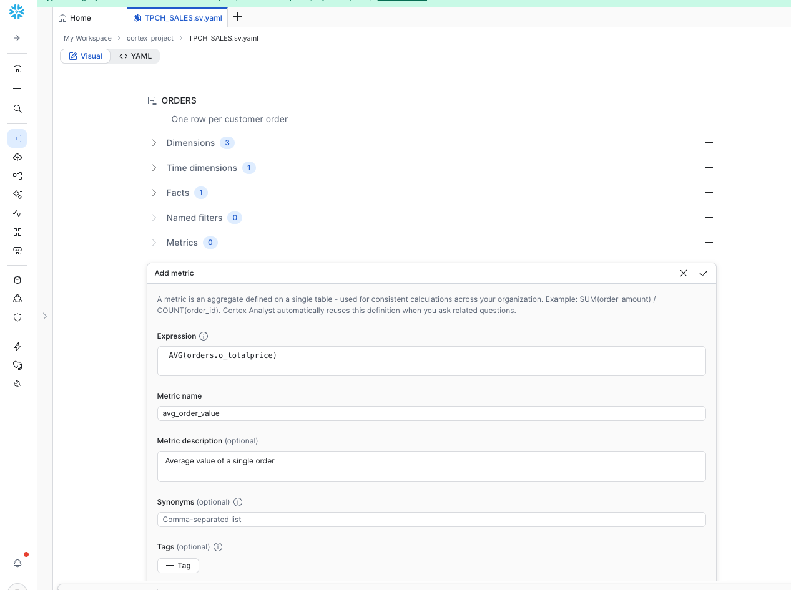
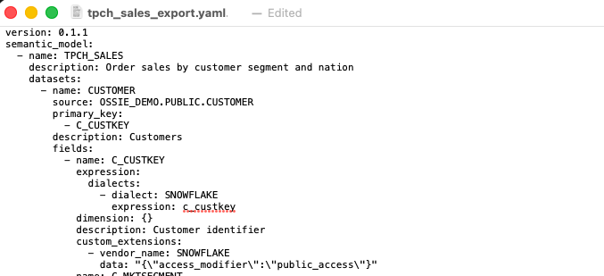

author: Eric Tolotti
id: connect-power-bi-with-ossie-semantics
summary: This is a quickstart for connecting Snowflake Semantic Views and Power BI semantic models using Apache Ossie, with changes flowing in both directions
title: Connect Power BI with OSSIE Semantics
categories: snowflake-site:taxonomy/solution-center/certification/quickstart, snowflake-site:taxonomy/product/analytics
environments: web
language: en
status: Published
feedback link: https://github.com/Snowflake-Labs/sfguides/issues


# Connect Power BI with OSSIE Semantics

<!-- ------------------------ -->
## Overview

Semantic models are becoming the layer where business meaning lives. As more teams build on AI agents, BI tools, and natural language queries, the definitions behind metrics like revenue and order count need to be consistent everywhere they are used. When every tool keeps its own copy, those definitions drift. Revenue is defined one way in Snowflake and another way in a Power BI semantic model, and nobody notices until the numbers disagree.

Apache Ossie (incubating), previously Open Semantic Interchange (OSI), is a vendor-neutral YAML standard for semantic models. It describes datasets, relationships, dimensions, and metrics in a format any platform can read and write. Snowflake supports Ossie natively, and the Apache Ossie project provides an open-source converter for Power BI. This makes Ossie the shared layer between the two platforms, the same way Apache Iceberg is the shared layer for tables.

In Snowflake, the semantic model lives as a Semantic View: governed, queryable with standard SQL, and available to Cortex Analyst and Snowflake Intelligence. In Power BI, the same model becomes a semantic model with DAX measures that analysts can extend. A change made on either side can be carried to the other through Ossie, with a review step so every definition is approved before it is deployed.

This quickstart demonstrates the core workflow on sample data: creating a Semantic View in Snowflake, converting it to Power BI through Ossie, adding a measure in Power BI, and bringing that measure back into Snowflake.


### Prerequisites
- familiarity with [Snowflake Semantic Views](https://docs.snowflake.com/en/user-guide/views-semantic/overview) and a Snowflake account
- familiarity with Power BI semantic models and DAX
- comfort running commands in a terminal


### What You Will Learn
- creating a Snowflake Semantic View from YAML
- exporting a semantic view to Ossie with `SYSTEM$READ_OSSIE_YAML_FROM_SEMANTIC_VIEW`
- converting Ossie to and from a Power BI `model.bim` with the `ossie-microsoft` converter
- merging a Power BI change back into the Ossie model and deploying it with `SYSTEM$CREATE_SEMANTIC_VIEW_FROM_OSSIE_YAML`

### What You Will Build
- You will build a sales semantic model that is shared between Snowflake and Power BI. You will create a Semantic View in Snowflake, convert it to a Power BI semantic model, add a measure in Power BI, and deploy that measure back to Snowflake. The end result is one set of business definitions that both platforms use.

### What You Will Need
- A free [Snowflake Account](https://signup.snowflake.com/?utm_source=snowflake-devrel&utm_medium=developer-guides&utm_cta=developer-guides)
- Git, Python 3.10+, and [uv](https://docs.astral.sh/uv/getting-started/installation/) installed locally (`pip install uv` works if you don't have it)
- A text editor, or [Tabular Editor](https://github.com/TabularEditor/TabularEditor) to edit the Power BI model file

The end-to-end workflow will look like this:

```
 Snowflake Semantic View
   |  SYSTEM$READ_OSSIE_YAML_FROM_SEMANTIC_VIEW
   v
 Ossie YAML  --- ossie-microsoft export --->  Power BI model.bim
   ^                                               |
   |  SYSTEM$CREATE_SEMANTIC_VIEW_FROM_OSSIE_YAML  |  edit a measure
   |                                               v
 Merged Ossie YAML  <--- merge + review ---  ossie-microsoft import
```


<!-- ------------------------ -->
## Create a Snowflake Semantic View

### Create the sample data
In this step, you create a database with views over the TPC-H sample data. The model uses three tables: orders, customers, and nations.

The views read `SNOWFLAKE_SAMPLE_DATA`, which Snowflake shares with your account and which doesn't use your storage. If it isn't listed under your databases, create it once as `ACCOUNTADMIN` before continuing:

```sql
CREATE DATABASE SNOWFLAKE_SAMPLE_DATA FROM SHARE SFC_SAMPLES.SAMPLE_DATA;

GRANT IMPORTED PRIVILEGES ON DATABASE SNOWFLAKE_SAMPLE_DATA TO ROLE PUBLIC;
```

```sql
USE ROLE ACCOUNTADMIN;

CREATE DATABASE IF NOT EXISTS OSSIE_DEMO;

CREATE OR REPLACE VIEW OSSIE_DEMO.PUBLIC.ORDERS AS
SELECT O_ORDERKEY, O_CUSTKEY, O_ORDERSTATUS, O_TOTALPRICE, O_ORDERDATE
FROM SNOWFLAKE_SAMPLE_DATA.TPCH_SF1.ORDERS;

CREATE OR REPLACE VIEW OSSIE_DEMO.PUBLIC.CUSTOMER AS
SELECT C_CUSTKEY, C_NAME, C_NATIONKEY, C_MKTSEGMENT
FROM SNOWFLAKE_SAMPLE_DATA.TPCH_SF1.CUSTOMER;

CREATE OR REPLACE VIEW OSSIE_DEMO.PUBLIC.NATION AS
SELECT N_NATIONKEY, N_NAME
FROM SNOWFLAKE_SAMPLE_DATA.TPCH_SF1.NATION;
```

### Create the semantic view
The statement below creates the semantic view. It joins orders to customers and customers to nations, and defines three metrics: `total_sales`, `order_count`, and `avg_order_value`. The same definition is available as [tpch_sales_semantic_view.yaml](https://raw.githubusercontent.com/Snowflake-Labs/sfquickstarts/master/site/sfguides/src/connect-power-bi-with-ossie-semantics/assets/tpch_sales_semantic_view.yaml).

```sql
CALL SYSTEM$CREATE_SEMANTIC_VIEW_FROM_YAML(
    'OSSIE_DEMO.PUBLIC',
$$
name: tpch_sales
description: Order sales by customer segment and nation
tables:
- name: orders
  base_table:
    database: OSSIE_DEMO
    schema: PUBLIC
    table: ORDERS
  primary_key:
    columns:
    - o_orderkey
  description: One row per customer order
  dimensions:
  - name: o_orderkey
    expr: o_orderkey
    description: Order identifier
    data_type: NUMBER(38,0)
  - name: o_custkey
    expr: o_custkey
    description: Customer who placed the order
    data_type: NUMBER(38,0)
  - name: o_orderstatus
    expr: o_orderstatus
    description: Order status (F = fulfilled, O = open, P = partial)
    data_type: VARCHAR
  time_dimensions:
  - name: o_orderdate
    expr: o_orderdate
    description: Date the order was placed
    data_type: DATE
  facts:
  - name: o_totalprice
    expr: o_totalprice
    description: Total price of the order
    data_type: NUMBER(12,2)
- name: customer
  base_table:
    database: OSSIE_DEMO
    schema: PUBLIC
    table: CUSTOMER
  primary_key:
    columns:
    - c_custkey
  description: Customers
  dimensions:
  - name: c_custkey
    expr: c_custkey
    description: Customer identifier
    data_type: NUMBER(38,0)
  - name: c_name
    expr: c_name
    description: Customer name
    data_type: VARCHAR
  - name: c_nationkey
    expr: c_nationkey
    description: Customer nation
    data_type: NUMBER(38,0)
  - name: c_mktsegment
    expr: c_mktsegment
    description: Market segment
    data_type: VARCHAR
- name: nation
  base_table:
    database: OSSIE_DEMO
    schema: PUBLIC
    table: NATION
  primary_key:
    columns:
    - n_nationkey
  description: Countries
  dimensions:
  - name: n_nationkey
    expr: n_nationkey
    description: Nation identifier
    data_type: NUMBER(38,0)
  - name: n_name
    expr: n_name
    description: Nation name
    data_type: VARCHAR
relationships:
- name: orders_to_customer
  left_table: orders
  right_table: customer
  relationship_columns:
  - left_column: o_custkey
    right_column: c_custkey
- name: customer_to_nation
  left_table: customer
  right_table: nation
  relationship_columns:
  - left_column: c_nationkey
    right_column: n_nationkey
metrics:
- name: total_sales
  expr: SUM(orders.o_totalprice)
  description: Total order value
- name: order_count
  expr: COUNT(orders.o_orderkey)
  description: Number of orders
- name: avg_order_value
  expr: AVG(orders.o_totalprice)
  description: Average value of a single order
$$
);
```

The view takes its name from the `name` field, so this creates `OSSIE_DEMO.PUBLIC.TPCH_SALES`. Confirm it returns data:

```sql
SELECT * FROM SEMANTIC_VIEW(
    OSSIE_DEMO.PUBLIC.TPCH_SALES
    DIMENSIONS customer.c_mktsegment
    METRICS total_sales, order_count, avg_order_value
) ORDER BY c_mktsegment;
```

You can also open the view you just created. In Snowsight, select **AI & ML** » **Cortex Analyst** and select `TPCH_SALES`. [Semantic Studio](https://docs.snowflake.com/en/user-guide/views-semantic/semantic-studio) shows the tables, relationships, and metrics, and has a form for adding more of each. **Deploy** writes those edits back to the live view. This quickstart keeps the definition in the statement above so it stays visible and repeatable, and Semantic Studio is where a team would maintain the model day to day.




<!-- ------------------------ -->
## Export to Ossie

In this section, the Semantic View is exported as an Ossie file, which is the format the Power BI converter reads.

### Install the Power BI converter
Clone the Apache Ossie converters repository and install the Microsoft converter. Then download the two helper scripts for this quickstart into the same working folder.

```bash
mkdir -p ~/ossie-demo && cd ~/ossie-demo
git clone --recurse-submodules https://github.com/apache/ossie-converters.git

curl -fLO https://raw.githubusercontent.com/Snowflake-Labs/sfquickstarts/master/site/sfguides/src/connect-power-bi-with-ossie-semantics/assets/unwrap_snowflake_export.py
curl -fLO https://raw.githubusercontent.com/Snowflake-Labs/sfquickstarts/master/site/sfguides/src/connect-power-bi-with-ossie-semantics/assets/merge_from_powerbi.py

cd ossie-converters/microsoft
uv sync
uv run ossie-microsoft --help
```

Run the remaining commands in this quickstart from `~/ossie-demo/ossie-converters/microsoft`. The working files live in `~/ossie-demo`.

### Export the semantic view
In Snowflake, export the semantic view as Ossie YAML:

```sql
SELECT SYSTEM$READ_OSSIE_YAML_FROM_SEMANTIC_VIEW('OSSIE_DEMO.PUBLIC.TPCH_SALES');
```

The function returns the whole model as a single text value, so the result is one cell. Click that cell and copy its value, then paste it into a new file and save it as `~/ossie-demo/tpch_sales_export.yaml`. A pasted export looks like this:



The export contains the three datasets with full `OSSIE_DEMO.PUBLIC.<TABLE>` sources, the relationships, the `O_ORDERDATE` time dimension, and all three metrics as `SNOWFLAKE` SQL expressions. Names are uppercase because Snowflake normalizes unquoted identifiers.

### Prepare it for the converter
Snowflake wraps the model in a `semantic_model:` list. The Power BI converter expects the model at the top of the file, so move it there:

```bash
uv run python ~/ossie-demo/unwrap_snowflake_export.py \
    ~/ossie-demo/tpch_sales_export.yaml \
    ~/ossie-demo/tpch_sales.ossie.yaml
```

`tpch_sales.ossie.yaml` is the Ossie model you will work from.


<!-- ------------------------ -->
## Convert to Power BI

In this step, you convert the Ossie model to a Power BI semantic model in TMSL `model.bim` format.

```bash
uv run ossie-microsoft export \
    -i ~/ossie-demo/tpch_sales.ossie.yaml \
    -o ~/ossie-demo/model.bim
```

Keep an untouched copy. The merge step later compares against it to find what changed in Power BI:

```bash
cp ~/ossie-demo/model.bim ~/ossie-demo/model.original.bim
```

### What the converter produced
The three tables, their columns, and both relationships carry over. Each Snowflake metric becomes a DAX measure:

| Snowflake metric (SQL) | Power BI measure (DAX) |
|---|---|
| `SUM(orders.o_totalprice)` | `SUM('ORDERS'[O_TOTALPRICE])` |
| `COUNT(orders.o_orderkey)` | `COUNTA('ORDERS'[O_ORDERKEY])` |
| `AVG(orders.o_totalprice)` | `AVERAGE('ORDERS'[O_TOTALPRICE])` |

The converter translates simple aggregates such as `SUM`, `COUNT`, `COUNT(DISTINCT ...)`, `AVG`, and division of those. A SQL expression outside that set becomes a `BLANK()` measure with a warning instead of a guessed formula.

The converter prints warnings and ends with a count of constructs it couldn't convert faithfully. For this model they are expected:

- The file targets Ossie `0.1.1` and the converter targets `0.2.0.dev0`. The model in this quickstart converts fully despite the mismatch.
- Snowflake-specific settings stored in `SNOWFLAKE` custom extensions have no Power BI equivalent and are dropped from `model.bim`.
- Metrics have no home table in Ossie, so all measures are placed on the first table, `CUSTOMER`.
- The table partitions use Direct Lake with placeholder workspace and item IDs. The model definition is complete, but it isn't connected to data. Connecting it is outside the scope of this quickstart.


<!-- ------------------------ -->
## Make a Change in Power BI

In a real environment, analysts extend the model in Power BI with measures for their reports. For the sake of this quickstart, the change is one new measure: total sales divided by the number of distinct customers.

Open `~/ossie-demo/model.bim` in Tabular Editor or a text editor. Find the `CUSTOMER` table's `measures` list and add this entry at the end of the list. Put a comma after the measure before it:

```json
{
  "name": "SALES_PER_CUSTOMER",
  "expression": "DIVIDE(SUM('ORDERS'[O_TOTALPRICE]), DISTINCTCOUNT('ORDERS'[O_CUSTKEY]))",
  "description": "Average total order value per customer"
}
```

Save the file.


<!-- ------------------------ -->
## Bring the Change Back to Snowflake

In this section, the new Power BI measure is converted back to Ossie, reviewed, and deployed to the Semantic View in Snowflake.

### Convert Power BI back to Ossie

```bash
uv run ossie-microsoft import \
    -i ~/ossie-demo/model.bim \
    -o ~/ossie-demo/tpch_sales.imported.yaml
```

Don't deploy this file directly. The import writes Ossie version `0.2.0.dev0`, which Snowflake doesn't accept yet. It also writes two-part table names such as `PUBLIC.ORDERS`, and returns every metric as DAX only.

### Merge the change
Merge only the measure changes into the model you exported from Snowflake. That keeps the full table names, the time dimension, and the existing SQL:

```bash
uv run python ~/ossie-demo/merge_from_powerbi.py \
    ~/ossie-demo/tpch_sales.ossie.yaml \
    ~/ossie-demo/model.original.bim \
    ~/ossie-demo/tpch_sales.imported.yaml \
    ~/ossie-demo/tpch_sales.merged.yaml
```

The script reports what changed and stops on anything that has no Snowflake SQL yet:

```
added SALES_PER_CUSTOMER
changed description for SALES_PER_CUSTOMER
NEEDS SQL: add a SNOWFLAKE expression for SALES_PER_CUSTOMER before deploying
```

Compare the two files to see exactly what Power BI changed:

```bash
diff ~/ossie-demo/tpch_sales.ossie.yaml ~/ossie-demo/tpch_sales.merged.yaml
```

### Add the Snowflake SQL

In `tpch_sales.merged.yaml`, add a `SNOWFLAKE` dialect to `SALES_PER_CUSTOMER`:

```yaml
- name: SALES_PER_CUSTOMER
  expression:
    dialects:
    - dialect: SNOWFLAKE
      expression: SUM(orders.o_totalprice) / COUNT(DISTINCT orders.o_custkey)
    - dialect: DAX
      expression: DIVIDE(SUM('ORDERS'[O_TOTALPRICE]), DISTINCTCOUNT('ORDERS'[O_CUSTKEY]))
  description: Average total order value per customer
```

Run the merge again with the merged file as the base to confirm nothing is missing:

```bash
uv run python ~/ossie-demo/merge_from_powerbi.py \
    ~/ossie-demo/tpch_sales.merged.yaml \
    ~/ossie-demo/model.original.bim \
    ~/ossie-demo/tpch_sales.imported.yaml \
    ~/ossie-demo/tpch_sales.merged.yaml
```

It reports `no measure changes` and exits cleanly, so the file is ready to deploy.

### Deploy to Snowflake
Run this statement. It contains the merged model from the previous step, with the new `SALES_PER_CUSTOMER` metric and its Snowflake SQL at the end. If your `tpch_sales.merged.yaml` differs, use its contents between the `$$` markers instead.

```sql
CALL SYSTEM$CREATE_SEMANTIC_VIEW_FROM_OSSIE_YAML(
    'OSSIE_DEMO.PUBLIC',
$$
version: 0.1.1
name: TPCH_SALES
description: Order sales by customer segment and nation
datasets:
- name: CUSTOMER
  source: OSSIE_DEMO.PUBLIC.CUSTOMER
  primary_key:
  - C_CUSTKEY
  description: Customers
  fields:
  - name: C_CUSTKEY
    expression:
      dialects:
      - dialect: SNOWFLAKE
        expression: c_custkey
    dimension: {}
    description: Customer identifier
    custom_extensions:
    - vendor_name: SNOWFLAKE
      data: '{"access_modifier":"public_access"}'
  - name: C_MKTSEGMENT
    expression:
      dialects:
      - dialect: SNOWFLAKE
        expression: c_mktsegment
    dimension: {}
    description: Market segment
    custom_extensions:
    - vendor_name: SNOWFLAKE
      data: '{"access_modifier":"public_access"}'
  - name: C_NAME
    expression:
      dialects:
      - dialect: SNOWFLAKE
        expression: c_name
    dimension: {}
    description: Customer name
    custom_extensions:
    - vendor_name: SNOWFLAKE
      data: '{"access_modifier":"public_access"}'
  - name: C_NATIONKEY
    expression:
      dialects:
      - dialect: SNOWFLAKE
        expression: c_nationkey
    dimension: {}
    description: Customer nation
    custom_extensions:
    - vendor_name: SNOWFLAKE
      data: '{"access_modifier":"public_access"}'
- name: NATION
  source: OSSIE_DEMO.PUBLIC.NATION
  primary_key:
  - N_NATIONKEY
  description: Countries
  fields:
  - name: N_NAME
    expression:
      dialects:
      - dialect: SNOWFLAKE
        expression: n_name
    dimension: {}
    description: Nation name
    custom_extensions:
    - vendor_name: SNOWFLAKE
      data: '{"access_modifier":"public_access"}'
  - name: N_NATIONKEY
    expression:
      dialects:
      - dialect: SNOWFLAKE
        expression: n_nationkey
    dimension: {}
    description: Nation identifier
    custom_extensions:
    - vendor_name: SNOWFLAKE
      data: '{"access_modifier":"public_access"}'
- name: ORDERS
  source: OSSIE_DEMO.PUBLIC.ORDERS
  primary_key:
  - O_ORDERKEY
  description: One row per customer order
  fields:
  - name: O_CUSTKEY
    expression:
      dialects:
      - dialect: SNOWFLAKE
        expression: o_custkey
    dimension: {}
    description: Customer who placed the order
    custom_extensions:
    - vendor_name: SNOWFLAKE
      data: '{"access_modifier":"public_access"}'
  - name: O_ORDERKEY
    expression:
      dialects:
      - dialect: SNOWFLAKE
        expression: o_orderkey
    dimension: {}
    description: Order identifier
    custom_extensions:
    - vendor_name: SNOWFLAKE
      data: '{"access_modifier":"public_access"}'
  - name: O_ORDERSTATUS
    expression:
      dialects:
      - dialect: SNOWFLAKE
        expression: o_orderstatus
    dimension: {}
    description: Order status (F = fulfilled, O = open, P = partial)
    custom_extensions:
    - vendor_name: SNOWFLAKE
      data: '{"access_modifier":"public_access"}'
  - name: O_ORDERDATE
    expression:
      dialects:
      - dialect: SNOWFLAKE
        expression: o_orderdate
    dimension:
      is_time: true
    description: Date the order was placed
    custom_extensions:
    - vendor_name: SNOWFLAKE
      data: '{"access_modifier":"public_access"}'
  - name: O_TOTALPRICE
    expression:
      dialects:
      - dialect: SNOWFLAKE
        expression: o_totalprice
    description: Total price of the order
    custom_extensions:
    - vendor_name: SNOWFLAKE
      data: '{"access_modifier":"public_access"}'
relationships:
- name: CUSTOMER_TO_NATION
  from: CUSTOMER
  to: NATION
  from_columns:
  - C_NATIONKEY
  to_columns:
  - N_NATIONKEY
- name: ORDERS_TO_CUSTOMER
  from: ORDERS
  to: CUSTOMER
  from_columns:
  - O_CUSTKEY
  to_columns:
  - C_CUSTKEY
metrics:
- name: AVG_ORDER_VALUE
  expression:
    dialects:
    - dialect: SNOWFLAKE
      expression: AVG(orders.o_totalprice)
  description: Average value of a single order
  custom_extensions:
  - vendor_name: SNOWFLAKE
    data: '{"access_modifier":"public_access"}'
- name: ORDER_COUNT
  expression:
    dialects:
    - dialect: SNOWFLAKE
      expression: COUNT(orders.o_orderkey)
  description: Number of orders
  custom_extensions:
  - vendor_name: SNOWFLAKE
    data: '{"access_modifier":"public_access"}'
- name: TOTAL_SALES
  expression:
    dialects:
    - dialect: SNOWFLAKE
      expression: SUM(orders.o_totalprice)
  description: Total order value
  custom_extensions:
  - vendor_name: SNOWFLAKE
    data: '{"access_modifier":"public_access"}'
- name: SALES_PER_CUSTOMER
  expression:
    dialects:
    - dialect: SNOWFLAKE
      expression: SUM(orders.o_totalprice) / COUNT(DISTINCT orders.o_custkey)
    - dialect: DAX
      expression: DIVIDE(SUM('ORDERS'[O_TOTALPRICE]), DISTINCTCOUNT('ORDERS'[O_CUSTKEY]))
  description: Average total order value per customer
$$
);
```

The model is named `TPCH_SALES`, so this replaces the existing semantic view and keeps its grants.

### Verify the numbers
Query the new metric through the semantic view:

```sql
SELECT * FROM SEMANTIC_VIEW(
    OSSIE_DEMO.PUBLIC.TPCH_SALES
    DIMENSIONS customer.c_mktsegment
    METRICS total_sales, sales_per_customer
) ORDER BY c_mktsegment;
```

Check it against plain SQL on the underlying views. The two results should match:

```sql
SELECT c.C_MKTSEGMENT,
       SUM(o.O_TOTALPRICE) AS total_sales,
       SUM(o.O_TOTALPRICE) / COUNT(DISTINCT o.O_CUSTKEY) AS sales_per_customer
FROM OSSIE_DEMO.PUBLIC.ORDERS o
JOIN OSSIE_DEMO.PUBLIC.CUSTOMER c ON o.O_CUSTKEY = c.C_CUSTKEY
GROUP BY 1
ORDER BY 1;
```


<!-- ------------------------ -->
## Take This to Production

The loop in this quickstart treats Snowflake as the hub. That works when every measure is one the converter can rebuild, but in many environments changes that do not convert will need to be maintained for the respective semantic layer. For those environments, store the Ossie model in git as the single source of truth, and follow these practices:

- Merge from both sides. Changes from Snowflake merge in their SQL and keep the DAX already in git. Changes from Power BI merge in their DAX and keep the SQL and Snowflake-specific settings. `merge_from_powerbi.py` covers the Power BI side for metrics, and the Snowflake side is the same idea in reverse.
- Sync before you deploy. `SYSTEM$CREATE_SEMANTIC_VIEW_FROM_OSSIE_YAML` replaces the whole semantic view, so pull any edits made directly in Snowflake into git first.
- Review every formula change. A changed SQL expression needs matching DAX, and changed DAX needs matching SQL. The merge script exits with an error when SQL is missing, so it can block a CI pipeline until someone adds it.
- Watch for conflicts. If the same metric changes in both tools between syncs, compare each side against the last synced version in git history rather than overwriting.

### Known limits
These held true when this quickstart was written. Apache Ossie is incubating, so check the converter and Snowflake documentation for changes.

- Snowflake exports and accepts Ossie version `0.1.1`. The Power BI converter writes `0.2.0.dev0`, which is why the import can't be deployed directly.
- Measures with filters or other logic outside simple aggregates come back as BLANK() the next time the model is exported from Snowflake. Keep them in git with both expressions.
- Synonyms aren't restored when a semantic view is created from Ossie YAML.
- Column data types aren't included in the Snowflake export, so Power BI columns come through untyped.
- Snowflake's export adds a duplicate `SNOWFLAKE` custom extension to each field on every round trip. It's harmless, but the file grows.
- The Power BI model uses Direct Lake placeholders and isn't connected to data.


<!-- ------------------------ -->
## Conclusion and Resources

Congratulations! You've successfully moved a semantic model from Snowflake to Power BI with Apache Ossie, added a measure in Power BI, and deployed it back to Snowflake after review, esulting in one set of business definitions shared by both platforms. The merge step keeps each platform's details intact, and the review step makes sure every formula is approved before it reaches the other side. This is the foundation for a shared semantic layer between Snowflake and Power BI!

### What You Learned
- creating a Snowflake Semantic View from YAML
- exporting a semantic view to Ossie with `SYSTEM$READ_OSSIE_YAML_FROM_SEMANTIC_VIEW`
- converting Ossie to and from a Power BI `model.bim` with the `ossie-microsoft` converter
- merging a Power BI change back into the Ossie model and deploying it with `SYSTEM$CREATE_SEMANTIC_VIEW_FROM_OSSIE_YAML`

### Resources
- [Apache Ossie (incubating)](https://ossie.apache.org/)
- [Apache Ossie Core Specification](https://github.com/apache/ossie/blob/main/core-spec/spec.md)
- [Apache Ossie Microsoft converter](https://github.com/apache/ossie-converters/tree/main/microsoft)
- [SYSTEM$READ_OSSIE_YAML_FROM_SEMANTIC_VIEW](https://docs.snowflake.com/en/sql-reference/functions/system_read_ossie_yaml_from_semantic_view)
- [SYSTEM$CREATE_SEMANTIC_VIEW_FROM_OSSIE_YAML](https://docs.snowflake.com/en/sql-reference/stored-procedures/system_create_semantic_view_from_ossie_yaml)
- [Snowflake Semantic Views](https://docs.snowflake.com/en/user-guide/views-semantic/overview)

If you have any questions, reach out to your Snowflake account team!
