author: Gayatri Ghanakota
id: credit-risk-pd-model-snowflake-ml
summary: Build, govern, and automate a credit risk Probability of Default (PD) model on Snowflake ML, migrated from SAS PROC GRADBOOST, with Feature Store, Experiment Tracking, Model Registry, SHAP explainability, Model Monitors, champion/challenger review, and Task DAGs.
categories: getting-started, data-science-&-ml, financial-services
environments: web
status: Draft
feedback link: https://github.com/Snowflake-Labs/sfguides/issues
tags: Getting Started, Machine Learning, Snowflake ML, Feature Store, Model Registry, Financial Services, Credit Risk

# From SAS to Snowflake: Productionizing Credit Risk Models on a Modern ML Platform

<!-- ------------------------ -->
## Overview

Banks have built Probability of Default (PD), Loss Given Default (LGD) and Exposure at Default (EAD) models in SAS for decades. The models work, but the infrastructure around them (data extracts to SAS Grid, macro-generated datasets, cron-driven batch jobs, spreadsheet model inventories and email sign-offs) makes reproducibility, lineage and monitoring expensive to prove to regulators.

In this Quickstart you migrate a SAS `PROC GRADBOOST` PD model to **XGBoost on Snowflake ML** and run the whole model lifecycle in one governed platform: features, training data, experiments, registry, explainability, batch scoring, scenario-weighted Expected Credit Loss (ECL) scoring, monitoring, human-in-the-loop promotion and scheduled pipelines.

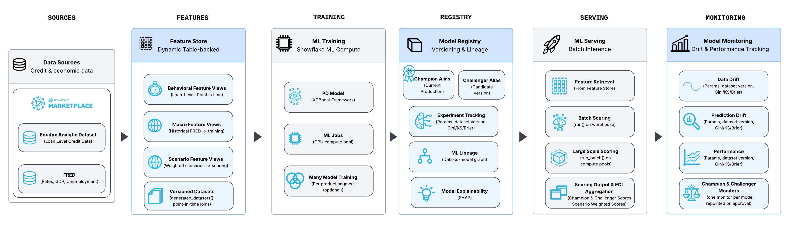

The complete notebook is in the companion GitHub repository: **[Snowflake-Labs/sfguide-credit-risk-pd-model-snowflake-ml](https://github.com/sfc-gh-gghanakota/sfquickstarts/blob/sfguide-credit-risk-pd-model-snowflake-ml/site/sfguides/src/credit-risk-pd-model-snowflake-ml/assets/credit_risk_probability_of_default_model.ipynb)**. Each step below shows the notebook code with an explanation, so you can follow along cell by cell.

### What You Will Learn
- How to convert a SAS `PROC GRADBOOST` PD model to Python with CoCo, and map its hyperparameters to `XGBClassifier`
- How to build Feature Views (backed by Dynamic Tables) for behavioral, macroeconomic and forward-looking scenario features
- How to generate immutable, point-in-time training Datasets
- How to log runs with Experiment Tracking and register models on Snowflake Model Registry
- How to explain predictions with the Model Registry's built-in SHAP `explain` function and trace ML Lineage
- How to batch score with `run()` and compute probability-weighted ECL across macro scenarios
- How to attach Model Monitors for drift and performance
- How to automate monthly retraining and weekly scoring with Task DAGs, including an email-driven, role-gated model approval step

### What You Will Build
- A Feature Store with three Feature Views: `LOAN_BEHAVIORAL_FEATURES`, `LOAN_MACRO_FEATURES` and `MACRO_SCENARIO_FEATURES`
- A versioned training Dataset, `PD_TRAINING_DS`
- A registered model, `PD_XGB_MODEL`, with champion and challenger versions, SHAP explainability and lineage
- Model Monitors for the champion and challenger models
- A monthly **training pipeline** Task DAG that retrains both models, scores them against production, gates them, and emails a reviewer for approval
- A weekly **scoring pipeline** Task DAG that scores the portfolio with the approved models, computes scenario-weighted ECL, keeps history, and emails a summary

### Prerequisites
- A Snowflake account with access to **Snowflake Notebooks** and a role that can create databases, warehouses, roles and notification integrations (the notebook was built with `ACCOUNTADMIN`)
- A verified email address on your Snowflake user, for the review and scoring notification emails
- Two free Snowflake Marketplace listings (installed in the next step):
  - [Equifax Analytic Dataset (Demo/Sample)](https://app.snowflake.com/marketplace/listing/GZT0ZOSU8UC)
  - [FRED - Federal Reserve Economic Data](https://app.snowflake.com/marketplace/listing/GZTYZ40XYNE)
- Familiarity with Python and SQL. Credit risk knowledge helps but is not required.

<!-- ------------------------ -->
## Get the Data and the Notebook

### Install the Marketplace data
1. In Snowsight, open **Data Products > Marketplace**.
2. Search for **Equifax Analytic Dataset (Demo/Sample)** and select **Get**. Keep the database name `ANALYTIC_DATASET_DEMOSAMPLE`.
3. Search for **FRED - Federal Reserve Economic Data** (provided by Fruit Stand) and select **Get**. Keep the database name `FRED_FEDERAL_RESERVE_ECONOMIC_DATA_SERIES_OBSERVATIONS`.

The notebook reads `ANALYTIC_DATASET_DEMOSAMPLE.DATASET.ANALYTICSSAMPLE_LATEST` and `FRED_FEDERAL_RESERVE_ECONOMIC_DATA_SERIES_OBSERVATIONS.FRED.FRED_SERIES_OBSERVATIONS_VW`. If you choose different database names, update those references.

### Import the notebook
1. Download `credit_risk_probability_of_default_model.ipynb` from the [GitHub repository](https://github.com/sfc-gh-gghanakota/sfquickstarts/blob/sfguide-credit-risk-pd-model-snowflake-ml/site/sfguides/src/credit-risk-pd-model-snowflake-ml/assets/credit_risk_probability_of_default_model.ipynb).
2. In Snowsight, go to **Projects > Notebooks**, choose **Import .ipynb file**, and select the downloaded notebook.
3. Make sure these packages are available to the notebook: `snowflake-ml-python`, `xgboost`, `scikit-learn`, `scipy`, `matplotlib`, `altair`.
4. Upload `python_pd_model.py` from the repository to the same notebook, next to the `.ipynb` file. The notebook and the training pipeline import the model from it (see the next step).

The repository also contains `sas_pd_model.sas` (the original SAS model) and `python_pd_model.py` (the Python conversion produced with CoCo). The next step shows how that conversion is done.

<!-- ------------------------ -->
## Convert the SAS Model to Python with CoCo

The starting point is a SAS PD model, `sas_pd_model.sas`. It follows a pattern found in many banks:
1. `PROC SQL` joins Equifax loan data to FRED macro indicators, with `%let` macro variables for libraries and the observation window.
2. A `DATA` step imputes missing values with 0.
3. `PROC SURVEYSELECT` makes an 80/20 split.
4. `PROC GRADBOOST` trains a gradient boosting model.
5. `PROC ASTORE` scores the test set from the saved analytic store.
6. `PROC LOGISTIC` computes AUC, and the metrics go into an Excel tracker by hand.

The core of the model is the `PROC GRADBOOST` step. Because it is gradient boosting, like XGBoost, its options map closely onto `XGBClassifier`:

```sas
proc gradboost data=&OUT_LIB..PD_TRAIN
    ntrees=200
    learningrate=0.1
    maxdepth=6
    vars_to_try=5
    minleafsize=20
    seed=42;

    target DEFAULT_FLAG / level=nominal;

    input VANTAGE_SCORE_3 NUMBER_OF_ACCOUNTS NUMBER_ACCOUNTS_PAST_DUE
          NUMBER_ACCOUNTS_MAJOR_DEROGATORY HIGH_UTIL_ACCTS
          AGE_OLDEST_ACCOUNT TOTAL_PAST_DUE_AMOUNT BALANCE
          / level=interval;
    input UNEMPLOYMENT_RATE FED_FUNDS_RATE CPI_INDEX / level=interval;

    savestate rstore=&OUT_LIB..PD_GRADBOOST_STORE;
    ods output VariableImportance = &OUT_LIB..PD_IMPORTANCE;
    ods output FitStatistics      = &OUT_LIB..PD_FITSTATS;
run;
```

### Prompt CoCo
**[CoCo](https://www.snowflake.com/en/product/snowflake-coco/)** is Snowflake's AI coding assistant. It's available in Snowsight and as a desktop app. Open the repository folder in CoCo (or attach `sas_pd_model.sas` to the chat) and ask for the conversion in plain language. Name the target frameworks and the Snowflake features you want each SAS construct to become:

```text
Convert @sas_pd_model.sas into a Python script, python_pd_model.py, that runs on Snowflake.

- Replace PROC GRADBOOST with xgboost.XGBClassifier. Map every GRADBOOST option to its closest
  XGBoost hyperparameter and explain each mapping in a comment.
- Replace the %let macros and PROC SQL join with Snowflake Feature Store Feature Views
  (one for the Equifax behavioral features, one for the FRED macro features), keyed on TRADE_ID
  with ARCHIVE_DATE as the timestamp.
- Replace PROC SURVEYSELECT and the manual dataset freeze with a versioned Dataset from
  fs.generate_dataset, then a stratified 80/20 split with seed 42.
- Keep the DATA step behavior: impute missing numeric values with 0.
- Replace PROC LOGISTIC ROC with AUC, Gini and KS computed in Python.
- Replace the saved analytic store with Snowflake Model Registry registration and a "champion" alias.
- Replace PROC ASTORE with model.run() batch scoring on a warehouse.
Use the Snowpark session from get_active_session(); data is in CREDIT_RISK_ML.PD_MODEL.
```

CoCo reads the SAS file and returns `python_pd_model.py` (in the repository). Ask it to structure the result as a reusable module, not just a one-off script: the feature lists, the SAS-mapped hyperparameters, and a small function for each SAS step. The notebook and the training pipeline then import the same code, so the converted model is the one that is actually trained in production:

```python
# XGBoost hyperparameters mapped from SAS PROC GRADBOOST:
#   ntrees=200        →  n_estimators=200
#   learningrate=0.1  →  learning_rate=0.1
#   maxdepth=6        →  max_depth=6
#   vars_to_try=5     →  colsample_bynode = 5/11 (features tried per split)
#   minleafsize=20    →  min_child_weight (approx)
#   seed=42           →  random_state=42
SAS_MAPPED_PARAMS = {
    "n_estimators": 200,
    "max_depth": 6,
    "learning_rate": 0.1,
    "colsample_bynode": 5 / len(FEATURE_COLS),
    "min_child_weight": 20,
    "objective": "binary:logistic",
    "eval_metric": "auc",
    "random_state": 42,
}


def prepare_features(pdf):
    """Feature matrix and label from a pandas frame. Replaces the SAS DATA step (missing → 0)."""
    return pdf[FEATURE_COLS].fillna(0), pdf[TARGET_COL]


def split_train_test(X, y):
    """Stratified 80/20 split with seed 42. Replaces PROC SURVEYSELECT samprate=0.8 seed=42."""
    return train_test_split(X, y, test_size=0.2, random_state=42, stratify=y)


def train_pd_model(X, y, params=None):
    """Fit the PD model. Replaces PROC GRADBOOST."""
    return XGBClassifier(**(params or SAS_MAPPED_PARAMS)).fit(X, y)
```

The module also defines `BEHAVIORAL_COLS`, `MACRO_COLS`, `FEATURE_COLS`, `TARGET_COL`, `CHALLENGER_PARAMS` and `pd_metrics()` (AUC, Gini, KS and Brier, replacing `PROC LOGISTIC`). Running the file directly (`main(session)`) still performs the converted SAS workflow end to end.

To get this shape, add a line like this to the prompt:

```text
Structure python_pd_model.py as an importable module: constants for the feature lists and the
SAS-mapped hyperparameters, one function per SAS step (prepare, split, train, evaluate), and the
end-to-end workflow in main(session) under if __name__ == "__main__".
```

The notebook in this guide imports this module and builds the rest of the lifecycle around it: Experiment Tracking, a challenger model, SHAP explainability, monitoring and orchestration. The remaining steps walk through it cell by cell.

<!-- ------------------------ -->
## Set Up the Environment

Edit the configuration block at the top of the first cell before running anything:

- `REVIEWER_USERS`: Snowflake users who will receive the `MODEL_REVIEWER` role and approve or reject models.
- `REVIEWER_EMAILS`: verified email addresses of users in your account. They become the allowed recipients of the email notification integration.
- `SCORING_NOTIFY_EMAILS`: recipients of the weekly scoring summary (must also be in `REVIEWER_EMAILS`).
- `REVIEW_EMAIL_INTEGRATION`: name of the email notification integration the notebook creates.

The cell then creates the `CREDIT_RISK_ML` database, the `PD_MODEL` schema and an extra-small `CREDIT_RISK_WH` warehouse.

```python
# ---------------------------------------------------------------------------
# Configuration — edit these before running the notebook
# ---------------------------------------------------------------------------
# Snowflake users who review and approve models (granted the MODEL_REVIEWER role in section 10)
REVIEWER_USERS = ["<YOUR_SNOWFLAKE_USERNAME>"]
# Email addresses for model review requests (section 10). Each must be the verified email
# of a user in this Snowflake account; they become the email integration's ALLOWED_RECIPIENTS.
REVIEWER_EMAILS = ["<your.email@example.com>"]
# Recipients of the weekly scoring summary (section 10b) — must also appear in REVIEWER_EMAILS
SCORING_NOTIFY_EMAILS = REVIEWER_EMAILS
# Email notification integration used for both emails (created in section 10)
REVIEW_EMAIL_INTEGRATION = "PD_MODEL_REVIEW_EMAIL"
# ---------------------------------------------------------------------------

from snowflake.snowpark.context import get_active_session

session = get_active_session()

session.sql("CREATE DATABASE IF NOT EXISTS CREDIT_RISK_ML").collect()
session.sql("CREATE SCHEMA IF NOT EXISTS CREDIT_RISK_ML.PD_MODEL").collect()
session.sql("""
    CREATE WAREHOUSE IF NOT EXISTS CREDIT_RISK_WH
    WAREHOUSE_SIZE = 'XSMALL' AUTO_SUSPEND = 120 AUTO_RESUME = TRUE
""").collect()
session.sql("USE SCHEMA CREDIT_RISK_ML.PD_MODEL").collect()
session.sql("USE WAREHOUSE CREDIT_RISK_WH").collect()
print("Setup complete: CREDIT_RISK_ML.PD_MODEL")
```

<!-- ------------------------ -->
## Explore the Data

Start by profiling the two Marketplace sources. The Equifax demo sample contains 500K loan-level records across product categories such as auto, credit card, mortgage, student and personal loans.

```python
explore_equifax = session.sql("""
    SELECT COUNT(*) AS total_rows,
           COUNT(DISTINCT CONSUMER_ID) AS unique_consumers,
           COUNT(DISTINCT TRADE_ID) AS unique_trades,
           MIN(ARCHIVE_DATE) AS min_date,
           MAX(ARCHIVE_DATE) AS max_date,
           COUNT(DISTINCT PRODUCT_CATEGORY) AS product_categories
    FROM ANALYTIC_DATASET_DEMOSAMPLE.DATASET.ANALYTICSSAMPLE_LATEST
""")
explore_equifax.show()
```

The target is **default**, defined as 90+ days past due (`STATUS_CATEGORY >= 4`). This is the standard PD definition and it mirrors the SAS model. Check the class balance:

```python
# Target variable distribution
# STATUS_CATEGORY: 1=Current, 2=30DPD, 3=60DPD, 4=90DPD, 5=120+DPD
# Default flag: STATUS_CATEGORY >= 4 (90+ days past due)
target_dist = session.sql("""
    SELECT CASE WHEN STATUS_CATEGORY >= 4 THEN 1 ELSE 0 END AS DEFAULT_FLAG,
           COUNT(*) AS count,
           ROUND(COUNT(*) * 100.0 / SUM(COUNT(*)) OVER(), 1) AS pct
    FROM ANALYTIC_DATASET_DEMOSAMPLE.DATASET.ANALYTICSSAMPLE_LATEST
    GROUP BY DEFAULT_FLAG ORDER BY DEFAULT_FLAG
""")
target_dist.show()
```

From FRED, the model uses three monthly macro series: unemployment rate (`UNRATE`), the federal funds rate (`FEDFUNDS`) and CPI (`CPIAUCSL`).

```python
# FRED macro series available for this model
explore_fred = session.sql("""
    SELECT SERIES_ID, SERIES_NAME, FREQUENCY, UNITS,
           MIN(DATE) AS min_date, MAX(DATE) AS max_date, COUNT(*) AS obs_count
    FROM FRED_FEDERAL_RESERVE_ECONOMIC_DATA_SERIES_OBSERVATIONS.FRED.FRED_SERIES_OBSERVATIONS_VW
    WHERE SERIES_ID IN ('UNRATE', 'FEDFUNDS', 'CPIAUCSL')
    GROUP BY SERIES_ID, SERIES_NAME, FREQUENCY, UNITS
    ORDER BY SERIES_ID
""")
explore_fred.show()
```

<!-- ------------------------ -->
## Prepare the Data

Managed Feature Views are backed by Dynamic Tables, which can only read a shared Marketplace view if the provider has enabled change tracking on its underlying tables. Consumers can't enable change tracking on shared objects. To avoid depending on the provider, first materialize the data into the project schema with change tracking enabled.

`LOAN_DATA` keeps the loan key, observation date, the derived `DEFAULT_FLAG` and the behavioral attributes. `CHANGE_TRACKING = TRUE` keeps the downstream Dynamic Tables refreshable after the table is re-created.

```python
# Materialize Equifax loan data
# CHANGE_TRACKING keeps the Feature View dynamic tables refreshable after this table is re-created
session.sql("""
    CREATE OR REPLACE TABLE CREDIT_RISK_ML.PD_MODEL.LOAN_DATA CHANGE_TRACKING = TRUE AS
    SELECT 
        TRADE_ID, CONSUMER_ID, ARCHIVE_DATE,
        CASE WHEN STATUS_CATEGORY >= 4 THEN 1 ELSE 0 END AS DEFAULT_FLAG,
        VANTAGE_SCORE_3, NUMBER_OF_ACCOUNTS, NUMBER_ACCOUNTS_PAST_DUE,
        NUMBER_ACCOUNTS_MAJOR_DEROGATORY,
        BANKCARD_ACCTS_OVER_75_PERCENT_UTILIZATION AS HIGH_UTIL_ACCTS,
        AGE_OLDEST_ACCOUNT, TOTAL_PAST_DUE_AMOUNT, BALANCE,
        PRODUCT_CATEGORY, STATUS_CATEGORY
    FROM ANALYTIC_DATASET_DEMOSAMPLE.DATASET.ANALYTICSSAMPLE_LATEST
""").collect()
print(f"LOAN_DATA: {session.table('CREDIT_RISK_ML.PD_MODEL.LOAN_DATA').count():,} rows")
```

`MACRO_INDICATORS` pivots the three FRED series from long to wide, with one row per month:

```python
# Pivot FRED monthly series into a wide table
session.sql("""
    CREATE OR REPLACE TABLE CREDIT_RISK_ML.PD_MODEL.MACRO_INDICATORS CHANGE_TRACKING = TRUE AS
    SELECT DATE AS OBSERVATION_MONTH,
           MAX(CASE WHEN SERIES_ID = 'UNRATE' THEN VALUE END) AS UNEMPLOYMENT_RATE,
           MAX(CASE WHEN SERIES_ID = 'FEDFUNDS' THEN VALUE END) AS FED_FUNDS_RATE,
           MAX(CASE WHEN SERIES_ID = 'CPIAUCSL' THEN VALUE END) AS CPI_INDEX
    FROM FRED_FEDERAL_RESERVE_ECONOMIC_DATA_SERIES_OBSERVATIONS.FRED.FRED_SERIES_OBSERVATIONS_VW
    WHERE SERIES_ID IN ('UNRATE', 'FEDFUNDS', 'CPIAUCSL') AND DATE >= '2022-01-01'
    GROUP BY DATE HAVING UNEMPLOYMENT_RATE IS NOT NULL
    ORDER BY DATE
""").collect()
print(f"MACRO_INDICATORS: {session.table('CREDIT_RISK_ML.PD_MODEL.MACRO_INDICATORS').count()} rows")
session.table("CREDIT_RISK_ML.PD_MODEL.MACRO_INDICATORS").show(5)
```

### Feature exploration
Before engineering features, run a few standard credit risk checks. Each aggregation runs in Snowflake, and only small summaries come back to pandas for plotting.

Class balance and default rate by product:

```python
# Class balance + default rate by product category
import matplotlib.pyplot as plt

class_pdf = session.sql("""
    SELECT DEFAULT_FLAG, COUNT(*) AS N
    FROM CREDIT_RISK_ML.PD_MODEL.LOAN_DATA GROUP BY DEFAULT_FLAG ORDER BY DEFAULT_FLAG
""").to_pandas()

product_pdf = session.sql("""
    SELECT PRODUCT_CATEGORY, AVG(DEFAULT_FLAG) AS DEFAULT_RATE, COUNT(*) AS N
    FROM CREDIT_RISK_ML.PD_MODEL.LOAN_DATA
    GROUP BY PRODUCT_CATEGORY ORDER BY DEFAULT_RATE DESC
""").to_pandas()

fig, axes = plt.subplots(1, 2, figsize=(14, 5))
axes[0].bar(["Non-default (0)", "Default (1)"], class_pdf["N"], color=["#4C9BE8", "#E8684C"])
axes[0].set_title("Class Balance")
axes[0].set_ylabel("Loans")

axes[1].bar(product_pdf["PRODUCT_CATEGORY"], product_pdf["DEFAULT_RATE"], color="#7A6FD6")
axes[1].set_title("Default Rate by Product Category")
axes[1].set_ylabel("Default rate")
axes[1].tick_params(axis="x", rotation=45)
plt.tight_layout()
plt.show()
```

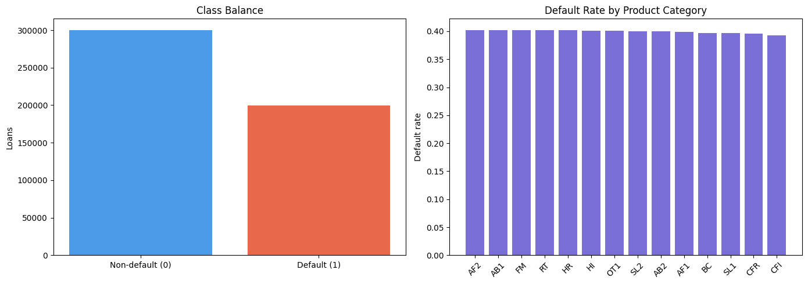

Macro trends against the portfolio default rate over time:

```python
# Macro trends vs portfolio default rate over time
trend_pdf = session.sql("""
    SELECT m.OBSERVATION_MONTH, m.UNEMPLOYMENT_RATE, m.FED_FUNDS_RATE, m.CPI_INDEX,
           AVG(l.DEFAULT_FLAG) AS DEFAULT_RATE
    FROM CREDIT_RISK_ML.PD_MODEL.MACRO_INDICATORS m
    LEFT JOIN CREDIT_RISK_ML.PD_MODEL.LOAN_DATA l
        ON DATE_TRUNC('MONTH', l.ARCHIVE_DATE) = m.OBSERVATION_MONTH
    GROUP BY 1, 2, 3, 4 ORDER BY 1
""").to_pandas()

fig, axes = plt.subplots(2, 2, figsize=(14, 8), sharex=True)
series = [("UNEMPLOYMENT_RATE", "Unemployment rate (%)"),
          ("FED_FUNDS_RATE", "Fed funds rate (%)"),
          ("CPI_INDEX", "CPI index"),
          ("DEFAULT_RATE", "Portfolio default rate")]
for ax, (c, title) in zip(axes.flat, series):
    ax.plot(trend_pdf["OBSERVATION_MONTH"], trend_pdf[c], marker=".")
    ax.set_title(title)
    ax.tick_params(axis="x", rotation=45)
plt.suptitle("FRED Macro Indicators and Portfolio Default Rate (Monthly)")
plt.tight_layout()
plt.show()
```

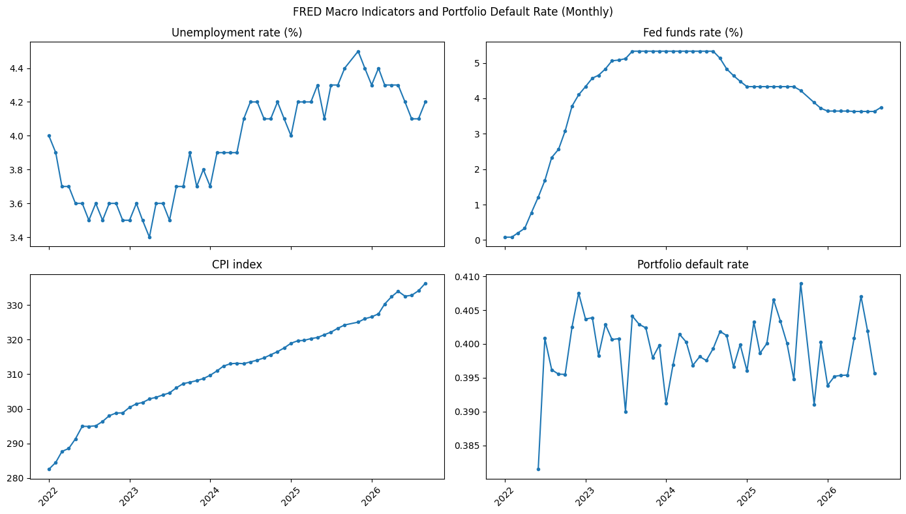

A correlation matrix on a 20K-row sample, taken in Snowflake before collecting:

```python
# Correlation heatmap on a 20K-row sample (sampled in Snowflake before collecting)
import numpy as np

corr_cols = behavioral_cols + ["UNEMPLOYMENT_RATE", "FED_FUNDS_RATE", "CPI_INDEX", "DEFAULT_FLAG"]
sample_pdf = session.sql(f"""
    SELECT * FROM (
        SELECT {", ".join("l." + c for c in behavioral_cols + ["DEFAULT_FLAG"])},
               m.UNEMPLOYMENT_RATE, m.FED_FUNDS_RATE, m.CPI_INDEX
        FROM CREDIT_RISK_ML.PD_MODEL.LOAN_DATA l
        JOIN CREDIT_RISK_ML.PD_MODEL.MACRO_INDICATORS m
            ON DATE_TRUNC('MONTH', l.ARCHIVE_DATE) = m.OBSERVATION_MONTH
    ) SAMPLE (20000 ROWS)
""").to_pandas()

corr = sample_pdf[corr_cols].corr()
fig, ax = plt.subplots(figsize=(11, 9))
im = ax.imshow(corr, cmap="RdBu_r", vmin=-1, vmax=1)
ax.set_xticks(range(len(corr_cols)))
ax.set_xticklabels(corr_cols, rotation=90)
ax.set_yticks(range(len(corr_cols)))
ax.set_yticklabels(corr_cols)
for i in range(len(corr_cols)):
    for j in range(len(corr_cols)):
        ax.text(j, i, f"{corr.iloc[i, j]:.2f}", ha="center", va="center", fontsize=7)
fig.colorbar(im, ax=ax, shrink=0.8)
ax.set_title("Feature Correlation Matrix (incl. DEFAULT_FLAG)")
plt.tight_layout()
plt.show()
```

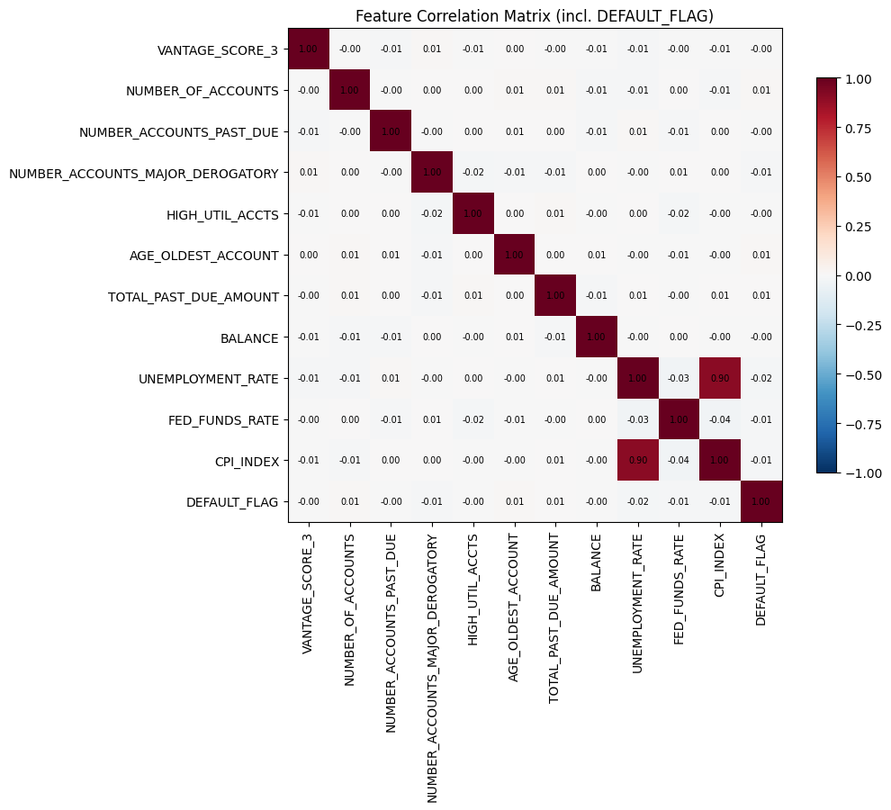

<!-- ------------------------ -->
## Build the Feature Store

In SAS, features usually live in macro-generated datasets refreshed on custom schedules. Here they become managed **Feature Views**: you declare the transformation once, and Snowflake handles refresh, versioning and point-in-time correct retrieval.

Create the Feature Store in the project schema and register the `LOAN` entity, keyed on `TRADE_ID`:

```python
from snowflake.ml.feature_store import FeatureStore, Entity, FeatureView, CreationMode

fs = FeatureStore(
    session=session,
    database="CREDIT_RISK_ML",
    name="PD_MODEL",
    default_warehouse="CREDIT_RISK_WH",
    creation_mode=CreationMode.CREATE_IF_NOT_EXIST
)

# Entity: one row per loan trade
loan_entity = Entity(name="LOAN", join_keys=["TRADE_ID"])
fs.register_entity(loan_entity)
print(f"Registered entity: {loan_entity.name}")
```

**Behavioral Feature View.** Loan-level credit attributes from Equifax, time-stamped by `ARCHIVE_DATE` so later joins are point-in-time correct:

```python
# Behavioral Feature View — loan-level attributes from Equifax
behavioral_source = session.sql("""
    SELECT TRADE_ID, ARCHIVE_DATE,
           VANTAGE_SCORE_3, NUMBER_OF_ACCOUNTS, NUMBER_ACCOUNTS_PAST_DUE,
           NUMBER_ACCOUNTS_MAJOR_DEROGATORY, HIGH_UTIL_ACCTS,
           AGE_OLDEST_ACCOUNT, TOTAL_PAST_DUE_AMOUNT, BALANCE
    FROM CREDIT_RISK_ML.PD_MODEL.LOAN_DATA
""")

behavioral_fv = FeatureView(
    name="LOAN_BEHAVIORAL_FEATURES",
    entities=[loan_entity],
    feature_df=behavioral_source,
    timestamp_col="ARCHIVE_DATE",
    refresh_freq="1 day",
    desc="Loan-level behavioral features from Equifax"
)
behavioral_fv = fs.register_feature_view(feature_view=behavioral_fv, version="V1")
print(f"Registered: {behavioral_fv.name} v{behavioral_fv.version}")
```

**Macro Feature View.** FRED indicators joined to each loan's observation month. These historical values are used for training:

```python
# Macro Feature View — FRED economic indicators joined to loan population
macro_source = session.sql("""
    SELECT l.TRADE_ID, l.ARCHIVE_DATE,
           m.UNEMPLOYMENT_RATE, m.FED_FUNDS_RATE, m.CPI_INDEX
    FROM CREDIT_RISK_ML.PD_MODEL.LOAN_DATA l
    JOIN CREDIT_RISK_ML.PD_MODEL.MACRO_INDICATORS m
        ON DATE_TRUNC('MONTH', l.ARCHIVE_DATE) = m.OBSERVATION_MONTH
""")

macro_fv = FeatureView(
    name="LOAN_MACRO_FEATURES",
    entities=[loan_entity],
    feature_df=macro_source,
    timestamp_col="ARCHIVE_DATE",
    refresh_freq="1 day",
    desc="Macroeconomic indicators from FRED joined to loan population"
)
macro_fv = fs.register_feature_view(feature_view=macro_fv, version="V1")
print(f"Registered: {macro_fv.name} v{macro_fv.version}")
```

**Macro Scenario Feature View.** IFRS 9 and CECL require forward-looking, scenario-weighted loss estimates. This view holds four illustrative scenarios (baseline, upside, downside and severe downside), each a shock applied to the latest FRED observation with a probability weight. In production these would come from your economics team, regulator-prescribed scenarios or a Marketplace provider. The view is keyed by `SCENARIO_ID` rather than by loan, because each loan is scored once per scenario at scoring time.

| Scenario | Weight | Unemployment shift | Fed funds shift | CPI factor |
|---|---|---|---|---|
| BASELINE | 0.50 | 0.0 | 0.00 | 1.000 |
| UPSIDE | 0.15 | -0.5 | +0.25 | 1.010 |
| DOWNSIDE | 0.30 | +2.0 | -1.00 | 0.990 |
| SEVERE_DOWNSIDE | 0.05 | +4.5 | -2.00 | 0.970 |

```python
# Macro Scenario Feature View — forward-looking scenarios for IFRS 9 / CECL scenario-weighted ECL
# Illustrative shocks applied to the latest FRED observation; in production these come from the
# economics team, regulator-prescribed scenarios or a Marketplace provider.
from python_pd_model import MACRO_COLS  # shared with the training module

session.sql("""
    CREATE OR REPLACE TABLE CREDIT_RISK_ML.PD_MODEL.MACRO_SCENARIOS CHANGE_TRACKING = TRUE AS
    WITH latest AS (
        SELECT * FROM CREDIT_RISK_ML.PD_MODEL.MACRO_INDICATORS
        QUALIFY ROW_NUMBER() OVER (ORDER BY OBSERVATION_MONTH DESC) = 1
    ),
    shocks (SCENARIO_ID, SCENARIO_WEIGHT, UNRATE_SHIFT, FEDFUNDS_SHIFT, CPI_FACTOR) AS (
        SELECT * FROM VALUES
            ('BASELINE',        0.50,  0.0,   0.00, 1.000),
            ('UPSIDE',          0.15, -0.5,   0.25, 1.010),
            ('DOWNSIDE',        0.30,  2.0,  -1.00, 0.990),
            ('SEVERE_DOWNSIDE', 0.05,  4.5,  -2.00, 0.970)
    )
    SELECT s.SCENARIO_ID, s.SCENARIO_WEIGHT,
           l.OBSERVATION_MONTH AS SCENARIO_ANCHOR_MONTH,
           l.UNEMPLOYMENT_RATE + s.UNRATE_SHIFT               AS UNEMPLOYMENT_RATE,
           GREATEST(l.FED_FUNDS_RATE + s.FEDFUNDS_SHIFT, 0)   AS FED_FUNDS_RATE,
           l.CPI_INDEX * s.CPI_FACTOR                         AS CPI_INDEX
    FROM shocks s CROSS JOIN latest l
""").collect()

scenario_entity = Entity(name="MACRO_SCENARIO", join_keys=["SCENARIO_ID"])
fs.register_entity(scenario_entity)

scenario_fv = FeatureView(
    name="MACRO_SCENARIO_FEATURES",
    entities=[scenario_entity],
    feature_df=session.table("CREDIT_RISK_ML.PD_MODEL.MACRO_SCENARIOS").select(
        "SCENARIO_ID", "SCENARIO_WEIGHT", *MACRO_COLS),
    refresh_freq="1 day",  # in practice quarterly, or ad hoc when economics revises forecasts
    desc="Forward-looking macro scenarios (baseline/upside/downside/severe) with probability weights",
)
scenario_fv = fs.register_feature_view(feature_view=scenario_fv, version="V1")
print(f"Registered: {scenario_fv.name} v{scenario_fv.version}")
fs.read_feature_view(scenario_fv).show()
```

List the registered Feature Views:

```python
# List all registered feature views
fv_list = fs.list_feature_views().to_pandas()
print(f"Feature Views registered: {len(fv_list)}")
fv_list[["NAME", "VERSION", "DESC"]]
```

<!-- ------------------------ -->
## Generate a Versioned Training Dataset

Regulators ask: *"What data trained this model?"* A Snowflake **Dataset** answers that with a single immutable, versioned reference.

Build a spine of loan IDs, observation dates and labels:

```python
from snowflake.snowpark.functions import col

# Build spine: loan IDs + observation dates + labels
spine_df = session.table("CREDIT_RISK_ML.PD_MODEL.LOAN_DATA").select(
    col("TRADE_ID"), col("ARCHIVE_DATE"), col("DEFAULT_FLAG")
)
print(f"Spine rows: {spine_df.count():,}")
```

Then let the Feature Store join the behavioral and macro features as of each loan's `ARCHIVE_DATE`, so no feature value from the future leaks into training:

```python
# Generate training dataset with point-in-time joins (no look-ahead bias)
dataset = fs.generate_dataset(
    name="PD_TRAINING_DS",
    spine_df=spine_df,
    features=[behavioral_fv, macro_fv],
    spine_timestamp_col="ARCHIVE_DATE",
    spine_label_cols=["DEFAULT_FLAG"],
    output_type="dataset"
)
print(f"Dataset: {dataset.fully_qualified_name}")
print(f"Version: {dataset.selected_version.name}")
```

Inspect the result:

```python
# Inspect the versioned dataset
ds_df = dataset.read.to_snowpark_dataframe()
print(f"Rows: {ds_df.count():,}")
print(f"Columns: {ds_df.columns}")
ds_df.show(5)
```

<!-- ------------------------ -->
## Train the Model with Experiment Tracking

The PD model is an `XGBClassifier`, the Python equivalent of the SAS `PROC GRADBOOST` model (`sas_pd_model.sas`). It was converted with **CoCo**. The hyperparameters map directly from the SAS source:

| SAS PROC GRADBOOST | XGBClassifier | Value |
|---|---|---|
| `ntrees=200` | `n_estimators` | 200 |
| `learningrate=0.1` | `learning_rate` | 0.1 |
| `maxdepth=6` | `max_depth` | 6 |
| `vars_to_try=5` | `colsample_bynode` | 5/11 (~0.45), per split |
| `minleafsize=20` | `min_child_weight` | 20 (approximate) |
| `seed=42` | `random_state` | 42 |

Import the model definition from `python_pd_model.py`, then load the Dataset and create the stratified 80/20 split over the 11 features (8 behavioral, 3 macro) with the module's `prepare_features` and `split_train_test`:

```python
# The model definition lives in python_pd_model.py (converted from SAS by Cortex Code).
# The notebook and the training pipeline both import it, so they train exactly the same model.
import numpy as np
from python_pd_model import (FEATURE_COLS, TARGET_COL, SAS_MAPPED_PARAMS, CHALLENGER_PARAMS,
                             prepare_features, split_train_test, train_pd_model, pd_metrics)

# Load dataset to pandas
train_pdf = ds_df.to_pandas()

X, y = prepare_features(train_pdf)                           # SAS DATA step: missing -> 0
X_train, X_test, y_train, y_test = split_train_test(X, y)    # SAS PROC SURVEYSELECT: 80/20, seed 42
print(f"Train: {X_train.shape[0]:,} rows | Test: {X_test.shape[0]:,} rows")
print(f"Default rate — Train: {y_train.mean():.3f} | Test: {y_test.mean():.3f}")
```

Train two candidates with the module's `train_pd_model` and log both to the `PD_MODEL_DEVELOPMENT` experiment: the SAS-mapped baseline, `SAS_MAPPED_PARAMS` (the future **champion**), and a tuned configuration, `CHALLENGER_PARAMS` (the **challenger**). Each run records its hyperparameters, the exact Dataset version it consumed, and the standard credit risk metrics:
- **Gini** (2 × AUC − 1): discrimination
- **KS**: the maximum separation between the score distributions of defaulters and non-defaulters
- **Brier score**: calibration

This replaces the Word or Excel tracker in which modelers record what they tried.

```python
# Train XGBoost — converted from SAS PROC GRADBOOST (see sas_pd_model.sas) — with Experiment Tracking
# Every run (params, dataset version, Gini/KS/Brier) is logged to the PD_MODEL_DEVELOPMENT experiment
from snowflake.ml.experiment import ExperimentTracking

exp = ExperimentTracking(session=session, database_name="CREDIT_RISK_ML", schema_name="PD_MODEL")
exp.set_experiment("PD_MODEL_DEVELOPMENT")

# Champion candidate: hyperparameters mapped from SAS PROC GRADBOOST (see SAS_MAPPED_PARAMS in python_pd_model.py)
params = SAS_MAPPED_PARAMS
# Challenger candidate: CHALLENGER_PARAMS (slower learning rate, more trees, row subsampling)

runs = {}
for run_name, run_params in [("sas_mapped_baseline", params), ("challenger_lr005_d5", CHALLENGER_PARAMS)]:
    with exp.start_run(run_name):
        exp.log_params({**run_params, "dataset": dataset.fully_qualified_name,
                        "dataset_version": dataset.selected_version.name})
        clf = train_pd_model(X_train, y_train, run_params)
        run_metrics = pd_metrics(y_test.values, clf.predict_proba(X_test)[:, 1])
        exp.log_metrics(run_metrics)
    runs[run_name] = (clf, run_metrics)
    print(f"{run_name:<22} AUC={run_metrics['auc']:.4f}  Gini={run_metrics['gini']:.4f}  "
          f"KS={run_metrics['ks']:.4f}  Brier={run_metrics['brier']:.4f}")

model, champion_metrics = runs["sas_mapped_baseline"]
challenger_model, challenger_metrics = runs["challenger_lr005_d5"]
y_pred_proba = model.predict_proba(X_test)[:, 1]
print("\nCompare runs in Snowsight: AI & ML > Experiments > PD_MODEL_DEVELOPMENT")
```

Plot the champion's feature importance:

```python
# Feature importance
import matplotlib.pyplot as plt

importances = model.feature_importances_
sorted_idx = np.argsort(importances)

fig, ax = plt.subplots(figsize=(10, 6))
ax.barh(range(len(sorted_idx)), importances[sorted_idx])
ax.set_yticks(range(len(sorted_idx)))
ax.set_yticklabels([FEATURE_COLS[i] for i in sorted_idx])
ax.set_xlabel("Feature Importance (Gain)")
ax.set_title("PD Model — XGBoost Feature Importance")
plt.tight_layout()
plt.show()
```

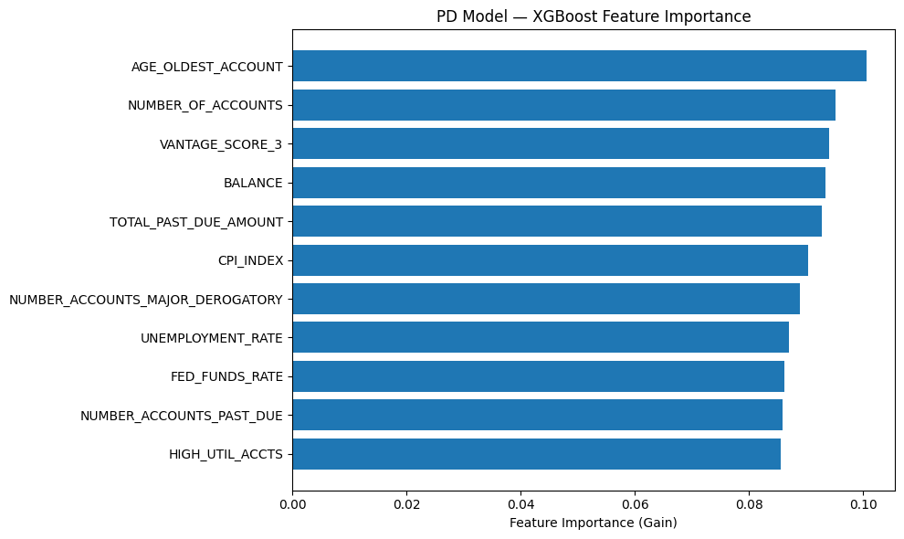

You can compare the runs in Snowsight under **AI & ML > Experiments > PD_MODEL_DEVELOPMENT**.

### Optional: scale out with ML Jobs and Many Model Training
The demo portfolio trains comfortably in the notebook kernel. For larger portfolios, the same code runs as an **ML Job** on a CPU compute pool. **Many Model Training** fits one PD model per segment (here `PRODUCT_CATEGORY`) in a single distributed run. Both cells are gated by `RUN_ON_COMPUTE_POOL = False`, so the notebook runs end to end without a compute pool. Set it to `True` to try them.

```python
# ML Job: run the challenger training on a compute pool instead of the notebook kernel
RUN_ON_COMPUTE_POOL = False
COMPUTE_POOL = "SYSTEM_COMPUTE_POOL_CPU"

session.sql("CREATE STAGE IF NOT EXISTS CREDIT_RISK_ML.PD_MODEL.ML_ARTIFACTS").collect()

if RUN_ON_COMPUTE_POOL:
    from snowflake.ml.jobs import remote

    @remote(COMPUTE_POOL, stage_name="CREDIT_RISK_ML.PD_MODEL.ML_ARTIFACTS",
            pip_requirements=["xgboost", "scikit-learn"], session=session)
    def train_pd_on_pool(dataset_name: str, dataset_version: str, run_params: dict, feature_cols: list):
        from snowflake.snowpark import Session
        from snowflake.ml.dataset import load_dataset
        from xgboost import XGBClassifier
        from sklearn.metrics import roc_auc_score

        s = Session.builder.getOrCreate()
        pdf = load_dataset(s, dataset_name, dataset_version).read.to_pandas()
        X_all, y_all = pdf[feature_cols].fillna(0), pdf["DEFAULT_FLAG"]
        clf = XGBClassifier(**run_params).fit(X_all, y_all)
        print(f"In-sample Gini: {2 * roc_auc_score(y_all, clf.predict_proba(X_all)[:, 1]) - 1:.4f}")
        return clf

    job = train_pd_on_pool(dataset.fully_qualified_name, dataset.selected_version.name,
                           CHALLENGER_PARAMS, FEATURE_COLS)
    print(f"ML Job {job.id} submitted to {COMPUTE_POOL}")
    job.wait()
    pool_model = job.result()
    print(job.get_logs())
else:
    print("Skipped ML Job — set RUN_ON_COMPUTE_POOL = True to train on a compute pool")
```

```python
# Many Model Training: one PD model per product segment, trained in parallel on the compute pool
if RUN_ON_COMPUTE_POOL:
    from snowflake.ml.modeling.distributors.many_model import ManyModelTraining

    segment_train_df = ds_df.join(
        session.table("CREDIT_RISK_ML.PD_MODEL.LOAN_DATA").select("TRADE_ID", "PRODUCT_CATEGORY"),
        on="TRADE_ID",
    )

    def train_segment_model(data_connector, context):
        from xgboost import XGBClassifier
        seg = data_connector.to_pandas()
        print(f"Training PD model for segment {context.partition_id}: {len(seg):,} loans")
        return XGBClassifier(**params).fit(seg[FEATURE_COLS].fillna(0), seg[TARGET_COL])

    mmt = ManyModelTraining(train_segment_model, "CREDIT_RISK_ML.PD_MODEL.ML_ARTIFACTS")
    mmt_run = mmt.run(
        partition_by="PRODUCT_CATEGORY",
        snowpark_dataframe=segment_train_df,
        run_id="pd_by_product_category",
    )
    print(f"Many Model Training finished: {mmt_run.wait()}")
else:
    print("Skipped Many Model Training — set RUN_ON_COMPUTE_POOL = True to train per-segment models")
```

> aside negative
> The per-segment models are a demonstration only. They are not registered or used by the pipelines later in this guide.

<!-- ------------------------ -->
## Register, Explain and Trace the Model

Register both models in the **Model Registry** as versions of `PD_XGB_MODEL`: **V1** gets the `champion` alias (production) and **V2** gets the `challenger` alias (candidate). Logging each model with a Snowpark sample from the versioned Dataset does two things:
- it records **ML Lineage** from the model back to the Dataset and Feature Views;
- with `target_platforms=["WAREHOUSE"]`, it enables the Registry's built-in SHAP `explain` function.

```python
from snowflake.ml.registry import Registry

reg = Registry(session=session, database_name="CREDIT_RISK_ML", schema_name="PD_MODEL")

# Drop existing model if re-running so V1/V2 can be re-registered
try:
    reg.delete_model("PD_XGB_MODEL")
    print("Dropped existing PD_XGB_MODEL for re-registration")
except Exception:
    pass

# Snowpark sample from the versioned Dataset -> records lineage Dataset -> Model
sample_input = ds_df.select(FEATURE_COLS).limit(5)

registered = {}
for version_name, alias, mdl, mtr, desc in [
    ("V1", "champion", model, champion_metrics, "SAS-mapped hyperparameters"),
    ("V2", "challenger", challenger_model, challenger_metrics, "tuned candidate"),
]:
    mv_i = reg.log_model(
        model=mdl,
        model_name="PD_XGB_MODEL",
        version_name=version_name,
        sample_input_data=sample_input,
        comment=f"{alias.upper()} — PD model, XGBoost migrated from SAS PROC GRADBOOST ({desc})",
        metrics=mtr,
        target_platforms=["WAREHOUSE"],  # warehouse target + sample input enables the explain function
    )
    mv_i.set_alias(alias)
    registered[alias] = mv_i
    print(f"Registered {version_name} as '{alias}': Gini={mtr['gini']:.4f}, KS={mtr['ks']:.4f}, Brier={mtr['brier']:.4f}")

mv = registered["champion"]
pd_model = reg.get_model("PD_XGB_MODEL")
pd_model.default = mv
pd_model.show_versions()
```

### SHAP explainability
Credit decisions must be explainable, for audit purposes. The `explain` function runs on the warehouse next to the data, with no external SHAP tooling. Start with global importance:

```python
# SHAP Explainability from the Registry — critical for adverse action notices and SR 11-7 compliance
# The explain function runs on the warehouse next to the data; no local SHAP tooling required
import altair as alt
from snowflake.ml.monitoring.explain_visualize import plot_violin

explain_input = ds_df.select("TRADE_ID", *FEATURE_COLS).limit(200)
explanations = mv.run(explain_input, function_name="explain").to_pandas()

shap_cols = [f"{c}_explanation" for c in FEATURE_COLS]
shap_df = explanations[shap_cols].rename(columns=lambda c: c.replace("_explanation", ""))
feature_df = explanations[FEATURE_COLS]

# Global importance: mean |SHAP| per feature
print(shap_df.abs().mean().sort_values(ascending=False).round(4).to_string())

alt.renderers.enable("mimetype")
plot_violin(shap_df=shap_df, feature_df=feature_df)
```

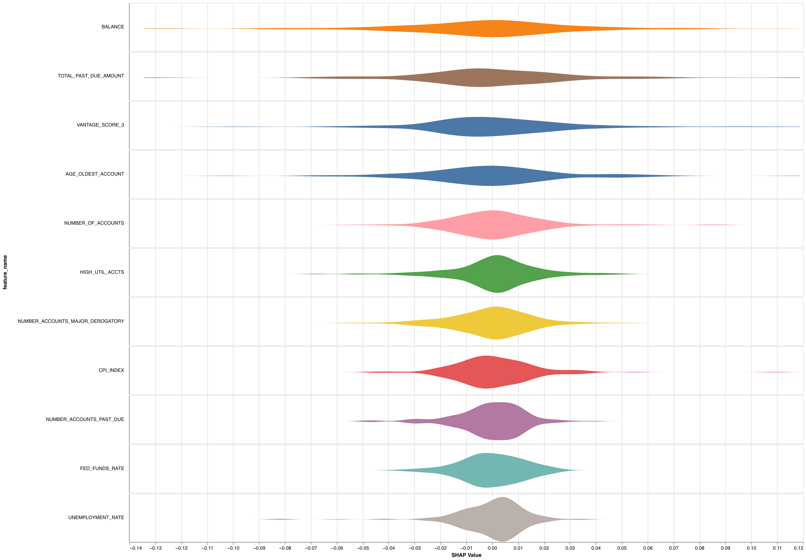

Then explain a single prediction. This is the input to an adverse action notice ("why was this applicant declined?"):

```python
# Per-prediction explanation (adverse action reporting) from the Registry's explain output
sample_idx = 0
sample_trade = explanations["TRADE_ID"].iloc[sample_idx].item()  # numpy scalar -> native Python for Snowpark literal
sample_pd = mv.run(
    explain_input.filter(col("TRADE_ID") == sample_trade), function_name="predict_proba"
).to_pandas()["output_feature_1"].iloc[0]

print(f"Loan {sample_trade}: PD = {sample_pd:.4f}\n")
print("Top adverse action factors:")
factors = sorted(
    zip(FEATURE_COLS, shap_df.iloc[sample_idx].values, feature_df.iloc[sample_idx].values),
    key=lambda x: abs(x[1]), reverse=True,
)
for feat, shap_val, feat_val in factors[:5]:
    direction = "increases" if shap_val > 0 else "decreases"
    print(f"  {feat} = {feat_val:.1f} ({direction} PD by {abs(shap_val):.4f})")
```

### ML Lineage
Answer "what data trained this model?" with a query instead of a document hunt. Walk upstream from the champion to its Dataset, Feature Views and source tables:

```python
# ML Lineage — trace the champion back to its Dataset, Feature Views and source tables
# Answers the validator question "what data trained this model?" with a query, not a document hunt
for node in mv.lineage(direction="upstream"):
    print(f"model {mv.version_name} <- {node}")
    if hasattr(node, "lineage"):
        for parent in node.lineage(direction="upstream"):
            print(f"    <- {parent}")
```

<!-- ------------------------ -->
## Batch Score and Compute Scenario-Weighted ECL

Credit risk models run in batch, for monthly provisioning and quarterly stress tests. Features come straight from the Feature Store through `retrieve_feature_values`, so scoring uses exactly the same feature definitions as training.

Score the same portfolio with the champion and the challenger. This is **offline champion/challenger**: both models see the identical population, and nothing reaches production decisions until a model is explicitly promoted.

```python
# Score the same portfolio with champion and challenger — features served by the Feature Store
from snowflake.snowpark.types import TimestampType

pd_model = reg.get_model("PD_XGB_MODEL")

scoring_spine = session.table("CREDIT_RISK_ML.PD_MODEL.LOAN_DATA").select(
    "TRADE_ID", "ARCHIVE_DATE", "DEFAULT_FLAG", "PRODUCT_CATEGORY"
).limit(100000)

scoring_df = fs.retrieve_feature_values(
    spine_df=scoring_spine,
    features=[behavioral_fv, macro_fv],
    spine_timestamp_col="ARCHIVE_DATE",
)

for alias in ["champion", "challenger"]:
    mv_alias = pd_model.version(alias)
    preds = mv_alias.run(scoring_df, function_name="predict_proba")
    # Model monitors require a TIMESTAMP_NTZ timestamp column
    preds = preds.with_column("ARCHIVE_DATE", col("ARCHIVE_DATE").cast(TimestampType()))
    preds.write.save_as_table(f"CREDIT_RISK_ML.PD_MODEL.PD_SCORES_{alias.upper()}", mode="overwrite")
    print(f"{alias:<10} ({mv_alias.version_name}): scored {preds.count():,} loans "
          f"-> PD_SCORES_{alias.upper()}")

session.table("CREDIT_RISK_ML.PD_MODEL.PD_SCORES_CHAMPION").show(5)
```

Compare discrimination and calibration on that population:

```python
# Champion vs challenger on the identical population: discrimination (Gini, KS) and calibration (Brier)
from sklearn.metrics import brier_score_loss

comparison = []
for alias in ["CHAMPION", "CHALLENGER"]:
    s = session.table(f"CREDIT_RISK_ML.PD_MODEL.PD_SCORES_{alias}").select(
        "DEFAULT_FLAG", '"output_feature_1"').to_pandas()
    y_s, p_s = s["DEFAULT_FLAG"].values, s["output_feature_1"].values
    a = roc_auc_score(y_s, p_s)
    comparison.append({
        "model": alias, "auc": a, "gini": 2 * a - 1,
        "ks": ks_2samp(p_s[y_s == 0], p_s[y_s == 1]).statistic,
        "brier": brier_score_loss(y_s, p_s),
        "mean_pd": p_s.mean(), "observed_dr": y_s.mean(),
    })

import pandas as pd
pd.DataFrame(comparison).set_index("model").round(4)
```

For very large portfolios, `run_batch()` distributes inference across a compute pool. This step is optional and gated by the same flag:

```python
# Large portfolios: job-based batch inference with run_batch() on an SPCS compute pool
# (warehouse run() above is enough for this demo portfolio; RUN_ON_COMPUTE_POOL is set in section 6b)
if RUN_ON_COMPUTE_POOL:
    from snowflake.ml.model.batch import JobSpec, OutputSpec, SaveMode

    batch_job = pd_model.version("champion").run_batch(
        X=scoring_df,
        compute_pool=COMPUTE_POOL,
        output_spec=OutputSpec(
            stage_location="@CREDIT_RISK_ML.PD_MODEL.ML_ARTIFACTS/batch_scores/",
            mode=SaveMode.OVERWRITE,
        ),
        job_spec=JobSpec(function_name="predict_proba"),
    )
    batch_job.wait()
    print(f"run_batch job {batch_job.id}: {batch_job.status}")
else:
    print("Skipped run_batch() — set RUN_ON_COMPUTE_POOL = True to score on a compute pool")
```

### Scenario-weighted Expected Credit Loss
ECL = PD × LGD × EAD, weighted across macro scenarios:
Scenario-conditioned scoring: score each loan once per macro scenario, then probability-weight
LGD is a flat illustrative assumption and BALANCE is used as the EAD proxy — this guide models PD only

```python
LGD_ASSUMPTION = 0.45

scenarios_df = fs.read_feature_view(scenario_fv)
behavioral_cols = [c for c in FEATURE_COLS if c not in MACRO_COLS]

# Replace each loan's historical macro values with the scenario's forward-looking values
scenario_scoring_df = scoring_df.select("TRADE_ID", "ARCHIVE_DATE", *behavioral_cols).cross_join(scenarios_df)
scenario_preds = pd_model.version("champion").run(
    scenario_scoring_df.select("TRADE_ID", "SCENARIO_ID", "SCENARIO_WEIGHT", *FEATURE_COLS),
    function_name="predict_proba",
)
scenario_preds.write.save_as_table("CREDIT_RISK_ML.PD_MODEL.PD_SCORES_SCENARIO", mode="overwrite")

ecl_by_scenario = session.sql(f"""
    SELECT SCENARIO_ID, ANY_VALUE(SCENARIO_WEIGHT) AS SCENARIO_WEIGHT,
           AVG("output_feature_1") AS MEAN_PD,
           SUM("output_feature_1" * BALANCE * {LGD_ASSUMPTION}) AS ECL
    FROM CREDIT_RISK_ML.PD_MODEL.PD_SCORES_SCENARIO
    GROUP BY SCENARIO_ID
    ORDER BY MEAN_PD
""").to_pandas()
weighted_ecl = (ecl_by_scenario["SCENARIO_WEIGHT"] * ecl_by_scenario["ECL"]).sum()

# Loan-level probability-weighted PD for provisioning
session.sql("""
    CREATE OR REPLACE TABLE CREDIT_RISK_ML.PD_MODEL.PD_SCORES_WEIGHTED AS
    SELECT TRADE_ID, SUM(SCENARIO_WEIGHT * "output_feature_1") AS WEIGHTED_PD
    FROM CREDIT_RISK_ML.PD_MODEL.PD_SCORES_SCENARIO
    GROUP BY TRADE_ID
""").collect()

print(ecl_by_scenario.round(4).to_string(index=False))
print(f"\nProbability-weighted ECL: {weighted_ecl:,.0f}  (LGD = {LGD_ASSUMPTION}, EAD = BALANCE)")
```

<!-- ------------------------ -->
## Monitor the Models

Attach a **Model Version Monitor** to the champion and to the challenger. Each monitor:
- reads its model's scoring output (`PD_SCORES_<ROLE>`);
- compares it with a baseline, which is that version's scores on its training Dataset;
- tracks data drift and prediction drift against that baseline;
- tracks performance against realized defaults (`DEFAULT_FLAG`);
- breaks every metric out by `PRODUCT_CATEGORY`.

This replaces quarterly manual monitoring reports.

```python
# Model Version Monitors — one per version, each on its own scoring output (champion vs challenger)
# predict_proba returns lowercase columns: "output_feature_1" is P(default), so it is the score column
# Binary classification: ground truth (0/1 DEFAULT_FLAG) goes in ACTUAL_CLASS_COLUMNS, not ACTUAL_SCORE_COLUMNS
for alias, version in [("CHAMPION", "V1"), ("CHALLENGER", "V2")]:
    # Baseline = this version's scores on its training Dataset; drift (PSI, JS divergence) is measured against it
    baseline_input = ds_df.join(
        session.table("CREDIT_RISK_ML.PD_MODEL.LOAN_DATA").select("TRADE_ID", "PRODUCT_CATEGORY"), on="TRADE_ID"
    )
    pd_model.version(version).run(baseline_input, function_name="predict_proba").with_column(
        "ARCHIVE_DATE", col("ARCHIVE_DATE").cast(TimestampType())
    ).write.save_as_table(f"CREDIT_RISK_ML.PD_MODEL.PD_BASELINE_{alias}", mode="overwrite")

    session.sql(f"""
        CREATE OR REPLACE MODEL MONITOR CREDIT_RISK_ML.PD_MODEL.PD_MODEL_MONITOR_{alias}
        WITH
            MODEL = CREDIT_RISK_ML.PD_MODEL.PD_XGB_MODEL
            VERSION = '{version}'
            FUNCTION = 'predict_proba'
            SOURCE = CREDIT_RISK_ML.PD_MODEL.PD_SCORES_{alias}
            BASELINE = CREDIT_RISK_ML.PD_MODEL.PD_BASELINE_{alias}
            TIMESTAMP_COLUMN = ARCHIVE_DATE
            PREDICTION_SCORE_COLUMNS = ('output_feature_1')
            ACTUAL_CLASS_COLUMNS = (DEFAULT_FLAG)
            ID_COLUMNS = (TRADE_ID)
            SEGMENT_COLUMNS = (PRODUCT_CATEGORY)
            WAREHOUSE = CREDIT_RISK_WH
            AGGREGATION_WINDOW = '1 DAY'
            REFRESH_INTERVAL = '1 DAY'
    """).collect()
    print(f"Model Monitor created: PD_MODEL_MONITOR_{alias} (version {version})")

# Drop the single-version monitor from earlier runs of this notebook
session.sql("DROP MODEL MONITOR IF EXISTS CREDIT_RISK_ML.PD_MODEL.PD_MODEL_MONITOR").collect()
print("Tracking per version: data drift vs training baseline, prediction drift, Gini/KS/calibration vs realized defaults")
print("View in Snowsight: AI & ML > Models > PD_XGB_MODEL > Monitors")
```

View the monitors in Snowsight under **AI & ML > Models > PD_XGB_MODEL > Monitors**. When the training pipeline promotes a new version, it re-points that role's monitor automatically.

<!-- ------------------------ -->
## Automate Monthly Retraining with Human Approval

Now automate the lifecycle with **Task DAGs**, replacing the cron and shell scripts common in SAS environments. Each task calls a Python stored procedure.

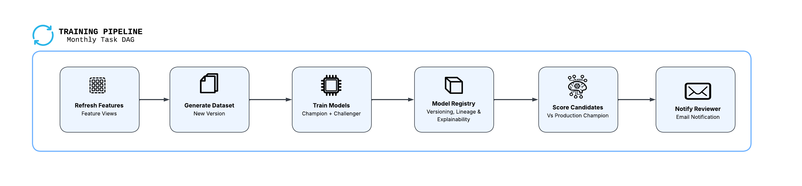

Every month the training pipeline produces **two candidates** on a fresh Dataset:
- a **champion candidate**: the production champion's hyperparameters, refit;
- a **challenger candidate**: the challenger configuration, refit.

Both candidates are registered with `CHAMPION_CANDIDATE` / `CHALLENGER_CANDIDATE` aliases and scored on the same portfolio as the production champion. An advisory **validation gate** checks Gini lift ≥ 0 and Brier ≤ 1.02 × champion. A reviewer then gets one email and approves or rejects each candidate separately. The automated gate only *recommends*. Only a user with the `MODEL_REVIEWER` role can move the production aliases, which gives you the four-eyes control expected under SR 11-7 / SS1/23.

```
PD_MODEL_TRAIN_PIPELINE (root, 1st of month 02:00)   SP_REFRESH_FEATURES
  └─ ..._GENERATE_DATASET                              SP_GENERATE_DATASET
       └─ ..._TRAIN_CANDIDATES                         SP_TRAIN_CANDIDATES
            └─ ..._SCORE_CANDIDATES                    SP_SCORE_CANDIDATES
                 └─ ..._VALIDATION_GATE                SP_VALIDATION_GATE   -> PROMOTION_LOG (PENDING_REVIEW)
                      └─ ..._NOTIFY_REVIEWER           SP_NOTIFY_REVIEWER   -> review email

Reviewer (MODEL_REVIEWER), outside the DAG, once per candidate:
  CALL SP_REVIEW_MODEL('<version>', 'APPROVE' | 'REJECT', '<comments>')
    -> SP_APPLY_REVIEW: moves the alias, re-points the monitor, writes the audit trail
```

### Pipeline stored procedures
This cell uploads `python_pd_model.py` to the `ML_ARTIFACTS` stage and registers each pipeline step as a stored procedure with that file as an import. `SP_TRAIN_CANDIDATES` trains with the module's `prepare_features`, `split_train_test`, `train_pd_model` and hyperparameters, and every step computes metrics with its `pd_metrics`. The monthly retraining therefore runs the same converted code as the notebook. To change the model, edit `python_pd_model.py` and re-run this cell. The pipeline steps are:

| Procedure | What it does |
|---|---|
| `SP_REFRESH_FEATURES` | Refreshes the behavioral and macro Feature Views |
| `SP_GENERATE_DATASET` | Writes a new timestamped version of `PD_TRAINING_DS` |
| `SP_TRAIN_CANDIDATES` | Retrains both candidates, logs runs to Experiment Tracking, registers them with candidate aliases |
| `SP_SCORE_CANDIDATES` | Scores the production champion and both candidates on the same portfolio |
| `SP_VALIDATION_GATE` | Computes Gini/Brier vs the champion, writes one `PENDING_REVIEW` row per candidate to `PROMOTION_LOG` |
| `SP_NOTIFY_REVIEWER` | Sends one HTML email covering both candidates, with approve/reject commands for each |
| `SP_APPLY_REVIEW` | Applies a decision: moves the alias, re-points the monitor, comments the versions, updates the audit trail |

It also creates `PROMOTION_LOG`, the model risk review queue and audit trail.

```python
# Pipeline steps as Python stored procedures — each Task in the DAG calls one of these
# Every retraining cycle produces TWO candidates, each approved (or rejected) separately by the reviewer:
#   champion candidate   — the current champion's hyperparameters refit on the latest Dataset
#   challenger candidate — the challenger configuration (CHALLENGER_PARAMS) refit on the latest Dataset
# Candidates carry CHAMPION_CANDIDATE / CHALLENGER_CANDIDATE aliases until reviewed; only an approval
# moves the CHAMPION / CHALLENGER alias that weekly scoring uses.
from snowflake.snowpark import Session
import python_pd_model as pdm

DB, SCHEMA, WH = "CREDIT_RISK_ML", "PD_MODEL", "CREDIT_RISK_WH"
MODEL_NAME = "PD_XGB_MODEL"
SP_PACKAGES = ["snowflake-ml-python", "xgboost", "scikit-learn", "scipy", "pandas"]
ROLES = ["CHAMPION", "CHALLENGER"]

session.sql(f"CREATE STAGE IF NOT EXISTS {DB}.{SCHEMA}.ML_ARTIFACTS").collect()
# Ship the model module to the stage; every pipeline procedure imports it from there
MODEL_MODULE = f"@{DB}.{SCHEMA}.ML_ARTIFACTS/code/python_pd_model.py"
session.file.put("python_pd_model.py", f"@{DB}.{SCHEMA}.ML_ARTIFACTS/code",
                 auto_compress=False, overwrite=True)
# PROMOTION_LOG is the model-risk review queue and audit trail, one row per candidate:
#   TARGET_ROLE        = role the candidate would take if approved (CHAMPION / CHALLENGER)
#   CHALLENGER_VERSION = the candidate version under review (column name kept for compatibility)
#   CHAMPION_VERSION   = the champion in production when the candidate was evaluated (the benchmark)
#   DECISION           = the automated gate's recommendation (PASS / REJECT)
#   STATUS             = PENDING_REVIEW -> APPROVED / REJECTED (by a human) or SUPERSEDED (newer candidate)
session.sql(f"""
    CREATE TABLE IF NOT EXISTS {DB}.{SCHEMA}.PROMOTION_LOG (
        EVALUATED_AT TIMESTAMP_NTZ, CHAMPION_VERSION STRING, CHALLENGER_VERSION STRING,
        CHAMPION_GINI FLOAT, CHALLENGER_GINI FLOAT, CHAMPION_BRIER FLOAT, CHALLENGER_BRIER FLOAT,
        DECISION STRING, PROMOTED BOOLEAN
    )
""").collect()
for column, dtype in [("STATUS", "STRING"), ("REVIEWED_BY", "STRING"),
                      ("REVIEWED_AT", "TIMESTAMP_NTZ"), ("REVIEW_COMMENTS", "STRING"),
                      ("NOTIFIED_AT", "TIMESTAMP_NTZ"), ("TARGET_ROLE", "STRING")]:
    session.sql(f"ALTER TABLE {DB}.{SCHEMA}.PROMOTION_LOG ADD COLUMN IF NOT EXISTS {column} {dtype}").collect()
# Rows written before TARGET_ROLE existed were challenger -> champion promotions
session.sql(f"UPDATE {DB}.{SCHEMA}.PROMOTION_LOG SET TARGET_ROLE = 'CHAMPION' WHERE TARGET_ROLE IS NULL").collect()

# Reviewer emails and the email integration name are configured in the Setup cell (section 1)


def _version_by_alias(model, alias):
    import json
    for _, row in model.show_versions().iterrows():
        aliases = json.loads(row["aliases"]) if row["aliases"] else []
        if alias.upper() in [a.upper() for a in aliases]:
            return model.version(row["name"])
    return None


def _move_alias(model, alias, version_name):
    """Point an alias at version_name, removing it from whichever version holds it now (idempotent)."""
    holder = _version_by_alias(model, alias)
    if holder is not None and holder.version_name == version_name:
        return None
    if holder is not None:
        holder.unset_alias(alias)
    model.version(version_name).set_alias(alias)
    return holder.version_name if holder is not None else None


def _latest_dataset_version(session):
    versions = session.sql(f"SHOW VERSIONS IN DATASET {DB}.{SCHEMA}.PD_TRAINING_DS").collect()
    return sorted(versions, key=lambda r: r["created_on"])[-1]["version"]


def _scoring_features(session, fs, limit=100000):
    spine = session.table(f"{DB}.{SCHEMA}.LOAN_DATA").select(
        "TRADE_ID", "ARCHIVE_DATE", "DEFAULT_FLAG", "PRODUCT_CATEGORY")
    if limit is not None:
        spine = spine.limit(limit)
    return fs.retrieve_feature_values(
        spine_df=spine,
        features=[fs.get_feature_view("LOAN_BEHAVIORAL_FEATURES", "V1"),
                  fs.get_feature_view("LOAN_MACRO_FEATURES", "V1")],
        spine_timestamp_col="ARCHIVE_DATE",
    )


def _set_version_comment(session, version_name, text):
    """Role-prefixed comment shown next to each version in Snowsight (AI & ML > Models).
    DDL does not accept bind variables, so the text is escaped as a string literal."""
    escaped = text.replace("\\", "\\\\").replace("'", "''")
    session.sql(f"ALTER MODEL {DB}.{SCHEMA}.{MODEL_NAME} MODIFY VERSION {version_name} "
                f"SET COMMENT = '{escaped}'").collect()


def _upsert_monitor(session, role, version_name):
    """(Re)point the role's monitor at a version, with a baseline scored on the latest training Dataset."""
    import json
    from snowflake.snowpark.functions import col
    from snowflake.snowpark.types import TimestampType
    from snowflake.ml.dataset import load_dataset
    from snowflake.ml.registry import Registry
    train_df = load_dataset(session, f"{DB}.{SCHEMA}.PD_TRAINING_DS",
                            _latest_dataset_version(session)).read.to_snowpark_dataframe()
    baseline_input = train_df.join(
        session.table(f"{DB}.{SCHEMA}.LOAN_DATA").select("TRADE_ID", "PRODUCT_CATEGORY"), on="TRADE_ID")
    mv = Registry(session=session, database_name=DB, schema_name=SCHEMA).get_model(MODEL_NAME).version(version_name)
    mv.run(baseline_input, function_name="predict_proba").with_column(
        "ARCHIVE_DATE", col("ARCHIVE_DATE").cast(TimestampType())
    ).write.save_as_table(f"{DB}.{SCHEMA}.PD_BASELINE_{role}", mode="overwrite")
    # Snowflake allows one monitor per model version: drop any other monitor already on this version
    for mon in session.sql(f"SHOW MODEL MONITORS IN SCHEMA {DB}.{SCHEMA}").collect():
        on_version = json.loads(mon["model"]).get("version_name", "").upper() == version_name.upper()
        if on_version and mon["name"].upper() != f"PD_MODEL_MONITOR_{role}":
            session.sql(f"DROP MODEL MONITOR {DB}.{SCHEMA}.{mon['name']}").collect()
    session.sql(f"""
        CREATE OR REPLACE MODEL MONITOR {DB}.{SCHEMA}.PD_MODEL_MONITOR_{role}
        WITH
            MODEL = {DB}.{SCHEMA}.{MODEL_NAME}
            VERSION = '{version_name}'
            FUNCTION = 'predict_proba'
            SOURCE = {DB}.{SCHEMA}.PD_SCORES_{role}
            BASELINE = {DB}.{SCHEMA}.PD_BASELINE_{role}
            TIMESTAMP_COLUMN = ARCHIVE_DATE
            PREDICTION_SCORE_COLUMNS = ('output_feature_1')
            ACTUAL_CLASS_COLUMNS = (DEFAULT_FLAG)
            ID_COLUMNS = (TRADE_ID)
            SEGMENT_COLUMNS = (PRODUCT_CATEGORY)
            WAREHOUSE = {WH}
            AGGREGATION_WINDOW = '1 DAY'
            REFRESH_INTERVAL = '1 DAY'
    """).collect()


def sp_refresh_features(session: Session) -> str:
    from snowflake.ml.feature_store import FeatureStore
    fs = FeatureStore(session, DB, SCHEMA, WH)
    for name in ["LOAN_BEHAVIORAL_FEATURES", "LOAN_MACRO_FEATURES"]:
        fs.refresh_feature_view(fs.get_feature_view(name, "V1"))
    return "Feature views refreshed"


def sp_generate_dataset(session: Session) -> str:
    import datetime
    from snowflake.ml.feature_store import FeatureStore
    fs = FeatureStore(session, DB, SCHEMA, WH)
    version = datetime.datetime.utcnow().strftime("V_%Y%m%d_%H%M")
    spine = session.table(f"{DB}.{SCHEMA}.LOAN_DATA").select("TRADE_ID", "ARCHIVE_DATE", "DEFAULT_FLAG")
    fs.generate_dataset(
        name="PD_TRAINING_DS", version=version, spine_df=spine,
        features=[fs.get_feature_view("LOAN_BEHAVIORAL_FEATURES", "V1"),
                  fs.get_feature_view("LOAN_MACRO_FEATURES", "V1")],
        spine_timestamp_col="ARCHIVE_DATE", spine_label_cols=["DEFAULT_FLAG"], output_type="dataset",
    )
    return version


def sp_train_candidates(session: Session) -> str:
    """Retrain both models on the latest Dataset and register them as candidates awaiting review."""
    import datetime
    from snowflake.ml.dataset import load_dataset
    from snowflake.ml.experiment import ExperimentTracking
    from snowflake.ml.registry import Registry

    ds_version = _latest_dataset_version(session)
    sdf = load_dataset(session, f"{DB}.{SCHEMA}.PD_TRAINING_DS", ds_version).read.to_snowpark_dataframe()
    pdf = sdf.to_pandas()
    X, y = pdm.prepare_features(pdf)
    X_tr, X_te, y_tr, y_te = pdm.split_train_test(X, y)

    reg = Registry(session=session, database_name=DB, schema_name=SCHEMA)
    m = reg.get_model(MODEL_NAME)

    # Champion candidate keeps the production champion's hyperparameters; challenger uses the challenger config
    champion = _version_by_alias(m, "champion")
    champion_params, params_source = pdm.SAS_MAPPED_PARAMS, "SAS-mapped baseline (no champion found)"
    if champion is not None:
        champion_params = {k: v for k, v in champion.load(force=True).get_params().items() if v is not None}
        params_source = f"hyperparameters of champion {champion.version_name}"
    candidates = [("CHAMPION", champion_params, params_source),
                  ("CHALLENGER", pdm.CHALLENGER_PARAMS, "challenger configuration")]

    exp = ExperimentTracking(session=session, database_name=DB, schema_name=SCHEMA)
    exp.set_experiment("PD_MODEL_DEVELOPMENT")
    stamp = datetime.datetime.utcnow().strftime("%Y%m%d_%H%M")
    created = []
    for role, run_params, source in candidates:
        version_name = f"V_{stamp}_{role[:5]}"          # e.g. V_20261101_0200_CHAMP / _CHALL
        with exp.start_run(f"retrain_{role.lower()}_{stamp}"):
            exp.log_params({**run_params, "dataset_version": ds_version, "target_role": role})
            model = pdm.train_pd_model(X_tr, y_tr, run_params)
            metrics = pdm.pd_metrics(y_te.values, model.predict_proba(X_te)[:, 1])
            exp.log_metrics(metrics)
        reg.log_model(
            model=model, model_name=MODEL_NAME, version_name=version_name,
            sample_input_data=sdf.select(pdm.FEATURE_COLS).limit(5),  # Snowpark input -> lineage to the Dataset
            metrics=metrics, target_platforms=["WAREHOUSE"],
            comment=f"{role} CANDIDATE — pending review | {source}, dataset {ds_version}",
        )
        superseded = _move_alias(reg.get_model(MODEL_NAME), f"{role}_CANDIDATE", version_name)
        if superseded:
            _set_version_comment(session, superseded,
                                 f"SUPERSEDED {role.lower()} candidate — replaced by {version_name} before review")
        created.append(f"{role.lower()} candidate {version_name}")
    return "Registered " + " and ".join(created)


def sp_score_candidates(session: Session) -> str:
    """Score the production champion and both candidates on the identical portfolio."""
    from snowflake.snowpark.functions import col
    from snowflake.snowpark.types import TimestampType
    from snowflake.ml.feature_store import FeatureStore
    from snowflake.ml.registry import Registry
    fs = FeatureStore(session, DB, SCHEMA, WH)
    m = Registry(session=session, database_name=DB, schema_name=SCHEMA).get_model(MODEL_NAME)
    features = _scoring_features(session, fs)
    scored = []
    for alias, table in [("champion", "PD_SCORES_CHAMPION"),
                         ("champion_candidate", "PD_SCORES_CHAMPION_CANDIDATE"),
                         ("challenger_candidate", "PD_SCORES_CHALLENGER_CANDIDATE")]:
        mv = _version_by_alias(m, alias)
        mv.run(features, function_name="predict_proba").with_column(
            "ARCHIVE_DATE", col("ARCHIVE_DATE").cast(TimestampType())
        ).write.save_as_table(f"{DB}.{SCHEMA}.{table}", mode="overwrite")
        scored.append(f"{alias} {mv.version_name}")
    return "Scored " + ", ".join(scored)


def sp_validation_gate(session: Session) -> str:
    """Gate each candidate against the production champion and queue both for human review."""
    import datetime
    from snowflake.ml.registry import Registry
    m = Registry(session=session, database_name=DB, schema_name=SCHEMA).get_model(MODEL_NAME)

    def metrics_for(table):
        pdf = session.table(f"{DB}.{SCHEMA}.{table}").select("DEFAULT_FLAG", '"output_feature_1"').to_pandas()
        return pdm.pd_metrics(pdf["DEFAULT_FLAG"].values, pdf["output_feature_1"].values)

    bench = metrics_for("PD_SCORES_CHAMPION")
    champion_version = _version_by_alias(m, "champion").version_name
    now = datetime.datetime.utcnow()
    rows, summary = [], []
    for role in ROLES:
        candidate = _version_by_alias(m, f"{role}_candidate").version_name
        cand = metrics_for(f"PD_SCORES_{role}_CANDIDATE")
        passed = (cand["gini"] >= bench["gini"] + GATE_MIN_GINI_LIFT and
                  cand["brier"] <= bench["brier"] * GATE_MAX_BRIER_RATIO)
        decision = "PASS" if passed else "REJECT"
        # An older candidate for the same role still waiting for review is superseded by this one
        session.sql(f"""
            UPDATE {DB}.{SCHEMA}.PROMOTION_LOG SET STATUS = 'SUPERSEDED'
            WHERE STATUS = 'PENDING_REVIEW' AND TARGET_ROLE = ? AND CHALLENGER_VERSION != ?
        """, params=[role, candidate]).collect()
        rows.append([now, champion_version, candidate, bench["gini"], cand["gini"], bench["brier"],
                     cand["brier"], decision, False, "PENDING_REVIEW", role])
        summary.append(f"{role.lower()} candidate {candidate}: {decision}")
    session.create_dataframe(rows, schema=[
        "EVALUATED_AT", "CHAMPION_VERSION", "CHALLENGER_VERSION", "CHAMPION_GINI", "CHALLENGER_GINI",
        "CHAMPION_BRIER", "CHALLENGER_BRIER", "DECISION", "PROMOTED", "STATUS", "TARGET_ROLE",
    ]).write.mode("append").save_as_table(f"{DB}.{SCHEMA}.PROMOTION_LOG", column_order="name")
    return "Gate recommendations — " + "; ".join(summary) + " — pending human review"


def sp_notify_reviewer(session: Session) -> str:
    """One email covering every candidate awaiting review, each with its own approve / reject commands."""
    from snowflake.ml.registry import Registry
    pending = session.sql(f"""
        SELECT * FROM {DB}.{SCHEMA}.PROMOTION_LOG
        WHERE STATUS = 'PENDING_REVIEW' AND NOTIFIED_AT IS NULL
        ORDER BY IFF(TARGET_ROLE = 'CHAMPION', 0, 1)
    """).collect()
    if not pending:
        return "Nothing pending review"
    m = Registry(session=session, database_name=DB, schema_name=SCHEMA).get_model(MODEL_NAME)
    versions = m.show_versions()
    trained = {row["name"]: str(row["created_on"])[:16] for _, row in versions.iterrows()}
    current = {role: (_version_by_alias(m, role.lower()) or None) for role in ROLES}
    current = {role: (mv.version_name if mv else "none") for role, mv in current.items()}

    cell = "padding:6px 10px;border:1px solid #d1d5db"
    colours = {"CHAMPION": "#1e3a8a", "CHALLENGER": "#b45309"}

    def metric_row(label, bench_val, cand_val, higher_is_better):
        delta = cand_val - bench_val
        better = (delta > 0) == higher_is_better and delta != 0
        verdict = ("Candidate better" if better else "Production champion better" if delta != 0 else "Equal")
        colour = "#15803d" if better else "#b91c1c" if delta != 0 else "#6b7280"
        return (f"<tr><td style='{cell}'><b>{label}</b></td><td style='{cell}'>{bench_val:.4f}</td>"
                f"<td style='{cell}'>{cand_val:.4f}</td>"
                f"<td style='{cell};color:{colour}'>{delta:+.4f} ({verdict})</td></tr>")

    sections = []
    for r in pending:
        role, v, bench = r["TARGET_ROLE"], r["CHALLENGER_VERSION"], r["CHAMPION_VERSION"]
        gate_colour = "#15803d" if r["DECISION"] == "PASS" else "#b91c1c"
        sections.append(f"""
        <h3 style="color:{colours[role]}">{role} candidate {v}</h3>
        <p>If approved, <b>{v}</b> becomes the <b>{role}</b> (replacing {current[role]}) and is used by
           weekly batch scoring as the {role.lower()} from the next run.</p>
        <table style="border-collapse:collapse">
          <tr><th style="{cell}"></th>
              <th style="{cell};background:#1e3a8a;color:#ffffff">PRODUCTION CHAMPION &mdash; benchmark</th>
              <th style="{cell};background:{colours[role]};color:#ffffff">{role} CANDIDATE &mdash; awaiting approval</th>
              <th style="{cell}">Candidate vs production champion</th></tr>
          <tr><td style="{cell}"><b>Version</b></td><td style="{cell}">{bench}</td><td style="{cell}">{v}</td><td style="{cell}"></td></tr>
          <tr><td style="{cell}"><b>Trained</b></td><td style="{cell}">{trained.get(bench, 'n/a')}</td><td style="{cell}">{trained.get(v, 'n/a')}</td><td style="{cell}"></td></tr>
          {metric_row("Gini (higher is better)", r["CHAMPION_GINI"], r["CHALLENGER_GINI"], True)}
          {metric_row("Brier (lower is better)", r["CHAMPION_BRIER"], r["CHALLENGER_BRIER"], False)}
        </table>
        <p>Automated gate recommendation: <b style="color:{gate_colour}">{r['DECISION']}</b> (advisory).</p>
        <pre>-- Approve {v} as {role} (replaces {current[role]})
CALL {DB}.{SCHEMA}.SP_REVIEW_MODEL('{v}', 'APPROVE', '&lt;comments&gt;');
-- Reject {v}; {current[role]} stays {role.lower()}
CALL {DB}.{SCHEMA}.SP_REVIEW_MODEL('{v}', 'REJECT', '&lt;comments&gt;');</pre>""")

    roles_pending = " + ".join(f"{r['TARGET_ROLE']} {r['CHALLENGER_VERSION']}" for r in pending)
    subject = f"[PD model review] {len(pending)} candidate(s) awaiting approval — {roles_pending}"
    body = f"""
        <p>The monthly retraining run produced new candidates. Each is reviewed <b>separately</b>:
           you can approve both, one, or neither. Both are benchmarked against the production champion
           <b>{current['CHAMPION']}</b> on the same portfolio.</p>
        {''.join(sections)}
        <p>Gate rule: Gini lift &ge; {GATE_MIN_GINI_LIFT} and Brier &le; {GATE_MAX_BRIER_RATIO}&times; production champion.
           In Snowsight (AI &amp; ML &gt; Models &gt; {MODEL_NAME}) candidates carry the CHAMPION_CANDIDATE /
           CHALLENGER_CANDIDATE aliases and a comment starting with "CHAMPION CANDIDATE" / "CHALLENGER CANDIDATE".
           Run the commands as a user with the MODEL_REVIEWER role.</p>
    """
    session.sql("CALL SYSTEM$SEND_EMAIL(?, ?, ?, ?, 'text/html')",
                params=[REVIEW_EMAIL_INTEGRATION, ",".join(REVIEWER_EMAILS), subject, body]).collect()
    session.sql(f"""
        UPDATE {DB}.{SCHEMA}.PROMOTION_LOG SET NOTIFIED_AT = CURRENT_TIMESTAMP()::TIMESTAMP_NTZ
        WHERE STATUS = 'PENDING_REVIEW' AND NOTIFIED_AT IS NULL
    """).collect()
    return f"Review request for {roles_pending} sent to {', '.join(REVIEWER_EMAILS)}"


def sp_apply_review(session: Session, challenger_version: str, decision: str,
                    comments: str, reviewer: str) -> str:
    """Owner's-rights step: apply a reviewer's decision on one candidate. Only reachable via SP_REVIEW_MODEL.
    (The first argument is the candidate version; the name is kept so SP_REVIEW_MODEL's signature is unchanged.)"""
    import datetime
    from snowflake.ml.registry import Registry
    candidate = challenger_version
    decision = decision.strip().upper()
    if decision not in ("APPROVE", "REJECT"):
        raise ValueError("decision must be 'APPROVE' or 'REJECT'")
    if not comments or not comments.strip():
        raise ValueError("review comments are required for the audit trail")
    pending = session.sql(f"""
        SELECT TARGET_ROLE FROM {DB}.{SCHEMA}.PROMOTION_LOG
        WHERE CHALLENGER_VERSION = ? AND STATUS = 'PENDING_REVIEW'
    """, params=[candidate]).collect()
    if not pending:
        raise ValueError(f"No pending review for version {candidate}")
    role = pending[0]["TARGET_ROLE"]
    today = datetime.datetime.utcnow().strftime("%Y-%m-%d")
    m = Registry(session=session, database_name=DB, schema_name=SCHEMA).get_model(MODEL_NAME)

    promoted = decision == "APPROVE"
    if promoted:
        # Each step is idempotent so a retry after a partial failure completes cleanly.
        # The role's monitor reads PD_SCORES_<ROLE>, so seed it with this candidate's gate scores first.
        candidate_scores = f"{DB}.{SCHEMA}.PD_SCORES_{role}_CANDIDATE"
        if session.sql(f"SHOW TABLES LIKE 'PD_SCORES_{role}_CANDIDATE' IN SCHEMA {DB}.{SCHEMA}").collect():
            session.sql(f"CREATE OR REPLACE TABLE {DB}.{SCHEMA}.PD_SCORES_{role} CLONE {candidate_scores}").collect()
        _upsert_monitor(session, role, candidate)
        replaced = _move_alias(m, role, candidate)
        holder = _version_by_alias(m, f"{role}_candidate")
        if holder is not None and holder.version_name == candidate:
            holder.unset_alias(f"{role}_candidate")
        if role == "CHAMPION":
            m.default = m.version(candidate)
        # Role-prefixed comments make each version's status obvious in Snowsight
        _set_version_comment(session, candidate, f"{role} — approved {today} by {reviewer}: {comments}")
        if replaced:
            _set_version_comment(session, replaced, f"RETIRED {role.lower()} — replaced by {candidate} on {today}")
    else:
        holder = _version_by_alias(m, f"{role}_candidate")
        if holder is not None and holder.version_name == candidate:
            holder.unset_alias(f"{role}_candidate")
        _set_version_comment(session, candidate,
                             f"REJECTED {role.lower()} candidate — {today} by {reviewer}: {comments}")

    session.sql(f"""
        UPDATE {DB}.{SCHEMA}.PROMOTION_LOG
        SET STATUS = ?, PROMOTED = ?, REVIEWED_BY = ?,
            REVIEWED_AT = CURRENT_TIMESTAMP()::TIMESTAMP_NTZ, REVIEW_COMMENTS = ?
        WHERE CHALLENGER_VERSION = ? AND STATUS = 'PENDING_REVIEW'
    """, params=["APPROVED" if promoted else "REJECTED", promoted, reviewer, comments, candidate]).collect()
    return (f"{candidate} approved as {role.lower()} by {reviewer}" if promoted
            else f"{candidate} rejected by {reviewer}; current {role.lower()} retained")


# Validation-gate thresholds (candidate must match the champion's discrimination without degrading calibration)
GATE_MIN_GINI_LIFT = 0.0
GATE_MAX_BRIER_RATIO = 1.02

for fn in [sp_refresh_features, sp_generate_dataset, sp_train_candidates,
           sp_score_candidates, sp_validation_gate, sp_notify_reviewer, sp_apply_review]:
    session.sproc.register(
        fn, name=f"{DB}.{SCHEMA}.{fn.__name__.upper()}",
        packages=SP_PACKAGES, imports=[MODEL_MODULE], is_permanent=True, replace=True,
        stage_location=f"@{DB}.{SCHEMA}.ML_ARTIFACTS",
    )
    print(f"Registered procedure {fn.__name__.upper()}")

# The single-challenger procedures are replaced by the candidate procedures above
for old_proc in ["SP_TRAIN_CHALLENGER()", "SP_SCORE_CHAMPION_CHALLENGER()", "SP_PROMOTE_MODEL()"]:
    session.sql(f"DROP PROCEDURE IF EXISTS {DB}.{SCHEMA}.{old_proc}").collect()
```

### Human-in-the-loop review
Create the email notification integration and the reviewer entry point. `SP_REVIEW_MODEL` runs with **caller's rights**, so `CURRENT_USER()` records the actual reviewer. It then hands off to the owner's-rights `SP_APPLY_REVIEW`, which holds the registry privileges. The cell also creates the `REVIEW_QUEUE` view and grants `MODEL_REVIEWER` only what it needs. The pipeline role cannot approve its own models.

```python
# Human-in-the-loop review: notification channel, reviewer role, and the approval entry point
# REVIEWER_USERS / REVIEWER_EMAILS are configured in the Setup cell (section 1)

# 1. Email notification integration — recipients must be verified emails of users in this account.
#    ALLOWED_RECIPIENTS is re-synced from the Setup-cell config every run, so editing the lists there is enough.
allowed = ", ".join(f"'{e}'" for e in dict.fromkeys(REVIEWER_EMAILS + SCORING_NOTIFY_EMAILS))
session.sql(f"""
    CREATE NOTIFICATION INTEGRATION IF NOT EXISTS {REVIEW_EMAIL_INTEGRATION}
        TYPE = EMAIL
        ENABLED = TRUE
        ALLOWED_RECIPIENTS = ({allowed})
""").collect()
session.sql(f"ALTER NOTIFICATION INTEGRATION {REVIEW_EMAIL_INTEGRATION} SET ALLOWED_RECIPIENTS = ({allowed})").collect()

# 2. Reviewer approval entry point — caller's rights so CURRENT_USER() is the actual reviewer,
#    then hands off to the owner's-rights SP_APPLY_REVIEW, which holds the registry privileges
session.sql(f"""
    CREATE OR REPLACE PROCEDURE {DB}.{SCHEMA}.SP_REVIEW_MODEL(
        CHALLENGER_VERSION STRING, DECISION STRING, COMMENTS STRING)
    RETURNS STRING
    LANGUAGE SQL
    EXECUTE AS CALLER
    AS
    $$
    DECLARE
        reviewer STRING DEFAULT CURRENT_USER();
        result STRING;
    BEGIN
        CALL {DB}.{SCHEMA}.SP_APPLY_REVIEW(:CHALLENGER_VERSION, :DECISION, :COMMENTS, :reviewer) INTO :result;
        RETURN result;
    END;
    $$
""").collect()

# 3. Review queue for reviewers and MRM reporting
session.sql(f"""
    CREATE OR REPLACE VIEW {DB}.{SCHEMA}.REVIEW_QUEUE AS
    SELECT TARGET_ROLE, CHALLENGER_VERSION AS CANDIDATE_VERSION, CHAMPION_VERSION AS BENCHMARK_CHAMPION,
           EVALUATED_AT, NOTIFIED_AT,
           CHAMPION_GINI, CHALLENGER_GINI, CHAMPION_BRIER, CHALLENGER_BRIER,
           DECISION AS GATE_RECOMMENDATION, STATUS, REVIEWED_BY, REVIEWED_AT, REVIEW_COMMENTS,
           DATEDIFF('day', EVALUATED_AT, COALESCE(REVIEWED_AT, CURRENT_TIMESTAMP())) AS DAYS_IN_REVIEW
    FROM {DB}.{SCHEMA}.PROMOTION_LOG
    WHERE STATUS IS NOT NULL
""").collect()

# 4. Segregation of duties: only MODEL_REVIEWER can approve; the pipeline role gets no grant on these
session.sql("CREATE ROLE IF NOT EXISTS MODEL_REVIEWER").collect()
for grant in [
    f"GRANT USAGE ON DATABASE {DB} TO ROLE MODEL_REVIEWER",
    f"GRANT USAGE ON SCHEMA {DB}.{SCHEMA} TO ROLE MODEL_REVIEWER",
    f"GRANT USAGE ON WAREHOUSE {WH} TO ROLE MODEL_REVIEWER",
    f"GRANT SELECT ON VIEW {DB}.{SCHEMA}.REVIEW_QUEUE TO ROLE MODEL_REVIEWER",
    f"GRANT USAGE ON PROCEDURE {DB}.{SCHEMA}.SP_REVIEW_MODEL(STRING, STRING, STRING) TO ROLE MODEL_REVIEWER",
    f"GRANT USAGE ON PROCEDURE {DB}.{SCHEMA}.SP_APPLY_REVIEW(STRING, STRING, STRING, STRING) TO ROLE MODEL_REVIEWER",
]:
    session.sql(grant).collect()
for user in REVIEWER_USERS:
    session.sql(f"GRANT ROLE MODEL_REVIEWER TO USER {user}").collect()

print(f"Reviewer notifications: {REVIEW_EMAIL_INTEGRATION} -> {', '.join(REVIEWER_EMAILS)}")
print(f"MODEL_REVIEWER granted to: {', '.join(REVIEWER_USERS)}")
```

### Create the training Task DAG
```python
# Create Task DAG for the monthly retrain of BOTH models (ends at human review of each candidate)
dag = [
    # (task name, predecessor, procedure)
    ("PD_MODEL_TRAIN_PIPELINE", None, "SP_REFRESH_FEATURES"),
    ("PD_MODEL_TRAIN_PIPELINE_GENERATE_DATASET", "PD_MODEL_TRAIN_PIPELINE", "SP_GENERATE_DATASET"),
    ("PD_MODEL_TRAIN_PIPELINE_TRAIN_CANDIDATES", "PD_MODEL_TRAIN_PIPELINE_GENERATE_DATASET", "SP_TRAIN_CANDIDATES"),
    ("PD_MODEL_TRAIN_PIPELINE_SCORE_CANDIDATES", "PD_MODEL_TRAIN_PIPELINE_TRAIN_CANDIDATES", "SP_SCORE_CANDIDATES"),
    ("PD_MODEL_TRAIN_PIPELINE_VALIDATION_GATE", "PD_MODEL_TRAIN_PIPELINE_SCORE_CANDIDATES", "SP_VALIDATION_GATE"),
    ("PD_MODEL_TRAIN_PIPELINE_NOTIFY_REVIEWER", "PD_MODEL_TRAIN_PIPELINE_VALIDATION_GATE", "SP_NOTIFY_REVIEWER"),
]

# The graph can only be changed while the root is suspended
session.sql(f"ALTER TASK IF EXISTS {DB}.{SCHEMA}.PD_MODEL_TRAIN_PIPELINE SUSPEND").collect()
# Remove tasks from earlier designs (single challenger, automated promotion), children first
for old_task in ["TASK_PROMOTE_MODEL", "TASK_SCORE_CHAMPION_CHALLENGER", "TASK_TRAIN_CHALLENGER", "TASK_TRAIN_MODEL",
                 # Pre-rename names of both DAGs
                 "TASK_NOTIFY_REVIEWER", "TASK_VALIDATION_GATE", "TASK_SCORE_CANDIDATES", "TASK_TRAIN_CANDIDATES",
                 "TASK_GENERATE_DATASET", "TASK_FEATURE_REFRESH", "TASK_WEEKLY_SCORING_NOTIFY",
                 "TASK_WEEKLY_SCENARIO_ECL", "TASK_WEEKLY_BATCH_SCORE", "TASK_WEEKLY_FEATURE_REFRESH",
                 "TRAIN_PIPELINE_NOTIFY_REVIEWER", "TRAIN_PIPELINE_VALIDATION_GATE", "TRAIN_PIPELINE_SCORE_CANDIDATES",
                 "TRAIN_PIPELINE_TRAIN_CANDIDATES", "TRAIN_PIPELINE_GENERATE_DATASET", "TRAIN_PIPELINE_FEATURE_REFRESH"]:
    session.sql(f"DROP TASK IF EXISTS {DB}.{SCHEMA}.{old_task}").collect()

for task, after, proc in dag:
    trigger = (f"SCHEDULE = 'USING CRON 0 2 1 * * America/New_York'" if after is None
               else f"AFTER {DB}.{SCHEMA}.{after}")
    session.sql(f"""
        CREATE OR REPLACE TASK {DB}.{SCHEMA}.{task}
            WAREHOUSE = {WH}
            {trigger}
        AS
            CALL {DB}.{SCHEMA}.{proc}()
    """).collect()
print(f"Task DAG created ({len(dag)} tasks, suspended)")
```

View the graph:

```python
# View the task graph
task_graph = session.sql("""
    SELECT NAME, STATE, SCHEDULE, COMMENT
    FROM TABLE(INFORMATION_SCHEMA.TASK_DEPENDENTS(
        TASK_NAME => 'CREDIT_RISK_ML.PD_MODEL.PD_MODEL_TRAIN_PIPELINE',
        RECURSIVE => TRUE
    ))
    ORDER BY NAME
""")
task_graph.show()
```

Activate the graph. The children are resumed along with the root:

```sql
SELECT SYSTEM$TASK_DEPENDENTS_ENABLE('CREDIT_RISK_ML.PD_MODEL.PD_MODEL_TRAIN_PIPELINE');
```

To run one cycle on demand instead of waiting for the 1st of the month, resume the child tasks and execute the root:

```sql
ALTER TASK CREDIT_RISK_ML.PD_MODEL.PD_MODEL_TRAIN_PIPELINE_NOTIFY_REVIEWER RESUME;
ALTER TASK CREDIT_RISK_ML.PD_MODEL.PD_MODEL_TRAIN_PIPELINE_VALIDATION_GATE RESUME;
ALTER TASK CREDIT_RISK_ML.PD_MODEL.PD_MODEL_TRAIN_PIPELINE_SCORE_CANDIDATES RESUME;
ALTER TASK CREDIT_RISK_ML.PD_MODEL.PD_MODEL_TRAIN_PIPELINE_TRAIN_CANDIDATES RESUME;
ALTER TASK CREDIT_RISK_ML.PD_MODEL.PD_MODEL_TRAIN_PIPELINE_GENERATE_DATASET RESUME;
EXECUTE TASK CREDIT_RISK_ML.PD_MODEL.PD_MODEL_TRAIN_PIPELINE;
```

You can follow the run in Snowsight under **Monitoring > Task History**, or open the root task and select the **Graph** tab to see each step's status:

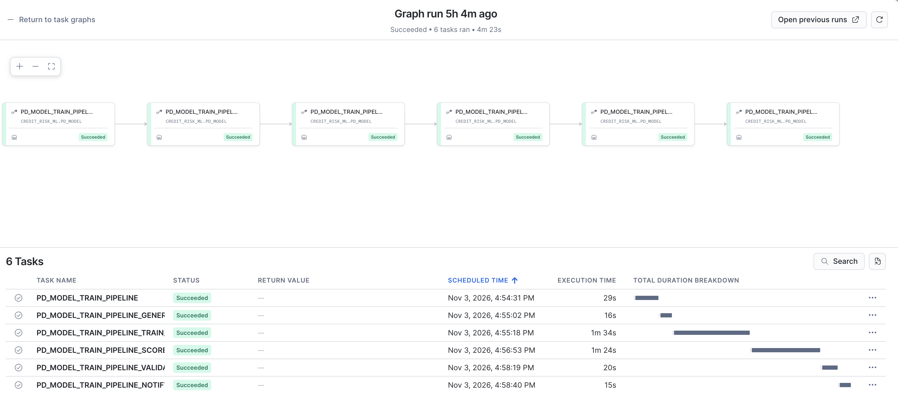

### Review the candidates
When the run finishes, the reviewer receives one email. It has a section for each candidate with its metrics against the production champion, the gate's recommendation, and ready-to-run commands:

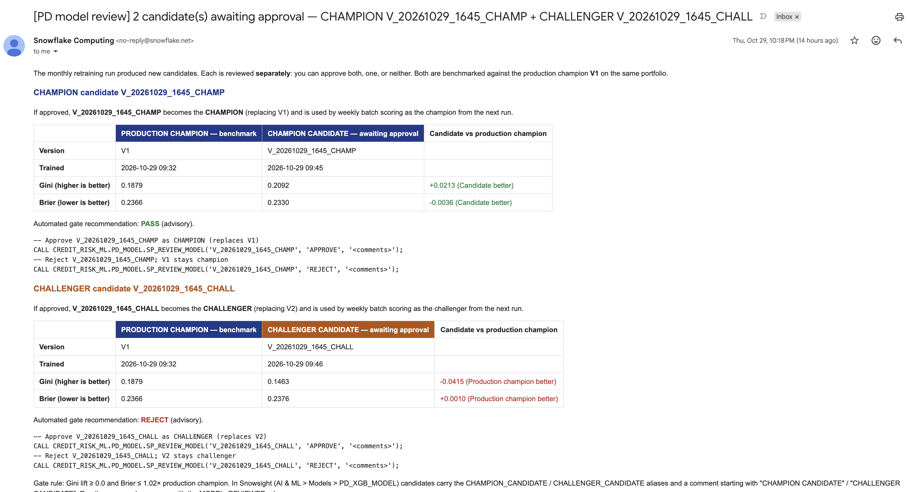

The reviewer decides on each candidate separately:

```sql
USE ROLE MODEL_REVIEWER;
SELECT * FROM CREDIT_RISK_ML.PD_MODEL.REVIEW_QUEUE WHERE STATUS = 'PENDING_REVIEW';
CALL CREDIT_RISK_ML.PD_MODEL.SP_REVIEW_MODEL('<champion_candidate_version>', 'APPROVE', '<comments>');
CALL CREDIT_RISK_ML.PD_MODEL.SP_REVIEW_MODEL('<challenger_candidate_version>', 'REJECT', '<comments>');
```

Approving a candidate moves the `champion` or `challenger` alias, re-points that role's monitor, and records who approved it, when and why. That record is kept in `PROMOTION_LOG` and in the model version's comment. A candidate left unreviewed is marked `SUPERSEDED` by the next cycle's candidate.

<!-- ------------------------ -->
## Automate Weekly Scoring

A second, independent Task DAG produces the weekly portfolio PDs and scenario-weighted ECL. It never picks a model version itself. It reads whichever versions hold the `champion` and `challenger` aliases when it runs, so an approval in the training pipeline takes effect from the next weekly run.

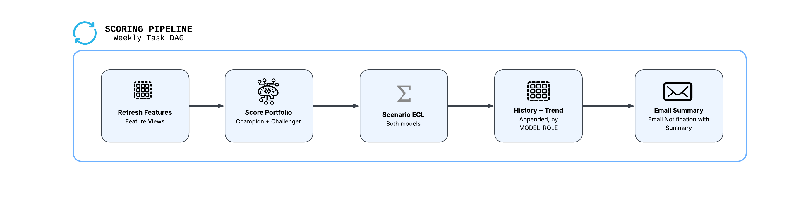

```
PD_MODEL_SCORING_PIPELINE (root, Mondays 03:00)   SP_REFRESH_FEATURES
  └─ ..._BATCH_SCORE                                SP_WEEKLY_BATCH_SCORE   -> PD_PORTFOLIO_SCORES (append)
       └─ ..._SCENARIO_ECL                          SP_WEEKLY_SCENARIO_ECL  -> PD_WEIGHTED_HISTORY, PD_ECL_HISTORY (append)
                                                                            -> PD_CHAMPION_CHALLENGER_TREND (view)
            └─ ..._NOTIFY                           SP_WEEKLY_SCORING_NOTIFY -> summary email
```

How the weekly results are kept:
- Every row is appended with `SCORE_TS`, `MODEL_VERSION` and `MODEL_ROLE`, so any week's provision traces back to an approved model.
- The champion's numbers are the official provision. The challenger's build up comparison evidence for the next review.
- `PD_CHAMPION_CHALLENGER_TREND` summarizes both models week by week: mean PD, observed default rate, PD correlation and weighted ECL.

```python
# Weekly scoring steps as stored procedures (reuse helpers and constants from the cells above)
# Champion AND challenger score the same portfolio every week; MODEL_ROLE tells them apart.
# The champion's numbers are the official provision; the challenger's are for comparison only.
session.sql(f"""
    CREATE TABLE IF NOT EXISTS {DB}.{SCHEMA}.PD_WEIGHTED_HISTORY (
        SCORE_TS TIMESTAMP_NTZ, MODEL_VERSION STRING, TRADE_ID NUMBER,
        WEIGHTED_PD FLOAT, WEIGHTED_ECL FLOAT
    )
""").collect()
session.sql(f"""
    CREATE TABLE IF NOT EXISTS {DB}.{SCHEMA}.PD_ECL_HISTORY (
        SCORE_TS TIMESTAMP_NTZ, MODEL_VERSION STRING, SCENARIO_ID STRING,
        SCENARIO_WEIGHT FLOAT, LOANS NUMBER, MEAN_PD FLOAT, ECL FLOAT
    )
""").collect()
# MODEL_ROLE (CHAMPION / CHALLENGER) on every history table, added in place if they already exist.
# Widen it too: a table first created from champion-only scores infers VARCHAR(8), too short for 'CHALLENGER'.
for table in ["PD_PORTFOLIO_SCORES", "PD_WEIGHTED_HISTORY", "PD_ECL_HISTORY"]:
    session.sql(f"ALTER TABLE IF EXISTS {DB}.{SCHEMA}.{table} ADD COLUMN IF NOT EXISTS MODEL_ROLE STRING").collect()
    session.sql(f"ALTER TABLE IF EXISTS {DB}.{SCHEMA}.{table} ALTER COLUMN MODEL_ROLE SET DATA TYPE STRING").collect()


def _weekly_models(session):
    """(role, ModelVersion) pairs for this run: always the champion, plus the challenger if one exists."""
    from snowflake.ml.registry import Registry
    m = Registry(session=session, database_name=DB, schema_name=SCHEMA).get_model(MODEL_NAME)
    champion, challenger = _version_by_alias(m, "champion"), _version_by_alias(m, "challenger")
    models = [("CHAMPION", champion)]
    if challenger is not None and challenger.version_name != champion.version_name:
        models.append(("CHALLENGER", challenger))
    return models


def sp_weekly_batch_score(session: Session) -> str:
    """Score the full portfolio with champion and challenger; append with run timestamp, version and role."""
    import datetime
    from snowflake.snowpark.functions import col, lit
    from snowflake.snowpark.types import StringType, TimestampType
    from snowflake.ml.feature_store import FeatureStore
    fs = FeatureStore(session, DB, SCHEMA, WH)
    run_ts = datetime.datetime.utcnow().replace(microsecond=0)   # one timestamp shared by both models
    features = _scoring_features(session, fs, limit=None)

    scored = []
    for role, mv in _weekly_models(session):
        preds = (mv.run(features, function_name="predict_proba")
                 .with_column("ARCHIVE_DATE", col("ARCHIVE_DATE").cast(TimestampType()))
                 .with_column("SCORE_TS", lit(run_ts).cast(TimestampType()))
                 .with_column("MODEL_VERSION", lit(mv.version_name).cast(StringType()))
                 .with_column("MODEL_ROLE", lit(role).cast(StringType())))   # unbounded, not VARCHAR(len(role))
        # Full feature + prediction columns are kept so a model monitor can track drift on this table
        preds.write.mode("append").save_as_table(f"{DB}.{SCHEMA}.PD_PORTFOLIO_SCORES", column_order="name")
        scored.append(f"{role.lower()} {mv.version_name}")
    n = session.table(f"{DB}.{SCHEMA}.PD_PORTFOLIO_SCORES").filter(
        (col("SCORE_TS") == lit(run_ts)) & (col("MODEL_ROLE") == lit("CHAMPION"))).count()
    return f"Scored {n:,} loans with {' and '.join(scored)} at {run_ts:%Y-%m-%d %H:%M} UTC"


def sp_weekly_scenario_ecl(session: Session) -> str:
    """Score each loan under every macro scenario, per model, and append probability-weighted PD and ECL."""
    from snowflake.snowpark.functions import max as max_
    from snowflake.ml.feature_store import FeatureStore
    # Registered with caller's rights (needed for the temporary scratch table), so the session has no
    # database/schema of its own; Feature Store metadata lookups need one.
    session.use_schema(f"{DB}.{SCHEMA}")
    fs = FeatureStore(session, DB, SCHEMA, WH)
    # Tie this ECL run to the portfolio scoring run that just completed
    run_ts = session.table(f"{DB}.{SCHEMA}.PD_PORTFOLIO_SCORES").select(max_("SCORE_TS")).collect()[0][0]

    scenarios = fs.read_feature_view(fs.get_feature_view("MACRO_SCENARIO_FEATURES", "V1"))
    scenario_input = (_scoring_features(session, fs, limit=None)
                      .select("TRADE_ID", *pdm.BEHAVIORAL_COLS).cross_join(scenarios)
                      .select("TRADE_ID", "SCENARIO_ID", "SCENARIO_WEIGHT", *pdm.FEATURE_COLS))

    results = []
    for role, mv in _weekly_models(session):
        mv.run(scenario_input, function_name="predict_proba").write.save_as_table(
            f"{DB}.{SCHEMA}.PD_SCENARIO_SCRATCH", mode="overwrite", table_type="temporary")
        params = [run_ts, mv.version_name, role]
        session.sql(f"""
            INSERT INTO {DB}.{SCHEMA}.PD_WEIGHTED_HISTORY
                (SCORE_TS, MODEL_VERSION, MODEL_ROLE, TRADE_ID, WEIGHTED_PD, WEIGHTED_ECL)
            SELECT ?::TIMESTAMP_NTZ, ?, ?, TRADE_ID,
                   SUM(SCENARIO_WEIGHT * "output_feature_1"),
                   SUM(SCENARIO_WEIGHT * "output_feature_1" * BALANCE * {LGD_ASSUMPTION})
            FROM {DB}.{SCHEMA}.PD_SCENARIO_SCRATCH
            GROUP BY TRADE_ID
        """, params=params).collect()
        session.sql(f"""
            INSERT INTO {DB}.{SCHEMA}.PD_ECL_HISTORY
                (SCORE_TS, MODEL_VERSION, MODEL_ROLE, SCENARIO_ID, SCENARIO_WEIGHT, LOANS, MEAN_PD, ECL)
            SELECT ?::TIMESTAMP_NTZ, ?, ?, SCENARIO_ID, ANY_VALUE(SCENARIO_WEIGHT), COUNT(*),
                   AVG("output_feature_1"), SUM("output_feature_1" * BALANCE * {LGD_ASSUMPTION})
            FROM {DB}.{SCHEMA}.PD_SCENARIO_SCRATCH
            GROUP BY SCENARIO_ID
        """, params=params).collect()
        weighted = session.sql(f"""
            SELECT SUM(SCENARIO_WEIGHT * ECL) FROM {DB}.{SCHEMA}.PD_ECL_HISTORY
            WHERE SCORE_TS = ?::TIMESTAMP_NTZ AND MODEL_ROLE = ?
        """, params=[run_ts, role]).collect()[0][0]
        results.append(f"{role.lower()} {mv.version_name}: {weighted:,.0f}")
    _ensure_trend_view(session)
    return f"Scenario-weighted ECL — {'; '.join(results)} (run {run_ts})"


# Week-by-week champion vs challenger comparison on the identical portfolio.
# Created by the pipeline (after the first run writes the history tables it reads).
def _ensure_trend_view(session):
    session.sql(f"""
    CREATE OR REPLACE VIEW {DB}.{SCHEMA}.PD_CHAMPION_CHALLENGER_TREND AS
    WITH paired AS (
        SELECT c.SCORE_TS, c.MODEL_VERSION AS CHAMPION_VERSION, h.MODEL_VERSION AS CHALLENGER_VERSION,
               c.TRADE_ID, c.DEFAULT_FLAG,
               c."output_feature_1" AS CHAMPION_PD, h."output_feature_1" AS CHALLENGER_PD
        FROM {DB}.{SCHEMA}.PD_PORTFOLIO_SCORES c
        JOIN {DB}.{SCHEMA}.PD_PORTFOLIO_SCORES h
          ON c.SCORE_TS = h.SCORE_TS AND c.TRADE_ID = h.TRADE_ID
        WHERE c.MODEL_ROLE = 'CHAMPION' AND h.MODEL_ROLE = 'CHALLENGER'
    ),
    ecl AS (
        SELECT SCORE_TS,
               SUM(IFF(MODEL_ROLE = 'CHAMPION', SCENARIO_WEIGHT * ECL, 0))   AS CHAMPION_WEIGHTED_ECL,
               SUM(IFF(MODEL_ROLE = 'CHALLENGER', SCENARIO_WEIGHT * ECL, 0)) AS CHALLENGER_WEIGHTED_ECL
        FROM {DB}.{SCHEMA}.PD_ECL_HISTORY
        GROUP BY SCORE_TS
    )
    SELECT p.SCORE_TS, p.CHAMPION_VERSION, p.CHALLENGER_VERSION,
           COUNT(*)                                     AS LOANS,
           AVG(p.CHAMPION_PD)                           AS CHAMPION_MEAN_PD,
           AVG(p.CHALLENGER_PD)                         AS CHALLENGER_MEAN_PD,
           AVG(p.DEFAULT_FLAG)                          AS OBSERVED_DEFAULT_RATE,
           AVG(ABS(p.CHALLENGER_PD - p.CHAMPION_PD))    AS MEAN_ABS_PD_DIFF,
           CORR(p.CHAMPION_PD, p.CHALLENGER_PD)         AS PD_CORRELATION,
           AVG(IFF(ABS(p.CHALLENGER_PD - p.CHAMPION_PD) > 0.05, 1, 0)) AS SHARE_LOANS_DIFF_GT_5PP,
           ANY_VALUE(e.CHAMPION_WEIGHTED_ECL)           AS CHAMPION_WEIGHTED_ECL,
           ANY_VALUE(e.CHALLENGER_WEIGHTED_ECL)         AS CHALLENGER_WEIGHTED_ECL
    FROM paired p
    LEFT JOIN ecl e ON e.SCORE_TS = p.SCORE_TS
    GROUP BY p.SCORE_TS, p.CHAMPION_VERSION, p.CHALLENGER_VERSION
    """).collect()


def sp_weekly_scoring_notify(session: Session) -> str:
    """Email the latest weekly run: champion provision (official) plus challenger comparison."""
    from snowflake.snowpark.functions import max as max_
    run_ts = session.table(f"{DB}.{SCHEMA}.PD_ECL_HISTORY").select(max_("SCORE_TS")).collect()[0][0]
    scen = session.sql(f"""
        SELECT SCENARIO_ID, SCENARIO_WEIGHT, MEAN_PD, ECL, MODEL_VERSION
        FROM {DB}.{SCHEMA}.PD_ECL_HISTORY
        WHERE SCORE_TS = ?::TIMESTAMP_NTZ AND MODEL_ROLE = 'CHAMPION' ORDER BY MEAN_PD
    """, params=[run_ts]).collect()
    runs = session.sql(f"""
        SELECT SCORE_TS, SUM(SCENARIO_WEIGHT * ECL) AS WEIGHTED_ECL
        FROM {DB}.{SCHEMA}.PD_ECL_HISTORY
        WHERE SCORE_TS <= ?::TIMESTAMP_NTZ AND MODEL_ROLE = 'CHAMPION'
        GROUP BY SCORE_TS ORDER BY SCORE_TS DESC LIMIT 2
    """, params=[run_ts]).collect()
    portfolio = session.sql(f"""
        SELECT COUNT(*) AS LOANS, AVG("output_feature_1") AS MEAN_PD
        FROM {DB}.{SCHEMA}.PD_PORTFOLIO_SCORES
        WHERE SCORE_TS = ?::TIMESTAMP_NTZ AND MODEL_ROLE = 'CHAMPION'
    """, params=[run_ts]).collect()[0]
    trend = session.sql(f"""
        SELECT * FROM {DB}.{SCHEMA}.PD_CHAMPION_CHALLENGER_TREND WHERE SCORE_TS = ?::TIMESTAMP_NTZ
    """, params=[run_ts]).collect()

    weighted = runs[0]["WEIGHTED_ECL"]
    if len(runs) > 1 and runs[1]["WEIGHTED_ECL"]:
        prev = runs[1]["WEIGHTED_ECL"]
        change = f"{(weighted - prev) / prev:+.1%} vs previous run ({runs[1]['SCORE_TS']:%Y-%m-%d})"
    else:
        change = "first run — no prior week to compare"
    version = scen[0]["MODEL_VERSION"]

    cell = "padding:6px 10px;border:1px solid #d1d5db"
    rows = "".join(
        f"<tr><td style='{cell}'>{r['SCENARIO_ID']}</td><td style='{cell}'>{r['SCENARIO_WEIGHT']:.0%}</td>"
        f"<td style='{cell}'>{r['MEAN_PD']:.4f}</td><td style='{cell}'>{r['ECL']:,.0f}</td></tr>" for r in scen)

    if trend:
        t = trend[0]
        ecl_delta = t["CHALLENGER_WEIGHTED_ECL"] - t["CHAMPION_WEIGHTED_ECL"]
        comparison = f"""
        <h3>Champion vs challenger (same portfolio, comparison only)</h3>
        <table style="border-collapse:collapse">
          <tr><th style="{cell}"></th>
              <th style="{cell};background:#1e3a8a;color:#ffffff">CHAMPION {t['CHAMPION_VERSION']}</th>
              <th style="{cell};background:#b45309;color:#ffffff">CHALLENGER {t['CHALLENGER_VERSION']}</th></tr>
          <tr><td style="{cell}"><b>Mean PD</b></td><td style="{cell}">{t['CHAMPION_MEAN_PD']:.4f}</td>
              <td style="{cell}">{t['CHALLENGER_MEAN_PD']:.4f}</td></tr>
          <tr><td style="{cell}"><b>Weighted ECL</b></td><td style="{cell}">{t['CHAMPION_WEIGHTED_ECL']:,.0f}</td>
              <td style="{cell}">{t['CHALLENGER_WEIGHTED_ECL']:,.0f} ({ecl_delta:+,.0f})</td></tr>
        </table>
        <p>Observed default rate {t['OBSERVED_DEFAULT_RATE']:.4f} &middot; mean |PD difference|
           {t['MEAN_ABS_PD_DIFF']:.4f} &middot; PD correlation {t['PD_CORRELATION']:.3f} &middot;
           {t['SHARE_LOANS_DIFF_GT_5PP']:.1%} of loans differ by more than 5 pp.
           History: {DB}.{SCHEMA}.PD_CHAMPION_CHALLENGER_TREND.</p>"""
    else:
        comparison = "<p>No challenger is currently registered, so only the champion was scored this week.</p>"

    subject = f"[PD model] Weekly scoring complete — {run_ts:%Y-%m-%d}, champion weighted ECL {weighted:,.0f}"
    body = f"""
        <p>The weekly PD batch scoring run has completed.</p>
        <ul>
          <li>Run: {run_ts:%Y-%m-%d %H:%M} UTC</li>
          <li>Champion model (official provision): {MODEL_NAME} {version}</li>
          <li>Loans scored: {portfolio['LOANS']:,} &mdash; mean PD {portfolio['MEAN_PD']:.4f}</li>
          <li>Probability-weighted ECL: <b>{weighted:,.0f}</b> ({change})</li>
        </ul>
        <table style="border-collapse:collapse">
          <tr><th style="{cell}">Scenario</th><th style="{cell}">Weight</th>
              <th style="{cell}">Mean PD</th><th style="{cell}">ECL</th></tr>{rows}
        </table>
        {comparison}
        <p>ECL uses LGD = {LGD_ASSUMPTION} and BALANCE as EAD (illustrative).
           Results: {DB}.{SCHEMA}.PD_PORTFOLIO_SCORES, PD_WEIGHTED_HISTORY, PD_ECL_HISTORY (filter on MODEL_ROLE).</p>
    """
    session.sql("CALL SYSTEM$SEND_EMAIL(?, ?, ?, ?, 'text/html')",
                params=[REVIEW_EMAIL_INTEGRATION, ",".join(SCORING_NOTIFY_EMAILS), subject, body]).collect()
    return f"Scoring summary for {run_ts} sent to {', '.join(SCORING_NOTIFY_EMAILS)}"


# SCORING_NOTIFY_EMAILS is configured in the Setup cell (section 1)

for fn in [sp_weekly_batch_score, sp_weekly_scenario_ecl, sp_weekly_scoring_notify]:
    session.sproc.register(
        fn, name=f"{DB}.{SCHEMA}.{fn.__name__.upper()}",
        packages=SP_PACKAGES, imports=[MODEL_MODULE], is_permanent=True, replace=True,
        stage_location=f"@{DB}.{SCHEMA}.ML_ARTIFACTS",
        # Owner's-rights procedures cannot create temporary tables; the scenario step uses one
        execute_as="caller" if fn is sp_weekly_scenario_ecl else "owner",
    )
    print(f"Registered procedure {fn.__name__.upper()}")
```

Create the weekly DAG:

```python
# Weekly scoring Task DAG — Mondays 03:00 New York, independent of the monthly retraining DAG
weekly_dag = [
    # (task name, predecessor, procedure)
    ("PD_MODEL_SCORING_PIPELINE", None, "SP_REFRESH_FEATURES"),
    ("PD_MODEL_SCORING_PIPELINE_BATCH_SCORE", "PD_MODEL_SCORING_PIPELINE", "SP_WEEKLY_BATCH_SCORE"),
    ("PD_MODEL_SCORING_PIPELINE_SCENARIO_ECL", "PD_MODEL_SCORING_PIPELINE_BATCH_SCORE", "SP_WEEKLY_SCENARIO_ECL"),
    ("PD_MODEL_SCORING_PIPELINE_NOTIFY", "PD_MODEL_SCORING_PIPELINE_SCENARIO_ECL", "SP_WEEKLY_SCORING_NOTIFY"),
]

# The graph can only be changed while the root is suspended
session.sql(f"ALTER TASK IF EXISTS {DB}.{SCHEMA}.PD_MODEL_SCORING_PIPELINE SUSPEND").collect()
# Remove the pre-rename names of this DAG, children first
for old_task in ["SCORING_PIPELINE_NOTIFY", "SCORING_PIPELINE_SCENARIO_ECL", "SCORING_PIPELINE_BATCH_SCORE",
                 "SCORING_PIPELINE_FEATURE_REFRESH"]:
    session.sql(f"DROP TASK IF EXISTS {DB}.{SCHEMA}.{old_task}").collect()

for task, after, proc in weekly_dag:
    trigger = ("SCHEDULE = 'USING CRON 0 3 * * 1 America/New_York'" if after is None
               else f"AFTER {DB}.{SCHEMA}.{after}")
    session.sql(f"""
        CREATE OR REPLACE TASK {DB}.{SCHEMA}.{task}
            WAREHOUSE = {WH}
            {trigger}
        AS
            CALL {DB}.{SCHEMA}.{proc}()
    """).collect()
print(f"Weekly scoring DAG created ({len(weekly_dag)} tasks, suspended)")
```

Activate it:

```sql
SELECT SYSTEM$TASK_DEPENDENTS_ENABLE('CREDIT_RISK_ML.PD_MODEL.PD_MODEL_SCORING_PIPELINE');
```

To run one cycle on demand:

```sql
ALTER TASK CREDIT_RISK_ML.PD_MODEL.PD_MODEL_SCORING_PIPELINE_NOTIFY RESUME;
ALTER TASK CREDIT_RISK_ML.PD_MODEL.PD_MODEL_SCORING_PIPELINE_SCENARIO_ECL RESUME;
ALTER TASK CREDIT_RISK_ML.PD_MODEL.PD_MODEL_SCORING_PIPELINE_BATCH_SCORE RESUME;
EXECUTE TASK CREDIT_RISK_ML.PD_MODEL.PD_MODEL_SCORING_PIPELINE;
```

A completed weekly run looks like this in the task graph:

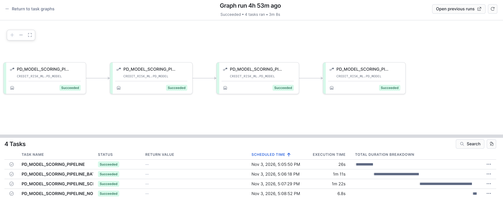

Each run ends with a summary email. It shows the champion's weighted ECL and change since the previous week, the per-scenario breakdown, and the challenger comparison:

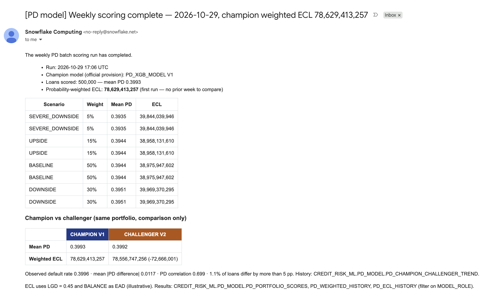

<!-- ------------------------ -->
## Clean Up

The final cell removes everything the notebook created:
- suspends both Task DAGs;
- drops the account-level notification integration and the `MODEL_REVIEWER` role;
- drops the `CREDIT_RISK_ML` database and the `CREDIT_RISK_WH` warehouse.

**This is irreversible.** It deletes the model versions, Feature Store, Datasets, experiments, score history and the `PROMOTION_LOG` audit trail. Set `CONFIRM_CLEANUP = True` only when you mean it. The Marketplace databases are left untouched.

```python
# Tear down all resources created by this notebook — set CONFIRM_CLEANUP = True to run
CONFIRM_CLEANUP = False

DB, SCHEMA, WH = "CREDIT_RISK_ML", "PD_MODEL", "CREDIT_RISK_WH"

if not CONFIRM_CLEANUP:
    print("Cleanup skipped — set CONFIRM_CLEANUP = True to permanently delete the resources listed above.")
else:
    def run(sql):
        try:
            session.sql(sql).collect()
            print(f"OK    {sql}")
        except Exception as e:  # keep going so one missing object doesn't block the rest
            print(f"SKIP  {sql}  ({str(e).splitlines()[0]})")

    # 1. Suspend both task graphs (root tasks first) so no run starts during cleanup
    for root in ["PD_MODEL_TRAIN_PIPELINE", "PD_MODEL_SCORING_PIPELINE"]:
        run(f"ALTER TASK IF EXISTS {DB}.{SCHEMA}.{root} SUSPEND")

    # 2. Account-level objects, which dropping the database does not remove
    run("DROP NOTIFICATION INTEGRATION IF EXISTS PD_MODEL_REVIEW_EMAIL")
    run("DROP ROLE IF EXISTS MODEL_REVIEWER")

    # 3. The database: registry models and monitors, Feature Store, Datasets, experiments,
    #    tasks, procedures, tables, views and stages all live inside it
    run(f"DROP DATABASE IF EXISTS {DB}")

    # 4. The warehouse (last, since the statements above run on it)
    run(f"DROP WAREHOUSE IF EXISTS {WH}")

    print("\nCleanup complete.")
```

<!-- ------------------------ -->
## Conclusion and Resources

You migrated a SAS `PROC GRADBOOST` PD model to XGBoost on Snowflake ML and ran its full lifecycle in one governed platform. Data never left Snowflake, every model is traceable to the exact data that trained it, and promotion requires an audited human decision.

| Snowflake ML capability | What it replaces in a SAS stack |
|---|---|
| Feature Store (behavioral, macro, scenario Feature Views) | SAS macros generating feature datasets |
| Versioned Datasets | Manual dataset freezes |
| Experiment Tracking | Excel/Word model development trackers |
| Model Registry with `champion` / `challenger` aliases | Version-named `.sas7bdat` files and spreadsheet inventories |
| Registry SHAP `explain` and ML Lineage | External explainability tooling and provenance documents |
| `run()` / `run_batch()` batch scoring and scenario-weighted ECL | SAS batch scoring jobs and spreadsheet IFRS 9 overlays |
| Model Version Monitors | Quarterly manual monitoring reports |
| Task DAGs with `MODEL_REVIEWER` approval | Cron + shell scripts and email sign-off chains |

### What You Learned
- Mapping SAS model code and hyperparameters to XGBoost with CoCo
- Building point-in-time correct features and immutable training Datasets
- Tracking experiments and governing models with registry aliases, SHAP and lineage
- Scoring offline champion/challenger and computing scenario-weighted ECL
- Monitoring drift and performance per model version
- Orchestrating retraining and scoring with a role-gated, auditable approval step
