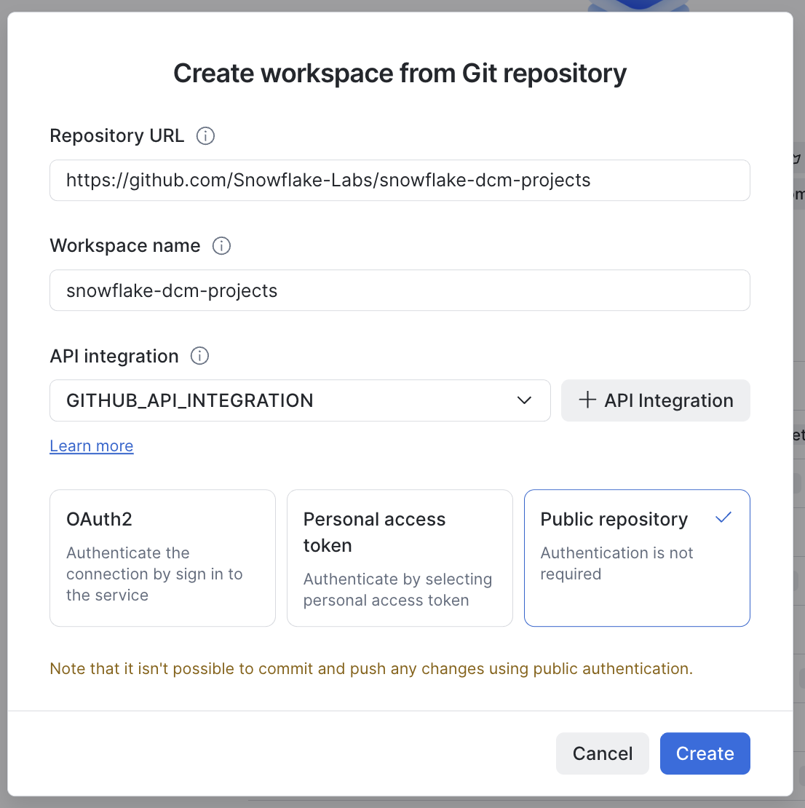
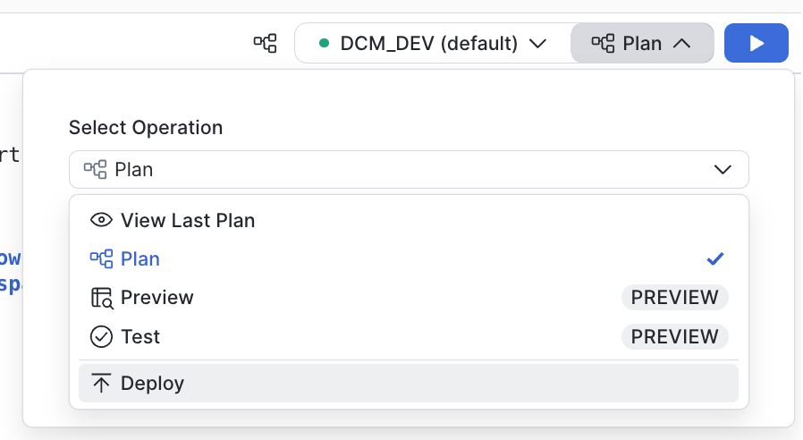
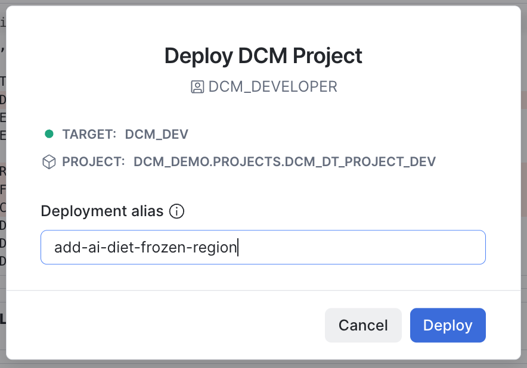
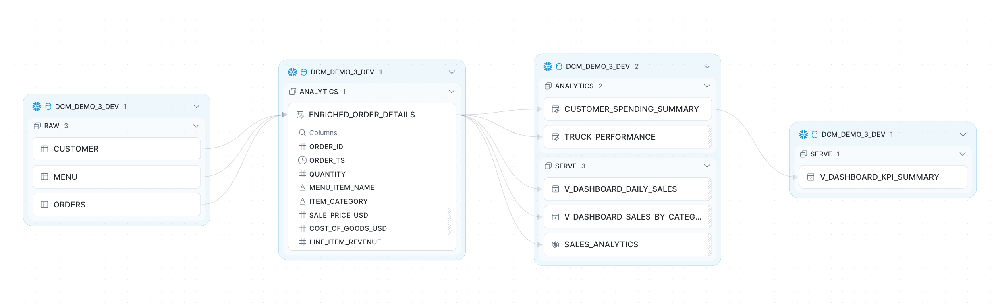
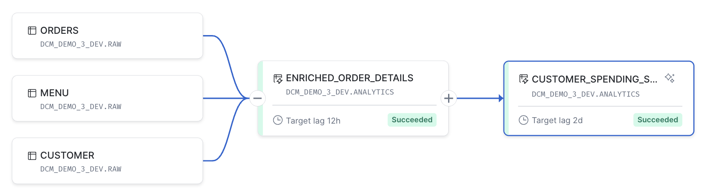

author: Yoav Ostrinsky
id: dcm-projects-for-dynamic-tables
summary: Learn how to use DCM Projects to manage dynamic table pipelines, evolve their schemas with frozen regions, and enrich them with a Cortex AI function.
categories: snowflake-site:taxonomy/solution-center/certification/quickstart, snowflake-site:taxonomy/product/platform, snowflake-site:taxonomy/product/data-engineering, snowflake-site:taxonomy/product/ai, snowflake-site:taxonomy/snowflake-feature/dynamic-tables
environments: web
status: Published
language: en
feedback link: https://github.com/Snowflake-Labs/sfguides/issues
fork repo link: https://github.com/Snowflake-Labs/snowflake-dcm-projects

# DCM Projects for Dynamic Tables
<!-- ------------------------ -->
## Overview

In the [Build Data Pipelines with Snowflake DCM Projects](https://www.snowflake.com/en/developers/guides/build-data-pipelines-with-snowflake-dcm-projects/) guide, you learned how to split infrastructure across multiple DCM Projects and build a medallion architecture with dynamic tables defined as code.

In this guide, you'll focus on **dynamic table lifecycle management**: making changes and enhancements to your pipeline while keeping control over what gets recomputed.

Dynamic tables are the backbone of declarative data pipelines in Snowflake. You define the *what*, and Snowflake handles the *when* and *how*. Managing them at scale raises real questions. How do you version-control their definitions? How do you promote changes across environments? And when you need to evolve a schema, how do you avoid recomputing all of your history?

This guide answers all three by combining three Snowflake features:

- **DCM Projects.** Define your entire pipeline (database, schemas, tables, dynamic tables, views, a semantic view and an alert) as code, then plan and deploy changes declaratively.
- **Frozen regions.** Tell Snowflake which rows in a dynamic table will never change, so a schema change only recomputes the active rows.
- **Cortex AI functions in dynamic tables.** Call an AI function like AI_CLASSIFY directly in a dynamic table's definition, so AI-derived columns are filled in as data flows through your pipeline.

You'll deploy a food truck analytics pipeline with a DCM Project, then evolve a dynamic table by adding an **AI-classified column**, and see the frozen region keep historical rows out of the recompute and out of the AI call.

### Prerequisites
- Basic knowledge of Snowflake concepts (databases, schemas, tables, roles)
- Familiarity with SQL and dynamic tables

### What You'll Learn
- How DCM Projects define Snowflake infrastructure as code
- How to structure a DCM Project with a manifest and definition files
- How to use Jinja variables to parameterize definitions across environments
- How to plan and deploy changes with Snowsight Workspaces or the Snowflake CLI
- Why INITIALIZE = ON_SCHEDULE keeps DCM deployments fast
- How frozen regions work on dynamic tables
- How to evolve a dynamic table's schema without recomputing frozen history
- How to call AI_CLASSIFY inside a dynamic table, and why a frozen region keeps its cost down
- How to use METADATA$IS_FROZEN and the refresh history to verify which rows were recomputed

### What You'll Need
- A [Snowflake account](https://signup.snowflake.com/?utm_source=snowflake-devrel&utm_medium=developer-guides&utm_cta=developer-guides) with ACCOUNTADMIN access, for the one-time setup script
- (Optional) [Snowflake CLI](https://docs.snowflake.com/en/developer-guide/snowflake-cli/installation/installation) 3.24 or later, if you prefer a terminal to the Snowsight UI
- [Cortex AI functions](https://docs.snowflake.com/en/user-guide/snowflake-cortex/aisql) available in your account's region. Calling them needs the USE AI FUNCTIONS account privilege and the SNOWFLAKE.CORTEX_USER database role, which every role gets through PUBLIC by default. If your administrator has revoked them from PUBLIC, grant both to DCM_DEVELOPER.

### What You'll Build
- A deployed food truck analytics pipeline, all defined as code: a database, three landing tables, three dynamic tables, three views, a semantic view, a SQL function, three data quality expectations, a refresh-failure alert and a warehouse
- An evolved dynamic table with an AI-classified column and a frozen region, deployed through a second plan and deploy, that recomputes only its active rows

<!-- ------------------------ -->
## Create a Workspace from Git

If you want to work in Snowsight rather than locally, create a Snowsight Workspace linked to the sample repository on GitHub.

1. Navigate to **Projects > Workspaces** in Snowsight.
2. Click **Create** (+) and select **Git repository**.
3. Enter the repository URL: https://github.com/Snowflake-Labs/snowflake-dcm-projects
4. Select an API Integration for GitHub ([create one if needed](https://docs.snowflake.com/en/user-guide/ui-snowsight/workspaces-git#label-create-a-git-workspace)).
5. Select **Public repository**.



Once the workspace is created you will see the repository files in the file explorer. Navigate to **Quickstarts/dcm-projects-for-dynamic-tables** to find two directories.

DCM_Projects_DT_Lifecycle/ is the DCM Project itself. scripts/ holds numbered SQL files that you run in Snowsight worksheets at different stages of this guide. They live outside the project directory, so nothing in them is ever picked up by a plan.

| File | When to run |
|---|---|
| scripts/01_pre_deploy.sql | Once, before the first plan |
| scripts/02_post_deploy.sql | After the first successful deploy |
| scripts/03_verify_evolution.sql | After the second deploy (frozen region and AI column) |
| scripts/04_cleanup.sql | When you are finished |

Every operational step in this guide is given twice: once for Snowsight, and once for the [Snowflake CLI](https://docs.snowflake.com/en/developer-guide/snowflake-cli/installation/installation) if you would rather drive the project from a terminal against your own copy of the repository.

**With the Snowflake CLI:** clone the repository and work from the guide's folder. Run the snow dcm commands from inside DCM_Projects_DT_Lifecycle, and the snow sql commands from the guide's folder.

```bash
git clone https://github.com/Snowflake-Labs/snowflake-dcm-projects.git
cd snowflake-dcm-projects/Quickstarts/dcm-projects-for-dynamic-tables
```

<!-- ------------------------ -->
## Set Up Roles and Permissions

Run the first script. **In Snowsight:** open scripts/01_pre_deploy.sql in a worksheet and run it from top to bottom. **With the Snowflake CLI:**

```bash
snow sql -f scripts/01_pre_deploy.sql
```

The script is the same in every guide of this series. It runs as ACCOUNTADMIN and is safe to run again: if you already ran it for another guide, running it now changes nothing. It has six numbered sections.

**1. Role.** It creates the DCM_DEVELOPER role and grants it to you and to SYSADMIN. Every guide in this series uses this role as the project owner.

**2. Inherited grants opt-in.** It turns on inherited grants for the account.

**3. Account-level privileges.** A project cannot grant account-level privileges to its own owner, so they all happen here, before the first plan. DCM_DEVELOPER gets the privileges that the guides in this series need together, one grant per line, each with a comment naming the guide or feature that uses it. Some are checked at plan time, so a missing one fails the first plan rather than the deploy.

**4. Series container.** It creates the DCM_DEMO database and the DCM_DEMO.PROJECTS schema that holds the project objects of the series, and grants DCM_DEVELOPER USAGE on both and CREATE DCM PROJECT on the schema. A project cannot define the database or schema it lives in.

**5. Project object.** It creates this guide's DCM Project object, DCM_DEMO.PROJECTS.DCM_DT_PROJECT_DEV, as DCM_DEVELOPER. This is the only section that differs between the guides of the series.

**6. Values for the manifest.** The last query returns your account identifier and user name.

When the script finishes, refresh your browser so the DCM control panel lists the new project object.

> **Important: update the manifest before the first plan.** Copy ACCOUNT_IDENTIFIER from the last query of scripts/01_pre_deploy.sql into the account_identifier line of the DCM_DEV target in DCM_Projects_DT_Lifecycle/manifest.yml (line 11, marked "# update to your account names").

<!-- ------------------------ -->
## Explore the Project Files

Navigate into DCM_Projects_DT_Lifecycle/. A DCM Project consists of a **manifest file** and one or more **definition files** in a sources/ directory.

### Manifest

DCM_Projects_DT_Lifecycle/manifest.yml defines four targets, DCM_DEV, DCM_STAGE, DCM_PROD_US and DCM_PROD_EU, and the templating values for each. DEV appends a _DEV suffix to every object name and uses an X-SMALL warehouse; PROD uses no suffix and a LARGE warehouse. The definition files reference these values as Jinja variables, so the same files create DCM_DEMO_3_DEV in development and DCM_DEMO_3 in production. This guide only deploys DCM_DEV. The [Get Started](https://www.snowflake.com/en/developers/guides/get-started-snowflake-dcm-projects/) guide walks through the manifest in detail.

### Definition Files

The sources/definitions/ directory contains the SQL that defines your infrastructure. Each file uses DEFINE statements and Jinja variables like {{env_suffix}}:

| File | What it defines |
|---|---|
| <span style="white-space: nowrap">infrastructure.sql</span> | The warehouse that refreshes the dynamic tables, the database (with LOG_EVENT_LEVEL = ERROR) and its PUBLIC schema |
| <span style="white-space: nowrap">raw.sql</span> | The RAW schema and three landing tables: MENU, CUSTOMER and ORDERS |
| <span style="white-space: nowrap">analytics.sql</span> | The ANALYTICS schema, three dynamic tables, and a SQL function, CALCULATE_PROFIT_MARGIN, used by TRUCK_PERFORMANCE |
| <span style="white-space: nowrap">serve.sql</span> | The SERVE schema, three views for dashboards and SALES_ANALYTICS, a semantic view over ENRICHED_ORDER_DETAILS |
| <span style="white-space: nowrap">expectations.sql</span> | Three data quality expectations: on a table, a dynamic table and a view |
| <span style="white-space: nowrap">alerts.sql</span> | DT_REFRESH_FAILURE, an alert built from a Snowflake alert template |

DT_REFRESH_FAILURE watches every dynamic table in DCM_DEMO_3_DEV and posts an in-app notification in Snowsight when a refresh fails. It reads the refresh failure events that LOG_EVENT_LEVEL = ERROR on the database writes to the event table. An alert built from a template cannot be declared STARTED, so DCM deploys it suspended and scripts/02_post_deploy.sql resumes it.

Here's how infrastructure.sql defines the warehouse and the database:

```sql
DEFINE WAREHOUSE DCM_DEMO_3_WH{{env_suffix}}
WITH
    WAREHOUSE_SIZE = '{{wh_size}}'
    AUTO_SUSPEND = 60
    COMMENT = 'Refreshes the dynamic tables of the DCM Projects for Dynamic Tables quickstart';

DEFINE DATABASE DCM_DEMO_3{{env_suffix}}
    LOG_EVENT_LEVEL = ERROR
    COMMENT = 'This is a Quickstart Demo for DCM Projects with Dynamic Tables';

DEFINE SCHEMA DCM_DEMO_3{{env_suffix}}.PUBLIC
    COMMENT = 'Default schema, declared so DCM manages it';
```

The {{env_suffix}} and {{wh_size}} variables are replaced at plan time from the target's configuration: _DEV and X-SMALL for development, an empty string and LARGE for production.

And here's how analytics.sql defines the dynamic table at the heart of this guide, which joins each order line to its menu item and customer:

```sql
DEFINE DYNAMIC TABLE DCM_DEMO_3{{env_suffix}}.ANALYTICS.ENRICHED_ORDER_DETAILS
WAREHOUSE = DCM_DEMO_3_WH{{env_suffix}}
TARGET_LAG = 'DOWNSTREAM'
REFRESH_MODE = ADAPTIVE
INITIALIZE = 'ON_SCHEDULE'
DATA_METRIC_SCHEDULE = 'TRIGGER_ON_CHANGES'
COMMENT = 'One row per order line, joined to the menu and the customer'
AS
SELECT
    O.ORDER_ID,
    O.ORDER_TS,
    O.QUANTITY,
    M.MENU_ITEM_NAME,
    M.ITEM_CATEGORY,
    M.SALE_PRICE_USD,
    M.COST_OF_GOODS_USD,
    (O.QUANTITY * M.SALE_PRICE_USD) AS LINE_ITEM_REVENUE,
    (O.QUANTITY * (M.SALE_PRICE_USD - M.COST_OF_GOODS_USD)) AS LINE_ITEM_PROFIT,
    C.CUSTOMER_ID,
    C.FIRST_NAME,
    C.LAST_NAME,
    INITCAP(C.CITY) AS CUSTOMER_CITY,
    O.TRUCK_BRAND_NAME
FROM DCM_DEMO_3{{env_suffix}}.RAW.ORDERS O
JOIN DCM_DEMO_3{{env_suffix}}.RAW.MENU M ON O.MENU_ITEM_ID = M.MENU_ITEM_ID
JOIN DCM_DEMO_3{{env_suffix}}.RAW.CUSTOMER C ON O.CUSTOMER_ID = C.CUSTOMER_ID;
```

CUSTOMER_SPENDING_SUMMARY and TRUCK_PERFORMANCE aggregate this table per customer and per truck brand.

**Why REFRESH_MODE = ADAPTIVE?** All three dynamic tables declare it. An adaptive dynamic table refreshes incrementally, and Snowflake decides per refresh cycle when the changed data is large enough that recomputing is cheaper than maintaining the result incrementally. You don't lock the table into INCREMENTAL or FULL up front.

**Why INITIALIZE = ON_SCHEDULE?** By default, a dynamic table runs a full synchronous refresh while it is being created. When a project creates several dynamic tables at once, those refreshes slow the deployment down. INITIALIZE = ON_SCHEDULE skips the refresh at creation, so the deploy finishes quickly and each dynamic table fills on its first scheduled (or manual) refresh. This is the recommended pattern for DCM deployments.

<!-- ------------------------ -->
## Plan and Deploy the Initial Pipeline

Before deploying, always run a **Plan**. A plan is a dry run that shows exactly what DCM will change, without changing anything.

### Plan

**In Snowsight:** the DCM control panel is the first tab in the bottom panel of your workspace. Select the project **dcm-projects-for-dynamic-tables/DCM_Projects_DT_Lifecycle**. On the right side of the same bar, select the **DCM_DEV** target and click the play button to the right of **Plan**.


**With the Snowflake CLI:** pass the manifest's owner role for the target with --role.

```bash
snow dcm plan --target DCM_DEV --role DCM_DEVELOPER --save-output
```

Since none of the defined objects exist yet, the plan shows **19 entities: 18 to create and 1 to alter**:

| Operation | Entities |
|---|---|
| CREATE | 1 database (DCM_DEMO_3_DEV) and 4 schemas: PUBLIC, RAW, ANALYTICS and SERVE |
| CREATE | 3 tables, 3 dynamic tables, 3 views, 1 semantic view and 1 function |
| CREATE | 1 alert and 1 warehouse |
| ALTER | the owner role DCM_DEVELOPER, which receives ownership of everything above |


The plan also wrote an out folder next to sources. It holds the rendered definitions, with every {{env_suffix}} replaced by _DEV; open one next to its source to see what the plan actually ran.

### Deploy

When the changeset matches what you expected, deploy it.

**In Snowsight:** in the DCM control panel, set the operation to **Deploy** instead of **Plan**, add a deployment alias such as initial-pipeline, and run it.





**With the Snowflake CLI:**

```bash
snow dcm deploy --target DCM_DEV --role DCM_DEVELOPER --alias initial-pipeline
```

The deploy reports **19 entities (18 created, 1 altered, 0 dropped)**. Open ENRICHED_ORDER_DETAILS in the database explorer and select its **Lineage** tab to see how the layers connect: the three RAW tables feed it, and it feeds the two aggregate dynamic tables, the three dashboard views and the SALES_ANALYTICS semantic view.



<!-- ------------------------ -->
## Insert Sample Data

The deployment created the structures, but the tables are empty and the dynamic tables have not refreshed yet. Open scripts/02_post_deploy.sql in a Snowsight worksheet and run it. It runs as DCM_DEVELOPER on the project's warehouse.

### 1. Insert sample data

The script inserts 14 menu items, 20 customers and 24 order lines.

**Note the dates.** Every order line is from October 2023. When you add a frozen region later, all of these rows fall in the **frozen** region, and the new orders you add then fall in the **active** region.

### 2. Refresh the dynamic tables

One ALTER DYNAMIC TABLE statement can refresh several dynamic tables at once. The script lists the two leaf tables:

```sql
ALTER DYNAMIC TABLE DCM_DEMO_3_DEV.ANALYTICS.CUSTOMER_SPENDING_SUMMARY,
                    DCM_DEMO_3_DEV.ANALYTICS.TRUCK_PERFORMANCE REFRESH;
```

Their shared upstream, ENRICHED_ORDER_DETAILS, refreshes with them. The result reports a refreshed_dt_count of 3 and one data_timestamp for both rows, so the two leaf tables are consistent with each other. You don't list the upstream yourself.

The **Graph** tab of a dynamic table shows the same chain with each table's target lag and the state of its last refresh. ENRICHED_ORDER_DETAILS has TARGET_LAG = DOWNSTREAM, so it inherits the tightest lag of the tables that read it: 12 hours from TRUCK_PERFORMANCE.



### 3. Verify

The final query shows the enriched order details, newest first:

```sql
SELECT * FROM DCM_DEMO_3_DEV.ANALYTICS.ENRICHED_ORDER_DETAILS ORDER BY ORDER_TS DESC, ORDER_ID;
```

You should see 24 rows, starting like this (other columns omitted):

| ORDER_ID | ORDER_TS | MENU_ITEM_NAME | LINE_ITEM_REVENUE | CUSTOMER_CITY | TRUCK_BRAND_NAME |
|---|---|---|---|---|---|
| 1023 | 2023-10-30 11:30:00 | Chocolate Lava Cake | 12.00 | San Francisco | Sweet Retreat |
| 1022 | 2023-10-30 11:00:00 | Pulled Pork Slider | 8.00 | New York | BBQ Barn |

Take note of this schema: in the next step you'll evolve it.

<!-- ------------------------ -->
## Evolve the Dynamic Table with a Frozen Region and AI

You have a running pipeline. Now the analytics team wants every order tagged with a **diet classification**, Healthy or Indulgent, so they can analyze ordering trends. Rather than maintain a lookup table by hand, you'll let a **Cortex AI function** classify each menu item directly inside the dynamic table.

There's a catch: AI inference isn't free. Running an LLM over *every* historical order whenever the definition changes would be slow and expensive. You only want to classify rows that are still changing, not years of settled history. This is exactly what a **frozen region** is for.

### Understanding Frozen Regions

A FROZEN WHERE clause on a dynamic table declares a condition under which rows are frozen. Snowflake leaves those rows untouched on refresh, which means:

- **Schema changes refresh only the active region.** Frozen rows stay as they are stored, so adding a column does not rewrite your history.
- **Expensive expressions run only on the active region.** An AI function in the SELECT list is evaluated for active rows only, so you never pay to classify frozen history.
- **Changes to joined tables reach only active rows.** If a customer moves city, active order rows pick up the new city on the next refresh; frozen rows keep the city they were computed with.
- **METADATA$IS_FROZEN**, a virtual column on every dynamic table with a frozen region, tells you which rows are frozen and which are active.

Frozen regions were previously called *immutability constraints*. The older IMMUTABLE WHERE syntax still works. SHOW DYNAMIC TABLES shows the predicate in the immutable_where column, and on the account used for this guide also in a frozen_where column. FROZEN WHERE and METADATA$IS_FROZEN are the current names. For more detail, see the [documentation on frozen regions](https://docs.snowflake.com/en/user-guide/dynamic-tables/frozen-regions).

### Modify the Definition File

The sources ship with all four edits for this change already written out and commented, marked CHANGE STEP 1 of 4 through 4 of 4. Make all four before you plan.

Open sources/definitions/analytics.sql in your workspace. Steps 1 and 2 change the ENRICHED_ORDER_DETAILS definition:

1. **Step 1:** uncomment the FROZEN WHERE line, which freezes orders older than one day.
2. **Step 2:** comment out the O.TRUCK_BRAND_NAME line and uncomment the two lines below it. That adds a comma to TRUCK_BRAND_NAME and a DIET_CLASSIFICATION column, computed by AI_CLASSIFY, as the **last column**.

The changed definition:

```sql
DEFINE DYNAMIC TABLE DCM_DEMO_3{{env_suffix}}.ANALYTICS.ENRICHED_ORDER_DETAILS
WAREHOUSE = DCM_DEMO_3_WH{{env_suffix}}
TARGET_LAG = 'DOWNSTREAM'
REFRESH_MODE = ADAPTIVE
INITIALIZE = 'ON_SCHEDULE'
DATA_METRIC_SCHEDULE = 'TRIGGER_ON_CHANGES'
COMMENT = 'One row per order line, joined to the menu and the customer'
FROZEN WHERE (ORDER_TS < CURRENT_TIMESTAMP() - INTERVAL '1 day')
AS
SELECT
    O.ORDER_ID,
    O.ORDER_TS,
    O.QUANTITY,
    M.MENU_ITEM_NAME,
    M.ITEM_CATEGORY,
    M.SALE_PRICE_USD,
    M.COST_OF_GOODS_USD,
    (O.QUANTITY * M.SALE_PRICE_USD) AS LINE_ITEM_REVENUE,
    (O.QUANTITY * (M.SALE_PRICE_USD - M.COST_OF_GOODS_USD)) AS LINE_ITEM_PROFIT,
    C.CUSTOMER_ID,
    C.FIRST_NAME,
    C.LAST_NAME,
    INITCAP(C.CITY) AS CUSTOMER_CITY,
    O.TRUCK_BRAND_NAME,
    AI_CLASSIFY(M.MENU_ITEM_NAME, ['Healthy', 'Indulgent']):labels[0]::VARCHAR AS DIET_CLASSIFICATION
FROM DCM_DEMO_3{{env_suffix}}.RAW.ORDERS O
JOIN DCM_DEMO_3{{env_suffix}}.RAW.MENU M ON O.MENU_ITEM_ID = M.MENU_ITEM_ID
JOIN DCM_DEMO_3{{env_suffix}}.RAW.CUSTOMER C ON O.CUSTOMER_ID = C.CUSTOMER_ID;
```

| Change | Purpose |
|---|---|
| FROZEN WHERE (ORDER_TS < CURRENT_TIMESTAMP() - INTERVAL '1 day') | Orders older than one day are frozen: they are not recomputed, and the AI function never runs on them. The predicate names the column without a table alias. |
| DIET_CLASSIFICATION as the last column | AI_CLASSIFY tags each menu item as Healthy or Indulgent. Append it at the end. A column inserted mid-SELECT fails the plan with "Cannot reorder Dynamic Table columns in ALTER", and nothing is deployed. |

Cortex AI functions are allowed in a dynamic table's SELECT list, not in WHERE, GROUP BY, HAVING or QUALIFY. [Supported queries for dynamic tables](https://docs.snowflake.com/en/user-guide/dynamic-tables/supported-queries#supported-snowflake-cortex-ai-functions) describes them under incremental refresh. ENRICHED_ORDER_DETAILS runs in full refresh mode (see Refresh and Verify), and AI_CLASSIFY works there too.

Every sample order is from October 2023, well over a day old, so all 24 rows are frozen. After the redeploy, the verify script inserts two new orders, 1024 and 1025, stamped with CURRENT_TIMESTAMP(), so they fall in the active region whenever you run it. On the next refresh, Snowflake will:

1. **Leave** the frozen rows as they are stored. DIET_CLASSIFICATION stays NULL for them, and no AI inference runs on them.
2. **Compute** only the active rows, orders 1024 and 1025, calling AI_CLASSIFY for each.

You'll see both behaviors side by side after a single refresh.

### Carry the Column to the Serve Layer

A new column in the transformation layer is only useful once the dashboards and the semantic layer can see it. Steps 3 and 4, in sources/definitions/serve.sql, carry DIET_CLASSIFICATION all the way through in the same deploy.

**Step 3:** in V_DASHBOARD_SALES_BY_CATEGORY_CITY, comment out the TOTAL_REVENUE line and uncomment the two lines below it, then swap the GROUP BY the same way. The view becomes:

```sql
DEFINE VIEW DCM_DEMO_3{{env_suffix}}.SERVE.V_DASHBOARD_SALES_BY_CATEGORY_CITY
    COMMENT = 'Revenue per menu category and customer city'
AS
SELECT
    ITEM_CATEGORY,
    CUSTOMER_CITY,
    SUM(LINE_ITEM_REVENUE) AS TOTAL_REVENUE,
    DIET_CLASSIFICATION
FROM DCM_DEMO_3{{env_suffix}}.ANALYTICS.ENRICHED_ORDER_DETAILS
GROUP BY ITEM_CATEGORY, CUSTOMER_CITY, DIET_CLASSIFICATION;
```

**Step 4:** in the SALES_ANALYTICS semantic view, comment out the CUSTOMER_CITY COMMENT line and uncomment the four lines below it. That adds a comma after CUSTOMER_CITY and a DIET_CLASSIFICATION dimension:

```sql
    order_lines.CUSTOMER_CITY AS order_lines.CUSTOMER_CITY
      WITH SYNONYMS = ('city', 'customer city')
      COMMENT = 'City of the customer who placed the order',
    order_lines.DIET_CLASSIFICATION AS order_lines.DIET_CLASSIFICATION
      WITH SYNONYMS = ('diet', 'healthy or indulgent')
      COMMENT = 'Healthy or Indulgent, from AI_CLASSIFY; NULL for frozen rows'
  )
```

The column goes last in the view for the same reason as in the dynamic table: DCM deploys a view with CREATE OR ALTER, which can append a column but not reorder existing ones. Put it before TOTAL_REVENUE and the plan fails with a compilation error that doesn't name the cause. The semantic view has no such restriction, because its columns are named dimensions and metrics rather than a positional SELECT list.

<!-- ------------------------ -->
## Redeploy and Verify

Now push the definition change through a second plan and deploy.

### Plan the Change

**In Snowsight:** in the DCM control panel, select the project **dcm-projects-for-dynamic-tables/DCM_Projects_DT_Lifecycle** and the **DCM_DEV** target, then click the play button to the right of **Plan**.

**With the Snowflake CLI:**

```bash
snow dcm plan --target DCM_DEV --role DCM_DEVELOPER --save-output
```

This plan looks different from the first one. Instead of 18 CREATEs, it shows **3 entities, all ALTERs**. ENRICHED_ORDER_DETAILS has three changes: FROZEN_WHERE set, the query changed, and the column DIET_CLASSIFICATION added as VARCHAR. V_DASHBOARD_SALES_BY_CATEGORY_CITY and SALES_ANALYTICS each change to carry the new column. All three land in one changeset, so the serve layer never points at a column the dynamic table doesn't have yet. DCM alters the existing dynamic table instead of replacing it. That matters: a replaced dynamic table starts over with an initial refresh, and the frozen region predicate is ignored during initialization, so every row would be computed and classified again.


When the changeset matches what you expected, deploy it.

**In Snowsight:** in the DCM control panel, set the operation to **Deploy** instead of **Plan**, add a deployment alias such as add-ai-diet-frozen-region, and run it.


**With the Snowflake CLI:**

```bash
snow dcm deploy --target DCM_DEV --role DCM_DEVELOPER --alias add-ai-diet-frozen-region
```

The deploy reports **3 entities (0 created, 3 altered, 0 dropped)**.

### Refresh and Verify

Open scripts/03_verify_evolution.sql in a Snowsight worksheet and run it. It has five sections.

First, it inserts the two new orders, stamped with the current time:

```sql
INSERT INTO DCM_DEMO_3_DEV.RAW.ORDERS VALUES
    (1024, CURRENT_TIMESTAMP(), 2, 'Taco Titan', 7, 3),
    (1025, CURRENT_TIMESTAMP(), 3, 'The Rolling Dough', 8, 1);
```

Then it refreshes the dynamic table:

```sql
ALTER DYNAMIC TABLE DCM_DEMO_3_DEV.ANALYTICS.ENRICHED_ORDER_DETAILS REFRESH;
```

Next, it queries the table with the METADATA$IS_FROZEN virtual column:

```sql
SELECT
    ORDER_ID,
    ORDER_TS,
    MENU_ITEM_NAME,
    LINE_ITEM_REVENUE,
    DIET_CLASSIFICATION,
    METADATA$IS_FROZEN AS IS_FROZEN
FROM DCM_DEMO_3_DEV.ANALYTICS.ENRICHED_ORDER_DETAILS
ORDER BY ORDER_TS DESC, ORDER_ID;
```

You should see:

| ORDER_ID | ORDER_TS | MENU_ITEM_NAME | LINE_ITEM_REVENUE | DIET_CLASSIFICATION | IS_FROZEN |
|---|---|---|---|---|---|
| 1024 | (today) | Beef Birria Tacos | 34.50 | Indulgent | FALSE |
| 1025 | (today) | Margherita Pizza | 12.00 | Indulgent | FALSE |
| 1023 | 2023-10-30 11:30:00 | Chocolate Lava Cake | 12.00 | NULL | TRUE |
| 1022 | 2023-10-30 11:00:00 | Pulled Pork Slider | 8.00 | NULL | TRUE |
| ... | ... | ... | ... | NULL | TRUE |

The two recent orders have a DIET_CLASSIFICATION from AI_CLASSIFY and IS_FROZEN = FALSE: they are in the active region. The 24 order lines from October 2023 have DIET_CLASSIFICATION = NULL and IS_FROZEN = TRUE: they were stored before the change, and the AI function never ran on them. The labels come from a model, so yours may differ.

Finally, the script asks the refresh history what each refresh actually did:

```sql
SELECT
    REFRESH_START_TIME,
    REFRESH_ACTION,
    STATISTICS:"numInsertedRows"::INT AS ROWS_INSERTED,
    STATISTICS:"numDeletedRows"::INT AS ROWS_DELETED,
    STATISTICS:"numCopiedRows"::INT AS ROWS_COPIED
FROM TABLE(DCM_DEMO_3_DEV.INFORMATION_SCHEMA.DYNAMIC_TABLE_REFRESH_HISTORY(
    NAME => 'DCM_DEMO_3_DEV.ANALYTICS.ENRICHED_ORDER_DETAILS'))
ORDER BY REFRESH_START_TIME DESC;
```

| REFRESH_START_TIME | REFRESH_ACTION | ROWS_INSERTED | ROWS_DELETED | ROWS_COPIED |
|---|---|---|---|---|
| (after the second deploy) | REINITIALIZE | 2 | 0 | 0 |
| (after the first deploy) | INCREMENTAL | 24 | 0 | 0 |

The first refresh computed all 24 rows. The refresh after the schema change computed only the 2 active rows, and called AI_CLASSIFY only for them. It deleted and copied nothing: the 24 frozen rows stayed exactly as they were stored.

REFRESH_ACTION reads REINITIALIZE for the second refresh because the query changed, so the adaptive dynamic table had to rebuild rather than apply a delta. A reinitialization normally recomputes every row; with a frozen region it recomputes only the active region, which is why it inserted 2 rows rather than 26.

Last, it queries the semantic view by the new dimension, to show the column reached the serve layer in the same deploy:

```sql
SELECT * FROM SEMANTIC_VIEW(
    DCM_DEMO_3_DEV.SERVE.SALES_ANALYTICS
    DIMENSIONS order_lines.DIET_CLASSIFICATION
    METRICS order_lines.TOTAL_REVENUE, order_lines.ORDER_COUNT
)
ORDER BY DIET_CLASSIFICATION;
```

| DIET_CLASSIFICATION | TOTAL_REVENUE | ORDER_COUNT |
|---|---|---|
| Indulgent | 46.50 | 2 |
| NULL | 359.50 | 18 |

The two active orders are classified; the frozen history groups under NULL. The 24 frozen rows are 18 distinct orders, because some orders have more than one line.

This is a frozen region in action: a schema change was deployed through the transformation and serve layers together, and Snowflake only computed the rows that needed it, keeping your AI inference cost confined to the active region.

<!-- ------------------------ -->
## Cleanup

Before tearing anything down, know that there is a gentler option. DROP DCM PROJECT on its own, without a PURGE first, removes the project and its deployment history and leaves every entity, grant and attachment in place as an ordinary unmanaged object. To release a single entity, call SYSTEM$UNMANAGE_ENTITY_FROM_DCM_PROJECT with its type and name; to release grants or attachments, pass the rendered statements to SYSTEM$UNMANAGE_FROM_DCM_PROJECT. Then remove the matching statements from your definitions, or the next deploy takes them back.

When you are finished, open scripts/04_cleanup.sql in a Snowsight worksheet and run it as DCM_DEVELOPER. It is irreversible. In order, it:

1. **Purge the project.** PURGE drops every entity the project manages (the database and everything in it, including the alert and the warehouse), removes the expectation attachments, with all of their data.
2. **Drop the project object**, which PURGE leaves behind.
3. **Objects created outside the project.** There are none in this guide; everything was deployed by the project.
4. **Series-shared objects, left commented.** DCM_DEMO.PROJECTS, DCM_DEMO and DCM_DEVELOPER are used by every guide in this series, so their DROP statements are commented out, after a USE ROLE ACCOUNTADMIN line, because ACCOUNTADMIN owns the container. A SHOW DCM PROJECTS line shows what the schema still holds before you decide.
5. **Inherited grants, left commented.** The opt-in is account-wide and the other guides need it; the commented line to turn it off is there if you want it.
6. **Verify.** SHOW statements confirm the database and warehouse are gone. The last one, SHOW DCM PROJECTS IN SCHEMA DCM_DEMO.PROJECTS, still lists the projects of any other guides in this series that you have not cleaned up.

```sql
EXECUTE DCM PROJECT DCM_DEMO.PROJECTS.DCM_DT_PROJECT_DEV PURGE;

DROP DCM PROJECT IF EXISTS DCM_DEMO.PROJECTS.DCM_DT_PROJECT_DEV;
```

If PURGE ever fails, the script's comments show how to suspend the task and the dynamic table first, so nothing keeps consuming credits while you investigate.

<!-- ------------------------ -->
## Conclusion and Resources

In this guide, you learned how to:

- **Define a data pipeline as code** with a DCM Project: database, schemas, tables, dynamic tables, views, a semantic view and an alert in SQL definition files
- **Deploy and manage** the pipeline through the DCM plan and deploy cycle, in Snowsight Workspaces or the Snowflake CLI
- **Evolve a dynamic table's schema** by editing one definition and redeploying, with the plan showing a single ALTER
- **Call AI_CLASSIFY** inside a dynamic table to enrich rows as they refresh
- **Use a frozen region** to keep historical rows out of the recompute, and out of an expensive AI function
- **Verify the result** with METADATA$IS_FROZEN and the refresh history: 2 rows computed, 24 frozen rows left untouched

Together, DCM Projects, frozen regions and Cortex AI functions give you version-controlled pipeline definitions, environment-aware deployments, AI-enriched columns, and schema changes that respect the cost of reprocessing history.

### What's Next

- [Get Started with Snowflake DCM Projects](https://www.snowflake.com/en/developers/guides/get-started-snowflake-dcm-projects/)
- [Build Data Pipelines with Snowflake DCM Projects](https://www.snowflake.com/en/developers/guides/build-data-pipelines-with-snowflake-dcm-projects/)
- [Govern Data with Snowflake DCM Projects](https://www.snowflake.com/en/developers/guides/govern-data-with-snowflake-dcm-projects/)
- [DCM Projects for Tasks](https://www.snowflake.com/en/developers/guides/dcm-projects-for-tasks/)

### Related Resources
- [DCM Projects documentation](https://docs.snowflake.com/en/user-guide/dcm-projects/dcm-projects-overview)
- [Managing DCM Projects using the Snowflake CLI](https://docs.snowflake.com/developer-guide/snowflake-cli/data-pipelines/dcm-projects)
- [Dynamic tables: frozen regions](https://docs.snowflake.com/en/user-guide/dynamic-tables/frozen-regions)
- [Supported queries for dynamic tables (Cortex AI functions)](https://docs.snowflake.com/en/user-guide/dynamic-tables/supported-queries#supported-snowflake-cortex-ai-functions)
- [Cortex AI Functions](https://docs.snowflake.com/en/user-guide/snowflake-cortex/aisql)
- [Sample DCM Projects repository](https://github.com/Snowflake-Labs/snowflake-dcm-projects)
