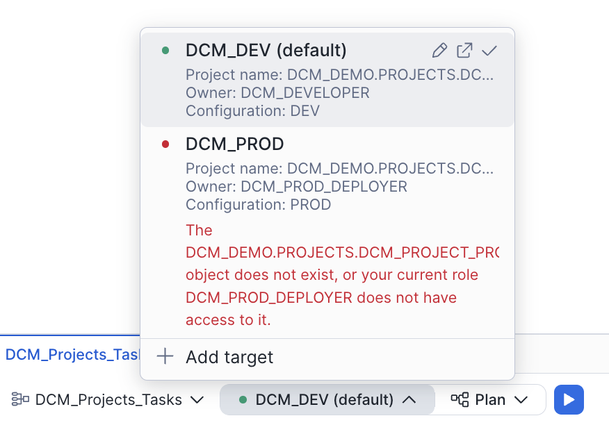
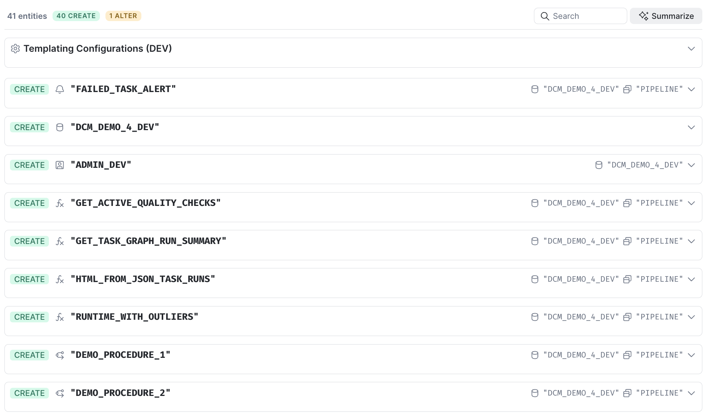

author: Charlie Hammond, Jan Sommerfeld, Gilberto Hernandez, Yoav Ostrinsky
id: dcm-projects-for-tasks
summary: Define a task graph as code with DCM Projects, run it, add a branch, and redeploy without suspending the graph.
categories: snowflake-site:taxonomy/solution-center/certification/quickstart, snowflake-site:taxonomy/product/platform, snowflake-site:taxonomy/product/data-engineering, snowflake-site:taxonomy/snowflake-feature/transformation
environments: web
status: Published
language: en
feedback link: https://github.com/Snowflake-Labs/sfguides/issues
fork repo link: https://github.com/Snowflake-Labs/snowflake-dcm-projects

# DCM Projects for Tasks
<!-- ------------------------ -->
## Overview

In [Get Started with Snowflake DCM Projects](https://www.snowflake.com/en/developers/guides/get-started-snowflake-dcm-projects/) and [DCM Projects for Dynamic Tables](https://www.snowflake.com/en/developers/guides/dcm-projects-for-dynamic-tables/) you managed tables and pipelines declaratively. This guide does the same for orchestration: one task graph, defined as code, deployed, changed and redeployed while it keeps running.

A task graph is a Snowflake object of its own. It holds everything that belongs to the pipeline as a whole: the schedule, the root task, the finalizer, the overlap policy, and the defaults that every member task inherits, such as the warehouse. The member tasks hold only their SQL and their predecessors. Changes to a graph are staged and only take effect when the graph is committed, so runs never see a half-edited pipeline. For the concepts behind this model, see the [comprehensive guide to orchestration](/en/developers/guides/comprehensive-guide-to-orchestration/).

In a DCM project you declare the graph with DEFINE TASK GRAPH and its members with DEFINE TASK, and you set the graph's desired state, STARTED or SUSPENDED, on the graph itself. DCM then creates, alters and commits the graph for you.

You'll work through three acts:

1. **Deploy and run.** Deploy a small hourly weather pipeline and run it once.
2. **Change the business logic.** The operations team wants a list of heat warnings, so you add a branch to the graph and tighten the task timeout.
3. **Redeploy without suspending.** You redeploy while the graph is started, read the Plan, and confirm that DCM committed a new version and that the next run used it.

If you'd rather build the same kind of DCM project visually, see [Getting Started with Pipeline Builder](/en/developers/guides/getting-started-with-pipeline-builder/).

### Prerequisites
- Basic knowledge of Snowflake tasks and SQL
- Completion of [Get Started with Snowflake DCM Projects](https://www.snowflake.com/en/developers/guides/get-started-snowflake-dcm-projects/) is recommended

### What You'll Learn
- How to declare a task graph and its members with DEFINE TASK GRAPH and DEFINE TASK
- Which settings belong on the graph and which come from TASK_DEFAULTS
- How DCM deploys changes to a started graph and commits them
- How to check which committed version a run used

### What You'll Need
- A [Snowflake account](https://signup.snowflake.com/?utm_source=snowflake-devrel&utm_medium=developer-guides&utm_cta=developer-guides) with ACCOUNTADMIN access, or a role that can create roles and grant account privileges
- (Optional) [Snowflake CLI](https://docs.snowflake.com/en/developer-guide/snowflake-cli/installation/installation) if you prefer the CLI to the Snowsight UI

### What You'll Build
- A task graph with a root task, a branch, and a finalizer that logs every run, all defined in one DCM project
- A second version of that graph with an extra branch, deployed while the first version keeps its schedule

<!-- ------------------------ -->
## Create a Workspace from Git

In this step, you'll create a Snowsight Workspace linked to the sample DCM Projects repository on GitHub.

1. Navigate to **Projects > Workspaces** in Snowsight.
2. Click **Create** (+) and select **Git repository**.
3. Enter the repository URL: `https://github.com/snowflake-labs/snowflake-dcm-projects`
4. Select an API Integration for GitHub ([create one if needed](https://docs.snowflake.com/en/user-guide/ui-snowsight/workspaces-git#label-create-a-git-workspace)).
5. Select **Public repository**.


Screenshot placeholder: the Git repository dialog with the snowflake-dcm-projects URL filled in, taken just before clicking Create.

Once the workspace is created, you'll see the repository files in the file explorer. Navigate to **Quickstarts/dcm-projects-for-tasks** to find the project files you'll be working with. There are two directories:

- **DCM_Projects_Tasks** is the DCM project: the manifest and the definition files. This is what DCM reads during Plan and Deploy.
- **scripts** holds numbered SQL files that you'll run in Snowsight worksheets at different stages of this guide. They live outside the project directory so DCM doesn't read them as definitions.

| File | When to Run |
|:-----|:------------|
| 01_pre_deploy.sql | Before the first DCM Plan and Deploy |
| 02_run_and_inspect.sql | After the first successful deployment |
| 03_verify_change.sql | After the second deployment (with the new branch) |
| 04_cleanup.sql | When you're done and want to tear everything down |

Open `scripts/01_pre_deploy.sql` in a Snowsight worksheet. You'll use it in the next step.

**CLI alternative.** Clone the repository and work from the project folder:

```bash
git clone https://github.com/Snowflake-Labs/snowflake-dcm-projects.git
cd snowflake-dcm-projects/Quickstarts/dcm-projects-for-tasks
```

<!-- ------------------------ -->
## Set Up Roles and the Project Object

Run `scripts/01_pre_deploy.sql` from top to bottom. It does three things.

It creates the DCM_DEVELOPER role and grants it to you:

```sql
USE ROLE ACCOUNTADMIN;

CREATE ROLE IF NOT EXISTS DCM_DEVELOPER
    COMMENT = 'Owns and deploys the DCM projects in the DCM quickstart series';
SET USER_NAME = (SELECT CURRENT_USER());
GRANT ROLE DCM_DEVELOPER TO USER IDENTIFIER($USER_NAME);
```

It grants the account-level privileges the project needs. A project can't grant account-level privileges to its own owner, so these happen before the first plan. The project creates a database and a warehouse, and EXECUTE TASK is what lets the owner run the task graph:

```sql
GRANT CREATE DATABASE      ON ACCOUNT TO ROLE DCM_DEVELOPER;
GRANT CREATE WAREHOUSE     ON ACCOUNT TO ROLE DCM_DEVELOPER;
GRANT EXECUTE TASK         ON ACCOUNT TO ROLE DCM_DEVELOPER;
GRANT EXECUTE MANAGED TASK ON ACCOUNT TO ROLE DCM_DEVELOPER;
GRANT MONITOR EXECUTION    ON ACCOUNT TO ROLE DCM_DEVELOPER;
```

EXECUTE MANAGED TASK is only needed if you later switch the members to serverless compute. MONITOR EXECUTION lets you read the task history in the next steps. DCM_DEVELOPER needs nothing more: it ends up owning everything the project creates, so it can create the tasks, run the graph and read its history without MANAGE GRANTS. This holds even with secondary roles turned off (USE SECONDARY ROLES NONE), so DCM_DEVELOPER doesn't borrow privileges from ACCOUNTADMIN or any other role granted to your user.

And it creates the DCM project object that the manifest points at:

```sql
USE ROLE DCM_DEVELOPER;

CREATE DATABASE IF NOT EXISTS DCM_DEMO
    COMMENT = 'Holds the DCM project objects of the DCM quickstart series';
CREATE SCHEMA IF NOT EXISTS DCM_DEMO.PROJECTS
    COMMENT = 'DCM project objects';

CREATE DCM PROJECT IF NOT EXISTS DCM_DEMO.PROJECTS.DCM_TASKS_PROJECT_DEV
    COMMENT = 'DCM Projects for Tasks quickstart: one task graph managed as code';
```

**Watch out for an existing DCM_DEMO database.** If you created DCM_DEMO in an earlier guide with a different role, CREATE DATABASE IF NOT EXISTS fails with "Database 'DCM_DEMO' already exists, but current role has no privileges on it". The comment at the top of section 3 in the script lists the three grants to run as ACCOUNTADMIN in that case: USAGE on the database, USAGE on the schema, and CREATE DCM PROJECT on the schema. After the grants, skip the CREATE DATABASE and CREATE SCHEMA lines, because CREATE SCHEMA IF NOT EXISTS still needs CREATE SCHEMA on the database. Run USE ROLE DCM_DEVELOPER, the CREATE DCM PROJECT statement and section 4.

The last query returns your account identifier. Copy it and paste it into `DCM_Projects_Tasks/manifest.yml` as the value of account_identifier on line 11, replacing MYORG-MY_DEV_ACCOUNT.

**Note:** After running this script, refresh your browser so Snowsight picks up the newly created DCM project object.

**CLI alternative.** Run the script with the Snowflake CLI:

```bash
snow sql -f scripts/01_pre_deploy.sql
```

<!-- ------------------------ -->
## Explore the Project Files

### Manifest

`DCM_Projects_Tasks/manifest.yml` defines two targets, DCM_DEV and DCM_PROD, and the templating values for each. DEV appends a _DEV suffix to every object name and uses an X-SMALL warehouse; PROD uses no suffix and a SMALL warehouse. The definition files reference these values as Jinja variables, so the same files can deploy to both environments. This guide only deploys DCM_DEV. DCM_PROD shows how a second environment would be configured: its owner role, DCM_PROD_DEPLOYER, and its project object aren't created by the scripts.

### Infrastructure: `sources/definitions/infrastructure.sql`

The warehouse that runs the member tasks, the database, and the PIPELINE schema that holds everything else:

```sql
DEFINE WAREHOUSE DCM_DEMO_4_WH{{env_suffix}}
WITH
    WAREHOUSE_SIZE = '{{wh_size}}'
    AUTO_SUSPEND = 60
    COMMENT = 'Runs the member tasks of the DCM Projects for Tasks quickstart';

DEFINE DATABASE DCM_DEMO_4{{env_suffix}}
    COMMENT = 'DCM Projects for Tasks quickstart: task graph and its tables';

DEFINE SCHEMA DCM_DEMO_4{{env_suffix}}.PIPELINE
    COMMENT = 'Tables, member tasks and the task graph';
```

### Tables: `sources/definitions/tables.sql`

Four tables. WEATHER_DATA_SOURCE receives the readings you insert. The root task copies new rows into RAW_WEATHER_DATA, a branch task rebuilds DAILY_WEATHER_SUMMARY from them, and the finalizer appends one row per run to PIPELINE_RUN_LOG. A fifth table, HEAT_WARNINGS, sits commented out at the bottom of the file (lines 45 to 51). You'll switch it on in Act 2.

### Tasks and the task graph: `sources/definitions/tasks.sql`

This file is the heart of the project. The member tasks come first. Each one has a comment, its predecessors in AFTER, and its SQL body, and nothing else: no warehouse, no schedule, no state.

```sql
DEFINE TASK DCM_DEMO_4{{env_suffix}}.PIPELINE.LOAD_WEATHER
    COMMENT = 'Root task: appends new source rows to RAW_WEATHER_DATA'
AS
    DECLARE
        RESULT VARCHAR;
    BEGIN
        INSERT INTO DCM_DEMO_4{{env_suffix}}.PIPELINE.RAW_WEATHER_DATA
        SELECT ROW_ID, CURRENT_TIMESTAMP(), DS, ZIPCODE, MIN_TEMP_IN_F, AVG_TEMP_IN_F, MAX_TEMP_IN_F
        FROM DCM_DEMO_4{{env_suffix}}.PIPELINE.WEATHER_DATA_SOURCE
        WHERE ROW_ID > (SELECT COALESCE(MAX(ROW_ID), 0) FROM DCM_DEMO_4{{env_suffix}}.PIPELINE.RAW_WEATHER_DATA);
        RESULT := SQLROWCOUNT || ' rows loaded';
        CALL SYSTEM$SET_RETURN_VALUE(:RESULT);
    END;

DEFINE TASK DCM_DEMO_4{{env_suffix}}.PIPELINE.BUILD_DAILY_SUMMARY
    COMMENT = 'Rebuilds DAILY_WEATHER_SUMMARY from RAW_WEATHER_DATA'
    AFTER DCM_DEMO_4{{env_suffix}}.PIPELINE.LOAD_WEATHER
AS
    INSERT OVERWRITE INTO DCM_DEMO_4{{env_suffix}}.PIPELINE.DAILY_WEATHER_SUMMARY
    SELECT DS, ZIPCODE, AVG(AVG_TEMP_IN_F), MAX(MAX_TEMP_IN_F)
    FROM DCM_DEMO_4{{env_suffix}}.PIPELINE.RAW_WEATHER_DATA
    GROUP BY DS, ZIPCODE;
```

Two details are worth knowing when you write your own members. In DEFINE TASK, COMMENT comes before AFTER; the other way round fails at Plan with a syntax error. And SYSTEM$SET_RETURN_VALUE only accepts a constant or a plain variable, so the root task builds its message in RESULT first and passes that.

The finalizer is an ordinary task with no AFTER. It writes the run's group ID and the current row count to the log table:

```sql
DEFINE TASK DCM_DEMO_4{{env_suffix}}.PIPELINE.LOG_RUN
    COMMENT = 'Finalizer: writes one row per graph run to PIPELINE_RUN_LOG'
AS
    INSERT INTO DCM_DEMO_4{{env_suffix}}.PIPELINE.PIPELINE_RUN_LOG
    SELECT SYSTEM$TASK_RUNTIME_INFO('CURRENT_TASK_GRAPH_RUN_GROUP_ID'),
           CURRENT_TIMESTAMP(),
           (SELECT COUNT(*) FROM DCM_DEMO_4{{env_suffix}}.PIPELINE.RAW_WEATHER_DATA);
```

The graph itself closes the file, on lines 55 to 65:

```sql
DEFINE TASK GRAPH DCM_DEMO_4{{env_suffix}}.PIPELINE.WEATHER_PIPELINE
    SCHEDULE = 'USING CRON 0 * * * * UTC'
    ROOTS = (DCM_DEMO_4{{env_suffix}}.PIPELINE.LOAD_WEATHER)
    FINALIZER = DCM_DEMO_4{{env_suffix}}.PIPELINE.LOG_RUN
    OVERLAP_POLICY = NO_OVERLAP
    COMMENT = 'Hourly weather pipeline managed by a DCM project'
    TASK_DEFAULTS (
        WAREHOUSE = 'DCM_DEMO_4_WH{{env_suffix}}',
        USER_TASK_TIMEOUT_MS = 600000
    )
    STARTED;
```

Everything that describes the pipeline as a whole lives here:

- **SCHEDULE, ROOTS, FINALIZER and OVERLAP_POLICY** are graph properties. A task graph has exactly one root, and the finalizer runs after every other task in a run, including runs where a task failed. Settings such as SCHEDULE, OVERLAP_POLICY, CONFIG and TASK_AUTO_RETRY_ATTEMPTS can only be set on the graph; putting them on a member task returns an error.
- **TASK_DEFAULTS** passes the warehouse and the timeout to every member. A member can override a default by setting the property itself, but none of these do.
- **STARTED** is the desired state of the whole graph. It is a DCM keyword: it isn't part of the graph's DDL, and member tasks of a graph can't declare a state of their own. With STARTED, DCM commits the graph and starts its schedule as part of Deploy, so there is no RESUME step to run afterwards.

Below BUILD_DAILY_SUMMARY, lines 36 to 45 hold a second branch task, BUILD_HEAT_WARNINGS, commented out. That's your Act 2 change.

<!-- ------------------------ -->
## Plan and Deploy

With the account identifier in the manifest and the pre-deploy script run, you're ready to deploy.

### Select the Project

1. Open `DCM_Projects_Tasks/manifest.yml` in the Workspaces file explorer.
2. At the bottom of the editor, confirm the project selector shows DCM_DEMO.PROJECTS.DCM_TASKS_PROJECT_DEV and the target shows DCM_DEV.



Screenshot placeholder: the DCM control panel at the bottom of the editor, with DCM_TASKS_PROJECT_DEV and DCM_DEV selected, before the first Plan.

### Execute the Plan

Click **Plan**. Every object is new, so the changeset is all CREATE: the warehouse, the database with its PIPELINE and PUBLIC schemas, four tables, three tasks and one TASK_GRAPH entry. It also lists an ALTER on DCM_DEVELOPER that adds the OWNERSHIP grants for the new objects.



Screenshot placeholder: the first Plan result, showing the CREATE TASK_GRAPH line for WEATHER_PIPELINE and the CREATE lines for its three tasks.

### Deploy

Instead of Plan, set the operation to **Deploy**, give the deployment an alias such as first-deploy, and run it.

When the deployment finishes, the database explorer shows the new objects, with the task graph and its three tasks in the PIPELINE schema.


Screenshot placeholder: the database explorer after the first deployment, with DCM_DEMO_4_DEV.PIPELINE expanded to show the four tables, three tasks and WEATHER_PIPELINE.

**CLI alternative.** From the dcm-projects-for-tasks folder you cloned into, point the CLI at the project directory with --from:

```bash
snow dcm plan --from DCM_Projects_Tasks --target DCM_DEV
snow dcm deploy --from DCM_Projects_Tasks --target DCM_DEV --alias first-deploy
```

<!-- ------------------------ -->
## Run the Graph and Inspect It

Open `scripts/02_run_and_inspect.sql` in a worksheet and run the whole script. It takes about two minutes, because it waits for the graph run to finish before it reads the history.

The tables below show the values in a simplified form: predecessors without the JSON brackets, task_parameters as a name and a value, and NULL where a column is empty. Your worksheet shows the raw values.

Section 1 checks the deployment. SHOW TASK GRAPHS reports the graph as STARTED, with has_pending_changes set to false: DCM committed what it deployed. SHOW COMMITTED TASKS lists the three members, each at version 1, all on the warehouse that TASK_DEFAULTS supplied. The version goes up by one with every deployment, so if you deployed more than once, you'll see a higher number here and in the rest of the guide.

| name | version | predecessors | warehouse |
|:-----|:--------|:-------------|:----------|
| BUILD_DAILY_SUMMARY | 1 | DCM_DEMO_4_DEV.PIPELINE.LOAD_WEATHER | DCM_DEMO_4_WH_DEV |
| LOAD_WEATHER | 1 | (none) | DCM_DEMO_4_WH_DEV |
| LOG_RUN | 1 | (none) | DCM_DEMO_4_WH_DEV |

Sections 2 and 3 insert six readings for two days and run the graph immediately rather than waiting for the top of the hour. The run is wrapped in a check, so it only happens when there are readings the graph hasn't loaded yet, and the script then waits 90 seconds:

```sql
EXECUTE IMMEDIATE $$
BEGIN
    IF ((SELECT COUNT(*) FROM DCM_DEMO_4_DEV.PIPELINE.WEATHER_DATA_SOURCE) >
        (SELECT COUNT(*) FROM DCM_DEMO_4_DEV.PIPELINE.RAW_WEATHER_DATA)) THEN
        EXECUTE TASK GRAPH DCM_DEMO_4_DEV.PIPELINE.WEATHER_PIPELINE;
        CALL SYSTEM$WAIT(90);
        RETURN 'Graph run started and given 90 seconds to finish';
    END IF;
    RETURN 'Nothing new to load, graph not run';
END;
$$;
```

The insert skips readings that are already there, so running the script again doesn't add rows or start another run.

Section 4 reads the task history for this graph. The GRAPH_VERSION column tells you which committed version each task ran. **Take note of it**: every task in this run used version 1.

| GRAPH_VERSION | NAME | STATE | RETURN_VALUE |
|:--------------|:-----|:------|:-------------|
| 1 | LOAD_WEATHER | SUCCEEDED | 6 rows loaded |
| 1 | BUILD_DAILY_SUMMARY | SUCCEEDED | NULL |
| 1 | LOG_RUN | SUCCEEDED | NULL |

The graph also keeps its hourly schedule, so if the top of the hour passes while you work, a scheduled run appears in the history that finds nothing new and reports 0 rows loaded. The history query leaves out runs like that, so the result stays as shown.

DAILY_WEATHER_SUMMARY now has six rows, one per day and ZIP code, and PIPELINE_RUN_LOG has one row with RAW_ROWS set to 6. Two of those readings, 85 F and 91 F in ZIP code 10001, will matter in a moment.

**CLI alternative.** From the dcm-projects-for-tasks folder:

```bash
snow sql -f scripts/02_run_and_inspect.sql
```

<!-- ------------------------ -->
## Add a Branch to the Graph

The operations team wants a daily list of heat warnings: every day where a ZIP code reached 85 F or more. They also want stuck tasks to fail sooner, so the timeout for every member drops from ten minutes to five.

With a root-task graph, a change like this meant suspending the root, altering tasks, and resuming. A task graph object separates editing from releasing: edits are staged, and a commit releases them as a new version while runs keep using the version they started with. DCM does the editing and the committing for you, so the change itself is just a change to the definition files.

Make three edits in the workspace:

1. In `sources/definitions/tables.sql`, uncomment lines 46 to 51 to define the HEAT_WARNINGS table.
2. In `sources/definitions/tasks.sql`, uncomment lines 37 to 45 to define the BUILD_HEAT_WARNINGS task. It runs after LOAD_WEATHER, alongside BUILD_DAILY_SUMMARY.
3. In `sources/definitions/tasks.sql`, change USER_TASK_TIMEOUT_MS on line 63 from 600000 to 300000.

After the edits, the new task reads:

```sql
DEFINE TASK DCM_DEMO_4{{env_suffix}}.PIPELINE.BUILD_HEAT_WARNINGS
    COMMENT = 'Rebuilds HEAT_WARNINGS from RAW_WEATHER_DATA'
    AFTER DCM_DEMO_4{{env_suffix}}.PIPELINE.LOAD_WEATHER
AS
    INSERT OVERWRITE INTO DCM_DEMO_4{{env_suffix}}.PIPELINE.HEAT_WARNINGS
    SELECT DS, ZIPCODE, MAX(MAX_TEMP_IN_F)
    FROM DCM_DEMO_4{{env_suffix}}.PIPELINE.RAW_WEATHER_DATA
    GROUP BY DS, ZIPCODE
    HAVING MAX(MAX_TEMP_IN_F) >= 85;
```

| Setting | Before | After |
|:--------|:-------|:------|
| Members after LOAD_WEATHER | BUILD_DAILY_SUMMARY | BUILD_DAILY_SUMMARY, BUILD_HEAT_WARNINGS |
| TASK_DEFAULTS timeout | 600000 ms | 300000 ms |
| Desired state | STARTED | STARTED |

The graph stays STARTED in the definition, and you won't suspend it at any point.

<!-- ------------------------ -->
## Redeploy Without Suspending

### Plan the Change

Run **Plan** again. Instead of all CREATE, you'll see only the difference: CREATE for the new table and the new task, and an ALTER on the task graph that shows the TASK_DEFAULTS change from 600000 to 300000.

```
CREATE   TABLE                DCM_DEMO_4_DEV.PIPELINE.HEAT_WARNINGS
CREATE   TASK                 DCM_DEMO_4_DEV.PIPELINE.BUILD_HEAT_WARNINGS
ALTER    TASK_GRAPH           DCM_DEMO_4_DEV.PIPELINE.WEATHER_PIPELINE
└─ changed TASK_DEFAULTS: …imeout_ms": 600000} → …imeout_ms": 300000}
```

The Plan also lists an ALTER on DCM_DEVELOPER for the ownership of the two new objects. It doesn't list a suspend, a resume or a commit. Those aren't separate steps you have to manage: the commit happens as part of Deploy, and you'll confirm it in the next step.


Screenshot placeholder: the second Plan result, with the ALTER TASK_GRAPH line expanded to show the TASK_DEFAULTS change.

### Deploy

Instead of Plan, set the operation to **Deploy**, use the alias add-heat-warnings, and run it. The graph is started the whole time.

**CLI alternative.**

```bash
snow dcm plan --from DCM_Projects_Tasks --target DCM_DEV
snow dcm deploy --from DCM_Projects_Tasks --target DCM_DEV --alias add-heat-warnings
```

### Verify the Committed Version

Open `scripts/03_verify_change.sql` and run the whole script. Like the previous one, it waits for its graph run, and running it again changes nothing.

SHOW TASK GRAPHS reports the graph as STARTED, has_pending_changes as false, and last_suspended_on as empty: the graph was never suspended during the deployment. Its task_defaults now show the 300000 ms timeout.

SHOW COMMITTED TASKS shows version 2, and the new task is part of it. Every member, including the new one, inherited the shorter timeout from TASK_DEFAULTS:

| name | version | predecessors | task_parameters |
|:-----|:--------|:-------------|:----------------|
| BUILD_DAILY_SUMMARY | 2 | DCM_DEMO_4_DEV.PIPELINE.LOAD_WEATHER | USER_TASK_TIMEOUT_MS 300000 |
| BUILD_HEAT_WARNINGS | 2 | DCM_DEMO_4_DEV.PIPELINE.LOAD_WEATHER | USER_TASK_TIMEOUT_MS 300000 |
| LOAD_WEATHER | 2 | (none) | USER_TASK_TIMEOUT_MS 300000 |
| LOG_RUN | 2 | (none) | USER_TASK_TIMEOUT_MS 300000 |

Sections 3 and 4 add two more hot days, run the graph again and show both runs side by side. The first run used version 1 and three tasks; the second used version 2, and BUILD_HEAT_WARNINGS ran in it:

| GRAPH_VERSION | NAME | STATE | RETURN_VALUE |
|:--------------|:-----|:------|:-------------|
| 1 | LOAD_WEATHER | SUCCEEDED | 6 rows loaded |
| 1 | BUILD_DAILY_SUMMARY | SUCCEEDED | NULL |
| 1 | LOG_RUN | SUCCEEDED | NULL |
| 2 | LOAD_WEATHER | SUCCEEDED | 2 rows loaded |
| 2 | BUILD_DAILY_SUMMARY | SUCCEEDED | NULL |
| 2 | BUILD_HEAT_WARNINGS | SUCCEEDED | NULL |
| 2 | LOG_RUN | SUCCEEDED | NULL |

HEAT_WARNINGS holds four rows. Two of them are the 85 F and 91 F readings from Act 1, which the new branch picked up from data that was already loaded:

| DS | ZIPCODE | MAX_TEMP_IN_F |
|:---|:--------|:--------------|
| 2026-06-01 | 10001 | 85 |
| 2026-06-02 | 10001 | 91 |
| 2026-06-03 | 10001 | 93 |
| 2026-06-03 | 94105 | 88 |

Removing a task works the same way. If you comment the branch out again and redeploy, the Plan shows DROP for the task and its table, and DCM commits a version without it, still without suspending the graph.

**To pause the pipeline**, change STARTED to SUSPENDED on line 65 and redeploy. The Plan shows the state change as an ALTER on the root task. After the deployment, SHOW TASK GRAPHS reports the graph as SUSPENDED, and SHOW TASKS shows all of its members as suspended.

**CLI alternative.** From the dcm-projects-for-tasks folder:

```bash
snow sql -f scripts/03_verify_change.sql
```

<!-- ------------------------ -->
## Cleanup

When you're done, open `scripts/04_cleanup.sql` and run it. It purges everything the project manages and then drops the project object:

```sql
EXECUTE DCM PROJECT DCM_DEMO.PROJECTS.DCM_TASKS_PROJECT_DEV PURGE;

DROP DCM PROJECT IF EXISTS DCM_DEMO.PROJECTS.DCM_TASKS_PROJECT_DEV;
```

PURGE drops the database, its tables and their data, the task graph and its members, and the warehouse. It can't be undone, and it leaves the project object behind, which is why the DROP follows.

The DCM_DEMO database, its PROJECTS schema and the DCM_DEVELOPER role are shared by every guide in the DCM series, so the script leaves them in place, commented out. Check what else is in the shared schema before you drop it:

```sql
SHOW DCM PROJECTS IN SCHEMA DCM_DEMO.PROJECTS;
```

**CLI alternative.** From the dcm-projects-for-tasks folder:

```bash
snow sql -f scripts/04_cleanup.sql
```

<!-- ------------------------ -->
## Conclusion and Resources

You defined a task graph as code, ran it, changed its shape and its defaults, and redeployed it while it kept running.

- The graph owns the pipeline-wide settings: schedule, root, finalizer, overlap policy and TASK_DEFAULTS. Member tasks hold only their SQL and their predecessors.
- STARTED or SUSPENDED on DEFINE TASK GRAPH sets the desired state of the whole graph; member tasks never declare one.
- The Plan for a redeployment shows only what changed: here an ALTER on the graph and a CREATE for the new member, and for a change to a member's SQL alone, an ALTER on that task with no graph line at all. Either way, Deploy commits a new version without suspending the graph, and the GRAPH_VERSION column in the task history shows which version each run used.

### What's Next
- Read the [comprehensive guide to orchestration](/en/developers/guides/comprehensive-guide-to-orchestration/) for the concepts behind task graphs: committed versions, advanced branching, finalizers and monitoring.
- Build the same kind of project visually with [Getting Started with Pipeline Builder](/en/developers/guides/getting-started-with-pipeline-builder/).

### Related Resources
- [Task graph object](https://docs.snowflake.com/en/user-guide/task-graph-object)
- [CREATE TASK GRAPH and DEFINE TASK GRAPH](https://docs.snowflake.com/en/sql-reference/sql/create-task-graph)
- [DCM Projects supported entities](https://docs.snowflake.com/en/user-guide/dcm-projects/dcm-projects-supported-entities)
- [DCM Projects documentation](https://docs.snowflake.com/en/user-guide/dcm-projects/dcm-projects-overview)
- [Get Started with Snowflake DCM Projects](https://www.snowflake.com/en/developers/guides/get-started-snowflake-dcm-projects/)
- [DCM Projects for Dynamic Tables](https://www.snowflake.com/en/developers/guides/dcm-projects-for-dynamic-tables/)
- [Sample DCM Projects repository](https://github.com/Snowflake-Labs/snowflake-dcm-projects)
