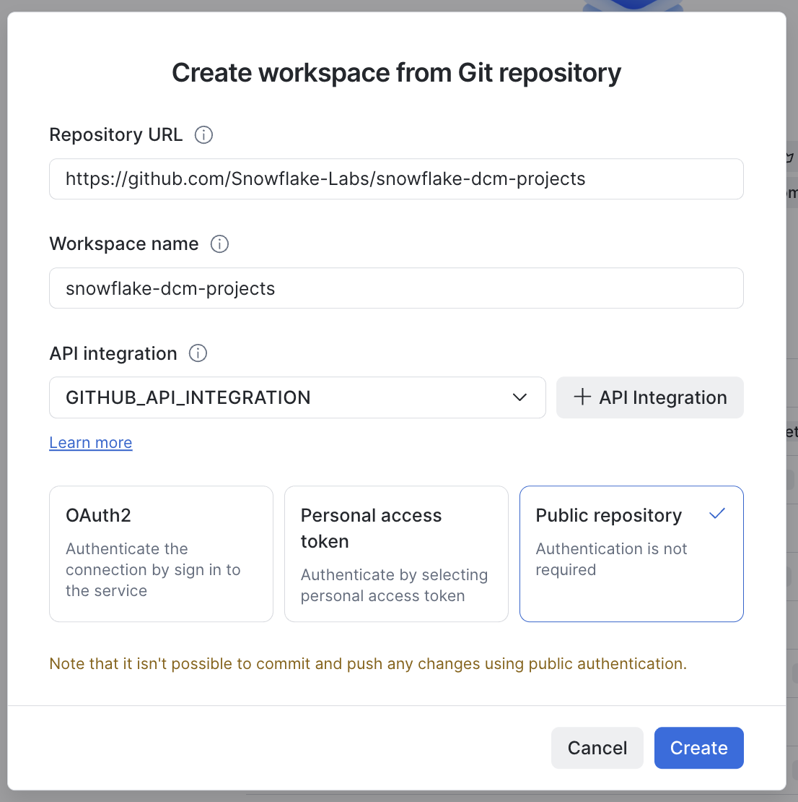
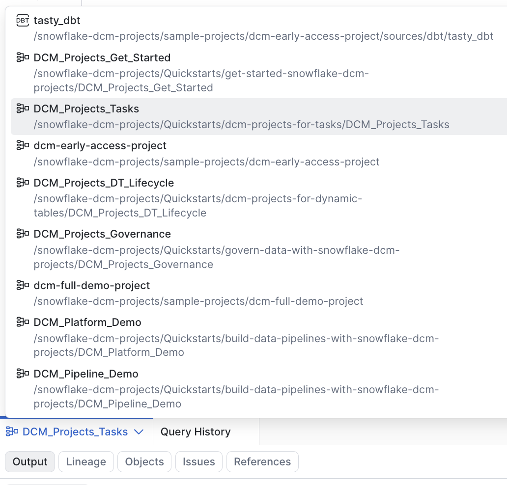
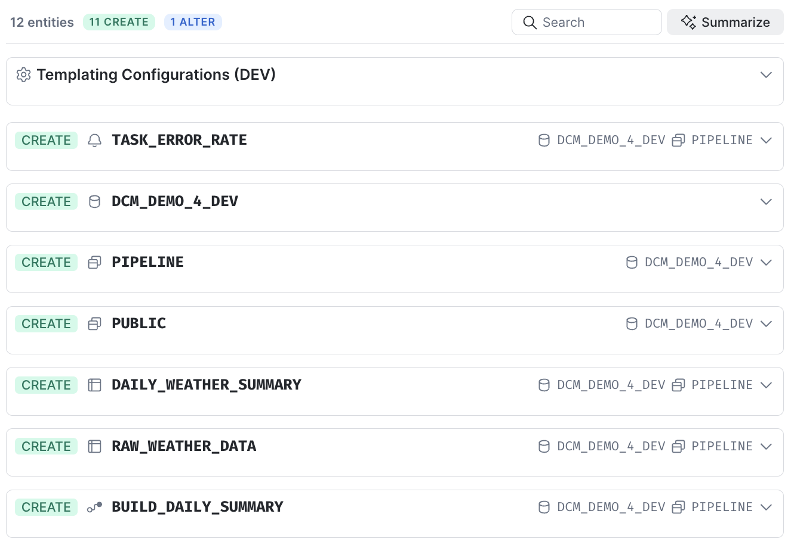
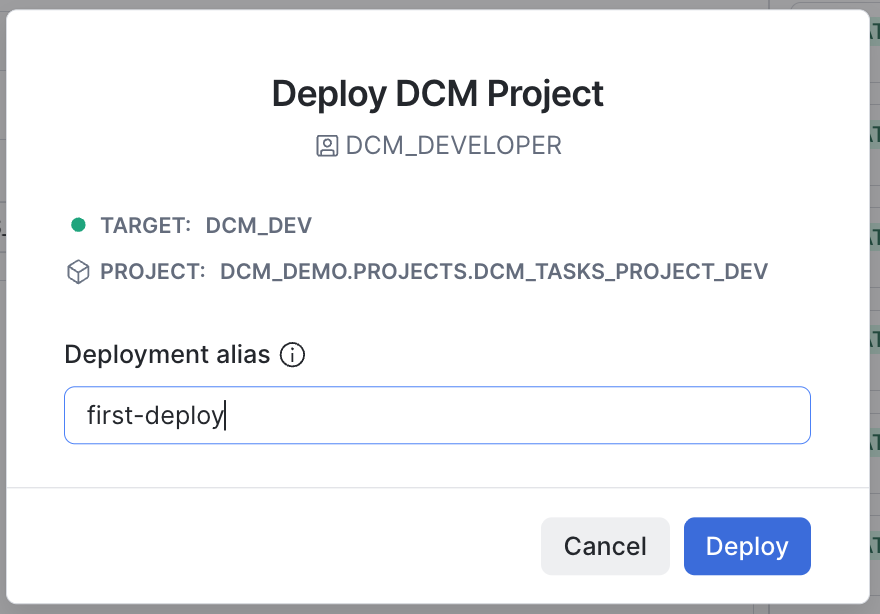
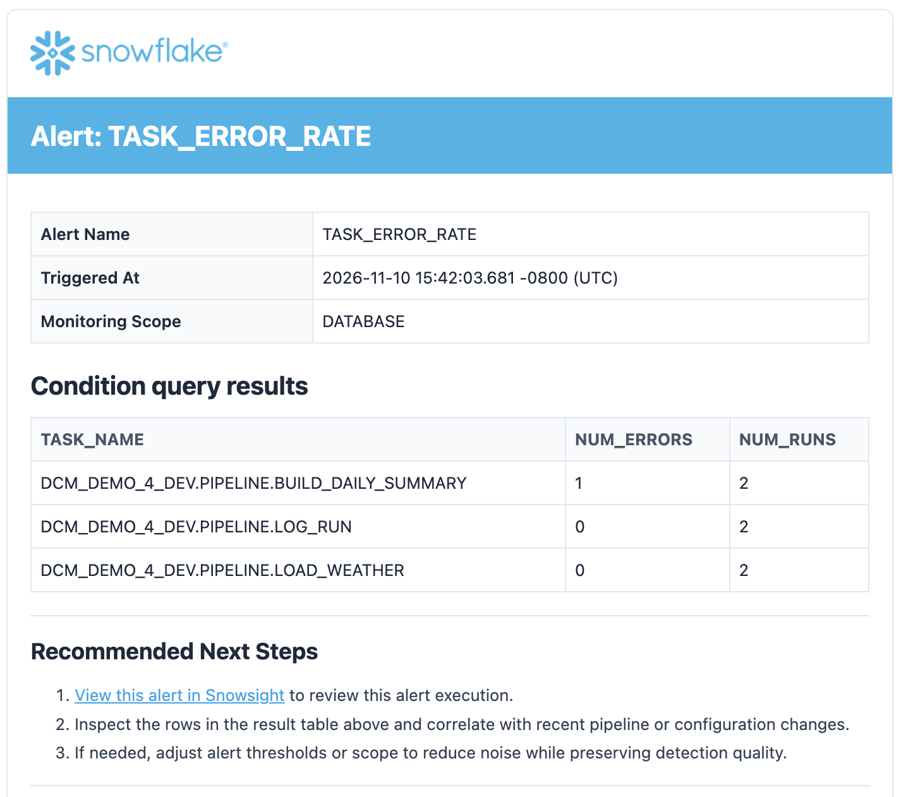
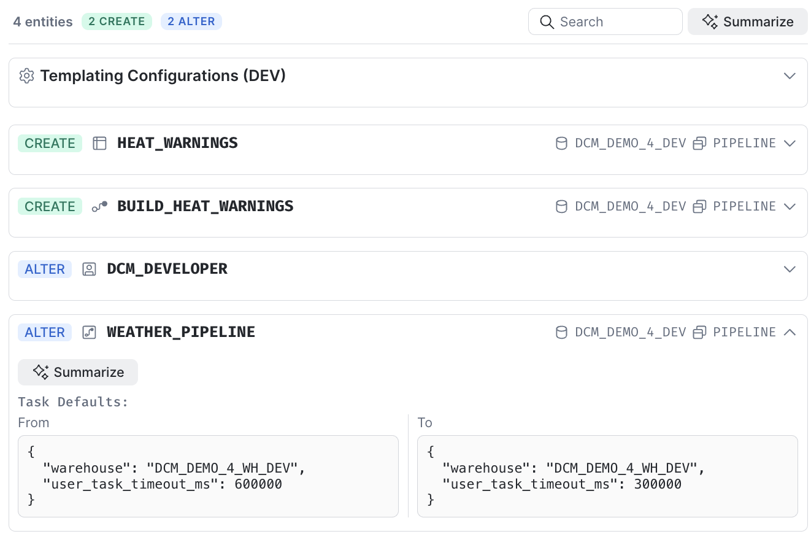

author: Charlie Hammond, Jan Sommerfeld, Gilberto Hernandez, Yoav Ostrinsky
id: dcm-projects-for-tasks
summary: Define a task graph and its failure alert as code with DCM Projects, watch the alert fire, add a branch, and redeploy without suspending the graph.
categories: snowflake-site:taxonomy/solution-center/certification/quickstart, snowflake-site:taxonomy/product/platform, snowflake-site:taxonomy/product/data-engineering, snowflake-site:taxonomy/snowflake-feature/transformation
environments: web
status: Published
language: en
feedback link: https://github.com/Snowflake-Labs/sfguides/issues
fork repo link: https://github.com/Snowflake-Labs/snowflake-dcm-projects

# DCM Projects for Tasks
<!-- ------------------------ -->
## Overview

In [Get Started with Snowflake DCM Projects](https://www.snowflake.com/en/developers/guides/get-started-snowflake-dcm-projects/) and [DCM Projects for Dynamic Tables](https://www.snowflake.com/en/developers/guides/dcm-projects-for-dynamic-tables/) you managed tables and pipelines declaratively. This guide does the same for orchestration: one task graph and the alert that watches it, defined as code, deployed, changed and redeployed while the graph keeps running.

A task graph is a Snowflake object of its own. It holds everything that belongs to the pipeline as a whole: the schedule, the root task, the finalizer, the overlap policy, and the defaults that every member task inherits, such as the warehouse. The member tasks hold only their SQL and their predecessors. Changes to a graph are staged and only take effect when the graph is committed, so runs never see a half-edited pipeline. For the concepts behind this model, see the [comprehensive guide to orchestration](/en/developers/guides/comprehensive-guide-to-orchestration/).

In a DCM project you declare the graph with DEFINE TASK GRAPH and its members with DEFINE TASK, and you set the graph's desired state, STARTED or SUSPENDED, on the graph itself. DCM then creates, alters and commits the graph for you. Next to the graph, the project declares an alert from the TASKS_ERROR_RATE template, which emails you when task runs start failing.

You'll work through three acts:

1. **Deploy, run and break.** Deploy a small hourly weather pipeline with its alert, run it once, then send it a broken reading and watch the alert email you.
2. **Change the business logic.** The operations team wants a list of heat warnings, so you add a branch to the graph and tighten the task timeout.
3. **Redeploy without suspending.** You redeploy while the graph and the alert are running, read the Plan, and confirm that DCM committed a new version and that the next run used it.

If you'd rather build the same kind of DCM project visually, see [Getting Started with Pipeline Builder](/en/developers/guides/getting-started-with-pipeline-builder/).

### Prerequisites
- Basic knowledge of Snowflake tasks and SQL
- Completion of [Get Started with Snowflake DCM Projects](https://www.snowflake.com/en/developers/guides/get-started-snowflake-dcm-projects/) is recommended

### What You'll Learn
- How to declare a task graph and its members with DEFINE TASK GRAPH and DEFINE TASK
- Which settings belong on the graph and which come from TASK_DEFAULTS
- How to declare an alert from a template in a DCM project, and what it needs to fire
- How DCM deploys changes to a started graph and commits them
- How to check which committed version a run used

### What You'll Need
- A [Snowflake account](https://signup.snowflake.com/?utm_source=snowflake-devrel&utm_medium=developer-guides&utm_cta=developer-guides) with ACCOUNTADMIN access, for the one-time setup script
- (Optional) [Snowflake CLI](https://docs.snowflake.com/en/developer-guide/snowflake-cli/installation/installation) 3.24 or later, if you prefer a terminal to the Snowsight UI
- A verified email address on your Snowflake user, for the alert to send to

### What You'll Build
- A task graph with a root task, a branch, and a finalizer that reports every run, all defined in one DCM project
- A TASKS_ERROR_RATE alert in the same project that emails you when task runs fail
- A second version of that graph with an extra branch, deployed while the first version keeps its schedule

<!-- ------------------------ -->
## Create a Workspace from Git

If you want to work in Snowsight rather than locally, create a Snowsight Workspace linked to the sample repository on GitHub.

1. Navigate to **Projects > Workspaces** in Snowsight.
2. Click **Create** (+) and select **Git repository**.
3. Enter the repository URL: https://github.com/Snowflake-Labs/snowflake-dcm-projects
4. Select an API Integration for GitHub ([create one if needed](https://docs.snowflake.com/en/user-guide/ui-snowsight/workspaces-git#label-create-a-git-workspace)).
5. Select **Public repository**.


Screenshot placeholder: the Create Workspace from Git repository dialog with the snowflake-dcm-projects URL filled in, taken just before clicking Create.

Once the workspace is created you will see the repository files in the file explorer. Navigate to **Quickstarts/dcm-projects-for-tasks** to find two directories.

DCM_Projects_Tasks/ is the DCM Project itself. scripts/ holds numbered SQL files that you run in Snowsight worksheets at different stages of this guide. They live outside the project directory, so nothing in them is ever picked up by a plan.

| File | When to run |
|---|---|
| scripts/01_pre_deploy.sql | Once, before the first plan |
| scripts/02_guide_setup.sql | Once, after 01_pre_deploy.sql and before the first plan |
| scripts/03_post_deploy.sql | After the first successful deploy |
| scripts/04_force_failure.sql | After 03_post_deploy.sql, to make the alert fire |
| scripts/05_verify_change.sql | After the second deploy (with the new branch) |
| scripts/06_cleanup.sql | When you are finished |

Every operational step in this guide is given twice: once for Snowsight, and once for the [Snowflake CLI](https://docs.snowflake.com/en/developer-guide/snowflake-cli/installation/installation) if you would rather drive the project from a terminal against your own copy of the repository.

**With the Snowflake CLI:** clone the repository and work from the guide's folder. Run the snow dcm commands from inside DCM_Projects_Tasks, and the snow sql commands from the guide's folder.

```bash
git clone https://github.com/Snowflake-Labs/snowflake-dcm-projects.git
cd snowflake-dcm-projects/Quickstarts/dcm-projects-for-tasks
```

<!-- ------------------------ -->
## Set Up Roles and Permissions

Run the first script. **In Snowsight:** open scripts/01_pre_deploy.sql in a worksheet and run it from top to bottom. **With the Snowflake CLI:**

```bash
snow sql -f scripts/01_pre_deploy.sql
```

The script is the same in every guide of this series. It runs as ACCOUNTADMIN and is safe to run again: if you already ran it for another guide, running it now changes nothing. It has six numbered sections.

**1. Role.** It creates the DCM_DEVELOPER role and grants it to you and to SYSADMIN. Every guide in this series uses this role as the project owner.

**2. Inherited grants opt-in.** It turns on inherited grants for the account.

**3. Account-level privileges.** A project cannot grant account-level privileges to its own owner, so they all happen here, before the first plan. DCM_DEVELOPER gets the privileges that the guides in this series need together, one grant per line, each with a comment naming the guide or feature that uses it. Some are checked at plan time, so a missing one fails the first plan rather than the deploy.

**4. Series container.** It creates the DCM_DEMO database and the DCM_DEMO.PROJECTS schema that holds the project objects of the series, and grants DCM_DEVELOPER USAGE on both and CREATE DCM PROJECT on the schema. A project cannot define the database or schema it lives in.

**5. Project object.** It creates this guide's DCM Project object, DCM_DEMO.PROJECTS.DCM_TASKS_PROJECT_DEV, as DCM_DEVELOPER. This is the only section that differs between the guides of the series.

**6. Values for the manifest.** The last query returns your account identifier and user name.

When the script finishes, refresh your browser so the DCM control panel lists the new project object.

**Inherited grants.** An inherited grant covers current *and* future objects of a type inside a container. GRANT ON ALL snapshots what exists right now; GRANT ON FUTURE covers only what comes later. An inherited grant covers both, as one grant rather than one per object, which is why it is the recommended pattern in DCM Projects. It is a one-time opt-in per account ([release note](https://docs.snowflake.com/en/release-notes/2026/other/2026-09-10-inherited-grants-ga)), which the setup script turns on:

```sql
ALTER ACCOUNT SET FEATURE_RBAC_INHERITED_GRANTS = 'ENABLED';
```

An inherited grant cannot be combined with WITH GRANT OPTION, CASCADE or RESTRICT.

This guide doesn't use inherited grants itself; the opt-in is there so the same role works for every guide in the series.

Of the grants in section 3, this guide relies on these:

- CREATE DATABASE and CREATE WAREHOUSE, because the project defines a database and a warehouse.
- EXECUTE TASK, which lets the owner run the task graph. The members run on the project's warehouse, so EXECUTE MANAGED TASK isn't needed here.
- EXECUTE ALERT, which lets the owner run the alert. The alert runs on the same warehouse as the tasks, so EXECUTE MANAGED ALERT isn't needed here either.
- CREATE INTEGRATION, for the email integration that 02_guide_setup.sql creates.
- MONITOR EXECUTION, for reading task history.

Two more are there because the alert reads task events:

```sql
GRANT APPLICATION ROLE SNOWFLAKE.EVENTS_VIEWER TO ROLE DCM_DEVELOPER;
GRANT MODIFY LOG EVENT LEVEL ON ACCOUNT TO ROLE DCM_DEVELOPER;
```

SNOWFLAKE.EVENTS_VIEWER is an application role, so it is granted with GRANT APPLICATION ROLE; without it the alert's condition can't read the event table. MODIFY LOG EVENT LEVEL lets the role set LOG_EVENT_LEVEL on the project's database, which is what makes the tasks log their run status. Without it the first plan fails with "must have MODIFY LOG EVENT LEVEL granted on ACCOUNT".

Paste ACCOUNT_IDENTIFIER into DCM_Projects_Tasks/manifest.yml as the value of account_identifier on line 11, replacing MYORG-MY_DEV_ACCOUNT.

### Create the Email Integration

Run the second script, still before the first plan. **In Snowsight:** open scripts/02_guide_setup.sql in a worksheet and run it. **With the Snowflake CLI:**

```bash
snow sql -f scripts/02_guide_setup.sql
```

A DCM project can't define notification integrations, so the script creates the one the alert sends to:

```sql
CREATE NOTIFICATION INTEGRATION IF NOT EXISTS DCM_DEMO_4_EMAIL_INT
    TYPE = EMAIL
    ENABLED = TRUE
    COMMENT = 'Email integration for the DCM Projects for Tasks alert';
```

It runs as DCM_DEVELOPER, so the role owns the integration, and ownership covers the USAGE the alert needs when it sends. The name carries this guide's DCM_DEMO_4 prefix, so it doesn't collide with an integration from another guide or an earlier version of this one. Plan checks the reference, so the integration has to exist before the first plan. The script is safe to run again.

On line 27 of DCM_Projects_Tasks/manifest.yml, set alert_email to the verified email address of your Snowflake user.

After these two scripts, nothing in the guide needs more than DCM_DEVELOPER. The guide was verified with secondary roles turned off, so DCM_DEVELOPER didn't borrow privileges from ACCOUNTADMIN or any other role granted to the user. You don't need to turn yours off.

<!-- ------------------------ -->
## Explore the Project Files

### Manifest

DCM_Projects_Tasks/manifest.yml defines two targets, DCM_DEV and DCM_PROD, and the templating values for each. DEV appends a _DEV suffix to every object name and uses an X-SMALL warehouse; PROD uses no suffix and a SMALL warehouse. Both use alert_email from the defaults. The definition files reference these values as Jinja variables, so the same files can deploy to both environments. This guide only deploys DCM_DEV. DCM_PROD shows how a second environment would be configured: its owner role, DCM_PROD_DEPLOYER, and its project object aren't created by the scripts.

### Infrastructure: sources/definitions/infrastructure.sql

The warehouse that runs the member tasks and the alert, the database, and the PIPELINE schema that holds everything else:

```sql
DEFINE WAREHOUSE DCM_DEMO_4_WH{{env_suffix}}
WITH
    WAREHOUSE_SIZE = '{{wh_size}}'
    AUTO_SUSPEND = 60
    COMMENT = 'Runs the member tasks of the DCM Projects for Tasks quickstart';

DEFINE DATABASE DCM_DEMO_4{{env_suffix}}
    LOG_EVENT_LEVEL = INFO
    COMMENT = 'DCM Projects for Tasks quickstart: task graph and its tables';

DEFINE SCHEMA DCM_DEMO_4{{env_suffix}}.PUBLIC
    COMMENT = 'Default schema, declared so DCM manages it';

DEFINE SCHEMA DCM_DEMO_4{{env_suffix}}.PIPELINE
    COMMENT = 'Tables, member tasks, the task graph and its alert';
```

LOG_EVENT_LEVEL = INFO on the database makes every task in it write its run status to the event table. That is what the alert reads, so without it the alert never sees a failure.

### Tables: sources/definitions/tables.sql

Two tables. RAW_WEATHER_DATA receives the readings the scripts insert, with LOADED_AT empty until the root task stamps it. A branch task rebuilds DAILY_WEATHER_SUMMARY from them. A third table, HEAT_WARNINGS, sits commented out at the bottom of the file (lines 27 to 32). You'll switch it on in Act 2.

### Tasks and the task graph: sources/definitions/tasks.sql

This file is the heart of the project. The member tasks come first. Each one has a comment, its predecessors in AFTER, and its SQL body, and nothing else: no warehouse, no schedule, no state.

```sql
DEFINE TASK DCM_DEMO_4{{env_suffix}}.PIPELINE.LOAD_WEATHER
    COMMENT = 'Root task: stamps the readings in RAW_WEATHER_DATA that no run has loaded yet'
AS
    DECLARE
        RESULT VARCHAR;
    BEGIN
        UPDATE DCM_DEMO_4{{env_suffix}}.PIPELINE.RAW_WEATHER_DATA
        SET LOADED_AT = CURRENT_TIMESTAMP()
        WHERE LOADED_AT IS NULL;
        RESULT := SQLROWCOUNT || ' rows loaded';
        CALL SYSTEM$SET_RETURN_VALUE(:RESULT);
    END;

DEFINE TASK DCM_DEMO_4{{env_suffix}}.PIPELINE.BUILD_DAILY_SUMMARY
    COMMENT = 'Rebuilds DAILY_WEATHER_SUMMARY from RAW_WEATHER_DATA'
    AFTER DCM_DEMO_4{{env_suffix}}.PIPELINE.LOAD_WEATHER
AS
    INSERT OVERWRITE INTO DCM_DEMO_4{{env_suffix}}.PIPELINE.DAILY_WEATHER_SUMMARY
    SELECT DS, ZIPCODE, AVG(AVG_TEMP_IN_F), MAX(MAX_TEMP_IN_F)
    FROM DCM_DEMO_4{{env_suffix}}.PIPELINE.RAW_WEATHER_DATA
    GROUP BY DS, ZIPCODE;
```

Two details are worth knowing when you write your own members. In DEFINE TASK, COMMENT comes before AFTER; the other way round fails at Plan with a syntax error. And SYSTEM$SET_RETURN_VALUE only accepts a constant or a plain variable, so the tasks build their message in RESULT first and pass that.

The finalizer is an ordinary task with no AFTER. It reports how many rows RAW_WEATHER_DATA holds once the run is over, as its return value:

```sql
DEFINE TASK DCM_DEMO_4{{env_suffix}}.PIPELINE.LOG_RUN
    COMMENT = 'Finalizer: reports the RAW_WEATHER_DATA row count after every graph run'
AS
    DECLARE
        RESULT VARCHAR;
    BEGIN
        RESULT := (SELECT COUNT(*) FROM DCM_DEMO_4{{env_suffix}}.PIPELINE.RAW_WEATHER_DATA) || ' raw rows';
        CALL SYSTEM$SET_RETURN_VALUE(:RESULT);
    END;
```

The graph itself closes the file, on lines 56 to 66:

```sql
DEFINE TASK GRAPH DCM_DEMO_4{{env_suffix}}.PIPELINE.WEATHER_PIPELINE
    SCHEDULE = 'USING CRON 0 * * * * UTC'
    ROOTS = (DCM_DEMO_4{{env_suffix}}.PIPELINE.LOAD_WEATHER)
    FINALIZER = DCM_DEMO_4{{env_suffix}}.PIPELINE.LOG_RUN
    OVERLAP_POLICY = NO_OVERLAP
    COMMENT = 'Hourly weather pipeline managed by a DCM project'
    TASK_DEFAULTS (
        WAREHOUSE = DCM_DEMO_4_WH{{env_suffix}},
        USER_TASK_TIMEOUT_MS = 600000
    )
    STARTED;
```

Everything that describes the pipeline as a whole lives here:

- **SCHEDULE, ROOTS, FINALIZER and OVERLAP_POLICY** are graph properties. A task graph has exactly one root, and the finalizer runs after every other task in a run, including runs where a task failed. Settings such as SCHEDULE, OVERLAP_POLICY, CONFIG and TASK_AUTO_RETRY_ATTEMPTS can only be set on the graph; putting them on a member task returns an error.
- **TASK_DEFAULTS** passes the warehouse and the timeout to every member. A member can override a default by setting the property itself, but none of these do.
- **STARTED** is the desired state of the whole graph. It is a DCM keyword: it isn't part of the graph's DDL, and member tasks of a graph can't declare a state of their own. With STARTED, DCM commits the graph and starts its schedule as part of Deploy, so there is no RESUME step to run for the graph.

Below BUILD_DAILY_SUMMARY, lines 36 to 44 hold a second branch task, BUILD_HEAT_WARNINGS, commented out. That's your Act 2 change.

### The alert: sources/definitions/alerts.sql

An alert template is a ready-made condition and action that Snowflake renders into an alert from a few parameters. TASKS_ERROR_RATE watches task history and fires when the share of failed runs crosses a threshold, so you do not write the monitoring query yourself.

```sql
DEFINE ALERT DCM_DEMO_4{{env_suffix}}.PIPELINE.TASK_ERROR_RATE
    FROM TEMPLATE TASKS_ERROR_RATE
    WAREHOUSE = DCM_DEMO_4_WH{{env_suffix}}
    SCHEDULE = '60 MINUTE'
    COMMENT = 'Emails when more than 10% of task runs in the database failed'
    TEMPLATE_PARAMS = '{"template_variables":{"ERROR_RATE_THRESHOLD":0.1,"SCOPE_ACTIVE":"DATABASE","SCOPE_DATABASE":"DCM_DEMO_4{{env_suffix}}","NOTIFICATION_MODE":"EMAIL","EMAIL_NOTIFICATION_INTEGRATION":"DCM_DEMO_4_EMAIL_INT"},"notification_config":{"notification_integration":"DCM_DEMO_4_EMAIL_INT","email_config":{"toAddress":["{{alert_email}}"]}}}';
```

TEMPLATE_PARAMS fills in the template:

- **ERROR_RATE_THRESHOLD, SCOPE_ACTIVE and SCOPE_DATABASE** make it fire when more than 10% of the task status events in this project's database are failures. The template counts the events from the alert's last successful scheduled run, or from one hour back if it has none, up to a minute before the current run. 0.1 is sized from a measured run of this demo; a real pipeline uses a higher threshold, and the template default is 0.15.
- **NOTIFICATION_MODE and EMAIL_NOTIFICATION_INTEGRATION** send the notification by email through the integration from 02_guide_setup.sql.
- **notification_config.email_config.toAddress** is the recipient, your alert_email from the manifest. Recipients aren't a template variable, and both the integration variable and toAddress are needed: with the integration only in notification_config, the alert emails the user who created it instead; with no toAddress, the send fails with "No recipients specified".

The alert runs on the same warehouse as the tasks, so the whole guide uses one compute model. Two more things make it work. The alert counts only tasks owned by roles that its own owner holds, which is the case here because DCM_DEVELOPER owns both. And an alert from a template can't be declared STARTED: the keyword is a syntax error after FROM TEMPLATE. DCM therefore deploys the alert suspended, and you resume it right after the first deploy.

<!-- ------------------------ -->
## Plan and Deploy

With the account identifier and your email in the manifest and both setup scripts run, you're ready to plan.

### Create the Project and Plan

**In Snowsight:** the DCM control panel is the first tab in the bottom panel of your workspace. Select the project **dcm-projects-for-tasks/DCM_Projects_Tasks**. On the right side of the same bar, select the **DCM_DEV** target and click the play button to the right of **Plan**.


Screenshot placeholder: the DCM control panel with project dcm-projects-for-tasks/DCM_Projects_Tasks and target DCM_DEV selected, taken just before clicking Plan.

**With the Snowflake CLI:** pass the manifest's owner role for the target with --role.

```bash
snow dcm plan --target DCM_DEV --role DCM_DEVELOPER --save-output
```

Every object is new, so the changeset is all CREATE: the warehouse, the database with its PIPELINE and PUBLIC schemas, two tables, three tasks, one TASK_GRAPH entry and the alert. It also lists an ALTER on DCM_DEVELOPER that adds the OWNERSHIP grants for the new objects.



Screenshot placeholder: the first Plan result, showing the CREATE ALERT line for TASK_ERROR_RATE, the CREATE TASK_GRAPH line for WEATHER_PIPELINE and the CREATE lines for its three tasks.

### Deploy

When the changeset matches what you expected, deploy it.

**In Snowsight:** in the DCM control panel, set the operation to **Deploy** instead of **Plan**, add a deployment alias such as first-deploy, and run it.



Screenshot placeholder: the Deploy confirmation dialog with the alias first-deploy filled in.

**With the Snowflake CLI:**

```bash
snow dcm deploy --target DCM_DEV --role DCM_DEVELOPER --alias first-deploy
```

When the deployment finishes, the database explorer shows the new objects in the PIPELINE schema: the task graph and its three tasks, the two tables and the alert.


Screenshot placeholder: the database explorer after the first deployment, with DCM_DEMO_4_DEV.PIPELINE expanded to show the two tables, three tasks, WEATHER_PIPELINE and TASK_ERROR_RATE.

<!-- ------------------------ -->
## Run the Graph and Inspect It

Open scripts/03_post_deploy.sql in a worksheet and run the whole script. It takes about two minutes, because it waits for the graph run to finish before it reads the history.

The tables below show the values in a simplified form: predecessors without the JSON brackets, task_parameters as a name and a value, NULL for a NULL value and '' for an empty string. Your worksheet shows the raw values.

Section 1 resumes the alert. DCM deployed it suspended, because an alert from a template can't be declared STARTED, so this one statement is the only state change you make outside the project:

```sql
ALTER ALERT DCM_DEMO_4_DEV.PIPELINE.TASK_ERROR_RATE RESUME;
```

SHOW ALERTS then reports it as started, checking every 60 minutes on the project's warehouse:

| NAME | STATE | SCHEDULE | WAREHOUSE |
|---|---|---|---|
| TASK_ERROR_RATE | started | 60 MINUTE | DCM_DEMO_4_WH_DEV |

Section 2 checks the graph. SHOW TASK GRAPHS reports it as STARTED, with has_pending_changes set to false: DCM committed what it deployed. SHOW COMMITTED TASKS lists the three members, each at version 1, all on the warehouse that TASK_DEFAULTS supplied. The version goes up by one with every deployment, so if you deployed more than once, you'll see a higher number here and in the rest of the guide.

| NAME | VERSION | PREDECESSORS | WAREHOUSE |
|---|---|---|---|
| BUILD_DAILY_SUMMARY | 1 | DCM_DEMO_4_DEV.PIPELINE.LOAD_WEATHER | DCM_DEMO_4_WH_DEV |
| LOAD_WEATHER | 1 | (none) | DCM_DEMO_4_WH_DEV |
| LOG_RUN | 1 | (none) | DCM_DEMO_4_WH_DEV |

Sections 3 and 4 insert six readings for two days into RAW_WEATHER_DATA and run the graph immediately rather than waiting for the top of the hour. The run is wrapped in a check, so it only happens when there are readings the graph hasn't loaded yet, and the script then waits 90 seconds:

```sql
EXECUTE IMMEDIATE $$
BEGIN
    IF ((SELECT COUNT(*) FROM DCM_DEMO_4_DEV.PIPELINE.RAW_WEATHER_DATA
         WHERE LOADED_AT IS NULL) > 0) THEN
        EXECUTE TASK GRAPH DCM_DEMO_4_DEV.PIPELINE.WEATHER_PIPELINE;
        CALL SYSTEM$WAIT(90);
        RETURN 'Graph run started and given 90 seconds to finish';
    END IF;
    RETURN 'Nothing new to load, graph not run';
END;
$$;
```

The insert skips readings that are already there, so running the script again doesn't add rows or start another run.

Section 5 reads the task history for this graph. The GRAPH_VERSION column tells you which committed version each task ran. **Take note of it**: every task in this run used version 1.

| <span style="white-space: nowrap">GRAPH_VERSION</span> | NAME | STATE | RETURN_VALUE |
|---|---|---|---|
| 1 | LOAD_WEATHER | SUCCEEDED | 6 rows loaded |
| 1 | BUILD_DAILY_SUMMARY | SUCCEEDED | NULL |
| 1 | LOG_RUN | SUCCEEDED | 6 raw rows |

The graph also keeps its hourly schedule, so if the top of the hour passes while you work, a scheduled run appears in the history that finds nothing new and reports 0 rows loaded. The history query leaves out runs like that, so the result stays as shown.

DAILY_WEATHER_SUMMARY now has six rows, one per day and ZIP code. Two of those readings, 85 F and 91 F in ZIP code 10001, will matter in Act 2.

**With the Snowflake CLI:**

```bash
snow sql -f scripts/03_post_deploy.sql
```

<!-- ------------------------ -->
## Watch the Alert Fire

A pipeline that only ever succeeds doesn't test its alert. Open scripts/04_force_failure.sql and run the whole script. It takes about four minutes, most of it waiting.

Section 1 sends the graph a sensor glitch: a reading with an average temperature of one billion degrees, for a ZIP code, 99999, that no other reading uses. DAILY_WEATHER_SUMMARY stores AVG_TEMP_IN_F as NUMBER(10,1), which can't hold that value.

Section 2 runs the graph and waits three minutes: a minute or so for the run, and the rest because task events reach the event table a minute or two after the run ends. The history of that run shows the root task loading the bad row, the summary task failing, and the finalizer still running, as finalizers do:

| <span style="white-space: nowrap">GRAPH_VERSION</span> | NAME | STATE | RETURN_VALUE | ERROR_MESSAGE |
|---|---|---|---|---|
| 1 | LOAD_WEATHER | SUCCEEDED | 1 rows loaded | NULL |
| 1 | BUILD_DAILY_SUMMARY | FAILED | NULL | Number out of representable range: type FIXED[SB8](10,1){nullable}, value 1000000000.000000 |
| 1 | LOG_RUN | SUCCEEDED | 7 raw rows | NULL |

Section 3 first counts what the alert is about to count: the task status events in DCM_DEMO_4_DEV over the last hour. In the verified run, 1 of 6 events was a failure, an error rate of 0.167, above the 0.1 threshold:

| FAILED_EVENTS | ALL_STATUS_EVENTS | ERROR_RATE |
|---|---|---|
| 1 | 6 | 0.167 |

The denominator counts every task status event, skipped runs included. If a scheduled hourly run fell inside the hour, it adds three successful events and your rate is lower; it stays above 0.1 here, but in a bigger graph one failure can drop below the threshold.

Then it runs the alert now instead of waiting up to an hour for its schedule:

```sql
EXECUTE ALERT DCM_DEMO_4_DEV.PIPELINE.TASK_ERROR_RATE;
```

The alert has no successful scheduled run yet, so it looks at the last hour, the same window as the count above. ALERT_HISTORY records the alert as TRIGGERED, and NOTIFICATION_HISTORY shows that the email went out through the integration:

| NAME | STATE | SQL_ERROR_MESSAGE |
|---|---|---|
| TASK_ERROR_RATE | TRIGGERED | NULL |

| INTEGRATION_NAME | STATUS | ERROR_MESSAGE |
|---|---|---|
| DCM_DEMO_4_EMAIL_INT | SUCCESS | '' |


Screenshot placeholder: the 04_force_failure.sql worksheet result for the ALERT_HISTORY query, with TASK_ERROR_RATE in state TRIGGERED.

Check your inbox for the email from Snowflake about TASK_ERROR_RATE.



Screenshot placeholder: the TASK_ERROR_RATE alert email as received at alert_email, opened, right after running 04_force_failure.sql.

If the alert history shows CONDITION_FAILED or ACTION_FAILED instead, read SQL_ERROR_MESSAGE. The usual causes are a missing grant from section 3 of 01_pre_deploy.sql, an alert_email that isn't the verified address of a user in the account, or events that hadn't arrived yet; in that case run EXECUTE ALERT again a minute later.

Section 4 removes the broken reading from RAW_WEATHER_DATA, so the next run succeeds again. Running the script a second time sends a new glitch and fires the alert again.

**With the Snowflake CLI:**

```bash
snow sql -f scripts/04_force_failure.sql
```

<!-- ------------------------ -->
## Add a Branch to the Graph

The operations team wants a daily list of heat warnings: every day where a ZIP code reached 85 F or more. They also want stuck tasks to fail sooner, so the timeout for every member drops from ten minutes to five.

With a root-task graph, a change like this meant suspending the root, altering tasks, and resuming. A task graph object separates editing from releasing: edits are staged, and a commit releases them as a new version while runs keep using the version they started with. DCM does the editing and the committing for you, so the change itself is just a change to the definition files.

Make three edits in the workspace:

1. In sources/definitions/tables.sql, uncomment lines 27 to 32 to define the HEAT_WARNINGS table.
2. In sources/definitions/tasks.sql, uncomment lines 36 to 44 to define the BUILD_HEAT_WARNINGS task. It runs after LOAD_WEATHER, alongside BUILD_DAILY_SUMMARY.
3. In sources/definitions/tasks.sql, change USER_TASK_TIMEOUT_MS on line 64 from 600000 to 300000.

After the edits, the new task reads:

```sql
DEFINE TASK DCM_DEMO_4{{env_suffix}}.PIPELINE.BUILD_HEAT_WARNINGS
    COMMENT = 'Rebuilds HEAT_WARNINGS from RAW_WEATHER_DATA'
    AFTER DCM_DEMO_4{{env_suffix}}.PIPELINE.LOAD_WEATHER
AS
    INSERT OVERWRITE INTO DCM_DEMO_4{{env_suffix}}.PIPELINE.HEAT_WARNINGS
    SELECT DS, ZIPCODE, MAX(MAX_TEMP_IN_F)
    FROM DCM_DEMO_4{{env_suffix}}.PIPELINE.RAW_WEATHER_DATA
    GROUP BY DS, ZIPCODE
    HAVING MAX(MAX_TEMP_IN_F) >= 85;
```

| Setting | Before | After |
|---|---|---|
| Members after LOAD_WEATHER | BUILD_DAILY_SUMMARY | BUILD_DAILY_SUMMARY, BUILD_HEAT_WARNINGS |
| TASK_DEFAULTS timeout | 600000 ms | 300000 ms |
| Desired state | STARTED | STARTED |

The graph stays STARTED in the definition, and you won't suspend it or the alert at any point. alerts.sql doesn't change.

<!-- ------------------------ -->
## Redeploy Without Suspending

### Plan the Change

**In Snowsight:** in the DCM control panel, select the project **dcm-projects-for-tasks/DCM_Projects_Tasks** and the **DCM_DEV** target, then click the play button to the right of **Plan**.

**With the Snowflake CLI:**

```bash
snow dcm plan --target DCM_DEV --role DCM_DEVELOPER --save-output
```

Instead of all CREATE, you'll see only the difference: CREATE for the new table and the new task, and an ALTER on the task graph that shows the TASK_DEFAULTS change from 600000 to 300000.

```
CREATE   TABLE                DCM_DEMO_4_DEV.PIPELINE.HEAT_WARNINGS
CREATE   TASK                 DCM_DEMO_4_DEV.PIPELINE.BUILD_HEAT_WARNINGS
ALTER    TASK_GRAPH           DCM_DEMO_4_DEV.PIPELINE.WEATHER_PIPELINE
└─ changed TASK_DEFAULTS: …imeout_ms": 600000} → …imeout_ms": 300000}
```

The Plan also lists an ALTER on DCM_DEVELOPER for the ownership of the two new objects. It doesn't list the alert, because its definition didn't change, and it doesn't list a suspend, a resume or a commit. Those aren't separate steps you have to manage: the commit happens as part of Deploy, and you'll confirm it in the next step.



Screenshot placeholder: the second Plan result, with the ALTER TASK_GRAPH line expanded to show the TASK_DEFAULTS change, and no ALERT line.

### Deploy

When the changeset matches what you expected, deploy it.

**In Snowsight:** in the DCM control panel, set the operation to **Deploy** instead of **Plan**, add a deployment alias such as add-heat-warnings, and run it.

**With the Snowflake CLI:**

```bash
snow dcm deploy --target DCM_DEV --role DCM_DEVELOPER --alias add-heat-warnings
```

The graph and the alert are started the whole time.

### Verify the Committed Version

Open scripts/05_verify_change.sql and run the whole script. Like 03_post_deploy.sql, it waits for its graph run, and running it again changes nothing.

SHOW TASK GRAPHS reports the graph as STARTED, has_pending_changes as false, and last_suspended_on as empty: the graph was never suspended during the deployment. Its task_defaults now show the 300000 ms timeout. SHOW ALERTS still reports TASK_ERROR_RATE as started: the redeploy didn't suspend the alert you resumed after the first deploy.

SHOW COMMITTED TASKS shows version 2, and the new task is part of it. Every member, including the new one, inherited the shorter timeout from TASK_DEFAULTS:

| NAME | VERSION | PREDECESSORS | TASK_PARAMETERS |
|---|---|---|---|
| BUILD_DAILY_SUMMARY | 2 | DCM_DEMO_4_DEV.PIPELINE.LOAD_WEATHER | USER_TASK_TIMEOUT_MS 300000 |
| BUILD_HEAT_WARNINGS | 2 | DCM_DEMO_4_DEV.PIPELINE.LOAD_WEATHER | USER_TASK_TIMEOUT_MS 300000 |
| LOAD_WEATHER | 2 | (none) | USER_TASK_TIMEOUT_MS 300000 |
| LOG_RUN | 2 | (none) | USER_TASK_TIMEOUT_MS 300000 |

Sections 3 and 4 add two more hot days, run the graph again and show every run side by side. The first two runs used version 1 and three tasks, including the run you broke on purpose; the last used version 2, and BUILD_HEAT_WARNINGS ran in it:

| <span style="white-space: nowrap">GRAPH_VERSION</span> | NAME | STATE | RETURN_VALUE |
|---|---|---|---|
| 1 | LOAD_WEATHER | SUCCEEDED | 6 rows loaded |
| 1 | BUILD_DAILY_SUMMARY | SUCCEEDED | NULL |
| 1 | LOG_RUN | SUCCEEDED | 6 raw rows |
| 1 | LOAD_WEATHER | SUCCEEDED | 1 rows loaded |
| 1 | BUILD_DAILY_SUMMARY | FAILED | NULL |
| 1 | LOG_RUN | SUCCEEDED | 7 raw rows |
| 2 | LOAD_WEATHER | SUCCEEDED | 2 rows loaded |
| 2 | BUILD_DAILY_SUMMARY | SUCCEEDED | NULL |
| 2 | BUILD_HEAT_WARNINGS | SUCCEEDED | NULL |
| 2 | LOG_RUN | SUCCEEDED | 8 raw rows |

HEAT_WARNINGS holds four rows. Two of them are the 85 F and 91 F readings from Act 1, which the new branch picked up from data that was already loaded:

| DS | ZIPCODE | MAX_TEMP_IN_F |
|---|---|---|
| 2026-06-01 | 10001 | 85 |
| 2026-06-02 | 10001 | 91 |
| 2026-06-03 | 10001 | 93 |
| 2026-06-03 | 94105 | 88 |

Removing a task works the same way. If you comment the branch out again and redeploy, the Plan shows DROP for the task and its table, and DCM commits a version without it, still without suspending the graph.

**To pause the pipeline**, change STARTED to SUSPENDED on line 66 and redeploy. The Plan shows the state change as an ALTER on the root task. After the deployment, SHOW TASK GRAPHS reports the graph as SUSPENDED, and SHOW TASKS shows all of its members as suspended. The alert has no desired state in the project, so pause it with ALTER ALERT ... SUSPEND.

**With the Snowflake CLI:**

```bash
snow sql -f scripts/05_verify_change.sql
```

<!-- ------------------------ -->
## Cleanup

Before tearing anything down, know that there is a gentler option. DROP DCM PROJECT on its own, without a PURGE first, removes the project and its deployment history and leaves every entity, grant and attachment in place as an ordinary unmanaged object. To release a single entity, call SYSTEM$UNMANAGE_ENTITY_FROM_DCM_PROJECT with its type and name; to release grants or attachments, pass the rendered statements to SYSTEM$UNMANAGE_FROM_DCM_PROJECT. Then remove the matching statements from your definitions, or the next deploy takes them back.

When you're done, open scripts/06_cleanup.sql and run it as DCM_DEVELOPER. It can't be undone.

1. **Purge the project.** PURGE drops every entity the project manages: the warehouse, the database with its tables and their data, the task graph and its members, and the alert.
2. **Drop the project object.** PURGE leaves the project object behind, so DROP DCM PROJECT follows.
3. **Objects created outside the project.** The email integration came from 02_guide_setup.sql, so PURGE doesn't touch it. Only this guide uses it, and DCM_DEVELOPER owns it, so the script drops it.
4. **Series-shared objects, left commented.** The DCM_DEMO database, its PROJECTS schema and the DCM_DEVELOPER role are shared by every guide in the series, so the script leaves them in place, commented out, with the drops running as ACCOUNTADMIN, which owns the container. Check what else is in the shared schema before you drop them:

    ```sql
    SHOW DCM PROJECTS IN SCHEMA DCM_DEMO.PROJECTS;
    -- USE ROLE ACCOUNTADMIN;
    -- DROP SCHEMA IF EXISTS DCM_DEMO.PROJECTS;
    -- DROP DATABASE IF EXISTS DCM_DEMO;
    -- DROP ROLE IF EXISTS DCM_DEVELOPER;
    ```

5. **Inherited grants, left commented.** The line that turns them off is commented out.
6. **Verify.** The SHOW statements at the end confirm that the database, the warehouse and the integration are gone. The last one, SHOW DCM PROJECTS IN SCHEMA DCM_DEMO.PROJECTS, still lists the projects of any other guides in this series that you have not cleaned up. If PURGE fails, suspend the task graph and the alert first so nothing keeps consuming credits; the script's last comment has both statements.

**With the Snowflake CLI:**

```bash
snow sql -f scripts/06_cleanup.sql
```

<!-- ------------------------ -->
## Conclusion and Resources

You defined a task graph and its alert as code, ran the graph, broke it on purpose and got an email about it, changed the graph's shape and defaults, and redeployed it while it kept running.

- The graph owns the pipeline-wide settings: schedule, root, finalizer, overlap policy and TASK_DEFAULTS. Member tasks hold only their SQL and their predecessors.
- STARTED or SUSPENDED on DEFINE TASK GRAPH sets the desired state of the whole graph; member tasks never declare one.
- DEFINE ALERT ... FROM TEMPLATE TASKS_ERROR_RATE replaces a hand-written monitoring query. It needs LOG_EVENT_LEVEL on what it watches, the SNOWFLAKE.EVENTS_VIEWER application role and EXECUTE ALERT for its owner, and both the integration variable and a toAddress for email. It deploys suspended, so resume it once after the first deploy.
- The Plan for a redeployment shows only what changed: here an ALTER on the graph and a CREATE for the new member, and for a change to a member's SQL alone, an ALTER on that task with no graph line at all. Either way, Deploy commits a new version without suspending the graph or the alert, and the GRAPH_VERSION column in the task history shows which version each run used.

### What's Next
- Read the [comprehensive guide to orchestration](/en/developers/guides/comprehensive-guide-to-orchestration/) for the concepts behind task graphs: committed versions, advanced branching, finalizers and monitoring.
- Build the same kind of project visually with [Getting Started with Pipeline Builder](/en/developers/guides/getting-started-with-pipeline-builder/).
- [Get Started with Snowflake DCM Projects](https://www.snowflake.com/en/developers/guides/get-started-snowflake-dcm-projects/)
- [DCM Projects for Dynamic Tables](https://www.snowflake.com/en/developers/guides/dcm-projects-for-dynamic-tables/)
- [Build Data Pipelines with Snowflake DCM Projects](https://www.snowflake.com/en/developers/guides/build-data-pipelines-with-snowflake-dcm-projects/)
- [Govern Data with Snowflake DCM Projects](https://www.snowflake.com/en/developers/guides/govern-data-with-snowflake-dcm-projects/)

### Related Resources
- [Task graph object](https://docs.snowflake.com/en/user-guide/task-graph-object)
- [CREATE TASK GRAPH and DEFINE TASK GRAPH](https://docs.snowflake.com/en/sql-reference/sql/create-task-graph)
- [CREATE ALERT, including FROM TEMPLATE](https://docs.snowflake.com/en/sql-reference/sql/create-alert)
- [DCM Projects supported entities](https://docs.snowflake.com/en/user-guide/dcm-projects/dcm-projects-supported-entities)
- [DCM Projects documentation](https://docs.snowflake.com/en/user-guide/dcm-projects/dcm-projects-overview)
- [Sample DCM Projects repository](https://github.com/Snowflake-Labs/snowflake-dcm-projects)
