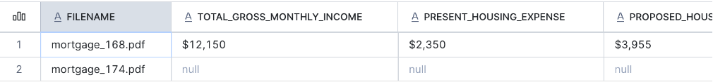

author: Hanna Mykula
id: document-intelligence-ai-functions
language: en
summary: Classify mortgage documents and extract business fields with AI_CLASSIFY and AI_EXTRACT, then parse greenhouse gas bulletins with AI_PARSE_DOCUMENT in AGENTIC mode and answer a question with Cortex Search and AI_COMPLETE, all in SQL inside Snowflake Notebooks.
categories: snowflake-site:taxonomy/solution-center/certification/quickstart, snowflake-site:taxonomy/product/ai, snowflake-site:taxonomy/snowflake-feature/cortex-llm-functions
environments: web
status: Published
feedback link: https://github.com/Snowflake-Labs/sfquickstarts/issues
fork repo link: https://github.com/Snowflake-Labs/sfquickstarts
open in snowflake: https://docs.snowflake.com/en/user-guide/snowflake-cortex/ai-documents

# From PDFs to Pipelines: Document Intelligence with Cortex AI Functions

*A hands-on lab with Snowflake Cortex AI Functions*
<!--
AUTHOR CHECKS:
The SQL has been run in the notebooks, but outputs should be rehearsed in a clean account before publishing.
Use actual captured outputs for screenshots; the placeholders are not result claims.
Confirm that every distributed PDF is approved for public use and redistribution.
The 45-minute allocation is a facilitation target, not a measured inference-time claim.
Native AI_EXTRACT citations are intentionally outside this version of the guide.
-->
<!-- ------------------------ -->
## Overview
Total Duration: ~45 minutes

Documents contain information teams need in two forms: selected fields for operational workflows and searchable content for research and review. Snowflake Cortex AI Functions let you process both from SQL.

This lab has two independent tracks, each in its own notebook:

- **Part A, mortgage (~25 minutes):** Classify eleven mortgage-document PDFs with `AI_CLASSIFY`, extract fields from the supported page types with `AI_EXTRACT`, and review each result.
- **Part B, greenhouse reports (~20 minutes):** Parse three WMO greenhouse gas bulletins with `AI_PARSE_DOCUMENT` in AGENTIC mode, index their text, visual summaries, and chart details with Cortex Search, and answer a question about Amazon fire CO₂ with `AI_COMPLETE`.

### Prerequisites
- Familiarity with SQL, including SELECT statements, joins, and table creation
- Basic understanding of Snowflake stages and JSON field access

### What You'll Learn
- How to classify documents and route each supported type to an extraction schema
- How to extract business fields from PDFs and review blank or placeholder values
- How to parse reports in AGENTIC mode and index text, visual summaries, and chart details
- How to answer a question from retrieved passages, with citations to the page and source type

### What You'll Need
- A [Snowflake account](https://signup.snowflake.com/) with access to [Cortex AI Functions](https://docs.snowflake.com/en/user-guide/snowflake-cortex/aisql), AI_PARSE_DOCUMENT in AGENTIC mode, and Cortex Search; confirm approved [cross-region inference](https://docs.snowflake.com/en/user-guide/snowflake-cortex/cross-region-inference) before starting
- A role with privileges to create a database, schema, internal stages, tables, and a Cortex Search service, plus access to a running warehouse
- Access to [Snowflake Notebooks in Workspaces](https://docs.snowflake.com/en/user-guide/ui-snowsight/notebooks-in-workspaces/notebooks-in-workspaces-overview), or a SQL worksheet
- The [mortgage document collection](https://github.com/sfc-gh-hmykula/sfquickstarts-fork/blob/hmykula-ai-functions-doc-intelligence/site/sfguides/src/document-intelligence-ai-functions/assets/mortgage_docs.zip) and the [greenhouse report collection](https://github.com/sfc-gh-hmykula/sfquickstarts-fork/blob/hmykula-ai-functions-doc-intelligence/site/sfguides/src/document-intelligence-ai-functions/assets/greenhouse_report.zip)

### What You'll Build
- Part A: one result row per mortgage PDF, with its document type, extracted fields, processing status, and review reason
- Part B: a Cortex Search index over three greenhouse bulletins, and a cited answer to a question about Amazon fire CO₂ in 2016 and 2024

The two tracks are independent. Parsing is not a prerequisite for direct-file extraction. This guide does not use native extraction citations or make loan-approval or borrower-eligibility decisions.

<!-- ------------------------ -->
## Setup
Duration: 5 minutes

### Import the Notebooks

1. Download [vhol_document_ai_mortgage.ipynb](https://github.com/sfc-gh-hmykula/sfquickstarts-fork/blob/hmykula-ai-functions-doc-intelligence/site/sfguides/src/document-intelligence-ai-functions/assets/vhol_document_ai_mortgage.ipynb) and [vhol_document_ai_greenhouse_reports.ipynb](https://github.com/sfc-gh-hmykula/sfquickstarts-fork/blob/hmykula-ai-functions-doc-intelligence/site/sfguides/src/document-intelligence-ai-functions/assets/vhol_document_ai_greenhouse_reports.ipynb). For GitHub-hosted notebooks, select **Download raw file**.
2. In Snowsight, go to **Projects > Workspaces**.
3. Click **+ Add new > Upload files** and select each downloaded `.ipynb` file.
4. Open a notebook and select an available warehouse and a role with the privileges listed above.

Run the first setup cell in each notebook to set the lab context. Each track is self-contained, so you can run either one first. Cleanup is a separate manual step at the end of this guide.

### Set the Lab Context

Each notebook starts with the same context cell. In a shared event account, use the participant-specific database or schema name assigned by the host in place of these defaults.

```sql
CREATE DATABASE IF NOT EXISTS VHOL_DOCUMENT_AI_DB;
CREATE SCHEMA IF NOT EXISTS VHOL_DOCUMENT_AI_DB.DOCUMENT_AI;

USE DATABASE VHOL_DOCUMENT_AI_DB;
USE SCHEMA DOCUMENT_AI;

SELECT CURRENT_ROLE(), CURRENT_DATABASE(), CURRENT_SCHEMA(), CURRENT_WAREHOUSE();
```

<!-- ------------------------ -->
## Part A: Classify and Extract Mortgage Documents
Duration: 25 minutes

This part uses `vhol_document_ai_mortgage.ipynb`. Each step below matches a cell in that notebook.

### Create the Stage

Create an internal stage for the mortgage documents. Directory tables let the workflow discover the uploaded files. Use `SNOWFLAKE_SSE` encryption for the direct-file AI calls; see [CREATE STAGE](https://docs.snowflake.com/en/sql-reference/sql/create-stage) and [AI_CLASSIFY limitations](https://docs.snowflake.com/en/sql-reference/functions/ai_classify#limitations).

```sql
CREATE STAGE IF NOT EXISTS MORTGAGE_DOCS
    ENCRYPTION = (TYPE = 'SNOWFLAKE_SSE')
    DIRECTORY = (ENABLE = TRUE);
```

### Upload the Sample PDFs

1. Download and unzip [mortgage_docs.zip](https://github.com/sfc-gh-hmykula/sfquickstarts-fork/blob/hmykula-ai-functions-doc-intelligence/site/sfguides/src/document-intelligence-ai-functions/assets/mortgage_docs.zip). Upload the individual PDFs, not the ZIP archive.
2. In Snowsight, go to **Ingestion > Add Data > Load files into a Stage**.
3. Select all eleven PDFs and choose **VHOL_DOCUMENT_AI_DB > DOCUMENT_AI > MORTGAGE_DOCS**, then upload them.

| File | Expected route |
|---|---|
| `mortgage_152.pdf` | Citizenship declaration |
| `mortgage_153.pdf` | Citizenship declaration |
| `mortgage_155.pdf` | Non-taxpayer affidavit |
| `mortgage_160.pdf` | Other |
| `mortgage_164.pdf` | Other |
| `mortgage_165.pdf` | Other (a Right to Financial Privacy Act and VA/HUD-FHA notice) |
| `mortgage_168.pdf` | Income and housing expenses |
| `mortgage_170.pdf` | Assets and transaction details |
| `mortgage_174.pdf` | Settlement charges |
| `mortgage_177.pdf` | Other |
| `mortgage_179.pdf` | Other |

Keep the filenames unchanged. The samples are selected from [RealDoc-Bench, published by Extend-AI on Hugging Face](https://huggingface.co/datasets/Extend-AI/RealDoc-Bench).

See [Staging files using Snowsight](https://docs.snowflake.com/en/user-guide/data-load-local-file-system-stage-ui) for the upload workflow. Then refresh the directory table and confirm the files are visible:

```sql
ALTER STAGE MORTGAGE_DOCS REFRESH;

LIST @MORTGAGE_DOCS;
```

### Select the PDFs

The query keeps every PDF on the stage. Each file is classified, and files that do not match a route are reported as `Other`.

```sql
CREATE OR REPLACE TEMP TABLE MORTGAGE_FILES AS
SELECT
    relative_path,
    SPLIT_PART(relative_path, '/', -1) AS filename,
    size AS file_size_bytes,
    last_modified
FROM DIRECTORY(@MORTGAGE_DOCS)
WHERE relative_path ILIKE '%.pdf';

SELECT * FROM MORTGAGE_FILES ORDER BY relative_path;
```

### Define the Routes

Define one route for each supported page type. The `Other` route has no extraction schema, so those documents go to review without an `AI_EXTRACT` call. The `Citizenship declaration` route extracts three fields from the declaration form.

```sql
CREATE OR REPLACE TEMP TABLE MORTGAGE_ROUTES (
    document_type VARCHAR,
    category_description VARCHAR,
    response_format VARIANT
);

INSERT INTO MORTGAGE_ROUTES
SELECT
    'Non taxpayer affidavit',
    'Affidavit of Non-Taxpayer with selected people, roles, years not filed, county, and notarization.',
    PARSE_JSON($${
  "county": "What county is entered near the top of the affidavit? Return an empty string if blank.",
  "affidavit_date": "What date is written in the Sworn to before me section? Return YYYY-MM-DD, or an empty string if blank. Do not use the notary commission expiration date.",
  "commission_expiration_date": "What is the date after My Commission expires? Return YYYY-MM-DD, or an empty string if blank."
}$$)
UNION ALL
SELECT
    'Income and housing expenses',
    'Residential loan application page with Section V monthly income and combined housing expenses, followed by assets and liabilities.',
    PARSE_JSON($${
  "total_gross_monthly_income": "What is the Total row in the Total column of Gross Monthly Income in Section V? Do not use Monthly Income in Employment Information. Return the written amount, or an empty string if blank.",
  "present_housing_expense": "What is the Total row in the Present column of Combined Monthly Housing Expense in Section V? Return the written amount, or an empty string if blank.",
  "proposed_housing_expense": "What is the Total row in the Proposed column of Combined Monthly Housing Expense in Section V? Return the written amount, or an empty string if blank."
}$$)
UNION ALL
SELECT
    'Assets and transaction details',
    'Residential loan application page with asset and liability totals plus Section VII Details of Transaction, including purchase price and loan amount.',
    PARSE_JSON($${
  "total_assets": "What amount is written for Total Assets a in Section VI? Do not use Subtotal Liquid Assets. Return the written amount, or an empty string if blank.",
  "total_liabilities": "What amount is written for Total Liabilities b in Section VI? Return the written amount, or an empty string if blank.",
  "purchase_price": "What amount is written for a. Purchase price in Section VII, Details of Transaction? Return the written amount, or an empty string if blank.",
  "loan_amount": "What amount is written for o. Loan amount (add m and n) in Section VII? Read the written total; do not calculate it. Return an empty string if blank.",
  "cash_from_borrower": "What amount is written for p. Cash from Borrower in Section VII? Return the written amount; do not calculate it. Return an empty string if blank."
}$$)
UNION ALL
SELECT
    'Settlement charges',
    'HUD-1 settlement statement page listing fees and line 1400 borrower and seller settlement charge totals.',
    PARSE_JSON($${
  "borrower_settlement_charges": "What amount is written on line 1400, Total Settlement Charges, in the Paid From Borrower Funds at Settlement column? Read the written total; do not calculate it. Return an empty string if blank.",
  "seller_settlement_charges": "What amount is written on line 1400, Total Settlement Charges, in the Paid From Seller Funds at Settlement column? Read the written total; do not calculate it. Return an empty string if blank.",
  "appraisal_fee": "What appraisal fee is written on line 804? Return the amount shown, or an empty string if blank.",
  "credit_report_fee": "What credit report fee is written on line 805? Return the amount shown, or an empty string if blank."
}$$)
UNION ALL
SELECT
    'Citizenship declaration',
    'Declaration of Citizenship Status form with numbered blocks 1, 2, and 3 for citizenship status, followed by a signature and date.',
    PARSE_JSON($${
  "declarant_name": "What name is printed after I, at the top of the declaration? Return the printed name as written, or an empty string if blank.",
  "citizenship_status": "Which status block is checked? Return exactly one of: U.S. citizen; Noncitizen with eligible immigration status; Not contending eligible immigration status. Return an empty string if no block is checked.",
  "signature_date": "What date is written next to the signature? The date on this form is in MM/DD/YYYY format. Return YYYY-MM-DD, or an empty string if blank."
}$$)
UNION ALL
SELECT
    'Other',
    'Any other document, including notices and disclosures such as the Right to Financial Privacy Act notice or VA and HUD/FHA borrower notices, government program agreement summaries, and property insurance rating or underwriting forms. Choose Other for notice or disclosure text even when it appears alongside a loan application.',
    NULL::VARIANT;
```

### Classify Each PDF

Build the category list from the routes and classify each PDF. The final `TRUE` returns error details in the result instead of failing the query. Compare the assigned types with the document headings. `mortgage_152.pdf` and `mortgage_153.pdf` should route to `Citizenship declaration`, and `mortgage_177.pdf` should route to `Other`. The filename is not supplied to the classifier as evidence.

```sql
CREATE OR REPLACE TEMP TABLE MORTGAGE_CLASSIFIED AS
WITH categories AS (
    SELECT ARRAY_AGG(
        OBJECT_CONSTRUCT('label', document_type, 'description', category_description)
    ) WITHIN GROUP (ORDER BY document_type) AS categories
    FROM MORTGAGE_ROUTES
),
classified AS (
    SELECT
        f.relative_path,
        f.filename,
        AI_CLASSIFY(
            TO_FILE('@MORTGAGE_DOCS', f.relative_path),
            c.categories,
            {
                'task_description': 'Classify the supplied document page by its visible headings and sections. Distinguish loan application pages by section content. Use Other when none of the defined form types matches. Do not use the filename as evidence.',
                'output_mode': 'single'
            },
            TRUE  -- returns error details instead of failing the query
        ) AS raw_classification
    FROM MORTGAGE_FILES AS f
    CROSS JOIN categories AS c
)
SELECT
    relative_path,
    filename,
    NULLIF(raw_classification:value:labels[0]::VARCHAR, 'null') AS document_type,
    NULLIF(NULLIF(TRIM(raw_classification:error::VARCHAR), ''), 'null') AS classification_error
FROM classified;

SELECT filename, document_type, classification_error
FROM MORTGAGE_CLASSIFIED
ORDER BY filename;
```


### Extract Business Fields

Route each classified document to its extraction schema and call `AI_EXTRACT` on the original PDF. Unsupported types and classification errors are skipped.

```sql
CREATE OR REPLACE TEMP TABLE MORTGAGE_EXTRACTED AS
WITH extraction_raw AS (
    SELECT
        c.relative_path,
        c.filename,
        c.document_type,
        AI_EXTRACT(
            file => TO_FILE('@MORTGAGE_DOCS', c.relative_path),
            responseFormat => r.response_format
        ) AS raw_extraction
    FROM MORTGAGE_CLASSIFIED AS c
    JOIN MORTGAGE_ROUTES AS r ON c.document_type = r.document_type
    WHERE c.classification_error IS NULL
      AND r.response_format IS NOT NULL
)
SELECT
    relative_path,
    filename,
    document_type,
    raw_extraction:response AS extracted_data,
    NULLIF(NULLIF(TRIM(raw_extraction:error::VARCHAR), ''), 'null') AS extraction_error
FROM extraction_raw;

SELECT filename, document_type, extracted_data, extraction_error
FROM MORTGAGE_EXTRACTED
ORDER BY filename;
```

### Review the Results

Each document gets one processing status. A field is flagged for review when it is blank, null, or a placeholder such as `unknown`. A citizenship status outside the three allowed options is also flagged. This check does not verify that values are correct.

- `EXTRACTED`: the call succeeded, no field is blank, and any citizenship status is one of the three allowed options
- `FIELD_REVIEW`: at least one field is blank, or a citizenship status is outside the three allowed options
- `UNSUPPORTED_DOCUMENT`: no extraction schema exists for this type
- `CLASSIFICATION_ERROR` or `EXTRACTION_ERROR`: the call returned an error

```sql
CREATE OR REPLACE TEMP TABLE MORTGAGE_RESULTS AS
WITH blank_fields AS (
    SELECT
        e.relative_path,
        LISTAGG(f.key, ', ') WITHIN GROUP (ORDER BY f.key) AS blank_fields
    FROM MORTGAGE_EXTRACTED AS e,
         LATERAL FLATTEN(INPUT => e.extracted_data) AS f
    WHERE NULLIF(TRIM(f.value::VARCHAR), '') IS NULL
       OR LOWER(TRIM(f.value::VARCHAR)) IN ('null', 'none', 'unknown', 'n/a')
    GROUP BY e.relative_path
)
SELECT
    c.filename,
    c.document_type,
    CASE
        WHEN c.classification_error IS NOT NULL THEN 'CLASSIFICATION_ERROR'
        WHEN r.response_format IS NULL THEN 'UNSUPPORTED_DOCUMENT'
        WHEN e.extraction_error IS NOT NULL OR e.extracted_data IS NULL THEN 'EXTRACTION_ERROR'
        WHEN b.blank_fields IS NOT NULL THEN 'FIELD_REVIEW'
        WHEN c.document_type = 'Citizenship declaration'
             AND NOT COALESCE(
                 (e.extracted_data:citizenship_status::VARCHAR) IN (
                     'U.S. citizen',
                     'Noncitizen with eligible immigration status',
                     'Not contending eligible immigration status'
                 ), FALSE)
            THEN 'FIELD_REVIEW'
        ELSE 'EXTRACTED'
    END AS processing_status,
    b.blank_fields,
    e.extracted_data
FROM MORTGAGE_CLASSIFIED AS c
LEFT JOIN MORTGAGE_ROUTES AS r ON c.document_type = r.document_type
LEFT JOIN MORTGAGE_EXTRACTED AS e ON c.relative_path = e.relative_path
LEFT JOIN blank_fields AS b ON c.relative_path = b.relative_path;

SELECT filename, document_type, processing_status, blank_fields, extracted_data
FROM MORTGAGE_RESULTS
ORDER BY processing_status, filename;
```

`EXTRACTED` means the call succeeded and no field is blank. It does not establish accuracy, completeness, or borrower eligibility. Check sample values against the source pages.

### Check Values Against the Source PDFs

The query below returns the extracted values as text. Compare them with the source pages. The values in the table are the ones read from the sample PDFs.

| Source | Field | Source value |
|---|---|---:|
| `mortgage_168.pdf` | Section V total gross monthly income | 12,150 |
| `mortgage_168.pdf` | Present housing expense | 2,350 |
| `mortgage_168.pdf` | Proposed housing expense | 3,955 |
| `mortgage_174.pdf` | Borrower settlement charges, line 1400 | 21,539 |
| `mortgage_174.pdf` | Seller settlement charges, line 1400 | 44,780 |

```sql
SELECT
    filename,
    extracted_data:total_gross_monthly_income::VARCHAR AS total_gross_monthly_income,
    extracted_data:present_housing_expense::VARCHAR AS present_housing_expense,
    extracted_data:proposed_housing_expense::VARCHAR AS proposed_housing_expense,
    extracted_data:borrower_settlement_charges::VARCHAR AS borrower_settlement_charges,
    extracted_data:seller_settlement_charges::VARCHAR AS seller_settlement_charges
FROM MORTGAGE_RESULTS
WHERE filename IN ('mortgage_168.pdf', 'mortgage_174.pdf');
```



> **Try it:** Refine the descriptions for the income-and-expenses and assets-and-transaction pages, then re-run the classification cell and compare the results. Re-running model calls can incur additional usage.

<!-- ------------------------ -->
## Part B: Parse and Search Greenhouse Reports
Duration: 20 minutes

This part uses `vhol_document_ai_greenhouse_reports.ipynb`. Each step below matches a cell in that notebook. The three bulletins come from `greenhouse_report.zip`.

### Create the Stage

Create an internal stage for the greenhouse bulletins. Directory tables let the workflow discover the uploaded files.

```sql
CREATE STAGE IF NOT EXISTS GHG_REPORTS
    ENCRYPTION = (TYPE = 'SNOWFLAKE_SSE')
    DIRECTORY = (ENABLE = TRUE);
```

### Upload the PDFs

1. Download and unzip [greenhouse_report.zip](https://github.com/sfc-gh-hmykula/sfquickstarts-fork/blob/hmykula-ai-functions-doc-intelligence/site/sfguides/src/document-intelligence-ai-functions/assets/greenhouse_report.zip). Upload the individual PDFs, not the ZIP archive.
2. In Snowsight, go to **Ingestion > Add Data > Load files into a Stage** and upload the three PDFs to `GHG_REPORTS`: `GHG-20_en.pdf`, `GHG-21_en.pdf`, and `GHG-22_en.pdf`.
3. Refresh the directory table and confirm all three files are listed:

```sql
ALTER STAGE GHG_REPORTS REFRESH;

LIST @GHG_REPORTS;
```

### Register the Bulletins

The bulletin number is read from the `GHG-NN` part of each filename. The query should return three rows: bulletins 20, 21, and 22.

```sql
CREATE OR REPLACE TEMP TABLE GHG_FILES AS
SELECT
    relative_path,
    SPLIT_PART(relative_path, '/', -1) AS filename,
    REGEXP_SUBSTR(relative_path, 'GHG-([0-9]+)', 1, 1, 'e', 1) AS bulletin,
    size AS file_size_bytes,
    last_modified
FROM DIRECTORY(@GHG_REPORTS)
WHERE relative_path ILIKE '%.pdf';

SELECT * FROM GHG_FILES ORDER BY bulletin;
```

### Parse the Bulletins with AGENTIC Mode

`AI_PARSE_DOCUMENT` in AGENTIC mode returns page text and a visual interpretation for each image. `page_split` returns one record per page. The final `TRUE` returns error details in the result instead of failing the query.

This step calls the model for each bulletin and can take several minutes.

```sql
CREATE OR REPLACE TEMP TABLE GHG_PARSED AS
SELECT
    relative_path,
    filename,
    bulletin,
    AI_PARSE_DOCUMENT(
        TO_FILE('@GHG_REPORTS', relative_path),
        {'mode': 'AGENTIC', 'page_split': TRUE},
        TRUE
    ) AS raw_parse
FROM GHG_FILES;

SELECT
    filename,
    bulletin,
    ARRAY_SIZE(raw_parse:value:pages) AS returned_pages,
    raw_parse:error AS call_error,
    raw_parse:value:error AS document_error
FROM GHG_PARSED
ORDER BY bulletin;
```

### Split Pages, Visual Summaries, and Chart Details

The parsed output is split into one row per page and one row per image. Images that return an error are skipped. Each image's structured details are kept so the chart series can be indexed.

```sql
CREATE OR REPLACE TEMP TABLE GHG_PAGES AS
SELECT
    r.relative_path,
    r.filename,
    r.bulletin,
    p.value:index::NUMBER + 1 AS pdf_page_number,
    p.value:content::VARCHAR AS page_content,
    p.value:images AS images
FROM GHG_PARSED AS r,
     LATERAL FLATTEN(INPUT => r.raw_parse:value:pages) AS p
WHERE NULLIF(r.raw_parse:error::VARCHAR, 'null') IS NULL;

CREATE OR REPLACE TEMP TABLE GHG_VISUALS AS
SELECT
    p.relative_path,
    p.filename,
    p.bulletin,
    p.pdf_page_number,
    i.index AS image_index,
    i.value:results:image_type::VARCHAR AS image_type,
    i.value:results:summary::VARCHAR AS summary,
    i.value:results:details AS details
FROM GHG_PAGES AS p,
     LATERAL FLATTEN(INPUT => p.images) AS i
WHERE NULLIF(TRIM(i.value:results:summary::VARCHAR), '') IS NOT NULL
  AND COALESCE(LOWER(i.value:results:description::VARCHAR), '') <> 'error';

SELECT bulletin, COUNT(*) AS pages FROM GHG_PAGES GROUP BY bulletin ORDER BY bulletin;

SELECT bulletin, COUNT(*) AS visuals_with_summary FROM GHG_VISUALS GROUP BY bulletin ORDER BY bulletin;
```

### Check the Chart Details for Bulletin 21, Page 6

Page 6 of bulletin 21 has the Amazon CO₂ chart. The query shows each image on that page with its summary and chart details, and counts the chart details that mention both 2016 and 2024. Those values are read from the chart, so they are estimates. If the details do not include the years you need, the answer relies on the printed text instead.

```sql
SELECT
    pdf_page_number,
    image_index,
    image_type,
    summary,
    LEFT(TO_JSON(details), 1200) AS details_preview
FROM GHG_VISUALS
WHERE bulletin = '21'
  AND pdf_page_number = 6
ORDER BY image_index;

SELECT
    COUNT(*) AS details_mention_2016_and_2024
FROM GHG_VISUALS
WHERE bulletin = '21'
  AND pdf_page_number = 6
  AND TO_JSON(details) LIKE '%2016%'
  AND TO_JSON(details) LIKE '%2024%';
```

### Build the Search Content

Index three kinds of content: the page text, the visual summaries, and the chart details. Each chunk repeats its bulletin number, PDF page, and content type, so a search can be restricted to one bulletin and traced back to its page.

```sql
CREATE OR REPLACE TEMP TABLE GHG_SEARCH_UNITS AS
SELECT relative_path, filename, bulletin, pdf_page_number,
       'text'::VARCHAR AS content_type,
       page_content AS body
FROM GHG_PAGES
WHERE NULLIF(TRIM(page_content), '') IS NOT NULL
UNION ALL
SELECT relative_path, filename, bulletin, pdf_page_number,
       'visual_summary'::VARCHAR AS content_type,
       summary AS body
FROM GHG_VISUALS
UNION ALL
SELECT
    v.relative_path,
    v.filename,
    v.bulletin,
    v.pdf_page_number,
    'visual_details'::VARCHAR AS content_type,
    LISTAGG(d.path || ': ' || d.value::VARCHAR, '\n') WITHIN GROUP (ORDER BY d.path) AS body
FROM GHG_VISUALS AS v,
     LATERAL FLATTEN(INPUT => v.details, RECURSIVE => TRUE) AS d
WHERE TYPEOF(d.value) NOT IN ('OBJECT', 'ARRAY', 'NULL_VALUE')
  AND d.path NOT LIKE '%value_range%'
  AND d.path NOT LIKE '%value_precision%'
GROUP BY v.relative_path, v.filename, v.bulletin, v.pdf_page_number, v.image_index;

CREATE OR REPLACE TABLE GHG_SEARCH_CHUNKS
    DATA_RETENTION_TIME_IN_DAYS = 1 AS
SELECT
    MD5(u.relative_path || '|' || u.pdf_page_number::VARCHAR || '|' ||
        u.content_type || '|' || c.index::VARCHAR) AS chunk_id,
    u.relative_path,
    u.filename,
    u.bulletin,
    u.pdf_page_number,
    u.content_type,
    'Report: WMO Greenhouse Gas Bulletin No. ' || u.bulletin ||
    '. PDF page: ' || u.pdf_page_number::VARCHAR ||
    '. Content: ' || u.content_type || CHR(10) || c.value::VARCHAR AS search_text
FROM GHG_SEARCH_UNITS AS u,
     LATERAL FLATTEN(INPUT => SNOWFLAKE.CORTEX.SPLIT_TEXT_RECURSIVE_CHARACTER(
         u.body, 'markdown', 1400, 150
     )) AS c
WHERE NULLIF(TRIM(c.value::VARCHAR), '') IS NOT NULL;

ALTER TABLE GHG_SEARCH_CHUNKS SET CHANGE_TRACKING = TRUE;

SELECT bulletin, content_type, COUNT(*) AS chunks
FROM GHG_SEARCH_CHUNKS
GROUP BY bulletin, content_type
ORDER BY bulletin, content_type;
```

### Create the Cortex Search Service

The service uses the warehouse selected in the notebook and filters on bulletin, content type, and filename. The index builds after creation, which can take a short time. If the retrieval below returns nothing right away, wait a minute and run the DESCRIBE statement again to check that `indexing_state` is `ACTIVE`.

```sql
-- Replaces only the Search service created by this notebook.
DROP CORTEX SEARCH SERVICE IF EXISTS GHG_BULLETIN_SEARCH;

EXECUTE IMMEDIATE $$
DECLARE
    wh VARCHAR DEFAULT CURRENT_WAREHOUSE();
    ddl VARCHAR;
    missing_warehouse EXCEPTION (-20001, 'Select a lab warehouse before creating Search.');
BEGIN
    IF (wh IS NULL) THEN
        RAISE missing_warehouse;
    END IF;
    ddl := 'CREATE OR REPLACE CORTEX SEARCH SERVICE GHG_BULLETIN_SEARCH '
        || 'ON search_text ATTRIBUTES bulletin, content_type, filename '
        || 'WAREHOUSE = "' || REPLACE(wh, '"', '""') || '" '
        || 'TARGET_LAG = ''1 hour'' INITIALIZE = ON_CREATE '
        || 'AS SELECT chunk_id, search_text, relative_path, filename, '
        || 'bulletin, pdf_page_number, content_type FROM GHG_SEARCH_CHUNKS';
    EXECUTE IMMEDIATE :ddl;
    RETURN 'Created GHG_BULLETIN_SEARCH.';
END;
$$;

DESCRIBE CORTEX SEARCH SERVICE GHG_BULLETIN_SEARCH;
```

### Retrieve Passages for the Question

The question is searched within bulletin 21 only. Each passage is shown with the chart details from the same page, so the chart series reach the answer step.

```sql
WITH hits AS (
    SELECT
        r.value:FILENAME::VARCHAR AS filename,
        r.value:BULLETIN::VARCHAR AS bulletin,
        r.value:PDF_PAGE_NUMBER::NUMBER AS pdf_page_number,
        r.value:CONTENT_TYPE::VARCHAR AS content_type,
        r.value:SEARCH_TEXT::VARCHAR AS passage
    FROM (
        SELECT PARSE_JSON(SNOWFLAKE.CORTEX.SEARCH_PREVIEW(
            'GHG_BULLETIN_SEARCH',
            '{"query": "Amazon fire CO2 emissions in 2016 and 2024", "columns": ["SEARCH_TEXT", "FILENAME", "BULLETIN", "PDF_PAGE_NUMBER", "CONTENT_TYPE"], "filter": {"@eq": {"BULLETIN": "21"}}, "limit": 6}'
        )) AS response
    ) AS s,
    LATERAL FLATTEN(INPUT => s.response:results) AS r
),
details AS (
    SELECT bulletin, pdf_page_number, LISTAGG(search_text, '\n') WITHIN GROUP (ORDER BY chunk_id) AS chart_details
    FROM GHG_SEARCH_CHUNKS
    WHERE content_type = 'visual_details'
    GROUP BY bulletin, pdf_page_number
)
SELECT h.filename, h.bulletin, h.pdf_page_number, h.content_type, h.passage, d.chart_details
FROM hits AS h
LEFT JOIN details AS d
  ON d.bulletin = h.bulletin
 AND d.pdf_page_number = h.pdf_page_number
ORDER BY h.pdf_page_number;
```

### Answer the Question with AI_COMPLETE

The answer step passes the retrieved passages and chart details to `claude-sonnet-5-5`. The model compares fire CO₂ emissions in 2016 and 2024, cites each claim by bulletin, PDF page, and source type (text, visual summary, or visual details), and says when a value comes from a chart description rather than printed text.

```sql
WITH context AS (
    SELECT
        LISTAGG(
            'Bulletin ' || bulletin || ', PDF page ' || pdf_page_number::VARCHAR || ' (' || content_type || '):\n' || passage ||
            IFF(chart_details IS NULL, '', '\nChart details for page ' || pdf_page_number::VARCHAR || ':\n' || chart_details),
            '\n---\n'
        ) WITHIN GROUP (ORDER BY pdf_page_number) AS passages
    FROM {{ghg_hits}}
)
SELECT AI_COMPLETE(
    'claude-sonnet-5-5',
    'You answer questions about WMO greenhouse gas bulletins using only the passages below. Question: Compare fire CO2 emissions in 2016 and 2024. Which year is higher, and by roughly how much? Give approximate values and say they are read from charts when they are. Cite each claim as [Bulletin N, PDF page P, source], where source is the content label of the passage you used: text, visual_summary, or visual_details. Say when a value comes from a chart description rather than printed text. If the passages do not contain the answer, say what is missing.\n\nPassages:\n' || passages
) AS answer
FROM context;
```

The answer returned by the notebook looks like this:

> **2024 was higher, nearly double 2016.** Amazon fire CO₂ emissions were approximately 0.79 GtC per year in 2024, compared with 0.40 GtC per year in 2016.
>
> | Year | Estimated fire CO₂ emissions |
> |---|---|
> | 2016 | 0.40 GtC per year |
> | 2024 | 0.79 GtC per year |
> | Difference | +0.39 GtC per year |
>
> Source: Bulletin 21, PDF page 6, visual_details. Values are approximate and derived from the chart.
>
> **Where the values come from.** These estimates come from the chart description of the Fire CO₂ series in Figure 11, which is flagged `values_estimated: true`. They are not exact numbers printed in the text. The chart shows annual Amazon CO₂ emissions from 2010 to 2024, split into Total CO₂, Fire CO₂, and Net Biome Exchange. The 2024 fire peak is also noted in the chart's key values. [Bulletin 21, PDF page 6, visual_summary and visual_details]
>
> **Supporting text**
> - **2024:** The printed text states that both total and fire CO₂ emissions in the Amazon were highest in 2024, associated with low precipitation and high temperatures. This supports the comparison but provides no numerical values. [Bulletin 21, PDF page 6, text]
> - **2015–2016:** The text also identifies this as a period of higher CO₂ emissions, linked to El Niño and North Atlantic warming. However, the chart-derived estimate for fire emissions in 2016 remains well below the estimate for 2024. [Bulletin 21, PDF page 6, text and visual_details]
>
> **Caveats**
> - Fire CO₂ and Total CO₂ are different series. The estimated Total CO₂ values are approximately 0.58 GtC per year in 2016 and 0.75 GtC per year in 2024. These should not be confused with the fire-emissions values above. [Bulletin 21, PDF page 6, visual_details]
> - No exact printed values or uncertainty ranges are provided for fire CO₂ emissions in either year.

<!-- ------------------------ -->
## Cleanup
Duration: 1 minute

Both tracks create their objects in `VHOL_DOCUMENT_AI_DB`. Dropping the database removes everything the lab created: the mortgage and greenhouse stages and their uploaded PDFs, the Cortex Search service, and the tables.

```sql
DROP DATABASE IF EXISTS VHOL_DOCUMENT_AI_DB;
```

Do not run this against a shared event database. In a shared account, ask the host which objects you can remove.

<!-- ------------------------ -->
## Conclusion And Resources
Duration: 1 minute

You classified mortgage pages and extracted fields from the supported types, including the citizenship declarations. You also parsed greenhouse gas bulletins with AGENTIC mode, indexed their text, visual summaries, and chart details, and answered a question with citations to the bulletin, page, and source type.

Use **AI_CLASSIFY** to select a processing route, **AI_EXTRACT** for selected business fields, **AI_PARSE_DOCUMENT** for reusable document content and interpretation, and **Cortex Search** with **AI_COMPLETE** to answer from the saved content.

### What You Learned
- How to classify document pages and select a type-specific extraction schema
- How to extract values from the original PDFs, review blank or placeholder values, and flag unexpected statuses
- How to parse reports in AGENTIC mode and index their text, visual summaries, and chart details
- How to answer a question from retrieved passages, with citations to the page and source type

### Dataset Sources
- [Extend-AI / RealDoc-Bench - mortgage document source](https://huggingface.co/datasets/Extend-AI/RealDoc-Bench)
- [WMO greenhouse gas bulletins - greenhouse report source](https://github.com/sfc-gh-hmykula/sfquickstarts-fork/blob/hmykula-ai-functions-doc-intelligence/site/sfguides/src/document-intelligence-ai-functions/assets/greenhouse_report.zip)

### Related Resources
- [Mortgage notebook used in Part A](https://github.com/sfc-gh-hmykula/sfquickstarts-fork/blob/hmykula-ai-functions-doc-intelligence/site/sfguides/src/document-intelligence-ai-functions/assets/vhol_document_ai_mortgage.ipynb)
- [Greenhouse reports notebook used in Part B](https://github.com/sfc-gh-hmykula/sfquickstarts-fork/blob/hmykula-ai-functions-doc-intelligence/site/sfguides/src/document-intelligence-ai-functions/assets/vhol_document_ai_greenhouse_reports.ipynb)
- [Mortgage document collection](https://github.com/sfc-gh-hmykula/sfquickstarts-fork/blob/hmykula-ai-functions-doc-intelligence/site/sfguides/src/document-intelligence-ai-functions/assets/mortgage_docs.zip)
- [Greenhouse report collection](https://github.com/sfc-gh-hmykula/sfquickstarts-fork/blob/hmykula-ai-functions-doc-intelligence/site/sfguides/src/document-intelligence-ai-functions/assets/greenhouse_report.zip)
- [AI_CLASSIFY](https://docs.snowflake.com/en/sql-reference/functions/ai_classify)
- [AI_EXTRACT](https://docs.snowflake.com/en/sql-reference/functions/ai_extract)
- [AI_PARSE_DOCUMENT](https://docs.snowflake.com/en/sql-reference/functions/ai_parse_document)
- [Parsing documents](https://docs.snowflake.com/en/user-guide/snowflake-cortex/parse-document)
- [Cortex Search](https://docs.snowflake.com/en/user-guide/snowflake-cortex/cortex-search/cortex-search-overview)
- [Snowflake Cortex AI Functions](https://docs.snowflake.com/en/user-guide/snowflake-cortex/aisql)
- [SEARCH_PREVIEW](https://docs.snowflake.com/en/sql-reference/functions/search_preview-snowflake-cortex)
