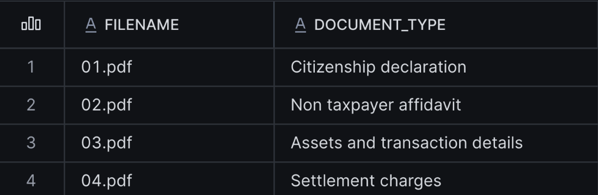
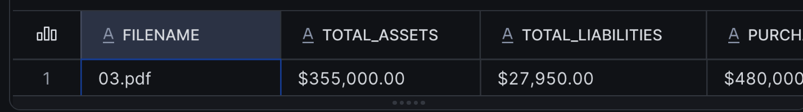
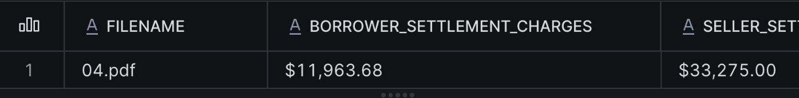

author: Hanna Mykula
id: document-intelligence-ai-functions
language: en
summary: Classify mortgage documents and extract business fields with AI_CLASSIFY and AI_EXTRACT, then parse a greenhouse gas report with AI_PARSE_DOCUMENT in AGENTIC mode and answer a question with Cortex Search and AI_COMPLETE, all in SQL inside Snowflake Notebooks.
categories: snowflake-site:taxonomy/solution-center/certification/quickstart, snowflake-site:taxonomy/product/ai, snowflake-site:taxonomy/snowflake-feature/cortex-llm-functions
environments: web
status: Published
feedback link: https://github.com/Snowflake-Labs/sfquickstarts/issues
fork repo link: https://github.com/Snowflake-Labs/sfquickstarts

# From PDFs to Pipelines: Document Intelligence with Cortex AI Functions
<!-- ------------------------ -->
## Overview

Documents contain information teams need in two forms: selected fields for operational workflows and searchable content for research and review. Snowflake Cortex AI Functions let you process both from SQL.

This lab has two independent tracks, each in its own notebook:

- **Part A, mortgage (~25 minutes):** Classify four synthetic mortgage-document PDFs with `AI_CLASSIFY`, extract fields from the supported page types with `AI_EXTRACT`, and review each result.
- **Part B, greenhouse report (~20 minutes):** Parse a greenhouse gas report with `AI_PARSE_DOCUMENT` in AGENTIC mode, index its text, visual summaries, and chart details with Cortex Search, and answer a question about regional CO₂ emissions with `AI_COMPLETE`.

### Prerequisites
- Familiarity with SQL, including SELECT statements, joins, and table creation
- Basic understanding of Snowflake stages and JSON field access

### What You'll Learn
- How to classify documents and route each supported type to an extraction schema
- How to extract business fields from PDFs and review blank or placeholder values
- How to parse reports in AGENTIC mode and index text, visual summaries, and chart details
- How to answer a question from retrieved passages, with citations to the page and source type

### What You'll Need
- A [Snowflake account](https://signup.snowflake.com/?utm_source=snowflake-devrel&utm_medium=developer-guides&utm_cta=developer-guides) with access to [Cortex AI Functions](https://docs.snowflake.com/en/user-guide/snowflake-cortex/aisql), AI_PARSE_DOCUMENT in AGENTIC mode, and Cortex Search; confirm approved [cross-region inference](https://docs.snowflake.com/en/user-guide/snowflake-cortex/cross-region-inference) before starting
- A role with privileges to create a database, schema, internal stages, tables, and a Cortex Search service, plus access to a running warehouse
- Access to [Snowflake Notebooks in Workspaces](https://docs.snowflake.com/en/user-guide/ui-snowsight/notebooks-in-workspaces/notebooks-in-workspaces-overview), or a SQL worksheet
- The [mortgage sample PDFs](https://github.com/Snowflake-Labs/sfquickstarts/blob/master/site/sfguides/src/document-intelligence-ai-functions/assets/mortgage_reports.zip) (`mortgage_reports.zip`) and [greenhouse_gas_report_2024.pdf](https://github.com/Snowflake-Labs/sfquickstarts/blob/master/site/sfguides/src/document-intelligence-ai-functions/assets/greenhouse_gas_report_2024.pdf)

### What You'll Build
- Part A: one result row per mortgage PDF, with its document type, extracted fields, processing status, and review reason
- Part B: a Cortex Search index over one greenhouse gas report, and a cited answer about annual regional CO₂ emissions between 2020 and 2023

The two tracks are independent. Parsing is not a prerequisite for direct-file extraction. This guide does not use native extraction citations or make loan-approval or borrower-eligibility decisions.

<!-- ------------------------ -->
## Setup
Duration: 5 minutes

### Import the Notebooks

1. Download [vhol_document_ai_mortgage.ipynb](https://github.com/Snowflake-Labs/sfquickstarts/blob/master/site/sfguides/src/document-intelligence-ai-functions/assets/vhol_document_ai_mortgage.ipynb) and [vhol_document_ai_greenhouse_reports.ipynb](https://github.com/Snowflake-Labs/sfquickstarts/blob/master/site/sfguides/src/document-intelligence-ai-functions/assets/vhol_document_ai_greenhouse_reports.ipynb). For GitHub-hosted notebooks, select **Download raw file**.
2. In Snowsight, go to **Projects > Workspaces**.
3. Click **+ Add new > Upload files** and select each downloaded `.ipynb` file.
4. Open a notebook and select an available warehouse and a role with the privileges listed above.

Run the first setup cell in each notebook to set the lab context. Each track is self-contained, so you can run either one first. Cleanup is a separate manual step at the end of this guide.

### Set the Lab Context

Each notebook starts with the same context cell. In a shared event account, use the participant-specific database or schema name assigned by the host in place of these defaults.

```sql
CREATE DATABASE IF NOT EXISTS VHOL_DOCUMENT_AI_DB;
CREATE SCHEMA IF NOT EXISTS VHOL_DOCUMENT_AI_DB.DOCUMENT_AI;

USE DATABASE VHOL_DOCUMENT_AI_DB;
USE SCHEMA DOCUMENT_AI;

SELECT CURRENT_ROLE(), CURRENT_DATABASE(), CURRENT_SCHEMA(), CURRENT_WAREHOUSE();
```

<!-- ------------------------ -->
## Classify Mortgage Documents
Duration: 25 minutes

This part uses `vhol_document_ai_mortgage.ipynb`. Each step below matches a cell in that notebook.

### Create the Stage

Create an internal stage for the mortgage documents. Directory tables let the workflow discover the uploaded files. Use `SNOWFLAKE_SSE` encryption for the direct-file AI calls; see [CREATE STAGE](https://docs.snowflake.com/en/sql-reference/sql/create-stage) and [AI_CLASSIFY limitations](https://docs.snowflake.com/en/sql-reference/functions/ai_classify#limitations).

```sql
CREATE STAGE IF NOT EXISTS MORTGAGE_DOCS
    ENCRYPTION = (TYPE = 'SNOWFLAKE_SSE')
    DIRECTORY = (ENABLE = TRUE);
```

### Upload the Sample PDFs

1. Download [mortgage_reports.zip](https://github.com/Snowflake-Labs/sfquickstarts/blob/master/site/sfguides/src/document-intelligence-ai-functions/assets/mortgage_reports.zip) and unzip it. Upload the individual PDFs, not the ZIP archive. For GitHub-hosted files, select **Download raw file**.
2. In Snowsight, go to **Ingestion > Add Data > Load files into a Stage**.
3. Select those four PDFs and choose **VHOL_DOCUMENT_AI_DB > DOCUMENT_AI > MORTGAGE_DOCS**, then upload them.

| File | Document | Expected route |
|---|---|---|
| `01.pdf` | Declaration of Citizenship / Household Status | Citizenship declaration |
| `02.pdf` | Affidavit of Non-Taxpayer / Household Schedule | Non taxpayer affidavit |
| `03.pdf` | Residential Loan Application, pages 1 and 2 | Assets and transaction details |
| `04.pdf` | Settlement Charges / Disbursement Worksheet | Settlement charges |

Keep the filenames unchanged. The four PDFs are synthetic test documents with fictional names, numbers, and signatures.

See [Staging files using Snowsight](https://docs.snowflake.com/en/user-guide/data-load-local-file-system-stage-ui) for the upload workflow. Then refresh the directory table and confirm the files are visible:

```sql
ALTER STAGE MORTGAGE_DOCS REFRESH;

LIST @MORTGAGE_DOCS;
```

### Select the PDFs

The query keeps every PDF on the stage. Each file is classified, and files that do not match a route are reported as `Other`.

```sql
CREATE OR REPLACE TEMP TABLE MORTGAGE_FILES AS
SELECT
    relative_path,
    SPLIT_PART(relative_path, '/', -1) AS filename,
    size AS file_size_bytes,
    last_modified
FROM DIRECTORY(@MORTGAGE_DOCS)
WHERE relative_path ILIKE '%.pdf';

SELECT * FROM MORTGAGE_FILES ORDER BY relative_path;
```

### Define the Routes

Define one route for each supported page type. The `Other` route has no extraction schema, so those documents go to review without an `AI_EXTRACT` call. The `Citizenship declaration` route extracts three fields from the declaration form.

```sql
CREATE OR REPLACE TEMP TABLE MORTGAGE_ROUTES (
    document_type VARCHAR,
    category_description VARCHAR,
    response_format VARIANT
);

INSERT INTO MORTGAGE_ROUTES
SELECT
    'Non taxpayer affidavit',
    'Affidavit of Non-Taxpayer with selected people, roles, years not filed, county, and notarization.',
    PARSE_JSON($${
  "county": "What county is entered near the top of the affidavit? Return an empty string if blank.",
  "affidavit_date": "What date does the notary acknowledgment in Section F give? Return YYYY-MM-DD, or an empty string if blank. Do not use the commission expiration date.",
  "commission_expiration_date": "What date is written as Commission expiration in the notary section? The date is in MM/DD/YYYY format. Return YYYY-MM-DD, or an empty string if blank."
}$$)
UNION ALL
SELECT
    'Assets and transaction details',
    'Residential loan application with Section VII assets and liabilities and Section VIII Details of Transaction, including purchase price, loan proceeds, and cash to close.',
    PARSE_JSON($${
  "total_assets": "What amount is written for TOTAL ASSETS in Section VII? Do not use Liquid Assets Subtotal. Return the written amount, or an empty string if blank.",
  "total_liabilities": "What amount is written for TOTAL LIABILITIES in Section VII, in the Unpaid balance column? Return the written amount, or an empty string if blank.",
  "purchase_price": "What amount is written for line a, Purchase price, in Section VIII, Details of Transaction? Return the written amount, or an empty string if blank.",
  "loan_proceeds": "What amount is written for line d, Loan proceeds, in Section VIII? Read the written amount; do not calculate it. Return an empty string if blank.",
  "cash_to_close": "What amount is written for line g, Cash to close, in Section VIII? Read the written amount; do not calculate it. Return an empty string if blank."
}$$)
UNION ALL
SELECT
    'Settlement charges',
    'Settlement charges worksheet listing fees by line number and line 1400 borrower and seller settlement charge totals.',
    PARSE_JSON($${
  "borrower_settlement_charges": "What amount is written on line 1400, Total Settlement Charges, in the Borrower paid column? Read the written total; do not calculate it. Return an empty string if blank.",
  "seller_settlement_charges": "What amount is written on line 1400, Total Settlement Charges, in the Seller paid column? Read the written total; do not calculate it. Return an empty string if blank.",
  "appraisal_fee": "What appraisal fee is written on line 803? Return the amount shown, or an empty string if blank.",
  "credit_report_fee": "What credit report fee is written on line 804? Return the amount shown, or an empty string if blank."
}$$)
UNION ALL
SELECT
    'Citizenship declaration',
    'Declaration of Citizenship / Household Status form with numbered blocks 1, 2, and 3 in Section II for citizenship status, followed by a signature and date.',
    PARSE_JSON($${
  "declarant_name": "What name is printed after I, at the top of the declaration? Return the printed name as written, or an empty string if blank.",
  "citizenship_status": "Which status block is checked? Return exactly one of: U.S. citizen; Noncitizen with eligible immigration status; Not contending eligible immigration status. Return an empty string if no block is checked.",
  "signature_date": "What date is written next to the signature? The date on this form is in MM/DD/YYYY format. Return YYYY-MM-DD, or an empty string if blank."
}$$)
UNION ALL
SELECT
    'Other',
    'Any other document, including notices and disclosures such as the Right to Financial Privacy Act notice or VA and HUD/FHA borrower notices, government program agreement summaries, and property insurance rating or underwriting forms. Choose Other for notice or disclosure text even when it appears alongside a loan application.',
    NULL::VARIANT;
```

### Classify Each PDF

Build the category list from the routes and classify each PDF. The final `TRUE` returns error details in the result instead of failing the query. Compare the assigned types with the document headings. `01.pdf` should route to `Citizenship declaration`, `02.pdf` to `Non taxpayer affidavit`, `03.pdf` to `Assets and transaction details`, and `04.pdf` to `Settlement charges`. The filename is not supplied to the classifier as evidence.

```sql
CREATE OR REPLACE TEMP TABLE MORTGAGE_CLASSIFIED AS
WITH categories AS (
    SELECT ARRAY_AGG(
        OBJECT_CONSTRUCT('label', document_type, 'description', category_description)
    ) WITHIN GROUP (ORDER BY document_type) AS categories
    FROM MORTGAGE_ROUTES
),
classified AS (
    SELECT
        f.relative_path,
        f.filename,
        AI_CLASSIFY(
            TO_FILE('@MORTGAGE_DOCS', f.relative_path),
            c.categories,
            {
                'task_description': 'Classify the supplied document page by its visible headings and sections. Distinguish loan application pages by section content. Use Other when none of the defined form types matches. Do not use the filename as evidence.',
                'output_mode': 'single'
            },
            TRUE  -- returns error details instead of failing the query
        ) AS raw_classification
    FROM MORTGAGE_FILES AS f
    CROSS JOIN categories AS c
)
SELECT
    relative_path,
    filename,
    NULLIF(raw_classification:value:labels[0]::VARCHAR, 'null') AS document_type,
    NULLIF(NULLIF(TRIM(raw_classification:error::VARCHAR), ''), 'null') AS classification_error
FROM classified;

SELECT filename, document_type, classification_error
FROM MORTGAGE_CLASSIFIED
ORDER BY filename;
```



### Extract Business Fields

Route each classified document to its extraction schema and call `AI_EXTRACT` on the original PDF. Unsupported types and classification errors are skipped.

```sql
CREATE OR REPLACE TEMP TABLE MORTGAGE_EXTRACTED AS
WITH extraction_raw AS (
    SELECT
        c.relative_path,
        c.filename,
        c.document_type,
        AI_EXTRACT(
            file => TO_FILE('@MORTGAGE_DOCS', c.relative_path),
            responseFormat => r.response_format
        ) AS raw_extraction
    FROM MORTGAGE_CLASSIFIED AS c
    JOIN MORTGAGE_ROUTES AS r ON c.document_type = r.document_type
    WHERE c.classification_error IS NULL
      AND r.response_format IS NOT NULL
)
SELECT
    relative_path,
    filename,
    document_type,
    raw_extraction:response AS extracted_data,
    NULLIF(NULLIF(TRIM(raw_extraction:error::VARCHAR), ''), 'null') AS extraction_error
FROM extraction_raw;

SELECT filename, document_type, extracted_data, extraction_error
FROM MORTGAGE_EXTRACTED
ORDER BY filename;
```

### Review the Results

Each document gets one processing status. A field is flagged for review when it is blank, null, or a placeholder such as `unknown`. A citizenship status outside the three allowed options is also flagged. This check does not verify that values are correct.

- `EXTRACTED`: the call succeeded, no field is blank, and any citizenship status is one of the three allowed options
- `FIELD_REVIEW`: at least one field is blank, or a citizenship status is outside the three allowed options
- `UNSUPPORTED_DOCUMENT`: no extraction schema exists for this type
- `CLASSIFICATION_ERROR` or `EXTRACTION_ERROR`: the call returned an error

```sql
CREATE OR REPLACE TEMP TABLE MORTGAGE_RESULTS AS
WITH blank_fields AS (
    SELECT
        e.relative_path,
        LISTAGG(f.key, ', ') WITHIN GROUP (ORDER BY f.key) AS blank_fields
    FROM MORTGAGE_EXTRACTED AS e,
         LATERAL FLATTEN(INPUT => e.extracted_data) AS f
    WHERE NULLIF(TRIM(f.value::VARCHAR), '') IS NULL
       OR LOWER(TRIM(f.value::VARCHAR)) IN ('null', 'none', 'unknown', 'n/a')
    GROUP BY e.relative_path
)
SELECT
    c.filename,
    c.document_type,
    CASE
        WHEN c.classification_error IS NOT NULL THEN 'CLASSIFICATION_ERROR'
        WHEN r.response_format IS NULL THEN 'UNSUPPORTED_DOCUMENT'
        WHEN e.extraction_error IS NOT NULL OR e.extracted_data IS NULL THEN 'EXTRACTION_ERROR'
        WHEN b.blank_fields IS NOT NULL THEN 'FIELD_REVIEW'
        WHEN c.document_type = 'Citizenship declaration'
             AND NOT COALESCE(
                 (e.extracted_data:citizenship_status::VARCHAR) IN (
                     'U.S. citizen',
                     'Noncitizen with eligible immigration status',
                     'Not contending eligible immigration status'
                 ), FALSE)
            THEN 'FIELD_REVIEW'
        ELSE 'EXTRACTED'
    END AS processing_status,
    b.blank_fields,
    e.extracted_data
FROM MORTGAGE_CLASSIFIED AS c
LEFT JOIN MORTGAGE_ROUTES AS r ON c.document_type = r.document_type
LEFT JOIN MORTGAGE_EXTRACTED AS e ON c.relative_path = e.relative_path
LEFT JOIN blank_fields AS b ON c.relative_path = b.relative_path;

SELECT filename, document_type, processing_status, blank_fields, extracted_data
FROM MORTGAGE_RESULTS
ORDER BY processing_status, filename;
```

`EXTRACTED` means the call succeeded and no field is blank. It does not establish accuracy, completeness, or borrower eligibility. Check sample values against the source pages.

### Check Values Against the Source PDFs

The query below returns the extracted values as text. Compare them with the source pages. The values in the table are the ones read from the sample PDFs.

| Source | Field | Source value |
|---|---|---:|
| `03.pdf` | Section VII total assets | 355,000.00 |
| `03.pdf` | Section VII total liabilities, unpaid balance | 27,950.00 |
| `03.pdf` | Section VIII line a, purchase price | 480,000.00 |
| `03.pdf` | Section VIII line d, loan proceeds | 384,000.00 |
| `03.pdf` | Section VIII line g, cash to close | 96,963.68 |
| `04.pdf` | Line 1400, borrower paid | 11,963.68 |
| `04.pdf` | Line 1400, seller paid | 33,275.00 |

```sql
SELECT
    filename,
    extracted_data:total_assets::VARCHAR AS total_assets,
    extracted_data:total_liabilities::VARCHAR AS total_liabilities,
    extracted_data:purchase_price::VARCHAR AS purchase_price,
    extracted_data:loan_proceeds::VARCHAR AS loan_proceeds,
    extracted_data:cash_to_close::VARCHAR AS cash_to_close,
    extracted_data:borrower_settlement_charges::VARCHAR AS borrower_settlement_charges,
    extracted_data:seller_settlement_charges::VARCHAR AS seller_settlement_charges
FROM MORTGAGE_RESULTS
WHERE filename IN ('03.pdf', '04.pdf');
```





> **Try it:** Refine the description for the assets-and-transaction route, then re-run the classification cell and compare the results. Re-running model calls can incur additional usage.

<!-- ------------------------ -->
## Search Greenhouse Reports
Duration: 20 minutes

This part uses `vhol_document_ai_greenhouse_reports.ipynb`. Each step below matches a cell in that notebook. The source is a single synthetic report, `greenhouse_gas_report_2024.pdf`.

### Create the Stage

Create an internal stage for the greenhouse report. Directory tables let the workflow discover the uploaded file.

```sql
CREATE STAGE IF NOT EXISTS GHG_REPORTS
    ENCRYPTION = (TYPE = 'SNOWFLAKE_SSE')
    DIRECTORY = (ENABLE = TRUE);
```

### Upload the PDF

1. Download [greenhouse_gas_report_2024.pdf](https://github.com/Snowflake-Labs/sfquickstarts/blob/master/site/sfguides/src/document-intelligence-ai-functions/assets/greenhouse_gas_report_2024.pdf). For GitHub-hosted files, select **Download raw file**.
2. In Snowsight, go to **Ingestion > Add Data > Load files into a Stage** and upload the PDF to `GHG_REPORTS`.
3. Refresh the directory table and confirm the file is listed:

```sql
ALTER STAGE GHG_REPORTS REFRESH;

LIST @GHG_REPORTS;
```

### Register the Report

The report year is read from the filename. The query returns one row for the 2024 report.

```sql
CREATE OR REPLACE TEMP TABLE GHG_FILES AS
SELECT
    relative_path,
    SPLIT_PART(relative_path, '/', -1) AS filename,
    REGEXP_SUBSTR(SPLIT_PART(relative_path, '/', -1), '(20[0-9]{2})', 1, 1, 'e', 1) AS report_year,
    size AS file_size_bytes,
    last_modified
FROM DIRECTORY(@GHG_REPORTS)
WHERE relative_path ILIKE '%.pdf';

SELECT * FROM GHG_FILES ORDER BY report_year;
```

### Parse the Report with AGENTIC Mode

`AI_PARSE_DOCUMENT` in AGENTIC mode returns page text and a visual interpretation for each image. `page_split` returns one record per page. The final `TRUE` returns error details in the result instead of failing the query.

This step calls the model and can take a few minutes.

```sql
CREATE OR REPLACE TEMP TABLE GHG_PARSED AS
SELECT
    relative_path,
    filename,
    report_year,
    AI_PARSE_DOCUMENT(
        TO_FILE('@GHG_REPORTS', relative_path),
        {'mode': 'AGENTIC', 'page_split': TRUE},
        TRUE
    ) AS raw_parse
FROM GHG_FILES;

SELECT
    filename,
    report_year,
    ARRAY_SIZE(raw_parse:value:pages) AS returned_pages,
    raw_parse:error AS call_error,
    raw_parse:value:error AS document_error
FROM GHG_PARSED
ORDER BY report_year;
```

### Split Pages, Visual Summaries, and Chart Details

The parsed output is split into one row per page and one row per image. Images that return an error are skipped. Each image's structured details are kept so the chart series can be indexed.

```sql
CREATE OR REPLACE TEMP TABLE GHG_PAGES AS
SELECT
    r.relative_path,
    r.filename,
    r.report_year,
    p.value:index::NUMBER + 1 AS pdf_page_number,
    p.value:content::VARCHAR AS page_content,
    p.value:images AS images
FROM GHG_PARSED AS r,
     LATERAL FLATTEN(INPUT => r.raw_parse:value:pages) AS p
WHERE NULLIF(r.raw_parse:error::VARCHAR, 'null') IS NULL;

CREATE OR REPLACE TEMP TABLE GHG_VISUALS AS
SELECT
    p.relative_path,
    p.filename,
    p.report_year,
    p.pdf_page_number,
    i.index AS image_index,
    i.value:results:image_type::VARCHAR AS image_type,
    i.value:results:summary::VARCHAR AS summary,
    i.value:results:details AS details
FROM GHG_PAGES AS p,
     LATERAL FLATTEN(INPUT => p.images) AS i
WHERE NULLIF(TRIM(i.value:results:summary::VARCHAR), '') IS NOT NULL
  AND COALESCE(LOWER(i.value:results:description::VARCHAR), '') <> 'error';

SELECT report_year, COUNT(*) AS pages FROM GHG_PAGES GROUP BY report_year ORDER BY report_year;

SELECT report_year, COUNT(*) AS visuals_with_summary FROM GHG_VISUALS GROUP BY report_year ORDER BY report_year;
```

### List All Extracted Images

This lists every image the parse returned, with its page, image ID, type, summary, and structured details. Images without a summary or details show NULL in those columns.

```sql
SELECT
    p.pdf_page_number,
    i.index AS image_index,
    i.value:id::VARCHAR AS image_id,
    i.value:results:image_type::VARCHAR AS image_type,
    i.value:results:summary::VARCHAR AS summary,
    i.value:results:details AS details
FROM GHG_PAGES AS p,
     LATERAL FLATTEN(INPUT => p.images) AS i
ORDER BY p.pdf_page_number, i.index;
```

### Check the Regional Figure on Page 2

Page 2 has the regional CO₂ figure. The query lists each image on that page with its summary and chart details. Values read from the chart are estimates. If the details do not include the values you need, the answer relies on the printed text instead.

```sql
SELECT
    pdf_page_number,
    image_index,
    image_type,
    summary,
    LEFT(TO_JSON(details), 1200) AS details_preview
FROM GHG_VISUALS
WHERE report_year = '2024'
  AND pdf_page_number = 2
ORDER BY image_index;
```

### Build the Search Content

Index three kinds of content: the page text, the visual summaries, and the chart details. Each chunk repeats the report year, PDF page, and content type, so a search can be traced back to its page.

```sql
CREATE OR REPLACE TEMP TABLE GHG_SEARCH_UNITS AS
SELECT relative_path, filename, report_year, pdf_page_number,
       'text'::VARCHAR AS content_type,
       page_content AS body
FROM GHG_PAGES
WHERE NULLIF(TRIM(page_content), '') IS NOT NULL
UNION ALL
SELECT relative_path, filename, report_year, pdf_page_number,
       'visual_summary'::VARCHAR AS content_type,
       summary AS body
FROM GHG_VISUALS
UNION ALL
SELECT
    v.relative_path,
    v.filename,
    v.report_year,
    v.pdf_page_number,
    'visual_details'::VARCHAR AS content_type,
    LISTAGG(d.path || ': ' || d.value::VARCHAR, '\n') WITHIN GROUP (ORDER BY d.path) AS body
FROM GHG_VISUALS AS v,
     LATERAL FLATTEN(INPUT => v.details, RECURSIVE => TRUE) AS d
WHERE TYPEOF(d.value) NOT IN ('OBJECT', 'ARRAY', 'NULL_VALUE')
  AND d.path NOT LIKE '%value_range%'
  AND d.path NOT LIKE '%value_precision%'
GROUP BY v.relative_path, v.filename, v.report_year, v.pdf_page_number, v.image_index;

CREATE OR REPLACE TABLE GHG_SEARCH_CHUNKS
    DATA_RETENTION_TIME_IN_DAYS = 1 AS
SELECT
    MD5(u.relative_path || '|' || u.pdf_page_number::VARCHAR || '|' ||
        u.content_type || '|' || c.index::VARCHAR) AS chunk_id,
    u.relative_path,
    u.filename,
    u.report_year,
    u.pdf_page_number,
    u.content_type,
    'Report: Greenhouse Gas Report ' || u.report_year ||
    '. PDF page: ' || u.pdf_page_number::VARCHAR ||
    '. Content: ' || u.content_type || CHR(10) || c.value::VARCHAR AS search_text
FROM GHG_SEARCH_UNITS AS u,
     LATERAL FLATTEN(INPUT => SNOWFLAKE.CORTEX.SPLIT_TEXT_RECURSIVE_CHARACTER(
         u.body, 'markdown', 1400, 150
     )) AS c
WHERE NULLIF(TRIM(c.value::VARCHAR), '') IS NOT NULL;

ALTER TABLE GHG_SEARCH_CHUNKS SET CHANGE_TRACKING = TRUE;

SELECT report_year, content_type, COUNT(*) AS chunks
FROM GHG_SEARCH_CHUNKS
GROUP BY report_year, content_type
ORDER BY report_year, content_type;
```

### Create the Cortex Search Service

The service uses the warehouse selected in the notebook and filters on report year, content type, and filename. The index builds after creation, which can take a short time. If the retrieval below returns nothing right away, wait a minute and run the DESCRIBE statement again to check that `indexing_state` is `ACTIVE`.

```sql
-- Replaces only the Search service created by this notebook.
DROP CORTEX SEARCH SERVICE IF EXISTS GHG_REPORT_SEARCH;

EXECUTE IMMEDIATE $$
DECLARE
    wh VARCHAR DEFAULT CURRENT_WAREHOUSE();
    ddl VARCHAR;
    missing_warehouse EXCEPTION (-20001, 'Select a lab warehouse before creating Search.');
BEGIN
    IF (wh IS NULL) THEN
        RAISE missing_warehouse;
    END IF;
    ddl := 'CREATE OR REPLACE CORTEX SEARCH SERVICE GHG_REPORT_SEARCH '
        || 'ON search_text ATTRIBUTES report_year, content_type, filename '
        || 'WAREHOUSE = "' || REPLACE(wh, '"', '""') || '" '
        || 'TARGET_LAG = ''1 hour'' INITIALIZE = ON_CREATE '
        || 'AS SELECT chunk_id, search_text, relative_path, filename, '
        || 'report_year, pdf_page_number, content_type FROM GHG_SEARCH_CHUNKS';
    EXECUTE IMMEDIATE :ddl;
    RETURN 'Created GHG_REPORT_SEARCH.';
END;
$$;

DESCRIBE CORTEX SEARCH SERVICE GHG_REPORT_SEARCH;
```

### Retrieve Passages for the Question

The question is searched within the 2024 report. Each passage is shown with the chart details from the same page, so the regional figure values reach the answer step.

```sql
CREATE OR REPLACE TEMP TABLE GHG_RETRIEVED_PASSAGES AS
WITH hits AS (
    SELECT
        r.value:FILENAME::VARCHAR AS filename,
        r.value:REPORT_YEAR::VARCHAR AS report_year,
        r.value:PDF_PAGE_NUMBER::NUMBER AS pdf_page_number,
        r.value:CONTENT_TYPE::VARCHAR AS content_type,
        r.value:SEARCH_TEXT::VARCHAR AS passage
    FROM (
        SELECT PARSE_JSON(SNOWFLAKE.CORTEX.SEARCH_PREVIEW(
            'GHG_REPORT_SEARCH',
            '{"query": "Which year had the highest and which had the lowest annual regional total CO2 emissions between 2020 and 2023", "columns": ["SEARCH_TEXT", "FILENAME", "REPORT_YEAR", "PDF_PAGE_NUMBER", "CONTENT_TYPE"], "filter": {"@eq": {"REPORT_YEAR": "2024"}}, "limit": 6}'
        )) AS response
    ) AS s,
    LATERAL FLATTEN(INPUT => s.response:results) AS r
),
details AS (
    SELECT report_year, pdf_page_number, LISTAGG(search_text, '\n') WITHIN GROUP (ORDER BY chunk_id) AS chart_details
    FROM GHG_SEARCH_CHUNKS
    WHERE content_type = 'visual_details'
    GROUP BY report_year, pdf_page_number
)
SELECT h.filename, h.report_year, h.pdf_page_number, h.content_type, h.passage, d.chart_details
FROM hits AS h
LEFT JOIN details AS d
  ON d.report_year = h.report_year
 AND d.pdf_page_number = h.pdf_page_number
ORDER BY h.pdf_page_number;

SELECT * FROM GHG_RETRIEVED_PASSAGES ORDER BY pdf_page_number;
```

### Answer the Question with AI_COMPLETE

The answer step passes the retrieved passages and chart details to `claude-sonnet-5-5`. The model names the year with the highest and lowest annual regional total CO₂ between 2020 and 2023, using values read from the chart where the passages give them. It cites each claim by report year, PDF page, and source type (text, visual summary, or visual details), and says when a value comes from a chart description rather than printed text.

```sql
WITH context AS (
    SELECT
        LISTAGG(
            'Report ' || report_year || ', PDF page ' || pdf_page_number::VARCHAR || ' (' || content_type || '):\n' || passage ||
            IFF(chart_details IS NULL, '', '\nChart details for page ' || pdf_page_number::VARCHAR || ':\n' || chart_details),
            '\n---\n'
        ) WITHIN GROUP (ORDER BY pdf_page_number) AS passages
    FROM GHG_RETRIEVED_PASSAGES
)
SELECT AI_COMPLETE(
    'claude-sonnet-5-5',
    'You answer questions about a 2024 greenhouse gas report using only the passages below. Question: which year had the highest and which had the lowest annual regional total CO2 emissions between 2020 and 2023? Cite each claim as [Report 2024, PDF page P, source], where source is the content label of the passage you used: text, visual_summary, or visual_details. If the passages do not name a region or the fire series, say so rather than guessing. If the passages do not contain the answer, say what is missing.\n\nPassages:\n' || passages
) AS answer
FROM context;
```

The answer returned by the notebook looks like this:

> **Highest: 2020. Lowest: 2023.** I read "between 2020 and 2023" as inclusive of both years.
>
> Annual regional total CO₂ (GtC yr⁻¹), from the dark/"Black Bars" series in Figure 1:
> - 2020: 0.57 [Report 2024, PDF page 2, visual_details]
> - 2021: 0.36 [Report 2024, PDF page 2, visual_details]
> - 2022: 0.33 [Report 2024, PDF page 2, visual_details]
> - 2023: 0.21 [Report 2024, PDF page 2, visual_details]
>
> The 2023 total of 0.21 is also given in Table 3 (fire 0.47, NBE −0.26) [Report 2024, PDF page 2, text].
>
> - **Series identification:** The chart legend is illegible in the extracted details, so the series are labeled only by appearance. The Figure 1 caption states that dark bars show total emissions [Report 2024, PDF page 2, text]. I therefore took the "Black Bars" series as the total.
> - **Consistency check:** For each of these years, fire plus NBE matches the total, as the report's formula requires [Report 2024, PDF page 1, text]. For 2020, grey bars (0.43) plus striped bars (0.14) give 0.57 [Report 2024, PDF page 2, visual_details].
> - **Estimated values:** The chart details are flagged `values_estimated: true` [Report 2024, PDF page 2, visual_details]. Only the 2023 figure is confirmed by an exact table value. The ranking is still clear, because the gaps between years are large relative to rounding.
> - **Region:** The passages do not name a region. They describe only "one illustrative land area" [Report 2024, PDF page 1, text] and an "Illustrative region" [Report 2024, PDF page 2, text]. The totals exclude fossil-fuel and ocean fluxes, so they are not a global inventory [Report 2024, PDF page 1, text].
> - **Exclusive reading:** If you meant only the years strictly between 2020 and 2023 (2021 and 2022), the highest would be 2021 (0.36) and the lowest 2022 (0.33).

<!-- ------------------------ -->
## Cleanup
Duration: 1 minute

Both notebooks create their objects in `VHOL_DOCUMENT_AI_DB`. Dropping the database removes everything the lab created: the mortgage and greenhouse stages and their uploaded PDFs, the `GHG_REPORT_SEARCH` Cortex Search service, and the tables.

```sql
DROP DATABASE IF EXISTS VHOL_DOCUMENT_AI_DB;
```

Do not run this against a shared event database. In a shared account, ask the host which objects you can remove.

<!-- ------------------------ -->
## Conclusion And Resources
Duration: 1 minute

You classified mortgage pages and extracted fields from the supported types, including the citizenship declarations. You also parsed a greenhouse gas report with AGENTIC mode, indexed its text, visual summaries, and chart details, and answered a question with citations to the report, page, and source type.

Use **AI_CLASSIFY** to select a processing route, **AI_EXTRACT** for selected business fields, **AI_PARSE_DOCUMENT** for reusable document content and interpretation, and **Cortex Search** with **AI_COMPLETE** to answer from the saved content.

### What You Learned
- How to classify document pages and select a type-specific extraction schema
- How to extract values from the original PDFs, review blank or placeholder values, and flag unexpected statuses
- How to parse reports in AGENTIC mode and index their text, visual summaries, and chart details
- How to answer a question from retrieved passages, with citations to the page and source type

### Dataset Sources
- Mortgage PDFs are synthetic test documents with fictional names, numbers, and signatures. They are not real loan records.
- The greenhouse gas report `greenhouse_gas_report_2024.pdf` is a synthetic document created for this lab.

### Related Resources
- [Mortgage notebook used in Part A](https://github.com/Snowflake-Labs/sfquickstarts/blob/master/site/sfguides/src/document-intelligence-ai-functions/assets/vhol_document_ai_mortgage.ipynb)
- [Greenhouse reports notebook used in Part B](https://github.com/Snowflake-Labs/sfquickstarts/blob/master/site/sfguides/src/document-intelligence-ai-functions/assets/vhol_document_ai_greenhouse_reports.ipynb)
- [Mortgage sample PDFs](https://github.com/Snowflake-Labs/sfquickstarts/blob/master/site/sfguides/src/document-intelligence-ai-functions/assets/mortgage_reports.zip)
- [Greenhouse gas report](https://github.com/Snowflake-Labs/sfquickstarts/blob/master/site/sfguides/src/document-intelligence-ai-functions/assets/greenhouse_gas_report_2024.pdf)
- [AI_CLASSIFY](https://docs.snowflake.com/en/sql-reference/functions/ai_classify)
- [AI_EXTRACT](https://docs.snowflake.com/en/sql-reference/functions/ai_extract)
- [AI_PARSE_DOCUMENT](https://docs.snowflake.com/en/sql-reference/functions/ai_parse_document)
- [Parsing documents](https://docs.snowflake.com/en/user-guide/snowflake-cortex/parse-document)
- [Cortex Search](https://docs.snowflake.com/en/user-guide/snowflake-cortex/cortex-search/cortex-search-overview)
- [Snowflake Cortex AI Functions](https://docs.snowflake.com/en/user-guide/snowflake-cortex/aisql)
- [SEARCH_PREVIEW](https://docs.snowflake.com/en/sql-reference/functions/search_preview-snowflake-cortex)
