# PostgreSQL source for the Vineyard Assistant guide

This page is part of the [Build a RAG-based, GenAI chatbot using Structured Data with Snowflake and Fivetran](https://www.snowflake.com/en/developers/guides/fivetran-vineyard-assistant-chatbot/) guide.  It is the alternative to Option 1 (Amazon S3).  You create your own PostgreSQL database in AWS, Google Cloud or Azure, load the same wine dataset into it, and let Fivetran replicate it into Snowflake.  This is the same pattern you would use for a production database, just with a small lab database.  Allow an extra 15 to 20 minutes, and remember to delete the database when you are done so you stop paying for it.

You need an account with one of these cloud providers, and a Fivetran account with a Snowflake destination as described in the guide.

## Create a PostgreSQL database

Create a PostgreSQL database (version 12 or later) in AWS, Google Cloud or Azure.  A small instance is enough.  Use Amazon RDS for PostgreSQL, Cloud SQL for PostgreSQL or Azure Database for PostgreSQL flexible server.  Set it up as follows:
- Database name: `industry`
- Port: 5432
- Admin user and password: your choice
- Public access: enabled, so Fivetran can reach it over the internet using TLS

Note the host name (endpoint) of the database.  You will need it for the load script and for Fivetran.

## Allow Fivetran to connect to your database

Fivetran connects from a fixed set of IP addresses.  Which set depends on the cloud provider and region of your Fivetran destination.  In Fivetran, click `Destinations`, open your Snowflake destination, and look at `Cloud Service Provider` and `Cloud Region` under `Destination Connection Details`.  Then find that provider and region in the [Fivetran IP address documentation](https://fivetran.com/docs/using-fivetran/ips), and allow every address block listed for it on port 5432 in your database networking.

The `Networking` step of the Fivetran connector setup, later on this page, also shows the addresses for your destination.  Add the rule in your cloud as follows.  Your database cloud does not have to match the cloud of your Fivetran destination.
- **AWS (Amazon RDS):** Open the database in the RDS console and click the VPC security group on the `Connectivity & security` tab.  Click `Edit inbound rules` and `Add rule`.  Choose type `PostgreSQL` (TCP, port 5432), set the source to the Fivetran CIDR block, and click `Save rules`.  The database must also have `Publicly accessible` set to `Yes`.
- **Google Cloud (Cloud SQL):** Open the instance, click `Connections`, then `Networking`.  Make sure `Public IP` is selected.  Under `Authorized networks`, click `Add a network`, enter a name such as `fivetran`, enter the Fivetran CIDR block, and click `Save`.
- **Azure (flexible server):** Open the server and click `Networking`.  Make sure `Public access` is selected.  Under `Firewall rules`, add a rule with a name such as `fivetran`.  Azure asks for a start and end IP address instead of a CIDR block, so enter the first and last address of the block.  For example, `4.246.253.112/29` is `4.246.253.112` to `4.246.253.119`.  Click `Save`.

Also allow the public IP address of the machine you will run the load script from, in the same place, because that machine connects to the database directly.  If you use a cloud shell, check its outbound IP address first (for example, run `curl -s https://checkip.amazonaws.com`).

## Load the wine dataset into your database

The dataset is a single JSON file with 743 California wineries in a public Amazon S3 bucket.  You do not need an AWS account to read it.  Load it with either of the two methods below, then create the Fivetran user.  Both create the table `agriculture.california_wine_country_visits` with 27 columns, and both can be run again safely.  The [full instructions](load-wine-data.md) describe the table.

**Method 1: Python script.**  The script [load_wine_data_to_postgres.py](load_wine_data_to_postgres.py) in this folder downloads the file and loads it.  It needs Python 3 and `psycopg2-binary`.

```bash
pip install psycopg2-binary
export PGHOST=<your database host>  PGPORT=5432  PGDATABASE=industry
export PGUSER=<your admin user>  PGPASSWORD=<your admin password>  PGSSLMODE=require
python3 load_wine_data_to_postgres.py
```

**Method 2: psql and SQL, no Python.**  Download the [JSON file](https://ft-s3-lab-bkt.s3.amazonaws.com/winedata/california_wine_country_visits_202409021224.json) and save the SQL file [load_wine_data_to_postgres.sql](load_wine_data_to_postgres.sql) in the same folder.  Then run it with `psql` from that folder:

```bash
psql "host=<your database host> port=5432 dbname=industry user=<your admin user> sslmode=require" -f load_wine_data_to_postgres.sql
```

The SQL file reads the whole JSON file into a temporary table with the psql command `\set content`, and then builds the table from it.  You need `psql` (the PostgreSQL command line client) on a machine that can reach your database, such as your laptop or a cloud shell.  On Windows, change `cat` to `type` in the `\set` line of the SQL file.  This method does not work if you paste the SQL into a graphical client, because `\set` is a `psql` command.

Both methods finish with 743 rows.  Then connect to the `industry` database as your admin user and create the user Fivetran will use:

``` SQL
CREATE USER fivetran WITH PASSWORD '<choose a strong password>';
GRANT CONNECT ON DATABASE industry TO fivetran;
GRANT USAGE ON SCHEMA agriculture TO fivetran;
GRANT SELECT ON ALL TABLES IN SCHEMA agriculture TO fivetran;
```

## Replicate the database into Snowflake with Fivetran

Ok, let's replicate our structured data from your PostgreSQL database into Snowflake via the quickest, easiest, and most reliable method available in the world today...Fivetran!  Ensure you are logged into your Fivetran account.

**Step 1.** With the `Connections` item selected in the nav panel, click `Add connection` in the upper right corner.

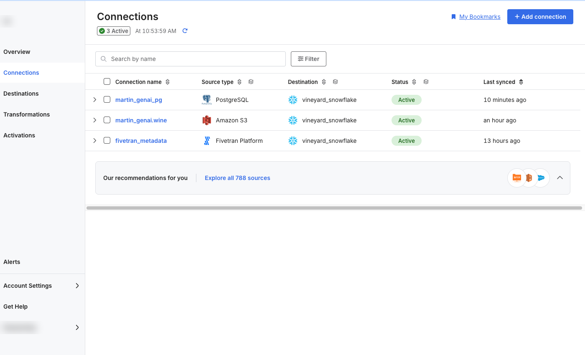

**Step 2.** Enter `postgres` in the search box.  Several PostgreSQL connectors are listed (for example Amazon RDS, Azure and Google Cloud SQL).  Use the one named `PostgreSQL`, which is the first in the list, whichever cloud your database runs in.  Highlight the item with your mouse and click `Set up`.

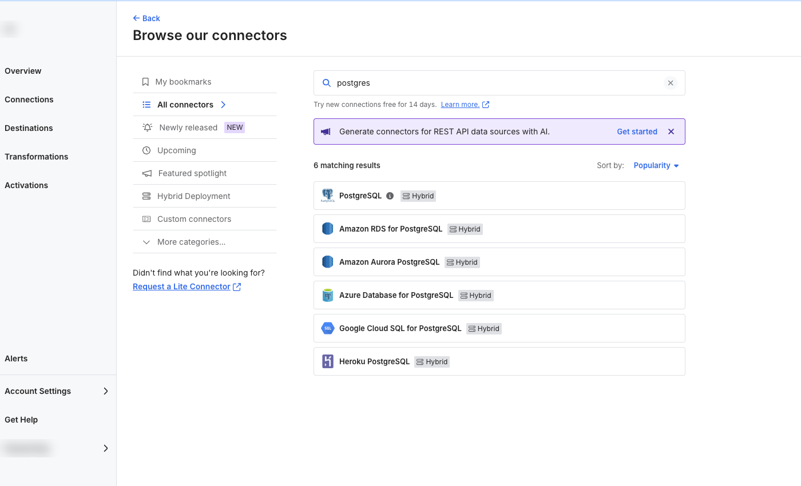

**Step 3.** The setup is a short wizard.  The steps are listed on the left: `Prerequisites`, `Connection name`, `Networking`, `Database access` and `Incremental sync`.  Read the prerequisites if you like and click `Next`.  On the `Connection name` step, enter `yourlastname_genai_pg` as the Destination schema prefix, select `Fivetran naming`, and click `Save and continue`.

Note that the Destination schema prefix must be unique to the destination.  Fivetran will prepend it to the schema copied from the PostgreSQL database.  **Select `Fivetran naming`, not the preselected `Source naming`.**  Fivetran naming creates the schema `YOURLASTNAME_GENAI_PG_AGRICULTURE` with upper case names, which is what the SQL later in this guide expects.  Source naming creates a lower case schema called `agriculture` that the guide's SQL cannot find.  The naming cannot be changed after the first sync.

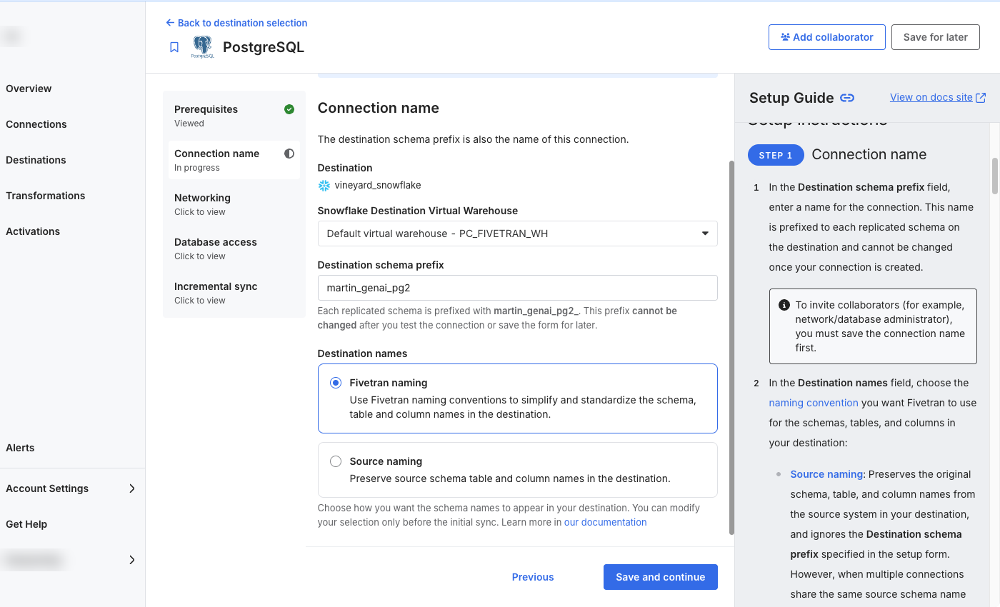

**Step 4.** On the `Networking` step, leave the Connection method on `Connect directly`.  This screen lists the Fivetran IP addresses for your destination.  Select the `CIDR` tab to see the same block you allowed in your database networking above.  If you have not done that yet, you can copy it from here.

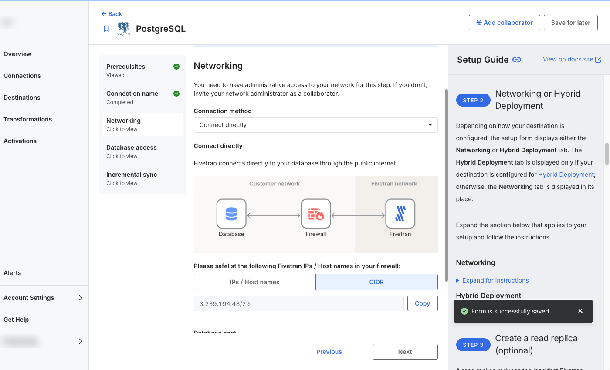

Scroll down, enter the host name or IP address of your database (the endpoint you noted when you created it) as the Database host, leave the Database port at 5432, and click `Next`.

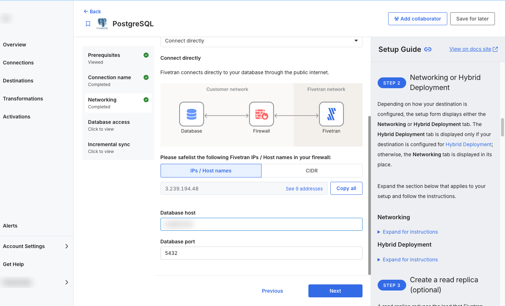

**Step 5.** On the `Database access` step, enter the following and click `Next`.
- Database:  industry
- Authentication Method:  Username and password
- User:  fivetran
- Password:  the password you chose when you created the `fivetran` user

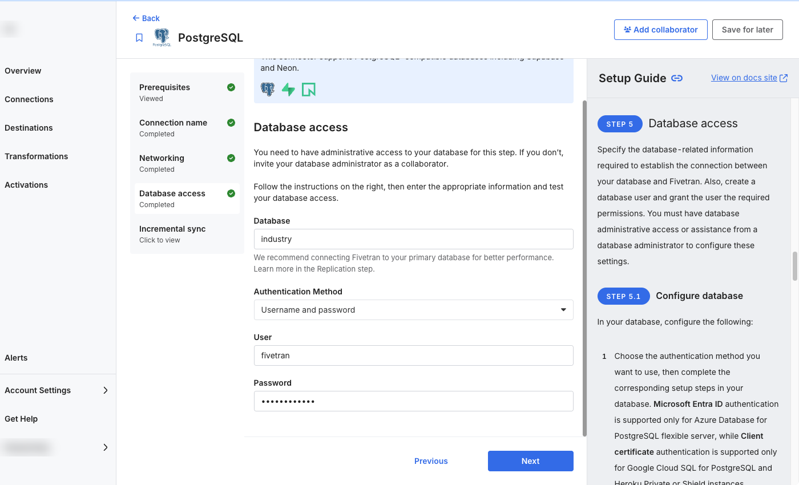

**Step 6.** On the `Incremental sync` step, `Logical Replication` is preselected.  Select `Query-Based` instead, and leave the `Capture Deletes` toggle on.  Click `Save & Test`.

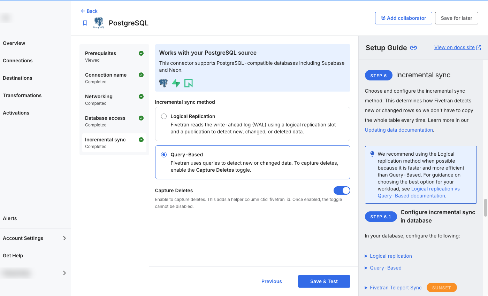

**Step 7.** Since we are connecting directly over the internet, Fivetran requires TLS.  Click the radio button next to the certificate, and click `Confirm`.  Once all connector tests complete, click `Continue`.

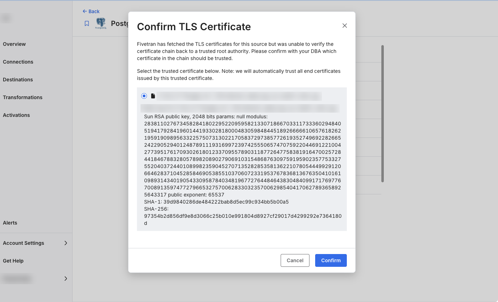

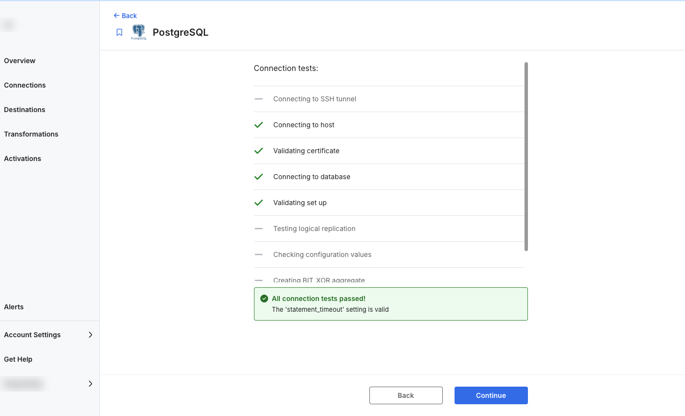

**Step 8.** Next you can review the schemas and tables to replicate.  Fivetran only lists what the `fivetran` user is allowed to read, so you see just the `agriculture` schema with the table `california_wine_country_visits`, both selected.  Click `Save & Continue`.

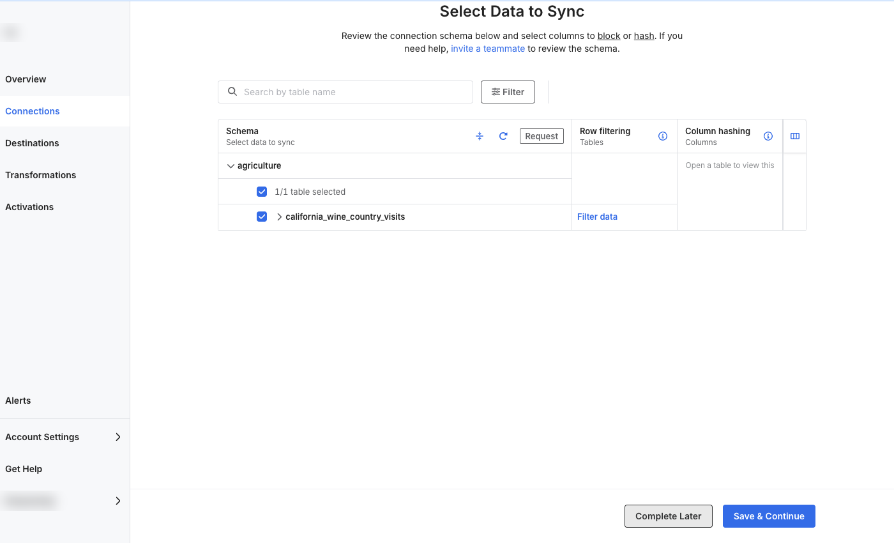

**Step 9.** By default, Fivetran will automatically replicate all schema changes to Snowflake so that any change in the source schema automatically appears in Snowflake.  Leave `Allow all` selected, and click `Continue`.

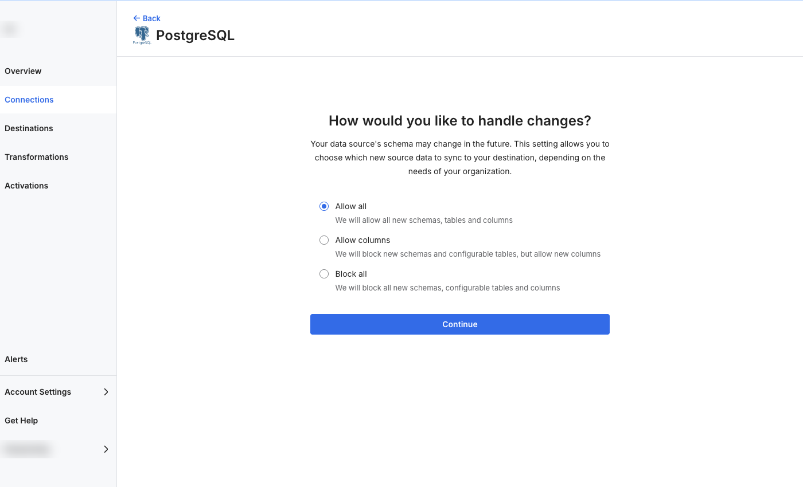

**Step 10.** With that, we are ready to go!  Let's sync data.  Click `Start Initial Sync`, and let Fivetran seamlessly replicate our database data into Snowflake.

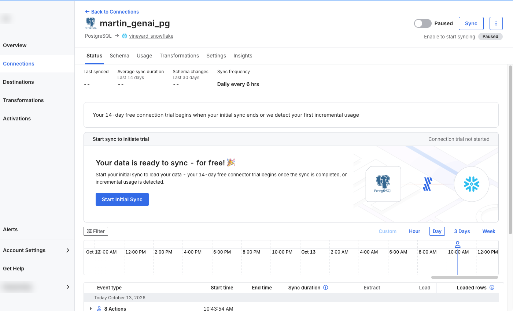

This should only take a minute or two at most.  When it finishes, the sync shows `Successful initial sync` with 743 loaded rows.  This process performs an initial sync of all of the data in the schema and table selected, and automatically schedules itself to run again in 6 hours.  The sync frequency can be adjusted, but for this lab, there is no CDC occurring behind the scenes; so we will leave it at 6 hours.  If this data was changing, Fivetran would only replicate the changes/delta from the previous run into Snowflake ensuring your Snowflake data is always up to date with your source!

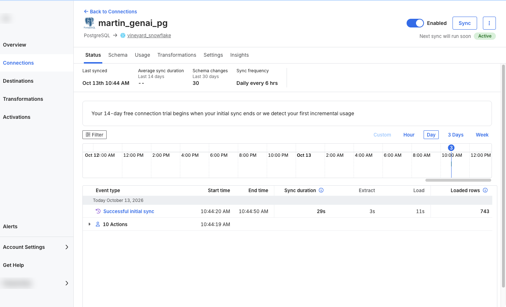

> 
> This is the power of Fivetran.  No allocating resources.  No development.  No code.  No column mapping.  No pre-building schemas or tables in the destination.  A fully automated, production data pipeline in a few steps!
>

In Snowflake, the data is now in the schema `YOURLASTNAME_GENAI_PG_AGRICULTURE`, in the table `CALIFORNIA_WINE_COUNTRY_VISITS`.  Return to the [guide](https://www.snowflake.com/en/developers/guides/fivetran-vineyard-assistant-chatbot/) and continue with **Transform the Wine Structured Dataset**.  Wherever the guide mentions the schema Fivetran created, use that schema name.
