author: Neelima Parakala
id: from-zero-to-agents
categories: snowflake-site:taxonomy/solution-center/certification/quickstart, snowflake-site:taxonomy/product/ai, snowflake-site:taxonomy/product/data-engineering, snowflake-site:taxonomy/feature/cortex-ai, snowflake-site:taxonomy/feature/dynamic-tables
language: en
summary: Build governed AI agents in Snowflake by transforming raw data into actionable insights using Cortex AI for sentiment analysis and Dynamic Tables for automated enrichment.
environments: web
status: Published
feedback link: https://github.com/Snowflake-Labs/sfguides/issues

# From Zero to Agents: Building End-to-End Data Pipelines for an AI Agent
<!-- ------------------------ -->

## Overview

This hands-on lab guides you through transforming raw data into actionable insights using Snowflake Cortex AI for sentiment analysis and classification. You will get hands-on experience with Cortex AI and Dynamic Tables to automate AI enrichment and construct a reliable semantic layer. Learn the architecture required to create a Marketing & Sales Intelligence Agent that leverages both structured data and enriched unstructured feedback while maintaining enterprise security standards.

### What You'll Learn
- How to use Cortex AI functions for sentiment analysis and text classification
- How to create Dynamic Tables for automated AI enrichment pipelines
- How to build a Semantic View to map technical columns to business terms
- How to create and configure an AI Agent with Analyst and Search tools
- How to implement Role-Based Access Control (RBAC) with Dynamic Data Masking

### What You'll Build
- An automated AI enrichment pipeline using Cortex AI and Dynamic Tables
- A Semantic View that provides business-friendly abstractions over your data
- A Marketing & Sales Intelligence Agent powered by Cortex Analyst and Cortex Search
- Enterprise-grade security controls with masking policies

### Prerequisites
- A [Snowflake account](https://signup.snowflake.com/) with a role that has the ability to create database, schema, tables, and virtual warehouse objects
- Basic familiarity with SQL
- Access to Snowsight (Snowflake's web interface)

<!-- ------------------------ -->

## Environment and Data Loading

Imagine you are on a marketing team at a fictional retail company selling sports and outdoor gear. The company has plenty of data from campaign performance from paid ads to customer feedback. 

The problem the team faces:
1. Campaign performance data is siloed from customer feedback
2. Customer feedback is unstructured and unanalyzed
3. Analysts can’t self-serve insights from these data

What you’ll build to solve these issues:
1. Cortex AI turns raw transcripts into structured sentiment and category labels
2. Dynamic Tables automate so that data stays current as new feedback arrives
3. Semantic View bridges campaign metrics and customer feedback into one model
4. Snowflake CoWork that allows analysts to ask natural language questions 


### Setup Instructions
Establish the secure foundation using the provided `setup.sql` script. This script automates the creation of roles, warehouses, and the ingestion of marketing data from public S3 buckets.

Run [setup.sql](https://github.com/Snowflake-Labs/sfquickstarts/blob/master/site/sfguides/src/from-zero-to-agents/assets/setup.sql) in a Snowsight SQL Worksheet.

> **Note:** Don't run this lab on the same account as the Getting Started with Snowflake CoWork lab. Both labs create the `DASH_DB_SI` database, the `DASH_WH_SI` warehouse, and the `SNOWFLAKE_INTELLIGENCE_ADMIN` role, so running one replaces the other's objects.

### What Gets Provisioned

- **Infrastructure:** Provisions the `dash_wh_si` warehouse and `snowflake_intelligence` database. Snowflake CoWork was previously called Snowflake Intelligence, so some object and role names still use the old name.
- **Ingestion:** Loads **structured metrics** (campaign spend, product sales) and **unstructured transcripts** (`support_cases`)

<!-- ------------------------ -->

## AI Enrichment with Cortex AI

**AI Enrichment with Cortex AI** refers to the process of using built-in generative AI functions directly within standard SQL queries to analyze, transform, and add value to your data.

In Snowflake, this is powered by **Snowflake Cortex AI**, which allows you to run high-performance Large Language Models (LLMs) without moving your data to an external service or managing complex infrastructure.

### How It Works

Traditionally, if you wanted to perform sentiment analysis or extract names from text, you had to export data to a Python environment or a third-party API. With Cortex AI Functions, the LLM is treated like any other SQL function (e.g., `SUM()` or `AVG()`).

### Core Cortex AI Functions

Snowflake provides several task-specific functions that make enrichment simple:

| Function | Description |
|----------|-------------|
| `AI_SENTIMENT(text)` | Returns an object with a sentiment category (`positive`, `negative`, `neutral`, or `mixed`), e.g. `{"categories":[{"name":"overall","sentiment":"mixed"}]}` |
| `AI_SUMMARIZE(text)` | Creates a concise summary of long documents or transcripts |
| `AI_EXTRACT(text, {'field': 'question'})` | Extracts specific fields or answers from unstructured text, e.g. `{"response":{"order_id":"123"}}` |
| `AI_CLASSIFY(text, categories)` | Buckets text into predefined labels (e.g., "Refund," "Complaint," "Sales Inquiry"). Returns an object such as `{"labels":["Return"]}` |
| `AI_TRANSLATE(text, source, target)` | Translates text between languages |

### Why Use AI Enrichment?

- **Scalability:** Process millions of rows of unstructured text using Snowflake's elastic compute (Warehouses)
- **Security:** Your data never leaves the Snowflake security perimeter, which is vital for GDPR/HIPAA compliance
- **Automation:** By putting these functions inside **Dynamic Tables**, your AI enrichment happens automatically as new data arrives
- **Low Friction:** Analysts who know SQL can now perform advanced "Data Science" tasks without learning Python or PyTorch

### Integration with AI Agents

AI Enrichment is the "Preprocessing" step. By enriching your data first:

1. The **Agent** doesn't have to read every raw transcript
2. It can simply query the `avg_sentiment` column to find unhappy customers
3. This makes the agent faster, cheaper, and more accurate

### Extract Trends

Transform "dark data" (raw transcripts) into analytical trends using Cortex AI Functions. Run sentiment analysis and classification on customer feedback to create measurable features.

`AI_SENTIMENT` and `AI_CLASSIFY` return objects, so the query extracts the value you want from each result:

```sql
USE DATABASE DASH_DB_SI;
USE SCHEMA RETAIL;
-- Align the support case product name with the marketing category so the two tables can be joined later
UPDATE support_cases SET product = 'Fitness Wear' WHERE product = 'ThermoJacket Pro';
SELECT 
    title,
    AI_SENTIMENT(transcript):categories[0]:sentiment::STRING AS sentiment,
    AI_CLASSIFY(transcript, ['Return', 'Quality', 'Shipping']):labels[0]::STRING AS issue_category
FROM support_cases;
```

The `sentiment` column is a category (`positive`, `negative`, `neutral`, or `mixed`). The next section converts it to a number so it can be averaged.
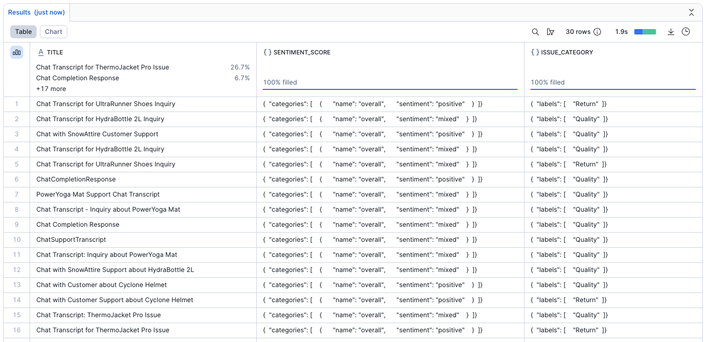


### Updating Marketing Data
Confirm that the role is set to `SNOWFLAKE_INTELLIGENCE_ADMIN` by clicking on your profile in the bottom left corner.
1. Download the [marketing_data.csv](https://github.com/Snowflake-Labs/sfquickstarts/blob/master/site/sfguides/src/from-zero-to-agents/assets/marketing_data.csv)
2. Navigate to `Catalog` > `Database Explorer`
3. Open `DASH_DB_SI.RETAIL.Tables.MARKETING_CAMPAIGN_METRICS`. If you do not see the database, refresh the data.
4. Click on `Load Data` in the top right hand corner
5. Upload the marketing_data.csv and click `next` then `load`
6. Click `View table detail` to see the new data uploaded

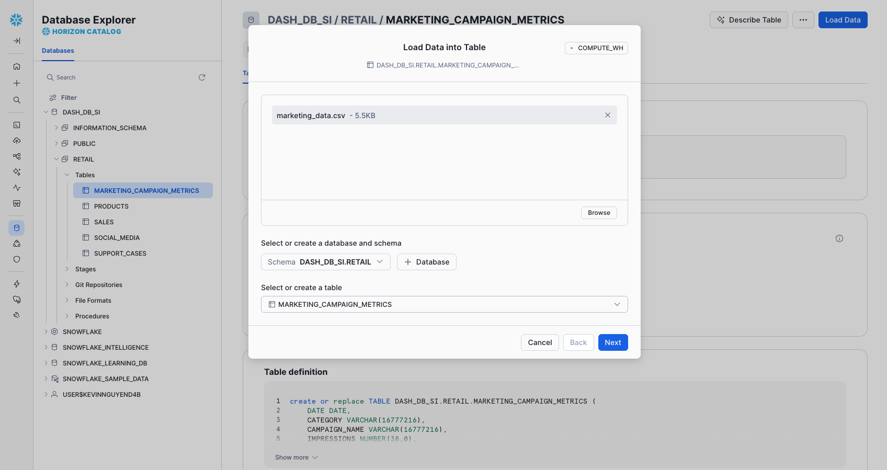


<!-- ------------------------ -->

## Create Live Enrichment Pipeline

To create a "Live" enrichment pipeline, we combine **Cortex AI Functions** with **Dynamic Tables**. This allows Snowflake to automatically process new data as it arrives, keeping your sentiment scores and classifications up to date without manual intervention.

### The Architecture of Live Enrichment

Instead of running a one-time enrichment, you define a **Dynamic Table**. This table acts as a materialized view that continuously "listens" for changes in your raw data (e.g., new customer feedback) and runs the AI functions only on the new or changed rows.

### Create the Enriched Dynamic Table

Create a Dynamic Table that automatically joins campaign metrics with AI-generated sentiment. `AI_SENTIMENT` returns a category, so a `CASE` expression converts it to a number (positive = 1, neutral/mixed = 0, negative = -1) that can be averaged.

The query totals clicks per campaign and averages sentiment per product **before** joining them. Joining the raw tables directly would repeat each campaign row once for every support case, which inflates the click totals.

```sql
USE ROLE SNOWFLAKE_INTELLIGENCE_ADMIN;
USE DATABASE DASH_DB_SI;
USE SCHEMA RETAIL;
CREATE OR REPLACE DYNAMIC TABLE enriched_marketing_intelligence
TARGET_LAG = '1 hours'
WAREHOUSE = dash_wh_si
AS
WITH sentiment AS (
    SELECT product,
           AVG(CASE AI_SENTIMENT(transcript):categories[0]:sentiment::STRING
                   WHEN 'positive' THEN 1
                   WHEN 'negative' THEN -1
                   ELSE 0
               END) AS avg_sentiment
    FROM support_cases
    GROUP BY product
),
campaigns AS (
    SELECT campaign_name, category, SUM(clicks) AS clicks
    FROM marketing_campaign_metrics
    GROUP BY campaign_name, category
)
SELECT c.campaign_name, c.clicks, c.category AS product_name, s.avg_sentiment
FROM campaigns c
JOIN sentiment s ON c.category = s.product;
```
Confirm the creation of the Dynamic Table by navigating to `Catalog` > `Database Explorer` > `DASH_DB_SI.RETAIL.DYNAMIC TABLES.ENRICHED_MARKETING_INTELLIGENCE`. If you do not see your table, click on the refresh button and the table should appear. 

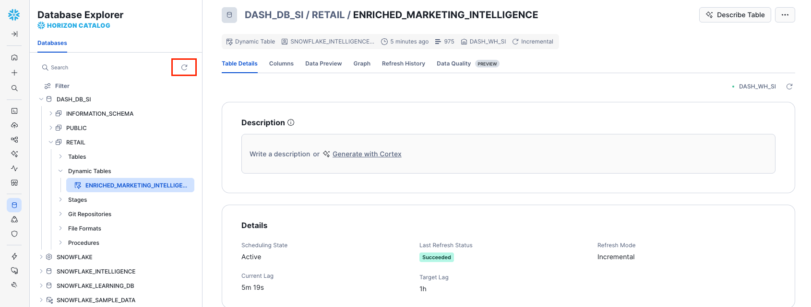

<!-- ------------------------ -->

## Semantic Layer and Agent Creation

Provide the agent with a "map" to understand your business logic through a **Semantic View**.

### Create a Cortex Analyst
This tool enables the agent to query structured data in Snowflake by generating SQL. It relies on semantic views, which are mappings between business concepts (e.g., "product name," "sales") and the underlying tables and columns in your Snowflake account. This abstraction helps the LLM understand how to query your data effectively, even if your tables have complex or arbitrary naming conventions.

**What is CoCo?** CoCo (Cortex Code) is Snowflake's AI assistant, built into Snowsight and Workspaces. You describe what you want in natural language, and CoCo finds the right tables, writes the SQL or configuration, and explains what it did. Before it runs anything, it shows you the plan and asks for approval. Click the CoCo icon in the bottom-right corner of the browser to open the panel.

1. Confirm that the role is set to `SNOWFLAKE_INTELLIGENCE_ADMIN` and the warehouse is set to `DASH_WH_SI`
2. Navigate to **AI > Cortex Analyst** in Snowsight, then select **Create with Autopilot in Workspaces**
3. Select **Create with CoCo**
4. Send CoCo this prompt:

> "Create a semantic view with these details:
> - Name: SEMANTIC_VIEW
> - Location: DASH_DB_SI.RETAIL
> - Tables: ENRICHED_MARKETING_INTELLIGENCE, MARKETING_CAMPAIGN_METRICS, PRODUCTS, SALES, SOCIAL_MEDIA, SUPPORT_CASES
> - Add a description to the PRODUCT_NAME dimension on ENRICHED_MARKETING_INTELLIGENCE: 'Product category value, which matches SUPPORT_CASES.PRODUCT.'
> - Add a description to the AVG_SENTIMENT fact on ENRICHED_MARKETING_INTELLIGENCE: 'Average sentiment of support cases for that product category, from -1 (negative) to 1 (positive).'
> - Add one many-to-one relationship from SALES.PRODUCT_ID to PRODUCTS.PRODUCT_ID. Do not add any relationship keyed on CATEGORY.
> - Add metrics: Total Clicks = SUM(CLICKS) and Total Impressions = SUM(IMPRESSIONS) on MARKETING_CAMPAIGN_METRICS; Click-Through Rate = SUM(CLICKS) / NULLIF(SUM(IMPRESSIONS), 0) on MARKETING_CAMPAIGN_METRICS; Total Sales = SUM(SALES_AMOUNT) and Units Sold = SUM(UNITS_SOLD) on SALES."


**What this prompt asks for**

| Part of the prompt | What it does |
|---|---|
| "Name: SEMANTIC_VIEW, Location: DASH_DB_SI.RETAIL" | Sets the name and where the view is stored |
| "Tables: ..." | Names the six tables to include |
| "Add a description to the PRODUCT_NAME dimension..." | Explains what the category field means to the agent |
| "Add a description to the AVG_SENTIMENT fact..." | Gives the sentiment score's scale |
| "Add one many-to-one relationship from SALES.PRODUCT_ID to PRODUCTS.PRODUCT_ID" | Connects sales to products |
| "Do not add any relationship keyed on CATEGORY" | Prevents a join on a field that repeats across rows |
| "Add metrics: ..." | Defines each calculation once, so the agent doesn't have to guess |

**Expected:** the draft opens in the Semantic View editor and contains the items in the checklist below.

5. Allow CoCo to create the semantic view draft in the Workspace. This creates an editable draft; it does not deploy it yet.

#### Review the Semantic View
Review the draft in the Semantic View editor and confirm it contains:

- [ ] Under **Dimensions** for `ENRICHED_MARKETING_INTELLIGENCE`, `PRODUCT_NAME` has this description: "Product category value, which matches SUPPORT_CASES.PRODUCT."
- [ ] Under **Facts** for `ENRICHED_MARKETING_INTELLIGENCE`, `AVG_SENTIMENT` has this description: "Average sentiment of support cases for that product category, from -1 (negative) to 1 (positive)."
- [ ] One relationship: `SALES.PRODUCT_ID` to `PRODUCTS.PRODUCT_ID`, many-to-one.
- [ ] In the **Relationships** list, no relationship uses `CATEGORY` as a key. `CATEGORY` repeats across many rows in `MARKETING_CAMPAIGN_METRICS`, `PRODUCTS`, and `SOCIAL_MEDIA`, so it can't identify one row. Delete any relationship that uses it.
- [ ] Under **Metrics**, on `MARKETING_CAMPAIGN_METRICS`, these three metrics exist (each sums facts from that table):
  - `Total Clicks`: SUM of `CLICKS`
  - `Total Impressions`: SUM of `IMPRESSIONS`
  - `Click-Through Rate`: SUM of `CLICKS` divided by SUM of `IMPRESSIONS`
- [ ] Under **Metrics**, on `SALES`, these two metrics exist (each sums facts from that table):
  - `Total Sales`: SUM of `SALES_AMOUNT`
  - `Units Sold`: SUM of `UNITS_SOLD`

CoCo may add other descriptions, synonyms, dimensions, or metrics. That's fine, as long as the items above are present and correct.

If anything is missing, add or correct it in the editor. Leave the suggestions disabled.

6. Select **Deploy**. In the dialog, confirm **Name** `SEMANTIC_VIEW`, **Database** `DASH_DB_SI`, and **Schema** `RETAIL`, then select **Deploy** to create the semantic view.

### Create a Cortex Search Service
This tool allows the agent to search and retrieve information from unstructured text data, such as customer support tickets, Slack conversations, or contracts. It leverages Cortex Search to index and query these text "chunks," enabling the agent to perform Retrieval Augmented Generation (RAG).

In this lab, the search service indexes the customer support transcripts, so the agent can answer "why" questions with what customers actually said.

1. Navigate to **AI > Cortex Search** in Snowsight
2. Confirm that role is set to `SNOWFLAKE_INTELLIGENCE_ADMIN`
3. Select **Create**
4. Configure the following settings:
   - **Service database & schema:** `DASH_DB_SI.Retail`
   - **Service name:** `support_search`
   - **Select data:** `support_cases`
   - **Select search column:** `TRANSCRIPT`
   - **Select attributes:** `PRODUCT` and `TITLE`
   - **Select columns:** `Select all`
   - **Warehouse for indexing:** `DASH_WH_SI`
5. Click `create` and click the refresh icon in the top right corner. `Serving` will update from `INITIALIZING` to `ACTIVE`

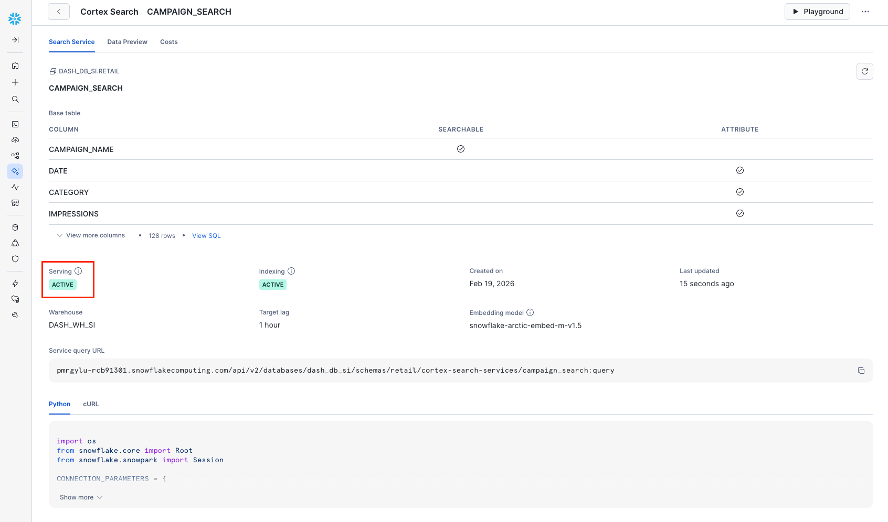


## Create the Agent
An agent is an intelligent entity that acts on behalf of the user, and you can chat with it in Snowflake CoWork. Agents are configured with specific tools and orchestration logic to answer questions and perform tasks on top of your data.

1. Navigate to **AI > Agent Studio** in Snowsight
2. On the top right, click on **Create agent**
   - **Database and schema**: `DASH_DB_SI.Retail`
   - **Agent object name**: `MarketingAgent`
3. Create the agent
4. Click **Configuration**

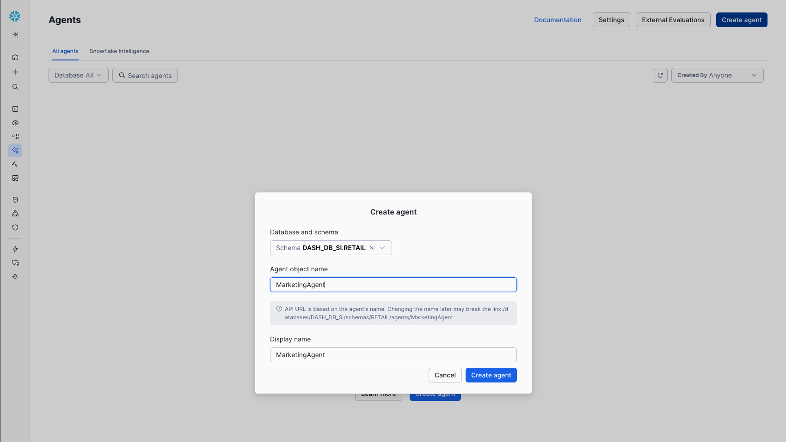


### Configure General
On the **General** tab, configure the following:
- **Description**: I am a specialized Marketing & Sales Intelligence Assistant. My  primary role is to provide accurate, data-driven insights by analyzing structured marketing metrics (spend, clicks, conversions) and unstructured customer feedback (support transcripts). I bridge the gap between 'what happened' (the numbers) and 'why it happened' (customer sentiment). Always maintain a professional, analytical tone and provide clear citations for information retrieved from support transcripts.
- **Example question**: What are the top 5 campaigns by clicks?

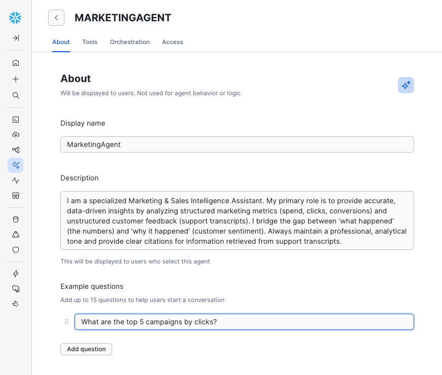

### Add Instructions
On the **Instructions** tab, configure the following:
- **Orchestration Instructions:** Whenever you can answer visually with a chart, always choose to generate a chart even if the user didn't specify to.

### Add Tools
Tools are the capabilities an agent can use to accomplish a task. Think of them as the agent's skillset and note that you can add one or more of each of the following tools.

**Cortex Analyst**
1. Click on **+ Add > Add semantic view**
2. Configure the following settings:
- **Service database & schema:** `DASH_DB_SI.Retail`
- **Select semantic view:** `SEMANTIC_VIEW`
- **Name:** `semantic_view`
- **Description:** Retail marketing and sales data: campaign clicks and impressions, product sales by region, social media mentions, support cases, and campaign performance paired with customer sentiment. Use for any numeric or trend question about campaigns, products, or sales.
- **Warehouse:** `Custom` > `DASH_WH_SI`
- **Query timeout:** 60
3. Click **Add**

**Cortex Search Services**
1. Click on **+Add**
2. Configure the following settings:
- **Service database & schema:** `DASH_DB_SI.Retail`
- **Cortex Search Services:** `DASH_DB_SI.RETAIL.SUPPORT_SEARCH`
- **Max Results:** `4`
- **ID Column:** `ID`
- **Title Column:** `TITLE`
- **Name:** `Search`
- **Description:** Search customer support transcripts to find what customers said about products, returns, and quality issues
3. Click **Add**

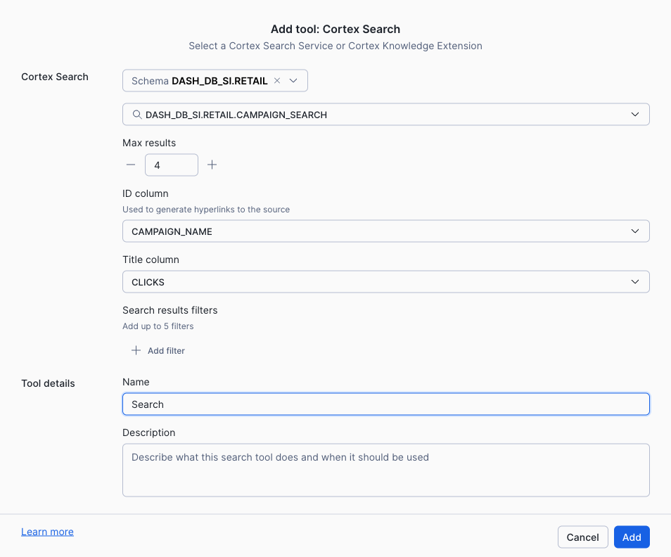


**Custom tools**
1. Click on **+Add**
2. Configure the following settings:
- **Resource type:** `procedure`
- **Service database & schema:** `DASH_DB_SI.Retail`
- **Custom tool identifier:** `DASH_DB_SI.RETAIL.SEND_EMAIL()`
- **Name:** `Send_Email`
- **Warehouse:** `Custom` > `DASH_WH_SI`
- **Query timeout:** 60
- **Parameter: body**
  - Description: Use HTML-Syntax for this. If the content you get is in markdown, translate it to HTML. If body is not provided, summarize the last question and use that as content for the email.
- **Parameter: recipient_email**
  - Description: If the email is not provided, send it to the current user's email address.
- **Parameter: subject**
  - Description: If the subject is not provided, use "Snowflake CoWork".
 
**Click `Save` in the top right corner**

<!-- ------------------------ -->

## Validation

Interact with the agent and verify that it respects enterprise-grade governance.

### Accessing the Agent

Once your agent is created, it appears in **Snowflake CoWork**:

1. In Snowsight, go to **AI > Snowflake CoWork**
2. You will see a list of agents you have access to
3. Select your **MarketingAgent**

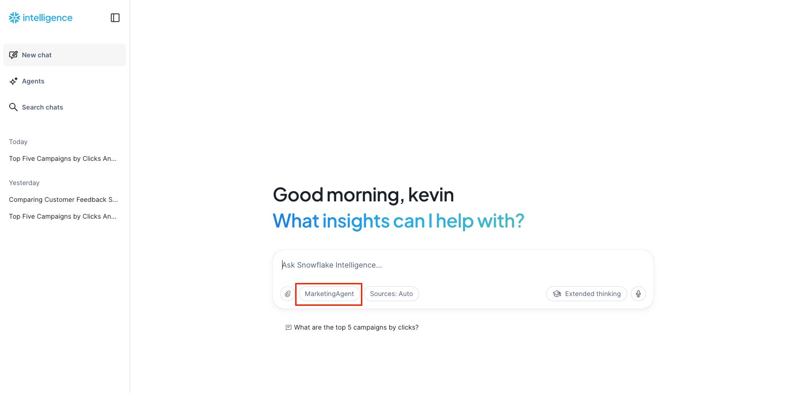


### The Conversational Interface

The UI is designed to handle natural language queries. It doesn't just return data; it provides a narrative response.

- **Natural Language Input:** Users type questions like, *"What are the top 5 campaigns by clicks?"*
- **Suggested Prompts:** Based on your Semantic View and Agent Description, the UI often provides "starter" questions to guide the user
- **Multimodal Answers:** The agent will combine text (summarizing feedback from Cortex Search) with tables or charts (visualizing metrics from Cortex Analyst)

Let's ask the following questions

### Q1. What are the top 5 campaigns by clicks?

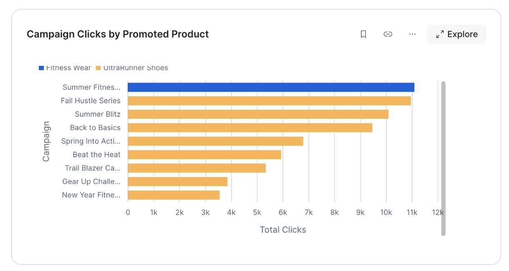

### Q2. Show me all campaign performance metrics and their relationship to the product

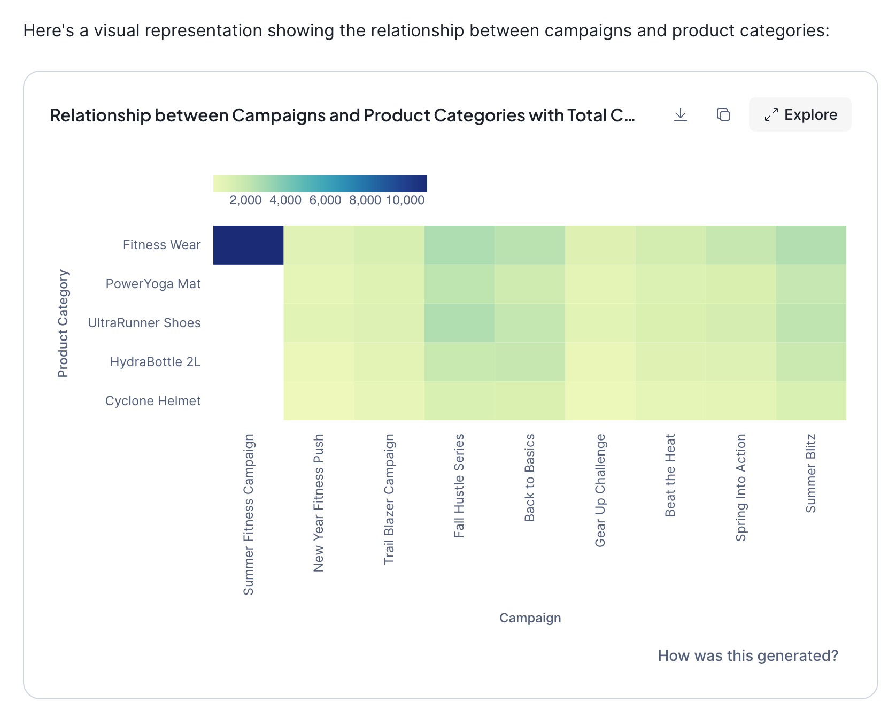

### Q3. What is the relationship between campaign clicks and customer satisfaction by category?

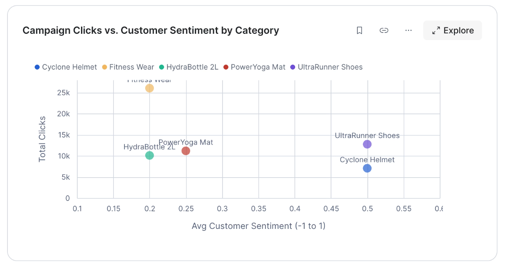

### Q4. What are the main customer complaints in support cases?

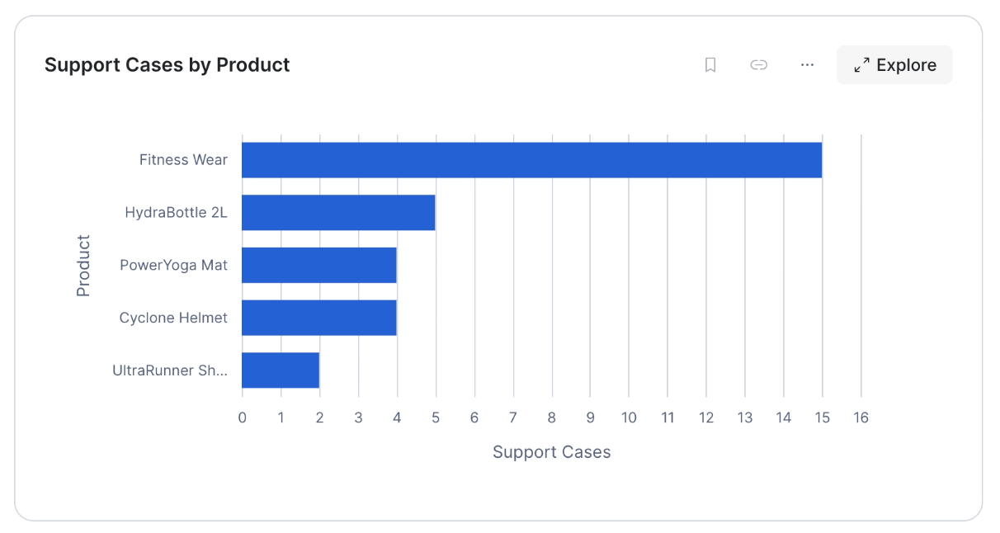


## Security (optional)
### Trace Monitoring

For lab participants, the Trace is the most critical UI interaction. It allows you to debug the agent's logic:

1. **The Plan:** The UI displays how the agent broke down your prompt (e.g., "Step 1: Identify campaigns with budget < 5000. Step 2: Retrieve sentiment scores for those campaigns.")
2. **Tool Selection:** You can see which tool was invoked for which step—whether it chose the Analyst for the budget or Search for the "Why"
3. **Reflection:** You can see if the agent caught its own errors and re-ran a query to get a better result

<!-- ------------------------ -->
### Security Showcase

Apply **Dynamic Data Masking** to specific metrics to ensure the agent respects **RBAC** (Role-Based Access Control).

### Create the Marketing Role and Granting Access

If you ran the `setup.sql` exactly as provided in the GitHub repo, it created `snowflake_intelligence_admin`. Let's create the `marketing_intelligence_role` to represent your "Restricted Team" and give it the necessary access. Be sure to have your role set to `snowflake_intelligence_admin` and warehouse to `DASH_WH_SI`.

```sql
USE DATABASE DASH_DB_SI;
USE SCHEMA RETAIL;

-- Create a secure view
CREATE OR REPLACE SECURE VIEW marketing_intelligence_view AS
SELECT 
    campaign_name AS "Ad Campaign",
    category AS "Product Category",
    clicks AS "Engagement Clicks",
    -- avg_sentiment will come from the Dynamic Table
    0 AS "Customer Sentiment Score" 
FROM marketing_campaign_metrics;

-- Check which roles have access to your database and schema
SHOW GRANTS ON DATABASE dash_db_si;
SHOW GRANTS ON SCHEMA dash_db_si.retail;

-- Check specifically for your Semantic View
SHOW GRANTS ON VIEW marketing_intelligence_view;

USE ROLE snowflake_intelligence_admin;
USE WAREHOUSE dash_wh_si;

-- You should see the actual budget/click numbers
SELECT * FROM marketing_intelligence_view LIMIT 5;

USE ROLE ACCOUNTADMIN;

-- Create the role
CREATE OR REPLACE ROLE marketing_intelligence_role;

-- Grant usage on the warehouse and database
GRANT USAGE ON WAREHOUSE dash_wh_si TO ROLE marketing_intelligence_role;
GRANT USAGE ON DATABASE dash_db_si TO ROLE marketing_intelligence_role;
GRANT USAGE ON SCHEMA dash_db_si.retail TO ROLE marketing_intelligence_role;

-- Grant access to the AI functions and the specific views
GRANT DATABASE ROLE SNOWFLAKE.CORTEX_USER TO ROLE marketing_intelligence_role;
GRANT SELECT ON VIEW dash_db_si.retail.marketing_intelligence_view TO ROLE marketing_intelligence_role;

-- Assign to yourself for testing
SET current_user = CURRENT_USER();
GRANT ROLE marketing_intelligence_role TO USER IDENTIFIER($CURRENT_USER);
```

### Apply the Masking Policy

A masking policy exists in Snowflake but isn't "active" until it is **applied** to a specific column. We will mask the `CLICKS` column so the marketing role sees `0` while the admin sees the real data.

```sql
USE ROLE snowflake_intelligence_admin;
USE SCHEMA dash_db_si.retail;

-- 1. Create the policy
CREATE OR REPLACE MASKING POLICY mask_engagement_clicks AS (val number) 
RETURNS number ->
  CASE 
    WHEN CURRENT_ROLE() IN ('SNOWFLAKE_INTELLIGENCE_ADMIN', 'ACCOUNTADMIN') THEN val 
    ELSE 0 -- Masked value for other roles
  END;

-- 2. Apply the policy to the base table column
ALTER TABLE marketing_campaign_metrics MODIFY COLUMN clicks SET MASKING POLICY mask_engagement_clicks;

-- 3. Verify the policy is active
SELECT * FROM TABLE(INFORMATION_SCHEMA.POLICY_REFERENCES(
    policy_name => 'mask_engagement_clicks'
));
```

### Verify as Admin

```sql
-- Re-run the view to ensure it picks up the table-level masking
CREATE OR REPLACE SECURE VIEW marketing_intelligence_view AS
SELECT 
    campaign_name AS "Ad Campaign",
    category AS "Product Category",
    clicks AS "Engagement Clicks",
    -- avg_sentiment will come from the Dynamic Table
    0 AS "Customer Sentiment Score" 
FROM marketing_campaign_metrics;

USE ROLE snowflake_intelligence_admin;
USE SCHEMA dash_db_si.retail;
-- You should see numbers like 11103
SELECT "Ad Campaign", "Engagement Clicks" FROM marketing_intelligence_view;
```
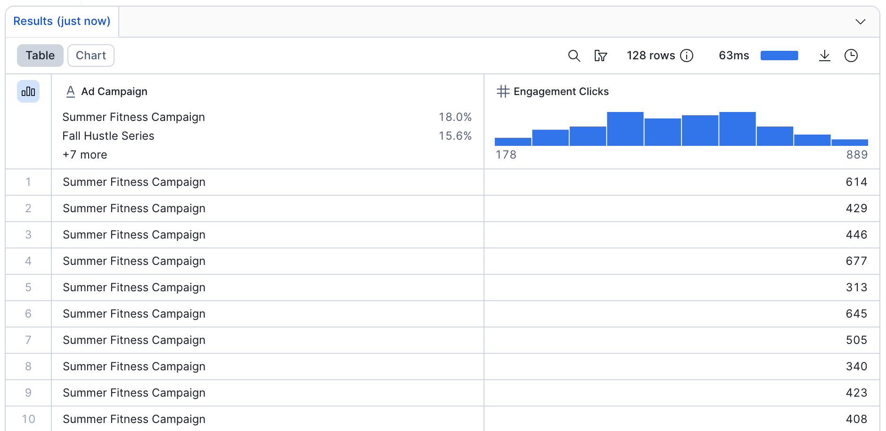


### Verify as Marketing Role

```sql
USE ROLE marketing_intelligence_role;
USE SCHEMA dash_db_si.retail;
-- You should see 0 for all clicks
SELECT "Ad Campaign", "Engagement Clicks" FROM marketing_intelligence_view;
```
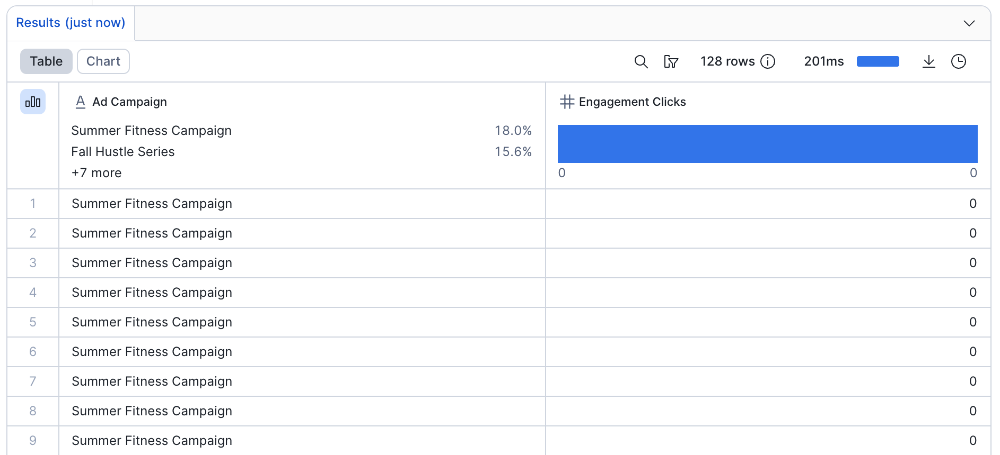

By applying Dynamic Data Masking alongside RBAC, you ensured that the data serves different teams with appropriate access — admins see real click data while the marketing role sees masked values.


<!-- ------------------------ -->

## Conclusion And Resources

Congratulations! You've successfully built an end-to-end data pipeline for an AI agent in Snowflake. You transformed raw marketing data and unstructured customer feedback into actionable insights using Cortex AI, automated the enrichment process with Dynamic Tables, and created a governed Marketing Intelligence Agent.

### What You Learned
- How to use Cortex AI functions (`AI_SENTIMENT`, `AI_CLASSIFY`) for text analysis directly in SQL
- How to create Dynamic Tables for automated, real-time AI enrichment
- How to build Semantic Views that map technical schemas to business-friendly terms
- How to configure AI Agents with Cortex Analyst and Cortex Search tools
- How to implement enterprise security using Dynamic Data Masking and RBAC

### Related Resources
- [Snowflake Cortex AI Documentation](https://docs.snowflake.com/en/user-guide/snowflake-cortex/aisql)
- [Dynamic Tables Overview](https://docs.snowflake.com/en/user-guide/dynamic-tables-about)
- [Semantic Views Documentation](https://docs.snowflake.com/en/user-guide/views-semantic/overview)
- [Getting Started with Snowflake CoWork](https://www.snowflake.com/en/developers/guides/getting-started-with-snowflake-intelligence/)
- [Snowflake Documentation](https://docs.snowflake.com/)
