author: Jan Sommerfeld, Gilberto Hernandez, Yoav Ostrinsky
id: get-started-snowflake-dcm-projects
summary: Learn how to declare Snowflake objects as code and run the plan, deploy and converge loop with DCM Projects.
categories: snowflake-site:taxonomy/solution-center/certification/quickstart, snowflake-site:taxonomy/product/platform, snowflake-site:taxonomy/product/data-engineering, snowflake-site:taxonomy/snowflake-feature/dynamic-tables
environments: web
status: Published
language: en
feedback link: https://github.com/Snowflake-Labs/sfguides/issues
fork repo link: https://github.com/Snowflake-Labs/snowflake-dcm-projects

# Get Started with Snowflake DCM Projects
<!-- ------------------------ -->
## Overview

Snowflake DCM (Database Change Management) Projects let you declare the Snowflake objects you want in SQL files, then let Snowflake work out how to get there.

That is the whole idea, and it is worth being precise about what it replaces. A script is imperative: it says "create this table", and running it twice either fails or destroys what you had. A migration framework is imperative with bookkeeping: it says "apply change 7, then change 8", and it needs a ledger of which changes already ran so it never applies one twice. Both encode a *path*.

A DCM Project encodes a *destination*. Each `DEFINE` statement states the object you want and the properties it should have. When you deploy, DCM inspects what exists, compares it to what you declared, and issues only the differences. There is no migration ledger to keep, because there is nothing to replay: the files are always the current desired state, and the account converges on them. Run a deploy twice and the second one does nothing.

You get two things from that. The first is a **plan**: a dry run that tells you exactly which objects would be created, altered and dropped before anything happens. The second is **convergence**: `DEFINE` executes as CREATE OR ALTER, so redeploying reconciles an object in place rather than recreating it.

### How you drive a project

DCM Projects can be managed using Snowsight, the Snowflake CLI, SQL, or Cortex Code. You can author, debug and deploy a project by hand in Snowflake Workspaces or your local IDE, use Cortex Code to do it via natural-language prompts, or automate deployments through CI/CD pipelines. Cortex Code also ships a skill that automates the workflow of migrating existing Snowflake objects into a DCM Project, so you do not have to hand-write `DEFINE` statements for objects that already exist.

This guide shows two of those interfaces side by side. Every plan and deploy step below gives you the Snowsight Workspaces path and the equivalent snow CLI command, so you can follow whichever fits how you work.

### What You'll Learn
- What a DCM Project declares, and how a manifest maps one codebase onto several environments
- How to read a plan changeset and deploy it with an alias
- How editing a definition and redeploying converges instead of recreating
- How Jinja templating parameterizes definitions, so one codebase serves DEV, STAGE and PROD
- How project assets let a project deploy a Streamlit app alongside the pipeline it reads
- How to keep an API key out of your files with environment secrets and a secret object
- How to inspect what a project manages, and how to tear it down safely

### What You'll Need
- A [Snowflake account](https://signup.snowflake.com/?utm_source=snowflake-devrel&utm_medium=developer-guides&utm_cta=developer-guides) with ACCOUNTADMIN access, for the one-time setup script
- (Optional) [Snowflake CLI](https://docs.snowflake.com/en/developer-guide/snowflake-cli/installation/installation) 3.24 or later, if you prefer a terminal to the Snowsight UI
- Basic knowledge of Snowflake concepts (databases, schemas, tables, roles)
- Familiarity with SQL

### What You'll Build
A small but real pipeline: three landing tables, one dynamic table, a semantic view you can query in business terms, a Streamlit dashboard that reads it, and a secret holding a partner API key. You declare all of it as code, deploy it, change it, redeploy it, and clean it up.

That work follows the DCM Projects lifecycle:

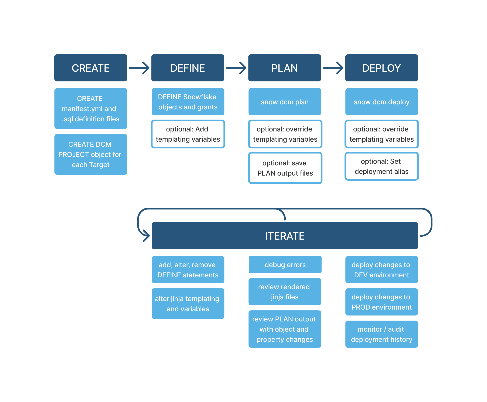

You will walk it in order (creating the manifest and project object, reading the definitions, planning, deploying) and then spend most of the guide in **ITERATE**, which is where a declarative tool earns its keep.

<!-- ------------------------ -->
## Create a Workspace from Git

If you want to work in Snowsight rather than locally, create a Snowsight Workspace linked to the sample repository on GitHub.

1. Navigate to **Projects > Workspaces** in Snowsight.
2. Click **Create** (+) and select **Git repository**.
3. Enter the repository URL: https://github.com/Snowflake-Labs/snowflake-dcm-projects
4. Select an API Integration for GitHub ([create one if needed](https://docs.snowflake.com/en/user-guide/ui-snowsight/workspaces-git#label-create-a-git-workspace)).
5. Select **Public repository**.

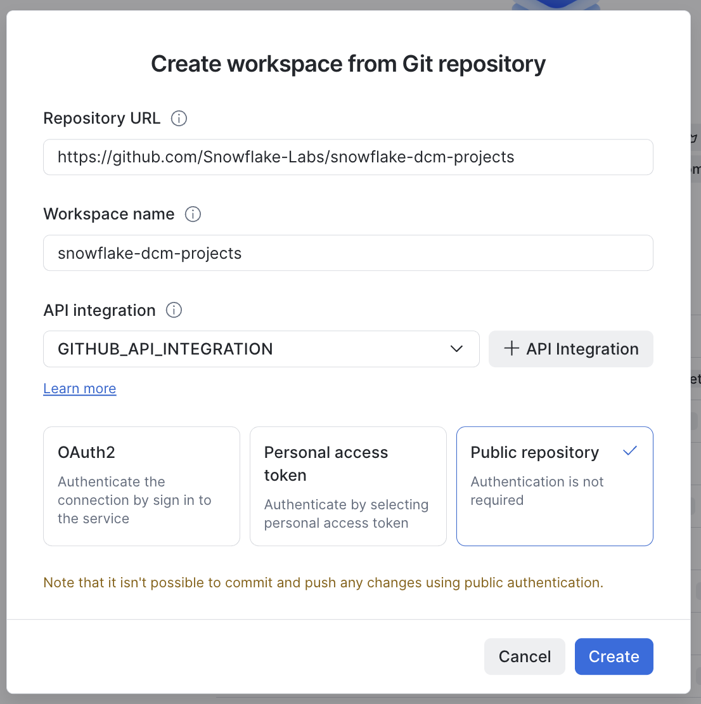
Screenshot placeholder: the Create Workspace from Git repository dialog with the snowflake-dcm-projects URL filled in, taken just before clicking Create.

Once the workspace is created you will see the repository files in the file explorer. Navigate to **Quickstarts/get-started-snowflake-dcm-projects** to find two directories.

DCM_Projects_Get_Started/ is the DCM Project itself. scripts/ holds numbered SQL files that you run in Snowsight worksheets at different stages of this guide. They live outside the project directory, so nothing in them is ever picked up by a plan.

| File | When to run |
|---|---|
| scripts/01_pre_deploy.sql | Once, before the first plan |
| scripts/02_post_deploy.sql | After the first successful deploy |
| scripts/03_cleanup.sql | When you are finished |

Every operational step in this guide is given twice: once for Snowsight, and once for the [Snowflake CLI](https://docs.snowflake.com/en/developer-guide/snowflake-cli/installation/installation) if you would rather drive the project from a terminal against your own copy of the repository.

**With the Snowflake CLI:** clone the repository and work from the guide's folder. Run the snow dcm commands from inside DCM_Projects_Get_Started, and the snow sql commands from the guide's folder.

```bash
git clone https://github.com/Snowflake-Labs/snowflake-dcm-projects.git
cd snowflake-dcm-projects/Quickstarts/get-started-snowflake-dcm-projects
```

<!-- ------------------------ -->
## Set Up Roles and Permissions

Run the first script. **In Snowsight:** open scripts/01_pre_deploy.sql in a worksheet and run it from top to bottom. **With the Snowflake CLI:**

```bash
snow sql -f scripts/01_pre_deploy.sql
```

The script is the same in every guide of this series. It runs as ACCOUNTADMIN and is safe to run again: if you already ran it for another guide, running it now changes nothing. It has six numbered sections.

**1. Role.** It creates the DCM_DEVELOPER role and grants it to you and to SYSADMIN. Every guide in this series uses this role as the project owner.

**2. Inherited grants opt-in.** It turns on inherited grants for the account.

**3. Account-level privileges.** A project cannot grant account-level privileges to its own owner, so they all happen here, before the first plan. DCM_DEVELOPER gets the privileges that the guides in this series need together, one grant per line, each with a comment naming the guide or feature that uses it. Some are checked at plan time, so a missing one fails the first plan rather than the deploy.

**4. Series container.** It creates the DCM_DEMO database and the DCM_DEMO.PROJECTS schema that holds the project objects of the series, and grants DCM_DEVELOPER USAGE on both and CREATE DCM PROJECT on the schema. A project cannot define the database or schema it lives in.

**5. Project object (alternative path only).** Commented out. The first plan creates the project object for you; the SQL is there if the prompt does not appear, or if you prefer to create it yourself.

**6. Values for the manifest.** The last query returns your account identifier and user name.

**Inherited grants.** An inherited grant covers current *and* future objects of a type inside a container. GRANT ON ALL snapshots what exists right now; GRANT ON FUTURE covers only what comes later. An inherited grant covers both, as one grant rather than one per object, which is why it is the recommended pattern in DCM Projects. It is a one-time opt-in per account ([release note](https://docs.snowflake.com/en/release-notes/2026/other/2026-09-10-inherited-grants-ga)), which the setup script turns on:

```sql
ALTER ACCOUNT SET FEATURE_RBAC_INHERITED_GRANTS = 'ENABLED';
```

An inherited grant cannot be combined with WITH GRANT OPTION, `CASCADE` or `RESTRICT`.

Copy the account identifier from the last query into account_identifier under the DCM_DEV target in DCM_Projects_Get_Started/manifest.yml (line 11, the line that ends with "# update to your account names"). A mismatched account_identifier is only a warning, not an error, but fixing it keeps the warning out of your output.

<!-- ------------------------ -->
## Anatomy of a DCM Project

A project is a **manifest** plus one or more **definition files** under sources/. The manifest is the control surface; the definitions are the desired state. This project has six definition files and one macro under sources/, and a Streamlit app that it deploys as an asset.

### The manifest

Open DCM_Projects_Get_Started/manifest.yml. It has three sections: **targets**, **assets** and **templating**. The first declares targets:

```yaml
manifest_version: 2
type: DCM_PROJECT
default_target: DCM_DEV

targets:
  DCM_DEV:
    account_identifier: MYORG-MY_DEV_ACCOUNT        # update to your account names
    project_name: DCM_DEMO.PROJECTS.DCM_PROJECT_DEV
    project_owner: DCM_DEVELOPER
    templating_config: DEV

  DCM_PROD_US:
    account_identifier: MYORG-MY_ACCOUNT_US         # update to your account names
    project_name: DCM_DEMO.PROJECTS.DCM_PROJECT_PROD
    project_owner: DCM_PROD_DEPLOYER
    templating_config: PROD
```

A target is a deployment destination: which account to deploy into, which DCM Project object holds the state there, which role owns that project, and which templating_config to render the definitions with. Replace MYORG-MY_DEV_ACCOUNT with the account identifier the setup script printed. default_target is what you get when you omit --target. This is an excerpt: the file also ships with DCM_STAGE and DCM_PROD_EU targets, and only DCM_DEV is used here.

Next comes **assets**. Everything under sources/ is SQL that a `DEFINE` statement expresses in full, but some objects are backed by files instead: a Streamlit app is Python, not DDL. An asset is a named set of such files that the project carries along with its definitions:

```yaml
assets:
  orders_dashboard:
    path: 'streamlit/dashboard/**/*'
```

orders_dashboard is a name you choose, and a definition refers to the files by it, as asset://orders_dashboard. The guide comes back to this once there is data for the app to read. For now, note that it sits at the **top level** of the manifest, alongside targets and templating rather than inside either.

The third section declares the templating configurations that targets select between. This excerpt shows DEV and PROD; the file also has a STAGE configuration and a commented block of environment-variable declarations you will use later.

```yaml
templating:
  defaults:
    wh_size: "X-SMALL"     # inherited unless a configuration overrides it

  configurations:
    DEV:
      env_suffix: "_DEV"
      project_owner_role: "DCM_DEVELOPER"
      teams:
        - name: "DEV_TEAM_1"
          data_retention_days: 1

    PROD:
      env_suffix: ""
      wh_size: "LARGE"
      teams:
        - name: "Marketing"
          data_retention_days: 1
        - name: "Finance"
          data_retention_days: 30
```

Values in defaults apply everywhere unless a configuration overrides them: wh_size is X-SMALL in DEV because DEV does not set it, and LARGE in PROD because PROD does. env_suffix is what lets a single definition file produce DCM_DEMO_1_DEV in development and DCM_DEMO_1 in production. The teams list differs per environment too: one team in DEV, two in PROD.

This is what the manifest is for: **one set of definition files, several environments, and the differences confined to YAML.** Nothing in sources/ mentions DEV or PROD.

### One definition file

Definition files use `DEFINE` in place of `CREATE`, and Jinja expressions for anything the manifest controls. Here is the modelled layer, sources/definitions/analytics.sql:

```sql
DEFINE SCHEMA DCM_DEMO_1{{env_suffix}}.ANALYTICS
    COMMENT = 'Modelled layer, built and kept fresh by a dynamic table';

DEFINE DYNAMIC TABLE DCM_DEMO_1{{env_suffix}}.ANALYTICS.ENRICHED_ORDER_DETAILS
WAREHOUSE = DCM_DEMO_1_WH{{env_suffix}}
TARGET_LAG = '1 hour'
INITIALIZE = 'ON_SCHEDULE'
COMMENT = 'Order lines enriched with menu attributes, revenue and profit'
AS
SELECT
    oh.ORDER_ID,
    oh.ORDER_TS,
    od.QUANTITY,
    m.MENU_ITEM_NAME,
    m.ITEM_CATEGORY,
    m.SALE_PRICE_USD,
    m.COST_OF_GOODS_USD,
    (od.QUANTITY * m.SALE_PRICE_USD) AS LINE_ITEM_REVENUE,
    (od.QUANTITY * (m.SALE_PRICE_USD - m.COST_OF_GOODS_USD)) AS LINE_ITEM_PROFIT
FROM DCM_DEMO_1{{env_suffix}}.RAW.ORDER_HEADER oh
JOIN DCM_DEMO_1{{env_suffix}}.RAW.ORDER_DETAIL od ON oh.ORDER_ID = od.ORDER_ID
JOIN DCM_DEMO_1{{env_suffix}}.RAW.MENU m ON od.MENU_ITEM_ID = m.MENU_ITEM_ID
QUALIFY ROW_NUMBER() OVER (
    PARTITION BY oh.ORDER_ID, m.MENU_ITEM_NAME
    ORDER BY oh.ORDER_TS DESC
    ) = 1;
```

The other files follow the same pattern:

- raw.sql declares the database, the RAW schema and the three landing tables.
- access.sql declares the warehouse, a read role, its grants and a tag.
- serve.sql declares a semantic view over the dynamic table, and the Streamlit app that reads it, both in the ANALYTICS schema. The file name groups the consumption objects; there is no SERVE schema.
- jinja_demo.sql holds the templated team objects covered in "Templating and Per-Environment Config".
- secrets.sql holds a secret that stays switched off until "Secrets and Environment Variables".

<!-- ------------------------ -->
## First Plan and Deploy

Always plan first. A plan renders the templates, compiles the SQL, compares the result against the account, and reports what it *would* do.

**Jinja renders before DCM sees any of the SQL.** The template engine runs first and produces plain SQL; only then does DCM parse it. That ordering has consequences you will meet in "Templating and Per-Environment Config", and it means the SQL DCM actually evaluated is a real artifact you can read: the plan writes it out, and looking at it is the fastest way to understand what a template did.

**In Snowsight:** the DCM control panel is the first tab in the bottom panel of your workspace. Select the project **get-started-snowflake-dcm-projects/DCM_Projects_Get_Started** and the **DCM_DEV** target. Until the DCM Project object named in the manifest exists, the status indicator next to **Target** is red. Click the play button to the right of **Plan**. Snowsight asks you to confirm creating the DCM Project object with the name and owner role defined for that target in the manifest; confirm, and the plan runs.

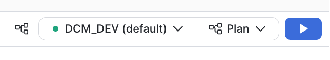
Screenshot placeholder: the DCM control panel with project get-started-snowflake-dcm-projects/DCM_Projects_Get_Started and target DCM_DEV selected and the red status indicator, taken just before clicking Plan.

**With the Snowflake CLI:** create the project object for the target, then plan. Pass the manifest's owner role for that target with --role. The CLI creates the object as the session role, so without it the object can end up owned by ACCOUNTADMIN or DCM_DEVELOPER instead of the manifest owner.

```bash
snow dcm create --target DCM_DEV --role DCM_DEVELOPER
snow dcm plan --target DCM_DEV --role DCM_DEVELOPER --save-output
```

**With SQL:** if the prompt does not appear, or you prefer to create the object yourself, run this as the project owner role before the first plan.

```sql
CREATE DCM PROJECT IF NOT EXISTS DCM_DEMO.PROJECTS.DCM_PROJECT_DEV
    COMMENT = 'for testing DCM Projects Quickstarts';
```

On a clean account the plan reports:

```text
Planned 16 entities (15 to create, 1 to alter, 0 to drop).
```

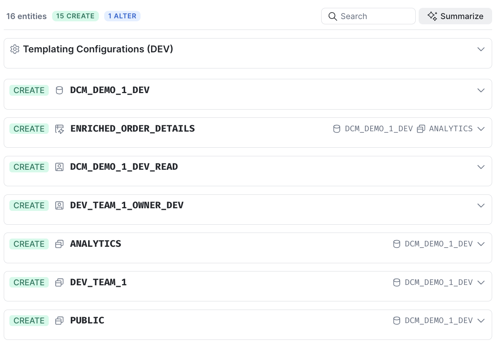
Screenshot placeholder: the first Plan result in Snowsight, showing 16 entities with 15 CREATE and 1 ALTER, including schemas ANALYTICS, PUBLIC, RAW and DEV_TEAM_1.

With the CLI, --save-output writes the rendered definitions and a plan_result.json under out/. The JSON carries a per-entity changes array, which is where you look when a summary count surprises you. In Snowsight the same rendered output appears in a new out folder above sources in the file explorer. Open the rendered jinja_demo.sql side by side with the original to see how the templating resolved.

### Reading the changeset

Two things in that summary deserve an explanation.

**Why one alter, on a first deploy?** The altered entity is ROLE DCM_DEVELOPER, acquiring `OWNERSHIP` on each newly created object. The project-owner role has to exist *before* the project can be created (it is what owns the project), so it is never something DCM creates. A first deploy of any DCM Project therefore shows exactly this one alter. It is not drift, and there is nothing to fix.

**Why 16 entities from 12 `DEFINE` statements?** The arithmetic is worth following, because it shows what DCM is actually tracking. The twelve definitions in the non-template files cover one database, two schemas, three tables, one dynamic table, one semantic view, one Streamlit app, one warehouse, one role and one tag. The remaining four come from elsewhere:

| Source | Entities |
|---|---|
| DEFINE statements | 12 |
| PUBLIC schema, planned with every database | 1 |
| Jinja loop and macro expanding DEV_TEAM_1 | 2 |
| ROLE DCM_DEVELOPER gaining ownership | 1 |
| **Total** | **16** |

An entity is not a line of SQL. It is an object DCM will own and reconcile on every future deploy.

### Deploy

When the changeset matches what you expected, deploy it.

**In Snowsight:** in the DCM control panel, set the operation to **Deploy** instead of **Plan**, add a deployment alias such as initial-deployment, and run it.

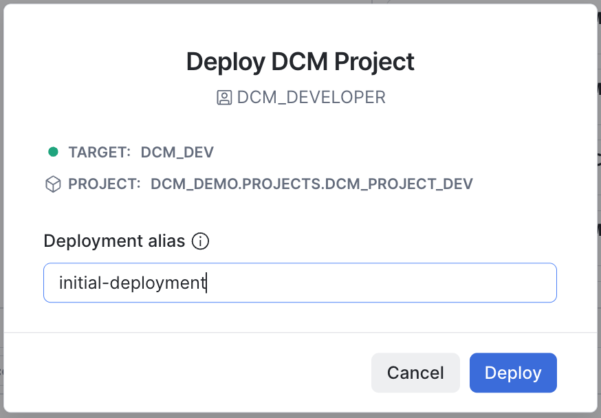

**With the Snowflake CLI:**

```bash
snow dcm deploy --target DCM_DEV --role DCM_DEVELOPER --alias initial-deployment
```

```text
Deployed 16 entities (15 created, 1 altered, 0 dropped).
```

The --alias is a label on this deployment, the way a commit message labels a commit. It appears in the project's deployment history, so six weeks later you can tell which deploy introduced a change without diffing object definitions.

Open the Database Explorer on the left of Snowsight and use its reload icon, and you will see DCM_DEMO_1_DEV with all of the created objects inside it.

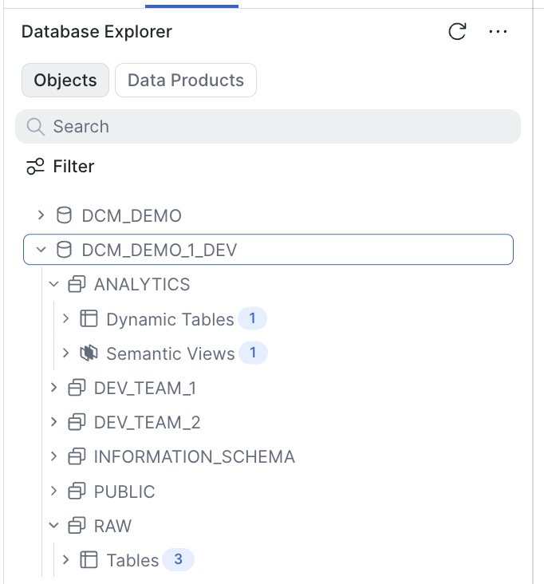
Screenshot placeholder: the Database Explorer after the first deploy, DCM_DEMO_1_DEV expanded to show the schemas ANALYTICS, DEV_TEAM_1, INFORMATION_SCHEMA, PUBLIC and RAW.

<!-- ------------------------ -->
## Change It and Redeploy

This is the loop that matters. The sources ship with three edits already written out and commented, marked CHANGE STEP 1 of 3 through 3 of 3. Make all three.

**Step 1, in sources/definitions/analytics.sql:** comment out the current TARGET_LAG and uncomment the replacement:

```sql
-- TARGET_LAG = '1 hour'
TARGET_LAG = '30 minutes'
```

**Step 2, in manifest.yml:** under the DEV configuration, uncomment the warehouse size so DEV stops inheriting X-SMALL from defaults:

```yaml
      wh_size: "SMALL"
```

**Step 3, in manifest.yml:** add a second team to the DEV teams list:

```yaml
        - name: "DEV_TEAM_2"
          data_retention_days: 3
```

Two of the three are manifest edits: a two-line YAML change is about to produce a set of new objects.

### See only what changed

The CLI has a delta mode for fast iteration:

```bash
snow dcm plan --delta --target DCM_DEV --role DCM_DEVELOPER
```

--delta reports the changes rather than the whole desired state, so it is what you run while iterating; in Snowsight, select **Delta** under **Plan Mode**. It only evaluates definitions that changed, so it cannot see drift made outside DCM. Always run a full plan before deploying.

### Then the full plan

**In Snowsight:** in the DCM control panel, select the project **get-started-snowflake-dcm-projects/DCM_Projects_Get_Started** and the **DCM_DEV** target, then click the play button to the right of **Plan**.

**With the Snowflake CLI:**

```bash
snow dcm plan --target DCM_DEV --role DCM_DEVELOPER --save-output
```

```text
CREATE   ROLE                 DEV_TEAM_2_OWNER_DEV
CREATE   SCHEMA               DCM_DEMO_1_DEV.DEV_TEAM_2
ALTER    DYNAMIC_TABLE        DCM_DEMO_1_DEV.ANALYTICS.ENRICHED_ORDER_DETAILS
ALTER    ROLE                 DCM_DEVELOPER
ALTER    WAREHOUSE            DCM_DEMO_1_WH_DEV
Planned 5 entities (2 to create, 3 to alter, 0 to drop).
```

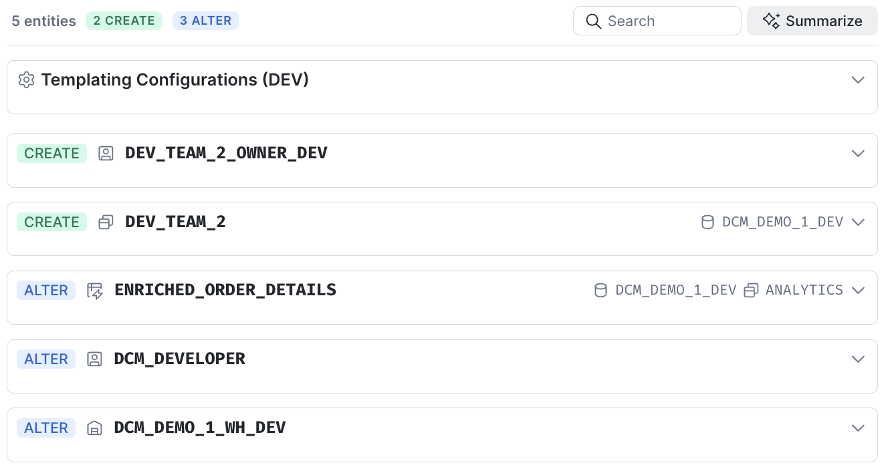
Screenshot placeholder: the second Plan result in Snowsight, 5 entities with 2 CREATE (DEV_TEAM_2_OWNER_DEV, DEV_TEAM_2) and 3 ALTER (ENRICHED_ORDER_DETAILS, DCM_DEVELOPER, DCM_DEMO_1_WH_DEV).

The two creates are DEV_TEAM_2's objects: a schema and a role, produced by the Jinja loop and macro from those two lines of YAML. The three alters are the dynamic table's target lag, the warehouse's size, and DCM_DEVELOPER taking ownership of the two new objects.

Open out/plan_result.json and find the dynamic table. Its entire change is one nested attribute:

```text
target_lag.seconds  3600 -> 1800
```

No refresh mode change, no body change, no re-initialization. This is the cheap case, and it is worth knowing which cases are cheap: **`WAREHOUSE` and TARGET_LAG are the only dynamic-table attributes that alter in place.** Any change to a dynamic table's *body*, including appending a column at the end, forces a re-initialization or a full refresh. Neither is wrong to do; the point is that a plan tells you the blast radius before you pay for it.

Adding a team creates objects. Removing an entry from the teams list would produce `DROP` operations on that team's real objects, with their data. Don't try it here, but know that it is what a plan would show you, which is precisely why you run one.

### Deploy, then deploy again

**In Snowsight:** in the DCM control panel, set the operation to **Deploy** instead of **Plan**, add a deployment alias such as lag-wh-and-team2, and run it.

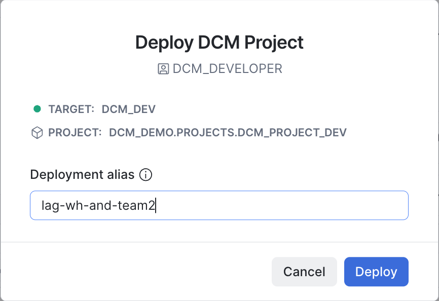

**With the Snowflake CLI:**

```bash
snow dcm deploy --target DCM_DEV --role DCM_DEVELOPER --alias lag-wh-and-team2
```

```text
Deployed 5 entities (2 created, 3 altered, 0 dropped).
```

Now deploy a second time with no edits in between, under a new alias, no-op-proof, from either interface:

```bash
snow dcm deploy --target DCM_DEV --role DCM_DEVELOPER --alias no-op-proof
```

```text
No changes detected.
```

Nothing happened, and nothing needed to. This is the difference between declaring state and running a script. `DEFINE` executes as **CREATE OR ALTER**, not CREATE OR REPLACE: the second deploy compared the declared state to the account, found them identical, and stopped. The dynamic table was not rebuilt. The tables were not recreated and their data was not lost. There is no ledger recording that the change already ran; the account simply already matches the files.

That is why the same project can be deployed on every merge to main without a migration ledger, and why a deploy is safe to retry after a network failure.

<!-- ------------------------ -->
## Inspect What the Project Manages

A deployed project is a live inventory of the objects it owns. Ask it:

```sql
SHOW ENTITIES IN DCM PROJECT DCM_DEMO.PROJECTS.DCM_PROJECT_DEV;
```

Every entity the project manages appears here, with its type and name. There are 16 rows at this point: the database, four schemas, three tables, the dynamic table, the semantic view, the Streamlit app, the tag, the warehouse and three roles. The PUBLIC schema and DCM_DEVELOPER were in both changesets, but neither is listed, because neither is a managed entity. This is the boundary of the project's authority: an object in this list is reconciled on every deploy, and an object that is not is invisible to DCM even if it sits in the same database.

That distinction is what makes the next command matter, because it tells you how the inventory got to its current shape:

```sql
SHOW DEPLOYMENTS IN DCM PROJECT DCM_DEMO.PROJECTS.DCM_PROJECT_DEV;
```

| name | alias |
|---|---|
| DEPLOYMENT$3 | no-op-proof |
| DEPLOYMENT$2 | lag-wh-and-team2 |
| DEPLOYMENT$1 | initial-deployment |

Three deployments, which is where the aliases pay off. The third one changed nothing, and the history records that too.

Together these two commands are the answer to "what is in this environment, and who put it there", without reading a single definition file. On a shared account they are also how you tell your own project's objects apart from a sibling project's, which matters when it is time to clean up.

<!-- ------------------------ -->
## Templating and Per-Environment Config

The "Anatomy of a DCM Project" section showed the manifest supplying values. This section shows the definitions consuming them. Values that must not live in the manifest at all, such as an API key, come later, in "Secrets and Environment Variables".

### Three Jinja ideas

sources/definitions/jinja_demo.sql is the whole templating lesson in ten lines:

```sql

    

    DEFINE SCHEMA DCM_DEMO_1{{env_suffix}}.{{team_name}}
        COMMENT = 'Team schema generated by the Jinja loop'
        DATA_RETENTION_TIME_IN_DAYS = {{ team.data_retention_days }};

    {{ create_team_roles(team_name) }}


```

There are exactly three ideas here. A **loop** over the manifest's teams list. A **dictionary value** injected into a real object property: data_retention_days from the YAML becomes the schema's actual DATA_RETENTION_TIME_IN_DAYS, which is why DEV_TEAM_2 was planned with a retention of 3. And a **macro call**, which is where each team's role comes from:

```sql

    DEFINE ROLE {{team}}_OWNER{{env_suffix}} COMMENT = 'Owns the {{team}} team schema';
    GRANT USAGE     ON DATABASE DCM_DEMO_1{{env_suffix}}        TO ROLE {{team}}_OWNER{{env_suffix}};
    GRANT OWNERSHIP ON SCHEMA DCM_DEMO_1{{env_suffix}}.{{team}} TO ROLE {{team}}_OWNER{{env_suffix}};
    -- ensure the project owner still holds every role it transfers ownership to,
    -- to avoid locking itself out
    GRANT ROLE {{team}}_OWNER{{env_suffix}} TO ROLE {{project_owner_role}};

```

Note the last grant and its comment. When a project hands `OWNERSHIP` to a role, it must keep hold of that role or it loses the ability to manage what it just gave away.

Deployed to DEV this loop runs twice. Deployed to PROD it runs for Marketing and Finance instead, from the same file. Read the rendered copy of this file under out/ after a plan to see the SQL DCM actually evaluated: loops expanded, macro inlined, values substituted.

### The render-order gotcha, worked

Jinja renders *before* Snowflake parses the SQL. The consequence catches everyone at least once: **a Jinja expression inside a -- comment is still evaluated.** Commenting a line out hides it from Snowflake. It does not hide it from the template engine, which has already finished by then.

sources/definitions/raw.sql carries a deliberate demonstration. This line is inert SQL but live Jinja:

```sql
--   this database is DCM_DEMO_1{{env_suffix}}
```

Run a plan with --save-output and read the same line back in out/rendered/sources/definitions/raw.sql. The suffix has been substituted *inside the comment*:

```text
--   this database is DCM_DEMO_1_DEV
```

Harmless here, because env_suffix always has a value. It stops being harmless the moment a commented-out line references something that does not resolve: the plan fails on a line you believed was disabled. The same applies to prose: never write Jinja delimiters as literal text in a comment you intend as explanation, because the engine reads them as code and not as English. To write about a Jinja expression, or to switch off a block that contains one, use a Jinja comment, which opens with a brace and a hash sign and closes with a hash sign and a brace. The engine strips it instead of evaluating it. secrets.sql uses exactly that to stay off until you need it.

So: the "comment out the alternative" pattern is safe in plain SQL and a trap in templated SQL. And out/rendered/ is the first place to look whenever a template surprises you; it is the exact SQL DCM evaluated.

<!-- ------------------------ -->
## Beyond DEFINE: ATTACH and GRANT

`DEFINE` declares objects, and most of a project is `DEFINE`. Two other verbs do the rest.

`ATTACH` connects two objects, because some relationships are not a property of either one: they are a link between them. sources/definitions/access.sql declares a tag, then attaches it to a table:

```sql
DEFINE TAG DCM_DEMO_1{{env_suffix}}.RAW.DATA_SENSITIVITY
    ALLOWED_VALUES 'PUBLIC', 'INTERNAL', 'RESTRICTED'
    COMMENT = 'Sensitivity classification for governed objects';

ATTACH TAG DCM_DEMO_1{{env_suffix}}.RAW.DATA_SENSITIVITY = 'INTERNAL'
    TO TABLE DCM_DEMO_1{{env_suffix}}.RAW.ORDER_HEADER;
```

Because the link is its own statement, the two ends are independent: the tag and the table it marks need not be declared in the same file, or even in the same project.

`GRANT` is the third verb, and it is just Snowflake's own `GRANT`, with no wrapper and no new syntax. The same file gives the read role access to everything it needs:

```sql
GRANT USAGE ON DATABASE DCM_DEMO_1{{env_suffix}} TO ROLE DCM_DEMO_1{{env_suffix}}_READ;

GRANT INHERITED SELECT ON ALL TABLES IN DATABASE DCM_DEMO_1{{env_suffix}}
    TO ROLE DCM_DEMO_1{{env_suffix}}_READ;
```

The second one covers every table in the database, including tables a future deploy has not created yet, as one grant rather than one per object.

Grants are not entities in their own right; they belong to the role that holds them. That is why a plan reports an ALTER on the role rather than a list of individual grants, and why the very first deploy showed one alter on DCM_DEVELOPER: taking ownership of each new object is itself a grant.

<!-- ------------------------ -->
## Seed Data and Query

The deploy created empty structures. Seed them. **In Snowsight:** open scripts/02_post_deploy.sql in a worksheet and run each section in order. **With the Snowflake CLI:**

```bash
snow sql -f scripts/02_post_deploy.sql
```

The script seeds the menu and ten orders, refreshes the dynamic table, and queries the result. It runs on the project's own warehouse, DCM_DEMO_1_WH_DEV. It is safe to re-run: the menu insert skips rows that already exist, and the order inserts compute an offset from the current maximum ORDER_ID, so each run appends ten fresh orders instead of colliding with previous ones. It uses a session variable rather than a BEGIN...END block, because snow sql -f splits a script at semicolons and would break the block apart.

The dynamic table builds **20 enriched rows**. Then the semantic view answers in business terms: you name dimensions and metrics, and it resolves the aggregation:

```sql
SELECT * FROM SEMANTIC_VIEW(
    DCM_DEMO_1_DEV.ANALYTICS.ORDER_ANALYTICS
    DIMENSIONS order_lines.ITEM_CATEGORY
    METRICS order_lines.TOTAL_REVENUE, order_lines.TOTAL_PROFIT, order_lines.ORDER_COUNT
)
ORDER BY TOTAL_REVENUE DESC;
```

| ITEM_CATEGORY | TOTAL_REVENUE | TOTAL_PROFIT | ORDER_COUNT |
|---|---|---|---|
| Pizza | 106.00 | 67.50 | 3 |
| Tacos | 34.50 | 25.50 | 1 |
| Burgers | 32.00 | 22.00 | 2 |
| Wraps | 30.00 | 18.00 | 2 |
| Drinks | 29.00 | 22.20 | 3 |
| Curry | 27.00 | 19.00 | 1 |
| Bowls | 25.50 | 17.25 | 2 |
| Sides | 24.00 | 16.00 | 3 |
| Desserts | 12.00 | 9.00 | 1 |
| Noodles | 10.00 | 6.50 | 1 |

DEFINE SEMANTIC VIEW means the vocabulary your BI tools and AI agents depend on is versioned and reviewed in the same plan diff as the pipeline producing the numbers.

<!-- ------------------------ -->
## The App That Reads It

Everything so far has been SQL that a `DEFINE` statement can express in full. A Streamlit app is Python files, so DCM carries it as **project assets**.

An asset is a named set of source files, declared at the top level of manifest.yml, a sibling of targets and templating, not nested inside either:

```yaml
assets:
  orders_dashboard:
    path: 'streamlit/dashboard/**/*'
```

The path is relative to the manifest and must live **outside sources/**, which is reserved for definitions, macros and tests. Use path for a single entry or paths for a list; each one can be a glob or a single file. A bare directory path is not accepted, so append a recursive wildcard to take a folder's contents. Globs support only the single and double asterisk (no question mark, no brace expansion), and paths cannot contain Jinja. A pattern matching no files fails the run rather than deploying something empty.

Then DEFINE STREAMLIT refers to the asset by name. Because the definition names a set of files rather than a path, the project can pull in files from outside sources/ and import them during rendering:

```sql
DEFINE STREAMLIT DCM_DEMO_1{{env_suffix}}.ANALYTICS.ORDERS_DASHBOARD
    FROM 'asset://orders_dashboard/'
    MAIN_FILE = 'streamlit_app.py'
    QUERY_WAREHOUSE = DCM_DEMO_1_WH{{env_suffix}}
    COMPUTE_POOL = SYSTEM_COMPUTE_POOL_CPU
    RUNTIME_NAME = 'SYSTEM$ST_CONTAINER_RUNTIME_PY3_11'
    TITLE = 'Orders Dashboard'
    COMMENT = 'Reads the ORDER_ANALYTICS semantic view; deployed from the orders_dashboard asset';
```

The app reads the semantic view rather than the dynamic table, so the numbers on screen are the same metric definitions an agent would resolve. For portability, note that **asset files are not Jinja-rendered**, so the app cannot use the env_suffix variable to find its own database. It resolves that at runtime instead, which is why the identical file serves every environment:

```python
session = get_active_session()
database = session.sql("SELECT CURRENT_DATABASE()").collect()[0][0]
```

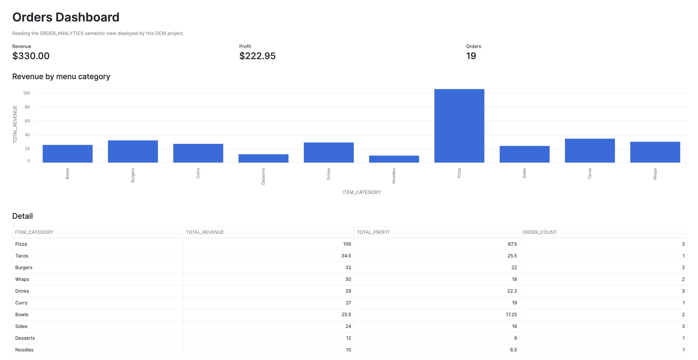

Change nothing but the Python, for example add a chart or rename a heading, and plan again:

```console
ALTER    STREAMLIT            DCM_DEMO_1_DEV.ANALYTICS.ORDERS_DASHBOARD
Planned 1 entity (0 to create, 1 to alter, 0 to drop).
```

The plan tracks the **contents of the asset**, not just the `DEFINE` statement, and a deploy publishes a new version of the app. The dashboard is versioned and promoted the same way as the tables it reads, in one plan and one deploy. Undo the edit before you go on, and the next plan returns No changes detected, the same convergence you saw earlier.

DEFINE CODE BUNDLE uses assets the same way, for packaging Python jobs rather than apps.

<!-- ------------------------ -->
## Secrets and Environment Variables

Some values cannot go in the manifest. The templating section of manifest.yml is committed to Git and rendered into plain text on the project's stage, which is fine for a warehouse size and wrong for an API key. DCM handles those with two kinds of runtime value, both declared by name in the manifest and supplied fresh on every plan and deploy:

- An **environment variable** is a value that changes per run but is safe to read, such as a CI build number. It renders into the SQL as plain text.
- An **environment secret** is a value that must never be written down. It renders as a reference, and DCM masks it in plan and deploy output and in the deployment history.

The partner that sends this pipeline its orders issues an API key. You will store it in a Snowflake secret, declared in the project like any other object, and record which build deployed it.

### Turn it on

This takes two small edits, marked SECRETS STEP 1 of 2 and 2 of 2.

**Step 1, in manifest.yml:** uncomment the four declaration lines under templating (lines 60 to 63). They declare names only; there is nowhere to put a value:

```yaml
  env_vars:
    - BUILD_NUMBER:
  env_secrets:
    - PARTNER_API_KEY:
```

**Step 2, in sources/definitions/secrets.sql:** delete the line that opens the Jinja comment and the line that closes it, so the definition becomes live:

```sql
DEFINE SECRET DCM_DEMO_1{{env_suffix}}.RAW.PARTNER_API_KEY
    TYPE = GENERIC_STRING
    SECRET_STRING = {{ _snow.env_secret("PARTNER_API_KEY") }}
    COMMENT = 'API key for the partner order feed, deployed by build {{ _snow.env_var("BUILD_NUMBER") }}';
```

The value comes from the environment secret and the comment from the environment variable. The file shipped inside a Jinja comment for the reason in the render-order section: a referenced environment secret must be supplied on every plan, and a -- comment would not have stopped Jinja from asking for it. Never write a literal for `SECRET_STRING`: DCM stores the rendered definition, literal included, as plain text on the project's stage.

### Supply the values and plan

Use a dummy value for the key; it is never shown back to you.

**In Snowsight:** in the DCM control panel, select the project **get-started-snowflake-dcm-projects/DCM_Projects_Get_Started** and the **DCM_DEV** target. The **Environment Variables** section now lists BUILD_NUMBER and PARTNER_API_KEY. Type 101 for BUILD_NUMBER and any dummy string for PARTNER_API_KEY; the secret field shows a lock icon and masks what you type. You can also select **Import .env file** to load both. Then click the play button to the right of **Plan**. The **Override Variables** option in the same pane overrides templating values from the manifest; it does not supply environment variables or secrets.

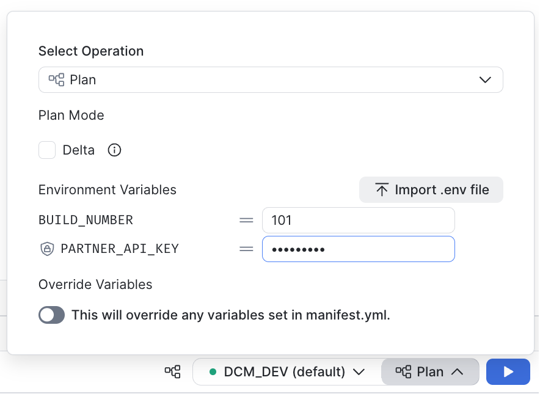
Screenshot placeholder: the DCM control panel Plan operation after SECRETS STEP 1 and 2, with the Environment Variables section showing BUILD_NUMBER = 101 and PARTNER_API_KEY masked behind the lock icon, and the Import .env file button visible.

**With the Snowflake CLI:** export both in your shell, or put them in a file and add --env-file .env (the repository's .gitignore already excludes .env files). The CLI sends the values as a bind variable, so they are not part of the SQL text recorded in query history.

```bash
export BUILD_NUMBER=101
export PARTNER_API_KEY='demo-key-not-a-real-secret'
snow dcm plan --target DCM_DEV --role DCM_DEVELOPER --save-output
```

```text
CREATE   SECRET               DCM_DEMO_1_DEV.RAW.PARTNER_API_KEY
ALTER    ROLE                 DCM_DEVELOPER
Planned 2 entities (1 to create, 1 to alter, 0 to drop).
```

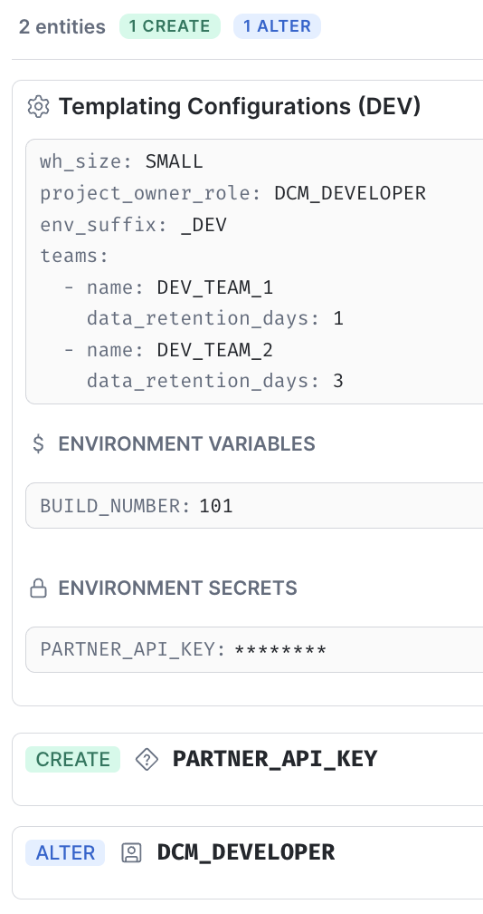
Screenshot placeholder: the Plan result in Snowsight with 2 entities, CREATE PARTNER_API_KEY expanded to show the comment ending in build 101 and secret_string shown as ********.

The rendered copy in out/rendered/sources/definitions/secrets.sql shows what DCM evaluated:

```sql
DEFINE SECRET DCM_DEMO_1_DEV.RAW.PARTNER_API_KEY
    TYPE = GENERIC_STRING
    SECRET_STRING = secretref('PARTNER_API_KEY')
    COMMENT = 'API key for the partner order feed, deployed by build 101';
```

The build number was substituted as text; the key was not. The rendered SQL holds a reference, and the secret_string change in out/plan_result.json reads ********. If you forget to supply the secret, the plan stops with an error naming it: "Template variable 'PARTNER_API_KEY' is declared in 'env_secrets' section of the manifest, but was not supplied in the ENVIRONMENT parameters".

### Deploy and check

Deploy with the values still supplied; every plan and deploy that renders the definition needs them.

**In Snowsight:** in the DCM control panel, set the operation to **Deploy** instead of **Plan**, add a deployment alias such as add-partner-secret, and run it.

**With the Snowflake CLI:**

```bash
snow dcm deploy --target DCM_DEV --role DCM_DEVELOPER --alias add-partner-secret
```

```text
Deployed 2 entities (1 created, 1 altered, 0 dropped).
```

Describing the secret shows everything except the value:

```sql
DESCRIBE SECRET DCM_DEMO_1_DEV.RAW.PARTNER_API_KEY;
```

| name | secret_type | owner | comment |
|---|---|---|---|
| PARTNER_API_KEY | GENERIC_STRING | DCM_DEVELOPER | API key for the partner order feed, deployed by build 101 |

The deployment history keeps the same discipline: its deploy_result.json records "BUILD_NUMBER": "101" and "PARTNER_API_KEY": "********". When we ran this guide, a search for the key across the definition files, the plan output, the deployment's files and the account's query history found it nowhere.

**When you rotate the key,** know that plan does not currently detect a change to a secret's value alone: it reports No changes detected and the old value stays. Change another property of the secret in the same deploy, such as the build number in its comment.

<!-- ------------------------ -->
## Detach and Clean Up

Before tearing anything down, know that there is a gentler option. DROP DCM PROJECT on its own, without a `PURGE` first, removes the project and its deployment history and leaves every entity, grant and attachment in place as an ordinary unmanaged object. To release a single entity, call SYSTEM$UNMANAGE_ENTITY_FROM_DCM_PROJECT with its type and name; to release grants or attachments, pass the rendered statements to SYSTEM$UNMANAGE_FROM_DCM_PROJECT. Then remove the matching statements from your definitions, or the next deploy takes them back.

For example, this releases the read role's warehouse grant without revoking it:

```sql
SELECT SYSTEM$UNMANAGE_FROM_DCM_PROJECT(
    'DCM_DEMO.PROJECTS.DCM_PROJECT_DEV',
    $$GRANT USAGE ON WAREHOUSE DCM_DEMO_1_WH_DEV TO ROLE DCM_DEMO_1_DEV_READ;$$);
```

It returns 1, the number of items released, and SHOW GRANTS IN DCM PROJECT lists one grant fewer while the role keeps its privilege. If the GRANT statement is still in access.sql, the next deploy adopts the grant again. Supply BUILD_NUMBER and PARTNER_API_KEY for that deploy as before: with the secret live, every deploy renders it. That deploy reports No changes detected, because nothing in the account changes, so check SHOW GRANTS IN DCM PROJECT rather than the deploy summary.

This guide cleans up fully. **In Snowsight:** open scripts/03_cleanup.sql in a worksheet and run it as DCM_DEVELOPER. **With the Snowflake CLI:**

```bash
snow sql -f scripts/03_cleanup.sql
```

The script works through six sections in order.

1. **Purge the project.** `PURGE` drops every object the project created (database, schemas, tables, dynamic table, semantic view, Streamlit app, secret, warehouse, roles, and all their data), and revokes its grants and removes its attachments. It is irreversible. It renders no definitions, so it needs no environment values.
2. **Drop the project object**, which `PURGE` leaves behind.

    ```sql
    EXECUTE DCM PROJECT DCM_DEMO.PROJECTS.DCM_PROJECT_DEV PURGE;

    DROP DCM PROJECT IF EXISTS DCM_DEMO.PROJECTS.DCM_PROJECT_DEV;
    ```

3. **Objects created outside the project.** There are none: everything above was declared in the project, and 02_post_deploy.sql only inserts rows.
4. **Series-shared objects, left commented.** The other guides in this series use them. The DCM_DEMO.PROJECTS schema holds the project objects for every DCM guide in this series, so only drop it once you have finished with all of them. The script shows what it contains first, and switches to ACCOUNTADMIN before the drops, because ACCOUNTADMIN owns the container:

    ```sql
    SHOW DCM PROJECTS IN SCHEMA DCM_DEMO.PROJECTS;
    -- USE ROLE ACCOUNTADMIN;
    -- DROP SCHEMA IF EXISTS DCM_DEMO.PROJECTS;
    -- DROP DATABASE IF EXISTS DCM_DEMO;
    -- DROP ROLE IF EXISTS DCM_DEVELOPER;
    ```

5. **Inherited grants, left commented.** The opt-in is account-wide and the other guides need it; the script carries the commented-out line to turn it off:

    ```sql
    -- ALTER ACCOUNT SET FEATURE_RBAC_INHERITED_GRANTS = 'DISABLED';
    ```

6. **Verify.** SHOW DATABASES for DCM_DEMO_1_DEV and SHOW WAREHOUSES for DCM_DEMO_1_WH_DEV both come back empty, and SHOW DCM PROJECTS IN SCHEMA DCM_DEMO.PROJECTS no longer lists DCM_PROJECT_DEV but still lists any other guide's project in the shared schema. If `PURGE` ever fails, its comment tells you to suspend the dynamic table and the warehouse first, so nothing keeps consuming credits while you investigate.

<!-- ------------------------ -->
## Conclusion and Resources

You declared a pipeline as code, planned it, deployed it, changed it, redeployed it, and watched the second deploy do nothing.

You now know that:

- A DCM Project declares a **destination**, not a path: no migration ledger, no replay
- plan shows the blast radius before you pay for it, and the changeset is readable per entity
- `DEFINE` executes as **CREATE OR ALTER**, so redeploying converges instead of recreating
- The manifest is the control surface: one codebase, many environments, differences confined to YAML
- Jinja renders **before** DCM parses the SQL, including inside comments
- **Project assets** carry the files a `DEFINE` statement cannot express, so an app ships with its pipeline
- **Environment secrets** keep a key out of your files, your plans and your deployment history, while DEFINE SECRET still manages the secret object itself

### What's Next
- [DCM Projects for Dynamic Tables](https://www.snowflake.com/en/developers/guides/dcm-projects-for-dynamic-tables/)
- [Build Data Pipelines with Snowflake DCM Projects](https://www.snowflake.com/en/developers/guides/build-data-pipelines-with-snowflake-dcm-projects/)
- [Govern Data with Snowflake DCM Projects](https://www.snowflake.com/en/developers/guides/govern-data-with-snowflake-dcm-projects/)
- [DCM Projects for Tasks](https://www.snowflake.com/en/developers/guides/dcm-projects-for-tasks/)

### Related Resources
- [DCM Projects Documentation](https://docs.snowflake.com/en/user-guide/dcm-projects/dcm-projects-overview)
- [Environment variables and secrets in DCM Projects](https://docs.snowflake.com/en/user-guide/dcm-projects/dcm-projects-supported-entities#label-dcm-projects-env-vars-and-secrets)
- [CREATE SECRET and DEFINE SECRET](https://docs.snowflake.com/en/sql-reference/sql/create-secret)
- [Managing DCM Projects using Snowflake CLI](https://docs.snowflake.com/developer-guide/snowflake-cli/data-pipelines/dcm-projects)
- [Sample DCM Projects Repository](https://github.com/Snowflake-Labs/snowflake-dcm-projects)
