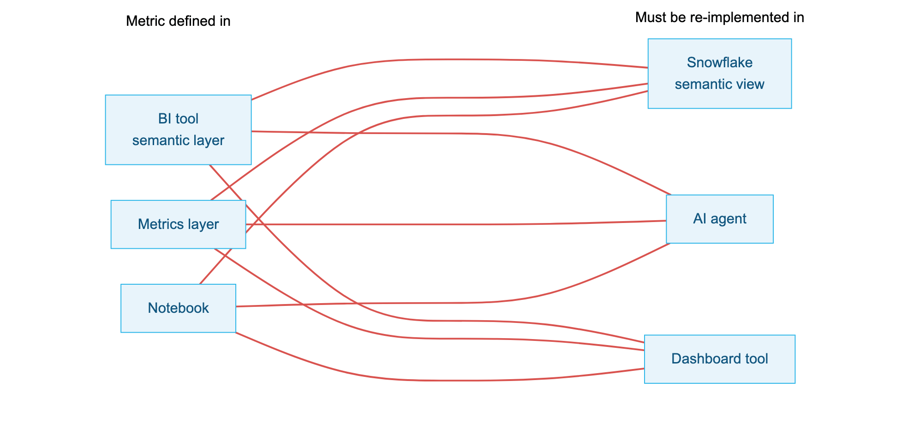
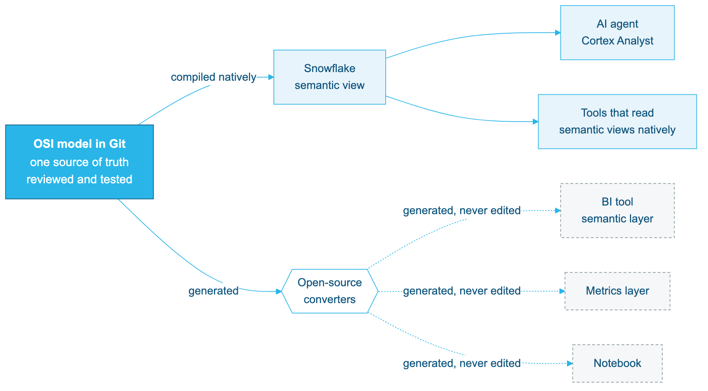

author: Reinout Korbee
id: getting-started-with-apache-osi
language: en
summary: Use an open Apache OSI model as the single source of truth for metrics, compile it into a Snowflake semantic view, generate proprietary formats from it, and weigh an interface layer of views as a design option.
categories: snowflake-site:taxonomy/solution-center/certification/quickstart, snowflake-site:taxonomy/product/analytics, snowflake-site:taxonomy/product/ai, snowflake-site:taxonomy/snowflake-feature/business-intelligence, snowflake-site:taxonomy/snowflake-feature/cortex-analyst
environments: web
status: Published
feedback link: https://github.com/Snowflake-Labs/sfguides/issues

# Getting Started with Apache OSI: An Open Source of Truth for Metrics
<!-- ------------------------ -->
## Overview

Ask three teams for "total revenue" and you will often get three numbers. On the TPC-H sample data that ships with every Snowflake account, five perfectly reasonable definitions give results between **$109B and $230B**:

| Definition | Revenue (TPC-H SF1) |
|---|---|
| Gross: `SUM(L_EXTENDEDPRICE)` | $229.6B |
| Order header: `SUM(O_TOTALPRICE)` | $226.8B |
| Net of discount | $218.1B |
| Net of discount, excluding returns | $164.4B |
| Net of discount, shipped lines only | $108.9B |

Nobody made an error. Each dashboard, notebook and AI assistant simply encoded its own definition. This is **metric drift**, and it is one symptom of semantic fragmentation:

- **Metric drift**: inconsistent KPIs across dashboards.
- **Manual translation**: the same logic re-typed in every tool, then reconciled.
- **Hallucinations**: an LLM grounded on conflicting or missing definitions guesses.
- **Integration debt**: N-to-N custom integrations between proprietary semantic layers.

**Open Semantic Interchange (OSI)** is a vendor-neutral YAML specification for semantic models: datasets, keys, relationships, fields and metrics. The specification and its converters are developed in the open as [Apache Ossie](https://github.com/apache/ossie).

Be clear about what OSI is today. It is **not** a format that every tool reads natively. Snowflake can turn an OSI document directly into a [semantic view](https://docs.snowflake.com/en/user-guide/views-semantic/overview). Most other tools are reached through open-source converters that translate OSI into their own proprietary format, and those converters are young. The value of OSI right now is architectural: one open definition that you own, version and test, from which every tool-specific format is **generated** rather than hand-maintained.

In this guide you:

1. Write the revenue definition once, in OSI, and compile it into a Snowflake semantic view that Cortex Analyst can use.
2. Prove the semantic view returns the right numbers.
3. Generate other tools' formats from the same file, and weigh how the model should bind to the data.

The tools used along the way are examples; the architectural pattern is what matters.

> NOTE:
> The OSI stored procedures used in this guide are in preview. Behaviour and supported spec versions may change. Everything in this guide was tested against OSI spec version `0.1.1`, the only version the Snowflake procedure accepted at the time of writing.

### Prerequisites
- Basic SQL knowledge
- Familiarity with YAML

### What You'll Learn
- Why an open semantic standard matters architecturally, and where it stands today
- The building blocks of an OSI semantic model and why each one matters
- Which parts of an OSI model are portable and which are Snowflake-specific
- How to create a semantic view from OSI YAML with `SYSTEM$CREATE_SEMANTIC_VIEW_FROM_OSSIE_YAML`
- How to test a semantic view against reference SQL
- How to generate proprietary formats from the model, and how to detect what a conversion loses
- When an interface layer of views between tables and model is worth considering, and what it costs

### What You'll Need
- A Snowflake account with access to the OSI preview, and a role that can create a database
- Python 3.11+ and `git` for the open-source converters

### What You'll Build
- An OSI model `tpch-revenue.osi.yaml` with one governed definition of revenue
- A Snowflake semantic view compiled from it, with parity tests
- Two proprietary formats generated from the same file, and a measured report of what each conversion keeps and loses
- Optionally, an interface layer of views, to compare against binding the model to the tables directly

<!-- ------------------------ -->
## Why an Open Standard

Before writing any YAML, it helps to see the problem the way an enterprise architect does.

### From N-to-N to hub and spoke

A typical enterprise already has three to five semantic layers: one in the BI tool, one in the transformation framework, one in the notebook platform, and now one for every AI agent. Without a shared format, each pair of tools that must agree needs its own translation, maintained by hand. Three tools that define metrics and three that consume them already mean nine such translations, and every new tool adds a full row:



With OSI as the hub, there is one reviewed and tested source. Snowflake compiles it natively into a semantic view, which AI agents and tools that read semantic views use directly. Other tools get their own format generated by a converter, never edited by hand:



With a hub, adding a tool means adding one converter, not N new integrations. Proprietary formats stay, but they become **build artifacts**, like compiled binaries, rather than places where business logic is authored.

### What this buys an enterprise today

| Benefit | What it means in practice |
|---|---|
| **One point of governance** | Revenue is defined in one reviewed file. A change is a pull request with an owner, a reviewer and an audit trail, not an edit buried in a dashboard. |
| **Vendor optionality** | The definition is not locked inside any one product. `SYSTEM$READ_OSSIE_YAML_FROM_SEMANTIC_VIEW` exports a Snowflake semantic view back to OSI, so choosing Snowflake does not trap your semantics. |
| **Cheaper migration and onboarding** | Existing models in other semantic layers can be converted to OSI and compiled into Snowflake as a starting point, instead of being rewritten from scratch. Expect to repair what a converter cannot carry. |
| **Consistent AI grounding** | The same descriptions feed Cortex Analyst, agents and BI tools, so an LLM and a dashboard work from the same definition. How much of the model each AI tool actually uses varies; see the Cortex Analyst section. |
| **Loss you can measure** | Converters report what a target cannot represent, and parity tests prove the numbers. Drift between tools becomes a CI failure instead of a surprise in a board meeting. |

How much of this works today depends on the target; the section *Portable versus Snowflake-specific* covers it once you know the building blocks of a model.

<!-- ------------------------ -->
## Set Up Snowflake

Create a database for the semantic view and make sure the TPC-H sample data is available. Some accounts do not have `SNOWFLAKE_SAMPLE_DATA` mounted; the second statement fixes that.

```sql
CREATE DATABASE IF NOT EXISTS OSI_GUIDE;
CREATE SCHEMA IF NOT EXISTS OSI_GUIDE.TPCH;

CREATE DATABASE IF NOT EXISTS SNOWFLAKE_SAMPLE_DATA FROM SHARE SFC_SAMPLES.SAMPLE_DATA;

SELECT COUNT(*) FROM SNOWFLAKE_SAMPLE_DATA.TPCH_SF1.LINEITEM;  -- 6,001,215
```

Reproduce the drift for yourself:

```sql
SELECT
  (SELECT SUM(O_TOTALPRICE) FROM SNOWFLAKE_SAMPLE_DATA.TPCH_SF1.ORDERS) AS order_total_price,
  SUM(L_EXTENDEDPRICE)                                                   AS gross,
  SUM(L_EXTENDEDPRICE * (1 - L_DISCOUNT))                                AS net,
  SUM(IFF(L_RETURNFLAG <> 'R', L_EXTENDEDPRICE * (1 - L_DISCOUNT), 0))   AS net_excl_returns,
  SUM(IFF(L_LINESTATUS = 'F',  L_EXTENDEDPRICE * (1 - L_DISCOUNT), 0))   AS net_shipped_only
FROM SNOWFLAKE_SAMPLE_DATA.TPCH_SF1.LINEITEM;
```

Notice that the gap between "net" and "net, shipped only" comes from a **filter**, not a formula. A metric definition is the expression *and* its filters *and* its grain. That is exactly what we will pin down in OSI.

<!-- ------------------------ -->
## Anatomy of a Model

An OSI document describes one semantic model. Its building blocks map closely to how analysts already think:

| Block | What it says | Why it matters for drift |
|---|---|---|
| `datasets` | A logical table and its physical `source` | Everyone starts from the same tables |
| `primary_key` | What makes a row unique, i.e. the grain | Lets engines aggregate at the right level |
| `relationships` | Many-to-one joins between datasets | Prevents fan-out double counting |
| `fields` | Row-level columns or expressions | Shared building blocks such as `net_amount_kept` |
| `metrics` | Aggregate expressions across datasets | The single definition of `net_revenue` |
| `description` | Human-readable meaning | Becomes native comments in Snowflake, which Cortex Analyst reads |
| `ai_context` | Extra context intended for AI tools | Portable hints for other tools; see the Cortex Analyst section for how Snowflake treats it today |
| `custom_extensions` | Vendor-specific metadata | Keeps tool-specific settings out of the core |

### Why keys and relationships are not optional

Join order lines to orders and sum the order header amount, a mistake that is easy to make in a notebook:

```sql
SELECT SUM(o.O_TOTALPRICE) AS naive_joined
FROM SNOWFLAKE_SAMPLE_DATA.TPCH_SF1.ORDERS o
JOIN SNOWFLAKE_SAMPLE_DATA.TPCH_SF1.LINEITEM l ON l.L_ORDERKEY = o.O_ORDERKEY;
-- 1,134 billion: five times the real 226.8 billion
```

Every order is counted once per line. Because the OSI model declares `primary_key` on each dataset and the direction of each relationship (`from` the many side `to` the one side), a semantic engine knows `orders` is at a coarser grain than `lineitem` and aggregates each metric at its own grain.

### Decide the definition, then write it down

For this guide, the business agrees that **revenue is extended price after discount, excluding returned lines, before tax**. We encode it as a field plus a metric:

```yaml
    - name: net_amount_kept
      datatype: Decimal
      expression: {dialects: [{dialect: ANSI_SQL, expression: "CASE WHEN L_RETURNFLAG <> 'R' THEN L_EXTENDEDPRICE * (1 - L_DISCOUNT) ELSE 0 END"}]}
      description: >
        Revenue per order line, the company definition: amount after discount,
        before tax, zero for returned lines. Also called net sales. Sum it for revenue.
...
  metrics:
  - name: net_revenue
    datatype: Decimal
    expression: {dialects: [{dialect: ANSI_SQL, expression: "SUM(lineitem.net_amount_kept)"}]}
    description: >
      Revenue, the company definition: extended price after discount, excluding
      returned lines, before tax. Also called sales or net sales. Use this metric
      whenever a question asks for revenue or sales.
    ai_context: "Synonyms: revenue, sales, net sales"
```

The filter lives in the field expression, so every consumer inherits it. `O_TOTALPRICE` stays in the model as `total_price`, but its description says explicitly: "Not revenue: never use it for revenue or sales questions."

Notice that the business meaning, including synonyms such as *net sales*, is written into `description`, on the field as well as the metric. The same synonyms also appear in `ai_context`, a field intended for AI tools. The section on Cortex Analyst explains why the model states things twice: in the current preview, Snowflake only acts on the `description`.

### Portable versus Snowflake-specific

Two questions decide how portable a model is: which parts of the document are standard, and which tools can consume it. Within the document:

| Part of the model | Portable? | Notes |
|---|---|---|
| Datasets, keys, relationships, fields, metrics | Yes | Core OSI specification |
| Expressions in `ANSI_SQL` dialect | Yes | Use where possible; the converters tested here read them |
| Expressions in `SNOWFLAKE` dialect | Snowflake only | Use for Snowflake functions; add an `ANSI_SQL` variant for other tools |
| `source: DB.SCHEMA.TABLE` | Partly | Any tool that connects to the same Snowflake tables can reuse it |
| `custom_extensions` with `vendor_name: SNOWFLAKE` | Snowflake only | Ignored by other tools |

And on the consuming side, at the time of writing (verified while building this guide):

| Target | How it consumes the model | Status |
|---|---|---|
| Snowflake semantic views | `SYSTEM$CREATE_SEMANTIC_VIEW_FROM_OSSIE_YAML`, natively | Preview; OSI `0.1.1` only |
| Snowflake export | `SYSTEM$READ_OSSIE_YAML_FROM_SEMANTIC_VIEW` | Preview; `datatype` values not exported |
| Other tools' semantic formats | Open-source converters in the Apache Ossie repository (Hex, dbt MetricFlow, Cube, Sigma, Power BI, GoodData, Honeydew and others) | Converters, not native import; two are tested in this guide |

Most third-party tools do not import OSI directly today. They read their own format, and some read Snowflake semantic views natively. The converters target the in-development spec `0.2.0.dev0` and were not yet on PyPI. Treat them as early tooling: useful, inspectable, and worth testing before you trust them.

Two practical rules that we learned while testing this guide:

- **Give every field a `datatype`.** Snowflake can infer types from the source table, but a converter generating another tool's format cannot. Without it, one of the converters tested later typed prices as `string`.
- **Write `ai_context` as a string.** The spec also allows an object (`instructions`, `synonyms`, `examples`), but the Snowflake procedure currently rejects the object form.

<!-- ------------------------ -->
## Deploy the Semantic View

The complete model is in [`assets/tpch-revenue.osi.yaml`](https://github.com/Snowflake-Labs/sfquickstarts/blob/master/site/sfguides/src/getting-started-with-apache-osi/assets/tpch-revenue.osi.yaml). Pass it to the procedure, together with the schema that will hold the semantic view. The semantic view gets the model's `name`.

```sql
CALL SYSTEM$CREATE_SEMANTIC_VIEW_FROM_OSSIE_YAML('OSI_GUIDE.TPCH', $$
-- paste the full contents of assets/tpch-revenue.osi.yaml here
$$);
-- Semantic view was successfully created from OSI YAML.
```

The `$$` delimiters let you paste the YAML as-is, without escaping quotes. Most of the file repeats the patterns from the previous section. The parts worth reading closely are the keys and relationships, which give the semantic view its grain and join paths:

```yaml
  - name: lineitem
    source: SNOWFLAKE_SAMPLE_DATA.TPCH_SF1.LINEITEM
    primary_key: [l_orderkey, l_linenumber]
...
  relationships:
  - {name: lineitem_to_orders, from: lineitem, to: orders, from_columns: [l_orderkey], to_columns: [o_orderkey]}
  - {name: orders_to_customer, from: orders, to: customer, from_columns: [o_custkey], to_columns: [c_custkey]}
  - {name: customer_to_nation, from: customer, to: nation, from_columns: [c_nationkey], to_columns: [n_nationkey]}
  - {name: nation_to_region, from: nation, to: region, from_columns: [n_regionkey], to_columns: [r_regionkey]}
```

Note that `source` points straight at the shared sample database; the tables do not have to live in the same schema as the semantic view.

Query it like any semantic view:

```sql
SELECT *
FROM SEMANTIC_VIEW(
  OSI_GUIDE.TPCH.TPCH_REVENUE
  METRICS net_revenue, order_count, average_order_value
  DIMENSIONS region.region_name
)
ORDER BY net_revenue DESC;
```

The `region` dimension sits three relationships away from `lineitem` (lineitem → orders → customer → nation → region). The semantic view resolves those joins from the model; nobody writes them again.

### Read the model back

The conversion also works in the other direction. This returns OSI YAML for any semantic view, including ones you built without OSI:

```sql
SELECT SYSTEM$READ_OSSIE_YAML_FROM_SEMANTIC_VIEW('OSI_GUIDE.TPCH.TPCH_REVENUE');
```

The output uses upper-case names and adds `SNOWFLAKE` vendor extensions such as `access_modifier`. Keys, relationships and descriptions are exported from native semantic view properties. `ai_context` comes back too, but only because it was stored verbatim in the `OSI` extension; the OSI `datatype` values are not exported. This export is what keeps Snowflake from becoming a lock-in point: any semantic view, including ones built without OSI, can leave as an open document. Keep the hand-written YAML in Git as the source of truth and treat the read-back as an export.

<!-- ------------------------ -->
## Prove Zero Drift

A shared definition is only useful if it is *correct*. Write each business question twice, once against the semantic view and once as independent reference SQL over the raw tables, and require zero differing rows.

```sql
WITH
sv_total   AS (SELECT ROUND(net_revenue, 2) v
               FROM SEMANTIC_VIEW(OSI_GUIDE.TPCH.TPCH_REVENUE METRICS net_revenue)),
ref_total  AS (SELECT ROUND(SUM(IFF(L_RETURNFLAG <> 'R', L_EXTENDEDPRICE * (1 - L_DISCOUNT), 0)), 2) v
               FROM SNOWFLAKE_SAMPLE_DATA.TPCH_SF1.LINEITEM),

sv_region  AS (SELECT region_name k, ROUND(net_revenue, 2) v
               FROM SEMANTIC_VIEW(OSI_GUIDE.TPCH.TPCH_REVENUE METRICS net_revenue DIMENSIONS region.region_name)),
ref_region AS (SELECT r.R_NAME k, ROUND(SUM(IFF(l.L_RETURNFLAG <> 'R', l.L_EXTENDEDPRICE * (1 - l.L_DISCOUNT), 0)), 2) v
               FROM SNOWFLAKE_SAMPLE_DATA.TPCH_SF1.LINEITEM l
               JOIN SNOWFLAKE_SAMPLE_DATA.TPCH_SF1.ORDERS   o ON o.O_ORDERKEY  = l.L_ORDERKEY
               JOIN SNOWFLAKE_SAMPLE_DATA.TPCH_SF1.CUSTOMER c ON c.C_CUSTKEY   = o.O_CUSTKEY
               JOIN SNOWFLAKE_SAMPLE_DATA.TPCH_SF1.NATION   n ON n.N_NATIONKEY = c.C_NATIONKEY
               JOIN SNOWFLAKE_SAMPLE_DATA.TPCH_SF1.REGION   r ON r.R_REGIONKEY = n.N_REGIONKEY
               GROUP BY 1),

sv_aov     AS (SELECT market_segment k, ROUND(average_order_value, 4) v
               FROM SEMANTIC_VIEW(OSI_GUIDE.TPCH.TPCH_REVENUE METRICS average_order_value DIMENSIONS customer.market_segment)),
ref_aov    AS (SELECT c.C_MKTSEGMENT k,
                      ROUND(SUM(IFF(l.L_RETURNFLAG <> 'R', l.L_EXTENDEDPRICE * (1 - l.L_DISCOUNT), 0))
                            / COUNT(DISTINCT l.L_ORDERKEY), 4) v
               FROM SNOWFLAKE_SAMPLE_DATA.TPCH_SF1.LINEITEM l
               JOIN SNOWFLAKE_SAMPLE_DATA.TPCH_SF1.ORDERS   o ON o.O_ORDERKEY = l.L_ORDERKEY
               JOIN SNOWFLAKE_SAMPLE_DATA.TPCH_SF1.CUSTOMER c ON c.C_CUSTKEY  = o.O_CUSTKEY
               GROUP BY 1),

sv_year    AS (SELECT order_year k, order_count v
               FROM SEMANTIC_VIEW(OSI_GUIDE.TPCH.TPCH_REVENUE METRICS order_count DIMENSIONS orders.order_year)),
ref_year   AS (SELECT YEAR(O_ORDERDATE) k, COUNT(*) v
               FROM SNOWFLAKE_SAMPLE_DATA.TPCH_SF1.ORDERS GROUP BY 1)

SELECT 'total' AS test,
       (SELECT COUNT(*) FROM (SELECT * FROM sv_total EXCEPT SELECT * FROM ref_total)) AS diffs
UNION ALL SELECT 'by_region',
       (SELECT COUNT(*) FROM ((SELECT * FROM sv_region EXCEPT SELECT * FROM ref_region)
                    UNION ALL (SELECT * FROM ref_region EXCEPT SELECT * FROM sv_region)))
UNION ALL SELECT 'aov_by_segment',
       (SELECT COUNT(*) FROM ((SELECT * FROM sv_aov EXCEPT SELECT * FROM ref_aov)
                    UNION ALL (SELECT * FROM ref_aov EXCEPT SELECT * FROM sv_aov)))
UNION ALL SELECT 'orders_by_year',
       (SELECT COUNT(*) FROM ((SELECT * FROM sv_year EXCEPT SELECT * FROM ref_year)
                    UNION ALL (SELECT * FROM ref_year EXCEPT SELECT * FROM sv_year)));
```

All four tests should return `diffs = 0`. The `orders_by_year` test is the fan-out check: `order_count` is defined on `orders`, and stays correct even though revenue is measured on `lineitem`.

Run these tests every time the model changes, for example in a CI pipeline, and a definition can no longer drift silently.

<!-- ------------------------ -->
## Ground Cortex Analyst

The OSI procedure turns `description` into native `COMMENT`s on the semantic view, its facts, dimensions and metrics, and Cortex Analyst reads those. Ask a plain-language question in Snowsight (**AI & ML » Cortex Analyst**, select `OSI_GUIDE.TPCH.TPCH_REVENUE`) or through a Cortex Agent that uses the semantic view as a tool:

> What was total revenue by region in 1997?

Cortex Analyst generates:

```sql
SELECT *
FROM SEMANTIC_VIEW(
    OSI_GUIDE.TPCH.TPCH_REVENUE
    DIMENSIONS region.region_name
    METRICS NET_REVENUE
    WHERE orders.order_year = 1997
);
```

It picked `net_revenue`, not the tempting `O_TOTALPRICE` column. The AI assistant now reports the same number as the finance dashboard. The names and descriptions in the model did that work, not prompt engineering: the metric is called `net_revenue`, its basis `net_amount_kept` is described as the company definition of revenue, and `total_price` is described as "Not revenue".

The synonyms written into the descriptions work too:

| Question | Cortex Analyst chose |
|---|---|
| Show net sales per country by booking year | `NET_REVENUE` by `nation.nation_name` and `orders.order_year` |
| What is the AOV per customer segment? | `AVERAGE_ORDER_VALUE` by `customer.market_segment` |

In the current preview, only `description` grounds Cortex Analyst. It becomes a native `COMMENT`, and it works best on the field Analyst has to choose between. `ai_context` is kept only in the `OSI` extension of the semantic view for export, and Cortex Analyst ignores it. Put anything an AI tool must respect in `description`.

> NOTE:
> This is the behaviour of the OSI procedure and Cortex Analyst as tested during the preview, with OSI spec version `0.1.1`. How `ai_context` is mapped into semantic views, for example into synonyms or custom instructions, may change in future versions. Re-test before you rely on it.

<!-- ------------------------ -->
## Generate Target Formats

The Snowflake semantic view is one target compiled from the OSI file. Other tools have their own proprietary semantic formats. In the hub-and-spoke architecture you never author those formats by hand: you **generate** them from the OSI source, the way a compiler produces binaries for different platforms.

This guide uses two of the open-source converters in the Apache Ossie repository as examples: Hex semantic project YAML and dbt MetricFlow. They represent two common kinds of target, a BI tool's semantic layer and a transformation framework's metric layer. The pattern is the same for any other converter. How each tool then loads its generated files is that tool's own concern and outside the scope of this guide.

### Install the converters

At the time of writing, the converters and their core library are not on PyPI. Install them from the repository:

```bash
git clone --depth 1 https://github.com/apache/ossie.git
python3 -m venv .venv && source .venv/bin/activate
pip install ./ossie/python ./ossie/converters/hex ./ossie/converters/dbt
```

### Bridge the spec version

The converters expect the in-development spec `0.2.0.dev0`, which drops the `semantic_model:` list and puts the model at the document root. The Snowflake procedure only accepts `0.1.1`. The content is identical, so generate the newer shape from your single source file:

```bash
python - <<'EOF'
import yaml
model = yaml.safe_load(open("tpch-revenue.osi.yaml"))["semantic_model"][0]
yaml.safe_dump({"version": "0.2.0.dev0", **model},
               open("tpch-revenue.osi.v02.yaml", "w"), sort_keys=False)
EOF
```

This is itself an example of the pattern: one hand-edited file, other shapes generated in the build. When Snowflake supports the newer version, the step disappears.

### Generate

```bash
ossie-hex export     -i tpch-revenue.osi.v02.yaml -o hex_project -d ansi_sql -v
ossie-dbt ossie-to-msi -i tpch-revenue.osi.v02.yaml -o semantic_manifest.json
```

The `-d ansi_sql` flag selects the expression dialect, which is why the model uses `ANSI_SQL`: portable expressions are what let one source feed many targets. Where a conversion succeeds, the business logic carries over unchanged. In the generated Hex YAML, for example:

```yaml
measures:
- id: net_revenue
  func_sql: SUM(${net_amount_kept})
relations:
- id: lineitem_to_orders
  target: orders
  type: many_to_one
```

Same table, same filter, same metric, same join direction. Whether a conversion fully succeeds is the subject of the next section.

<!-- ------------------------ -->
## Measure What Conversion Loses

An open standard does not make tools identical. Each proprietary format can express some things and not others. The architectural value of OSI is that those gaps become **explicit and testable** instead of silent. This section measures them for the two example targets.

### A BI semantic layer: warnings, not silent drops

The Hex export above reports:

```
Encountered 10 problems: 10 warnings.
   7× `ai_context` — AI context is not preserved in Hex and was dropped.
   1× `Dataset.primary_key` — Composite primary keys are not supported in Hex and were dropped.
   1× `Field.is_time` — Temporal role markers are not supported in Hex and were dropped.
   1× `description` — Project descriptions are not supported in Hex and were dropped.
```

The metrics and joins survive; the AI context and the composite key on `lineitem` do not. An earlier draft of this model had no `datatype` on most fields and produced 23 extra warnings, with prices typed as `string` in the target. Adding types fixed that.

### A metric layer: a round trip

Many enterprises already have metrics defined in another tool, and the most valuable use of a standard is to bring them over instead of rewriting them. dbt MetricFlow is a good test case. Converting to its format:

```bash
ossie-dbt ossie-to-msi -i tpch-revenue.osi.v02.yaml -o semantic_manifest.json
# ValueError: Dataset 'lineitem' has composite primary key ['l_orderkey', 'l_linenumber'];
# MetricFlow entities cannot represent composite keys losslessly
```

The converter refuses rather than producing a subtly wrong model. That is the right behaviour: the key defines the grain of `lineitem`, and the grain is what protects against fan-out. Removing the key would make the error go away by throwing that protection away. The proper fix is a single-column key, which is what the interface layer in the next section provides. Only to continue this experiment, a throwaway copy with the `primary_key` removed converts successfully. The converter even turns `average_order_value` into a proper MetricFlow ratio metric. Do not do this in a real model.

Now simulate the migration direction: take that manifest as if it were an existing project, convert it back to OSI and compile it into Snowflake:

```bash
ossie-dbt msi-to-ossie -i semantic_manifest.json -o from_dbt.yaml
```

Wrap `from_dbt.yaml` in the `0.1.1` shape, name the model `tpch_from_dbt` and deploy it with `SYSTEM$CREATE_SEMANTIC_VIEW_FROM_OSSIE_YAML`. Then run two queries:

```sql
SELECT net_revenue FROM SEMANTIC_VIEW(OSI_GUIDE.TPCH.TPCH_FROM_DBT METRICS net_revenue);
-- 164,360,931,200.40: identical to the original

SELECT * FROM SEMANTIC_VIEW(OSI_GUIDE.TPCH.TPCH_FROM_DBT
  METRICS net_revenue DIMENSIONS region.region_name);
-- SQL compilation error: The entities 'REGION' and 'LINEITEM' are not related.
```

The metric definition and its descriptions came through intact. All four relationships, the `datatype` values and the `ai_context` were lost. MetricFlow expresses joins through shared entity names, and the converter names each entity after its own key column (`l_orderkey` on one side, `o_orderkey` on the other), so nothing matches. Snowflake then refuses the cross-dataset query instead of returning a wrong number.

### What survived where

| Model element | Snowflake semantic view (and its OSI read-back) | BI semantic layer (`ossie-hex`) | Metric layer round trip (`ossie-dbt`) |
|---|---|---|---|
| Metrics and expressions | Yes | Yes | Yes |
| Field filters (`net_amount_kept`) | Yes | Yes | Yes |
| Descriptions | Yes | Mostly | Yes |
| Relationships | Yes | Yes | **No** |
| Composite primary key | Yes | Dropped, with warning | Refused |
| `datatype` | Used, but not in the read-back export | Yes | **No** |
| `ai_context` | Stored in the `OSI` extension only; not used by Cortex Analyst in our test | Dropped, with warning | **No** |

### The architectural lesson

- **Keep OSI as the source and never edit generated formats.** Losses then happen in one place, in one direction, and can be fixed by improving a converter or the model, not by patching every tool.
- **Test every target, not just the source.** The same parity queries that validated `TPCH_REVENUE` would have failed on `TPCH_FROM_DBT` immediately.
- **Model for portability.** Put filters in field expressions, give every field a `datatype`, write expressions in `ANSI_SQL`, prefer single-column keys where the grain allows it, and put meaning in `description` rather than only in `ai_context`.
- **Prefer native paths where they exist.** Compiling OSI into a Snowflake semantic view and letting tools read that view natively avoids a converter altogether. Several BI tools integrate with Snowflake semantic views directly.

Many of the losses above trace back to how the model is bound to the data, not to the standard itself. The model points straight at physical tables, with their composite keys and inconsistent column names. That leaves an uncomfortable choice: keep the composite key and lose the conversion, or drop the key and lose the grain. The next section explores a design pattern that removes the dilemma.

<!-- ------------------------ -->
## Consider an Interface Layer

So far the OSI model has read directly from the data layer: `SNOWFLAKE_SAMPLE_DATA.TPCH_SF1`. That is a perfectly valid way to work, and Snowflake semantic views accept tables and views alike. This section explores an alternative worth considering: a thin layer of views between the physical tables and the semantic model, so that the model binds to a stable interface instead of directly to storage.

This is a general architectural design pattern, not a Snowflake recommendation. Whether it is worth it depends on your situation. The case for it on this data set is concrete, though. The composite key on `LINEITEM` forced a choice between correctness and portability. A view that exposes a single-column key gives you both: the grain stays declared, and the conversion succeeds. The section shows what it changes, then weighs the benefits against the downsides.

### Where the pattern comes from

- **Logical data independence.** The ANSI/SPARC three-schema architecture separates the physical schema from the external schemas that consumers see. Consumers survive physical changes, such as renamed columns, split tables or a new source system, because only the mapping changes. A semantic model is such a consumer.
- **dbt layering.** dbt's recommended project structure goes from sources to staging to marts, and MetricFlow semantic models are defined on models, not on raw sources.
- **Dimensional modelling.** Kimball's presentation layer gives BI tools a curated star schema rather than operational tables.


### Build the views

Run [`assets/interface-views.sql`](https://github.com/Snowflake-Labs/sfquickstarts/blob/master/site/sfguides/src/getting-started-with-apache-osi/assets/interface-views.sql). It creates five views in `OSI_GUIDE.TPCH`, next to the semantic views, which keeps grants for the domain in one schema. The views only rename, key and type the data:

```sql
CREATE OR REPLACE VIEW OSI_GUIDE.TPCH.ORDER_LINE AS
SELECT L_ORDERKEY || '-' || L_LINENUMBER AS order_line_key,   -- single-column surrogate key
       L_ORDERKEY      AS order_key,
       L_RETURNFLAG    AS return_flag,
       L_EXTENDEDPRICE AS extended_price,
       L_DISCOUNT      AS discount,
       ...
FROM SNOWFLAKE_SAMPLE_DATA.TPCH_SF1.LINEITEM;

CREATE OR REPLACE VIEW OSI_GUIDE.TPCH.SALES_ORDER AS
SELECT O_ORDERKEY AS order_key,       -- same name as in ORDER_LINE
       O_CUSTKEY  AS customer_key,
       ...
FROM SNOWFLAKE_SAMPLE_DATA.TPCH_SF1.ORDERS;
```

Two design rules matter:

- **A key has the same name everywhere it appears.** `order_key` in `ORDER_LINE` and `SALES_ORDER`, `customer_key` in `SALES_ORDER` and `CUSTOMER`.
- **Every dataset has a single-column primary key.** `order_line_key` replaces the composite `(L_ORDERKEY, L_LINENUMBER)`. The script checks that it is unique across all 6,001,215 rows.

The business rule, excluding returned lines, deliberately stays in the OSI model and not in the view. Views express how data is stored; the model expresses what the business means. Hiding a definition in SQL would make it invisible to every other tool.

### Point the model at the views

[`assets/tpch-revenue-if.osi.yaml`](https://github.com/Snowflake-Labs/sfquickstarts/blob/master/site/sfguides/src/getting-started-with-apache-osi/assets/tpch-revenue-if.osi.yaml) is the same model bound to the views. Only the `source` lines, column names and keys change:

```yaml
  - name: order_line
    source: OSI_GUIDE.TPCH.ORDER_LINE
    primary_key: [order_line_key]
...
  relationships:
  - {name: order_line_to_sales_order, from: order_line, to: sales_order, from_columns: [order_key], to_columns: [order_key]}
```

Deploy it as `TPCH_REVENUE_IF` with `SYSTEM$CREATE_SEMANTIC_VIEW_FROM_OSSIE_YAML`, then run the parity tests against `OSI_GUIDE.TPCH.TPCH_REVENUE_IF`, with the reference SQL still on the raw tables. All four return `diffs = 0`, so the views add no drift.

### Rerun the conversions

Generate the `0.2.0.dev0` copy and run both converters again:

```bash
ossie-hex export -i tpch-revenue-if.osi.v02.yaml -o hex_project_if -d ansi_sql -v
# Encountered 9 problems: 9 warnings.   (composite key warning is gone)

ossie-dbt ossie-to-msi -i tpch-revenue-if.osi.v02.yaml -o semantic_manifest.json
# Written to semantic_manifest.json      (no manual edit needed)
ossie-dbt msi-to-ossie -i semantic_manifest.json -o from_dbt.yaml --model-name tpch_if_from_dbt
```

In the MetricFlow manifest, the entities now line up: `order_key` is a foreign entity on `order_line` and the primary entity on `sales_order`, so MetricFlow can join them. Converted back to OSI, the model has all four relationships and five primary keys. Deploy it as `TPCH_IF_FROM_DBT` and run the parity tests: **all four pass**, including revenue by region, which failed before.

| Result | Direct on tables | Through interface views |
|---|---|---|
| BI semantic layer export warnings | 10 | 9 |
| Metric layer export | Refused: composite key | Succeeds unchanged |
| Relationships after round trip | 0 of 4 | 4 of 4 |
| Parity tests after round trip | Cross-dataset queries fail | 4 of 4 pass |
| `datatype` and `ai_context` after round trip | Lost | Still lost |

Read the table as the answer to the dilemma from the previous section. Nothing in the OSI model was weakened to get there. The grain is still declared and the business rule is unchanged. Only the binding to the data changed, and the generated model went from unusable for cross-dataset questions to passing every parity test.

The last row is the honest limit. Views fix structural problems such as keys, names and grain. They cannot make a target format carry metadata it has no slot for. That is a converter or target limitation, so keep catching it in the pipeline.

### Benefits and downsides

Benefits:

- **Correctness and portability together.** A single-column key keeps the grain declared and is something every target format can represent. Without the views, this data set forces you to give up one or the other.
- **Portability.** Consistent key names are what let the relationships survive the round trip. Other tools can bind to the same view names.
- **Insulation from physical change.** A renamed column, a split table or a move to SF10 becomes a change to the views, not to the OSI file, its tests or any generated target.
- **Reuse across sources.** Two systems holding the same concepts can each get their own views exposing the same names, and share one model.
- **A clear split of concerns.** Views describe how data is stored; the OSI model describes what the business means.

Downsides:

- **More objects to own.** The views need the same versioning, review and deployment as the model. Without that discipline they become one more place where logic drifts.
- **Another place to hide logic.** It is tempting to put business rules in the view SQL, where other tools cannot see them. Keep the views to renaming, keys and types.
- **Grants.** Readers need `SELECT` on the views. Snowflake's documentation states that Cortex Agents need `SELECT` on both the semantic view and its underlying tables. Grant the agent's role `SELECT` on the views, and test whether your setup also needs it on the base tables behind them.
- **Performance.** Simple renaming views like these are normally merged into the query by the optimizer, so they typically add little or no cost. A layer that does heavy work, such as deduplicating change-data-capture tables, may need to be materialized, for example as a dynamic table, which brings its own refresh and cost considerations.
- **Lineage gets one hop longer.** Tracing a metric back to its source column now goes through the view.

### When to skip it

Binding directly to tables is the simpler choice when the tables are already a clean, well-named presentation layer, when the model only ever compiles to Snowflake, or when one team owns both the tables and the model. The interface layer pays off as the number of source systems, consuming tools or teams grows.

<!-- ------------------------ -->
## Automate the Pipeline

Suppose finance decides that revenue should also exclude lines that have not shipped yet. With OSI that is one edit, in one file:

```yaml
    - name: net_amount_kept
      expression: {dialects: [{dialect: ANSI_SQL, expression: "CASE WHEN L_RETURNFLAG <> 'R' AND L_LINESTATUS = 'F' THEN L_EXTENDEDPRICE * (1 - L_DISCOUNT) ELSE 0 END"}]}
```

In an enterprise setup, the pull request triggers a pipeline:

1. **Review**: the finance data owner approves the change to the OSI file.
2. **Compile to Snowflake**: deploy the interface views if you use them, then `SYSTEM$CREATE_SEMANTIC_VIEW_FROM_OSSIE_YAML`, into a test schema.
3. **Test**: run the parity queries, with the reference SQL updated to the new definition. Fail the build on any difference.
4. **Generate targets**: run every converter you depend on. Fail the build on new converter warnings or errors.
5. **Publish**: deploy the semantic view to production and hand each generated artifact to its tool's own deployment process. Tools that read Snowflake semantic views natively pick up the change without a separate artifact.

No tool keeps a hand-edited copy of the logic, so no tool drifts.

<!-- ------------------------ -->
## Clean Up

```sql
DROP DATABASE IF EXISTS OSI_GUIDE;
```

<!-- ------------------------ -->
## Conclusion And Resources

You treated an open OSI model as the source of truth for revenue and compiled it into a Snowflake semantic view, with Cortex Analyst grounded on the same definition. You generated two proprietary formats from the same file and pushed the model through one of them and back. Bound directly to the tables, the conversions lost structure. With an optional interface layer of views, the same round trip kept every relationship and passed every parity test, at the cost of more objects to own. The lesson is architectural, not tool-specific. Own your semantics in one open file, generate and test every proprietary format from it, and decide deliberately how the model binds to the data. Native OSI support across vendors is still maturing, but that architecture is something you can adopt now.

### What You Learned
- Why an open semantic standard turns N-to-N integrations into one source with generated targets
- How metric drift arises from formulas, filters and grain, measured on TPC-H
- The OSI building blocks, why keys, relationships and `datatype` matter, and why `description` is what grounds Cortex Analyst today
- Which parts of a model are portable (`ANSI_SQL`, core spec) and which are Snowflake-specific
- How to deploy OSI YAML as a semantic view and export it back
- How to test a semantic view against reference SQL
- What conversions to proprietary formats keep and lose, and how to catch it in a pipeline
- When an interface layer of views is worth considering, and its benefits and downsides

### Related Resources
- [Apache Ossie on GitHub: specification and converters](https://github.com/apache/ossie)
- [OSI core specification](https://github.com/apache/ossie/blob/main/core-spec/spec.md)
- [Snowflake semantic views](https://docs.snowflake.com/en/user-guide/views-semantic/overview)
- [Cortex Analyst](https://docs.snowflake.com/en/user-guide/snowflake-cortex/cortex-analyst)
- [Best practices for developing and deploying semantic views](https://docs.snowflake.com/en/user-guide/views-semantic/best-practices-dev), including BI tools that integrate with semantic views
