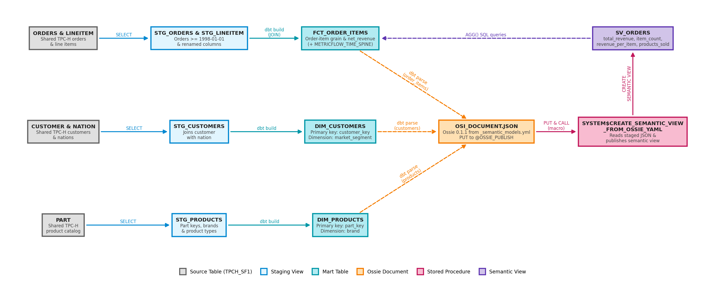
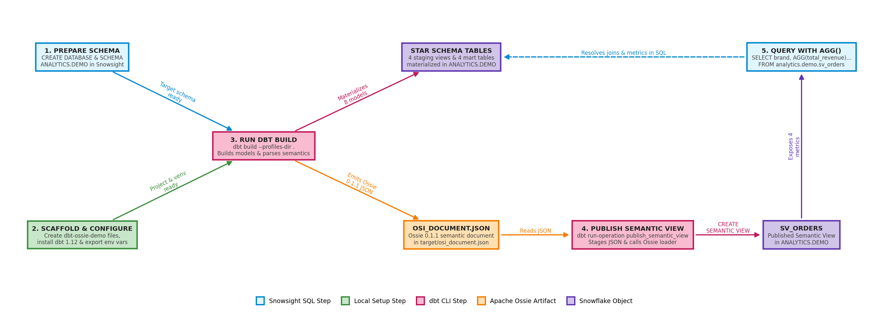

author: Aniruth Narayanan, Chanin Nantasenamat
id: getting-started-with-dbt-and-semantic-views-using-apache-ossie
categories: snowflake-site:taxonomy/solution-center/certification/quickstart, snowflake-site:taxonomy/product/ai, snowflake-site:taxonomy/product/analytics, snowflake-site:taxonomy/product/data-engineering
language: en
summary: Build a dbt star schema on TPC-H data, export dbt semantic layer metrics as an Apache Ossie document, and publish them as a Snowflake Semantic View.
environments: web
status: Published
feedback link: https://github.com/Snowflake-Labs/sfquickstarts/issues

# Getting Started with dbt and Semantic Views using Apache Ossie

## Overview

Data engineering teams often define business metrics like total revenue, revenue per item, and distinct products sold in the dbt semantic layer, right alongside the SQL models that build their tables. Those definitions are version-controlled in Git, but they traditionally stay locked inside tools that speak to dbt's semantic layer. Inside Snowflake, however, analysts, BI dashboards, Cortex Analyst, and Cortex Agents rely on Snowflake Semantic Views: warehouse-native objects that store table joins, dimensions, and metric formulas so anyone can query governed metrics in standard SQL without writing joins or repeating calculation logic. Until recently, using both meant rewriting and maintaining the same metric definitions in two separate formats, where a single change to a discount formula or join in dbt could leave Snowflake out of sync.

[Apache Ossie](https://github.com/apache/ossie) (formerly Open Semantic Interchange, or OSI) eliminates that duplication by providing an open, vendor-neutral specification for exchanging semantic metadata across analytics, BI, and AI platforms. Instead of maintaining custom translation scripts or dual YAML files, you author your metrics once in dbt. Starting in dbt Core 1.12, dbt automatically writes an Apache Ossie document whenever you parse or build your project, and Snowflake's built-in Ossie loader reads that document directly to create or replace a native Snowflake Semantic View.

To see how that workflow operates end to end, suppose you want to find the top five product brands in the Building customer segment ranked by total revenue, revenue per item, and distinct products sold. In this guide, you transform Snowflake's shared TPC-H sample data into a star schema in dbt, define four business metrics in the dbt semantic layer, and run a single dbt build that both materializes the tables in Snowflake and emits the Apache Ossie document. You then run a reusable dbt macro that publishes that document into Snowflake as a Semantic View, letting you query those exact dbt metrics in standard Snowflake SQL with `AGG()` while keeping dbt as your single source of truth.

With that end-to-end flow in mind, here are the specific skills you will cover along the way.

### What You'll Learn

- How to model a star schema and daily time spine in dbt over Snowflake's shared TPC-H sample data
- How to define entities, dimensions, measures, and simple and ratio metrics in the dbt semantic layer
- How dbt Core 1.12 automatically emits an Apache Ossie semantic document during project builds without extra converter packages
- How to publish the Apache Ossie document into Snowflake as a native Semantic View using a reusable dbt macro
- How to query a Snowflake Semantic View in SQL and apply key modeling guidelines when bridging dbt and Snowflake

Those learning goals map directly to the pipeline you will build in your environment.

### What You'll Build

By the end of this guide, you will have an end-to-end dbt-to-Snowflake semantic pipeline that transforms raw TPC-H order data into a star schema, exports its dbt semantic layer definitions as an Apache Ossie document, and publishes them as a Snowflake Semantic View.



As shown in the architecture diagram above, the pipeline moves from left to right across five stages:

1. **Source tables:** Five shared TPC-H sample tables supply the raw orders, line items, customers, nations, and product catalog records.
2. **Staging views:** Four dbt staging views filter orders to recent years, join customers with their nation names, and standardize column names.
3. **Star-schema mart tables:** Building the dbt project materializes an order-item fact table, customer and product dimension tables, and a daily time spine table in Snowflake.
4. **Semantic handoff:** During the same build, dbt parses your semantic layer YAML and writes an Apache Ossie JSON document, which a dbt macro stages and passes to Snowflake's built-in Ossie loader procedure.
5. **Semantic view:** Snowflake creates the semantic view with four governed metrics that analysts and AI tools can query directly in SQL against the star-schema tables.

The table below maps each stage of the pipeline to the files and Snowflake objects you will create:

| Path or Object | Role in the Pipeline |
|---|---|
| `models/staging/` | Four staging views (`stg_orders`, `stg_lineitem`, `stg_customers`, `stg_products`) over five TPC-H tables (`ORDERS`, `LINEITEM`, `CUSTOMER`, `NATION`, `PART`), trimmed to orders from 1998 onward. |
| `models/marts/` | Three star-schema tables (`fct_order_items`, `dim_customers`, `dim_products`) plus the daily `metricflow_time_spine` table required by MetricFlow. |
| `models/marts/_semantic_models.yml` | Three semantic models (`order_items`, `customers`, `products`) and four metrics (`total_revenue`, `item_count`, `revenue_per_item`, `products_sold`). |
| `macros/publish_semantic_view.sql` | A dbt macro that uploads `target/osi_document.json` to a temporary stage, sets the target view name, and calls `SYSTEM$CREATE_SEMANTIC_VIEW_FROM_OSSIE_YAML`. |
| `ANALYTICS.DEMO.SV_ORDERS` | The published Snowflake Semantic View, ready to query with standard Snowflake SQL (`AGG()`). |

With the end result in mind, check that your local machine and Snowflake account meet the prerequisites below.

### What You'll Need

- Access to a [Snowflake account](https://signup.snowflake.com/?utm_source=snowflake-devrel&utm_medium=developer-guides&utm_cta=developer-guides)
- A Snowflake role such as `ACCOUNTADMIN` (or any role that can read `SNOWFLAKE_SAMPLE_DATA`, use a warehouse, and create databases, schemas, tables, views, stages, and semantic views)
- Python 3.11 or 3.12 installed locally (`uv` or standard `venv` both work)
- Only two Python packages: `dbt-core==1.12.6` and `dbt-snowflake==1.12.5` (dbt's semantic layer engine, MetricFlow `0.213.0`, is installed automatically with `dbt-core`; no separate Ossie package or converter is needed)

Once you have those prerequisites ready, the first step is to create the target schema in Snowflake and scaffold the local dbt project.

## Setup

The diagram below outlines the five practical steps you will execute across Snowsight and your local terminal:

1. **Prepare schema:** Create the `ANALYTICS` database and `ANALYTICS.DEMO` schema in Snowsight.
2. **Scaffold and configure:** Create the local `dbt-ossie-demo` project files, install `dbt-core` and `dbt-snowflake` in a Python virtual environment, and export your Snowflake connection variables.
3. **Run dbt build:** After reviewing the staging, mart, and semantic layer files, run `dbt build` to materialize all eight warehouse models in `ANALYTICS.DEMO` and emit `target/osi_document.json`.
4. **Publish semantic view:** Run the `publish_semantic_view` macro to stage `target/osi_document.json` and create `ANALYTICS.DEMO.SV_ORDERS`.
5. **Query with AGG():** Query the published Semantic View in Snowsight SQL using `AGG()`.



In this Setup section, you complete the first two steps, starting with Step 1 in Snowsight.

### Create Target Database and Schema

**Run this step:** Open a SQL worksheet in Snowsight and run the following DDL statements to create the target database and schema in Snowflake:

```sql
CREATE DATABASE IF NOT EXISTS analytics;
CREATE SCHEMA IF NOT EXISTS analytics.demo;
```

**Check:** Verify that `ANALYTICS.DEMO` appears in your Snowsight object explorer.

With the Snowflake schema in place, you can create the local dbt project files.

### Scaffold the Project Files in One Step

Every file in the `dbt-ossie-demo` project is explained individually in the sections that follow so you can see how each layer works.

**Run this step:** Open your terminal and paste the following shell block to create the `dbt-ossie-demo` directory and all 14 project files in one step:

```bash
mkdir -p dbt-ossie-demo/macros \
         dbt-ossie-demo/models/staging \
         dbt-ossie-demo/models/marts
cd dbt-ossie-demo

cat << 'EOF' > requirements.txt
# Minimal set for dbt -> Ossie -> Snowflake semantic views (tested Oct. 16, 2026).
# dbt-core writes target/osi_document.json during parse; dbt-snowflake is the adapter
# that parse requires for a snowflake profile, and it builds the tables and runs the publish macro.
# No Apache Ossie package or converter is needed on this path.
dbt-core==1.12.6
dbt-snowflake==1.12.5
EOF

cat << 'EOF' > dbt_project.yml
name: dbt_ossie_demo
version: "1.0.0"
config-version: 2

profile: dbt_ossie_demo

model-paths: ["models"]
target-path: "target"
clean-targets: ["target", "dbt_packages"]

models:
  dbt_ossie_demo:
    staging:
      +materialized: view
    marts:
      +materialized: table
EOF

cat << 'EOF' > profiles.yml
dbt_ossie_demo:
  target: dev
  outputs:
    dev:
      type: snowflake
      account: "{{ env_var('SNOWFLAKE_ACCOUNT') }}"
      user: "{{ env_var('SNOWFLAKE_USER') }}"
      # Browser SSO by default. Set SNOWFLAKE_AUTHENTICATOR to another value
      # (for example oauth_authorization_code) if your account requires it.
      authenticator: "{{ env_var('SNOWFLAKE_AUTHENTICATOR', 'externalbrowser') }}"
      role: "{{ env_var('SNOWFLAKE_ROLE') }}"
      warehouse: "{{ env_var('SNOWFLAKE_WAREHOUSE') }}"
      database: "{{ env_var('SNOWFLAKE_DATABASE', 'ANALYTICS') }}"
      schema: "{{ env_var('SNOWFLAKE_SCHEMA', 'DEMO') }}"
      threads: 8
      client_session_keep_alive: false
EOF

cat << 'EOF' > models/staging/_sources.yml
version: 2

sources:
  - name: tpch
    database: SNOWFLAKE_SAMPLE_DATA
    schema: TPCH_SF1
    tables:
      - name: orders
      - name: lineitem
      - name: customer
      - name: part
      - name: nation
EOF

cat << 'EOF' > models/staging/stg_orders.sql
-- Order headers, trimmed to a recent slice so the demo stays small.
select
    o_orderkey      as order_key,
    o_custkey       as customer_key,
    o_orderdate     as order_date,
    o_orderstatus   as order_status,
    o_totalprice    as order_total_price
from {{ source('tpch', 'orders') }}
where o_orderdate >= date '1998-01-01'
EOF

cat << 'EOF' > models/staging/stg_lineitem.sql
-- Line items are the grain of the fact table: one row per item per order.
select
    l_orderkey      as order_key,
    l_linenumber    as line_number,
    l_partkey       as part_key,
    l_quantity      as quantity,
    l_extendedprice as extended_price,
    l_discount      as discount
from {{ source('tpch', 'lineitem') }}
EOF

cat << 'EOF' > models/staging/stg_customers.sql
select
    c.c_custkey     as customer_key,
    c.c_name        as customer_name,
    c.c_mktsegment  as market_segment,
    n.n_name        as nation
from {{ source('tpch', 'customer') }} c
left join {{ source('tpch', 'nation') }} n
    on c.c_nationkey = n.n_nationkey
EOF

cat << 'EOF' > models/staging/stg_products.sql
select
    p_partkey   as part_key,
    p_name      as product_name,
    p_brand     as brand,
    p_mfgr      as manufacturer,
    p_type      as product_type
from {{ source('tpch', 'part') }}
EOF

cat << 'EOF' > models/marts/fct_order_items.sql
-- Fact table at order-item grain. Surrogate key is order_key + line_number,
-- which MetricFlow needs as a single primary entity column.
select
    o.order_key || '-' || l.line_number             as order_item_key,
    o.order_key,
    o.customer_key,
    l.part_key,
    o.order_date,
    o.order_status,
    l.quantity,
    l.extended_price,
    l.discount,
    l.extended_price * (1 - l.discount)             as net_revenue,
    l.extended_price * l.discount                   as discount_amount
from {{ ref('stg_orders') }} o
join {{ ref('stg_lineitem') }} l
    on o.order_key = l.order_key
EOF

cat << 'EOF' > models/marts/dim_customers.sql
select
    customer_key,
    customer_name,
    market_segment,
    nation
from {{ ref('stg_customers') }}
EOF

cat << 'EOF' > models/marts/dim_products.sql
select
    part_key,
    product_name,
    brand,
    manufacturer,
    product_type
from {{ ref('stg_products') }}
EOF

cat << 'EOF' > models/marts/metricflow_time_spine.sql
-- MetricFlow requires a daily time spine to resolve time-based and
-- cumulative metrics. Generated with Snowflake's GENERATOR.
with days as (
    select
        dateadd(day, seq4(), date '1990-01-01') as date_day
    from table(generator(rowcount => 20000))
)
select date_day
from days
where date_day < date '2045-01-01'
EOF

cat << 'EOF' > models/marts/_models.yml
version: 2

models:
  - name: metricflow_time_spine
    description: Daily time spine required by the dbt semantic layer.
    time_spine:
      standard_granularity_column: date_day
    columns:
      - name: date_day
        granularity: day
EOF

cat << 'EOF' > models/marts/_semantic_models.yml
semantic_models:
  - name: order_items
    model: ref('fct_order_items')
    defaults:
      agg_time_dimension: order_date
    entities:
      - name: order_item_key
        type: primary
      - name: customer_key
        type: foreign
      - name: part_key
        type: foreign
    dimensions:
      - name: order_date
        type: time
        type_params:
          time_granularity: day
    measures:
      - name: net_revenue
        agg: sum
      - name: line_count
        agg: count
        expr: order_item_key
      - name: distinct_parts
        agg: count_distinct
        expr: part_key

  - name: customers
    model: ref('dim_customers')
    entities:
      - name: customer_key
        type: primary
    dimensions:
      - name: market_segment
        type: categorical

  - name: products
    model: ref('dim_products')
    entities:
      - name: part_key
        type: primary
    dimensions:
      - name: brand
        type: categorical

metrics:
  - name: total_revenue
    type: simple
    type_params:
      measure: net_revenue
  - name: item_count
    type: simple
    type_params:
      measure: line_count
  - name: revenue_per_item
    type: ratio
    type_params:
      numerator: total_revenue
      denominator: item_count
  - name: products_sold
    type: simple
    type_params:
      measure: distinct_parts
EOF

cat << 'EOF' > macros/publish_semantic_view.sql
{#-
  Publish dbt's Ossie document (target/osi_document.json) as a Snowflake semantic view
  named view_name. Run after `dbt parse` or `dbt build`:
    dbt run-operation publish_semantic_view --args '{view_name: sv_orders}'
-#}


  
  
  
  
  
    execute immediate $$
    declare
      doc varchar;
    begin
      select to_json(object_insert($1, 'semantic_model',
               array_construct(object_insert($1:semantic_model[0], 'name', '{{ view_name }}', true)), true))
        into :doc
        from @{{ stage }}/osi_document.json;
      call system$create_semantic_view_from_ossie_yaml('{{ schema }}', :doc);
      return 'published {{ schema }}.{{ view_name }}';
    end;
    $$
  
  
  {{ log(result.columns[0].values()[0], info=true) }}


EOF
```

With the project files on disk, the next step is to install the Python packages and set your Snowflake connection variables.

### Configure Python and Environment Variables

The root configuration of `dbt-ossie-demo` lives in three files already created on disk by the setup script above. Take a quick look at each file below to see how the project is configured; you do not need to recreate or run them individually.

`requirements.txt` pins `dbt-core` and `dbt-snowflake` so `dbt parse` and `dbt build` write `target/osi_document.json` without any separate Ossie converter package:

```text
# Minimal set for dbt -> Ossie -> Snowflake semantic views (tested Oct. 16, 2026).
# dbt-core writes target/osi_document.json during parse; dbt-snowflake is the adapter
# that parse requires for a snowflake profile, and it builds the tables and runs the publish macro.
# No Apache Ossie package or converter is needed on this path.
dbt-core==1.12.6
dbt-snowflake==1.12.5
```

`dbt_project.yml` configures the `dbt_ossie_demo` project to materialize `staging` models as views and `marts` models as tables:

```yaml
name: dbt_ossie_demo
version: "1.0.0"
config-version: 2

profile: dbt_ossie_demo

model-paths: ["models"]
target-path: "target"
clean-targets: ["target", "dbt_packages"]

models:
  dbt_ossie_demo:
    staging:
      +materialized: view
    marts:
      +materialized: table
```

`profiles.yml` reads every Snowflake connection setting from environment variables, defaulting `database` to `ANALYTICS`, `schema` to `DEMO`, and `authenticator` to `externalbrowser`:

```yaml
dbt_ossie_demo:
  target: dev
  outputs:
    dev:
      type: snowflake
      account: "{{ env_var('SNOWFLAKE_ACCOUNT') }}"
      user: "{{ env_var('SNOWFLAKE_USER') }}"
      # Browser SSO by default. Set SNOWFLAKE_AUTHENTICATOR to another value
      # (for example oauth_authorization_code) if your account requires it.
      authenticator: "{{ env_var('SNOWFLAKE_AUTHENTICATOR', 'externalbrowser') }}"
      role: "{{ env_var('SNOWFLAKE_ROLE') }}"
      warehouse: "{{ env_var('SNOWFLAKE_WAREHOUSE') }}"
      database: "{{ env_var('SNOWFLAKE_DATABASE', 'ANALYTICS') }}"
      schema: "{{ env_var('SNOWFLAKE_SCHEMA', 'DEMO') }}"
      threads: 8
      client_session_keep_alive: false
```

**Run this step:** In your terminal (inside `dbt-ossie-demo`), run the following commands to create the Python virtual environment, install `dbt-core` and `dbt-snowflake`, and export your Snowflake connection settings:

```bash
uv venv --python 3.12 .venv
uv pip install --python .venv -r requirements.txt
source .venv/bin/activate

export SNOWFLAKE_ACCOUNT=<org-account>
export SNOWFLAKE_USER=<user>
export SNOWFLAKE_ROLE=<role>
export SNOWFLAKE_WAREHOUSE=<warehouse>
export SNOWFLAKE_DATABASE=ANALYTICS      # default
export SNOWFLAKE_SCHEMA=DEMO             # default
# export SNOWFLAKE_AUTHENTICATOR=...     # defaults to externalbrowser
```

If you prefer standard `venv` instead of `uv`, run `python3 -m venv .venv && source .venv/bin/activate && pip install -r requirements.txt`.

Replace the four angle-bracket placeholders with your Snowflake details:
- `SNOWFLAKE_ACCOUNT`: Your `<orgname>-<accountname>` identifier (found in the bottom-left account menu in Snowsight, without `.snowflakecomputing.com`).
- `SNOWFLAKE_USER`, `SNOWFLAKE_ROLE`, and `SNOWFLAKE_WAREHOUSE`: Your Snowflake username, role (such as `ACCOUNTADMIN`), and an active warehouse name.
- By default, `profiles.yml` uses `externalbrowser` authentication, which opens a browser tab for Single Sign-On (SSO) when you run a dbt command.

**Check:** Run `dbt --version` and confirm that `dbt-core` `1.12.6` and `dbt-snowflake` `1.12.5` are active.

With the environment configured and connected to Snowflake, let's walk through how the staging layer prepares the raw TPC-H tables.

## Review Staging Models

The setup script in the previous section already created all five files in `models/staging/`. You do not need to run the YAML or SQL snippets in this section individually; review them below to understand how the staging layer prepares the raw TPC-H tables before `dbt build` runs them all at once.

### Inspect the TPC-H Source

`models/staging/_sources.yml` registers the five shared TPC-H tables (`orders`, `lineitem`, `customer`, `part`, and `nation`) from `SNOWFLAKE_SAMPLE_DATA.TPCH_SF1`:

```yaml
version: 2

sources:
  - name: tpch
    database: SNOWFLAKE_SAMPLE_DATA
    schema: TPCH_SF1
    tables:
      - name: orders
      - name: lineitem
      - name: customer
      - name: part
      - name: nation
```

With the five source tables declared, four SQL models filter and rename their columns.

### Inspect the Staging Views

`models/staging/stg_orders.sql` trims orders to `1998-01-01` onward so the demo builds quickly:

```sql
-- Order headers, trimmed to a recent slice so the demo stays small.
select
    o_orderkey      as order_key,
    o_custkey       as customer_key,
    o_orderdate     as order_date,
    o_orderstatus   as order_status,
    o_totalprice    as order_total_price
from {{ source('tpch', 'orders') }}
where o_orderdate >= date '1998-01-01'
```

`models/staging/stg_lineitem.sql` exposes one row per line item per order, which forms the grain of the fact table:

```sql
-- Line items are the grain of the fact table: one row per item per order.
select
    l_orderkey      as order_key,
    l_linenumber    as line_number,
    l_partkey       as part_key,
    l_quantity      as quantity,
    l_extendedprice as extended_price,
    l_discount      as discount
from {{ source('tpch', 'lineitem') }}
```

`models/staging/stg_customers.sql` joins `customer` with `nation` so customer attributes include both `market_segment` and `nation`:

```sql
select
    c.c_custkey     as customer_key,
    c.c_name        as customer_name,
    c.c_mktsegment  as market_segment,
    n.n_name        as nation
from {{ source('tpch', 'customer') }} c
left join {{ source('tpch', 'nation') }} n
    on c.c_nationkey = n.n_nationkey
```

`models/staging/stg_products.sql` selects the product key, name, brand, manufacturer, and product type from `part`:

```sql
select
    p_partkey   as part_key,
    p_name      as product_name,
    p_brand     as brand,
    p_mfgr      as manufacturer,
    p_type      as product_type
from {{ source('tpch', 'part') }}
```

Those four staging views provide the clean inputs needed for the star-schema tables in `models/marts/`.

## Review Star Schema

The setup script also created the five mart files in `models/marts/`. As with the staging models, you do not need to run these snippets one by one; inspect them below to see how the staging views are joined into a star schema and a daily time spine before `dbt build` materializes them in the next section.

### Inspect Fact and Dimension Models

In raw TPC-H data, a line item is uniquely identified by two columns (`order_key` and `line_number`). Because the dbt semantic layer requires a single column to serve as a table's primary key (`primary` entity), `models/marts/fct_order_items.sql` joins `stg_orders` and `stg_lineitem`, concatenates `o.order_key || '-' || l.line_number` into a single `order_item_key` surrogate key, and computes `net_revenue` and `discount_amount`:

```sql
-- Fact table at order-item grain. Surrogate key is order_key + line_number,
-- which MetricFlow needs as a single primary entity column.
select
    o.order_key || '-' || l.line_number             as order_item_key,
    o.order_key,
    o.customer_key,
    l.part_key,
    o.order_date,
    o.order_status,
    l.quantity,
    l.extended_price,
    l.discount,
    l.extended_price * (1 - l.discount)             as net_revenue,
    l.extended_price * l.discount                   as discount_amount
from {{ ref('stg_orders') }} o
join {{ ref('stg_lineitem') }} l
    on o.order_key = l.order_key
```

`models/marts/dim_customers.sql` materializes the customer dimension table with `customer_key`, `customer_name`, `market_segment`, and `nation`:

```sql
select
    customer_key,
    customer_name,
    market_segment,
    nation
from {{ ref('stg_customers') }}
```

`models/marts/dim_products.sql` materializes the product dimension table with `part_key`, `product_name`, `brand`, `manufacturer`, and `product_type`:

```sql
select
    part_key,
    product_name,
    brand,
    manufacturer,
    product_type
from {{ ref('stg_products') }}
```

Even when your queries do not group by date, dbt's semantic layer engine (MetricFlow) requires a daily calendar table, called a time spine, in the project before it will validate and export any semantic model.

### Inspect the Time Spine

`models/marts/metricflow_time_spine.sql` uses Snowflake's `GENERATOR` table function to generate one calendar row per day from `1990-01-01` through `2044-12-31`:

```sql
-- MetricFlow requires a daily time spine to resolve time-based and
-- cumulative metrics. Generated with Snowflake's GENERATOR.
with days as (
    select
        dateadd(day, seq4(), date '1990-01-01') as date_day
    from table(generator(rowcount => 20000))
)
select date_day
from days
where date_day < date '2045-01-01'
```

`models/marts/_models.yml` registers `date_day` as the daily `time_spine` column for the dbt semantic layer:

```yaml
version: 2

models:
  - name: metricflow_time_spine
    description: Daily time spine required by the dbt semantic layer.
    time_spine:
      standard_granularity_column: date_day
    columns:
      - name: date_day
        granularity: day
```

Now that you have seen how the star schema and time spine are structured, you can inspect the semantic layer definition and run `dbt build` to materialize the entire project.

## Build Semantic Layer

In this section, you first inspect `models/marts/_semantic_models.yml` (already created by the setup script) and then run `dbt build` to materialize all eight warehouse models and emit `target/osi_document.json`.

### Inspect Semantic Models and Metrics

Review `models/marts/_semantic_models.yml` below (no action required) to see how it connects the three mart tables and defines four business metrics:

```yaml
semantic_models:
  - name: order_items
    model: ref('fct_order_items')
    defaults:
      agg_time_dimension: order_date
    entities:
      - name: order_item_key
        type: primary
      - name: customer_key
        type: foreign
      - name: part_key
        type: foreign
    dimensions:
      - name: order_date
        type: time
        type_params:
          time_granularity: day
    measures:
      - name: net_revenue
        agg: sum
      - name: line_count
        agg: count
        expr: order_item_key
      - name: distinct_parts
        agg: count_distinct
        expr: part_key

  - name: customers
    model: ref('dim_customers')
    entities:
      - name: customer_key
        type: primary
    dimensions:
      - name: market_segment
        type: categorical

  - name: products
    model: ref('dim_products')
    entities:
      - name: part_key
        type: primary
    dimensions:
      - name: brand
        type: categorical

metrics:
  - name: total_revenue
    type: simple
    type_params:
      measure: net_revenue
  - name: item_count
    type: simple
    type_params:
      measure: line_count
  - name: revenue_per_item
    type: ratio
    type_params:
      numerator: total_revenue
      denominator: item_count
  - name: products_sold
    type: simple
    type_params:
      measure: distinct_parts
```

Notice how the four building blocks in `_semantic_models.yml` map to your Snowflake Semantic View:
- **Entities (`primary` and `foreign`):** Define the join keys across tables. Naming each entity after its key column (`order_item_key`, `customer_key`, and `part_key`) lets Snowflake resolve the joins from `fct_order_items` to `dim_customers` and `dim_products` automatically.
- **Dimensions (`time` and `categorical`):** Expose attributes you can group or filter by (`order_date`, `market_segment`, and `brand`).
- **Measures (`sum`, `count`, and `count_distinct`):** Define raw column aggregations on the `order_items` fact table (`net_revenue`, `line_count`, and `distinct_parts`).
- **Metrics (`simple` and `ratio`):** Turn those measures into governed business KPIs: three `simple` metrics (`total_revenue`, `item_count`, and `products_sold`) and one `ratio` metric (`revenue_per_item`, which divides `total_revenue` by `item_count`).

With the staging, mart, and semantic layer definitions reviewed, you are ready to execute the build.

### Run dbt Build

**Run this step:** In your terminal (inside `dbt-ossie-demo`), run `dbt build` to materialize all four staging views and four mart tables in Snowflake and emit the Apache Ossie document at `target/osi_document.json`:

```bash
dbt build --profiles-dir .
```

**Check:** Confirm that `dbt build` completes without errors (`PASS=8`), that `FCT_ORDER_ITEMS`, `DIM_CUSTOMERS`, `DIM_PRODUCTS`, and `METRICFLOW_TIME_SPINE` exist in `ANALYTICS.DEMO`, and that `target/osi_document.json` has been written locally (you can run `ls -lh target/osi_document.json` to verify).

With the warehouse tables materialized and `target/osi_document.json` written locally, the next step is to publish that document into Snowflake as a Semantic View.

## Publish Semantic View

A custom dbt macro in `macros/publish_semantic_view.sql` (created by the setup script) handles the handoff from `target/osi_document.json` to `SYSTEM$CREATE_SEMANTIC_VIEW_FROM_OSSIE_YAML`.

### Inspect the Publish Macro

Review `macros/publish_semantic_view.sql` below (no action required) to see how it works:

```sql
{#-
  Publish dbt's Ossie document (target/osi_document.json) as a Snowflake semantic view
  named view_name. Run after `dbt parse` or `dbt build`:
    dbt run-operation publish_semantic_view --args '{view_name: sv_orders}'
-#}


  
  
  
  
  
    execute immediate $$
    declare
      doc varchar;
    begin
      select to_json(object_insert($1, 'semantic_model',
               array_construct(object_insert($1:semantic_model[0], 'name', '{{ view_name }}', true)), true))
        into :doc
        from @{{ stage }}/osi_document.json;
      call system$create_semantic_view_from_ossie_yaml('{{ schema }}', :doc);
      return 'published {{ schema }}.{{ view_name }}';
    end;
    $$
  
  
  {{ log(result.columns[0].values()[0], info=true) }}


```

When executed, the macro performs three steps inside Snowflake:
1. Creates a temporary JSON stage (`ANALYTICS.DEMO.OSSIE_PUBLISH`) and uploads `target/osi_document.json` using `PUT`.
2. Rewrites `semantic_model[0].name` from dbt's hardcoded default (`"semantic_model"`) to your chosen `view_name` using `OBJECT_INSERT`.
3. Calls `SYSTEM$CREATE_SEMANTIC_VIEW_FROM_OSSIE_YAML('ANALYTICS.DEMO', :doc)` to create or replace the semantic view.

Now that you have seen what the macro does, run it to create the Semantic View in Snowflake.

### Run the Publish Operation

**Run this step:** In your terminal (inside `dbt-ossie-demo`), run the following command to invoke the macro and publish `target/osi_document.json` as `ANALYTICS.DEMO.SV_ORDERS`:

```bash
dbt run-operation publish_semantic_view --profiles-dir . --args '{view_name: sv_orders}'
```

You can run this operation again any time after `dbt parse` or `dbt build` and it replaces `ANALYTICS.DEMO.SV_ORDERS` in place.

**Check:** Confirm that the command logs `published ANALYTICS.DEMO.sv_orders`.

That completes the core build and publish workflow. Next, you query the published Semantic View in Snowflake SQL and review key modeling guidelines.

## Query Semantic View

Because `ANALYTICS.DEMO.SV_ORDERS` is now a native Snowflake object, you can query its dimensions and metrics directly in SQL using the `AGG()` function.

### Run a Semantic View Query

Notice that in the query below, `brand` comes from `DIM_PRODUCTS`, `market_segment` comes from `DIM_CUSTOMERS`, and the three metrics come from `FCT_ORDER_ITEMS`. Because `SV_ORDERS` already stores the entity relationships and metric formulas from your Apache Ossie document, you query `analytics.demo.sv_orders` directly with `AGG()` without writing any `JOIN` clauses or ratio calculations.

**Run this step:** Open your Snowsight SQL worksheet and run the following query to compute `total_revenue`, `revenue_per_item`, and `products_sold` by `brand` for customers in the `BUILDING` market segment:

```sql
SELECT brand,
       AGG(total_revenue)    AS total_revenue,
       AGG(revenue_per_item) AS revenue_per_item,
       AGG(products_sold)    AS products_sold
  FROM analytics.demo.sv_orders
 WHERE market_segment = 'BUILDING'
 GROUP BY brand
 ORDER BY total_revenue DESC
 LIMIT 5;
```

**Check:** Confirm that the query returns the five rows below, with `Brand#52` at the top (`165,202,705.9201` in total revenue and `3,458` products sold), matching the exact numbers you would get by joining `fct_order_items`, `dim_customers`, and `dim_products` manually:

| BRAND | TOTAL_REVENUE | REVENUE_PER_ITEM | PRODUCTS_SOLD |
|---|---|---|---|
| `Brand#52` | `165202705.9201` | `36364.2319876954` | `3458` |
| `Brand#12` | `162858632.9205` | `36458.1672085292` | `3397` |
| `Brand#53` | `162164279.9846` | `36278.3624126622` | `3411` |
| `Brand#21` | `160949289.0776` | `36529.5708301407` | `3411` |
| `Brand#45` | `159970306.2905` | `36315.6200432463` | `3405` |

The query confirms that your dbt metrics resolve accurately in Snowflake. Before you adapt this pattern to your own dbt projects, review the modeling guidelines below.

### Modeling Guidelines Worth Knowing

- **Spec version:** Snowflake's loader accepts Ossie spec `0.1.1`, which is what `dbt-core` 1.12 writes. External converters on `apache/ossie` `main` emit a newer development version that Snowflake rejects, which is why this workflow uses `dbt-core` directly.
- **View name:** dbt always names the exported model `semantic_model` and provides no setting to override it, so `publish_semantic_view` rewrites `semantic_model[0].name` before calling `SYSTEM$CREATE_SEMANTIC_VIEW_FROM_OSSIE_YAML`. Without that rewrite, every publish lands on a view named `SEMANTIC_MODEL`.
- **Entity names:** Name each entity after its key column (`order_item_key`, `customer_key`, `part_key`). That keeps table relationships and `COUNT` metrics resolvable on the Snowflake side.
- **Filtered metrics across tables:** A dbt metric filter referencing a joined dimension such as `{{ Dimension('part_key__product_type') }}` is written into `target/osi_document.json` as the literal column `part_key__product_type`, causing the Snowflake load to fail with an invalid identifier error. Keep metric filters on the fact table, or author cross-table filtered metrics in the Snowflake Semantic View directly.
- **Windowed metrics:** dbt flattens cumulative metrics to a plain `SUM` in `target/osi_document.json`, and the Snowflake Ossie loader does not accept window specifications. Define rolling windows in the Snowflake Semantic View directly.
- **Privileges for the load:** Your role needs `CREATE SEMANTIC VIEW` on the target schema, `SELECT` on each source table, and `OWNERSHIP` of any existing semantic view with the same name to replace it.

Once you finish exploring the semantic view, you can remove the demo objects from your Snowflake account.

## Clean Up

**Run this step:** In your Snowsight SQL worksheet, run the following statements to remove the semantic view and demo schema created in this guide:

```sql
DROP SEMANTIC VIEW IF EXISTS analytics.demo.sv_orders;
DROP SCHEMA IF EXISTS analytics.demo;
```

With the demo resources cleaned up, here is a summary of what you built and where to explore further.

## Conclusion And Resources

Congratulations! You've successfully built a star schema in dbt over TPC-H data, generated an Apache Ossie `0.1.1` semantic document with `dbt build`, and published your dbt semantic layer metrics as a native Snowflake Semantic View using `SYSTEM$CREATE_SEMANTIC_VIEW_FROM_OSSIE_YAML`.

### What You Learned

- How `dbt-core` 1.12 natively writes `target/osi_document.json` (Apache Ossie spec `0.1.1`) during `dbt parse` and `dbt build` without extra converter packages
- How to model primary and foreign entities, dimensions, measures, and simple and ratio metrics in `models/marts/_semantic_models.yml` so they map cleanly to Snowflake
- How to stage `target/osi_document.json`, override the semantic model name, and publish a Snowflake Semantic View in place with `SYSTEM$CREATE_SEMANTIC_VIEW_FROM_OSSIE_YAML`
- How to query a Snowflake Semantic View with `AGG()` and work within the current Ossie `0.1.1` loader guidelines

To dive deeper into Apache Ossie, Snowflake Semantic Views, and the dbt semantic layer, explore the resources below.

### Related Resources

- [Apache Ossie Repository](https://github.com/apache/ossie)
- [Overview of Snowflake Semantic Views](https://docs.snowflake.com/en/user-guide/views-semantic/overview)
- [dbt Semantic Layer Documentation](https://docs.getdbt.com/docs/use-dbt-semantic-layer/dbt-sl)
