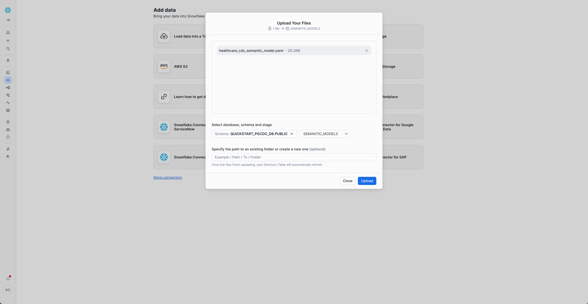
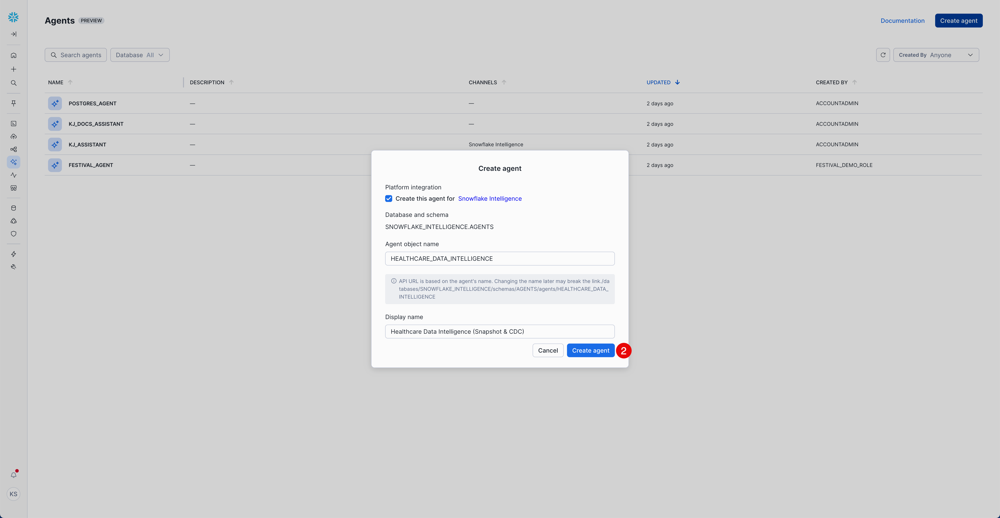
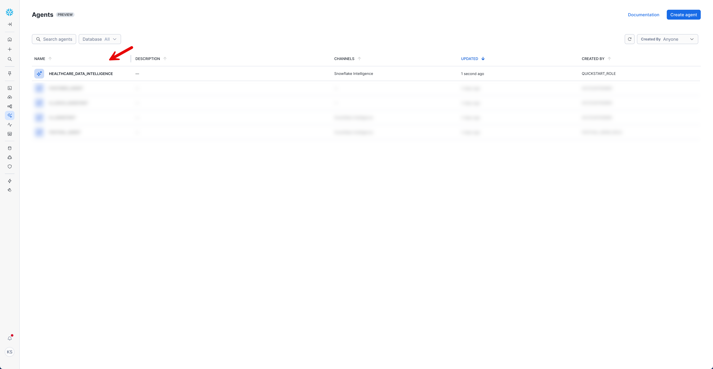
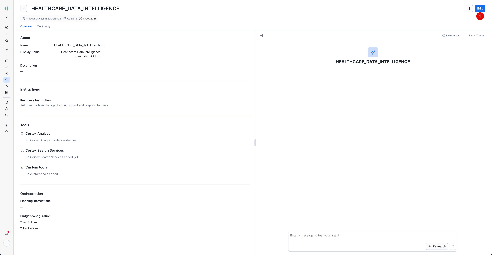
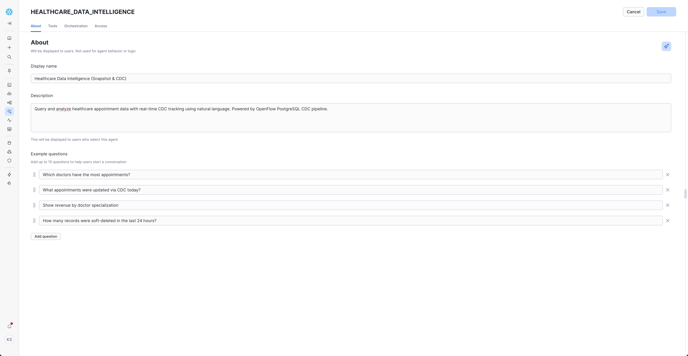
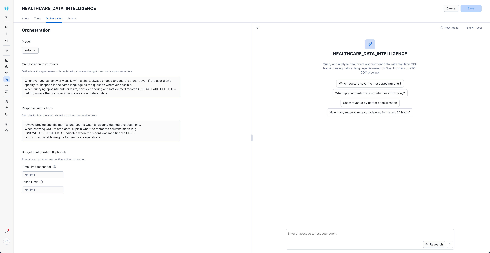
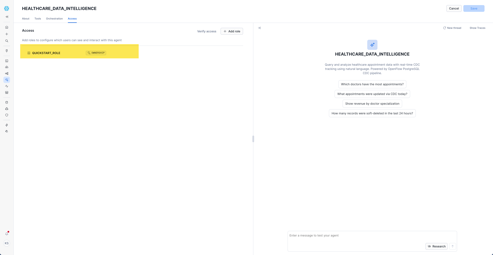
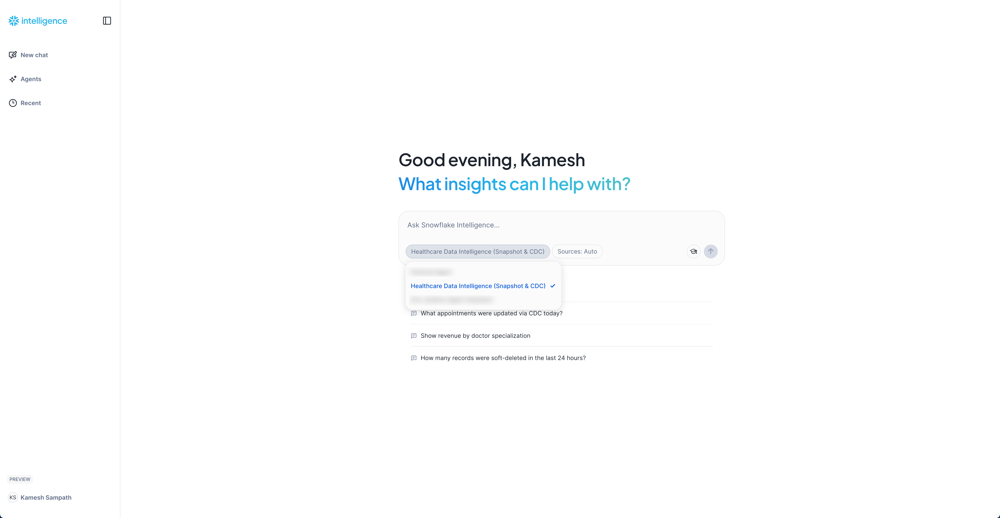

author: Kamesh Sampath, Gilberto Hernandez
id: getting-started-with-openflow-postgresql-cdc
categories: snowflake-site:taxonomy/solution-center/certification/quickstart, snowflake-site:taxonomy/product/platform, snowflake-site:taxonomy/snowflake-feature/ingestion, snowflake-site:taxonomy/snowflake-feature/transformation, snowflake-site:taxonomy/snowflake-feature/openflow, snowflake-site:taxonomy/snowflake-feature/postgres
language: en
summary: Build a real-time CDC pipeline from PostgreSQL to Snowflake with the gen 2 Openflow PostgreSQL connector, then explore the changes in natural language with Snowflake CoWork.
environments: web
status: published
feedback link: <https://github.com/Snowflake-Labs/sfquickstarts/issues>
fork repo link: https://github.com/Snowflake-Labs/sfguide-getting-started-openflow-postgresql-cdc
tags: Postgres

# Getting Started with PostgreSQL CDC
<!-- ------------------------ -->
## Overview

In this Quickstart, you'll build a real-time Change Data Capture (CDC) pipeline from PostgreSQL to Snowflake using the gen 2 Openflow PostgreSQL connector. We'll capture an initial snapshot of a transactional database, stream every insert, update, and delete into Snowflake within seconds, and then ask questions about those changes in plain English with Snowflake CoWork.

We use a healthcare appointment management system as our demo dataset, and the same patterns apply to any transactional application, including e-commerce, CRM, and ERP systems.

> **Note:** If you already run gen 1 Openflow, which most Openflow users do today, read the **Already on Gen 1?** step before you start. It explains how your existing setup maps to gen 2 and where to rejoin the guide.

### Healthcare Appointments Demo Dataset

You'll work with a synthetic healthcare appointment management system that includes:

- 100 synthetic patients with diverse demographics
- 10 doctors across 5 medical specializations
- 170 appointments (150 historical and 20 upcoming)
- 120 visit records with diagnoses and charges
- Real-time CDC events covering INSERT, UPDATE, and DELETE operations

> **Important:** All patient data, doctor information, and healthcare records in this demo are entirely fictitious and created for demonstration purposes only. No real PHI (Protected Health Information) is used.

### What is Openflow

[Snowflake Openflow](https://docs.snowflake.com/en/user-guide/data-integration/openflow/about) is an integration service, built on Apache NiFi, that moves data from almost any source into Snowflake. It ships with ready-made connectors for databases, SaaS apps, files, and streams.

Openflow runs in one of two deployment types. A Snowflake deployment runs on Snowpark Container Services inside your Snowflake account. A BYOC (bring your own cloud) deployment runs the data plane in your own AWS account. This Quickstart uses a Snowflake deployment.

### What's New in Gen 2 Openflow

Gen 2 is the current Openflow management model, and every new Openflow deployment is gen 2. Here's what changes compared with gen 1:

- Deployments, runtimes, and connectors are Snowflake objects. You create and manage them with SQL (`CREATE OPENFLOW DEPLOYMENT`, `CREATE OPENFLOW RUNTIME`, `CREATE OPENFLOW CONNECTOR`) or in the Openflow UI.
- Runtimes and connectors live in a schema and use standard Snowflake RBAC. Each runtime runs as an execute-as role, and that role's grants decide what the connector can read and write.
- The PostgreSQL connector installs through a setup wizard that validates your connection and privileges before the connector starts. In gen 1 you configured parameter contexts and controller services by hand on the canvas.
- Connector configuration is versioned. You can draft changes, commit them, abort them, and reuse the same configuration across environments.

Learn more in [Openflow gen 1 and gen 2](https://docs.snowflake.com/en/user-guide/data-integration/openflow/gen2/openflow-generations).

### What is Change Data Capture (CDC)

Change Data Capture (CDC) identifies the changes made to data in a database and delivers them to a downstream system as they happen. CDC tracks only what changed, so there's no need to re-query the entire database on a schedule.

PostgreSQL CDC uses logical replication, which reads changes from the Write-Ahead Log (WAL). When data is modified in PostgreSQL:

1. Changes are written to the WAL (a transaction log)
2. A replication slot captures these changes
3. A publication defines which tables to track
4. Openflow reads from the replication slot and delivers changes to Snowflake

Here's how CDC compares with traditional batch ETL:

| Aspect | CDC | Batch ETL |
|--------|-----|-----------|
| Latency | Seconds | Hours/Days |
| Data Freshness | Real-time | Scheduled intervals |
| Network Impact | Changes only | Full table scans |
| Database Load | Minimal (log reading) | High (full queries) |
| History | All changes tracked | Point-in-time snapshots |

Learn more about the [Openflow Connector for PostgreSQL](https://docs.snowflake.com/en/user-guide/data-integration/openflow/connectors/postgres/about).

### What You'll Learn

- How to create gen 2 Openflow deployments and runtimes with SQL
- How the execute-as role controls what an Openflow connector can access in Snowflake
- How to install and validate the PostgreSQL CDC connector with the setup wizard
- How to store source credentials in a Snowflake secret
- How to capture snapshot and incremental changes, including soft deletes and journal tables
- How to recreate the same connector as code with versioned configuration
- How to explore CDC data in natural language with Snowflake CoWork

### What You'll Need

- A Snowflake account in an AWS, Azure, or GCP commercial region where Openflow is available
- ACCOUNTADMIN access, or an admin who can run the SQL block in the **Setup: Role & Grants** step for you
- Room for one more Openflow Snowflake deployment. Each account supports up to three, and gen 1 and gen 2 deployments share that limit. You can also reuse an existing gen 2 deployment.
- A PostgreSQL 11 to 18 instance with logical replication enabled. We recommend [Snowflake Postgres](https://www.snowflake.com/en/product/features/postgres/) (see [Getting Started with Snowflake Postgres](https://www.snowflake.com/en/developers/guides/getting-started-with-snowflake-postgres/)). AWS RDS, Amazon Aurora, GCP Cloud SQL, Azure Database for PostgreSQL, and self-hosted PostgreSQL also work.
- Network connectivity from Snowflake to your PostgreSQL instance
- Git and a PostgreSQL client such as `psql`
- [Snowflake CLI](https://docs.snowflake.com/en/developer-guide/snowflake-cli/index), only for the optional **Recreate the Connector as Code** step

<!-- TODO (DEVREL-113): Confirm GCP availability for Openflow Snowflake deployments and whether BCR bundle 2025_06 is still required; the gen 1 guide required it. -->

### What You'll Build

A real-time healthcare appointment pipeline that replicates PostgreSQL tables into Snowflake through a gen 2 Openflow connector, complete with an audit trail of every change and a CoWork agent you can question in plain English.

<!-- ------------------------ -->
## Setup: Role & Grants

Before we begin, we'll create a dedicated role for this Quickstart and grant it the privileges you'll need. If you don't have ACCOUNTADMIN access in your Snowflake account, send the SQL block below to your Snowflake admin. They can review and run it to provision the role on your behalf.

We'll create two roles:

- `QUICKSTART_ROLE` is the role you work in. It creates the Openflow deployment, runtime, and connector, and it owns the database, warehouse, and CoWork agent.
- `QUICKSTART_PGCDC_RUNTIME_ROLE` is the runtime's execute-as role. The connector uses this role to read and write in Snowflake, so it only gets the grants the connector needs. We grant it to `QUICKSTART_ROLE` so you can query the tables the connector creates.

```sql
-- Run as ACCOUNTADMIN
USE ROLE ACCOUNTADMIN;

-- 1. Create the role for this Quickstart
CREATE ROLE IF NOT EXISTS QUICKSTART_ROLE;

-- 2. Grant the role to the user who will run the Quickstart
GRANT ROLE QUICKSTART_ROLE TO USER <your_username>;

-- 3. Warehouse privileges
GRANT CREATE WAREHOUSE ON ACCOUNT TO ROLE QUICKSTART_ROLE;

-- 4. Database & schema privileges
GRANT CREATE DATABASE ON ACCOUNT TO ROLE QUICKSTART_ROLE;

-- 5. Integration privileges (external access integration for the runtime)
GRANT CREATE INTEGRATION ON ACCOUNT TO ROLE QUICKSTART_ROLE;

-- 6. Future grants
-- -- N/A for this guide

-- 7. Stage privileges
-- -- N/A for this guide (QUICKSTART_ROLE owns the stage it creates)

-- 8. Guide-specific grants
-- Openflow gen 2: create deployments, and compute pools for Snowflake deployments
GRANT CREATE OPENFLOW DEPLOYMENT ON ACCOUNT TO ROLE QUICKSTART_ROLE;
GRANT CREATE COMPUTE POOL ON ACCOUNT TO ROLE QUICKSTART_ROLE;

-- Execute-as role for the Openflow runtime
CREATE ROLE IF NOT EXISTS QUICKSTART_PGCDC_RUNTIME_ROLE;
GRANT ROLE QUICKSTART_PGCDC_RUNTIME_ROLE TO ROLE QUICKSTART_ROLE;

-- 9. Switch into the role for the rest of the Quickstart
USE ROLE QUICKSTART_ROLE;
```

> **Note:** If you don't have ACCOUNTADMIN access, send the SQL block above to your Snowflake admin to run on your behalf. Once the role is granted, run `USE ROLE QUICKSTART_ROLE;` and continue with the Quickstart.

Every object in the rest of this Quickstart is created by `QUICKSTART_ROLE`. The admin doesn't need to create any integrations or network rules on your behalf.

<!-- ------------------------ -->
## Already on Gen 1?

Skip this step if you're new to Openflow. If you already run Openflow, start here.

Your existing gen 1 deployments, runtimes, and connectors keep working. New gen 1 deployments can't be created, so this Quickstart builds on gen 2 objects. You have three ways forward:

- Create a new gen 2 deployment for this Quickstart. This is the simplest path if your account has room under the limit of three Snowflake deployments. Continue with the next step.
- Migrate your existing gen 1 deployment and runtimes to gen 2, then continue with this Quickstart and skip deployment creation. See [Migrate a gen 1 deployment and runtimes to gen 2](https://docs.snowflake.com/en/user-guide/data-integration/openflow/gen2/migrate-deployment-runtime).
- Migrate a gen 1 PostgreSQL connector you already run to gen 2. See [Migrate a gen 1 connector to gen 2](https://docs.snowflake.com/en/user-guide/data-integration/openflow/gen2/migrate-connector).

A few differences you'll notice coming from gen 1:

- Runtimes are schema-level objects. `USAGE` on a deployment no longer shows you its runtimes. You need `USAGE`, `OPERATE`, or `MONITOR` on the runtime itself, plus `USAGE` on its database and schema.
- The runtime role from gen 1 becomes the runtime's `EXECUTE_AS_ROLE`. The connector's access to Snowflake follows that role's grants.
- The runtime canvas is read-only for gen 2 connectors. You configure them through the setup wizard, **Installed Connectors**, or SQL.
- Gen 2 runtimes also run gen 1 connectors, so you can move your runtimes first and connectors later.

> **Note:** The deployment limit counts gen 1 and gen 2 together. If your account already has three Snowflake deployments, migrate an existing one or remove one you no longer use before continuing.

<!-- ------------------------ -->
## Clone the QuickStart Repository

First, clone the repository to get access to SQL scripts and setup files:

```bash
git clone https://github.com/Snowflake-Labs/sfguide-getting-started-openflow-postgresql-cdc.git
cd sfguide-getting-started-openflow-postgresql-cdc
```

Here's what's in the repository:

- **sql/0.init_healthcare.sql**: PostgreSQL schema and synthetic data initialization
- **sql/2.verify_snapshot.sql**: Snapshot load verification queries
- **sql/3.live_appointments.sql**: Live CDC event generation script
- **sql/4.analytics_queries.sql**: Real-time analytics query examples

> **Note:** This Quickstart runs the Snowflake setup SQL inline in the **Setup Snowflake Environment** step, so you won't need the repository's Snowflake setup script.

<!-- TODO (DEVREL-113): Update the companion repo's setup script for gen 2 (execute-as role, control schema, secret), or remove it. -->

<!-- ------------------------ -->
## Setup PostgreSQL Database

In this section, we'll configure PostgreSQL for CDC and load the healthcare demo data.

### PostgreSQL Requirements

This guide assumes you have a PostgreSQL instance already created and available. Before proceeding, ensure your instance meets these requirements:

> **Required PostgreSQL Configuration**:
>
> - **PostgreSQL instance available**: You have a running PostgreSQL instance (Snowflake Postgres, AWS RDS, GCP Cloud SQL, Azure Database, or self-hosted) with network accessibility
> - **Logical replication enabled**: `wal_level = logical` (required for CDC) - see configuration instructions below
> - **User with REPLICATION privileges**: The PostgreSQL user must have replication permissions
> - **Network access**: Configure network access from Snowflake SPCS to your PostgreSQL instance
> - **Supported versions**: PostgreSQL 11-18
>
> This quickstart was tested with **Snowflake Postgres v17**.

#### Enable Logical Replication (If Not Already Enabled)

PostgreSQL CDC requires logical replication to be enabled. This allows the connector to capture changes from the Write-Ahead Log (WAL).

**Grant REPLICATION privileges to your PostgreSQL user:**

```sql
ALTER USER snowflake_admin WITH REPLICATION;
```

**Enable logical replication** via your PostgreSQL service:

- **Snowflake Postgres**: Logical replication is enabled by default. No additional configuration required. See [Getting Started with Snowflake Postgres](https://www.snowflake.com/en/developers/guides/getting-started-with-snowflake-postgres/) for setup
- **GCP Cloud SQL**: Set the `cloudsql.logical_decoding` and `cloudsql.enable_pglogical` flags to `on`
- **AWS RDS** or **AWS Aurora**: Set `rds.logical_replication = 1` and apply it to your instance
- **Azure Database**: Set `wal_level = logical` via the Azure portal or Azure CLI
- **Self-hosted PostgreSQL**: Edit `postgresql.conf` to set `wal_level = logical` (or run `ALTER SYSTEM SET wal_level = logical;`), then restart PostgreSQL

> **Important**: For detailed configuration instructions specific to your PostgreSQL service, see [Snowflake's PostgreSQL CDC Setup Guide - Configure wal_level](https://docs.snowflake.com/en/user-guide/data-integration/openflow/connectors/postgres/setup#configure-wal-level).

After enabling logical replication and restarting your PostgreSQL instance if needed, you'll verify the `wal_level` setting in the next section after setting up your PostgreSQL client.

### Setup Notes

Before configuring your PostgreSQL environment, note these setup considerations:

- **Service Compatibility**: You can use any PostgreSQL service:
  - Snowflake Postgres (recommended)
  - AWS RDS
  - Amazon Aurora
  - GCP Cloud SQL
  - Azure Database for PostgreSQL
  - Self-hosted PostgreSQL
  
  The SQL scripts are compatible with all variants; configuration steps may vary slightly depending on your service.

- **Client Tools**: You can use any PostgreSQL client you're comfortable with - `psql` command-line tool, pgAdmin, DBeaver, DataGrip, TablePlus, or others. This guide shows `psql` examples, but the SQL scripts work with any client.

- **PostgreSQL User**: This guide uses the `snowflake_admin` user for both CLI connections and Openflow connector configuration. You can use any PostgreSQL user with appropriate privileges (superuser or replication role) - just ensure the user has permissions for logical replication and can create publications and replication slots.

### Setup PostgreSQL Client Environment

This section shows how to install and configure the `psql` command-line tool, which is used throughout this guide.

> **Don't have psql installed?** The `psql` client is part of the PostgreSQL installation:
>
> - **macOS**: `brew install postgresql` (via Homebrew)
> - **Ubuntu/Debian**: `sudo apt-get install postgresql-client`
> - **RHEL/CentOS**: `sudo yum install postgresql`
> - **Windows**: Download from [PostgreSQL Downloads](https://www.postgresql.org/download/windows/)
>
> **Using a different client?** If you prefer pgAdmin, DBeaver, or another GUI client, you can adapt the `psql` commands throughout this guide by running the SQL portion in your client's query window.

#### Set Environment Variables

Set these environment variables to avoid repeating connection parameters:

```bash
export PGHOST='YOUR-POSTGRES-HOST'        # e.g., your Snowflake Postgres endpoint
export PGPORT='5432'
export PGDATABASE='postgres'
export PGUSER='snowflake_admin'
```

These variables will be referenced throughout the guide (e.g., `$PGHOST`, `$PGUSER`) for convenience.

#### Configure Password File

Create a `.pgpass` file to avoid entering your password repeatedly. This file securely stores your PostgreSQL credentials.

```bash
# Create .pgpass file (Unix/Linux/macOS)
echo "$PGHOST:$PGPORT:$PGDATABASE:$PGUSER:YOUR-PASSWORD" >> ~/.pgpass

# Set proper permissions (required for security)
chmod 0600 ~/.pgpass
```

> **Password File Format**: The `.pgpass` file format is `hostname:port:database:username:password`. You can use `*` as a wildcard for any field. Learn more about [PostgreSQL password files](https://www.postgresql.org/docs/current/libpq-pgpass.html).

### Test PostgreSQL Connection

Before proceeding with any configuration, verify that your PostgreSQL instance is accessible and that logical replication is enabled.

#### Check PostgreSQL Accessibility

First, ensure your PostgreSQL instance allows external connections:

**For Snowflake Postgres (Recommended):**

- Your Snowflake Postgres instance is accessible via the endpoint provided during setup
- Network connectivity between Snowflake SPCS and Snowflake Postgres is automatically configured
- Note the **Connection Endpoint** - you'll need this for both client connection and Openflow connector configuration
- See [Getting Started with Snowflake Postgres](https://www.snowflake.com/en/developers/guides/getting-started-with-snowflake-postgres/) for setup details

**For GCP Cloud SQL:**

- Navigate to Cloud SQL instance → **Connections** → **Networking**
- Ensure **Public IP** is enabled (or VPC peering is configured for private)
- Add authorized networks if needed (or configure for broad access during demo)
- Note the **Public IP Address** - you'll need this for both client connection and Snowflake network rule

**For AWS RDS:**

- Navigate to RDS instance → **Connectivity & security**
- Ensure **Publicly accessible** is "Yes" (or VPC peering is configured)
- Check **Security group** allows inbound traffic on port 5432
- Note the **Endpoint** - you'll need this for both client connection and Snowflake network rule

**For Azure Database for PostgreSQL:**

- Navigate to PostgreSQL server → **Connection security**
- Ensure **Allow access to Azure services** is enabled
- Add firewall rules for your IP address
- Note the **Server name** - you'll need this for both client connection and Snowflake network rule

**For self-hosted PostgreSQL:**

- Ensure `pg_hba.conf` allows connections from your IP (or use `0.0.0.0/0` for demo)
- Firewall allows inbound traffic on port 5432
- PostgreSQL is listening on external interfaces (`listen_addresses = '*'` in `postgresql.conf`)

#### Test Basic Connection

Test the connection to your PostgreSQL instance using any method you prefer:

**For Snowflake Postgres:** Use the `psql` connection URL provided during instance creation. The connection string format is typically provided in the Snowflake Postgres setup UI.

**Option 1: Using psql:**

If you set up environment variables and `.pgpass` in the previous section, simply run:

```bash
psql -c "SELECT version();"
```

If you didn't set up environment variables, specify connection parameters explicitly:

```bash
psql -h YOUR-POSTGRES-HOST -p 5432 -U snowflake_admin -d postgres -c "SELECT version();"
```

**Option 2: Using pgAdmin, DBeaver, or other GUI client:**

- Create a new connection with your PostgreSQL host, port, username, and password
- Test the connection
- Run `SELECT version();` to verify

Expected result (version number may vary):

```text
                                                 version                                                  
----------------------------------------------------------------------------------------------------------
 PostgreSQL 17.2 on x86_64-pc-linux-gnu, compiled by gcc (Debian 12.2.0-14) 12.2.0, 64-bit
(1 row)
```

> **Connection Failed?** If you cannot connect to PostgreSQL, resolve this before proceeding. Common fixes:
>
> - **Check firewall**: Ensure port 5432 is open
> - **Check PostgreSQL config**: Verify `listen_addresses` in `postgresql.conf`
> - **Check pg_hba.conf**: Ensure host-based authentication allows your connection
> - **Check cloud provider**: Verify security groups, firewall rules, authorized networks
> - **Verify credentials**: Ensure username and password are correct
>
> All subsequent steps require a working PostgreSQL connection.

#### Verify psql Configuration (Optional)

If you set up environment variables and `.pgpass`, test that they're working correctly:

```bash
psql -c "SELECT current_database(), current_user;"
```

Expected output:

```text
 current_database | current_user 
------------------+--------------
 postgres         | snowflake_admin
(1 row)
```

If the connection succeeds without prompting for a password, your psql environment is configured correctly.

#### Verify Logical Replication

Confirm that logical replication is enabled (as required in the PostgreSQL Requirements section):

> **Snowflake Postgres Advantage:** If you're using Snowflake Postgres, logical replication (`wal_level = logical`) is **enabled by default**. You can skip this verification step, but feel free to confirm it works as expected.

```bash
psql -c "SHOW wal_level;"
```

Expected output:

```text
 wal_level 
-----------
 logical
(1 row)
```

If the output shows `logical`, you're all set! If not, go back to the "Enable Logical Replication" section in PostgreSQL Requirements and ensure you've enabled `wal_level = logical` and restarted your PostgreSQL instance.

### Initialize Healthcare Database

Now we'll initialize the PostgreSQL database with the healthcare schema, synthetic data, and CDC configuration.

#### Execute the Initialization Script

The `sql/0.init_healthcare.sql` script will:

1. Grant replication privileges to the snowflake_admin user
2. Create the `healthcare` schema
3. Create tables: `patients`, `doctors`, `appointments`, `visits`
4. Load 100 synthetic patients, 10 doctors, 170 appointments, and 100 visit records
5. Create indexes for performance
6. Configure CDC publication for logical replication

#### Run the Script

```bash
psql -f sql/0.init_healthcare.sql
```

> **Using a different PostgreSQL client?** If you're using pgAdmin, DBeaver, or another GUI client instead of `psql`, simply open `sql/0.init_healthcare.sql`, copy the entire contents, and execute it in your client's query window. The script contains standard PostgreSQL SQL and will work with any client.
>
> **Script Duration**: Approximately 10-15 seconds to complete.

#### Verify PostgreSQL Setup

Before connecting Openflow, let's verify the entire PostgreSQL CDC configuration is correct.

> **Using a different PostgreSQL client?** All verification queries below use `psql` for consistency. If you're using a GUI client (pgAdmin, DBeaver, etc.), simply run the SQL portion of each command. For example, for `psql -c "SELECT ..."`, just run `SELECT ...` in your client.

#### Check Tables Exist

```bash
psql -c "\dt healthcare.*"
```

Expected output:

```text
              List of relations
   Schema   |     Name     | Type  |      Owner      
------------+--------------+-------+-----------------
 healthcare | appointments | table | snowflake_admin
 healthcare | doctors      | table | snowflake_admin
 healthcare | patients     | table | snowflake_admin
 healthcare | visits       | table | snowflake_admin
(4 rows)
```

#### Check Row Counts

```bash
psql -c "SELECT 
  (SELECT COUNT(*) FROM healthcare.patients) as patients,
  (SELECT COUNT(*) FROM healthcare.doctors) as doctors,
  (SELECT COUNT(*) FROM healthcare.appointments) as appointments,
  (SELECT COUNT(*) FROM healthcare.visits) as visits;"
```

Expected output:

```text
 patients | doctors | appointments | visits 
----------+---------+--------------+--------
      100 |      10 |          170 |    100
(1 row)
```

> **What's a Publication?** A PostgreSQL publication defines which tables are tracked for CDC. The Openflow connector subscribes to this publication to receive change events (INSERT, UPDATE, DELETE) in real-time.

#### Verify CDC Publication

```bash
psql -c "SELECT * FROM pg_publication WHERE pubname = 'healthcare_cdc_publication';"
```

Expected output:

```text
          pubname           | pubowner | puballtables | pubinsert | pubupdate | pubdelete | pubtruncate 
----------------------------+----------+--------------+-----------+-----------+-----------+-------------
 healthcare_cdc_publication |    16390 | t            | t         | t         | t         | t
(1 row)
```

#### Verify Published Tables

```bash
psql -c "SELECT schemaname, tablename FROM pg_publication_tables WHERE pubname = 'healthcare_cdc_publication';"
```

Expected output:

```text
 schemaname |  tablename   
------------+--------------
 healthcare | appointments
 healthcare | doctors
 healthcare | patients
 healthcare | visits
(4 rows)
```

#### Check CDC Configuration

```bash
psql -c "SELECT
    current_setting('wal_level') AS wal_level,
    current_setting('max_replication_slots') AS max_replication_slots,
    current_setting('max_wal_senders') AS max_wal_senders,
    (SELECT count(*) FROM pg_publication) AS publication_count,
    (SELECT count(*) FROM pg_replication_slots) AS active_slots;"
```

Expected output:

```text
 wal_level | max_replication_slots | max_wal_senders | publication_count | active_slots 
-----------+-----------------------+-----------------+-------------------+--------------
 logical   | 10                    | 10              | 1                 | 0
(1 row)
```

> **What to check:**
>
> - `wal_level` should be `logical`
> - `max_replication_slots` should be at least 1 (typically 10 or more)
> - `max_wal_senders` should be at least 1 (typically 10 or more)
> - `publication_count` should be 1 (our healthcare_cdc_publication)
> - `active_slots` will be 0 now, and will increase to 1 once Openflow connects

#### Verify Replication Privileges

```bash
psql -c "SELECT rolname, rolsuper, rolreplication FROM pg_roles WHERE rolname = '$PGUSER';"
```

Expected output:

```text
 rolname         | rolsuper | rolreplication 
-----------------+----------+----------------
 snowflake_admin | f        | t
(1 row)
```

> **Snowflake Postgres Advantage:** If you're using Snowflake Postgres, the `snowflake_admin` user is **pre-configured with replication privileges** (`rolreplication = t`) and is not a superuser (`rolsuper = f`). This is the recommended secure configuration for CDC workloads.
>
> **Note:** For other managed services (AWS RDS, Azure), `rolsuper` is typically `f` (false). For self-hosted installations where you're using the superuser account, it may be `t` (true). The critical column to verify is `rolreplication` which must be `t` (true).

The `rolreplication` column should be `t` (true). If it's `f` (false), grant replication privileges:

```bash
psql -c "ALTER USER $PGUSER WITH REPLICATION;"
```

> **Setup Complete!** Your PostgreSQL database is now fully configured for CDC with:
>
> - ✅ Logical replication enabled
> - ✅ Healthcare schema with 100 patients, 10 doctors, 170 appointments, 100 visits
> - ✅ CDC publication tracking all healthcare tables
> - ✅ Replication privileges granted
>

Next, let us setup the Snowflake environment.

<!-- ------------------------ -->
## Setup Snowflake Environment

Now let's create the Snowflake objects the pipeline needs. We'll run everything as `QUICKSTART_ROLE`.

Here's what we're creating:

- `QUICKSTART_PGCDC_WH`, a warehouse the connector uses to merge changes
- `QUICKSTART_PGCDC_DB`, the destination database. The connector creates the `healthcare` schema and its tables here during the snapshot load.
- `QUICKSTART_PGCDC_DB.OPENFLOW`, the control schema that holds the Openflow runtime, connector, and the PostgreSQL password secret
- `QUICKSTART_PGCDC_DB.NETWORKS`, a schema for the network rule
- `quickstart_pgcdc_access`, an external access integration that lets the runtime reach PostgreSQL
- `snowflake_intelligence.agents` and the `semantic_models` stage, which CoWork uses later in the Quickstart

<!-- TODO (DEVREL-113): Confirm CoWork still uses the snowflake_intelligence database and agents schema after the Snowflake Intelligence rename. -->

### Create Snowflake Objects

Open [Workspaces](https://app.snowflake.com/_deeplink/#/workspaces?utm_source=snowflake-devrel&utm_medium=developer-guides&utm_content=getting-started-with-openflow-postgresql-cdc&utm_cta=developer-guides-deeplink) in Snowsight (**Projects** > **Workspaces**), create a new SQL file, and run the following. Replace `YOUR-POSTGRES-HOST` with your PostgreSQL endpoint and `YOUR-POSTGRES-PASSWORD` with the password of the PostgreSQL user the connector will use.

```sql
USE ROLE QUICKSTART_ROLE;

-- Warehouse and destination database
CREATE WAREHOUSE IF NOT EXISTS QUICKSTART_PGCDC_WH
  WAREHOUSE_SIZE = MEDIUM
  AUTO_SUSPEND = 300
  AUTO_RESUME = TRUE;

CREATE DATABASE IF NOT EXISTS QUICKSTART_PGCDC_DB;
CREATE SCHEMA IF NOT EXISTS QUICKSTART_PGCDC_DB.OPENFLOW;
CREATE SCHEMA IF NOT EXISTS QUICKSTART_PGCDC_DB.NETWORKS;

-- Stage for the CoWork semantic model
CREATE STAGE IF NOT EXISTS QUICKSTART_PGCDC_DB.PUBLIC.semantic_models
  DIRECTORY = (ENABLE = TRUE);

-- Network rule and external access integration for PostgreSQL
CREATE OR REPLACE NETWORK RULE QUICKSTART_PGCDC_DB.NETWORKS.postgres_network_rule
  MODE = EGRESS
  TYPE = HOST_PORT
  VALUE_LIST = ('YOUR-POSTGRES-HOST:5432');

CREATE OR REPLACE EXTERNAL ACCESS INTEGRATION quickstart_pgcdc_access
  ALLOWED_NETWORK_RULES = (QUICKSTART_PGCDC_DB.NETWORKS.postgres_network_rule)
  ENABLED = TRUE
  COMMENT = 'Openflow runtime access for PostgreSQL CDC';

-- PostgreSQL password, stored as a Snowflake secret
CREATE OR REPLACE SECRET QUICKSTART_PGCDC_DB.OPENFLOW.postgres_password
  TYPE = GENERIC_STRING
  SECRET_STRING = 'YOUR-POSTGRES-PASSWORD';

-- Grants for the runtime's execute-as role
GRANT USAGE ON WAREHOUSE QUICKSTART_PGCDC_WH TO ROLE QUICKSTART_PGCDC_RUNTIME_ROLE;
GRANT OPERATE ON WAREHOUSE QUICKSTART_PGCDC_WH TO ROLE QUICKSTART_PGCDC_RUNTIME_ROLE;
GRANT USAGE ON DATABASE QUICKSTART_PGCDC_DB TO ROLE QUICKSTART_PGCDC_RUNTIME_ROLE;
GRANT CREATE SCHEMA ON DATABASE QUICKSTART_PGCDC_DB TO ROLE QUICKSTART_PGCDC_RUNTIME_ROLE;
GRANT USAGE ON SCHEMA QUICKSTART_PGCDC_DB.OPENFLOW TO ROLE QUICKSTART_PGCDC_RUNTIME_ROLE;
GRANT READ ON SECRET QUICKSTART_PGCDC_DB.OPENFLOW.postgres_password TO ROLE QUICKSTART_PGCDC_RUNTIME_ROLE;
GRANT USAGE ON INTEGRATION quickstart_pgcdc_access TO ROLE QUICKSTART_PGCDC_RUNTIME_ROLE;

-- CoWork agent infrastructure
CREATE DATABASE IF NOT EXISTS snowflake_intelligence;
CREATE SCHEMA IF NOT EXISTS snowflake_intelligence.agents;
GRANT USAGE ON DATABASE snowflake_intelligence TO ROLE PUBLIC;
GRANT USAGE ON SCHEMA snowflake_intelligence.agents TO ROLE PUBLIC;
```

Here's what the code does:

- Creates the warehouse, destination database, and the schemas for Openflow objects and network rules
- Allows the runtime to reach your PostgreSQL host and port through a network rule and external access integration
- Stores the PostgreSQL password as a secret, so it never appears in the connector configuration
- Grants the execute-as role only what the connector needs: the warehouse, `CREATE SCHEMA` on the destination database, the control schema, the secret, and the integration
- Creates the database and schema that will hold the CoWork agent

> **Note:** The connector creates the `healthcare` schema itself, which is why the execute-as role gets `CREATE SCHEMA` on the database. Don't create that schema ahead of time.

Use your PostgreSQL endpoint for `YOUR-POSTGRES-HOST`:

- Snowflake Postgres: your Snowflake Postgres connection endpoint
- GCP Cloud SQL: your instance's public IP (for example, `34.123.45.67`)
- AWS RDS: your RDS endpoint hostname
- Azure Database: your Azure PostgreSQL server name
- Self-hosted: your server hostname or IP address

### Verify Snowflake Setup

Let's confirm the schemas exist:

```sql
SHOW SCHEMAS IN DATABASE QUICKSTART_PGCDC_DB;
```

You should see `NETWORKS`, `OPENFLOW`, and `PUBLIC` (plus `INFORMATION_SCHEMA`).

Next, confirm the network rule points at your PostgreSQL host:

```sql
DESC NETWORK RULE QUICKSTART_PGCDC_DB.NETWORKS.postgres_network_rule;
```

The `value_list` column should show your actual host and port. If it doesn't, update the rule in place:

```sql
ALTER NETWORK RULE QUICKSTART_PGCDC_DB.NETWORKS.postgres_network_rule
  SET VALUE_LIST = ('YOUR-CORRECT-POSTGRES-HOST:5432');
```

> **Important:** Openflow can reach PostgreSQL only when two things are true. Your PostgreSQL firewall or security group must allow inbound connections from Snowflake, and the network rule must match your PostgreSQL host and port exactly. The setup wizard tests the connection for you in a later step.

<!-- ------------------------ -->
## Create the Openflow Deployment and Runtime

With the Snowflake objects in place, let's create the Openflow infrastructure. In gen 2, both the deployment and the runtime are Snowflake objects, so we'll create them with SQL.

### Create the Deployment

A deployment is the Openflow environment that hosts your runtimes. We'll create a Snowflake deployment, which runs on Snowpark Container Services in your account.

> **Note:** Skip this step if you already have a gen 2 deployment you want to reuse. Use its name in place of `QUICKSTART_DEPLOYMENT` below.

```sql
USE ROLE QUICKSTART_ROLE;

CREATE OPENFLOW DEPLOYMENT QUICKSTART_DEPLOYMENT
  DEPLOYMENT_TYPE = SNOWFLAKE
  DISPLAY_NAME = 'Quickstart PostgreSQL CDC Deployment';
```

Deployment creation takes several minutes. Check its status:

```sql
SHOW OPENFLOW DEPLOYMENTS LIKE 'QUICKSTART_DEPLOYMENT';
```

<!-- TODO (DEVREL-113): Confirm SHOW OPENFLOW DEPLOYMENTS syntax, the status column name and ready value, and typical provisioning time. -->

You can also watch it in Snowsight under **Ingestion** > **Openflow** > **Deployments**. Wait until the deployment is active before continuing.

> **Important:** PrivateLink settings can only be set when a deployment is created. This Quickstart uses public connectivity. If your organization requires PrivateLink, see [Quickstart: gen 2 Openflow](https://docs.snowflake.com/en/user-guide/data-integration/openflow/gen2/quickstart) before you create the deployment.

### Create the Runtime

A runtime is the compute that runs your connectors. Let's create one in the control schema, set its execute-as role, and attach the external access integration so it can reach PostgreSQL.

```sql
USE DATABASE QUICKSTART_PGCDC_DB;
USE SCHEMA OPENFLOW;

CREATE OPENFLOW RUNTIME QUICKSTART_PGCDC_RUNTIME
  IN DEPLOYMENT QUICKSTART_DEPLOYMENT
  NODE_TYPE = MEDIUM
  NODE_TYPE_TIER = 'M4'
  MIN_NODES = 1
  MAX_NODES = 1
  EXECUTE_AS_ROLE = QUICKSTART_PGCDC_RUNTIME_ROLE
  EXTERNAL_ACCESS_INTEGRATIONS = (quickstart_pgcdc_access)
  DISPLAY_NAME = 'Quickstart PostgreSQL CDC Runtime';
```

Here's what the code does:

- Creates the runtime as a schema-level object, `QUICKSTART_PGCDC_DB.OPENFLOW.QUICKSTART_PGCDC_RUNTIME`
- Runs on a single node. The PostgreSQL connector doesn't support multi-node runtimes, so `MIN_NODES` and `MAX_NODES` are both `1`.
- Sets `EXECUTE_AS_ROLE`, so the connector reads and writes in Snowflake with the grants you gave `QUICKSTART_PGCDC_RUNTIME_ROLE`
- Attaches `quickstart_pgcdc_access`, which allows outbound connections to your PostgreSQL host

<!-- TODO (DEVREL-113): Confirm NODE_TYPE/NODE_TYPE_TIER sizing for this workload against the CDC runtime sizing doc. -->

Check the runtime status:

```sql
SHOW OPENFLOW RUNTIMES IN SCHEMA QUICKSTART_PGCDC_DB.OPENFLOW;
```

You can also find it in Snowsight under **Ingestion** > **Openflow** > **Runtimes**. Wait until the runtime is active before installing the connector.

<!-- TODO (DEVREL-113): Screenshot: gen 2 runtime active in the Runtimes tab. -->

Great job! Your gen 2 Openflow infrastructure is ready.

<!-- ------------------------ -->
## Install the Connector with the Setup Wizard

Now we'll install the PostgreSQL CDC connector on the runtime. The setup wizard walks through each setting and validates it before the connector starts, so configuration problems surface early.

### Download the PostgreSQL JDBC Driver

The connector needs the PostgreSQL JDBC driver to connect to your database. Download it from [jdbc.postgresql.org](https://jdbc.postgresql.org/download/). This Quickstart uses **postgresql-42.7.7.jar**, and any recent version works. You'll upload the file in the wizard.

### Start the Wizard

1. In Snowsight, go to **Ingestion** > **Openflow** and select **Launch Openflow**.
2. Open the **Connector library** tab.
3. Find the gen 2 **PostgreSQL CDC** connector.
4. Select `QUICKSTART_PGCDC_RUNTIME` as the runtime. The list only shows runtimes sized for the connector.
5. Select **Install**.

<!-- TODO (DEVREL-113): Screenshot: gen 2 PostgreSQL CDC entry in the Connector library. -->

### Configure the Connector

Step through the wizard and enter the following values. Each step includes help text in the panel on the right.

| Setting | Value |
|---------|-------|
| PostgreSQL host | Your PostgreSQL endpoint (same as the network rule) |
| Port | `5432` |
| Database | `postgres` |
| Username | `snowflake_admin`, or the PostgreSQL user with `REPLICATION` privileges |
| Password | The `QUICKSTART_PGCDC_DB.OPENFLOW.postgres_password` secret |
| JDBC driver | Upload **postgresql-42.7.7.jar** |
| Publication | `healthcare_cdc_publication` |
| Replication slot | Leave empty to auto-generate a name like `snowflake_connector_<unique_id>` |
| Destination database | `QUICKSTART_PGCDC_DB` |
| Warehouse | `QUICKSTART_PGCDC_WH` |
| Tables to replicate | `healthcare\..*` (all tables in the `healthcare` schema) |
| Ingestion type | `full` (snapshot first, then incremental changes) |

<!-- TODO (DEVREL-113): Capture the wizard's actual step names and field labels on a test run; confirm where the JDBC JAR is uploaded, how the secret is selected, and the merge schedule default. -->

> **Note:** The table pattern is a regular expression. The backslash escapes the dot so it matches the literal period in schema-qualified names like `healthcare.patients`.

### Validate Before You Create

Each wizard step has a **Verify** button that tests what you entered. Let's see it catch a mistake. On the source connection step, enter the wrong password, select **Verify**, and read the result. The wizard reports the failed connection and explains how to fix it in the panel on the right.

Correct the password and select **Verify** again. This time the connection test passes. The wizard also checks that your Snowflake role has the privileges it needs on the destination database and that values like hostnames and ports are well formed.

<!-- TODO (DEVREL-113): Screenshot: failed and passing Verify results. -->

> **Note:** You can move past a failed check on an intermediate step. Only the final validation before **Create Connector** has to pass. Select **Save and Close** at any point to keep your progress and come back later.

### Create and Start the Connector

1. On the last step, select **Create Connector**.
2. You're redirected to **Installed Connectors**. Wait for the connector to finish installing.
3. Select **Start** from the connector's menu.

The connector begins with a snapshot load of every table in the `healthcare` schema, then switches to streaming incremental changes.

Great job! The CDC pipeline is running.

<!-- ------------------------ -->
## Verify Snapshot Load

With the connector configured, you're now ready to start the CDC pipeline and verify that the initial snapshot is loaded correctly.

### Monitor the Connector

Let's watch the snapshot load. Open **Ingestion** > **Openflow** > **Connector Observability** to see the connector's health, throughput, and any errors.

For a closer look, select **Go to canvas** for the connector. The runtime canvas shows the connector's processors, queues, and bulletins. For gen 2 connectors the canvas is read-only, so you can inspect the flow but configuration changes go through **Installed Connectors** > **Edit** or SQL.

<!-- TODO (DEVREL-113): Screenshots: Connector Observability dashboard and read-only canvas during snapshot load. -->

> **Note:** The snapshot typically takes 1 to 2 minutes for the demo dataset. Larger datasets take proportionally longer. After the snapshot, the connector listens on the replication slot and applies new changes as they arrive.

### Verify Data in Snowflake

After the snapshot completes, verify that the data was loaded successfully in Snowflake.

> **IMPORTANT: Identifier Quoting Rule**
>
> PostgreSQL creates lowercase unquoted identifiers (e.g., `healthcare`, `appointments`, `patient_id`). When Openflow replicates these to Snowflake, they are preserved as **case-sensitive lowercase** names.
>
> **In Snowflake, you MUST quote these identifiers in lowercase**:
>
> - ✅ Correct: `USE SCHEMA "healthcare"; SELECT "patient_id", "status" FROM "appointments";`
> - ❌ Wrong: `USE SCHEMA healthcare; SELECT patient_id, status FROM appointments;`
> - ❌ Wrong: `SELECT PATIENT_ID, STATUS FROM APPOINTMENTS;`
>
> Why? Snowflake uppercases unquoted identifiers, so `appointments` becomes `APPOINTMENTS`, which won't match the actual table name `appointments` (lowercase). All queries in this quickstart follow this quoting convention.

#### Check Record Counts

Run the following query in Snowsight to verify all tables were created and populated:

```sql
USE ROLE QUICKSTART_ROLE;
USE DATABASE QUICKSTART_PGCDC_DB;
USE SCHEMA "healthcare";
USE WAREHOUSE QUICKSTART_PGCDC_WH;

SELECT 'patients' as table_name, COUNT(*) as record_count FROM "patients"
UNION ALL
SELECT 'doctors', COUNT(*) FROM "doctors"
UNION ALL
SELECT 'appointments', COUNT(*) FROM "appointments"
UNION ALL
SELECT 'visits', COUNT(*) FROM "visits"
ORDER BY table_name;
```

Expected output:

```text
+----------------+--------------+
| TABLE_NAME     | RECORD_COUNT |
+----------------+--------------+
| APPOINTMENTS   |          170 |
| DOCTORS        |           10 |
| PATIENTS       |          100 |
| VISITS         |          100 |
+----------------+--------------+
```

> Note: The initial snapshot loads 100 rows in `"visits"`. Additional visit records are generated during the Live CDC demo, so this count will increase after running the steps in "Generate Live CDC Events".

#### Verify CDC Metadata

Check that CDC metadata columns are present and confirm the snapshot was loaded:

```sql
SELECT 
    COUNT(*) as total_rows,
    MIN(_SNOWFLAKE_INSERTED_AT) as earliest_inserted,
    MAX(_SNOWFLAKE_INSERTED_AT) as latest_inserted,
    COUNT(DISTINCT _SNOWFLAKE_INSERTED_AT) as unique_insert_timestamps
FROM "appointments";
```

Expected output (timestamps will vary):

```text
+------------+---------------------------+---------------------------+---------------------------+
| TOTAL_ROWS | EARLIEST_INSERTED         | LATEST_INSERTED           | UNIQUE_INSERT_TIMESTAMPS  |
+------------+---------------------------+---------------------------+---------------------------+
|        170 | 2025-10-08 10:15:33.000   | 2025-10-08 10:15:45.000   |                        10 |
+------------+---------------------------+---------------------------+---------------------------+
```

This confirms that all 170 appointments were successfully loaded during the snapshot phase.

> **CDC Metadata Columns**: Openflow automatically adds the following metadata columns to track changes:
>
> - `_SNOWFLAKE_INSERTED_AT` (TIMESTAMP): When the row was first inserted into Snowflake during the snapshot or initial CDC event
> - `_SNOWFLAKE_UPDATED_AT` (TIMESTAMP): When the row was last updated by CDC processing (remains NULL for snapshot-only rows)
> - `_SNOWFLAKE_DELETED` (BOOLEAN): Logical delete flag (FALSE for active rows, TRUE when a DELETE event is captured)
>
> During the Live CDC demo, you'll see `_SNOWFLAKE_UPDATED_AT` populated when records are modified, and `_SNOWFLAKE_DELETED` set to TRUE for deleted records.

#### Verify Appointment Status Distribution

Check the distribution of appointment statuses:

```sql
SELECT 
    "status",
    COUNT(*) as count,
    ROUND(COUNT(*) * 100.0 / SUM(COUNT(*)) OVER (), 2) as percentage
FROM "appointments"
GROUP BY "status"
ORDER BY count DESC;
```

Expected output (approximate - actual counts will vary):

```text
+-----------+-------+------------+
| STATUS    | COUNT | PERCENTAGE |
+-----------+-------+------------+
| completed |   100 |      58.82 |
| cancelled |    40 |      23.53 |
| scheduled |    15 |       8.82 |
| no_show   |    10 |       5.88 |
| confirmed |     5 |       2.94 |
+-----------+-------+------------+
```

> **Note on Data Variability**: The exact counts and percentages will vary each time you run the initialization script because the appointment status is assigned using `RANDOM()` in PostgreSQL. Your actual output might show `completed: 102, cancelled: 44, no_show: 4` or other values, which is completely normal. The important thing is that you see a mix of different statuses with `completed` being the most common (~60%), followed by `cancelled` (~25%).
>
> **Save Baseline Results**: These snapshot results serve as your baseline for comparison. After running the CDC demo, you'll re-run this same query to see how the status distribution changed. Consider saving these results or taking a screenshot for easy side-by-side comparison later.

#### Verify Doctor Workload

Check appointment distribution across doctors:

```sql
SELECT 
    d."first_name" || ' ' || d."last_name" as doctor_name,
    d."specialization",
    d."department",
    COUNT(a."appointment_id") as total_appointments,
    SUM(CASE WHEN a."status" = 'completed' THEN 1 ELSE 0 END) as completed_appointments,
    SUM(CASE WHEN a."status" IN ('scheduled', 'confirmed') THEN 1 ELSE 0 END) as upcoming_appointments
FROM "doctors" d
LEFT JOIN "appointments" a ON d."doctor_id" = a."doctor_id"
GROUP BY d."doctor_id", d."first_name", d."last_name", d."specialization", d."department"
ORDER BY total_appointments DESC
LIMIT 5;
```

This query shows the top 5 doctors by appointment volume, demonstrating that relational joins work correctly with the replicated data.

### Run Additional Verification Queries

For comprehensive verification, run the complete verification script from the companion GitHub repository:

📋 **Full Verification Script**: [2.verify_snapshot.sql](https://github.com/Snowflake-Labs/sfguide-getting-started-openflow-postgresql-cdc/blob/main/sql/2.verify_snapshot.sql)

The full script includes additional checks for:

- Data quality validation (NULL checks)
- Patient demographics analysis
- Revenue summaries by doctor
- Common diagnoses
- Follow-up and prescription statistics

You can run this script directly in Snowsight by copying and pasting the SQL.

> **Snapshot Load Complete!** If all queries return expected results, your PostgreSQL tables are successfully replicated to Snowflake. The connector is now listening for changes and will automatically capture any INSERT, UPDATE, or DELETE operations in real-time.

<!-- ------------------------ -->
## Snowflake CoWork

<!-- TODO (DEVREL-113): CoWork was renamed from Snowflake Intelligence. Confirm current UI navigation, button labels, and deeplinks in this section, and recapture all si_* screenshots. -->

Now that the snapshot is loaded, let's set up Snowflake CoWork before generating CDC events. This allows you to establish a baseline understanding of your data, then observe changes in real-time after running the CDC demo.

> **Why Set Up Intelligence First?** By asking baseline questions about your snapshot data now, you'll be able to compare results after the CDC demo and see exactly how the data changed. This creates a powerful before/after experience for understanding CDC!

### What You'll Build

You'll create an AI agent that can answer questions like:

- "Show me doctor workload for today"
- "Which appointments were updated via CDC in the last hour?"
- "What's the revenue by specialization this month?"
- "How many records were soft-deleted today?"

The agent understands your healthcare schema AND the CDC metadata columns for tracking changes!

### Prerequisites

Before setting up Snowflake CoWork, ensure you have:

- ✅ Completed snapshot load with Openflow pipeline running
- ✅ Snowflake CoWork infrastructure created (created in the Setup Snowflake Environment step: the `snowflake_intelligence` database and `agents` schema)
- ✅ Default role and warehouse set in your Snowflake user profile

### Upload Semantic Model

The semantic model defines your healthcare schema for the AI agent. It includes table definitions, relationships, and CDC metadata columns.

> **NOTE:** The `semantic_models` stage and `snowflake_intelligence` database were already created in the Setup Snowflake Environment step. You just need to upload the semantic model file!

Upload the semantic model to the stage using Snowsight:

1. Navigate directly to **Ingestion** --> **Add Data**: <a href="https://app.snowflake.com/_deeplink/#/data/add-data?utm_source=snowflake-devrel&utm_medium=developer-guides&utm_campaign=-us-en-all&utm_content=app-getting-started-with-openflow-postgresql-cdc&utm_cta=developer-guides-deeplink" class="_deeplink">Load files into a Stage</a>
2. Select the database, schema, and stage:
   - **Database:** `QUICKSTART_PGCDC_DB`
   - **Schema:** `PUBLIC`
   - **Stage:** `semantic_models`
3. Click **+ Files** and select `healthcare_cdc_semantic_model.yaml` from the `semantic-models/` directory in your cloned repository
4. Click **Upload**



Or use Snowflake CLI:

```bash
snow stage put semantic-models/healthcare_cdc_semantic_model.yaml @semantic_models \
  --database QUICKSTART_PGCDC_DB \
  --schema PUBLIC \
  --role QUICKSTART_ROLE \
  --overwrite
```

Verify the upload via <a href="https://app.snowflake.com/_deeplink/#/data/databases/QUICKSTART_PGCDC_DB/schemas/PUBLIC/stage/SEMANTIC_MODELS?utm_source=snowflake-devrel&utm_medium=developer-guides&utm_campaign=-us-en-all&utm_content=app-getting-started-with-openflow-postgresql-cdc&utm_cta=developer-guides-deeplink" class="_deeplink">Database Explorer</a>

### Create the Agent

> **IMPORTANT:** Before creating the agent, ensure you are using the `QUICKSTART_ROLE` role in Snowsight. This ensures the agent is owned by the correct role and has proper access to resources. You can switch roles using the role selector in the top-right corner of Snowsight.

#### Access Agent Creation Interface

1. Sign in to Snowsight
2. **Switch to `QUICKSTART_ROLE`** using the role selector in the top-right corner
3. Navigate directly to Agents: <a href="https://app.snowflake.com/_deeplink/#/agents?utm_source=snowflake-devrel&utm_medium=developer-guides&utm_campaign=-us-en-all&utm_content=app-buidling-new-snowflake-intelligence-agents&utm_cta=developer-guides-deeplink" class="_deeplink">Create Snowflake CoWork Agent</a>
4. Select **"Create agent"**



**Platform Integration:**

- ☑️ Select **"Create this agent for Snowflake CoWork"**

**Agent Details:**

- **Agent object name:** `HEALTHCARE_DATA_INTELLIGENCE`
- **Display name:** `Healthcare Data Intelligence (Snapshot & CDC)`

#### Configure Agent Basics

After creating the agent, configure its details:

1. **Click on the agent name** (`HEALTHCARE_DATA_INTELLIGENCE`) in the agent list to open it

   

2. **Click "Edit"** button to start editing the agent configuration

   

> **IMPORTANT:** As you configure each section below (About, Tools, Orchestration, Access), remember to click **"SAVE"** after completing all configurations to ensure your changes are preserved.

Now configure the agent basics in the "About" section:



- **Description:** `Query and analyze healthcare appointment data with real-time CDC tracking using natural language. Powered by OpenFlow PostgreSQL CDC pipeline.`

**Example Questions** (Add these to help users get started):

```text
"Show me the appointment status distribution"
```

```text
"Which doctors have the most appointments?"
```

```text
"What appointments were updated via CDC today?"
```

```text
"Show revenue by doctor specialization"
```

```text
"How many records were soft-deleted in the last 24 hours?"
```

### Configure Agent Tools

#### Add Semantic Model


1. Navigate to **"Tools"** tab
2. Find **"Semantic Models"** section
3. Click **"+ Add"** button

**Configure the Semantic Model:**

- **Name:** `HEALTHCARE_DATA_ANALYTICS`
- **Stage:** `@PUBLIC.semantic_models`
- **File:** `healthcare_cdc_semantic_model.yaml`
- **Description:** `Healthcare appointment management with real-time snapshot and CDC data tracking`

> **TIP:** The semantic model includes definitions for all four tables (patients, doctors, appointments, visits) plus their relationships and CDC metadata columns (_Snowflake_INSERTED_AT,_Snowflake_UPDATED_AT, _Snowflake_DELETED).

### Configure Orchestration



1. Navigate to **"Orchestration"** tab
2. Set **Model:** `auto` (recommended - lets Snowflake choose the optimal model)

**Orchestration Instructions:**

```
Whenever you can answer visually with a chart, always choose to generate a chart even if the user didn't specify to. 
Respond in the same language as the question wherever possible.
When querying appointments or visits, consider filtering out soft-deleted records (_SNOWFLAKE_DELETED = FALSE) unless the user specifically asks about deleted data.
```

**Response Instructions:** (Optional)

```
Always provide specific metrics and counts when answering quantitative questions.
When showing CDC-related data, explain what the metadata columns mean (e.g., _SNOWFLAKE_UPDATED_AT indicates when the record was modified via CDC).
Focus on actionable insights for healthcare operations.
```

> **TIP:** Use `auto` (default) to let Snowflake automatically select the best available model for your region and query type. Supported models include Claude 4.0, Claude 3.7, Claude 3.5, and GPT 4.1.

### Set Access Controls



1. Navigate to **"Access"** tab
2. Click **"Add role"**
3. Select appropriate roles for your organization

**Example Role Configuration:**

- **Role:** `QUICKSTART_ROLE`
- **Permission:** `OWNERSHIP`

> **NOTE:** All queries use the user's credentials. Ensure users have appropriate access to the `QUICKSTART_PGCDC_DB."healthcare"` schema and underlying tables.

### Ask Baseline Questions (Snapshot Data)

Now that your agent is configured, let's ask baseline questions about the snapshot data to establish the initial state.

#### Getting Started with Queries

1. Access Snowflake CoWork: [Open Snowflake CoWork](https://ai.snowflake.com/)
2. Select your agent `Healthcare Data Intelligence (Snapshot & CDC)` from the dropdown

   

3. Set the role and warehouse for the agent to use:
   - **Role:** `QUICKSTART_ROLE`
   - **Warehouse:** `QUICKSTART_PGCDC_WH`

   

      > **IMPORTANT:** The agent will use these credentials to query your data. Make sure the role has access to the `QUICKSTART_PGCDC_DB."healthcare"` schema and all tables.

4. Start with these baseline questions:

**Baseline Questions:**

```text
"How many total appointments do we have?"
```

**Expected:** ~170 appointments from snapshot load

```text
"Show me the appointment status distribution"
```

**Expected:** Breakdown showing completed (100), cancelled (40), scheduled (15), no_show (10), confirmed (5)

```text
"Which doctors have the most appointments?"
```

**Expected:** List of 10 doctors with appointment counts

```text
"What's the total revenue from all visits?"
```

**Expected:** Sum of charges from 100 visits (~$15,000-$20,000)

```text
"Show me appointments by specialization"
```

**Expected:** Breakdown by General Practice, Cardiology, Pediatrics, Orthopedics, etc.

```text
"Are there any records with CDC updates yet?"
```

**Expected:** "No, all records are from the initial snapshot load. The _Snowflake_UPDATED_AT column is NULL for all records."


> **Baseline Established!** You now have a clear picture of your snapshot data. Keep these numbers in mind - after running the CDC demo in the next section, you'll ask follow-up questions to see exactly what changed!

<!-- ------------------------ -->
## Generate Live CDC Events

Now that the snapshot is loaded, let's generate live CDC events to see real-time replication in action. We'll simulate a busy morning at DemoClinic Healthcare with various database operations.

### What CDC Events Will Be Generated

The demo script simulates a busy morning at DemoClinic Healthcare (8:00 AM - 12:45 PM) and will generate the following CDC events:

| **Event Type** | **Operation** | **Count** | **Description** |
|----------------|---------------|-----------|-----------------|
| **INSERT** | New Appointments | **10** | - 3 scheduled appointments (8:00 AM)<br>- 2 urgent walk-ins (10:00 AM)<br>- 5 future appointments (12:00 PM) |
| **INSERT** | New Visit Records | **4** | - 2 completed visits (9:30 AM)<br>- 2 more completed visits (11:30 AM) |
| **UPDATE** | Appointment Status Changes | **20+** | - Scheduled → Confirmed (morning batch)<br>- Confirmed → Checked In (4 + 2 patients)<br>- Checked In → In Progress (2 + 2 appointments)<br>- In Progress → Completed (2 + 2 visits)<br>- Confirmed → Cancelled (1 appointment)<br>- Confirmed → No Show (1 patient) |
| **DELETE** | Removed Appointments | **2** | - Old cancelled appointments deleted (soft delete in Snowflake)<br>- Deletes the 2 appointments with lowest IDs from old cancelled records |
| **UPDATE** | Doctor Records | **1** | - Doctor availability changed (accepting_new_patients = FALSE) |

**Total Impact:**

- **170 → 180** appointments (net +10, accounting for 2 deletes)
- **100 → 104** visit records (net +4)
- **20+** appointment status transitions captured
- **2** soft-deleted records (visible with `_SNOWFLAKE_DELETED = TRUE`)
- **1** doctor record update

> **Real CDC Patterns**: This script demonstrates all major CDC event types you'll encounter in production: customer records being created (INSERT), order statuses changing (UPDATE), and old data being archived (DELETE). The timing is designed to align with Openflow's 1-minute sync interval!

### Run CDC Demo Script

The easiest way to generate CDC events is to run the provided SQL script on your PostgreSQL database.

#### Option 1: Using psql Command Line

If you have the environment variables set from earlier, run:

```bash
psql -f sql/3.live_appointments.sql
```

Or with explicit connection:

```bash
psql -h YOUR_POSTGRES_HOST \
     -p 5432 \
     -U postgres \
     -d postgres \
     -f sql/3.live_appointments.sql
```

#### Option 2: Copy and Paste in pgAdmin or PostgreSQL Client

1. Open the script: [3.live_appointments.sql](https://github.com/Snowflake-Labs/sfguide-getting-started-openflow-postgresql-cdc/blob/main/sql/3.live_appointments.sql)
2. Copy the entire contents
3. Paste into your PostgreSQL client (pgAdmin, DBeaver, etc.)
4. Execute the script

The script will:

- Run for approximately **5 minutes** (with strategic pauses)
- Display progress messages with timestamps (8:00 AM → 12:45 PM simulation)
- Wait 60 seconds after major operations to align with CDC sync intervals
- Show a summary of changes at the end

> **Perfect Timing for CDC**: The script includes 60-second pauses after key operations to align with Openflow's 1-minute CDC sync interval. This lets you:
>
> - Switch to Snowflake between operations to observe changes appearing
> - See multiple CDC sync cycles in action
> - Understand the near real-time nature of CDC (not instant, but very fast!)
>
> The script displays "⏳ Waiting 60 seconds for CDC sync..." messages to indicate when it's a good time to check Snowflake.

#### Expected Output

You should see output like this:

```text
🕐 8:00 AM - New appointment requests coming in...
✅ 3 new appointments scheduled

🕐 8:15 AM - Front desk confirming today's appointments...
✅ Today's appointments confirmed

🕐 8:30 AM - Patients checking in for their appointments...
✅ 4 patients checked in

...

═══════════════════════════════════════════════════════════
📊 CDC Demo Summary - Changes Generated
═══════════════════════════════════════════════════════════

 activity                            | count 
-------------------------------------+-------
 New appointments created            |    10
 Appointments updated (status changes)|    20
 New visit records created           |     4
 Doctor records updated              |     1

✅ All CDC events have been generated!
```

### Verify Changes in Snowflake

While the script is running (or immediately after), switch to Snowflake to see the changes appear in real-time.

> **Tip - Refresh Openflow Canvas**: You can also monitor CDC activity in the Openflow UI. Right-click on the canvas and select **Refresh** to see updated statistics (records processed, events captured, etc.) on the connector flows in real-time.

#### Check Updated Row Counts

Run this query to see the increased record counts:

```sql
USE ROLE QUICKSTART_ROLE;
USE DATABASE QUICKSTART_PGCDC_DB;
USE SCHEMA "healthcare";
USE WAREHOUSE QUICKSTART_PGCDC_WH;

SELECT 'patients' as table_name, COUNT(*) as record_count FROM "patients"
UNION ALL
SELECT 'doctors', COUNT(*) FROM "doctors"
UNION ALL
SELECT 'appointments', COUNT(*) FROM "appointments"
UNION ALL
SELECT 'visits', COUNT(*) FROM "visits"
ORDER BY table_name;
```

Expected output (compare to snapshot baseline of 170 appointments, 100 visits):

```text
+----------------+--------------+
| TABLE_NAME     | RECORD_COUNT |
+----------------+--------------+
| appointments   |          180 | -- +10 new appointments (net: 12 inserts - 2 deletes)
| doctors        |           10 | -- unchanged
| patients       |          100 | -- unchanged
| visits         |          104 | -- +4 new visit records
+----------------+--------------+
```

#### Verify CDC Metadata Shows Updates

Check the CDC metadata timestamps to see snapshot vs updated records:

```sql
SELECT 
    COUNT(*) as total_records,
    SUM(CASE WHEN _SNOWFLAKE_DELETED THEN 1 ELSE 0 END) as deleted_records,
    COUNT(DISTINCT _SNOWFLAKE_INSERTED_AT) as distinct_insert_times,
    COUNT(DISTINCT _SNOWFLAKE_UPDATED_AT) as distinct_update_times
FROM "appointments";
```

Expected output:

```text
+----------------+-----------------+-----------------------+-----------------------+
| TOTAL_RECORDS  | DELETED_RECORDS | DISTINCT_INSERT_TIMES | DISTINCT_UPDATE_TIMES |
+----------------+-----------------+-----------------------+-----------------------+
|           180  |               2 |                    2+ |                    2+ |
+----------------+-----------------+-----------------------+-----------------------+
```

This shows:

- **180** total appointments (170 original + 10 new from CDC)
- **2** deleted appointments (soft deleted with `_SNOWFLAKE_DELETED = TRUE`)
- **2+** distinct insert times (snapshot load + CDC inserts)
- **2+** distinct update times (various CDC updates)

To see the distribution of when records were inserted:

```sql
SELECT 
    DATE_TRUNC('minute', _SNOWFLAKE_INSERTED_AT) as insert_minute,
    COUNT(*) as records_inserted
FROM "appointments"
GROUP BY insert_minute
ORDER BY insert_minute;
```

This will show you the snapshot load followed by CDC inserts happening later.

#### Query the Journal Tables

Snowflake Openflow creates journal tables that track all CDC events. These tables are created dynamically as CDC events occur for each table, following the naming pattern: `<source_table_name>_JOURNAL_<timestamp>_<schema_generation>` where:

- `<timestamp>` = Epoch seconds when the source table was added to replication
- `<schema_generation>` = Integer starting at 1, increasing with each schema change on the source table

Based on the CDC events generated by the live appointments script, you'll see these journal tables appear in order:

1. **First**: `appointments_JOURNAL_1759908563_1` - Created when appointment status changes occur
2. **Second**: `visits_JOURNAL_1759908563_1` - Created when new visit records are added  
3. **Third**: `doctors_JOURNAL_1759908563_1` - Created when doctor availability is updated

> **Journal Table Naming**: The timestamp portion (e.g., `1759908563`) will be different in your environment based on when tables are added to replication. The schema generation number starts at `1` and increments if the source table schema changes. For more details, see [Track data changes in tables](https://docs.snowflake.com/en/user-guide/data-integration/openflow/connectors/postgres/setup#track-data-changes-in-tables) in the Snowflake documentation.

> **Find Your Journal Tables**: You can see which journal tables have been created by running:
>
> ```sql
> SHOW TABLES LIKE '%_JOURNAL_%' IN SCHEMA "healthcare";
> ```
>
> This will list all journal tables that Openflow has created as CDC events occurred. The tables appear in order as different table types experience their first CDC event.

Query recent CDC events for appointments:

```sql
-- View recent CDC events for appointments
-- Replace the timestamp with your actual journal table name
SELECT 
    SEEN_AT as event_time,
    EVENT_TYPE,
    "PRIMARY_KEY__appointment_id" as appointment_id,
    "PAYLOAD__patient_id" as patient_id,
    "PAYLOAD__doctor_id" as doctor_id,
    "PAYLOAD__status" as status,
    "PAYLOAD__reason_for_visit" as reason_for_visit,
    "PAYLOAD__appointment_date" as appointment_date
FROM QUICKSTART_PGCDC_DB."healthcare"."appointments_JOURNAL_1759908563_1"
WHERE SEEN_AT >= DATEADD(minute, -10, CURRENT_TIMESTAMP)
ORDER BY SEEN_AT DESC
LIMIT 20;
```

> **Journal Table Structure**: Journal tables track all CDC events with:
>
> - `EVENT_TYPE`: The operation type - `IncrementalInsertRows`, `IncrementalUpdateRows`, or `IncrementalDeleteRows`
> - `SEEN_AT`: Timestamp when the CDC event was captured
> - `PRIMARY_KEY__<column>`: Primary key column(s) from the source table (quoted, lowercase)
> - `PAYLOAD__<column>`: All data columns from the source table (quoted, lowercase)
> - `SF_METADATA`: Additional Snowflake CDC metadata

To find your actual journal table names:

```sql
SHOW TABLES LIKE '%_JOURNAL_%' IN SCHEMA QUICKSTART_PGCDC_DB."healthcare";
```

This shows the complete audit trail of all changes captured by CDC!

#### View Deleted Records

Query appointments that were deleted (soft delete):

```sql
SELECT 
    "appointment_id",
    "patient_id",
    "status",
    "appointment_date",
    "reason_for_visit",
    _SNOWFLAKE_INSERTED_AT,
    _SNOWFLAKE_UPDATED_AT,
    _SNOWFLAKE_DELETED
FROM "appointments"
WHERE _SNOWFLAKE_DELETED = TRUE;
```

Expected output (the exact `appointment_id` and `patient_id` values will be consistent across runs due to deterministic `ORDER BY appointment_id`):

```text
+-----------------+------------+------------+------------------+-----------------------------+---------------------------+---------------------------+----------------------+
| APPOINTMENT_ID  | PATIENT_ID | STATUS     | APPOINTMENT_DATE | REASON_FOR_VISIT            | _SNOWFLAKE_INSERTED_AT    | _SNOWFLAKE_UPDATED_AT     | _SNOWFLAKE_DELETED   |
+-----------------+------------+------------+------------------+-----------------------------+---------------------------+---------------------------+----------------------+
|             123 |         45 | cancelled  | 2024-08-15       | Annual physical examination | 2025-10-08 10:15:33.000   | 2025-10-08 15:30:22.000   | TRUE                 |
|             156 |         78 | cancelled  | 2024-09-01       | Routine checkup             | 2025-10-08 10:15:40.000   | 2025-10-08 15:30:22.000   | TRUE                 |
+-----------------+------------+------------+------------------+-----------------------------+---------------------------+---------------------------+----------------------+
```

> **Note on Deleted Record IDs**: The specific appointment IDs deleted will be consistent across multiple runs of the demo because the DELETE query uses `ORDER BY appointment_id` to select the 2 oldest cancelled appointments deterministically. The actual IDs depend on which appointments were randomly assigned `cancelled` status during your PostgreSQL initialization.

> **Soft Deletes**: Notice that deleted records are still queryable in Snowflake! The `_SNOWFLAKE_DELETED` flag marks them as deleted, but the data is preserved. This is crucial for:
>
> - Audit trails and compliance
> - Historical analysis
> - Data recovery if needed
>
> You can filter deleted records out of queries with `WHERE _SNOWFLAKE_DELETED = FALSE` or `WHERE NOT _SNOWFLAKE_DELETED`.

#### Compare Before and After Status Distribution

Re-run the status distribution query to see the changes:

```sql
SELECT 
    "status",
    COUNT(*) as count,
    ROUND(COUNT(*) * 100.0 / SUM(COUNT(*)) OVER (), 2) as percentage
FROM "appointments"
WHERE NOT _SNOWFLAKE_DELETED  -- Exclude deleted records
GROUP BY "status"
ORDER BY count DESC;
```

**Key Changes from Baseline:**

The CDC script will create these changes:

- **completed**: Increases by +4 (new completed visits)
- **scheduled**: Increases by +5 (new future appointments)  
- **no_show**: Increases by +1 (missed appointment)
- **confirmed**: Decreases as some move to other statuses
- **in_progress**: New status with +2 (active visits)
- **Total active records**: 170 → 180 (+10 net, accounting for 2 soft deletes)

The exact counts and percentages will vary based on your baseline snapshot data (which uses `RANDOM()` for initial status assignment), but you should see the relative changes described above.

> **Real-time CDC in Action!** The changes you made in PostgreSQL appeared in Snowflake within seconds. This demonstrates the power of CDC for real-time data integration and analytics.

---

### Return to Snowflake CoWork (Ask CDC Questions)

Now that CDC events have been processed, return to your Snowflake CoWork agent and ask CDC-specific questions to see the changes!

1. Access Snowflake CoWork: [Open Snowflake CoWork](https://ai.snowflake.com/)
2. Select your agent `HEALTHCARE_DATA_INTELLIGENCE` from the dropdown
3. **Refresh the agent cache** by clicking the refresh button or typing a new question (this ensures the agent fetches the latest CDC data)
4. Ask these CDC-focused questions:

#### CDC Monitoring Questions

**Track Recent Changes:**

```text
"How many appointments were updated via CDC in the last hour?"
```

Count of records with `_SNOWFLAKE_UPDATED_AT` in the last hour (typically 10-30 records depending on timing)

```text
"Show me all appointments that were modified today via CDC"
```

Table with appointment details and `_SNOWFLAKE_UPDATED_AT` timestamps

```text
"Which appointments were soft-deleted?"
```

2 cancelled appointments that were removed (where `_SNOWFLAKE_DELETED = TRUE`)

> **Note on Counts**: The exact numbers you see may vary based on when you run the CDC script, how long it runs, and the timing of CDC sync intervals. For example, you might see "12 appointments were updated" or "30 appointments were updated" - both are correct depending on which CDC events have been synced at query time. The key is to verify that CDC events are being captured, not to match exact counts.

#### Compare Before and After

**Compare to Your Baseline:**

```text
"What's the new appointment status distribution?"
```

**Expected:** Updated counts showing more completed appointments than the baseline

```text
"How many new visit records were created today?"
```

**Expected:** Visit count increase from baseline of 100 to 110 visits

```text
"Show me appointments that changed from scheduled to completed"
```

**Expected:** Appointments with status transitions during the CDC demo

#### Operational Analytics

**Real-time Operations:**

```text
"Which doctors completed the most visits today?"
```

**Expected:** Doctor rankings with today's completed visit counts

```text
"What's today's total revenue from visits?"
```

**Expected:** Sum of charges from visits created today (~$2,000-$3,000 from new visits)

```text
"Show me all urgent appointments added today"
```

**Expected:** Walk-in appointments with urgent status added during CDC demo

#### CDC Audit Trail

**Track Changes:**

```text
"Show me appointments with status changes in the last 2 hours?"
```

**Expected:** Appointments with `_SNOWFLAKE_UPDATED_AT` in last 2 hours

```text
"How many total records have been modified via CDC?"
```

**Expected:** Count where `_SNOWFLAKE_UPDATED_AT IS NOT NULL` (~30 records)

```text
"What percentage of appointments were updated via incremental vs snapshot only?"
```

**Expected:** Ratio showing ~85% snapshot, ~15% CDC-modified

#### Advanced CDC Questions

**Change Patterns:**

```text
"Show me the timeline of appointment status changes today"
```

**Expected:** Time-series of status transitions with timestamps

```text
"Which patient had the most appointment updates?"
```

**Expected:** Patient with multiple appointment modifications during the demo

```text
"Compare snapshot-only vs CDC-updated appointment counts"
```

**Expected:** Breakdown showing 170 snapshot, 30 CDC-modified

#### Business Insights

**Operational Metrics:**

```text
"What's the cancellation rate for today's appointments?"
```

**Expected:** Percentage of cancelled appointments

```text
"Show revenue by doctor for visits completed in the last hour"
```

**Expected:** Recent revenue attribution from new visits

```text
"How many appointments need follow-up visits?"
```

**Expected:** Count from visits where `follow_up_required = TRUE`

> **Pro Tip:** Snowflake CoWork understands the CDC metadata columns and can differentiate between snapshot data and real-time changes. Try asking comparative questions like "Show me only the appointments that changed today" to see CDC-specific insights!

### Alternative: SQL Queries

If you prefer SQL over natural language, you can also use the comprehensive analytics script with 20+ pre-built queries:

📋 **Analytics Script**: [4.analytics_queries.sql](https://github.com/Snowflake-Labs/sfguide-getting-started-openflow-postgresql-cdc/blob/main/sql/4.analytics_queries.sql)

**Example SQL Queries:**

**1. CDC Change Volume:**

```sql
SELECT 
    'appointments' as table_name,
    COUNT(*) as total_records,
    SUM(CASE WHEN _SNOWFLAKE_UPDATED_AT IS NULL THEN 1 ELSE 0 END) as snapshot_only,
    SUM(CASE WHEN _SNOWFLAKE_UPDATED_AT IS NOT NULL THEN 1 ELSE 0 END) as updated_via_cdc,
    SUM(CASE WHEN _SNOWFLAKE_DELETED THEN 1 ELSE 0 END) as soft_deleted
FROM "appointments";
```

**2. Recent CDC Events:**

```sql
SELECT 
    "appointment_id",
    "patient_id",
    "status",
    "appointment_date",
    _SNOWFLAKE_UPDATED_AT,
    _SNOWFLAKE_DELETED
FROM "appointments"
WHERE _SNOWFLAKE_UPDATED_AT >= DATEADD(hour, -24, CURRENT_TIMESTAMP)
ORDER BY _SNOWFLAKE_UPDATED_AT DESC;
```

**3. Doctor Productivity with CDC Data:**

```sql
SELECT 
    d."first_name" || ' ' || d."last_name" as doctor_name,
    d."specialization",
    COUNT(a."appointment_id") as total_appointments,
    SUM(CASE WHEN a."status" = 'completed' THEN 1 ELSE 0 END) as completed
FROM "doctors" d
LEFT JOIN "appointments" a ON d."doctor_id" = a."doctor_id"
WHERE NOT a._SNOWFLAKE_DELETED OR a._SNOWFLAKE_DELETED IS NULL
GROUP BY d."doctor_id", d."first_name", d."last_name", d."specialization"
ORDER BY completed DESC;
```

> **Best of Both Worlds:** Use Snowflake CoWork for ad-hoc exploration and business user queries, and SQL for repeatable reporting and dashboards!

<!-- ------------------------ -->
## Recreate the Connector as Code (Optional)

The wizard is the fastest way to set up your first connector. When you want the same setup in another environment, or in a CI/CD pipeline, you can create the connector with SQL and a versioned configuration file. Let's build a second copy of our connector this way.

> **Note:** This step needs [Snowflake CLI](https://docs.snowflake.com/en/developer-guide/snowflake-cli/index). Snowsight doesn't support `GET` and `PUT` on connector stages.

### Create the Connector from a Definition

Each gen 2 catalog entry has a definition ID. Let's list them:

```sql
SHOW OPENFLOW CONNECTOR DEFINITIONS;
```

The PostgreSQL CDC definition is `OPENFLOW_POSTGRES_CDC`. Create a connector from it:

```sql
USE ROLE QUICKSTART_ROLE;
USE DATABASE QUICKSTART_PGCDC_DB;
USE SCHEMA OPENFLOW;

CREATE OPENFLOW CONNECTOR QUICKSTART_PGCDC_CONNECTOR_CODE
  IN RUNTIME QUICKSTART_PGCDC_RUNTIME
  FROM DEFINITION OPENFLOW_POSTGRES_CDC
  DISPLAY_NAME = 'Quickstart PostgreSQL CDC (as code)';
```

The new connector starts in a STOPPED state with Draft status. It has a live configuration version you can edit and no committed version yet.

### Reuse the Wizard's Configuration

Gen 2 connectors store their configuration in a **config.json** file on an internal versioned stage. The easiest template is the one the wizard already generated for your first connector. Let's download it:

```bash
snow stage copy \
  'snow://openflow_connector/QUICKSTART_PGCDC_DB.OPENFLOW.<WIZARD_CONNECTOR_NAME>/versions/live/config.json' .
```

<!-- TODO (DEVREL-113): Confirm how to find the wizard-created connector's name (SHOW OPENFLOW CONNECTORS) and whether its live version is available after commit or needs ADD LIVE VERSION FROM LAST first. -->

Open **config.json** and look at the password setting. It references the secret, so the file holds no credentials:

```json
"Source Database Password": {
  "valueType": "SECRET_REFERENCE",
  "fullyQualifiedSecretName": "QUICKSTART_PGCDC_DB.OPENFLOW.POSTGRES_PASSWORD"
}
```

To keep the two connectors from competing for the same tables, change the destination database or table pattern in **config.json** before uploading it.

<!-- TODO (DEVREL-113): Pick the exact config.json keys to change so the second connector doesn't collide with the first (separate destination database or replication slot); capture from a real config.json. -->

### Upload, Commit, and Start

Upload the file to the new connector's live version. The destination is the live version directory. Including **config.json** in the destination path creates a nested file that hides the real one.

```sql
PUT 'file://./config.json'
  'snow://openflow_connector/QUICKSTART_PGCDC_DB.OPENFLOW.QUICKSTART_PGCDC_CONNECTOR_CODE/versions/live/'
  AUTO_COMPRESS = FALSE
  OVERWRITE = TRUE;
```

Commit the live version to make it the default, then start the connector and wait for it to stabilize:

```sql
ALTER OPENFLOW CONNECTOR QUICKSTART_PGCDC_CONNECTOR_CODE COMMIT;

ALTER OPENFLOW CONNECTOR QUICKSTART_PGCDC_CONNECTOR_CODE START;

SELECT SYSTEM$WAIT_FOR_STABLE_OPENFLOW_CONNECTORS(600, 'QUICKSTART_PGCDC_CONNECTOR_CODE');
```

Here's what the code does:

- Uploads your edited configuration to the connector's live version
- Commits the live version, which becomes the default version the connector runs
- Starts the connector and blocks until it reaches a stable state, which makes the sequence safe to script

To change the configuration later, create a new live version from the last commit with `ALTER OPENFLOW CONNECTOR ... ADD LIVE VERSION FROM LAST`, edit and upload **config.json**, then `COMMIT` or `ABORT`.

That's it. The same connector setup now lives in a file you can keep in Git and promote across environments.

<!-- ------------------------ -->
## Cleanup

When you're done with the Quickstart, follow these steps to remove everything you created and stop any compute costs.

> **Important:** Some of these steps permanently delete databases, tables, and data created during this Quickstart. Save any queries or results you want to keep before proceeding.

### Stop and Remove the Connectors

Gen 2 connectors are removed in three steps: stop, terminate, then drop. Run these for the wizard connector, and for `QUICKSTART_PGCDC_CONNECTOR_CODE` if you completed the optional step.

```sql
USE ROLE QUICKSTART_ROLE;
USE DATABASE QUICKSTART_PGCDC_DB;
USE SCHEMA OPENFLOW;

ALTER OPENFLOW CONNECTOR <WIZARD_CONNECTOR_NAME> STOP;
ALTER OPENFLOW CONNECTOR <WIZARD_CONNECTOR_NAME> TERMINATE;
DROP OPENFLOW CONNECTOR <WIZARD_CONNECTOR_NAME>;
```

You can also use **Installed Connectors** in the Openflow UI: select **Stop**, then **Delete**, then **Drop** from the connector's menu.

> **Note:** To pause replication without removing anything, run only the `STOP` statement. Start it again later with `ALTER OPENFLOW CONNECTOR ... START`.

### Remove the Runtime and Deployment

Runtimes follow the same pattern: suspend, terminate, then drop.

```sql
ALTER OPENFLOW RUNTIME QUICKSTART_PGCDC_RUNTIME SUSPEND;
ALTER OPENFLOW RUNTIME QUICKSTART_PGCDC_RUNTIME TERMINATE;
DROP OPENFLOW RUNTIME QUICKSTART_PGCDC_RUNTIME;
```

If you created `QUICKSTART_DEPLOYMENT` for this Quickstart and nothing else uses it, drop it as well. Skip this if you reused an existing deployment.

```sql
DROP OPENFLOW DEPLOYMENT QUICKSTART_DEPLOYMENT;
```

<!-- TODO (DEVREL-113): Confirm DROP OPENFLOW DEPLOYMENT syntax and any prerequisite state. -->

### Clean Up PostgreSQL

Connect to your PostgreSQL database and look for the connector's replication slot:

```sql
SELECT slot_name, slot_type, active, restart_lsn
FROM pg_replication_slots
WHERE database = 'postgres';
```

With the connectors removed, the slot shows `active = false`. Drop it so PostgreSQL stops retaining WAL for it:

```sql
SELECT pg_drop_replication_slot(slot_name)
FROM pg_replication_slots
WHERE database = 'postgres'
  AND NOT active;
```

Drop the publication:

```sql
DROP PUBLICATION IF EXISTS healthcare_cdc_publication;
```

If this was a dedicated test instance, you can also drop the demo data:

```sql
DROP SCHEMA IF EXISTS healthcare CASCADE;
```

### Drop Snowflake Objects

Finally, remove the CoWork agent and the Snowflake objects:

```sql
USE ROLE QUICKSTART_ROLE;

DROP AGENT IF EXISTS snowflake_intelligence.agents.HEALTHCARE_DATA_INTELLIGENCE;

DROP DATABASE IF EXISTS QUICKSTART_PGCDC_DB;
DROP WAREHOUSE IF EXISTS QUICKSTART_PGCDC_WH;
DROP INTEGRATION IF EXISTS quickstart_pgcdc_access;
```

> **Note:** Leave the `snowflake_intelligence` database in place if other CoWork agents in your account use it. Otherwise, drop it with `DROP DATABASE IF EXISTS snowflake_intelligence;`.

Drop the roles created for this Quickstart:

```sql
USE ROLE ACCOUNTADMIN;

DROP ROLE IF EXISTS QUICKSTART_PGCDC_RUNTIME_ROLE;

-- Drop the role created for this Quickstart
DROP ROLE IF EXISTS QUICKSTART_ROLE;
```

<!-- ------------------------ -->
## Conclusion And Resources

Congratulations! You've built a real-time CDC pipeline from PostgreSQL to Snowflake with gen 2 Openflow, and you can explore every change in natural language with Snowflake CoWork.

### What You Learned

- How to configure PostgreSQL logical replication for CDC
- How to create gen 2 Openflow deployments and runtimes with SQL
- How the runtime's execute-as role controls what the connector can access
- How to install and validate the PostgreSQL CDC connector with the setup wizard
- How to capture snapshot and incremental changes, including soft deletes and journal tables
- How to recreate a connector as code with versioned configuration
- How to use Snowflake CoWork to explore CDC data in natural language

### Related Resources

Openflow documentation:

- [Openflow Overview](https://docs.snowflake.com/en/user-guide/data-integration/openflow/about)
- [Quickstart: gen 2 Openflow](https://docs.snowflake.com/en/user-guide/data-integration/openflow/gen2/quickstart)
- [Openflow gen 1 and gen 2](https://docs.snowflake.com/en/user-guide/data-integration/openflow/gen2/openflow-generations)
- [Configure a connector with the setup wizard](https://docs.snowflake.com/en/user-guide/data-integration/openflow/gen2/setup-connector-wizard)
- [Configure a gen 2 connector with SQL](https://docs.snowflake.com/en/user-guide/data-integration/openflow/gen2/configure-connector-sql)
- [Openflow Connector for PostgreSQL](https://docs.snowflake.com/en/user-guide/data-integration/openflow/connectors/postgres/about)
- [MySQL CDC Connector](https://docs.snowflake.com/en/user-guide/data-integration/openflow/connectors/mysql/about)
- [SQL Server CDC Connector](https://docs.snowflake.com/en/user-guide/data-integration/openflow/connectors/sql-server/about)

Snowflake CoWork:

- [Snowflake CoWork Overview](https://docs.snowflake.com/en/user-guide/snowflake-cortex/snowflake-intelligence)
- [Semantic Models](https://docs.snowflake.com/en/user-guide/snowflake-cortex/semantic-model-spec)
- [Agents](https://docs.snowflake.com/en/user-guide/snowflake-cortex/agents)

<!-- TODO (DEVREL-113): Update CoWork doc links if the URLs changed with the rename. -->

PostgreSQL resources:

- [Snowflake Postgres](https://www.snowflake.com/en/product/features/postgres/)
- [Getting Started with Snowflake Postgres](https://www.snowflake.com/en/developers/guides/getting-started-with-snowflake-postgres/)
- [PostgreSQL Logical Replication](https://www.postgresql.org/docs/current/logical-replication.html)

Feedback: Please provide feedback on this Quickstart via [GitHub Issues](https://github.com/Snowflake-Labs/sfquickstarts/issues).
