author: Mike Kovner, Gilberto Hernandez, Snowflake CoCo
id: getting-started-with-pipeline-builder
language: en
summary: Use Pipeline Builder in Snowflake Workspaces to turn two Tasty Bytes notebooks into a scheduled, deployed task graph without writing CREATE TASK SQL.
categories: snowflake-site:taxonomy/solution-center/certification/quickstart, snowflake-site:taxonomy/product/data-engineering, snowflake-site:taxonomy/snowflake-feature/transformation
environments: web
status: Published
feedback link: https://github.com/Snowflake-Labs/sfguides/issues

# Getting Started with Pipeline Builder
<!-- ------------------------ -->
## Overview

Tasty Bytes is a fictional global food truck company. Every morning its data engineering team receives the previous day's raw orders, and analysts expect a clean daily sales-by-truck table to be ready by 6:00 AM. Today, a teammate opens two notebooks and runs them by hand. One cleans the raw orders, and the other builds the daily sales table.

In this Quickstart, you'll turn those two notebooks into a scheduled pipeline with Pipeline Builder, a visual designer in Snowflake Workspaces. You drag notebooks onto a canvas, connect them to set the order they run in, and deploy. Pipeline Builder creates the tasks, the task graph, and the Code Bundles that package your code. You don't write `CREATE TASK` statements by hand.

Each pipeline is also a DCM project. Before anything changes in your account, you see a plan of every object a deployment will create, alter, or drop.

> **Note:** Pipeline Builder is in public preview.

### Prerequisites
- A Snowflake account (or [free trial](https://signup.snowflake.com/)) in a region where Pipeline Builder and Snowpark Container Services are available
- Familiarity with SQL and basic Python

### What You'll Learn
- How to turn notebooks into tasks by dragging them onto the Pipeline Builder canvas
- How connecting tasks creates a task graph, and how to schedule the graph as one unit
- How to plan and deploy a pipeline as a DCM project, and how the declarative model creates, alters, and drops objects
- How to run and monitor a deployed task graph in Snowsight
- How to generate a pipeline draft with CoCo

### What You'll Need
- The ACCOUNTADMIN role, or an admin who can run the role and grants block in the next step. Creating the warehouse, compute pool, and database requires ACCOUNTADMIN.
- Access to Workspaces in Snowsight
- The [companion repo](https://github.com/Snowflake-Labs/sfguide-getting-started-with-pipeline-builder), which you clone into a workspace in the next step. It's public, so you don't need a GitHub account.

### What You'll Build
- A Tasty Bytes daily sales pipeline: a task graph that cleans raw food truck orders, then builds a daily sales table per truck, on a 6:00 AM schedule

```console
RAW.ORDERS ──> clean_orders_task (notebook) ──> STAGING.ORDERS_CLEAN
                     │
                     v
               daily_sales_task (notebook) ──> ANALYTICS.DAILY_TRUCK_SALES
```

<!-- ------------------------ -->
## Setup

In this step, you clone the companion repo into a workspace, then run its setup script to create the role, warehouse, compute pool, database, and sample data this Quickstart uses. Do this step as ACCOUNTADMIN: make sure ACCOUNTADMIN is selected in your Snowsight user menu in the lower-left corner.

> **Note:** If you don't have ACCOUNTADMIN access, ask your Snowflake admin to create an API integration named `TASTY_PIPELINE_QS_GIT_INT` that allows `https://github.com/Snowflake-Labs`, grant your role `USAGE` on it, and run [setup.sql](https://github.com/Snowflake-Labs/sfguide-getting-started-with-pipeline-builder/blob/main/setup.sql) with your user name. Then clone the repo with the steps below and skip to Switch to the guide role.

### Get the companion repo

1. In Snowsight, click **Workspaces**.
2. In the workspaces UI, click **Create new Git workspace**.
3. For **Repository URL**, enter `https://github.com/Snowflake-Labs/sfguide-getting-started-with-pipeline-builder`.
4. Next to **API integration**, select **+ API Integration**, and fill in the **Create API Integration** dialog:
   - For **Name**, enter `TASTY_PIPELINE_QS_GIT_INT`. Use this exact name, so **cleanup.sql** can drop it at the end.
   - For **Allowed prefixes**, enter `https://github.com/Snowflake-Labs`.
   - For **Allowed authentication secrets**, select **None**. The repo is public, so it doesn't need a secret.
   - Leave **Enable OAuth authentication** cleared, and select **Create**.

   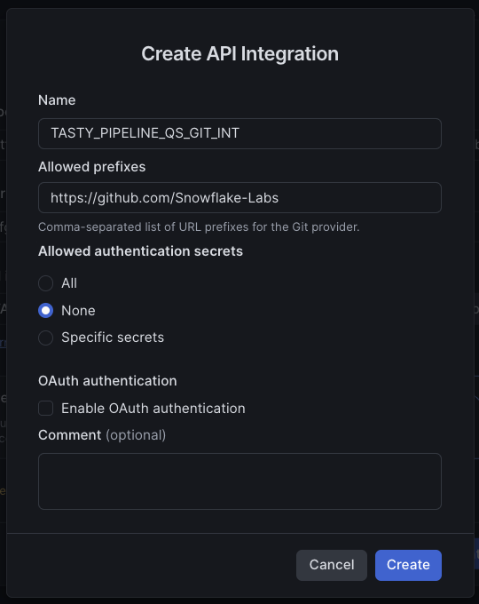

5. Back in the **Create workspace from Git repository** dialog, select **Public repository**. You can't push changes back to the repo with public authentication, and this Quickstart doesn't need to. Leave **Workspace name** as it fills in from the URL.

   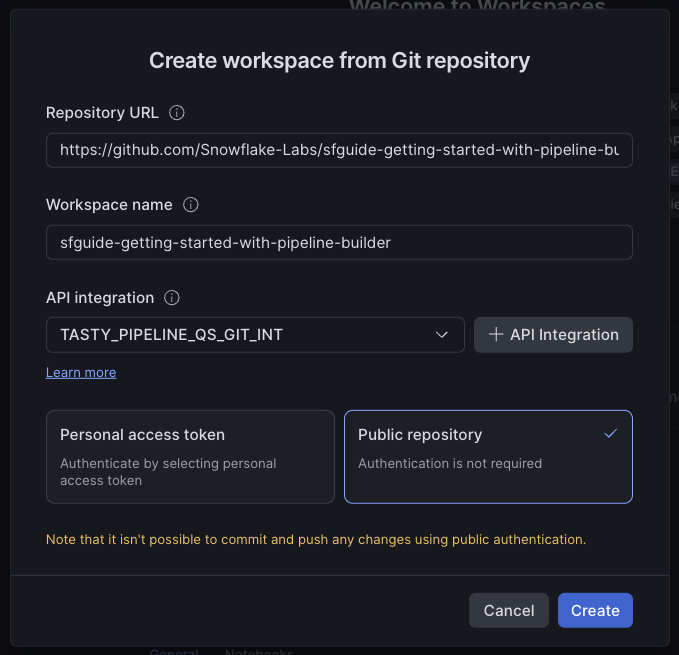

6. Select **Create**.

The workspace opens with **setup.sql**, **cleanup.sql**, **01_clean_orders.ipynb**, and **02_daily_sales.ipynb**.

> **Important:** The repo gets fixes over time, so pull the latest changes now, before you start. Once you move the notebooks into your pipeline's folder later in this Quickstart, your workspace has local changes, and pulling again can conflict with them.

### Run the setup script

Open **setup.sql**, replace `<your_username>` with your Snowflake user name, and run the whole file as ACCOUNTADMIN.

Here's what the script does:

- Creates the `TASTY_PIPELINE_QS_ROLE` role and grants it to you and to `SYSADMIN`
- Creates the `TASTY_PIPELINE_QS_WH` warehouse and the `TASTY_PIPELINE_QS_POOL` compute pool. Notebooks in Pipeline Builder run on a compute pool.
- Creates the `TASTY_PIPELINE_QS_DB` database and makes the guide role its owner, so the role can create the schemas, tables, tasks, task graphs, Code Bundles, and DCM project the pipeline needs
- Grants the guide role `EXECUTE TASK` on the account
- Creates a RAW, STAGING, ANALYTICS, and PIPELINE schema. The PIPELINE schema holds the pipeline's tasks, task graph, Code Bundle, and DCM project.
- Seeds about 5,000 Tasty Bytes orders, plus 200 duplicate orders and 50 invalid orders for the pipeline to clean up
- Creates a `RUN_LOG` table that the optional Advanced modules write to

The last statement returns `raw_rows` = `5250`.

### Switch to the guide role

You create the pipeline in the next step, and it has to be created with the guide role. If you create it as ACCOUNTADMIN, deployments and runs fail with privilege errors.

1. In the lower-left corner of Snowsight, select your name.
2. Select **Switch role**.
3. Select **TASTY_PIPELINE_QS_ROLE**.
4. Confirm that your name in the lower-left corner now shows **TASTY_PIPELINE_QS_ROLE**.

Changing the role selector inside a SQL file doesn't count. Pipeline Builder uses the role in your user menu.

<!-- ------------------------ -->
## Create the Pipeline

A Pipeline Builder pipeline lives in a project folder in your workspace. Let's create one.

1. In Snowsight, open your workspace.
2. In the file explorer, select **Add new**, and then select **Pipeline Builder**.
3. In the **Create Pipeline Builder** dialog, enter `Pipeline_builder_quickstart` for the **Name**. Pipeline Builder creates a folder with this name for the pipeline.
4. Select **Select database and schema**, and select `TASTY_PIPELINE_QS_DB.PIPELINE`. This is where the pipeline's DCM project object is created.
5. Select **Create**.

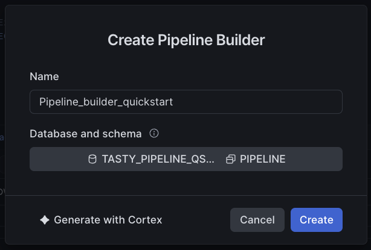

Pipeline Builder creates a **Pipeline_builder_quickstart** project folder and opens an empty canvas. The folder contains:

- **manifest.yml**: the DCM project's manifest, including its deployment target
- **sources/**: a folder for DCM definition files

When you add your first task, Pipeline Builder also creates **pipeline.yml**, which holds the tasks, task graphs, and Code Bundles you build on the canvas. You won't edit these files in this Quickstart. Pipeline Builder writes to them for you.

Open **manifest.yml** and confirm that the target's `project_owner` is `TASTY_PIPELINE_QS_ROLE`. If it shows another role, such as `ACCOUNTADMIN`, see Troubleshooting before you continue.

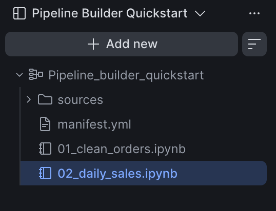

### Move the notebooks into the pipeline

Now add the two notebooks your teammate has been running by hand. They came with the companion repo, at the root of your workspace. Pipeline Builder can only turn files inside the pipeline's project folder into tasks, so move them there first.

In the file explorer, drag **01_clean_orders.ipynb** and **02_daily_sales.ipynb** into the **Pipeline_builder_quickstart** folder. Drop them at the root of the folder, not in **sources/** or **out/**. Pipeline Builder can't turn files in those two folders into tasks.

Here's what the notebooks do:

- **01_clean_orders.ipynb** drops the invalid rows, removes the duplicates, and writes `STAGING.ORDERS_CLEAN`
- **02_daily_sales.ipynb** aggregates the clean orders into one row per day, truck, and city in `ANALYTICS.DAILY_TRUCK_SALES`
- Both use fully qualified table names, because a notebook that runs as a task doesn't have a current database or schema

> **Note:** You can open each notebook and run its cell to check it works. Running it now also creates the tables early, which is fine: the pipeline replaces them on every run.

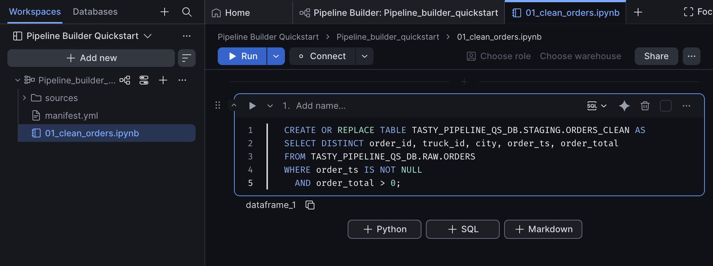

<!-- ------------------------ -->
## Turn Notebooks into Tasks

This is where Pipeline Builder starts saving you work. You drag your notebooks onto the canvas, without publishing them or uploading files to a stage.

If the canvas isn't open, go back to it: select the **Pipeline Builder** tab for **Pipeline_builder_quickstart** at the top of the editor, or, in the file explorer, hover over the **Pipeline_builder_quickstart** folder and select the **Open pipeline builder** icon. Keep the file explorer visible next to the canvas, then drag **01_clean_orders.ipynb** from the file explorer and drop it anywhere on the canvas.

Pipeline Builder adds a card with a **Notebook** badge and opens the task's settings drawer. Behind the scenes, it also creates a Code Bundle that packages the project's code so Snowflake can run it, and fills in a default runtime, compute pool, and warehouse.

In the drawer, on the **General** tab:

1. Confirm that **Name** is `TASTY_PIPELINE_QS_DB.PIPELINE.clean_orders_task`. Pipeline Builder names the task after the file and the project's database and schema. Names in Pipeline Builder are always fully qualified.
2. Confirm that **Entrypoint** points at **01_clean_orders.ipynb**.
3. Under **Execution**, for **Warehouse**, set to `TASTY_PIPELINE_QS_WH`.

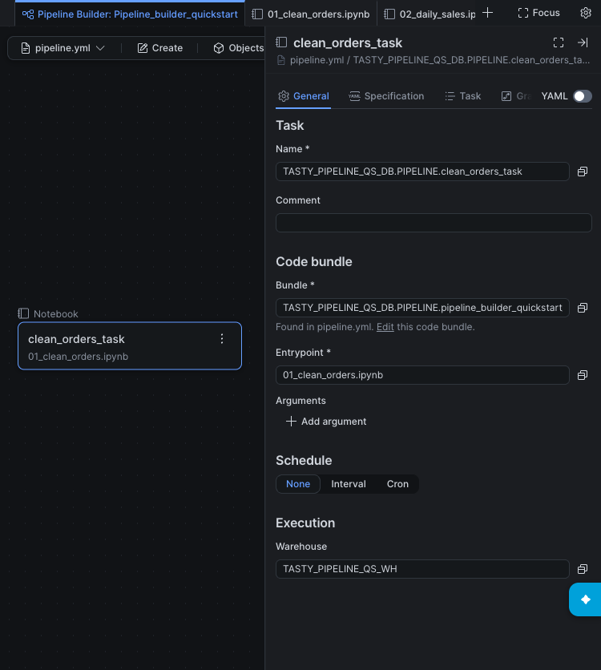

On the **Specification** tab:

1. For **Compute pool**, set to `TASTY_PIPELINE_QS_POOL`.
2. For **Query warehouse**, set to `TASTY_PIPELINE_QS_WH`. This warehouse runs the SQL that the notebook issues.
3. Leave **Runtime version** at its default.

> **Note:** If a field shows an error with a **Fix** action, the value is close to an existing object, for example a name with the wrong case. Select **Fix** to correct it.

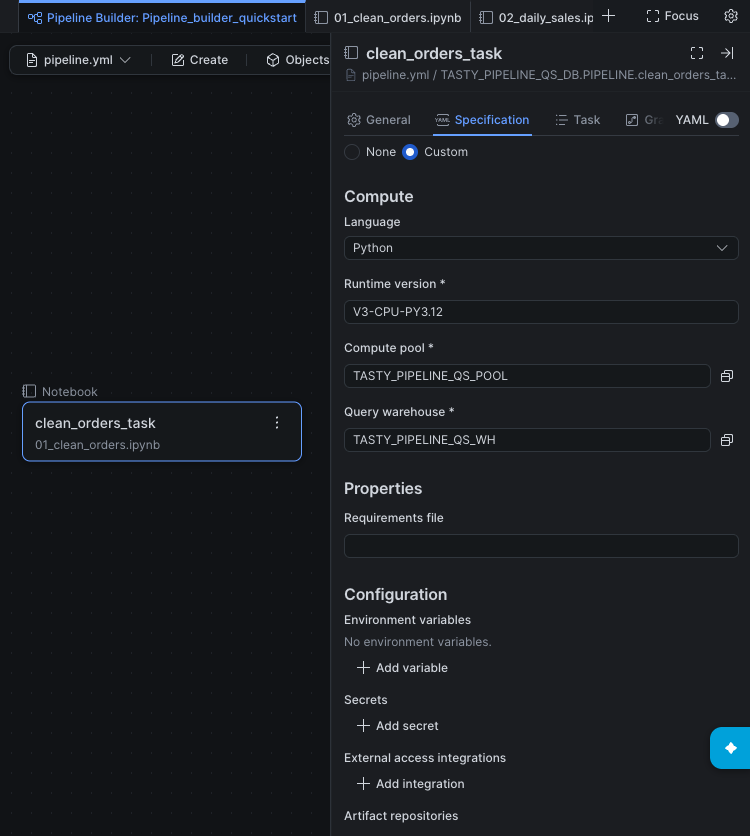

### Add the second task

Now drag **02_daily_sales.ipynb** onto the right side of the **clean_orders_task** card. When the **Run After** hint appears, drop the file.

Pipeline Builder adds a second task, connects the two cards, and makes the new task run after **clean_orders_task**. The new task reuses the same Code Bundle.

In its drawer, confirm that **Name** is `TASTY_PIPELINE_QS_DB.PIPELINE.daily_sales_task`, and under **Execution**, set **Warehouse** to `TASTY_PIPELINE_QS_WH`. On the **Specification** tab, select the same compute pool and query warehouse as the first task.

Then select the **clean_orders_task** card and check its **Warehouse** again. Connecting the tasks can clear it. If it's empty, set it to `TASTY_PIPELINE_QS_WH`.

You now have two connected cards on the canvas. You can also connect cards by dragging from the outgoing connector on the right of one card to the incoming connector on the left of another.

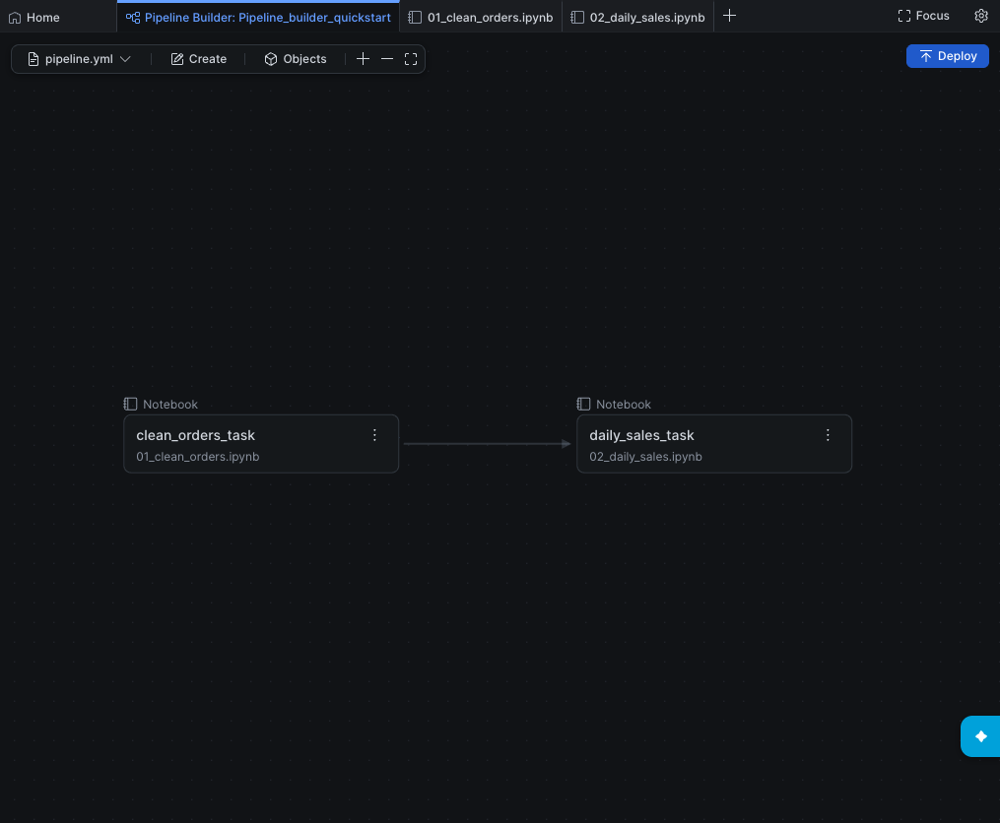

<!-- ------------------------ -->
## Schedule the Task Graph

When you connected the two tasks, Pipeline Builder quietly did something else: it created a task graph that contains both of them. A task graph is a first-class object that holds the schedule, run policies, and the defaults its tasks inherit. **clean_orders_task** has no predecessors, so it's the graph's root.

Pipeline Builder also moved any values the tasks share, such as the warehouse, into the graph's task defaults. Let's look.

1. Select **Objects** on the canvas toolbar, and then select **Task graphs**.
2. Select the task graph that Pipeline Builder created.
3. Under **Task graph object**, set **Name** to `TASTY_PIPELINE_QS_DB.PIPELINE.TASTY_DAILY_SALES_GRAPH`.
4. Under **Task graph settings**, for **Schedule**, select **Cron**. Enter `0 6 * * *`, and select your time zone (e.g., `0 6 * * * UTC`).
5. For **Desired state**, leave **Suspended**. You'll run the graph manually for now, so it doesn't start running on a schedule and using credits before you're ready.
6. Under **Task defaults**, confirm that **Warehouse** is `TASTY_PIPELINE_QS_WH`. Any task in the graph that doesn't set its own warehouse uses this one.
7. Under **Tasks in this graph**, confirm both tasks are listed, with **clean_orders_task** marked **Root**.

You can open the same settings from any task: select the task, select the **Graph** tab, and then select **Edit graph settings**.

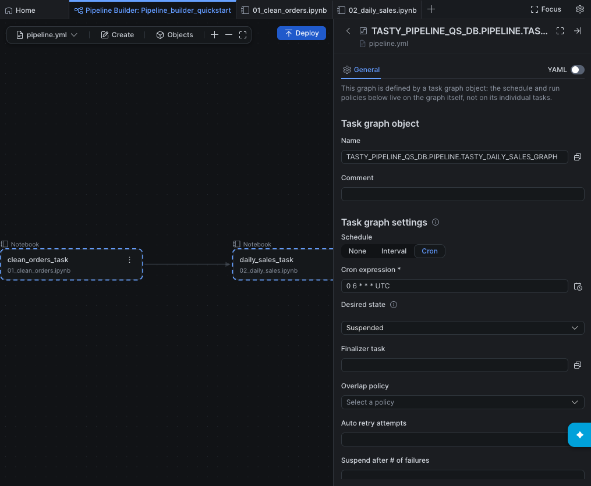

<!-- ------------------------ -->
## Plan and Deploy

Nothing you've built exists in your account yet. A pipeline doesn't run until you deploy it, and deploying starts with a plan that shows exactly what will change.

1. Select **Deploy** in the upper-right corner of the canvas. If you don't see it, collapse the workspace's bottom pane.
2. In the **Review planned changes** dialog, review the list. This first deployment creates the Code Bundle, the **clean_orders_task** and **daily_sales_task** tasks, and the **TASTY_DAILY_SALES_GRAPH** task graph. It also lists an **ALTER** on **TASTY_PIPELINE_QS_ROLE**. Confirm that this row names `TASTY_PIPELINE_QS_ROLE`. If it names `ACCOUNTADMIN`, the pipeline was created with the wrong role. Cancel and see Troubleshooting.

   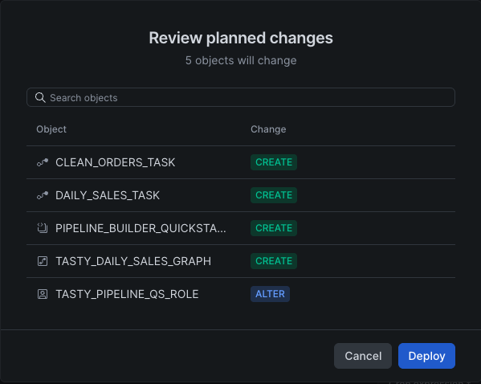

3. Select **Deploy**.

While the deployment runs, the **Deploy** button changes to **Cancel**. When it finishes, a **Deployed Project** button appears next to **Deploy**.

This plan-then-deploy loop comes from DCM. The project files describe the objects you want, not the steps to create them. Each deployment compares the files with your account and creates, alters, or drops objects to match, in the right order.

<!-- ------------------------ -->
## Run and Monitor

The graph is deployed but suspended. Let's run it once now, ahead of its 6:00 AM schedule.

1. Select **Deployed Project**. The DCM project opens in Snowsight on the **Objects** tab, which lists the tasks, task graph, and Code Bundle the project manages.

   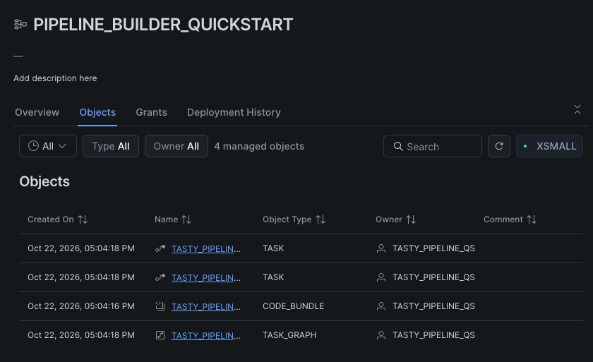

2. Select **TASTY_DAILY_SALES_GRAPH** to open its details page.
3. Select the **Graph** tab, and then select the **Run Task Graph** (play) icon in the toolbar above the graph.

   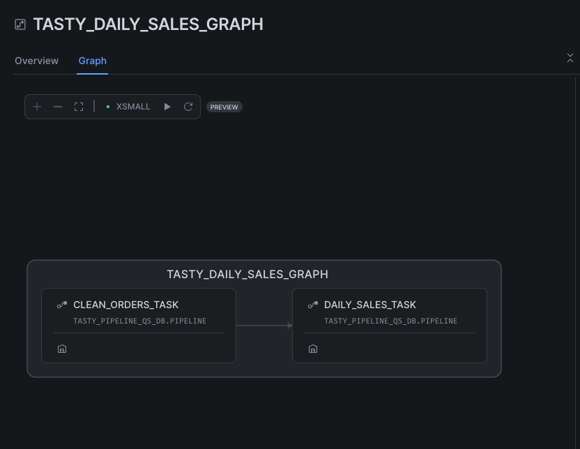

4. To watch the run while it's in progress, open a task's details page (for example, select **clean_orders_task** on the **Objects** tab of the DCM project) and select its **Run History** tab. The task graph's **Overview** tab shows the run once it finishes.

You can also run the graph from SQL:

```sql
EXECUTE TASK GRAPH TASTY_PIPELINE_QS_DB.PIPELINE.TASTY_DAILY_SALES_GRAPH;
```

A task that belongs to a task graph runs only as part of its graph. You can't run **daily_sales_task** on its own.

> **Note:** The first run after the compute pool resumes can take a few minutes while the pool starts. If a notebook task fails quickly on that first run, run the graph again once the pool is active.

When both tasks succeed, check the output:

```sql
SELECT city, SUM(orders) AS orders, SUM(revenue) AS revenue
FROM TASTY_PIPELINE_QS_DB.ANALYTICS.DAILY_TRUCK_SALES
GROUP BY city
ORDER BY revenue DESC;
```

You should see five cities. Check the clean row count too:

```sql
SELECT COUNT(*) AS clean_orders FROM TASTY_PIPELINE_QS_DB.STAGING.ORDERS_CLEAN;
```

You should see `clean_orders` = `5000`: the 200 duplicates and the 50 invalid orders are gone.

<!-- ------------------------ -->
## Change It Like Code

Because the pipeline is a DCM project, every deployment brings your account in line with the project files. Let's see what that means in practice.

### Redeploy with no changes

Select **Deploy** again without changing anything. Pipeline Builder shows "No changes to deploy." and doesn't deploy. Deployments are safe to repeat.

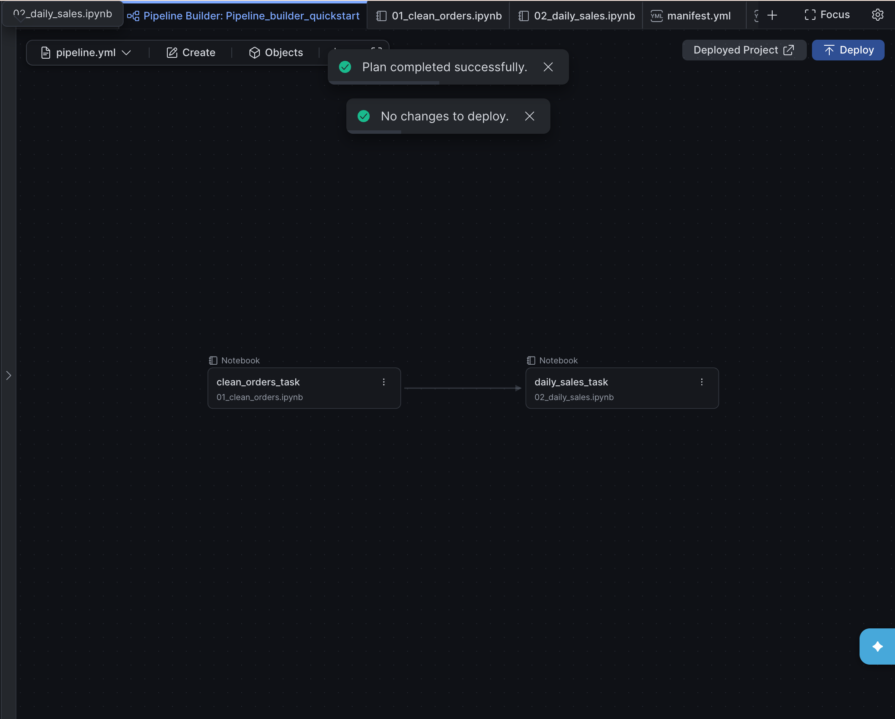

### Add a task

Analysts have asked for a daily leaderboard of the top five trucks. Let's add a SQL task after **daily_sales_task** that rebuilds it on every run. A SQL task is also how you run stored procedures or any other Snowflake object from a pipeline.

1. Hover over the **daily_sales_task** card, select **+** on its outgoing connector, and then select **SQL**. Pipeline Builder adds a new card that runs after **daily_sales_task**.
2. Set **Name** to `TASTY_PIPELINE_QS_DB.PIPELINE.top_trucks_task`.
3. Under **Execution**, set **Warehouse** to `TASTY_PIPELINE_QS_WH`.
4. In the **Source** editor, enter:

```sql
CREATE OR REPLACE TABLE TASTY_PIPELINE_QS_DB.ANALYTICS.TOP_TRUCKS AS
SELECT truck_id, city, SUM(revenue) AS revenue
FROM TASTY_PIPELINE_QS_DB.ANALYTICS.DAILY_TRUCK_SALES
GROUP BY ALL
ORDER BY revenue DESC
LIMIT 5;
```

5. Select **Deploy**. The plan shows **TOP_TRUCKS_TASK** as a task to create and an **ALTER** on **TASTY_PIPELINE_QS_ROLE**. Confirm the **ALTER** row still names `TASTY_PIPELINE_QS_ROLE`, and then select **Deploy**.

   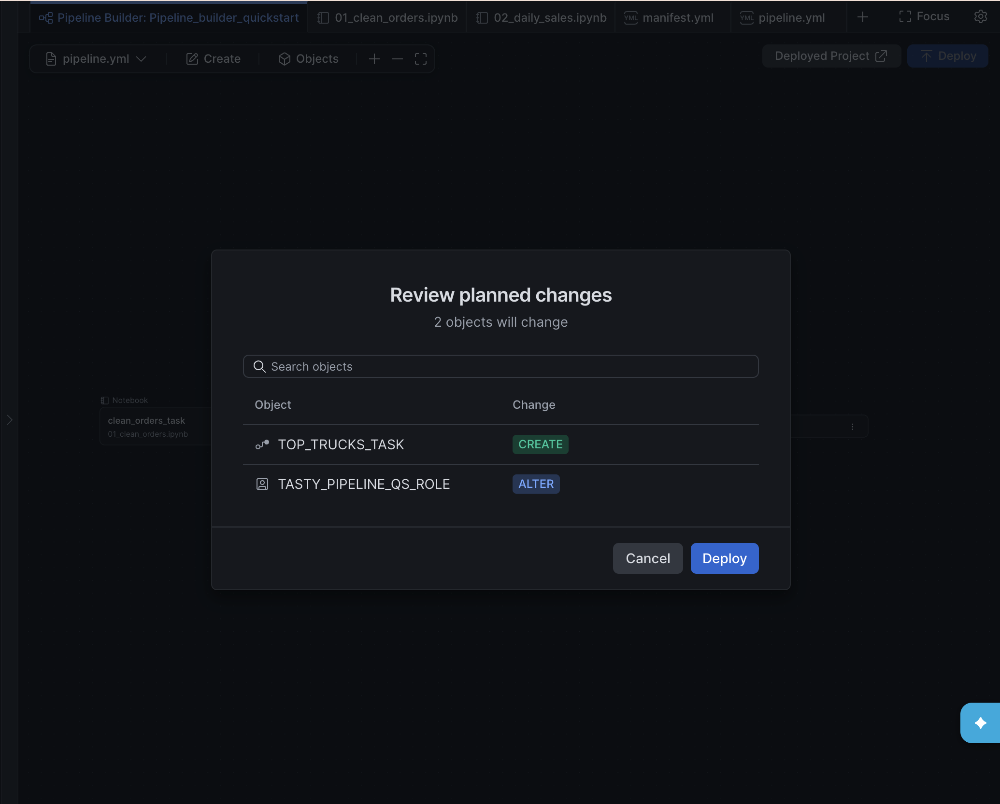

### Delete a task

Now suppose the analysts change their minds. On the **top_trucks_task** card, select the **⋮** menu, and then select **Delete**. Select **Deploy**.

This time, the plan shows **top_trucks_task** as a task to drop. Deleting a card removes it from the project files, and the next deployment drops the task from your account. You never write a `DROP TASK`.

> **Note:** The deployment drops the task, but not the `TOP_TRUCKS` table the task created if it ran. DCM manages the objects defined in the project, such as tasks, task graphs, and Code Bundles. Tables that your code creates at run time aren't part of the project.

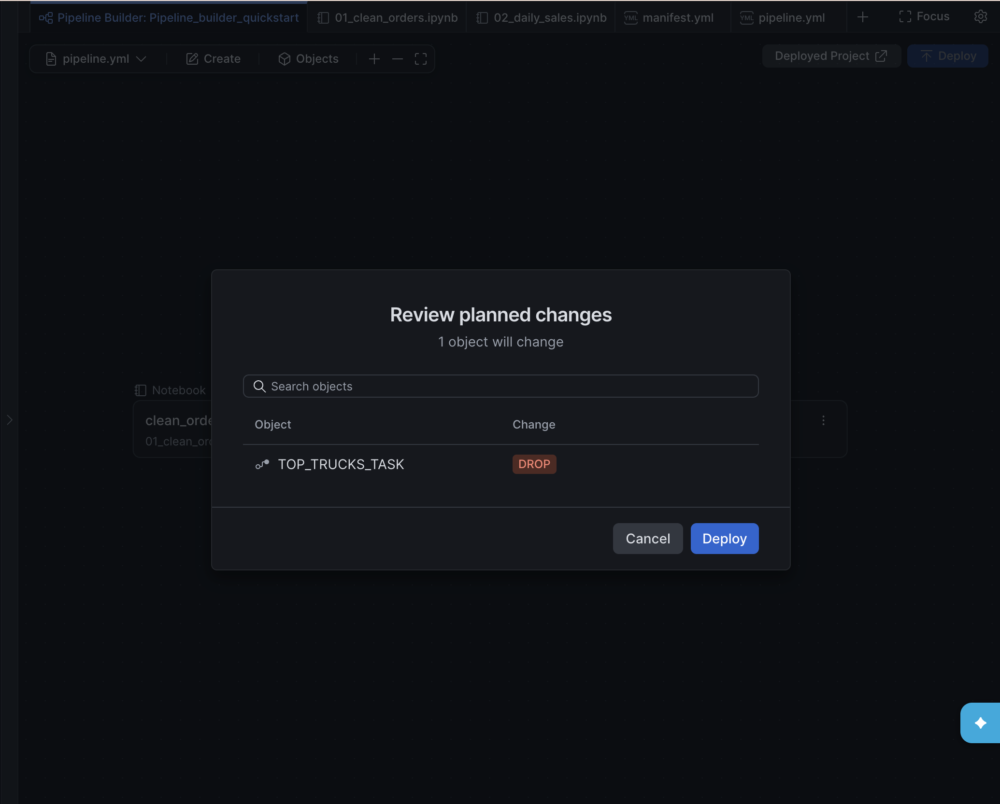

### Turn on the schedule (optional)

To have Tasty Bytes' sales table ready every morning, open the task graph settings: select **Objects** on the canvas toolbar, select **Task graphs**, and then select **TASTY_DAILY_SALES_GRAPH**. Set **Desired state** to **Resumed**, and deploy. The graph then runs every day at 6:00 AM. If you do this, remember to clean up at the end of the Quickstart so the graph stops running.

<!-- ------------------------ -->
## Build with CoCo

You've built a pipeline card by card. Now let's have CoCo draft one from a description.

1. In the file explorer, select **Add new**, and then select **Pipeline Builder**.
2. In the **Create Pipeline Builder** dialog, enter `tasty_menu_popularity` for the **Name**, and select `TASTY_PIPELINE_QS_DB.PIPELINE` for **Database and schema**.
3. Select **Generate with Cortex**.
4. In the **Prompt** field, enter:

```console
Build a weekly pipeline for Tasty Bytes over TASTY_PIPELINE_QS_DB.RAW.ORDERS.
Step 1: a SQL task that writes weekly order counts and revenue per city to
TASTY_PIPELINE_QS_DB.ANALYTICS.WEEKLY_CITY_SALES.
Step 2: a SQL task, after step 1, that writes the top city for each week to
TASTY_PIPELINE_QS_DB.ANALYTICS.WEEKLY_TOP_CITY.
Put all tasks in TASTY_PIPELINE_QS_DB.PIPELINE, use warehouse TASTY_PIPELINE_QS_WH,
and schedule the graph every Monday at 7:00 AM America/Los_Angeles, suspended.
```

5. Select **Generate**.

CoCo writes the tasks, the connection between them, and the task graph settings to the new project's definition file, so you can review its work on the canvas before anything is deployed. Select each card to check its SQL. To check the schedule, select **Objects** on the canvas toolbar, select **Task graphs**, and then select the graph CoCo created. If it looks right, select **Deploy** to plan and deploy it the same way as the first pipeline.

To change an existing pipeline with CoCo, open the CoCo chat in your workspace and use the `/pipeline-builder` skill. For example, ask it to add a task to **Pipeline_builder_quickstart**.

<!-- ------------------------ -->
## Advanced: Optional Modules

You've built, deployed, run, and changed a pipeline. That's the core of Pipeline Builder. The modules below go further. Each one starts from the **Pipeline_builder_quickstart** pipeline as you left it in Change It Like Code, and none depend on each other, so pick the ones that match your pipelines.

Each module ends with a deployment. To compare what changed, review the **Review planned changes** dialog before you select **Deploy**.

Before you start, make sure you're back on the **Pipeline_builder_quickstart** canvas, not the pipeline CoCo generated in the previous step. Select its **Pipeline Builder** tab, or, in the file explorer, hover over the **Pipeline_builder_quickstart** folder and select the **Open pipeline builder** icon.

For every task you add in these modules, set **Warehouse** to `TASTY_PIPELINE_QS_WH` under **Execution** on the task's **General** tab, as you did for the first two tasks.

Several modules write to `TASTY_PIPELINE_QS_DB.ANALYTICS.RUN_LOG`, a small log table that **setup.sql** already created. It has three columns: `logged_at`, `source`, and `message`.

### A1: Branch on a Return Value

Tasty Bytes wants to reprocess everything when order volume is high, and take a lighter path otherwise. You'll build three tasks: one that decides, and one for each branch. To keep the focus on branching, each branch task writes a row to `RUN_LOG`. In a real pipeline, that's where the full or incremental logic would go.

```console
clean_orders_task ──> CHECK_VOLUME ──> FULL_PATH
                                  └──> INCREMENTAL_PATH
```

#### Step 1: Create the deciding task

`CHECK_VOLUME` counts the clean orders and sets its return value to `FULL` if there are more than 4,000, or `INCREMENTAL` otherwise. Tasks that run after it can read that value.

1. Hover over the **clean_orders_task** card and select **+** on its outgoing connector to add a **SQL** task.
2. Set **Name** to `TASTY_PIPELINE_QS_DB.PIPELINE.CHECK_VOLUME`.
3. Under **Execution**, set **Warehouse** to `TASTY_PIPELINE_QS_WH`.
4. In the **Source** editor, enter:

```sql
EXECUTE IMMEDIATE $$
DECLARE
  path STRING;
BEGIN
  SELECT IFF(COUNT(*) > 4000, 'FULL', 'INCREMENTAL') INTO :path
  FROM TASTY_PIPELINE_QS_DB.STAGING.ORDERS_CLEAN;
  CALL SYSTEM$SET_RETURN_VALUE(:path);
END;
$$;
```

The block computes the path into a variable first, because `SYSTEM$SET_RETURN_VALUE` only accepts a constant or a variable, not a subquery.

#### Step 2: Create the full refresh branch

`FULL_PATH` stands in for a full reprocess. It logs `FULL_PATH` to `RUN_LOG`, and it runs only when `CHECK_VOLUME` returned `FULL`.

1. Hover over the **CHECK_VOLUME** card and select **+** on its outgoing connector to add a **SQL** task.
2. Set **Name** to `TASTY_PIPELINE_QS_DB.PIPELINE.FULL_PATH`.
3. Under **Execution**, set **Warehouse** to `TASTY_PIPELINE_QS_WH`.
4. In the **Source** editor, enter:

```sql
INSERT INTO TASTY_PIPELINE_QS_DB.ANALYTICS.RUN_LOG (source, message)
VALUES ('FULL_PATH', 'Full refresh branch ran');
```

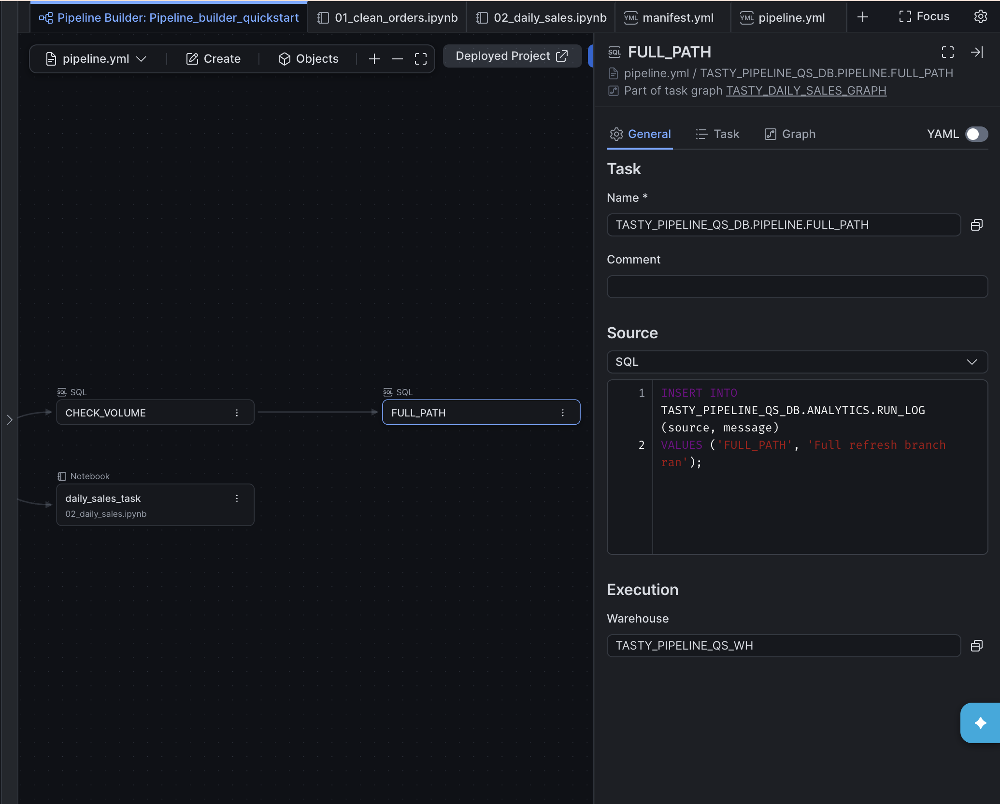

5. Select the **Task** tab. Under **Dependencies** > **Additional conditions**, enter:

```sql
SYSTEM$GET_PREDECESSOR_RETURN_VALUE('CHECK_VOLUME') = 'FULL'
```

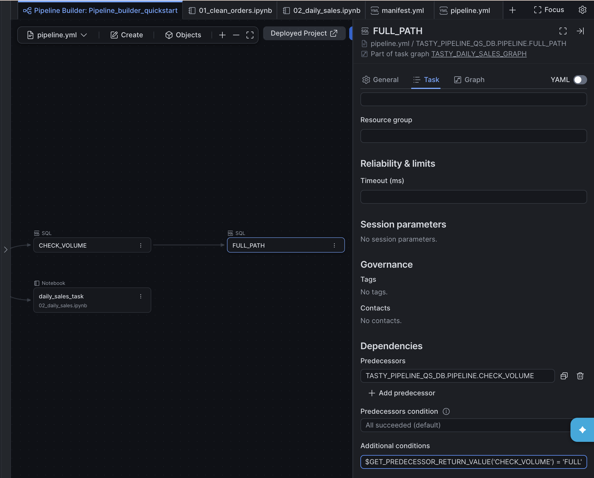

#### Step 3: Create the incremental branch

`INCREMENTAL_PATH` stands in for the lighter path. It logs `INCREMENTAL_PATH` to `RUN_LOG`, and it runs only when `CHECK_VOLUME` returned `INCREMENTAL`.

1. Hover over the **CHECK_VOLUME** card and select **+** on its outgoing connector again to add a second **SQL** task.
2. Set **Name** to `TASTY_PIPELINE_QS_DB.PIPELINE.INCREMENTAL_PATH`.
3. Under **Execution**, set **Warehouse** to `TASTY_PIPELINE_QS_WH`.
4. In the **Source** editor, enter:

```sql
INSERT INTO TASTY_PIPELINE_QS_DB.ANALYTICS.RUN_LOG (source, message)
VALUES ('INCREMENTAL_PATH', 'Incremental branch ran');
```

5. Select the **Task** tab. Under **Dependencies** > **Additional conditions**, enter:

```sql
SYSTEM$GET_PREDECESSOR_RETURN_VALUE('CHECK_VOLUME') = 'INCREMENTAL'
```

> **Note:** `SYSTEM$GET_PREDECESSOR_RETURN_VALUE` takes the name of a predecessor task without its database and schema, so the condition uses `'CHECK_VOLUME'`. The name is case-sensitive.

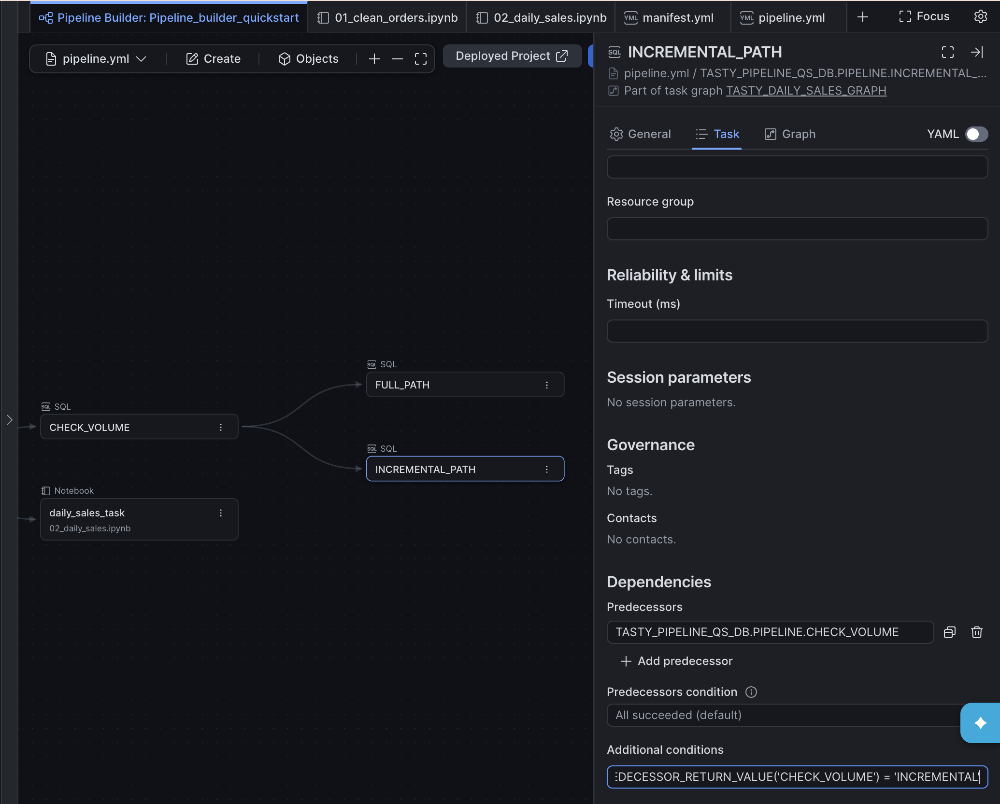

#### Step 4: Deploy and run

Deploy the pipeline, and then run the task graph.

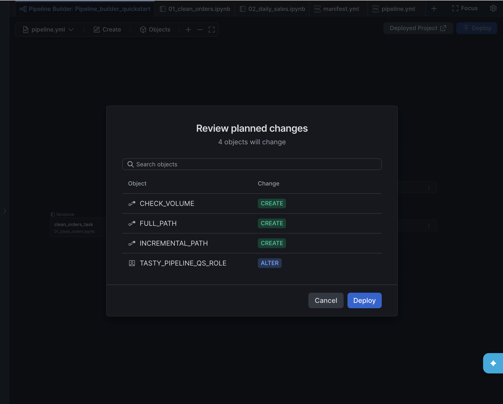

When the run finishes, check which branch ran:

```sql
SELECT logged_at, source, message
FROM TASTY_PIPELINE_QS_DB.ANALYTICS.RUN_LOG
ORDER BY logged_at;
```

`ORDERS_CLEAN` has 5,000 rows, so you should see only `FULL_PATH`. `INCREMENTAL_PATH` doesn't write a row, because its condition isn't met.

### A2: Handle Failures

When a step fails, you want to know. A task with the **At least one failed** condition runs only when something upstream fails.

1. Hover over the **daily_sales_task** card and select **+** on its outgoing connector to add a **SQL** task. Set **Name** to `TASTY_PIPELINE_QS_DB.PIPELINE.FORCE_FAIL`, set **Warehouse** to `TASTY_PIPELINE_QS_WH` under **Execution**, and enter `SELECT 1/0;` in the **Source** editor. This stands in for a step that breaks.
2. Hover over the **FORCE_FAIL** card and select **+** on its outgoing connector to add a **SQL** task. Set **Name** to `TASTY_PIPELINE_QS_DB.PIPELINE.ON_FAILURE`, set **Warehouse** to `TASTY_PIPELINE_QS_WH` under **Execution**, and in the **Source** editor, enter:

```sql
INSERT INTO TASTY_PIPELINE_QS_DB.ANALYTICS.RUN_LOG (source, message)
VALUES ('ON_FAILURE', 'A pipeline step failed');
```

3. On the **ON_FAILURE** drawer, select the **Task** tab, and under **Dependencies**, set **Predecessors condition** to **At least one failed**.

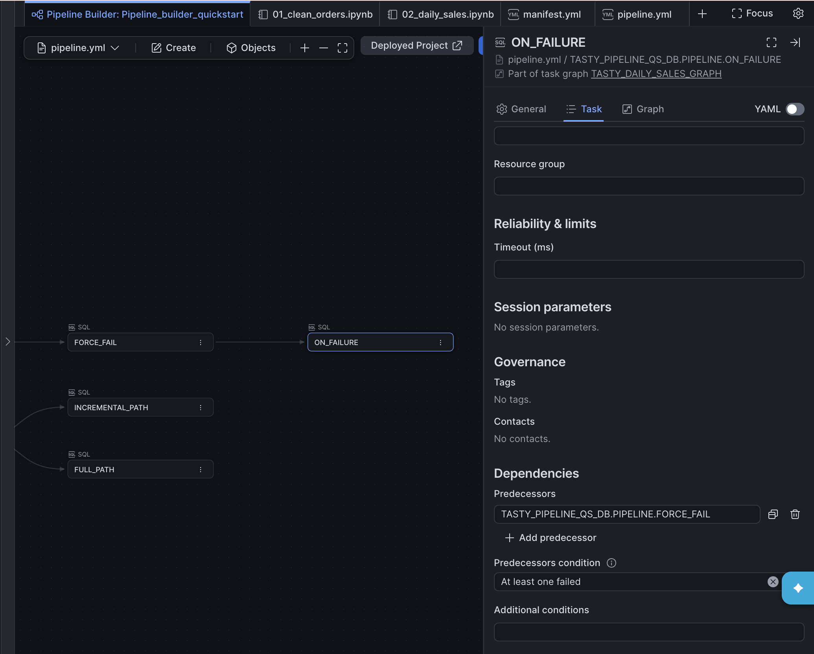

4. Deploy and run the graph.

**FORCE_FAIL** fails, and **ON_FAILURE** runs and writes to `RUN_LOG`. In production, the handler could call a stored procedure that sends an alert. When you're done, delete both cards and deploy.

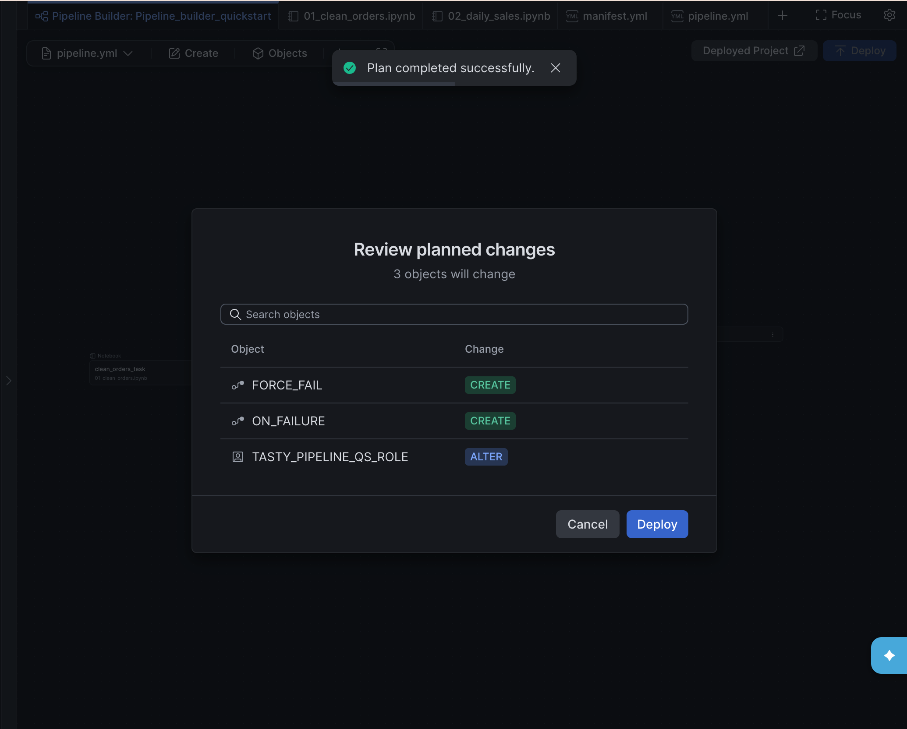

### A3: Add a Finalizer

A finalizer task runs after all other tasks in the graph finish, whether they succeeded or failed. It's a good place for cleanup or a run summary. A finalizer can't also be a member of the graph, so you create it as a standalone task first and then attach it to the graph.

`RUN_SUMMARY` stands in for an end-of-run report. It writes one row to `RUN_LOG` with the number of daily sales rows the run produced.

1. Select **Create** on the canvas toolbar, and then select **SQL**. Don't connect the new card to anything.
2. Set **Name** to `TASTY_PIPELINE_QS_DB.PIPELINE.RUN_SUMMARY`, and under **Execution**, set **Warehouse** to `TASTY_PIPELINE_QS_WH`.
3. In the **Source** editor, enter:

```sql
INSERT INTO TASTY_PIPELINE_QS_DB.ANALYTICS.RUN_LOG (source, message)
SELECT 'RUN_SUMMARY', COUNT(*) || ' daily sales rows'
FROM TASTY_PIPELINE_QS_DB.ANALYTICS.DAILY_TRUCK_SALES;
```

4. Open the task graph settings: select **Objects** on the canvas toolbar, select **Task graphs**, and then select **TASTY_DAILY_SALES_GRAPH**. You can also select any task in the graph, select its **Graph** tab, and then select **Edit graph settings**.
5. Under **Task graph settings**, for **Finalizer task**, select **RUN_SUMMARY**.

   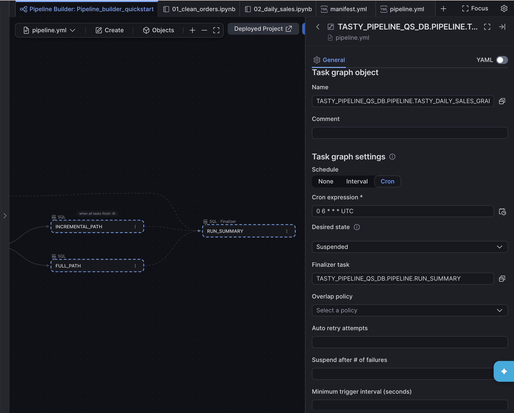

6. Deploy, and then run the task graph.

When the run finishes, check `RUN_LOG`:

```sql
SELECT logged_at, source, message
FROM TASTY_PIPELINE_QS_DB.ANALYTICS.RUN_LOG
ORDER BY logged_at;
```

The last row is from `RUN_SUMMARY`, written after every other task in the graph finished. On the graph's **Graph** tab in Snowsight, the finalizer appears with a **Finalized by** label.

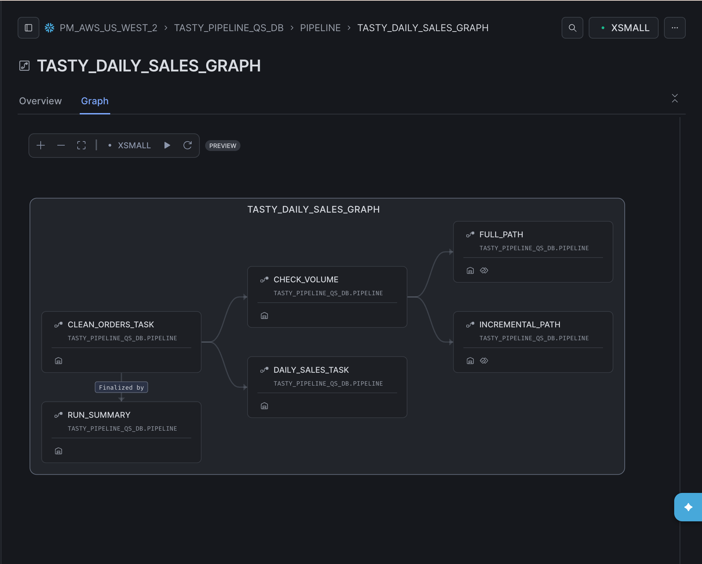

<!-- ------------------------ -->
## Troubleshooting

Most problems in this Quickstart come from creating the pipeline with a role other than `TASTY_PIPELINE_QS_ROLE`. The pipeline's owner role is set when you create it, so switching your Snowsight role afterward doesn't change which role deploys.

| Error or symptom | Cause | Fix |
| --- | --- | --- |
| Creating the pipeline fails with "ACCOUNTADMIN must have CREATE DCM PROJECT on SCHEMA TASTY_PIPELINE_QS_DB.PIPELINE." | Your Snowsight role was ACCOUNTADMIN when you created the pipeline | Switch your Snowsight role to **TASTY_PIPELINE_QS_ROLE**, and create the pipeline again |
| Deployment fails on `CREATE NOTEBOOK PROJECT` or `CREATE TASK`, and the error names ACCOUNTADMIN | The pipeline's `project_owner` in **manifest.yml** is `ACCOUNTADMIN` | Change the target's owner to `TASTY_PIPELINE_QS_ROLE`: open the DCM project controls in the bottom pane, open the target menu, and select the pencil icon. Or delete the pipeline folder and create it again as the guide role. |
| **Review planned changes** shows an **ALTER** on **ACCOUNTADMIN** | Same as above | Same as above |
| Running the graph fails with "Cannot execute task, USAGE privilege on the task's schema and database must be granted to owner role." | The tasks are owned by a role, such as ACCOUNTADMIN, that has no usage on the guide database | Fix the owner role as above and redeploy, so the guide role owns the tasks |
| Creating the API integration in the **Create API Integration** dialog fails | Your Snowsight role can't create integrations | Switch your Snowsight role to ACCOUNTADMIN, or ask your admin to create the integration for you |

<!-- ------------------------ -->
## Clean Up

Let's remove everything this Quickstart created. **cleanup.sql** in the companion repo does it in order. Start with the DCM project, because it knows every object it manages.

1. Open **cleanup.sql**. If you deployed the CoCo pipeline, uncomment its two lines.
2. Run the first part as the guide role. `PURGE` runs a deployment with no definitions, so it drops every task, task graph, and Code Bundle the project manages, and records the purge in the project's deployment history. Purge doesn't drop the project object itself, so the script drops it next.
3. Run the second part as ACCOUNTADMIN. It drops the database, compute pool, warehouse, Git API integration, and role. Dropping the database also removes the sample data and the tables your notebooks created, which the DCM project didn't manage.

> **Important:** Purge before you drop. Dropping a DCM project without purging it first leaves its tasks and task graphs in your account as unmanaged objects.

> **Note:** If your DCM project names differ, check them with `SHOW DCM PROJECTS IN SCHEMA TASTY_PIPELINE_QS_DB.PIPELINE;`.

Finally, delete the workspace you created from the companion repo.

<!-- ------------------------ -->
## Conclusion And Resources

Tasty Bytes' daily sales table no longer depends on someone remembering to run two notebooks. You turned them into a scheduled task graph on a canvas, reviewed a plan before anything changed, and deployed it, without writing a `CREATE TASK` statement.

### What You Learned
- Dragging notebooks onto the Pipeline Builder canvas creates tasks and the Code Bundles that package your code
- Connecting tasks creates a task graph that holds the schedule and the defaults its tasks share
- Every deployment is planned first, and the declarative model creates, alters, and drops objects to match your project
- How to run and monitor a task graph from Snowsight or with `EXECUTE TASK GRAPH`
- How to have CoCo draft a pipeline for you to review
- How to purge a DCM project to clean up everything it manages

### Resources
- [Companion repo](https://github.com/Snowflake-Labs/sfguide-getting-started-with-pipeline-builder)
- [Pipeline Builder](https://docs.snowflake.com/en/user-guide/pipeline-builder/pipeline-builder-overview)
- [Build and configure pipelines with Pipeline Builder](https://docs.snowflake.com/en/user-guide/pipeline-builder/pipeline-builder-build)
- [Run tasks conditionally](https://docs.snowflake.com/en/user-guide/pipeline-builder/pipeline-builder-conditions)
- [Deploy, run, and monitor pipelines](https://docs.snowflake.com/en/user-guide/pipeline-builder/pipeline-builder-deploy)
- [Code Bundles](https://docs.snowflake.com/en/developer-guide/code-bundles/code-bundles)
- [DCM Projects for Tasks](https://www.snowflake.com/en/developers/guides/dcm-projects-for-tasks/): build a similar task graph code-first with DCM definition files
- [Getting Started with Task Graphs](https://www.snowflake.com/en/developers/guides/getting-started-with-task-graphs/)
