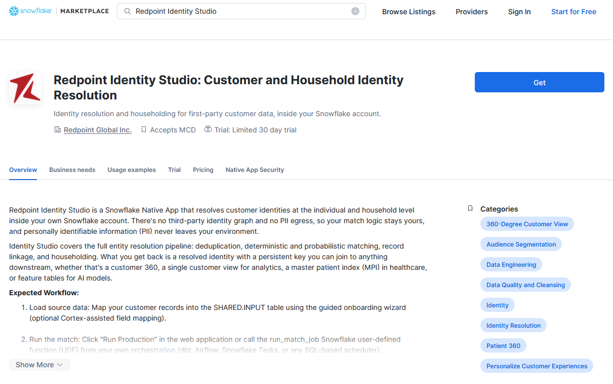
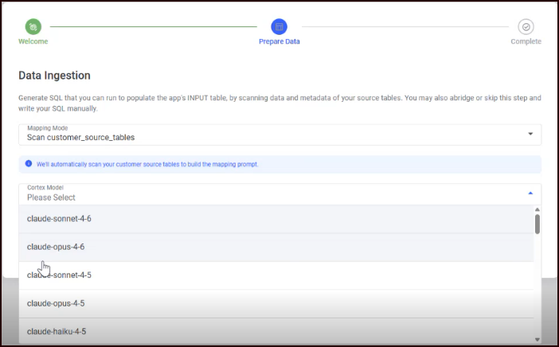
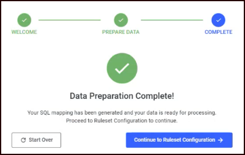
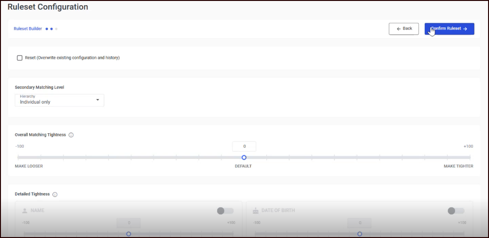

author: Kris Tomes
id: getting-started-with-redpoint-identity-studio
language: en
summary: Install Redpoint Identity Studio as a Snowflake Native App, map your source data, configure match rules, run a match, and review and deliver resolved profiles.
categories: snowflake-site:taxonomy/solution-center/certification/quickstart, snowflake-site:taxonomy/solution-center/certification/partner-solution, snowflake-site:taxonomy/product/data-engineering, snowflake-site:taxonomy/snowflake-feature/transformation, snowflake-site:taxonomy/snowflake-feature/native-apps, snowflake-site:taxonomy/snowflake-feature/marketplace-and-integrations, snowflake-site:taxonomy/snowflake-feature/cortex-llm-functions, snowflake-site:taxonomy/solution-center/includes/architecture, snowflake-site:taxonomy/industry/advertising-media-and-entertainment, snowflake-site:taxonomy/industry/financial-services, snowflake-site:taxonomy/industry/healthcare-and-life-sciences, snowflake-site:taxonomy/industry/public-sector, snowflake-site:taxonomy/industry/retail-and-cpg, snowflake-site:taxonomy/industry/sports, snowflake-site:taxonomy/industry/telecom, snowflake-site:taxonomy/industry/travel-and-hospitality
environments: web
status: Published
feedback link: https://github.com/Snowflake-Labs/sfguides/issues

# Getting Started with Redpoint Identity Studio
<!-- ------------------------ -->
## Overview

Redpoint Identity Studio is a Snowflake Native App that resolves customer records into unified profiles directly inside your Snowflake account. Your data remains in your Snowflake instance, and matching runs inside the app.

In this Quickstart, you will install the app, map your source data into the app's input table, configure a match ruleset, run a match, review the results, and query the resolved profiles so the rest of your organization can use them.

### Prerequisites

- A [Snowflake account](https://signup.snowflake.com/) in any AWS or Azure region, with privileges to install a Native App from the Snowflake Marketplace
- The `ACCOUNTADMIN` role, or a role with the grants needed to install and configure Native Apps
- One or more customer source tables in Snowflake to use as input

### What You'll Learn

- How to install Redpoint Identity Studio from the Snowflake Marketplace
- How to map your source data into the app's input table, with Cortex-assisted mapping or your own SQL
- How to configure a match ruleset
- How to run a match and review the results
- How to query resolved profiles for downstream use

### What You'll Need

- A Snowflake account (see Prerequisites)
- Customer source data in Snowflake

### What You'll Build

A working Redpoint Identity Studio deployment: source data mapped into the input table, a configured ruleset, a completed match, and a reviewed set of resolved profiles ready to deliver to your organization.

<!-- ------------------------ -->
## Install the App

Install Redpoint Identity Studio from the Snowflake Marketplace, grant it the access it needs, and launch it.

1. In Snowsight, open **Marketplace** and search for **Redpoint Identity Studio**.
2. Open the listing and select **Get**. Accept the confirmations at the bottom of the page and complete the request. Snowflake returns you to the listing when it finishes.
3. Select **Open**.

> **Note:** If you see a message that your role does not have sufficient privileges to access the app, refresh the page. The message clears and **Open** becomes available.

4. Work through the app's configuration steps, granting each request with a role that has sufficient access (for example, `ACCOUNTADMIN`). You must approve all of the app's grants and options:
   - **External Connections**
   - **Account Privileges**
   - **Object Access Privileges:** add the customer source tables you want to match to `CUSTOMER_SOURCE_TABLES`. The app's Cortex-assisted mapping can only scan tables added here. This step can take several minutes. You can change these tables later from the app's **Permissions** tab.
   - **Activation**
5. Select **Proceed to app**. The page can take about a minute to load. Wait until the gray placeholder bars are replaced with content before you continue.
6. Select **Launch app**. If prompted, sign in to Snowflake again.
7. The onboarding wizard opens. Select **Get Started**.



<!-- ------------------------ -->
## Map Your Source Data

Redpoint Identity Studio reads from its own input table, `SHARED.INPUT`. The onboarding wizard's **Prepare Data** step helps you map your source tables into that input table.

In this guide, `<app_db>` is the name of your installed application (for example, `REDPOINT_IDENTITY_STUDIO_CUSTOMER_AND_HOUSEHOLD_IDENTITY_RESOLUTION`). Replace it in each SQL example.

Under **Data Ingestion**, the **Mapping Modes** list offers three options:

- **Scan customer_source_tables (Cortex-assisted):** the app scans the source tables you added during installation and uses a Cortex model you choose to generate the mapping SQL.
- **Manually complete the AI prompt:** you write the mapping prompt yourself before generating SQL.
- **Skip this step and load your data independent of this wizard:** you write the mapping SQL directly.

This guide covers the Cortex-assisted option first, then shows how to write the mapping SQL yourself.

### Input table schema

The input table uses tuple-based columns for names and addresses, so a single row can carry multiple names, addresses, phones, and emails.

| Column group | Columns | Notes |
|---|---|---|
| Identifiers | `ID`, `CUST_GID` | Row identifier and customer group ID |
| Name tuples | `NAME1..3`, `FNAME1..3`, `MNAME1..3`, `LNAME1..3`, `GENERATION1..3`, `GENDER1..3`, `DATE_OF_BIRTH1..3` | Do not split name tuples |
| Address tuples | `ADDRESS1..3`, `CITY1..3`, `PROVINCE1..3`, `POSTCODE1..3`, `COUNTRY1..3` | Do not split address tuples |
| Phone | `PHONE1..3` | Multiple phone slots |
| Email | `EMAIL1..3` | Multiple email slots |
| Other | `SOCIAL1..3`, `ACCOUNT`, `OTHER1..3` | Additional attributes |

### Option A: Cortex-assisted mapping

To let the app draft the mapping SQL for you:

1. In the **Prepare Data** step, under **Data Ingestion**, set **Mapping Modes** to **Scan customer_source_tables (Cortex-assisted)**.
2. Choose a **Cortex Model** from the list.
3. Select **Build AI Prompt**. The app builds a mapping prompt from your source table metadata.
4. Review the prompt. To keep the generated SQL concise, add `Use compact SQL.` as the first line of the prompt.
5. Select **Submit Prompt to AI**.
6. Review the generated SQL, then select **Copy SQL to Clipboard**.



> **Note:** If you switch between mapping modes and the wizard stops responding, select **Start Over** and choose **Scan customer_source_tables (Cortex-assisted)** again.

### Option B: Write your own mapping SQL

Set **Mapping Modes** to **Skip this step and load your data independent of this wizard**, then write SQL that reads from your source table and inserts into the app's input table. Replace the source table and column names below with your own.

```sql
TRUNCATE TABLE IF EXISTS <app_db>.SHARED.INPUT;

INSERT INTO <app_db>.SHARED.INPUT (
    ID, CUST_GID,
    NAME1, FNAME1, MNAME1, LNAME1, GENERATION1, GENDER1, DATE_OF_BIRTH1,
    ADDRESS1, CITY1, PROVINCE1, POSTCODE1, COUNTRY1,
    PHONE1, EMAIL1
)
SELECT
    id, cust_gid,
    name1, fname1, mname1, lname1, generation1,
    CASE WHEN UPPER(gender1) IN ('M', 'F') THEN UPPER(gender1) ELSE '' END,
    date_of_birth1,
    address1, city1, province1, postcode1, country1,
    phone1, email1
FROM <your_source_database>.<your_source_schema>.<your_source_table>;
```

### Run the mapping and confirm

1. Open a Snowflake worksheet. If you have loaded the input table before, clear it first so records are not duplicated:

```sql
TRUNCATE TABLE IF EXISTS <app_db>.SHARED.INPUT;
```

2. Paste the mapping SQL into the worksheet and run it. This populates the input table.
3. Return to the app and select **Continue**.
4. When you see **Data Preparation Complete**, select **Continue to Ruleset Configuration**.
5. Review the **Coverage Report** to confirm your source data populated the input table as expected, then select **Continue to Configuration**.



<!-- ------------------------ -->
## Configure the Ruleset

The ruleset controls how the app decides whether two records represent the same person or household. For a first run, keep the default tightness settings.

1. On the **Ruleset Configuration** screen, set the **Secondary Matching Level** to choose whether the app resolves individuals only, or both individuals and households.
2. Adjust **Overall Matching Tightness** if needed. The default sits in the middle; move toward looser or tighter as needed.
3. Optionally, expand **Detailed Tightness** to tune individual elements such as name, date of birth, address, and phone.
4. Review the match options and turn on only those that fit your data. The last option indicates that `PHONE1` holds a mobile phone number; turn it on only if that is true for your data.
5. Select **Confirm Ruleset**, review the summary, then select **Initialize Ruleset**.
6. When you see **Ruleset Initialized Successfully**, select **Go to Production Match**.



<!-- ------------------------ -->
## Run the Match

With the input mapped and the ruleset initialized, run the match from the **Production Matching** page.

1. Select **Run Full Match**.

The app runs the matching process producing resolved profiles for review.

<!-- ------------------------ -->
## Review the Results

Review how your input records resolved into unified profiles. You can inspect the resolved groups in the app, and you can query the results in Snowflake.

```sql
SELECT ID, GROUP_ID, LEVEL, TIMESTAMP
FROM <app_db>.SHARED.MATCH_RESULT
LIMIT 100;
```

The `SHARED.MATCH_RESULT` table contains these fields:

| Field | Description |
|---|---|
| `ID` | Unique ID that joins each result back to its original record in `SHARED.INPUT` |
| `GROUP_ID` | Match ID assigned to the record for a given match level |
| `LEVEL` | The match level (`individual` or `household`) |
| `TIMESTAMP` | When the record was created in the table |

Records that share a `GROUP_ID` at the same `LEVEL` have been identified as the same entity (individual or household).

<!-- ------------------------ -->
## Deliver Ready Data

Once you are satisfied with the results, deliver the resolved profiles for the rest of your organization to use. Because the app runs in place, the resolved data stays in your Snowflake account, where downstream teams and tools can consume it.

The SQL below maps the individual-level group ID to each original input record. You can embed this SQL, or a variation of it, in your data pipelines so that upstream and downstream systems can consume the data.

```sql
SELECT mr.GROUP_ID AS INDIVIDUAL_ID, mr.LEVEL, i.*
FROM <app_db>.SHARED.INPUT i
INNER JOIN <app_db>.SHARED.MATCH_RESULT mr
    ON i.ID = mr.ID
WHERE mr.LEVEL = 'individual';
```

To deliver household-level groups, change the filter to `WHERE mr.LEVEL = 'household'`.

<!-- ------------------------ -->
## Conclusion And Resources

Congratulations! You've successfully installed Redpoint Identity Studio, mapped your source data into the input table, configured a ruleset, ran a match, reviewed the resolved profiles, and queried them for downstream use, all inside your own Snowflake account.

### What You Learned

- How to install Redpoint Identity Studio from the Snowflake Marketplace
- How to map source data into the input table, with Cortex-assisted mapping or your own SQL
- How to configure a match ruleset
- How to run a match and review the results
- How to query resolved profiles for downstream use

### Related Resources

- [Redpoint Identity Studio documentation](https://docs.redpointglobal.com/ris)
- [Redpoint Identity Studio getting started guide] (https://docs.redpointglobal.com/ris/getting-started-guide)
- [Read the blog] (https://medium.com/snowflake/identity-resolution-that-shows-its-work-e64db4dd2004)
- [Reference Architecture](https://cdn.redpointglobal.com/redpoint-identity-studio/redpoint-identity-studio-snowflake-reference-architecture.pdf)

<!-- ------------------------ -->

- [Redpoint Global](https://www.redpointglobal.com/redpoint-identity-studio/)
