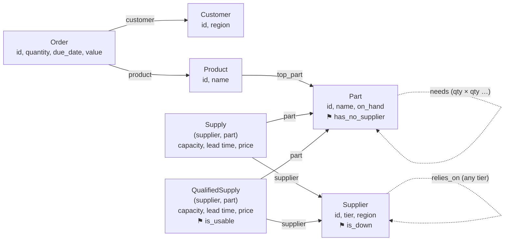

author: Reinout Korbee
id: getting-started-with-relational-ai-for-supply-chain-analysis
categories: snowflake-site:taxonomy/solution-center/certification/quickstart, snowflake-site:taxonomy/product/platform, snowflake-site:taxonomy/product/ai
language: en
summary: Use RelationalAI PyRel on Snowflake tables to find a hidden multi-tier supplier risk that is awkward in SQL, then turn the result into a mitigation plan with Cortex AI_COMPLETE.
environments: web
status: Draft
feedback link: https://github.com/Snowflake-Labs/sfguides/issues
tags: Getting Started, RelationalAI, PyRel, Semantic Model, Supply Chain, Snowflake Notebooks, Cortex AI

# Getting Started with RelationalAI for Supply Chain Analysis
<!-- ------------------------ -->
## Overview

[RelationalAI](https://docs.relational.ai/) adds a semantic modelling and reasoning layer to Snowflake. You build models in Python with **PyRel**: *concepts* (suppliers, parts, orders), *properties* (a supplier's region) and *relationships* (a part contains another part), plus *rules* that derive new facts.

The official [Start building with PyRel](https://docs.relational.ai/get-started/start-building-with-pyrel) guide runs from a local terminal and needs `uv`, a `raiconfig.yaml` file and a browser sign-in. A Snowflake Notebook already has an authenticated session, a warehouse and your data. This guide shows how to use that, and what PyRel adds next to SQL and an LLM.

The case: a tier-3 supplier stops delivering. Nobody buys from it directly. Which customer orders are at risk, why, and what do we do about it? Answering it means following two networks of unknown depth, the supplier tiers and the bill of materials, and the supplier network contains a cycle. SQL can do it, with complications. PyRel does it with a few rules. Cortex `AI_COMPLETE` then writes the mitigation plan from the facts PyRel derived.

The notebook is only the surface for showing these concepts. The same model, rules and prompt run from any Python environment connected to Snowflake.

### What You Will Learn
- Why PyRel needs a semantic model (ontology) over your tables, and how to map tables to it
- How recursive rules handle multi-hop questions and cycles, compared with recursive CTEs
- How to hand derived facts to an LLM, and check the plan it writes against those facts
- How to run PyRel from a Snowflake Notebook: network access, the kernel restart after install, and reusing the notebook session

### What You Will Build
Two notebooks on a synthetic electronics supply chain (20 products, 315 parts, 80 suppliers in four tiers, 1,500 orders):

1. `01_relationalai_setup.ipynb`: install, connect, first query.
2. `02_supplier_risk_to_plan.ipynb`: impact of a supplier failure, a check of the alternative supplier, a mitigation plan and a grounding check.

> **How this guide was made.** The ontology, the PyRel rules and queries, the notebooks, the sample data and most of this text were generated with generative AI (Cortex Code), not written by hand. Every code cell was then run against the loaded tables and checked against the planted answers in `data/expected_results.json`. Treat the code as a working example to review and adapt, not as reference style for PyRel. In a production setting, an agent with an LLM will be used to generate the queries against the ontology. Building the ontology will be assisted by generatiev AI tooling as well.

### Prerequisites
- A Snowflake account with the [RelationalAI Native App](https://app.snowflake.com/marketplace/listing/GZTYZOOIX8H/relationalai-relationalai) installed and activated ([setup guide](https://docs.relational.ai/get-started/set-up-relationalai-in-snowflake))
- `ACCOUNTADMIN`, or an administrator who runs the two setup scripts for you
- Access to Cortex `AI_COMPLETE` and a supported model in your region, or cross-region inference enabled

<!-- ------------------------ -->
## Load the Sample Data

Run [`scripts/load_data.sql`](scripts/load_data.sql) as `ACCOUNTADMIN`. It:

- creates the role `RAI_QS_ROLE` (with `RAI_DEVELOPER`), granted to you;
- creates the warehouse `RAI_QS_WH`, with a 600-second statement timeout;
- creates the schema `RAI_QUICKSTART.SUPPLY_CHAIN`;
- connects the companion Git repository and copies the CSV files from its `data/` directory to an internal stage (`COPY INTO` can't read a Git repository stage directly);
- creates eleven tables with `CHANGE_TRACKING = TRUE`, loads them, and checks the row counts.

RelationalAI keeps its copy of source tables in sync through change data capture (CDC), which is why change tracking is on.

The data is synthetic, with a few cases planted deliberately. [`data/README.md`](data/README.md) describes each one, and what the notebooks are looking for. This guide uses these:

| Case | In the data |
|---|---|
| Hidden single point of failure | Sensor `P-141` has two tier-1 suppliers, but both depend on tier-3 supplier `S-T3-07` |
| Shared subassembly | `P-141` sits in control board `P-040`, which is used in 8 products, at different depths |
| Cycle | `S-T2-11` and `S-T2-14` depend on each other |
| Qualified alternative | `S-T1-01` is approved for `P-141`: 1,500 per week, 70 days lead time |

No Git integration? The script has a fallback: upload the CSV files to the stage in Snowsight, or with `snow stage copy`.

<!-- ------------------------ -->
## Admin Setup

Run [`scripts/admin_setup.sql`](scripts/admin_setup.sql) as `ACCOUNTADMIN`, after `load_data.sql`. It does three things.

**1. Checks that the RelationalAI app is healthy.**

```sql
CALL RELATIONALAI.APP.SERVICE_STATUS();  -- main and otel-collector: READY
CALL RELATIONALAI.APP.CDC_STATUS();      -- CDC_ENABLED = TRUE
```

These are procedures, so use `CALL`, not `SELECT`. A `SUSPENDED` CDC engine is normal while idle.

**2. Creates the external access integration `RAI_NOTEBOOK_ACCESS` with two egress rules.** You need both:

| Rule | Why |
|---|---|
| `SNOWFLAKE.EXTERNAL_ACCESS.PYPI_RULE` | `relationalai` is not in the Snowflake Anaconda channel, so you install it from PyPI. |
| RelationalAI results host | PyRel downloads query results from a presigned URL on the RelationalAI app's S3 stage. Without this rule the query reaches the engine, then fails with `Max retries exceeded ... HTTPSConnectionPool(host='sfc-...-customer-stage.s3.<region>.amazonaws.com')`. |

The results host depends on your account and region. The script contains an example value. If your first query fails with the error above, copy the host from the message into `RAI_RESULTS_RULE`.

**3. Grants `RAI_QS_ROLE` usage on the integration and on `SYSTEM_COMPUTE_POOL_CPU`, and the right to create notebooks in the schema.**

<!-- ------------------------ -->
## Create the Notebooks

1. In Snowsight, go to **Projects » Notebooks** and import `notebooks/01_relationalai_setup.ipynb` and `notebooks/02_supplier_risk_to_plan.ipynb` into `RAI_QUICKSTART.SUPPLY_CHAIN`, as `RAI_QS_ROLE`.
2. Set **Runtime** to **Run on container**. The warehouse runtime can't pip install from PyPI.
3. Set **Compute pool** to `SYSTEM_COMPUTE_POOL_CPU` and **Query warehouse** to `RAI_QS_WH`.
4. Open **⋮ » Notebook settings » External access** and enable `RAI_NOTEBOOK_ACCESS`.
5. Upload `notebooks/supply_chain_ontology.py` next to notebook 02. It holds the semantic model that the notebook imports.

The Container Runtime image ships Python 3.10, the lowest version PyRel supports.

<!-- ------------------------ -->
## Install and Connect

Notebook 01 walks through this step by step. In short:

```python
%pip install -q "relationalai>=1.30.1,<2.0"
```

pip reports dependency conflicts for `mlruntimes-service` and `opentelemetry-proto`. You can ignore them for this guide.

> **Restart the kernel now.** The install upgrades `protobuf` from 4.25 to 5.x, but the kernel still has the old version loaded. If you skip the restart, the first query fails with `ImportError: cannot import name 'runtime_version' from 'google.protobuf'`. Clearing modules from `sys.modules` does not help, because protobuf's compiled extension stays loaded. Use the **Restart** option in the kernel menu, then continue with the next cell. Don't rerun the install cell.

In a notebook, PyRel detects the active Snowpark session automatically:

```python
from relationalai.config import create_config
cfg = create_config()
print(type(cfg).__name__)   # ConfigFromActiveSession
```

You don't need a `raiconfig.yaml`, a password or a token. PyRel runs with the notebook's role and warehouse.

The first query starts a reasoning engine and indexes the tables. That takes a few minutes; later queries take seconds.

<!-- ------------------------ -->
## The Semantic Model

> **Generated, not handwritten.** This whole section, and `supply_chain_ontology.py` behind it, was generated with generative AI from the table definitions and the RelationalAI documentation. A person reviewed the result and it was validated by loading every table into the model and checking the counts. It was not designed by a domain modeller; for your own data, review the concepts and keys with someone who knows the business.

PyRel doesn't reason over tables directly. It reasons over an **ontology**: the business concepts, how they relate, and which table populates what. `supply_chain_ontology.py` defines it once, and every rule and query in notebook 02 builds on it.

```python
Part = model.Concept("Part", identify_by={"id": String})
Supplier = model.Concept("Supplier", identify_by={"id": String})
Supply = model.Concept("Supply", identify_by={"supplier": Supplier, "part": Part})

Part.contains = model.Property(f"{Part:parent} contains {Part:child} {Integer:qty} times")
Supplier.depends_on = model.Relationship(f"{Supplier:buyer} depends on {Supplier:upstream}")

bom = model.Table("RAI_QUICKSTART.SUPPLY_CHAIN.BOM")
model.define(Part.lookup(id=bom.PARENT_PART_ID).contains(Part.lookup(id=bom.CHILD_PART_ID), bom.QTY_PER))
```

- `identify_by` sets a concept's key. `Supply` is keyed by a supplier and a part, because the pair carries its own data: capacity, lead time and price.
- `Property` holds one value per key, here the quantity of a child in a parent. `Relationship` links one entity to many.
- Same-type slots get role names (`parent`, `child`), so the direction is explicit.
- `model.Table()` maps a Snowflake table; column names are upper case, as Snowflake stores them.

The full model used in this guide looks like this. Solid lines come from the tables. Dashed lines are facts that the rules in the next section derive. Yes/no facts are shown as ⚑ tags on their concept.



The question flows through it like this: `S-T3-07` is down, so everyone who `relies_on` it is down. A `Part` whose every `Supply` has a down supplier `has_no_supplier`. An `Order` is at risk if its product's top part `includes` that part. The diagram was generated with generative AI from `supply_chain_ontology.py` and the notebook rules.

<!-- ------------------------ -->
## Find the Hidden Risk

**The tier-1 view.** `P-141` has two suppliers, in different regions. That looks safe.

**The SQL attempt.** A recursive CTE can walk up the supplier tiers and down the bill of materials. Because of the cycle, you have to carry the visited path in an array, skip suppliers already on it, and cap the depth. Without that guard, a recursive query over the supplier network can run forever. When we built this guide, one ran for over an hour, which is why `RAI_QS_WH` has a statement timeout. The notebook shows the guarded query. It gives the right answer, but `depth < 10` is a guess, and each follow-up question needs the guard again.

**The PyRel rules.** The rules below and in the notebook were generated with generative AI, then run and checked against the planted answers. "Relies on, at some tier" is two lines: a direct dependency, or a dependency of something you already rely on.

```python
Supplier.relies_on = model.Relationship(f"{Supplier:buyer} relies on {Supplier:upstream} at some tier")
s1, s2, s3 = Supplier.ref(), Supplier.ref(), Supplier.ref()
model.where(s1.depends_on(s2)).define(s1.relies_on(s2))
model.where(s1.relies_on(s2), s2.depends_on(s3)).define(s1.relies_on(s3))
```

RelationalAI keeps deriving facts until nothing new appears. A known fact isn't derived again, so the cycle ends on its own. The notebook adds four more rules in the same style: `is_down`, `has_no_supplier`, `includes` (any level of the BOM) and `needs` (quantity per unit, multiplied along the path). A last rule, `QualifiedSupply.is_usable`, checks that the alternative supplier doesn't itself rely on the failed one.

Expected result:

| | |
|---|---|
| Suppliers down | `S-T3-07`, `S-T2-03`, `S-T2-08`, `S-T1-02`, `S-T1-05` |
| Part without a working supplier | `P-141` |
| Orders at risk | 568, worth 6,840,136.49, in all three regions |
| Sensors needed | 29,286 |
| Usable alternative | `S-T1-01`, first delivery 2027-01-04 |

Python with NetworkX is a valid alternative. It handles the cycle too, but you pull the tables into the notebook's memory and keep two graphs in sync by hand. PyRel keeps the rules in the model, next to the data in Snowflake. Both are memory-bound: PyRel runs in an engine that has to be sized for the model.

<!-- ------------------------ -->
## Write the Plan with Cortex

The notebook builds a small **facts pack** from what PyRel derived: the dependency chain, the impact by region, the gap until the alternative delivers, and the shortfall. Python computes every number. The LLM gets the JSON and a prompt with three rules: use only the facts, copy numbers exactly, list unknowns as open questions.

```python
plan = sql("""
SELECT AI_COMPLETE(
    model => ?,
    prompt => ?,
    model_parameters => {'temperature': 0, 'max_tokens': 1500}
) AS plan
""", params=[LLM, prompt]).plan[0]
```

The prompt goes in as a bind parameter, so the facts never become part of the SQL text. `AI_COMPLETE` runs inside Snowflake.

**Check the plan.** A final cell collects every number in the plan and looks it up in the facts pack. When we tested an earlier prompt, the model subtracted stock from demand on its own and wrote a shortfall that wasn't in the facts. The arithmetic was right, but nobody had checked it. The shortfall is now part of the facts, and the check reports any number that isn't. It doesn't judge the advice itself; a planner still reads the plan.

The notebook writes `ORDERS_AT_RISK` and `MITIGATION_PLANS` back to the schema, so SQL, dashboards and tasks can use them.

<!-- ------------------------ -->
## Troubleshooting

| Symptom | Cause | Fix |
|---|---|---|
| `pip install` hangs or can't reach PyPI | External access not enabled, or warehouse runtime | Use Container Runtime and enable `RAI_NOTEBOOK_ACCESS` |
| `cannot import name 'runtime_version' from 'google.protobuf'` | Kernel not restarted after install | Restart the kernel, then rerun from the Connect step |
| `TypeError: A Message class can only inherit from Message` | Modules purged instead of restarting the kernel | Restart the kernel |
| `Max retries exceeded ... customer-stage.s3...amazonaws.com` | Results host not allowed in the integration | Add the host from the error to `RAI_RESULTS_RULE` |
| `[Unknown Table] Failed to fetch schema for table` | Role can't see the table, or wrong name | Check grants and the fully qualified upper-case name |
| `Unknown user-defined function RELATIONALAI.APP.SERVICE_STATUS` | Called with `SELECT` | Use `CALL` |
| `ConfigFileNotFoundError` | Code running outside the notebook kernel (for example, a subprocess) | Run PyRel in the notebook kernel itself |
| `ModuleNotFoundError: supply_chain_ontology` | Ontology file not next to the notebook | Upload `supply_chain_ontology.py` to the notebook's files |
| First query takes minutes | Engine start and table indexing, or a new table being synced | Wait; later queries are fast |
| `AI_COMPLETE` fails with an unknown or unavailable model | Model not offered in your region | Pick another model for `LLM`, or enable cross-region inference |
| A query runs until the 600-second timeout | Unguarded recursion on the supplier cycle | Use the guarded CTE, or the PyRel rules |

<!-- ------------------------ -->
## Cleanup

```sql
USE ROLE ACCOUNTADMIN;
DROP INTEGRATION IF EXISTS RAI_NOTEBOOK_ACCESS;     -- first: it uses a network rule inside the database
DROP DATABASE IF EXISTS RAI_QUICKSTART;
DROP INTEGRATION IF EXISTS RAI_QS_GIT_INTEGRATION;
DROP WAREHOUSE IF EXISTS RAI_QS_WH;
DROP ROLE IF EXISTS RAI_QS_ROLE;
```

Dropping the database also drops the notebooks, the Git repository object and the network rule in it.

<!-- ------------------------ -->
## Conclusion and Resources

You found a supplier risk that a tier-1 view hides, using PyRel rules over Snowflake tables from a notebook, and turned the result into a checked mitigation plan with Cortex.

### What You Learned
- A Container Runtime notebook needs PyPI egress plus egress to the RelationalAI results host, and a kernel restart after the install
- `create_config()` picks up the notebook session, so you need no config file or credentials
- An ontology maps tables to concepts once; rules and queries build on it
- Recursive rules handle multi-hop questions and cycles without a hand-written guard
- An LLM writes the plan best from a small facts pack, and a simple check keeps its numbers honest

### Related Resources
- [Start building with PyRel](https://docs.relational.ai/get-started/start-building-with-pyrel)
- [Set up RelationalAI in Snowflake](https://docs.relational.ai/get-started/set-up-relationalai-in-snowflake)
- [RelationalAI project templates](https://docs.relational.ai/build/templates)
- [Snowflake Notebooks on Container Runtime](https://docs.snowflake.com/en/user-guide/ui-snowsight/notebooks-on-spcs)
- [AI_COMPLETE](https://docs.snowflake.com/en/sql-reference/functions/ai_complete)
