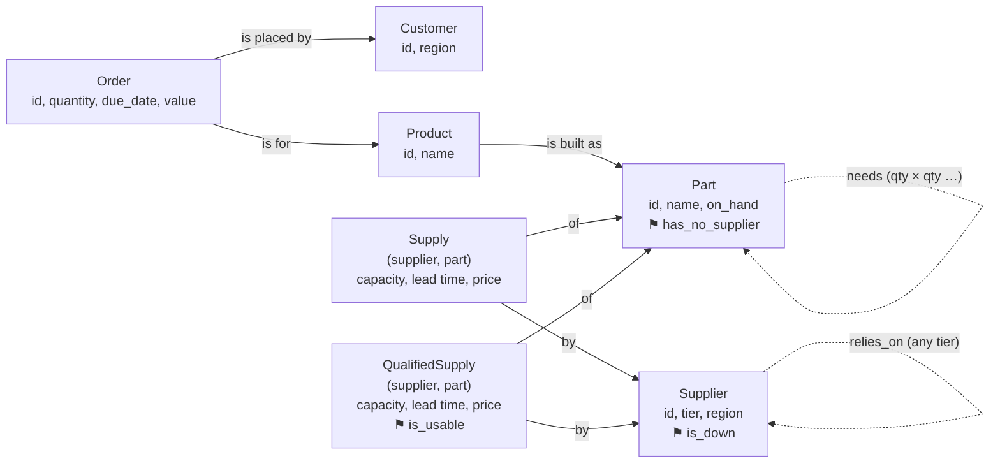

author: Reinout Korbee
id: getting-started-with-relational-ai-for-supply-chain-analysis
categories: snowflake-site:taxonomy/solution-center/certification/quickstart, snowflake-site:taxonomy/product/platform, snowflake-site:taxonomy/product/ai
language: en
summary: Use RelationalAI PyRel on Snowflake tables to find a hidden multi-tier supplier risk that is awkward in SQL, then turn the result into a mitigation plan with Cortex AI_COMPLETE.
environments: web
status: Draft
feedback link: https://github.com/Snowflake-Labs/sfguides/issues
tags: Getting Started, RelationalAI, PyRel, Semantic Model, Supply Chain, Jupyter, Cortex AI

# Getting Started with RelationalAI for Supply Chain Analysis
<!-- ------------------------ -->
## Overview

[RelationalAI](https://docs.relational.ai/) adds a semantic modelling and reasoning layer to Snowflake. You build models in Python with **PyRel**: *concepts* (suppliers, parts, orders), *properties* (a supplier's region) and *relationships* (a part contains another part), plus *rules* that derive new facts.

This guide builds on the official [Start building with PyRel](https://docs.relational.ai/get-started/start-building-with-pyrel) guide: same local setup, a richer model, and a question that shows what PyRel adds next to SQL and an LLM.

The case: a tier-3 supplier stops delivering. Nobody buys from it directly. Which customer orders are at risk, why, and what do we do about it? Answering it means following two networks of unknown depth, the supplier tiers and the bill of materials, and the supplier network contains a cycle. SQL can do it, with complications. PyRel does it with a few rules. Cortex `AI_COMPLETE` then writes the mitigation plan from the facts PyRel derived.

The notebooks are only the surface for showing these concepts. They run locally in Jupyter for this demonstration, not as a recommended production setup. The reasoning runs in the RelationalAI app inside your Snowflake account, next to the data.

### What You Will Learn
- Why PyRel needs a semantic model (ontology) over your tables, and how to map tables to it
- How recursive rules handle multi-hop questions and cycles, compared with recursive CTEs
- How to hand derived facts to an LLM, and check the plan it writes against those facts
- How to connect PyRel to Snowflake with `raiconfig.yaml`, and reuse its session for SQL and Cortex

### What You Will Build
Two notebooks on a synthetic electronics supply chain (20 products, 315 parts, 80 suppliers in four tiers, 1,500 orders):

1. `01_relationalai_setup.ipynb`: connect, load the data, first query.
2. `02_supplier_risk_to_plan.ipynb`: impact of a supplier failure, a check of the alternative supplier, a mitigation plan and a grounding check.

> **How this guide was made.** The ontology, the PyRel rules and queries, the notebooks, the sample data and most of this text were generated with generative AI (Cortex Code), not written by hand. Every code cell was then run against the loaded tables and checked against the planted answers in `data/expected_results.json`. Treat the code as a working example to review and adapt, not as reference style for PyRel. In a production setting, an agent with an LLM will be used to generate the queries against the ontology. Building the ontology will be assisted by generatiev AI tooling as well.

### Prerequisites
- The [RelationalAI Native App](https://app.snowflake.com/marketplace/listing/GZTYZOOIX8H/relationalai-relationalai) installed and activated, with user access granted, as described in [Set up RelationalAI in Snowflake](https://docs.relational.ai/get-started/set-up-relationalai-in-snowflake). You need the role `RAI_DEVELOPER` and a `raiconfig.yaml` from your invite link.
- An administrator who can run one short setup script as `ACCOUNTADMIN`
- Python 3.10–3.14 on your machine
- Access to Cortex `AI_COMPLETE` and a supported model in your region, or cross-region inference enabled

<!-- ------------------------ -->
## Setup

**1. Warehouse and schema (administrator).** Run [`scripts/setup.sql`](scripts/setup.sql) as `ACCOUNTADMIN`. It creates the warehouse `RAI_QS_WH`, with a 600-second statement timeout, and the schema `RAI_QUICKSTART.SUPPLY_CHAIN`, and grants both to `RAI_DEVELOPER`. Nothing else is needed: no integrations, network rules or extra roles. The RelationalAI setup already created the role and the OAuth integration that PyRel signs in with.

**2. Python environment.** Clone or download this guide's folder. From that folder, create an environment, install PyRel and Jupyter, and register the environment as a Jupyter kernel:

```bash
python -m venv .venv && source .venv/bin/activate
pip install "relationalai>=1.30.1,<2.0" jupyter
python -m ipykernel install --user --name rai-supply-chain --display-name "RAI supply chain"
```

The last line makes the environment show up as **RAI supply chain** in the kernel picker of Jupyter, VS Code or Cortex Code, wherever the environment lives. Prefer conda? Use `conda create -n rai-supply-chain python=3.12 -y && conda activate rai-supply-chain` instead of the first line.

**3. Connection.** Save the `raiconfig.yaml` from your invite link in the guide folder, next to `notebooks/`, and set the warehouse to `RAI_QS_WH`:

```yaml
default_connection: sf
direct_access: true
connections:
  sf:
    type: snowflake
    authenticator: oauth_authorization_code
    account: <org>-<account>
    warehouse: RAI_QS_WH
    user: <your_user>
    role: RAI_DEVELOPER
    oauth_client_id: <oauth_client_id>
    oauth_redirect_uri: http://localhost:54321/snowflake/oauth-redirect
```

Check it with `rai connect` from the guide folder. Then open the notebooks in `notebooks/` and select the kernel **RAI supply chain**. PyRel looks for `raiconfig.yaml` in the notebook's folder and its parent folders, so it finds the file one level up.

**4. Load the data.** Notebook 01 uploads the CSV files from `data/` to a stage and runs [`scripts/load_data.sql`](scripts/load_data.sql). The script creates eleven tables with `CHANGE_TRACKING = TRUE` and checks the row counts. RelationalAI keeps its copy of source tables in sync through change data capture (CDC), which is why change tracking is on.

The first PyRel query in notebook 01 starts a reasoning engine and indexes the tables. That takes a few minutes; later queries take seconds.

The data is synthetic, with a few cases planted deliberately. [`data/README.md`](data/README.md) describes each one, and what the notebooks are looking for. This guide uses these:

| Case | In the data |
|---|---|
| Hidden single point of failure | Sensor `P-141` has two tier-1 suppliers, but both depend on tier-3 supplier `S-T3-07` |
| Shared subassembly | `P-141` sits in control board `P-040`, which is used in 8 products, at different depths |
| Cycle | `S-T2-11` and `S-T2-14` depend on each other |
| Qualified alternative | `S-T1-01` is approved for `P-141`: 1,500 per week, 70 days lead time |

<!-- ------------------------ -->
## The Semantic Model

PyRel doesn't reason over tables directly. It reasons over an **ontology**: the business concepts, how they relate, and which table populates what. `supply_chain_ontology.py` defines it once, and every rule and query in notebook 02 builds on it.

```python
Part = model.Concept("Part", identify_by={"id": String})
Supplier = model.Concept("Supplier", identify_by={"id": String})
Supply = model.Concept("Supply", identify_by={"supplier": Supplier, "part": Part})

Part.contains = model.Property(f"{Part:parent} contains {Part:child} {Integer:qty} times")
Supplier.depends_on = model.Relationship(f"{Supplier:buyer} depends on {Supplier:upstream}")

bom = model.Table("RAI_QUICKSTART.SUPPLY_CHAIN.BOM")
model.define(Part.lookup(id=bom.PARENT_PART_ID).contains(Part.lookup(id=bom.CHILD_PART_ID), bom.QTY_PER))
```

- `identify_by` sets a concept's key. `Supply` is keyed by a supplier and a part, because the pair carries its own data: capacity, lead time and price.
- `Property` holds one value per key: here, one quantity per (parent, child) pair. `Relationship` is a set of facts with no key, for many-to-many links that carry no value, like `depends_on`.
- Same-type slots get role names (`parent`, `child`), so the direction is explicit.
- `model.Table()` maps a Snowflake table; column names are upper case, as Snowflake stores them.

The full model used in this guide is shown below. It describes an electronics manufacturer from order to raw supplier: customers place orders for products, each product is built from a bill of materials of parts, and parts are delivered by suppliers who depend on other suppliers, up to tier 4. It contains seven concepts (the boxes), their attributes (the text in each box) and the links between them (the arrows).

An arrow means "is linked to", not "is a PyRel `Relationship`". Each arrow is one of three things in the code:

- a **`Property` pointing to another concept**, when each entity has exactly one: an order *is placed by* one customer, *is for* one product. `contains` is also a Property, with one quantity per (parent, child) pair.
- a **`Relationship`**, when the link is many-to-many and carries no value: `depends_on`.
- a **key field of a link concept**. `Supply` and `QualifiedSupply` are entities keyed by a supplier and a part, so *of* and *by* point to the two ends of the key.

Solid arrows come from the tables. Dashed arrows are facts that the rules in the next section derive. Yes/no facts are shown as ⚑ tags on their concept.



The question flows through it like this: `S-T3-07` is down, so everyone who `relies_on` it is down. A `Part` whose every `Supply` has a down supplier `has_no_supplier`. An `Order` is at risk if its product's top part `includes` that part. The diagram was generated with generative AI from `supply_chain_ontology.py` and the notebook rules.

<!-- ------------------------ -->
## Find the Hidden Risk

**The tier-1 view.** `P-141` has two suppliers, in different regions. That looks safe.

**The SQL attempt.** A recursive CTE can walk up the supplier tiers and down the bill of materials. Because of the cycle, you have to carry the visited path in an array, skip suppliers already on it, and cap the depth. Without that guard, a recursive query over the supplier network can run forever. When we built this guide, one ran for over an hour, which is why `RAI_QS_WH` has a statement timeout. The notebook shows the guarded query. It gives the right answer, but `depth < 10` is a guess, and each follow-up question needs the guard again.

**The PyRel rules.**  "Relies on, at some tier" is two lines: a direct dependency, or a dependency of something you already rely on.

```python
Supplier.relies_on = model.Relationship(f"{Supplier:buyer} relies on {Supplier:upstream} at some tier")
s1, s2, s3 = Supplier.ref(), Supplier.ref(), Supplier.ref()
model.where(s1.depends_on(s2)).define(s1.relies_on(s2))
model.where(s1.relies_on(s2), s2.depends_on(s3)).define(s1.relies_on(s3))
```

RelationalAI keeps deriving facts until nothing new appears. A known fact isn't derived again, so the cycle ends on its own. The notebook adds four more rules in the same style: `is_down`, `has_no_supplier`, `includes` (any level of the BOM) and `needs` (quantity per unit, multiplied along the path). A last rule, `QualifiedSupply.is_usable`, checks that the alternative supplier doesn't itself rely on the failed one.

Expected result:

| | |
|---|---|
| Suppliers down | `S-T3-07`, `S-T2-03`, `S-T2-08`, `S-T1-02`, `S-T1-05` |
| Part without a working supplier | `P-141` |
| Orders at risk | 568, worth 6,840,136.49, in all three regions |
| Sensors needed | 29,286 |
| Usable alternative | `S-T1-01`, first delivery 2027-01-04 |

<!-- ------------------------ -->
## Write the Plan with Cortex

The notebook builds a small **facts pack** from what PyRel derived: the dependency chain, the impact by region, the gap until the alternative delivers, and the shortfall. Python computes every number. The LLM gets the JSON and a prompt with three rules: use only the facts, copy numbers exactly, list unknowns as open questions.

```python
plan = sql("""
SELECT AI_COMPLETE(
    model => ?,
    prompt => ?,
    model_parameters => {'temperature': 0, 'max_tokens': 1500}
) AS plan
""", params=[LLM, prompt]).plan[0]
```

The prompt goes in as a bind parameter, so the facts never become part of the SQL text. `AI_COMPLETE` runs inside Snowflake.

**Check the plan.** A final cell collects every number in the plan and looks it up in the facts pack. An LLM tends to derive numbers of its own, such as a shortfall from demand and stock. Even when the arithmetic is right, that number hasn't been checked. So the facts pack already contains the derived numbers the plan needs, and the check reports any number that isn't in it. It doesn't judge the advice itself; a planner still reads the plan.

The notebook writes `ORDERS_AT_RISK` and `MITIGATION_PLANS` back to the schema, so SQL, dashboards and tasks can use them.

<!-- ------------------------ -->
## Troubleshooting

| Symptom | Cause | Fix |
|---|---|---|
| `No module named 'relationalai'` | Notebook runs on another kernel | Select the kernel **RAI supply chain**; if it's missing, rerun the `ipykernel install` line with the environment active |
| `rai connect` or the first cell can't find a config | `raiconfig.yaml` not in the guide folder or `notebooks/` | Move it there; PyRel searches the current folder and its parents |
| Sign-in fails, or a role isn't allowed | Role in `raiconfig.yaml` isn't `RAI_DEVELOPER`, or your user lacks it | Set `role: RAI_DEVELOPER` and ask the administrator for the grant |
| `Warehouse RAI_QS_WH` check fails | `setup.sql` not run, or a different warehouse in `raiconfig.yaml` | Run `setup.sql` and set `warehouse: RAI_QS_WH` |
| `[Unknown Table] Failed to fetch schema for table` | Tables not loaded yet, or wrong name | Run notebook 01; use the fully qualified upper-case name |
| `ModuleNotFoundError: supply_chain_ontology` | Notebook opened from a copy outside `notebooks/` | Open the notebook in `notebooks/`, next to `supply_chain_ontology.py` |
| First query takes minutes | Engine start and table indexing, or a new table being synced | Wait; later queries are fast |
| `AI_COMPLETE` fails with an unknown or unavailable model | Model not offered in your region | Pick another model for `LLM`, or enable cross-region inference |
| A query runs until the 600-second timeout | Unguarded recursion on the supplier cycle | Use the guarded CTE, or the PyRel rules |

<!-- ------------------------ -->
## Cleanup

```sql
USE ROLE ACCOUNTADMIN;
DROP DATABASE IF EXISTS RAI_QUICKSTART;
DROP WAREHOUSE IF EXISTS RAI_QS_WH;
```

This leaves the RelationalAI app, its roles and the OAuth integration in place. To stop the app's compute, see [Shut down the app](https://docs.relational.ai/manage/app/shut-down).

<!-- ------------------------ -->
## Conclusion and Resources

You found a supplier risk that a tier-1 view hides, using PyRel rules over Snowflake tables from a local notebook, and turned the result into a checked mitigation plan with Cortex.

### What You Learned
- After the RelationalAI setup, a warehouse, a schema and a `raiconfig.yaml` are all you need: no integrations or extra roles
- `model.config.get_session()` gives you a Snowpark session on the same connection, for SQL, uploads and Cortex
- An ontology maps tables to concepts once; rules and queries build on it
- Recursive rules handle multi-hop questions and cycles without a hand-written guard
- An LLM writes the plan best from a small facts pack, and a simple check keeps its numbers honest

### Related Resources
- [Start building with PyRel](https://docs.relational.ai/get-started/start-building-with-pyrel)
- [Set up RelationalAI in Snowflake](https://docs.relational.ai/get-started/set-up-relationalai-in-snowflake)
- [RelationalAI project templates](https://docs.relational.ai/build/templates)
- [AI_COMPLETE](https://docs.snowflake.com/en/sql-reference/functions/ai_complete)
