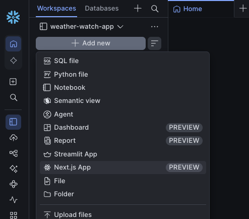
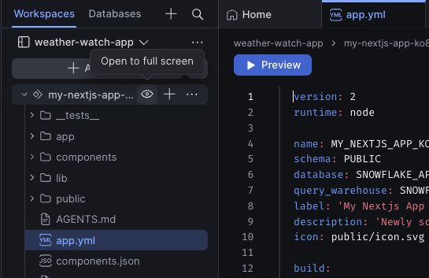
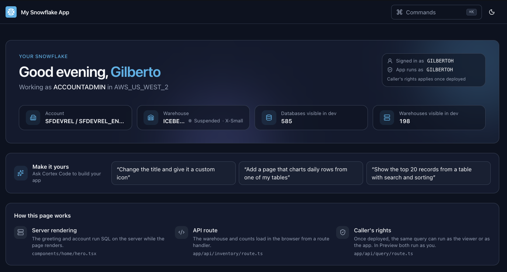
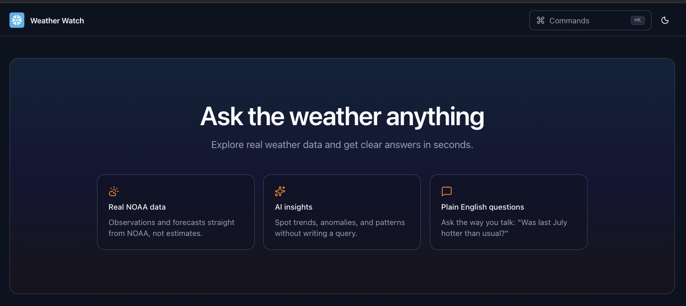
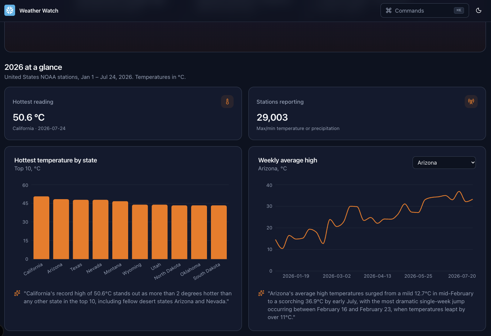
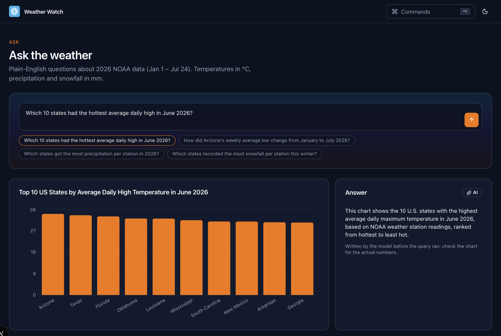
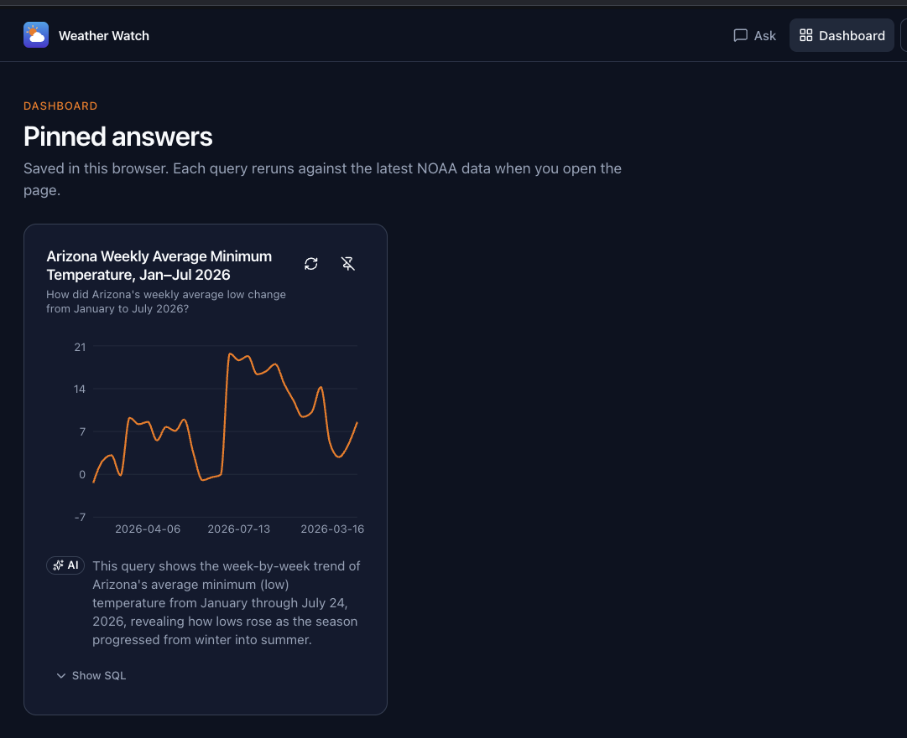

author: Myles Borins, Gilberto Hernandez, Snowflake CoCo
id: getting-started-with-snowflake-app-runtime
summary: Create, preview, change, and deploy your first Snowflake App Runtime app from a Snowsight workspace with CoCo. No local install required.
categories: snowflake-site:taxonomy/solution-center/certification/quickstart,snowflake-site:taxonomy/product/applications-and-collaboration,snowflake-site:taxonomy/snowflake-feature/build
environments: web
status: Published
language: en
duration: 30
feedback link: https://github.com/Snowflake-Labs/sfguides/issues

# Getting Started with Snowflake App Runtime
<!-- ------------------------ -->
## Overview

[Snowflake App Runtime](https://docs.snowflake.com/en/developer-guide/snowflake-app-runtime/about-snowflake-app-runtime) lets you build web apps and run them inside Snowflake, next to your data. It runs Node.js apps, with a focus on Next.js, and Python apps built with frameworks such as FastAPI and Flask.

In this guide, you'll use Snowflake App Runtime to build and deploy Weather Watch, an AI weather analyst for the United States, without installing anything. It runs on real NOAA weather station data. The app charts the data and lets you ask it a question in plain English to get back a chart. You'll create the app from a starter template in a Snowsight workspace, watch it run in Preview, change it by chatting with Snowflake CoCo, and deploy it to its own URL.

### What You'll Learn

* How to create a Snowflake App Runtime project in Workspaces
* How to run it live with Preview, where each edit reloads the app
* How to change the app with CoCo prompts
* How to query Snowflake data and call Cortex AI functions from the app
* How to deploy the app, open it at its own URL, and share it

### What You'll Need

* A Snowflake account with Snowflake App Runtime and workspace preview enabled
* A browser – you don't need to install anything
* The free Snowflake Curated Data (Free) listing from Snowflake Marketplace.

<!-- ------------------------ -->
## Get the Data

The Weather Watch app we'll build will use free, public NOAA weather data that Snowflake curates and maintains.

1. Open the [Snowflake Curated Data (Free)](https://app.snowflake.com/marketplace/listing/GZTSZ290BV255) listing in Snowflake Marketplace.

2. Select **Get**.

3. Keep the default database name, `SNOWFLAKE_CURATED_DATA_FREE`, and select **Get** again.

Getting a listing needs the `ACCOUNTADMIN` role or a role with the `IMPORT SHARE` privilege.

<!-- ------------------------ -->
## Create a Snowflake App Runtime App

You'll build Weather Watch in Workspaces, which lets you build, preview, and deploy Next.js apps from your browser (in public preview).

1. In Snowsight, select **Workspaces**.
2. Create a new workspace and give it a name.
3. In the workspace select **+ Add new » Next.js App**.
4. Keep the suggested project name. It ends in a random suffix, so it won't clash with other apps in your account.



Workspaces creates a Next.js project from the Snowflake App Runtime template and opens its **app.yml**. The project includes:

* **app.yml**, the manifest that tells Snowflake how to build, run, and deploy the app
* **package.json**, whose `dev` script starts the dev server
* **app/page.tsx**, the home page
* **lib/constants.ts**, where the app title, logo, and page links live
* **app/globals.css**, the theme, including the `--brand-primary` accent color
* **components/**, ready-made UI pieces: cards, tables, stat cards, skeletons, and empty states
* **lib/snowflake.ts** and **lib/run-as.ts**, helpers for running queries from the app. You don't need to edit them.
* **AGENTS.md**, notes that CoCo reads before it changes your app

The starter app already looks finished. Its home page greets you by name and shows your role, account, and warehouse, with a card of example prompts and a short tour of how the page talks to Snowflake.

<!-- ------------------------ -->
## Preview the App

In the file explorer, hover over your project folder and click the eye icon (**Open to full screen**). This starts Preview, opens it full screen, and opens the CoCo chat next to it.




Wait for the dev server to start. Preview shows its progress in the logs pane, then shows your running app. You can also start Preview in steps: select **Preview** above **app.yml**, select **Fullscreen** on the Preview pane, then open CoCo with the star icon in the side bar.

Preview displays the app to you alone – it creates no service until you deploy. Leave it open while you work. When CoCo changes a file, the app reloads in place.



<!-- ------------------------ -->
## Build the Weather Watch App

Now let's turn the starter app into Weather Watch, built on the NOAA tables in `SNOWFLAKE_CURATED_DATA_FREE.PUBLIC_DATA_FREE`. The free listing has daily readings from thousands of US weather stations through July 24, 2026. The template already handles the basics: cards, charts, light and dark mode, loading skeletons, and empty and error states. The prompts below focus on the styling and the data.

By default, the app's queries run as the owner's role, the role you deploy with. With caller's rights, a query runs as the signed-in user instead, so row access and masking policies apply per user. The template's **app/api/query/route.ts** shows both. In Preview, both run as you.

Paste each of the following prompts into CoCo and watch Preview update the app. Before CoCo changes a file, it asks you to accept the change. Review it and accept it to let CoCo continue.

### Make it yours

Start with a quick rebrand before you add any data. Paste the following prompt into CoCo:

```text
Rebrand the app as Weather Watch: set the title in lib/constants.ts
(keep the name in app.yml), change --brand-primary to a warm sunset
orange, and make dark mode the default instead of following the
system setting. Replace the demo home page sections (the greeting
hero, Make it yours, and How this page works) with a hero over a
subtle sky gradient: the headline "Ask the weather anything", a
one-line subtitle, and three small feature cards for real NOAA data,
AI insights, and plain English questions.
```

The header, buttons, and charts pick up the new accent color, because they all read from `--brand-primary`.



### Build the AI dashboard

This prompt tells CoCo to cache each query result for 24 hours, so charts load fast after the first view. Paste the following prompt into CoCo:

```text
Below the hero, add a 2026 weather dashboard in the same style using
SNOWFLAKE_CURATED_DATA_FREE.PUBLIC_DATA_FREE.NOAA_WEATHER_METRICS_TI
MESERIES joined to NOAA_WEATHER_STATION_INDEX on
NOAA_WEATHER_STATION_ID, limited to COUNTRY_NAME = 'United States'
and DATE from 2026-01-01 to 2026-07-24. Values are in Celsius and
millimeters. Use only the VARIABLE values maximum_temperature,
minimum_temperature and precipitation. Show cards for the hottest
reading and its state, and the number of stations reporting, using
the template's StatCard. With Recharts and components/chart-utils.tsx,
add a bar chart of the hottest temperature by STATE_NAME, top 10, and
a line chart of the weekly average high for a state picked from a
dropdown, defaulting to Arizona. Run the queries in parallel and
cache each result for 24 hours. Under each chart, add a one-sentence
insight from AI_COMPLETE with the claude-sonnet-5 model given the
chart's rows as JSON. Show the template's Skeleton while each chart
loads.
```

The bar chart puts California first at about 50 °C, and the AI points to Death Valley.



### Add an Ask box

Next, add a page where you ask the data a question in plain English and get back a chart. The server only runs read-only SQL that the model writes. Paste the following prompt into CoCo:

```text
Add an Ask page, listed in NAV_ITEMS in lib/constants.ts so it shows
up in the ⌘K palette, with a question box and 4 example questions. On
submit, a server route sends the columns of SNOWFLAKE_CURATED_DATA_F
REE.PUBLIC_DATA_FREE.NOAA_WEATHER_METRICS_TIMESERIES and
NOAA_WEATHER_STATION_INDEX, the join key, the VARIABLE values
maximum_temperature, minimum_temperature, precipitation and
snowfall, and the date range 2026-01-01 to 2026-07-24 to AI_COMPLETE
(model claude-sonnet-5) with a structured response_format of {sql,
chart_type, x, y, title, answer}. Tell the model to average
precipitation per station when comparing places. On the server,
allow only one SELECT or WITH statement, reject DDL and DML, wrap it
in a LIMIT 200 and set a 60 second timeout. If the SQL fails, send
the error back to AI_COMPLETE once to fix it. Show the chart, a
short answer, and the SQL in a syntax-highlighted code block with a
copy button.
```

Try "Which 5 states got the most rain per station in July 2026?" You get a chart, an answer, and the SQL that made it.




### Pin answers and polish

Finish by pinning answers to a dashboard and checking the app in light mode or dark mode. Paste the following prompt into CoCo:

```text
Let me pin any answer to a Dashboard page, stored in the browser and
listed in NAV_ITEMS, that reruns each pinned SQL on load in a grid.
Then check every page in light and dark mode, make sure each query
and AI call uses the template's Skeleton and EmptyState, and make the
layout work on a phone.
```

If something looks wrong, say so in plain words, for example "the chart is empty" or "make the table fit on my screen." CoCo reads the Preview logs and fixes it.




<!-- ------------------------ -->
## Deploy Your App

Deploying builds your app and starts it as a service at its own URL.

Ask CoCo:

```text
Deploy this app
```

You can also select **Deploy** in the editor. The first deploy creates the `APPLICATION SERVICE` that runs your app and can take a few minutes. Later deploys update the same URL.

When the deploy finishes, open the app: ask CoCo to open it, or select **Open deployed app** from the menu next to **Deploy**.

The template's **app.yml** names where the app deploys, such as the `SNOWFLAKE_APPS` database. You can also set its compute type there. Managed compute runs until you suspend it. Serverless compute, in public preview, scales to zero when idle and starts again on the next request.

### Share your app

The role you deploy with owns the app. To share it, grant other roles usage on the app, plus its database and schema:

```sql
GRANT USAGE ON APPLICATION SERVICE SNOWFLAKE_APPS.PUBLIC.MY_APP TO ROLE ANALYST;
```

Apps are private to your account and not open to the internet. Apps in your personal database stay private to you. To share apps with others, an admin first runs app development setup from **Settings » Apps**.

<!-- ------------------------ -->
## Keep Building

### Stay in Workspaces

Try more prompts on the same app, then deploy again. Add "and list it in NAV_ITEMS" to any prompt that creates a page, so the page shows up in the ⌘K palette:

```text
Add a Station Cards page. Pick a random US station from SNOWFLAKE_CU
RATED_DATA_FREE.PUBLIC_DATA_FREE.NOAA_WEATHER_STATION_INDEX with its
name, state, elevation, latitude and longitude, plus its hottest and
coldest 2026 readings from NOAA_WEATHER_METRICS_TIMESERIES, and send
those to AI_COMPLETE (model claude-sonnet-5) with a structured
response_format for a nickname, a personality, a superpower and a
short weather forecast in its voice. Show it as a trading card with
a "Draw another card" button.
```

```text
Add an AI Usage page that queries
SNOWFLAKE.ACCOUNT_USAGE.CORTEX_AI_FUNCTIONS_USAGE_HISTORY for the
last 24 hours: total credits, a bar chart of credits by function and
model, and the latest query IDs. If it is empty, say usage shows up
a few minutes after a call and add a refresh button.
```

Usage takes a few minutes to show up, so try the AI Usage page last and check back if it's empty.

```text
Add a Data page that lists the databases I can access. Selecting a
database shows its schemas, and selecting a schema shows its tables
with row counts. Load each level only when I open it.
```

To check the phone layout, open Preview in a new browser window and turn on device emulation in your browser's developer tools.

To use your own data, name the table in the prompt. Your role needs `SELECT` on it.

### Build a bigger app

[Build an AI Retention App with Snowflake App Runtime](https://www.snowflake.com/en/developers/guides/build-an-ai-retention-app-with-snowflake-app-runtime/) uses CoCo Desktop to build ChurnGuard in three steps: a dashboard, a workflow app that writes to Snowflake, and an app with a Cortex Agent.

<!-- ------------------------ -->
## Cleanup

Ask CoCo:

```text
Delete the deployed app for this project.
```

To remove the project too, delete its folder in Workspaces.

<!-- ------------------------ -->
## Conclusion And Resources

### What You Learned

* Create a Snowflake App Runtime project from the Next.js template in Workspaces
* Run it live with Preview
* Change it with CoCo prompts, including pages that query Snowflake and call AI_COMPLETE
* Deploy it to its own URL

### Related Resources

* [Snowflake App Runtime documentation](https://docs.snowflake.com/en/developer-guide/snowflake-app-runtime)
* [Deploy with the Snowflake CLI](https://docs.snowflake.com/en/developer-guide/snowflake-app-runtime/deploy)
* [app.yml manifest reference](https://docs.snowflake.com/en/developer-guide/snowflake-app-runtime/app-yml)
* [Query Snowflake from your app](https://docs.snowflake.com/en/developer-guide/snowflake-app-runtime/query-snowflake)
* [Access control for Snowflake App Runtime](https://docs.snowflake.com/en/developer-guide/snowflake-app-runtime/access-control)
* [Snowflake CoCo in Snowsight](https://docs.snowflake.com/en/user-guide/cortex-code/cortex-code-snowsight)
* [Snowflake Curated Data (Free) listing](https://app.snowflake.com/marketplace/listing/GZTSZ290BV255)
* [AI_COMPLETE structured outputs](https://docs.snowflake.com/en/sql-reference/functions/ai_complete-structured-outputs)
