author: Chanin Nantasenamat
id: getting-started-with-snowflake-dashboards-2-0
categories: snowflake-site:taxonomy/solution-center/certification/quickstart, snowflake-site:taxonomy/product/analytics, snowflake-site:taxonomy/product/ai
language: en
summary: Get started with Snowflake Dashboards 2.0 using step-by-step Cortex Code prompts to build, refine, and check a revenue dashboard, then publish it and explore it in CoWork.
environments: web
status: Published
feedback link: https://github.com/Snowflake-Labs/sfquickstarts/issues
fork repo link: https://github.com/sfc-gh-cnantasenamat/getting-started-with-snowflake-dashboards-2-0

# Getting Started with Snowflake Dashboards 2.0

## Overview

It's Monday morning and revenue is behind target. The BI dashboard says attainment is 86%, the AI assistant says 84%, and the sales-ops spreadsheet says something else. Each tool has its own copy of the metric logic, so the team spends the meeting reconciling numbers instead of asking why the quarter is slipping. Even once the numbers agree, finding the cause means paging through a multi-page dashboard and drilling down filter by filter.

In this guide, you'll build **Revenue Pulse** to work through that morning check on a synthetic dataset: a fictional B2B software company with 54 accounts, 3 product lines, and 24 months of revenue through September 30, 2026. The data contains a story. Q3 2026 net revenue is barely up (0.8%) year over year and $1.09M behind target. EMEA Enterprise is the largest single miss, and APAC is behind too. Your task is to trace that shortfall from the company-wide total to the regions, accounts, and recorded drivers behind it, using a shared overview for the daily check and follow-up questions with a consistent basis for comparison.

The workflow has four parts:

1. **A [Cortex Agent](https://docs.snowflake.com/en/user-guide/snowflake-cortex/cortex-agents)** that answers plain-language revenue questions through Cortex Analyst.
2. **A [Dashboards 2.0](https://docs.snowflake.com/en/LIMITEDACCESS/cowork-dashboards) dashboard** that you build with Cortex Code prompts for the team's daily revenue check.
3. **A shared [semantic view](https://docs.snowflake.com/en/user-guide/views-semantic/overview)** that defines their joins, dimensions, and metrics. Compare results using the same period and filters.
4. **A published dashboard in [Snowflake CoWork](https://docs.snowflake.com/en/user-guide/snowflake-cortex/snowflake-cowork)** that you share with a sales-ops role and ask follow-up questions about. Dashboard follow-up uses tile results and context; it does not automatically invoke the separate Revenue Advisor agent.

### When to Use Dashboards 2.0
Snowflake gives you several ways to present data, and each fits a different job:

- **HTML reports** suit one-off narrative analyses that are snapshots.
- **Streamlit** and **App Runtime** are for interactive tools and production apps, and they take more code to build and maintain.
- **Dashboards 2.0** sits in between. It is built for recurring KPI monitoring on live, governed queries, with filters, drilldown, and conversational follow-up, at a low build cost.

A morning revenue check fits that last description, so this guide uses a dashboard.

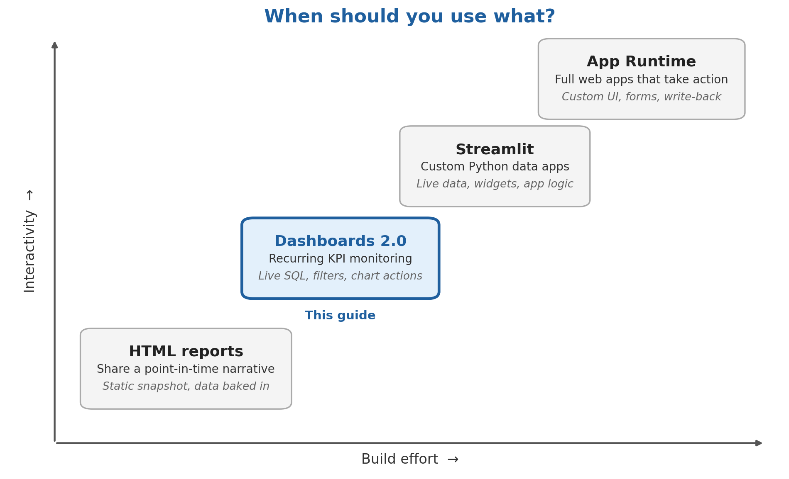

### What You'll Learn
- How to use the Snowsight Cortex Code `/dashboard` skill and refine a dashboard one prompt at a time
- How to model revenue, targets, and margin as a semantic view with additive metrics
- How to create a Cortex Agent with a Cortex Analyst tool over that semantic view
- How to check generated tile SQL, filters, and totals against a reproducible reference
- How a native `.dash` file holds the dashboard's tiles, filters, layout, and SQL datasources
- How to publish a dashboard as an artifact to a single role, with caller's rights
- How to ask follow-up questions about a dashboard in CoWork, and keep recorded drivers separate from hypotheses

### What You'll Build
You'll build Revenue Pulse, a single-page revenue dashboard that takes you from the Q3 2026 headline numbers down to the regions, segments, and accounts behind the $1.09M gap. It combines KPI sparklines, a monthly trend, regional bars, a heatmap, a variance waterfall, and account details, plus a driver donut and an account attainment bubble chart. Brush the trend or click a region bar, and the related charts would filter to match.

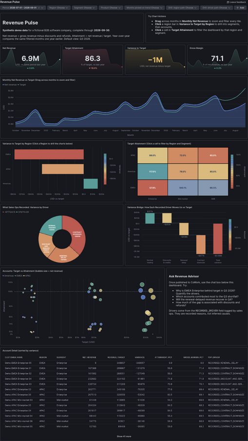

The architecture below shows how the dashboard and Revenue Advisor use the shared semantic view, and how viewers explore the published artifact in CoWork.


### Prerequisites
- Access to a [Snowflake account](https://signup.snowflake.com/?utm_source=snowflake-devrel&utm_medium=developer-guides&utm_cta=developer-guides)
- A role that can create databases, API integrations, semantic views, agents, and roles (this guide uses `ACCOUNTADMIN`)
- Access to Dashboards 2.0, Cortex Code in Snowsight Workspaces, and Snowflake CoWork in your account. At the time of this revision, the [dashboard documentation](https://docs.snowflake.com/en/LIMITEDACCESS/cowork-dashboards) labels the feature private preview; confirm enrollment with your account team
- A role with the `MANAGE ACCESS ON DASHBOARD ARTIFACTS` privilege, which is needed to publish dashboards as artifacts and choose who can view them. It is [granted to `PUBLIC` by default](https://docs.snowflake.com/en/release-notes/bcr-bundles/un-bundled/bcr-manage-access-dashboard-artifacts) unless your administrator revoked it

Everything in this guide runs in Snowsight. You don't need Python, a CLI, or a local copy of the code. The [companion repository](https://github.com/sfc-gh-cnantasenamat/getting-started-with-snowflake-dashboards-2-0) holds the SQL, the synthetic data, and the dashboard file, and Snowflake reads them directly from GitHub.

## Setup

### How to Follow Along

Run the supplied setup scripts, then send one authoring prompt at a time in the same Snowsight CoCo conversation. Review each change and complete its **Check** before continuing.

The companion's `dashboards/revenue_pulse.dash` is the completed example used for this guide's screenshots and expected figures. Create your dashboard as `dashboards/revenue_pulse_draft.dash` so you can compare the two without overwriting the example. Generated layouts and wording can differ. If you prefer to explore the completed example first, open it and jump to **Explore with Filters**.

The `/dashboard` skill was confirmed to load in Snowsight during a read-only check. The incremental authoring prompts below are suggested instructions, not a transcript of a completed end-to-end generation run. Validate the result in your account; a successful file check alone does not establish that its SQL or interactions are correct. Advanced chart actions depend on your account's enabled features.

> **Notes:**
>
> LLM generation is non-deterministic. **Expected output** describes the intended result, not a guaranteed response or layout; use **Check** to decide whether to continue.
>
> With the same data, definitions, dates, filters, and access, totals must reconcile, allowing for display rounding. Investigate differences rather than attributing them to LLM variability.

### Connect Snowflake to the Companion Repository

#### Review the Setup SQL

Paste the connection script below into a SQL file and ask CoCo to review it before running it.

**Prompt:**

```text
Review this setup SQL without executing it or changing anything.
Explain which objects it creates, which already-existing objects
it could affect, and which statements require elevated privileges.
Check whether it uses COMPUTE_WH and explain where I would substitute
my own warehouse. Do not execute statements or grant permissions.
```

**Expected output:** A review of the objects, warehouse references, and required privileges, including effects on existing objects. Nothing is executed or changed.

**Check:** Review the proposed operations yourself. Use only a dedicated demo database, and resolve warehouse or privilege issues before executing the supplied SQL. A chat explanation is not evidence that setup has run.

#### Run the Connection Script

In Snowsight, open **Projects > Workspaces**. In **My Workspace**, select **+ Add new > SQL File**. Set the role to `ACCOUNTADMIN` and the warehouse to `COMPUTE_WH`, then paste and run this script (it is also `sql/00_bootstrap.sql` in the repository):

```sql
USE ROLE ACCOUNTADMIN;

CREATE DATABASE IF NOT EXISTS REVENUE_PULSE_DB
  COMMENT = 'Revenue Pulse developer guide (synthetic data). Safe to drop after the guide.';

CREATE SCHEMA IF NOT EXISTS REVENUE_PULSE_DB.DASHBOARD_DEMO
  COMMENT = 'Revenue Pulse Dashboards 2.0 demo (synthetic data)';

CREATE API INTEGRATION IF NOT EXISTS REVENUE_PULSE_GIT_API
  API_PROVIDER = git_https_api
  API_ALLOWED_PREFIXES = ('https://github.com/sfc-gh-cnantasenamat/')
  ENABLED = TRUE
  COMMENT = 'Read access to the public Revenue Pulse companion repo';

CREATE GIT REPOSITORY IF NOT EXISTS REVENUE_PULSE_DB.DASHBOARD_DEMO.REVENUE_PULSE_REPO
  API_INTEGRATION = REVENUE_PULSE_GIT_API
  ORIGIN = 'https://github.com/sfc-gh-cnantasenamat/getting-started-with-snowflake-dashboards-2-0.git';

ALTER GIT REPOSITORY REVENUE_PULSE_DB.DASHBOARD_DEMO.REVENUE_PULSE_REPO FETCH;

LS @REVENUE_PULSE_DB.DASHBOARD_DEMO.REVENUE_PULSE_REPO/branches/main/sql/;
```

**Expected SQL output:** The final `LS` statement lists these six scripts. This ASCII preview shows only the `name` column, shortened to filenames without the repository path. The actual [Git file listing](https://docs.snowflake.com/en/developer-guide/git/git-operations) also includes size, hashes, and modification time, which depend on the fetched revision. Output previews in this guide describe expected successful results; they are not captures from a new execution.

```plaintext
+----------------------+
| name                 |
+----------------------+
| 00_bootstrap.sql     |
| 01_setup.sql         |
| 02_semantic_view.sql |
| 03_agent.sql         |
| 04_viewer_role.sql   |
| 99_cleanup.sql       |
+----------------------+
```

The demo's data objects live in `REVENUE_PULSE_DB`; the API integration and viewer role sit outside it and require separate cleanup.

> **Notes:**
>
> If your warehouse isn't `COMPUTE_WH`, use your own warehouse in the SQL file. Later, instead of running `sql/03_agent.sql` and `sql/04_viewer_role.sql` from the repository, copy each one from the repository into your SQL file, replace `COMPUTE_WH` with your warehouse, and run it there.

### About the Data

The repository's `data/` folder holds three CSV files: `customers.csv`, `products.csv`, and `revenue_monthly.csv`. They were produced by a deterministic generator (seed 42) that stores money as integer cents, so totals reconcile exactly. Every revenue row carries a `RECORDED_DRIVER` value: `NORMAL_TRADING`, `RECORDED_RENEWAL_DELAY`, `RECORDED_CONTRACT_DOWNSIZE`, or `RECORDED_DISCOUNT_AND_SERVICE_CREDIT`. These stand in for reasons a sales-ops team logged against each account.

## Load the Data

### Run the Setup Script

Run `sql/01_setup.sql` straight from the repository:

```sql
EXECUTE IMMEDIATE FROM @REVENUE_PULSE_DB.DASHBOARD_DEMO.REVENUE_PULSE_REPO/branches/main/sql/01_setup.sql;
```

**Expected SQL output:** [`EXECUTE IMMEDIATE FROM`](https://docs.snowflake.com/en/sql-reference/sql/execute-immediate-from#returns) returns the result of the last statement in the script when execution succeeds. Here, that is the row-count query:

```plaintext
+-----------+----------+--------------+
| CUSTOMERS | PRODUCTS | REVENUE_ROWS |
+-----------+----------+--------------+
|        54 |        3 |         3888 |
+-----------+----------+--------------+
```

The [full setup script](https://github.com/sfc-gh-cnantasenamat/getting-started-with-snowflake-dashboards-2-0/blob/main/sql/01_setup.sql) creates the tables and stage, copies the CSVs with `COPY FILES`, and loads them by column name. It truncates each table first. Run it only in the dedicated demo database: rerunning replaces any existing demo-table data.

> **Notes:**
>
> The wrapper returns only the final row-count result. To troubleshoot individual loads, inspect their `COPY INTO` results for loaded rows and errors. SQL blocks that create objects, grant access, or remove the demo return completion messages rather than data-query tables.

### Verify the Loaded Data

If you need help interpreting the load, ask CoCo to check it without reloading the tables.

**Prompt:**

```text
Check the loaded demo data with read-only queries against
REVENUE_PULSE_DB.DASHBOARD_DEMO.CUSTOMERS,
REVENUE_PULSE_DB.DASHBOARD_DEMO.PRODUCTS, and
REVENUE_PULSE_DB.DASHBOARD_DEMO.REVENUE_MONTHLY.
Report row counts, earliest and latest revenue month, and the
recorded-driver values. Show the SQL. Do not rerun the setup,
truncate tables, load files, or change any data.
```

**Expected output:** Row counts, date coverage, and recorded-driver values, with the read-only SQL used. Unreadable tables should produce explicit errors.

**Check:** Match the three row counts above and confirm monthly coverage from October 2024 through September 2026. Stop here if the load is incomplete; charts cannot correct missing source rows.

## Create the Semantic View

### Run the Semantic View Script

Run `sql/02_semantic_view.sql` from the repository:

```sql
EXECUTE IMMEDIATE FROM @REVENUE_PULSE_DB.DASHBOARD_DEMO.REVENUE_PULSE_REPO/branches/main/sql/02_semantic_view.sql;
```

It defines facts in USD, dimensions such as region, segment, and recorded driver, and metrics for net revenue, target, variance, attainment, and margin. Ratio metrics use [`DIV0NULL`](https://docs.snowflake.com/en/sql-reference/functions/div0null), which returns zero when the divisor is zero or NULL. An empty grouped result can still contain no rows; zero and missing data are not interchangeable.

See the [full semantic-view definition](https://github.com/sfc-gh-cnantasenamat/getting-started-with-snowflake-dashboards-2-0/blob/main/sql/02_semantic_view.sql) for joins and formulas. Its `AI_SQL_GENERATION` clause defines "Q3" and "last quarter" as July through September 2026; check generated query dates when comparing answers.

### Understand the Metric Definitions

Check how the model calculates totals and ratios before building charts.

**Prompt:**

```text
Inspect REVENUE_PULSE_DB.DASHBOARD_DEMO.REVENUE_SEMANTIC_VIEW
without changing it. Explain how customers and products relate to
monthly revenue, how cents become USD, and why attainment and margin
must be calculated from totals rather than averaged across accounts.
Use a small illustrative example, clearly marked as an example.
Do not create another semantic view or change its definitions.
```

**Expected output:** An explanation of the joins and cents-to-USD conversion, with a labeled example showing why ratios must use aggregated amounts. No definitions change.

**Check:** The explanation should distinguish additive amounts from ratios. These definitions are the foundation for both the dashboard and the separate agent.

## Create the Agent

### Agent Spec

The [agent specification in `sql/03_agent.sql`](https://github.com/sfc-gh-cnantasenamat/getting-started-with-snowflake-dashboards-2-0/blob/main/sql/03_agent.sql) configures one Cortex Analyst tool, `revenue_analytics`, over the shared semantic view. It uses `COMPUTE_WH` and instructs Revenue Advisor to quantify recorded drivers separately from hypotheses.

### Create the Agent

```sql
EXECUTE IMMEDIATE FROM @REVENUE_PULSE_DB.DASHBOARD_DEMO.REVENUE_PULSE_REPO/branches/main/sql/03_agent.sql;
```

### Prepare the Viewer Role

Then create the viewer role the dashboard is published to (covered in [Publish to a Role](#publish-to-a-role)):

```sql
EXECUTE IMMEDIATE FROM @REVENUE_PULSE_DB.DASHBOARD_DEMO.REVENUE_PULSE_REPO/branches/main/sql/04_viewer_role.sql;
```

### Understand the Agent's Role

Paste the specification from the linked `sql/03_agent.sql` into the CoCo conversation before sending the review prompt below.

**Prompt:**

```text
Review the Revenue Advisor agent specification shown in this guide.
Explain its revenue_analytics tool, semantic-view source, date limits,
and instructions for separating recorded drivers from hypotheses.
Do not modify or invoke the agent. Distinguish this agent from a
CoWork conversation started from a dashboard artifact.
```

**Expected output:** A review of the tool, data cutoff, and evidence rules, distinguishing direct semantic-view queries from dashboard follow-up chat. The agent is neither invoked nor modified.

**Check:** The agent's source is the same semantic view, but the dashboard's follow-up does not automatically call Revenue Advisor. Creation of the agent is not a test of its answers.

## Build Dashboard with Cortex Code

### Open a Git Workspace

Create a workspace from the companion repository so you can keep the completed example beside your own draft:

1. In **Workspaces**, select **+** (Create new workspace) at the top of the file tree, then select **Git workspace**.
2. For **Repository URL**, paste `https://github.com/sfc-gh-cnantasenamat/getting-started-with-snowflake-dashboards-2-0`. The workspace name fills in from the URL.
3. For **API integration**, select `REVENUE_PULSE_GIT_API`. The dialog may preselect a different integration, so check this field.
4. Select **Public repository**, then select **Create**.

Open Cortex Code in this workspace. The following prompts are for **CoCo in Snowsight**, not the CoWork artifact chat or a Desktop skill with an assumed identical name. The [documented authoring entry point](https://docs.snowflake.com/en/LIMITEDACCESS/cowork-dashboards#creating-a-dashboard) is `/dashboard`; CoCo generates the native file's tiles, SQL, and layout. You do not need to author its JSON yourself.

### 1. Establish the Data Context

After setup completes, give CoCo the exact source and period before asking for charts.

**Prompt:**

```text
/dashboard
Help me build a dashboard with Dashboards 2.0 natively in this workspace.
First inspect REVENUE_PULSE_DB.DASHBOARD_DEMO.REVENUE_SEMANTIC_VIEW.
Explain the revenue, target, variance, attainment, and gross-margin
metrics, and the month, region, segment, product, account, and
recorded-driver dimensions available to us.

This is synthetic monthly data through September 2026.
Q3 2026 means July, August, and September 2026.
Do not create or edit any files or database objects yet.
If the view is unavailable, stop and report the problem.
```

**Expected output:** The dashboard skill loads and summarizes the source, metrics, dimensions, and Q3 dates without creating anything. An unavailable skill or view is reported as a blocker.

**Check:** CoCo identifies the exact semantic view, USD metrics, and monthly dates. If it proposes a different source, correct that before proceeding. If `/dashboard` is unavailable, confirm feature access rather than switching to an HTML or Streamlit dashboard and treating it as the same result.

### 2. Check the Starting Numbers

Query a numerical baseline before building cards; never use expected values as hardcoded tile data.

**Prompt:**

```text
Using only the semantic view we inspected, run a read-only query
for Q3 2026 across all regions, segments, and products.
Return net revenue, target, net revenue minus target,
target attainment, and gross margin. Show the SQL used.
Compute ratios from the aggregated amounts, not by averaging
account percentages. Do not change the data or create files.
```

**Expected output:** A Q3 summary row with revenue, target, signed variance, attainment, and gross margin, plus its SQL. No files are created.

**Check:** Expect approximately $6.9M net revenue, 86.3% attainment, a $1.09M shortfall, and 71.1% gross margin. Treat these as checks, not hardcoded tile values. Resolve discrepancies in dates, units, or aggregation before building the dashboard.

### 3. Create Four KPI Cards

Start with four cards to show whether the team is on target.

**Prompt:**

```text
Create a new native dashboard titled Revenue Pulse
at dashboards/revenue_pulse_draft.dash. If that file exists,
stop and ask before replacing it. Leave revenue_pulse.dash unchanged.

Add a short header stating that the data is synthetic and complete
through September 2026. Below it, add four KPI cards for Q3 2026:
Net Revenue, Target Attainment, Variance to Target, and Gross Margin.
Back each card with SQL against the semantic view, not fixed values.
Show currency units and percentage labels clearly. Use a single-page
layout with the four cards in one row.

Validate and open the new .dash file. Do not publish it, change
sharing, modify database objects, or commit or push to Git.
```

**Expected output:** A new native dashboard with a synthetic-data header and four SQL-backed cards in one row, plus a file-validation report. The completed reference stays unchanged.

**Check:** Only your new draft file should be added. Open it, select the intended role and warehouse in the dashboard toolbar, and select **Run all**. Compare the cards with the query results from step 2. If your warehouse is not `COMPUTE_WH`, use the warehouse selected during setup.

The `.dash` file stores tiles, chart specifications, SQL datasources, filters, and layout as JSON. CoCo writes it and Workspaces renders it; no manual JSON editing or Python generator is needed.

The completed reference's Q3 scorecard row is shown below. The sparklines and prior-year comparisons are added in step 10; at this stage, check the four main values.

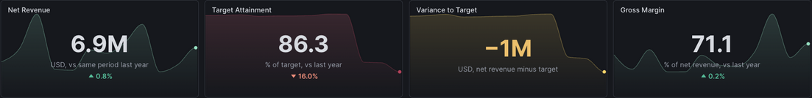

### 4. Add the Monthly Trend

The cards describe the selected quarter. The trend should reveal when performance changed, so it needs the full two-year context.

**Prompt:**

```text
Edit only revenue_pulse_draft.dash. Add a line chart titled
Monthly Net Revenue below the KPI cards. Plot monthly net revenue
and revenue target from October 2024 through September 2026.
Use a chronological date axis, distinguish the two series clearly,
and include USD in the axis or tooltip. Query the semantic view.
Keep the KPI cards unchanged and validate the updated file.
```

**Expected output:** A chronological revenue-versus-target line chart beneath the cards, with USD units and distinguishable series. KPI totals remain unchanged.

**Check:** The chart contains 24 monthly points per complete series, ordered by date. It should expose the revenue drop below target in July 2026 rather than plotting only the three Q3 months.

The completed reference uses an area fill beneath the revenue line, with a separate target line. The prompt above requests the same comparison as a line chart. No brush selection is active in this capture; step 12 shows the brushed state.

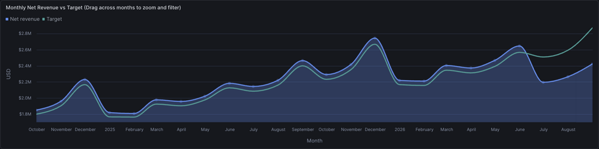

### 5. Add Dashboard Filters

Add filters for regional and product views while keeping the trend's full history independent of Period.

**Prompt:**

```text
Add Period, Region, Segment, and Product filters to the
dashboard. Default Period to Q3 2026, including monthly dates
2026-07-01, 2026-08-01, and 2026-09-01. Leave the other filters empty.
Populate their options from the demo data rather than invented lists.

Connect the filters to the tile SQL. Period should affect the KPI
totals; the monthly trend should ignore Period and keep all 24 months.
Region, Segment, and Product should affect both cards and trend.
Use the supported dashboard filter syntax. Explain the bindings
and validate the file without publishing.
```

**Expected output:** Four filters defaulting to Q3 with no other selections, plus an explanation of their query bindings. Period changes card totals; the other filters affect both cards and trend.

**Check:** Select EMEA. Revenue should fall to approximately $1.8M and attainment to 70.1%; the trend should still span 24 months but show EMEA data. Clear Region and verify that the original totals return. Do not continue if only some cards respond.

## Refine the Dashboard

Continue in the same CoCo conversation and edit only `revenue_pulse_draft.dash`. Each prompt adds one analytical purpose. After each change, inspect the file diff and run the affected tiles; avoid regenerating the whole dashboard to fix one tile.

### 6. Compare Regions

Compare regional shortfalls to decide where to investigate.

**Prompt:**

```text
Add a bar chart titled Variance to Target by Region.
For each region, calculate total net revenue minus total target
from the semantic view. Show signed USD values, a zero reference,
and readable region labels. Apply all four dashboard filters.
Keep existing tiles and filters intact, then validate the file.
```

**Expected output:** A regional bar chart showing signed variance in USD against a zero reference, with readable labels or tooltips.

**Check:** With Q3 selected and no other filters, EMEA has the largest regional shortfall. The sum of the regional variances should equal the variance card. Use the displayed signs, not colour alone, to read the result.

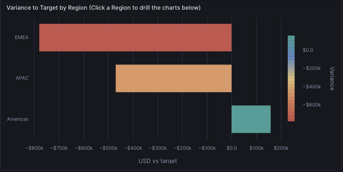

This unfiltered reference shows regional totals. Step 12 separates bar click-to-filter from dropdown-driven segment and account breakdowns.

### 7. Locate the Weakest Segment

Use a heatmap to distinguish strong and weak segments within each region.

**Prompt:**

```text
Add a heatmap titled Target Attainment by Region and Segment.
Put regions on one axis and segments on the other.
Calculate each cell as total net revenue divided by total target.
Show attainment as a percentage in each cell and include revenue,
target, and signed variance in the tooltip.
Use a fixed colour scale from 55% to 120% and a visible legend.
Apply all four filters and validate the file.
```

**Expected output:** A region-by-segment attainment grid with percentage labels, a fixed-scale legend, and financial measures in tooltips.

**Check:** The unfiltered Q3 heatmap should contain nine region-segment combinations. EMEA Enterprise should be about 57.9%, while Americas Enterprise is about 117%. A fixed scale keeps colours comparable when filters change.

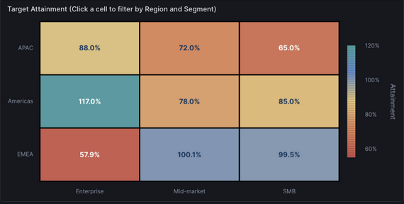

### 8. Show the Accounts

Add account records and recorded drivers as evidence behind each heatmap cell.

**Prompt:**

```text
Add an account table with customer name, region, segment,
recorded driver, net revenue, target, signed variance, and attainment.
Aggregate using the semantic view and apply the dashboard filters.
Sort the largest negative variances first. Retain all matching rows
with scrolling or pagination rather than dropping rows with a top-N
limit. If an account has multiple drivers, show separate rows and
make that grain clear. Validate the file.
```

**Expected output:** A filtered account-and-driver table ordered by largest shortfall, with all matching rows accessible through scrolling or pagination.

**Check:** Filter to EMEA and Enterprise. The table should expose the zero-revenue account and the other accounts behind the gap. Confirm its summed variance agrees with the filtered card before using it to explain the shortfall.

The completed reference below shows the first Q3 account rows, sorted by variance, with **Show 41 more** for the remaining rows. It uses one row per account and a `TOP_DRIVER` column; the prompt above asks for separate account-driver rows when multiple drivers occur.

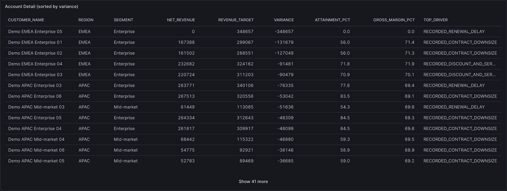

### 9. Reconcile the Drivers

Use a waterfall to reconcile signed driver contributions to total variance.

**Prompt:**

```text
Add a waterfall titled Recorded Drivers of Variance.
Group Q3 net revenue minus target by recorded driver, respecting
all dashboard filters. Start at zero variance, add each signed
driver contribution, and end with a separate total-variance bar.
Include positive offsets as well as negative contributions.
Use readable labels and USD tooltips. Do not infer causes beyond
the recorded labels. Validate the file.
```

**Expected output:** A waterfall starting at zero, adding signed recorded-driver contributions, and ending with a distinct total-variance bar. Positive offsets remain visible.

**Check:** In EMEA Enterprise, the approximately -$348.7K, -$258.7K, -$182.0K, and +$10.7K contributions should reconcile to -$778.7K. Clear Region and Segment before moving on.

The completed example below shows the unfiltered Q3 waterfall on the right. The donut on the left is added in step 11.

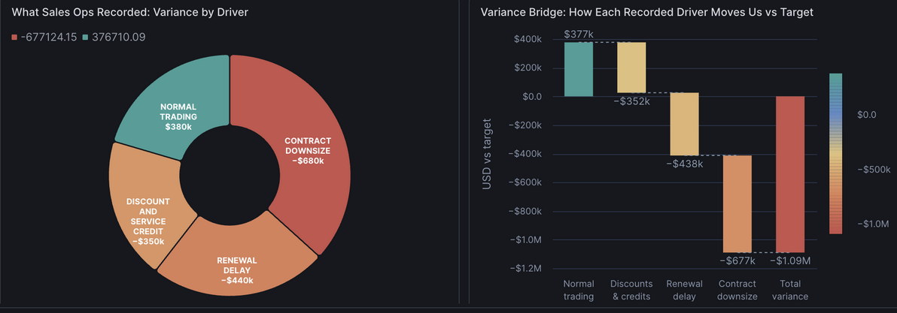

### 10. Add Comparisons and Sparklines

Once the totals are correct, add historical context to the cards. Keep the selected-period total separate from the monthly sparkline series.

**Prompt:**

```text
Enhance the four KPI cards with 12-month sparklines ending at the
last selected month. Preserve Region, Segment, and Product filters
in the sparkline queries. Keep each main value as the selected-period
aggregate, not the last sparkline point.

Add prior-year comparisons for the same selected months to Net
Revenue, Target Attainment, and Gross Margin. Clearly label relative
percent changes versus percentage-point changes. Leave comparison
off for Variance to Target. Keep currency and percentage units clear.
Use supported native scorecards and validate the file.
```

**Expected output:** Four KPI sparklines with selected-period totals preserved. Revenue, attainment, and margin gain labeled prior-year comparisons; variance does not.

**Check:** Default Q3 revenue remains about $6.9M, with a 0.8% year-over-year increase. The sparklines end in September 2026 and contain 12 months, while the main cards still describe the quarter. Inspect the prior-year dates if the comparisons look wrong.

The completed example below shows the four KPI sparklines and the dashboard header. It also includes the Chart Actions instructions added later in the walkthrough; your dashboard does not need to match its layout exactly.


### 11. Add Detail Charts

The waterfall and table show what moved; these two charts show how much and where. The donut compares driver magnitudes, and the bubble chart places each account by target and attainment. Send them separately so each can be reviewed on its own.

#### Compare Driver Magnitudes

**Prompt:**

```text
Add a donut titled Variance by Recorded Driver using the same
filtered driver aggregates as the waterfall. Size slices by absolute
variance, but show the signed USD value in each label or tooltip.
Add a note that slice sizes are not percentages of the net shortfall.
Keep labels readable; use a legend if in-ring labels do not fit.
Validate the file.
```

**Expected output:** A donut sized by absolute variance, with signed values and an encoding note. See the completed example beside the waterfall in step 9.

**Check:** A positive contribution must remain positive in its label, even though slice area is nonnegative. Do not use the donut's area to claim how much of the net gap a driver explains.

#### Compare Account Performance

**Prompt:**

```text
Add an account bubble chart with total target on the horizontal
axis and attainment on the vertical axis. Use net revenue for
bubble size and region for colour. Add a 100% attainment reference
line and account names in tooltips. Apply all dashboard filters.
Validate the file and preserve the existing table and charts.
```

**Expected output:** Account bubbles positioned by target and attainment, sized by revenue, and colored by region, with account tooltips and a 100% reference line.

**Check:** Accounts below the reference line are behind target. Tooltips should let you locate the same accounts in the table; zero-revenue accounts may have zero-sized bubbles, so retain the table for completeness.

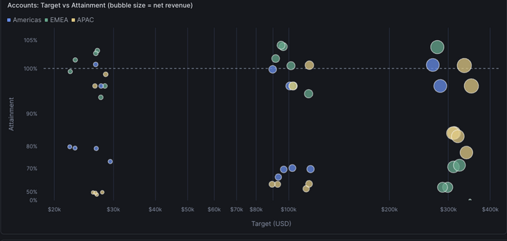

### 12. Add Chart Actions

#### Check Available Interactions

Chart actions turn the charts themselves into filters: brush a month range on the trend, or click a region bar or heatmap cell, and the other tiles follow. They are how readers move from the Q3 headline to the slice behind it without touching the header filters. Because Dashboards 2.0 is in preview, first confirm the actions are enabled in your account. The companion includes brushing and click-to-filter; if your account lacks one, keep the filter chips for that view and don't advertise a control you haven't created and tested.

**Prompt:**

```text
Check whether native trend brushing, bar click-to-filter, and
heatmap click-to-filter are supported for this dashboard.
Explain what is available and what is not. Do not edit the file yet,
and do not substitute custom JavaScript for unsupported actions.
```

**Expected output:** An evidence-backed capability summary for each action, with uncertainty stated and no file changes or unsupported substitutes.

**Check:** Distinguish confirmed availability from assumptions. Keep ordinary filter chips for unsupported or unverified actions; a capability summary is not a completed interaction test.

#### Brush a Time Range

Start by connecting a selected month range to the dashboard.

**Prompt:**

```text
Add a brush action to Monthly Net Revenue. Dragging a month range
should filter the trend and other data tiles to those months,
temporarily replacing Period. Show a clearable filter chip named
Months picked on trend. Clearing it should restore the original
Period and the trend's full 24-month context. Validate the file.
```

**Expected output:** A clearable **Months picked on trend** chip that temporarily overrides Period for affected tiles. Clearing it restores the prior period and full trend history.

**Check:** Brush a range outside Q3. Tiles should show that range rather than an empty intersection with Q3. Clear the brush and verify that the Q3 totals return.

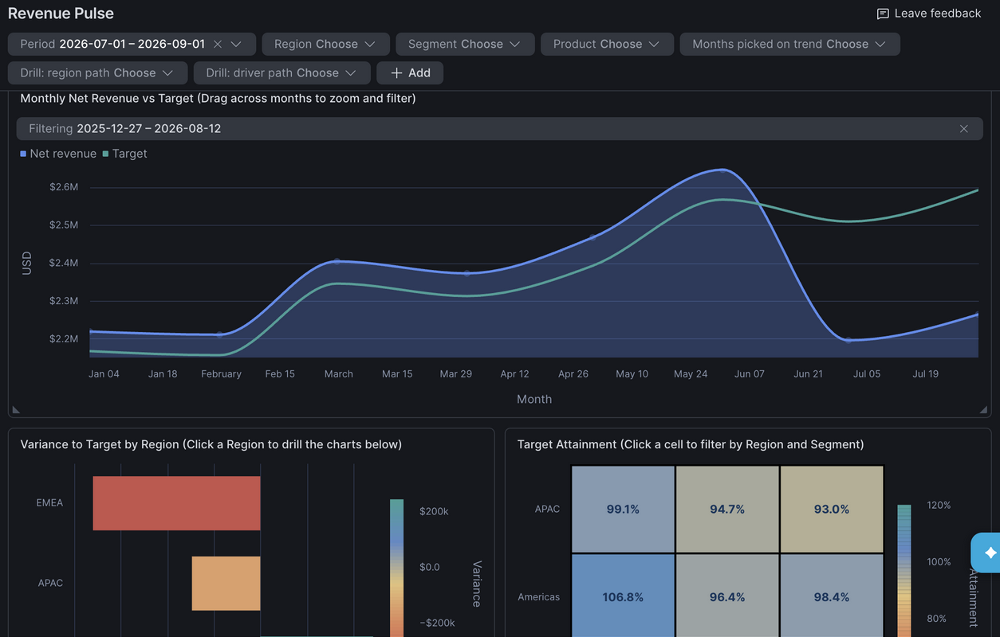

In the completed reference, the brush appears as a **Filtering** chip inside the trend tile. The scorecards, bars, and heatmap recalculate for the brushed months, and the header filters keep their saved values. Your build may surface the brush as the **Months picked on trend** chip instead, as the prompt requests; check whichever control your dashboard shows.

#### Filter from a Region Bar

**Prompt:**

```text
Add click-to-filter to Variance to Target by Region. Selecting a
region bar should filter the other data tiles but leave the source
region chart available for comparison. Show a clearable selection
chip. Separately, when Region has one selection, show segment bars
in that chart; with one Region and one Segment, show account bars.
Keep the selection grain and target scopes consistent with the
displayed bars. Validate the file.
```

**Expected output:** A bar selection filters other tiles and leaves the source bars visible. Separately, Region and Segment dropdowns control the source chart's region, segment, or account detail.

**Check:** A bar click must not remove the other bars from its own source chart. Clear its selection before testing the Region and Segment dropdowns for deeper breakdowns.

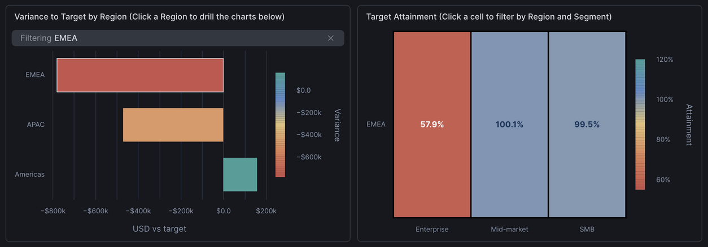

#### Filter from a Heatmap Cell

**Prompt:**

```text
Add click-to-filter to Target Attainment by Region and Segment.
Selecting a cell should filter the other data tiles by both its
region and segment while leaving the source heatmap unchanged.
Expose clearable selections and validate the file.
```

**Expected output:** Clearable region-and-segment selections filter other tiles while the source heatmap keeps all comparison cells.

**Check:** Select EMEA Enterprise, confirm the other tiles show that slice, and then clear the selections. The full heatmap should remain available throughout.

### 13. Explain the Controls

Finish with a compact layout and a short guide for the reader. Explain only interactions that survived your checks.

**Prompt:**

```text
Arrange the dashboard as one page: header and a short
Try Chart Actions text tile at the top, four KPI cards below,
then trend and regional views, followed by driver and account detail.
In the text tile, describe only the actions we verified and how to
clear their selections. If no chart actions are supported, title it
Try Dashboard Filters instead and explain the filter chips.
Keep labels readable and chart colours consistent. Preserve all
SQL, filter bindings, and tile IDs while adjusting layout.
Validate the file; do not publish or change sharing.
```

**Expected output:** A single-page layout ordered from summary to detail, with concise instructions for verified controls and reset actions. Existing SQL, bindings, and tile IDs remain intact.

**Check:** Read the dashboard at your normal browser size. Labels should fit, legends should explain units and colours, and the instructions should match the controls that actually work.

## Validate the Dashboard

### 14. Audit the Generated Result

#### Review Queries and Results

Separate a file-format check from a data check. A valid `.dash` can still contain a query that aggregates at the wrong grain or ignores a filter.

**Prompt:**

```text
Audit revenue_pulse_draft.dash without changing it.
Validate its native file format and inspect every datasource SQL.
Confirm that analytical queries use
REVENUE_PULSE_DB.DASHBOARD_DEMO.REVENUE_SEMANTIC_VIEW,
that ratios use aggregated amounts, and that labels match units.
Check Q3 2026 date boundaries, prior-year comparison dates,
filter bindings, and any chart-action scopes.
Run read-only comparison queries for all regions, EMEA, and
EMEA Enterprise. Report actual totals and any discrepancies.
List what you checked from source and what still needs a UI test.
Do not alter data, grants, files, or published artifacts.
```

**Expected output:** Separate findings for file format, SQL, bindings, and numerical comparisons, with actual results and outstanding UI tests. The audit reports problems without repairing them or marking untested behavior as working.

**Check:** Compare the results with the figures in **Explore with Filters**. In the UI, test each filter alone, combine Region and Segment, then clear them. Test a combination that returns no data: tiles should show an empty state rather than retaining old values. Restore Q3 and clear all other selections when finished.

#### Repair a Specific Issue

If you find a problem, give CoCo the observed behaviour and one expected outcome instead of asking it to rebuild everything.

**Prompt:**

```text
My dashboard's Net Revenue card does not change when
I select EMEA, although the account table does. Inspect that card's
datasource and filter bindings. Fix only the affected card or binding,
preserve the other tiles and IDs, and validate the file. Explain
the change so I can rerun the EMEA check. Do not change source data.
```

**Expected output:** A targeted fix and validation report if the defect is reproduced, preserving other tiles and source data. Otherwise, CoCo should request the missing observation rather than guess.

**Check:** This is an example repair prompt, not a known defect. Replace the observation with what you actually see, rerun the affected check, and confirm that clearing the filter restores the baseline.

### Compare with the Reference

Open `dashboards/revenue_pulse.dash` to compare the completed example with your dashboard. Its toolbar has its own role and warehouse; select the intended values before **Run all**. Screenshots throughout this guide show the completed example, not output guaranteed by the prompts. To follow their appearance exactly, use the example for the remaining exploration steps; otherwise continue with your validated dashboard.

## Explore with Filters

Use this section to check your dashboard against the completed example. The numerical checks use the same synthetic data, Q3 period, and stated filters. If your account doesn't support one of the chart actions from step 12, skip that check or open the completed example to try it.

### Review the Q3 Overview

With the dashboard open, select **Run all**.

The Variance to Target card abbreviates its value to **−$1M** at zero decimal places. The underlying shortfall is approximately **−$1.09M**, visible with more precision in the breakdowns. The attainment and margin card values are percentages, as their subtitles indicate.

With the default Q3 2026 period, the KPI row shows net revenue of **$6.9M**, up 0.8% year over year. Attainment is **86.3%**, which is **$1.09M behind target**, and gross margin is 71%. The trend line tracked target for 21 months, then fell below it in July.

### Locate the Revenue Gap

The Q3 heatmap in step 7 highlights **EMEA Enterprise at 57.9% attainment** and all three APAC segments below target. Americas Enterprise leads at 117%. These reference screenshots use Q3 with no region, segment, or product filter.

The waterfall in step 9 reconciles recorded drivers to the **−$1.09M** total variance. The bubble chart in step 11 helps locate large-target accounts below the 100% attainment line. Bubble size represents net revenue; use the account table to inspect the zero-revenue account.

### Filter to EMEA

Set **Region = EMEA**. Revenue becomes approximately $1.8M, attainment 70.1%, variance −$779.1K, and gross margin 71.3%. The regional chart now shows segment bars, while the trend retains its 24-month history.


### Focus on Enterprise Accounts

Add **Segment = Enterprise** and look at the account table. One account has zero revenue in the quarter, and four others are well under target. The drivers chart shows what sales ops recorded for EMEA Enterprise in Q3:

| Recorded driver | Variance |
|---|---|
| Renewal delay (1 account) | −$348.7K |
| Contract downsize (2 accounts) | −$258.7K |
| Discount and service credit (2 accounts) | −$182.0K |
| Normal trading (1 account) | +$10.7K |

Together these sum to the segment's −$778.7K gap. Clear Region and Segment to restore the all-region Q3 baseline before testing chart actions.

### Chart Actions

Test each action you added in step 12; for any your account doesn't support, the header filters remain the fallback. The completed example includes these actions:

1. **Brush months:** Drag a range on the trend, then clear **Months picked on trend** to restore Period and the full history.
2. **Select a region bar:** Other tiles filter to that region; the source bars remain visible. Clear **Drill: region path** to reset. Use the Region and Segment dropdowns, rather than bar clicks, to change the source chart's detail level.
3. **Select a heatmap cell:** Other tiles filter to its region and segment; the source grid stays unchanged. Clear the resulting selections before another test.

Restore Q3 and clear all other selections before publishing.

## Publish to a Role

### Create the Viewer Role

`sql/04_viewer_role.sql`, which you ran earlier, creates a read-only role with only the grants the dashboard and agent need. It does not grant the role to any user.

```sql
-- Dedicated viewer role for the Revenue Pulse demo. Read-only, least privilege.
-- Granted to no users by this script; add demo viewers explicitly.
USE ROLE ACCOUNTADMIN;
CREATE ROLE IF NOT EXISTS DASHBOARD_DEMO_SALES_OPS COMMENT = 'Viewer role for Revenue Pulse dashboard demo (synthetic data)';
GRANT USAGE ON DATABASE REVENUE_PULSE_DB TO ROLE DASHBOARD_DEMO_SALES_OPS;
GRANT USAGE ON SCHEMA REVENUE_PULSE_DB.DASHBOARD_DEMO TO ROLE DASHBOARD_DEMO_SALES_OPS;
GRANT SELECT ON TABLE REVENUE_PULSE_DB.DASHBOARD_DEMO.CUSTOMERS TO ROLE DASHBOARD_DEMO_SALES_OPS;
GRANT SELECT ON TABLE REVENUE_PULSE_DB.DASHBOARD_DEMO.PRODUCTS TO ROLE DASHBOARD_DEMO_SALES_OPS;
GRANT SELECT ON TABLE REVENUE_PULSE_DB.DASHBOARD_DEMO.REVENUE_MONTHLY TO ROLE DASHBOARD_DEMO_SALES_OPS;
GRANT SELECT ON SEMANTIC VIEW REVENUE_PULSE_DB.DASHBOARD_DEMO.REVENUE_SEMANTIC_VIEW TO ROLE DASHBOARD_DEMO_SALES_OPS;
GRANT USAGE ON AGENT REVENUE_PULSE_DB.DASHBOARD_DEMO.REVENUE_ADVISOR TO ROLE DASHBOARD_DEMO_SALES_OPS;
GRANT USAGE ON WAREHOUSE COMPUTE_WH TO ROLE DASHBOARD_DEMO_SALES_OPS;
GRANT DATABASE ROLE SNOWFLAKE.CORTEX_USER TO ROLE DASHBOARD_DEMO_SALES_OPS;
```

### Assign the Viewer Role

To let someone view the dashboard, grant them the role:

```sql
GRANT ROLE DASHBOARD_DEMO_SALES_OPS TO USER <name>;
```

### Publish as an Artifact

#### Review Publication Readiness

Before publishing, choose which file you intend to share: your validated dashboard or the completed example. Check the open file's path and its data, since both may be titled Revenue Pulse. Publishing is a deliberate UI action, not part of the generation prompts. You can ask CoCo to review the file first.

**Prompt:**

```text
Review revenue_pulse_draft.dash for publication without editing
or publishing it. Check for missing queries, unresolved errors,
misleading units, hardcoded KPI values, and instructions for actions
that are not configured. Summarize remaining checks, including a
viewer-role test. Do not grant access or change any sharing settings.
```

**Expected output:** A list of publication blockers and remaining execution or viewer-role tests. The file, grants, and sharing stay unchanged.

**Check:** Replace the filename in that prompt if you chose the reference. Resolve reported problems and restore default filters before continuing. This review does not replace checking access as the intended viewer.

#### Publish and Confirm Access

In the dashboard toolbar, choose **Share > Publish as artifact**. The dialog notes that viewers run the dashboard with their own privileges ([caller's rights](https://docs.snowflake.com/en/LIMITEDACCESS/cowork-dashboards)), not the owner's. The role's grants decide what each viewer sees.

Add `DASHBOARD_DEMO_SALES_OPS` with **Can view** access. When this guide was tested, the role search box sometimes already contained `PUBLIC`. Clear it so the dashboard is shared only with the sales-ops role. Then select **Publish**.

A confirmation appears, and the toolbar button changes to **Publish changes**. Open **Share** again and check **Who has access**. During testing, `PUBLIC` was granted **Can view** on publish even though the dialog didn't show it beforehand. If `PUBLIC` is listed, select its trash icon so only the owner and `DASHBOARD_DEMO_SALES_OPS` remain.

After publishing, make edits in the Workspaces editor and use **Publish changes** to push them.

## Ask Why in CoWork

### Open the Artifact

In Snowflake CoWork, open **Artifacts**, select the **All** tab, and open the **Revenue Pulse** dashboard you published. If you published more than one version, use the link copied from the intended dashboard's Share dialog to open the correct artifact. It shows the published tiles and filters, with a follow-up box below. The docs describe what viewers can and can't do here in [Consuming a dashboard in Cowork](https://docs.snowflake.com/en/LIMITEDACCESS/cowork-dashboards).

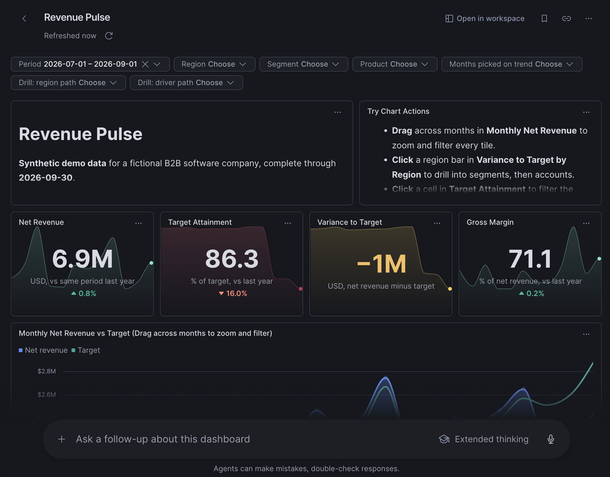

Confirm the artifact's filters and totals match your Q3 baseline. The **Ask a follow-up about this dashboard** box sits below the tiles.

### Ask a Follow-up Question

Publishing saved the dashboard as an artifact, so you can ask follow-up questions about the data it shows. Each follow-up starts a new conversation that carries the artifact's data and context, and it stays private to you ([Artifacts in Snowflake CoWork](https://docs.snowflake.com/en/user-guide/snowflake-cortex/snowflake-cowork/artifacts)). Enter the following question in the follow-up box.

**Prompt:**

```text
Why is EMEA Enterprise behind target in Q3 2026? Quantify the drivers.
```

**Expected output:** A conversation beside the docked dashboard, quantifying the EMEA Enterprise gap from available tile results without editing the dashboard. Missing evidence should be stated explicitly.


The captured response used heatmap and account-table results to report $1.07M revenue against a $1.85M target.

**Check:** Expect 57.9% attainment and a −$778.7K gap. Compare the signed contributions with the table in **Focus on Enterprise Accounts**, including the positive offset. Recorded labels do not prove causation or Q4 recovery; the data ends in September 2026.

For questions beyond what the tiles hold, open the Revenue Advisor agent in CoWork. It queries the semantic view directly. Check its answer against the breakdown above using the same period and filters; the dashboard follow-up does not automatically invoke this agent.

### Ask Smaller Follow-ups

For a more gradual exploration, start a conversation from the dashboard with a scoped question, then ask for detail in that conversation. These are suggested follow-ups, not additional captured responses.

#### Identify the Largest Shortfall

**Prompt:**

```text
For Q3 2026, which region and segment has the largest negative
variance to target? State its net revenue, target, variance,
and attainment, and identify the dashboard results you used.
```

**Expected output:** The largest region-segment shortfall, its financial measures, and the dashboard evidence used, or an explicit statement that the evidence is unavailable.

**Check:** Identify the slice by negative dollar variance, not just the lowest attainment percentage. The expected largest region-segment gap is EMEA Enterprise.

#### Reconcile the Recorded Drivers

**Prompt:**

```text
For EMEA Enterprise in the same quarter, break the variance down
by recorded driver. Include positive offsets and show whether
the contributions sum to the total gap. If the dashboard results
do not contain enough detail, say what is missing rather than guess.
```

**Expected output:** Signed driver contributions and their sum, with a reconciliation to the segment gap or an explanation of missing evidence.

**Check:** Compare the signed contributions with the table in **Focus on Enterprise Accounts**. An answer should not invent detail missing from the available tile results.

#### Separate Evidence from Hypotheses

**Prompt:**

```text
Which parts of that explanation are directly supported by recorded
data, and which would be hypotheses? What additional evidence would
you need to assess whether the delayed renewal will recover in Q4?
Do not forecast beyond the available data.
```

**Expected output:** A distinction between recorded evidence and hypotheses, plus missing evidence needed for a Q4 assessment, such as renewal status or later bookings. No forecast is presented.

**Check:** The answer should acknowledge that the dataset ends in September 2026 and that recorded labels do not prove future recovery.

## Clean Up

### Review the Cleanup Scope

Cleanup is optional until you finish exploring, and destructive once executed. If you want a final review, paste the cleanup SQL below into a file and ask CoCo to explain its scope and risks.

**Prompt:**

```text
Review this tutorial cleanup SQL without executing or changing it.
List exactly which objects it would remove. Explain which dashboard
artifacts and workspace files require separate manual cleanup.
Flag anything that could affect work outside this tutorial.
Do not drop objects, delete files, revoke grants, or publish changes.
```

**Expected output:** A list of objects to be removed, separate artifact and workspace cleanup, and risks from reused names. Nothing is deleted.

**Check:** Confirm that the named database, role, integration, workspace, and artifacts belong only to this tutorial before performing the steps below. Do not rely on the prompt to authorize deletion.

### Remove Artifacts and Workspace

Remove the published dashboard and the workspace first:

1. Open the dashboard's **Share** dialog and remove every role from **Who has access**.
2. Delete the artifact from CoWork (**Artifacts**, open it, **More options > Delete**). During testing, the CoWork delete returned an error. With every role removed, the artifact stays visible only to you.
3. In **Workspaces**, delete only the draft file or dedicated tutorial workspace you created. If the Git workspace was created solely for this tutorial, select **...** (More options) next to its name, select **Delete**, and confirm. Do not delete a workspace that contains unrelated work. If you published both dashboard versions, review and remove each tutorial artifact separately.

### Remove the Demo Objects

Then run `sql/99_cleanup.sql`. Paste it into your SQL file rather than running it from the repository, because it drops the database that holds the Git repository object. Dropping `REVENUE_PULSE_DB` removes the schema, tables, stage, Git repository, semantic view, and agent. The script also drops the viewer role and the API integration, which sit outside the database. No script runs this file for you.

```sql
-- Teardown for the Revenue Pulse guide. NOT run by any script; run it yourself at the end.
-- First remove every role from the dashboard's Share dialog and delete the artifact in CoWork,
-- and delete the Git-synced workspace in Snowsight (... next to the workspace name > Delete).
-- Every guide object (schema, tables, stage, Git repository, semantic view, agent) lives in
-- REVENUE_PULSE_DB, so dropping the database removes them all. The role and API integration live outside it.
USE ROLE ACCOUNTADMIN;
DROP DATABASE IF EXISTS REVENUE_PULSE_DB;
DROP ROLE IF EXISTS DASHBOARD_DEMO_SALES_OPS;
DROP API INTEGRATION IF EXISTS REVENUE_PULSE_GIT_API;
```

## Conclusion And Resources

Remember the Monday-morning meeting this guide started with, where the dashboard, the assistant, and the spreadsheet each told a different story? With Revenue Pulse, one semantic view defines net revenue, target, and attainment for the dashboard, the Revenue Advisor agent, and CoWork, so the numbers agree before the conversation starts. From there, you traced the $1.09M Q3 shortfall from the KPI cards to EMEA, to EMEA Enterprise at 57.9% attainment, and down to the recorded drivers and accounts behind it, without leaving the page.

You built that dashboard by describing what you needed to Cortex Code, one prompt at a time, and checking each result before moving on. You then published it to a role that can read only what the dashboard needs, so the sales-ops team can use it every morning and ask CoWork why the numbers moved. The same pattern applies to other data you work with: define the metrics once in a semantic view, build the dashboard with focused prompts, check it against numbers you can reproduce, and share it with the role that needs it.

### What You Learned
- Build a native dashboard with Snowsight CoCo's `/dashboard` skill, then refine it with one focused prompt at a time
- Check generated SQL and UI behaviour separately; compare filtered totals with a reproducible reference
- Keep semantic view metrics additive and compute ratios after aggregation, so filtered totals stay correct
- Ask CoCo to connect dashboard filters to the relevant tile queries
- Compare the same months year over year under identical filters
- Publish dashboards to a specific role. Viewers run them with caller's rights
- Separate recorded drivers from hypotheses when explaining a variance

### Related Resources
- [Dashboards in Snowflake CoWork](https://docs.snowflake.com/en/LIMITEDACCESS/cowork-dashboards)
- [Snowflake semantic views](https://docs.snowflake.com/en/user-guide/views-semantic/overview)
- [Cortex Agents](https://docs.snowflake.com/en/user-guide/snowflake-cortex/cortex-agents)
- [Cortex Analyst](https://docs.snowflake.com/en/user-guide/snowflake-cortex/cortex-analyst)
- [Artifacts in Snowflake CoWork](https://docs.snowflake.com/en/user-guide/snowflake-cortex/snowflake-cowork/artifacts)
- [MANAGE ACCESS privileges on Artifacts](https://docs.snowflake.com/en/release-notes/bcr-bundles/un-bundled/bcr-manage-access-dashboard-artifacts)
