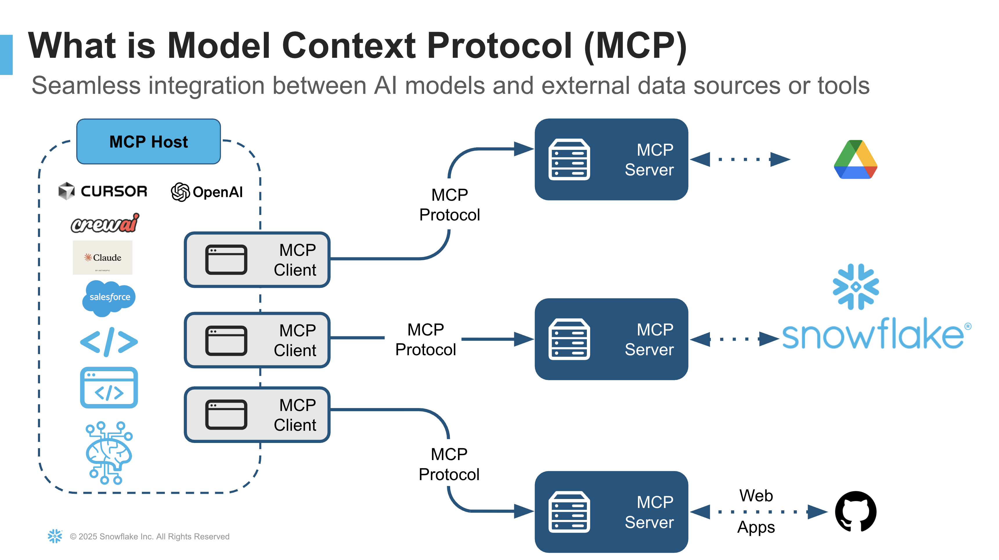

id: getting-started-with-snowflake-mcp-server
categories: snowflake-site:taxonomy/solution-center/certification/quickstart, snowflake-site:taxonomy/product/ai
language: en
summary: This guide outlines the process for getting started with Managed Snowflake MCP Server. 
environments: web
status: Published
open in snowflake link: https://app.snowflake.com/templates/?template=getting_started_with_managed_snowflake_mcp_server&utm_source=snowflake-devrel&utm_medium=developer-guides&utm_content=getting-started-with-snowflake-mcp-server&utm_cta=developer-guides-deeplink
feedback link: <https://github.com/Snowflake-Labs/sfguides/issues>
authors: Dash Desai

# Getting Started with Managed Snowflake MCP Server
<!-- ------------------------ -->

## Overview

The Snowflake-managed MCP server lets AI agents securely retrieve data from Snowflake accounts without deploying separate infrastructure. MCP clients discover and invoke tools, and retrieve the data their applications need, through a single standards-based interface built on the [Model Context Protocol (MCP)](https://modelcontextprotocol.io/). The server can expose Cortex Analyst, Cortex Search, Cortex Agents, SQL execution, and your own functions and procedures as tools.

**Top 3 Benefits**

* **Governed by design:** Enforce the same trusted governance policies, from role-based access to masking, for the MCP server as you do for your data.
* **Reduced integration:** With the MCP server, integration happens once. Any compatible agent or client can then connect without new development, accelerating adoption and reducing maintenance costs.
* **Extensible framework:** Give agents secure access to structured and unstructured data out of the box, and refine the tools to improve how agents interact with your data.

**Why It Matters**

The MCP server on Snowflake simplifies application architecture and eliminates the need for custom integrations. Enterprises can deliver generative AI applications faster, with richer insights, on a standards-based architecture and a robust governance model.



### What You'll Learn

- How to create the building blocks for a Snowflake MCP server: a Cortex Search service, a semantic view, and a custom tool
- How to create a Snowflake-managed MCP server and grant least-privileged access to it
- How to connect any MCP client to the server and verify it with `curl`
- How to expose a Cortex Agent as an MCP tool

### What You'll Build

A Snowflake-managed MCP server that answers financial services questions over structured and unstructured data, which you can use from the MCP client of your choice.

### What You'll Need

* Access to a Snowflake account with the ACCOUNTADMIN role. If you don't have an account, create a [free Snowflake trial account](https://signup.snowflake.com/?utm_source=snowflake-devrel&utm_medium=developer-guides&utm_cta=developer-guides).
* `curl` or another HTTP client, to test the server.
* Optional: any MCP client that supports remote (HTTP) MCP servers, such as Cursor, Claude, ChatGPT, VS Code, or a client you build yourself. You can complete the guide with `curl` alone.

<!-- ------------------------ -->
## Setup

### Create Objects

* Clone the [GitHub repository](https://github.com/Snowflake-Labs/sfguide-getting-started-with-snowflake-mcp-server).
* In Snowsight, on the left hand navigation menu, select **Projects** >> **Workspaces**, click on **+ Add new** >> **SQL File**, and copy the contents of [setup.sql](https://github.com/Snowflake-Labs/sfguide-getting-started-with-snowflake-mcp-server/blob/main/setup.sql) into it.
* Execute all statements in order from top to bottom.

The script runs as **ACCOUNTADMIN** and creates:

* The **DASH_MCP_DB.DATA** schema with financial services tables loaded from AWS S3, and the **DASH_WH_S** warehouse
* The **SEND_EMAIL** stored procedure and **EMAIL_INTEGRATION** notification integration, used later as a custom tool
* The **DASH_MCP_ROLE** role, granted to you. MCP clients use this least-privileged role instead of ACCOUNTADMIN.

> NOTE: If Cortex Analyst models aren't available in your region, uncomment the `ALTER ACCOUNT SET CORTEX_ENABLED_CROSS_REGION` statement near the top of the script to enable [cross-region inference](https://docs.snowflake.com/en/user-guide/snowflake-cortex/cross-region-inference/?utm_source=snowflake-devrel&utm_medium=developer-guides).

### Cortex Search Service

This tool lets an agent search and retrieve information from unstructured text, such as customer support tickets, Slack conversations, or contracts. It uses Cortex Search to index and query the text, enabling [Retrieval Augmented Generation](https://www.snowflake.com/en/fundamentals/rag/) (RAG).

* In Snowsight, on the left hand navigation menu, select <a href="https://app.snowflake.com/_deeplink/#/cortex/search?utm_source=snowflake-devrel&utm_medium=developer-guides&utm_campaign=-us-en-all&utm_content=app-getting-started-with-snowflake-mcp-server&utm_cta=developer-guides-deeplink" class="_deeplink">**AI & ML** >> **Cortex Search**</a> and click on **Create**
    - Role and Warehouse: **ACCOUNTADMIN** | **DASH_WH_S**
    - Database and Schema: **DASH_MCP_DB.DATA**
    - Name: **SUPPORT_TICKETS**
* Click on **Next** and complete the remaining steps:
    - Select data to be indexed: **Table or view** >> **FACT_SUPPORT_TICKETS**
    - Columns to include in the search results: select all
    - Search column: **DESCRIPTION**
    - Attribute (filter) columns: **CATEGORY**, **SUBCATEGORY**, **PRIORITY**, **CHANNEL**, **STATUS**, **SATISFACTION_SCORE**
    - Target lag: keep the default, then click on **Create**

> NOTE: Enter the name in uppercase. Snowsight double-quotes service names, so a mixed-case name such as `Support_Tickets` becomes case-sensitive and won't match the `DASH_MCP_DB.DATA.SUPPORT_TICKETS` identifier used in the MCP server specification.

### Cortex Analyst Semantic View

This tool lets an agent query structured data by generating SQL. It relies on a semantic view, which maps business concepts (for example, "customer lifetime value" or "risk profile") to the underlying tables and columns. The Snowflake-managed MCP server supports semantic views only, not legacy semantic model YAML files on a stage.

* Download [FINANCIAL_SERVICES_ANALYTICS.yaml](https://github.com/Snowflake-Labs/sfguide-getting-started-with-snowflake-mcp-server/blob/main/FINANCIAL_SERVICES_ANALYTICS.yaml) from the repository you cloned.
* In Snowsight, on the left hand navigation menu, select **Projects** >> **Workspaces** and click on **+ Add new** >> **Semantic View**. This opens [Semantic View Autopilot](https://docs.snowflake.com/en/user-guide/views-semantic/autopilot).
    - Location: **DASH_MCP_DB.DATA**
    - Name: **FINANCIAL_SERVICES_ANALYTICS**
* When Autopilot asks for context, choose to upload a YAML specification and select **FINANCIAL_SERVICES_ANALYTICS.yaml**. Autopilot converts it into a semantic view.
* Save the semantic view.

### Grant Access to the Tools

Run the following in your SQL file so that **DASH_MCP_ROLE** can use the search service and semantic view.

```sql
USE ROLE ACCOUNTADMIN;

GRANT USAGE ON CORTEX SEARCH SERVICE DASH_MCP_DB.DATA.SUPPORT_TICKETS TO ROLE DASH_MCP_ROLE;
GRANT SELECT ON SEMANTIC VIEW DASH_MCP_DB.DATA.FINANCIAL_SERVICES_ANALYTICS TO ROLE DASH_MCP_ROLE;
```

> NOTE: Access to an MCP server doesn't grant access to its tools. The role an MCP client uses needs a privilege on each underlying object: USAGE on Cortex Search services, agents, functions, and procedures, and SELECT on semantic views.

<!-- ------------------------ -->
## Snowflake MCP Server

> PREREQUISITE: Successful completion of steps outlined under **Setup**.

### Create the MCP Server

Run the following in the same SQL file to create the MCP server and grant **DASH_MCP_ROLE** access to it.

```sql
USE ROLE ACCOUNTADMIN;
USE SCHEMA DASH_MCP_DB.DATA;

CREATE OR REPLACE MCP SERVER DASH_MCP_SERVER FROM SPECIFICATION
$$
tools:
  - name: "Finance_and_Risk_Assessment_Semantic_View"
    identifier: "DASH_MCP_DB.DATA.FINANCIAL_SERVICES_ANALYTICS"
    type: "CORTEX_ANALYST_MESSAGE"
    description: "Comprehensive semantic model for financial services analytics, providing unified business definitions and relationships across customer data, transactions, marketing campaigns, support interactions, and risk assessments."
    title: "Financial And Risk Assessment"
  - name: "Support_Tickets_Cortex_Search"
    identifier: "DASH_MCP_DB.DATA.SUPPORT_TICKETS"
    type: "CORTEX_SEARCH_SERVICE_QUERY"
    description: "A tool that performs keyword and vector search over unstructured support tickets data."
    title: "Support Tickets Cortex Search"
  - name: "SQL_Execution_Tool"
    type: "SYSTEM_EXECUTE_SQL"
    description: "A tool to execute read-only SQL queries against the connected Snowflake database."
    title: "SQL Execution Tool"
    config:
      read_only: true
      warehouse: "DASH_WH_S"
  - name: "Send_Email"
    identifier: "DASH_MCP_DB.DATA.SEND_EMAIL"
    type: "GENERIC"
    description: "A custom tool to send emails to the user's verified email address."
    title: "Send_Email"
    config:
      type: "procedure"
      warehouse: "DASH_WH_S"
      input_schema:
        type: "object"
        properties:
          body:
            description: "Use HTML-Syntax for this. If the content you get is in markdown, translate it to HTML. If body is not provided, summarize the last question and use that as content for the email."
            type: "string"
          recipient_email:
            description: "If the email is not provided, send it to the current user's email address."
            type: "string"
          subject:
            description: "If subject is not provided, use Snowflake MCP Server."
            type: "string"
$$;

GRANT USAGE ON MCP SERVER DASH_MCP_DB.DATA.DASH_MCP_SERVER TO ROLE DASH_MCP_ROLE;
```

The server exposes four tools:

* **Finance_and_Risk_Assessment_Semantic_View** (Cortex Analyst): turns a question into SQL over the semantic view. It returns the generated SQL, not the query results.
* **Support_Tickets_Cortex_Search** (Cortex Search): searches support ticket descriptions.
* **SQL_Execution_Tool**: runs read-only SQL, such as the SQL that Cortex Analyst generates.
* **Send_Email** (custom tool): calls the **SEND_EMAIL** stored procedure.

### Create a Programmatic Access Token

MCP clients authenticate with a [programmatic access token (PAT)](https://docs.snowflake.com/en/user-guide/programmatic-access-tokens) or OAuth. This guide uses a PAT because every client and `curl` support it. Restrict the token to **DASH_MCP_ROLE** so that clients never run with ACCOUNTADMIN privileges.

* In Snowsight, on the left hand navigation menu, select **Governance & security** >> **Users & roles** and select your user.
* Under **Programmatic access tokens**, click on **Generate new token**.
    - Name: **MCP_GUIDE_TOKEN**
    - Expires in: choose a short expiration, such as 7 days
    - Select **One specific role (recommended)** and choose **DASH_MCP_ROLE**
* Click on **Generate**, then copy the token and store it somewhere safe. You can't view it again after you close the dialog.

> NOTE: A PAT for a person user only works if the user is subject to a [network policy](https://docs.snowflake.com/en/user-guide/network-policies). If your account or user has no network policy, select **Bypass requirement for network policy** in the dialog for a temporary bypass, or ask your administrator to add one.

You can also generate the token with SQL:

```sql
ALTER USER ADD PROGRAMMATIC ACCESS TOKEN MCP_GUIDE_TOKEN
  ROLE_RESTRICTION = 'DASH_MCP_ROLE'
  DAYS_TO_EXPIRY = 7;
```

> NOTE: For production, Snowflake recommends [OAuth](https://docs.snowflake.com/en/user-guide/snowflake-cortex/cortex-agents-mcp#set-up-oauth-authentication) instead of hardcoded tokens. Most hosted clients, such as Claude and ChatGPT, connect with OAuth.

### Find Your MCP Server URL

Every MCP client connects to the same URL:

```
https://<YOUR-ACCOUNT-URL>/api/v2/databases/DASH_MCP_DB/schemas/DATA/mcp-servers/DASH_MCP_SERVER
```

To get your account hostname, run:

```sql
SELECT REPLACE(LOWER(CURRENT_ORGANIZATION_NAME() || '-' || CURRENT_ACCOUNT_NAME()), '_', '-') || '.snowflakecomputing.com' AS account_url;
```

> NOTE: Use hyphens (-), not underscores (_), in the hostname. MCP clients fail to connect, often with a TLS certificate error, when the hostname contains underscores.

### Verify with curl

Before you configure a client, list the server's tools with `curl`. Replace **<YOUR-ACCOUNT-URL>** and **<YOUR-PAT>** with your values.

```bash
curl -X POST "https://<YOUR-ACCOUNT-URL>/api/v2/databases/DASH_MCP_DB/schemas/DATA/mcp-servers/DASH_MCP_SERVER" \
  --header 'Content-Type: application/json' \
  --header 'Accept: application/json, text/event-stream' \
  --header "Authorization: Bearer <YOUR-PAT>" \
  --data '{
    "jsonrpc": "2.0",
    "id": 1,
    "method": "tools/list",
    "params": {}
  }'
```

**What to expect:** A JSON response that lists the four tools by name (`Finance_and_Risk_Assessment_Semantic_View`, `Support_Tickets_Cortex_Search`, `SQL_Execution_Tool`, and `Send_Email`), each with an `inputSchema`. For example, the Cortex Analyst tool takes a `message`, the search tool takes a `query` plus optional `columns`, `filter`, and `limit`, and the SQL tool takes `sql`. If you get an error instead, check the account URL, the PAT, and the network policy note above.

Then call a tool. This example asks the SQL tool to count customers:

```bash
curl -X POST "https://<YOUR-ACCOUNT-URL>/api/v2/databases/DASH_MCP_DB/schemas/DATA/mcp-servers/DASH_MCP_SERVER" \
  --header 'Content-Type: application/json' \
  --header 'Accept: application/json, text/event-stream' \
  --header "Authorization: Bearer <YOUR-PAT>" \
  --data '{
    "jsonrpc": "2.0",
    "id": 2,
    "method": "tools/call",
    "params": {
      "name": "SQL_Execution_Tool",
      "arguments": { "sql": "SELECT COUNT(*) FROM DASH_MCP_DB.DATA.DIM_CUSTOMERS" }
    }
  }'
```

**What to expect:** A result whose `content` contains the query output, a count of 5,000 customers. Tool calls can stream their response as [Server-Sent Events](https://docs.snowflake.com/en/user-guide/snowflake-cortex/cortex-agents-mcp#discover-and-invoke-tools), which is why the `Accept` header lists both `application/json` and `text/event-stream`. In that case the JSON arrives in a `data:` line.

<!-- ------------------------ -->
## Connect an MCP Client

Any MCP client that supports remote (HTTP) MCP servers can use your server. Every client needs the same three things:

* **Server URL:** the URL from the previous step
* **Authentication:** an `Authorization: Bearer <YOUR-PAT>` header, or OAuth if your client supports it
* **Role:** the PAT is restricted to **DASH_MCP_ROLE**, so the client sees only the objects that role can use

Add the server using your client's MCP settings. Most clients use a JSON configuration with a `url` and `headers`, similar to the example below. For step-by-step instructions for Claude, ChatGPT, Cursor, and other clients, see [Connect from common MCP clients](https://docs.snowflake.com/en/user-guide/snowflake-cortex/cortex-agents-mcp#connect-from-common-mcp-clients).

### Example: Cursor

In Cursor, add the server to `.cursor/mcp.json` in your project, or to `~/.cursor/mcp.json` to make it available in every project. Replace **<YOUR-ACCOUNT-URL>** and **<YOUR-PAT>** with your values.

```json
{
  "mcpServers": {
    "snowflake": {
      "url": "https://<YOUR-ACCOUNT-URL>/api/v2/databases/DASH_MCP_DB/schemas/DATA/mcp-servers/DASH_MCP_SERVER",
      "headers": {
        "Authorization": "Bearer <YOUR-PAT>"
      }
    }
  }
}
```

Then open **Cursor Settings**, go to the MCP section, and confirm that the **snowflake** server is enabled and lists its tools.

> NOTE: Don't commit a file that contains your PAT to source control. Keep the token in a local or global configuration file, or use OAuth instead.

<!-- ------------------------ -->
## Ask Questions

Once your client lists the Snowflake tools, start a new chat and ask the following questions. Answers are generated live, so wording and formatting vary by client and model. Your client's model decides which tool to call, so the notes below describe what to look for.

### Q1. *What is the average customer lifetime value by region for customers with Low risk profile?*

**What to expect:** The client calls the Cortex Analyst tool, which returns the SQL it generated, then runs that SQL with the SQL tool. You should see five regions with similar averages of roughly $48,000 to $52,500, with Central the highest and East the lowest.

### Q2. *Show me the risk profile distribution across customer segments with transaction volumes. Include the number of customers, transaction counts, and average transactions per customer for each segment and risk profile combination.*

**What to expect:** The same Cortex Analyst plus SQL pattern, returning a table with 12 rows, one for each combination of the four customer segments (Basic, Standard, Premium, and VIP) and three risk profiles (Low, Medium, and High). Each customer averages roughly 9 to 11 transactions.

### Q3. *Can you summarize the overall sentiment based on the support tickets?*

**What to expect:** The client calls the Cortex Search tool, then summarizes the tickets it retrieves. Many tickets are routine questions about rates, fees, and accounts.

### Q4. *Which support categories would benefit most from automated responses based on ticket analysis?*

**What to expect:** Depending on your client, it searches the tickets, queries **FACT_SUPPORT_TICKETS** with SQL, or both. The categories have similar ticket volumes, so expect the answer to focus on routine categories, such as rate questions, general questions, and fee inquiries, and on response times and satisfaction scores.

### Custom Tools

Custom tools let you expose your own functions and stored procedures through the MCP server with `type: "GENERIC"` in the specification. The **Send_Email** tool calls the **SEND_EMAIL** stored procedure, which sends email through the **EMAIL_INTEGRATION** notification integration.

Enter the following prompt, replacing **YOUR-EMAIL-ADDRESS** with your [verified email address](https://docs.snowflake.com/en/user-guide/ui-snowsight-profile#verify-your-email-address):

#### *Send me an email with a summary of the analysis to YOUR-EMAIL-ADDRESS.*

**What to expect:** The client calls the **Send_Email** tool, which returns `Email sent successfully`. Check your inbox for the summary. Snowflake only sends email to verified addresses.

<!-- ------------------------ -->
## Optional: Expose a Cortex Agent

For governed business questions, Snowflake recommends exposing a [Cortex Agent](https://docs.snowflake.com/en/user-guide/snowflake-cortex/cortex-agents) as an MCP tool. The agent then chooses between Cortex Analyst, Cortex Search, and SQL itself, instead of leaving that choice to the client's model.

Run the following to create an agent over the same semantic view and search service, then recreate the MCP server with a `CORTEX_AGENT_RUN` tool added.

```sql
USE ROLE ACCOUNTADMIN;
USE SCHEMA DASH_MCP_DB.DATA;

CREATE OR REPLACE AGENT DASH_MCP_DB.DATA.FINANCIAL_ANALYST_AGENT
  COMMENT = 'Answers financial services questions using the semantic view and support tickets'
  FROM SPECIFICATION
$$
models:
  orchestration: auto
instructions:
  response: "Answer concisely and cite the data you used."
tools:
  - tool_spec:
      type: cortex_analyst_text_to_sql
      name: Finance_and_Risk_Assessment
      description: "Customers, transactions, marketing campaigns, support interactions, and risk assessments."
  - tool_spec:
      type: cortex_search
      name: Support_Tickets
      description: "Unstructured support ticket descriptions."
tool_resources:
  Finance_and_Risk_Assessment:
    semantic_view: DASH_MCP_DB.DATA.FINANCIAL_SERVICES_ANALYTICS
    execution_environment:
      type: warehouse
      warehouse: DASH_WH_S
  Support_Tickets:
    name: DASH_MCP_DB.DATA.SUPPORT_TICKETS
    id_column: TICKET_ID
    title_column: SUBJECT
    max_results: 5
$$;

GRANT USAGE ON AGENT DASH_MCP_DB.DATA.FINANCIAL_ANALYST_AGENT TO ROLE DASH_MCP_ROLE;
GRANT DATABASE ROLE SNOWFLAKE.CORTEX_AGENT_USER TO ROLE DASH_MCP_ROLE;

CREATE OR REPLACE MCP SERVER DASH_MCP_SERVER FROM SPECIFICATION
$$
tools:
  - name: "Financial_Analyst_Agent"
    identifier: "DASH_MCP_DB.DATA.FINANCIAL_ANALYST_AGENT"
    type: "CORTEX_AGENT_RUN"
    description: "Agent that answers financial services questions by combining the semantic view and support tickets."
    title: "Financial Analyst Agent"
  - name: "Finance_and_Risk_Assessment_Semantic_View"
    identifier: "DASH_MCP_DB.DATA.FINANCIAL_SERVICES_ANALYTICS"
    type: "CORTEX_ANALYST_MESSAGE"
    description: "Comprehensive semantic model for financial services analytics, providing unified business definitions and relationships across customer data, transactions, marketing campaigns, support interactions, and risk assessments."
    title: "Financial And Risk Assessment"
  - name: "Support_Tickets_Cortex_Search"
    identifier: "DASH_MCP_DB.DATA.SUPPORT_TICKETS"
    type: "CORTEX_SEARCH_SERVICE_QUERY"
    description: "A tool that performs keyword and vector search over unstructured support tickets data."
    title: "Support Tickets Cortex Search"
  - name: "SQL_Execution_Tool"
    type: "SYSTEM_EXECUTE_SQL"
    description: "A tool to execute read-only SQL queries against the connected Snowflake database."
    title: "SQL Execution Tool"
    config:
      read_only: true
      warehouse: "DASH_WH_S"
  - name: "Send_Email"
    identifier: "DASH_MCP_DB.DATA.SEND_EMAIL"
    type: "GENERIC"
    description: "A custom tool to send emails to the user's verified email address."
    title: "Send_Email"
    config:
      type: "procedure"
      warehouse: "DASH_WH_S"
      input_schema:
        type: "object"
        properties:
          body:
            description: "Use HTML-Syntax for this. If the content you get is in markdown, translate it to HTML. If body is not provided, summarize the last question and use that as content for the email."
            type: "string"
          recipient_email:
            description: "If the email is not provided, send it to the current user's email address."
            type: "string"
          subject:
            description: "If subject is not provided, use Snowflake MCP Server."
            type: "string"
$$;

GRANT USAGE ON MCP SERVER DASH_MCP_DB.DATA.DASH_MCP_SERVER TO ROLE DASH_MCP_ROLE;
```

> NOTE: `CREATE OR REPLACE MCP SERVER` drops the previous grants on the server, so run the `GRANT USAGE ON MCP SERVER` statement again after you recreate it.

Reconnect or refresh the server in your client so that it picks up the new **Financial_Analyst_Agent** tool, which takes a `text` argument. Then ask a question that spans both data sources:

#### *Which support categories would benefit most from automated responses, and how do Low risk customers compare on lifetime value by region?*

**What to expect:** The agent answers both parts in one response, typically with a table for each, and lists the tools it used. Agent responses include intermediate steps such as reasoning and tool results, so they can be much larger than other tool responses.

<!-- ------------------------ -->
## Clean Up

To remove the objects created in this guide, run the following SQL statements:

```sql
USE ROLE ACCOUNTADMIN;

ALTER USER REMOVE PROGRAMMATIC ACCESS TOKEN MCP_GUIDE_TOKEN;

DROP DATABASE IF EXISTS DASH_MCP_DB;
DROP WAREHOUSE IF EXISTS DASH_WH_S;
DROP NOTIFICATION INTEGRATION IF EXISTS EMAIL_INTEGRATION;
DROP ROLE IF EXISTS DASH_MCP_ROLE;
```

Dropping **DASH_MCP_DB** also removes the MCP server, agent, semantic view, Cortex Search service, and **SEND_EMAIL** procedure. Also remove the Snowflake server from your MCP client's configuration.

> NOTE: Dropping **DASH_MCP_ROLE** invalidates any PAT restricted to it. If `setup.sql` uncommented the cross-region inference statement, you can reset it with `ALTER ACCOUNT UNSET CORTEX_ENABLED_CROSS_REGION;`.

<!-- ------------------------ -->
## Conclusion And Resources

Congratulations! You've created a Snowflake-managed MCP server that answers questions over structured and unstructured data, and connected it to the MCP client of your choice with least-privileged access.

### What You Learned

- How to create the building blocks for a Snowflake MCP server: a Cortex Search service, a semantic view, and a custom tool
- How to create a Snowflake-managed MCP server and grant least-privileged access to it
- How to connect any MCP client to the server and verify it with `curl`
- How to expose a Cortex Agent as an MCP tool

### Related Resources

- [GitHub Repository](https://github.com/Snowflake-Labs/sfguide-getting-started-with-snowflake-mcp-server)
- [Snowflake-managed MCP server documentation](https://docs.snowflake.com/en/user-guide/snowflake-cortex/cortex-agents-mcp)
- [CREATE MCP SERVER](https://docs.snowflake.com/en/sql-reference/sql/create-mcp-server)
- [Programmatic access tokens](https://docs.snowflake.com/en/user-guide/programmatic-access-tokens)
- [Model Context Protocol](https://modelcontextprotocol.io/)
