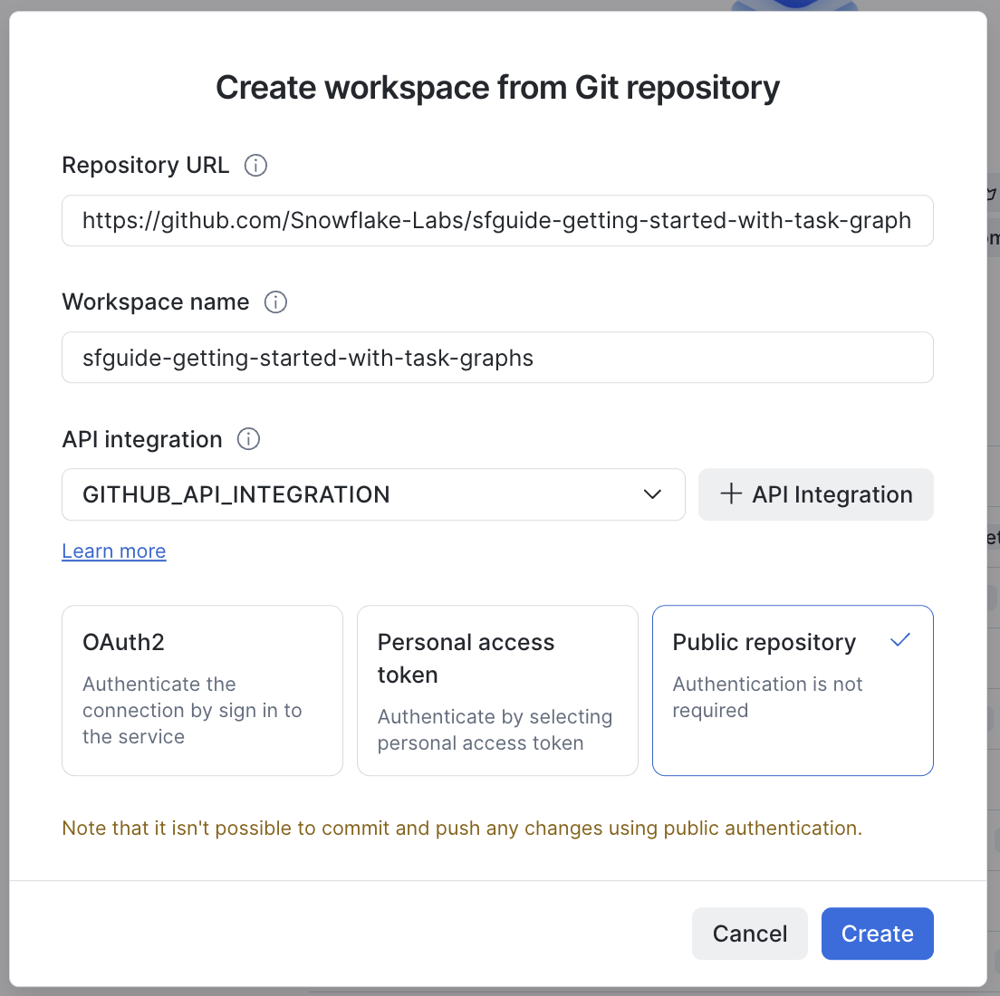
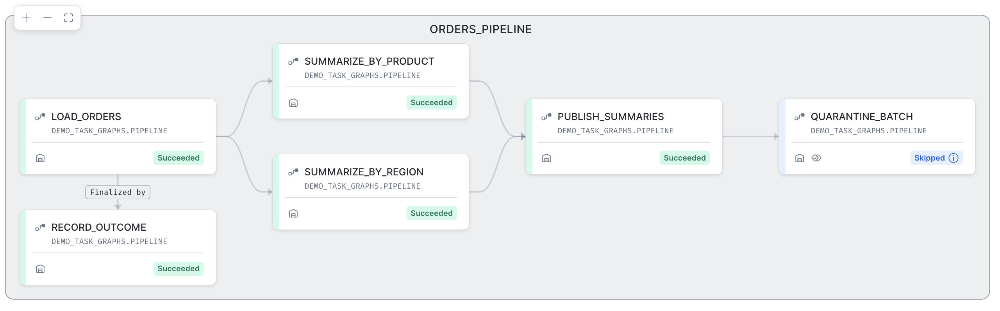
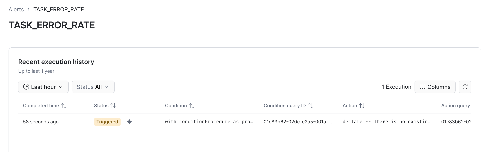
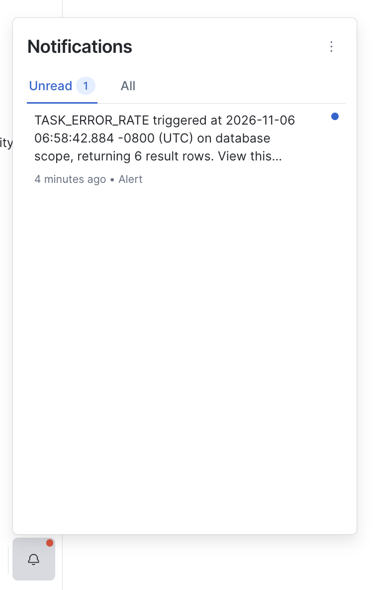
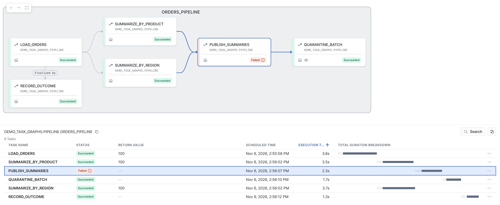

author: Yoav Ostrinsky
id: getting-started-with-task-graphs
categories: snowflake-site:taxonomy/solution-center/certification/quickstart, snowflake-site:taxonomy/product/data-engineering, snowflake-site:taxonomy/snowflake-feature/transformation
language: en
summary: Build a Snowflake task graph object with parallel branches, a checked publish step, a fallback branch and a finalizer, then change it while it runs.
environments: web
status: Published
feedback link: https://github.com/Snowflake-Labs/sfguides/issues
fork repo link: https://github.com/Snowflake-Labs/sfguide-getting-started-with-task-graphs

# Getting Started with Task Graphs
<!-- ------------------------ -->
## Overview

A task graph runs a set of tasks as one pipeline: each task starts when the tasks before it finish, and independent steps run side by side. In Snowflake, a task graph is its own database object. The graph owns the schedule, the root task, the finalizer, the run configuration and the defaults that every member task inherits, such as the warehouse. Member tasks are ordinary tasks linked by AFTER.

Because the graph is an object, you change it the way you'd change code. You edit a running graph without suspending it, the edits wait as staged changes, and nothing reaches a run until you COMMIT. Every run uses the committed version it started with.

In this guide you'll build a small orders pipeline and put it through three situations:

1. **Build and run it.** A root task loads a batch of orders, two branches summarize it in parallel and pass their counts on as return values, and a publish step checks the batch before it publishes the summaries.
2. **Change it while it's resumed.** You change a task in the resumed graph, inspect the staged change, commit it, and watch the next run pick it up.
3. **Break it on purpose.** You run one bad batch so the publish step's check fails. A fallback branch quarantines the batch, the finalizer records what happened, and a task error alert fires.

This guide is about building and operating a graph with SQL. For the concepts behind tasks and task graphs, see the [comprehensive guide to orchestration](/en/developers/guides/comprehensive-guide-to-orchestration/). To build the same kind of pipeline visually, see [Getting Started with Pipeline Builder](/en/developers/guides/getting-started-with-pipeline-builder/).

### What You'll Build

A task graph called ORDERS_PIPELINE with six member tasks:


| Task | Role |
|:-----|:-----|
| LOAD_ORDERS | Root. Loads 100 synthetic orders and returns the row count |
| SUMMARIZE_BY_REGION | Branch. Revenue by region, returns how many orders it summarized |
| SUMMARIZE_BY_PRODUCT | Branch. Revenue by product, returns how many orders it summarized |
| PUBLISH_SUMMARIES | Compares both branch counts, then publishes, or fails on negative amounts |
| QUARANTINE_BATCH | Fallback path. Runs only when PUBLISH_SUMMARIES fails |
| RECORD_OUTCOME | Finalizer. Runs after every run and records the outcome |

### What You'll Learn

- How to create a task graph object with a schedule, a finalizer, a run configuration and member defaults
- How to pass return values between tasks that run in parallel
- How to run a task only when an upstream task fails, with SYSTEM$PREDECESSORS_STATE
- How COMMIT, committed versions and EXECUTE TASK GRAPH fit together
- How to change a resumed graph and inspect the change before you release it
- How to read a run with TASK_HISTORY and COMPLETE_TASK_GRAPHS
- How to watch for failed tasks with an alert created from the TASKS_ERROR_RATE template

### Prerequisites

- A Snowflake account and access to the ACCOUNTADMIN role, for the first few statements of the setup script only. They create a dedicated demo role, and everything else runs as that role
- Basic familiarity with SQL and Snowflake Scripting

<!-- ------------------------ -->
## Create a Workspace from Git

In this step, you'll create a Snowsight Workspace linked to the sample task graph repository on GitHub.

1. Navigate to **Projects > Workspaces** in Snowsight.
2. Click **Create** (+) and select **Git repository**.
3. Enter the repository URL: https://github.com/Snowflake-Labs/sfguide-getting-started-with-task-graphs
4. Select an API Integration for GitHub ([create one if needed](https://docs.snowflake.com/en/user-guide/ui-snowsight/workspaces-git#label-create-a-git-workspace)).
5. Select **Public repository**.



Once the workspace is created, you'll see the repository files in the file explorer. The scripts/ folder contains numbered SQL files that you'll run at different stages of this guide:

| File | When to Run |
|:-----|:------------|
| 01_setup.sql | First, to create the demo role, warehouse, database and tables |
| 02_build_task_graph.sql | To build the graph and its error alert, commit the graph and run it once |
| 03_change_while_running.sql | To change the graph while it's resumed |
| 04_force_failure.sql | To run a bad batch, see the fallback branch and fire the alert |
| 05_cleanup.sql | When you're done and want to tear everything down |

Open scripts/01_setup.sql in the workspace. You'll run it from there in the next step, and the same goes for the other scripts.

**Prefer a terminal?** Clone the repository and run each script with the [Snowflake CLI](https://docs.snowflake.com/en/developer-guide/snowflake-cli/index), as shown at the end of each section. Every step in this guide works the same way from the CLI.

<!-- ------------------------ -->
## Set Up the Environment

Run all of 01_setup.sql. It starts as ACCOUNTADMIN and creates a role, DEMO_TASK_GRAPHS_ROLE, with only the account privileges this guide needs:

```sql
CREATE ROLE IF NOT EXISTS DEMO_TASK_GRAPHS_ROLE
  COMMENT = 'Getting Started with Task Graphs: owns every object the guide creates';
GRANT CREATE DATABASE ON ACCOUNT TO ROLE DEMO_TASK_GRAPHS_ROLE;
GRANT CREATE WAREHOUSE ON ACCOUNT TO ROLE DEMO_TASK_GRAPHS_ROLE;
GRANT EXECUTE TASK ON ACCOUNT TO ROLE DEMO_TASK_GRAPHS_ROLE;
GRANT EXECUTE MANAGED TASK ON ACCOUNT TO ROLE DEMO_TASK_GRAPHS_ROLE;
GRANT EXECUTE ALERT ON ACCOUNT TO ROLE DEMO_TASK_GRAPHS_ROLE;
GRANT APPLICATION ROLE SNOWFLAKE.EVENTS_VIEWER TO ROLE DEMO_TASK_GRAPHS_ROLE;
GRANT MODIFY LOG EVENT LEVEL ON ACCOUNT TO ROLE DEMO_TASK_GRAPHS_ROLE;
GRANT ROLE DEMO_TASK_GRAPHS_ROLE TO ROLE SYSADMIN;

SET MY_USER = CURRENT_USER();
GRANT ROLE DEMO_TASK_GRAPHS_ROLE TO USER IDENTIFIER($MY_USER);
```

EXECUTE TASK lets the role run tasks. EXECUTE MANAGED TASK is there for a less obvious reason: the member tasks in this guide run on a warehouse, but none of them names one, because the graph supplies it. Snowflake checks a task created without a WAREHOUSE for the serverless privilege, so without this grant the first CREATE TASK fails with "WAREHOUSE not specified and missing serverless task privilege". Granting the role to SYSADMIN keeps the objects it owns visible to your administrators.

The next three grants are for the task error alert you'll create in the next step. EXECUTE ALERT lets the role run the alert. The SNOWFLAKE.EVENTS_VIEWER application role lets the alert read task events. Without it, the alert's condition fails with "Schema 'SNOWFLAKE.TELEMETRY' does not exist or not authorized". MODIFY LOG EVENT LEVEL lets the role turn on event logging for its own database: owning the database isn't enough, and without the grant the ALTER DATABASE below fails with "must have MODIFY LOG EVENT LEVEL granted on ACCOUNT". The alert runs on the guide's warehouse, so the role doesn't need the serverless alert privilege.

The rest of the script, and every later script, runs as DEMO_TASK_GRAPHS_ROLE. As that role it creates:

- A warehouse, DEMO_TASK_GRAPHS_WH (XSMALL, suspends after 60 seconds), that every member task will use
- A database and schema, DEMO_TASK_GRAPHS.PIPELINE
- Three tables: RAW_ORDERS for the incoming batch, ORDER_SUMMARY, where the two branches write revenue by region and by product, and PIPELINE_LOG, where every task writes one row per run

Right after creating the database, the script turns on task event logging for it:

```sql
ALTER DATABASE DEMO_TASK_GRAPHS SET LOG_EVENT_LEVEL = 'INFO';
```

With LOG_EVENT_LEVEL at INFO, every task run in the database records its outcome, success or failure, as an event. That is what the alert counts. The graph's LOG_LEVEL setting, which you'll see later, controls a different thing: the log messages your task code writes.

PIPELINE_LOG is how you'll follow each run. Every task stamps its row with the run group ID that Snowflake gives each graph run, so you can group a run's rows together later:

```sql
CREATE OR REPLACE TABLE PIPELINE_LOG (
  RUN_ID    VARCHAR,
  TASK_NAME VARCHAR,
  DETAIL    VARCHAR,
  LOGGED_AT TIMESTAMP_LTZ DEFAULT CURRENT_TIMESTAMP()
) COMMENT = 'One row per task step, keyed by the graph run group ID';
```

The script ends with SHOW TABLES, which should list the three tables, all owned by DEMO_TASK_GRAPHS_ROLE.

**To start over at any point, run 05_cleanup.sql and then 01_setup.sql.** Running the later scripts a second time on a graph that has already been through them doesn't give the results shown in this guide.

**CLI alternative:**

```bash
snow sql -f scripts/01_setup.sql
```

<!-- ------------------------ -->
## Build the Task Graph

Open 02_build_task_graph.sql. The first half creates the member tasks, and the second half creates the graph object over them. Read through this section first, then run the script in the next section.

### Member tasks carry logic, not settings

None of the member tasks names a warehouse or a schedule. The warehouse comes from the graph's member defaults, and the schedule belongs to the graph. Setting a graph-wide property such as SCHEDULE or CONFIG on a member task returns an error.

The task bodies are Snowflake Scripting blocks wrapped in EXECUTE IMMEDIATE with dollar quotes. The wrapper keeps each CREATE TASK in one statement, so the scripts run the same way from a worksheet and from the Snowflake CLI, which splits a file on semicolons.

### The root task reads the run configuration

LOAD_ORDERS truncates RAW_ORDERS and loads 100 generated orders. It reads one setting, inject_bad_rows, from the graph's configuration with SYSTEM$GET_TASK_GRAPH_CONFIG. When the setting is true, three orders get a negative amount. The graph you're about to create sets it to false, so ignore it for now. You'll flip it for a single run in the last act.

An excerpt from the LOAD_ORDERS body, with the load itself elided:

```sql
  LET bad BOOLEAN := COALESCE(SYSTEM$GET_TASK_GRAPH_CONFIG('inject_bad_rows')::BOOLEAN, FALSE);
  ...
  IF (:bad) THEN
    UPDATE RAW_ORDERS SET AMOUNT = -AMOUNT WHERE ORDER_ID <= 3;
  END IF;
  LET loaded VARCHAR := (SELECT COUNT(*) FROM RAW_ORDERS)::VARCHAR;
  ...
  CALL SYSTEM$SET_RETURN_VALUE(:loaded);
```

### Two branches pass return values

SUMMARIZE_BY_REGION and SUMMARIZE_BY_PRODUCT both run AFTER LOAD_ORDERS, so they start together once the root finishes. Each reads the root's row count with SYSTEM$GET_PREDECESSOR_RETURN_VALUE, writes its own rows of ORDER_SUMMARY, and returns the number of orders it summarized. The DIMENSION column keeps the two branches apart: the region branch only deletes and inserts REGION rows, and the product branch only PRODUCT rows.

```sql
CREATE OR REPLACE TABLE ORDER_SUMMARY (
  DIMENSION       VARCHAR,
  DIMENSION_VALUE VARCHAR,
  ORDER_COUNT     NUMBER,
  REVENUE         NUMBER(12,2)
) COMMENT = 'Revenue by region and by product; each branch writes its own DIMENSION rows';
```

The region branch:

```sql
CREATE OR REPLACE TASK DEMO_TASK_GRAPHS.PIPELINE.SUMMARIZE_BY_REGION
  COMMENT = 'Branch: revenue by region'
  AFTER DEMO_TASK_GRAPHS.PIPELINE.LOAD_ORDERS
AS
EXECUTE IMMEDIATE $$
BEGIN
  LET run_id VARCHAR := SYSTEM$TASK_RUNTIME_INFO('CURRENT_TASK_GRAPH_RUN_GROUP_ID');
  LET loaded VARCHAR := SYSTEM$GET_PREDECESSOR_RETURN_VALUE('LOAD_ORDERS');
  DELETE FROM ORDER_SUMMARY WHERE DIMENSION = 'REGION';
  INSERT INTO ORDER_SUMMARY SELECT 'REGION', REGION, COUNT(*), SUM(AMOUNT) FROM RAW_ORDERS GROUP BY REGION;
  LET total VARCHAR := (SELECT SUM(ORDER_COUNT) FROM ORDER_SUMMARY WHERE DIMENSION = 'REGION')::VARCHAR;
  LET detail VARCHAR := 'root loaded ' || :loaded || ', summarized ' || :total;
  INSERT INTO PIPELINE_LOG (RUN_ID, TASK_NAME, DETAIL) VALUES (:run_id, 'SUMMARIZE_BY_REGION', :detail);
  CALL SYSTEM$SET_RETURN_VALUE(:total);
END;
$$;
```

Two details here are easy to get wrong:

- **Pass a variable to SYSTEM$SET_RETURN_VALUE.** An expression such as a cast inside the call fails with "needs to be constant". Convert the value into a VARCHAR variable first, as above.
- **Pass the bare task name to SYSTEM$GET_PREDECESSOR_RETURN_VALUE**, in uppercase: LOAD_ORDERS, not the fully qualified name.

### The publish step joins the branches and checks the batch

PUBLISH_SUMMARIES runs AFTER both branches, so it waits for both. It reads both return values and counts negative amounts. When everything checks out it publishes; when anything is off it raises an exception. A raised exception fails the task, and that failure is what the rest of the graph reacts to. An excerpt, with the run ID and return-value lines elided:

```sql
CREATE OR REPLACE TASK DEMO_TASK_GRAPHS.PIPELINE.PUBLISH_SUMMARIES
  COMMENT = 'Check the batch, then publish the summaries or fail'
  AFTER DEMO_TASK_GRAPHS.PIPELINE.SUMMARIZE_BY_REGION, DEMO_TASK_GRAPHS.PIPELINE.SUMMARIZE_BY_PRODUCT
AS
EXECUTE IMMEDIATE $$
DECLARE
  quality_check_failed EXCEPTION (-20001, 'Quality check failed: negative amounts or mismatched branch totals');
BEGIN
  ...
  LET bad_rows NUMBER := (SELECT COUNT(*) FROM RAW_ORDERS WHERE AMOUNT < 0);
  LET passed BOOLEAN := (:bad_rows = 0 AND :by_region = :by_product);
  LET detail VARCHAR := 'region=' || :by_region || ' product=' || :by_product || ' bad_rows=' || :bad_rows
                        || IFF(:passed, ', published', ', not published');
  INSERT INTO PIPELINE_LOG (RUN_ID, TASK_NAME, DETAIL) VALUES (:run_id, 'PUBLISH_SUMMARIES', :detail);
  IF (NOT :passed) THEN
    RAISE quality_check_failed;
  END IF;
END;
$$;
```

The task writes its PIPELINE_LOG row before it raises, so a failed check still leaves a record of what it found.

### A fallback when publishing fails

QUARANTINE_BATCH runs AFTER PUBLISH_SUMMARIES. A task with no condition runs only when its predecessors succeeded, but QUARANTINE_BATCH uses advanced branching: its WHEN clause calls SYSTEM$PREDECESSORS_STATE, so it runs only when PUBLISH_SUMMARIES failed:

```sql
CREATE OR REPLACE TASK DEMO_TASK_GRAPHS.PIPELINE.QUARANTINE_BATCH
  COMMENT = 'Fallback path: runs only when PUBLISH_SUMMARIES fails'
  AFTER DEMO_TASK_GRAPHS.PIPELINE.PUBLISH_SUMMARIES
  WHEN SYSTEM$PREDECESSORS_STATE('ALL_FAILED')
AS
  INSERT INTO PIPELINE_LOG (RUN_ID, TASK_NAME, DETAIL)
    SELECT SYSTEM$TASK_RUNTIME_INFO('CURRENT_TASK_GRAPH_RUN_GROUP_ID'), 'QUARANTINE_BATCH',
           (SELECT COUNT(*) FROM RAW_ORDERS WHERE AMOUNT < 0) || ' bad rows quarantined';
```

Once any task in a graph uses advanced branching, Snowflake schedules every task in the graph on every run. A task whose condition isn't met shows up in task history as SKIPPED instead of being left out, which makes it easy to see which path a run took. The [comprehensive guide to orchestration](/en/developers/guides/comprehensive-guide-to-orchestration/) explains the other conditions you can use, and SYSTEM$TASK_COMPLETION_STATE for branching on one named task.

### The finalizer is an ordinary task

RECORD_OUTCOME has no AFTER. It becomes the finalizer because the graph names it, and it runs after every run, whichever path the run took. It looks at what the run logged and records QUARANTINED if the fallback ran, PUBLISHED otherwise:

```sql
CREATE OR REPLACE TASK DEMO_TASK_GRAPHS.PIPELINE.RECORD_OUTCOME
  COMMENT = 'Finalizer: record the outcome of every run'
AS
  INSERT INTO PIPELINE_LOG (RUN_ID, TASK_NAME, DETAIL)
    SELECT SYSTEM$TASK_RUNTIME_INFO('CURRENT_TASK_GRAPH_RUN_GROUP_ID'), 'RECORD_OUTCOME',
           IFF(COUNT_IF(TASK_NAME = 'QUARANTINE_BATCH') > 0, 'outcome=QUARANTINED', 'outcome=PUBLISHED')
      FROM PIPELINE_LOG
     WHERE RUN_ID = SYSTEM$TASK_RUNTIME_INFO('CURRENT_TASK_GRAPH_RUN_GROUP_ID');
```

### The graph object holds the settings

With the members in place, the graph wraps them:

```sql
CREATE OR REPLACE TASK GRAPH DEMO_TASK_GRAPHS.PIPELINE.ORDERS_PIPELINE
  SCHEDULE = '720 MINUTE'
  ROOTS = (DEMO_TASK_GRAPHS.PIPELINE.LOAD_ORDERS)
  FINALIZER = DEMO_TASK_GRAPHS.PIPELINE.RECORD_OUTCOME
  CONFIG = $${"inject_bad_rows": false}$$
  COMMENT = 'Orders pipeline: load, summarize, publish or quarantine'
  TASK_DEFAULTS (WAREHOUSE = DEMO_TASK_GRAPHS_WH, LOG_LEVEL = 'INFO');
```

- **ROOTS** names the single root task. Every task reachable from it through AFTER belongs to the graph.
- **FINALIZER** names the finalizer on the graph. The finalizer task itself has no FINALIZE clause.
- **SCHEDULE** is every 720 minutes, so the graph won't fire on its own while you work through this guide. You'll trigger runs by hand.
- **CONFIG** is a JSON string every task can read.
- **TASK_DEFAULTS** cascades the warehouse and log level to every member that doesn't set its own.

Write the task names in ROOTS and FINALIZER fully qualified. An unqualified name resolves against your session's current schema, not the graph's, and the root must live in the graph's schema. Run the CREATE from another schema with an unqualified root and it fails with "Invalid root task ... The task must exist in the same schema as the task graph".

**Watch the clause order.** The properties (SCHEDULE, ROOTS, FINALIZER, CONFIG, COMMENT and the rest) can come in any order, but TASK_DEFAULTS must come after all of them, and a graph-level WHEN, if you use one, must come last. Putting COMMENT after TASK_DEFAULTS fails with "syntax error ... unexpected 'COMMENT'", and putting TASK_DEFAULTS after WHEN fails with "unexpected 'TASK_DEFAULTS'".

### An alert watches for failed tasks

The last object the script creates before it commits is an alert.

An alert template is a ready-made condition and action that Snowflake renders into an alert from a few parameters. TASKS_ERROR_RATE watches task history and fires when the share of failed runs crosses a threshold, so you do not write the monitoring query yourself.

```sql
CREATE OR ALTER ALERT DEMO_TASK_GRAPHS.PIPELINE.TASK_ERROR_RATE
  FROM TEMPLATE TASKS_ERROR_RATE
  WAREHOUSE = DEMO_TASK_GRAPHS_WH
  SCHEDULE = '60 MINUTE'
  COMMENT = 'Fires when the task error rate in DEMO_TASK_GRAPHS crosses 2 percent'
  TEMPLATE_PARAMS = '{"template_variables":{"ERROR_RATE_THRESHOLD":0.02,"SCOPE_ACTIVE":"DATABASE","SCOPE_DATABASE":"DEMO_TASK_GRAPHS","NOTIFICATION_MODE":"IN_APP"}}';
```

- **SCOPE_ACTIVE** and **SCOPE_DATABASE** limit the alert to tasks in DEMO_TASK_GRAPHS. It also counts only tasks owned by roles that the alert's owner holds, which here is every task in the guide.
- **ERROR_RATE_THRESHOLD** is 2 percent. The template divides failed task runs by every task status event in the window, skipped runs included, so the guide's three graph runs add up to 18 events, and the one failure in Force a Failure is about 5.6 percent. A real pipeline would use a higher threshold.
- **NOTIFICATION_MODE** IN_APP shows the notification in Snowsight, so you don't need a notification integration. To get an email instead, set it to EMAIL and add an email notification integration and recipients to TEMPLATE_PARAMS, as described in [Configure error alerts and notifications for tasks](https://docs.snowflake.com/en/user-guide/tasks-errors-integrate).
- **WAREHOUSE** runs the alert on the same warehouse as the tasks.

A new alert is suspended, and the script leaves it that way. You'll run it on demand in Force a Failure. Resume it with ALTER ALERT ... RESUME if you want it to check every 60 minutes. SHOW ALERTS confirms it:

| NAME | STATE | WAREHOUSE | SCHEDULE |
|:-----|:------|:----------|:---------|
| TASK_ERROR_RATE | suspended | DEMO_TASK_GRAPHS_WH | 60 MINUTE |

<!-- ------------------------ -->
## Commit and Run the Graph

Now run all of 02_build_task_graph.sql. After creating the tasks, the graph and the alert, it does three things.

**It commits the graph.** A new graph has no committed version, and a graph only ever runs a committed version. COMMIT freezes the current definition as version 1. It doesn't start the schedule:

```sql
ALTER TASK GRAPH DEMO_TASK_GRAPHS.PIPELINE.ORDERS_PIPELINE COMMIT;
```

SHOW TASK GRAPHS then lists ORDERS_PIPELINE as SUSPENDED, with has_pending_changes false and a task_defaults column that holds the warehouse and log level as JSON.

**It runs the graph once.** EXECUTE TASK GRAPH starts one run of the committed version right away. The graph doesn't need to be resumed:

```sql
EXECUTE TASK GRAPH DEMO_TASK_GRAPHS.PIPELINE.ORDERS_PIPELINE;

CALL SYSTEM$WAIT(60);
```

SYSTEM$WAIT pauses the script for a minute so the run can finish. A run takes about 30 seconds on an XSMALL warehouse that has to resume first.

**It reads the run.** Task history for a task graph is keyed by the graph's ID, so the script captures the ID from SHOW TASK GRAPHS and passes it to TASK_HISTORY as GRAPH_ID. Don't use ROOT_TASK_ID for a task graph object: it's NULL on these runs, so a query that filters on it returns no rows.

```sql
SHOW TASK GRAPHS LIKE 'ORDERS_PIPELINE' IN SCHEMA DEMO_TASK_GRAPHS.PIPELINE;
SET graph_id = (SELECT "id" FROM TABLE(RESULT_SCAN(LAST_QUERY_ID())));

SELECT NAME, STATE, RETURN_VALUE, GRAPH_VERSION
  FROM TABLE(DEMO_TASK_GRAPHS.INFORMATION_SCHEMA.TASK_HISTORY(
         GRAPH_ID => $graph_id,
         SCHEDULED_TIME_RANGE_END => CURRENT_TIMESTAMP()))
QUALIFY GRAPH_RUN_GROUP_ID = FIRST_VALUE(GRAPH_RUN_GROUP_ID) OVER (ORDER BY SCHEDULED_TIME DESC)
 ORDER BY SCHEDULED_TIME, NAME;
```

| NAME | STATE | RETURN_VALUE | GRAPH_VERSION |
|:-----|:------|:-------------|:--------------|
| LOAD_ORDERS | SUCCEEDED | 100 | 1 |
| SUMMARIZE_BY_PRODUCT | SUCCEEDED | 100 | 1 |
| SUMMARIZE_BY_REGION | SUCCEEDED | 100 | 1 |
| PUBLISH_SUMMARIES | SUCCEEDED | NULL | 1 |
| QUARANTINE_BATCH | SKIPPED | NULL | 1 |
| RECORD_OUTCOME | SUCCEEDED | NULL | 1 |

If a task still shows as EXECUTING or the finalizer is missing, wait a few seconds and run the query again.

The return values show the hand-off: the root returned 100, and each branch returned the 100 orders it summarized. QUARANTINE_BATCH is SKIPPED because its predecessor succeeded. The last query in the script shows what each task logged:

| TASK_NAME | DETAIL |
|:----------|:-------|
| LOAD_ORDERS | loaded 100 rows, inject_bad_rows=false |
| SUMMARIZE_BY_REGION | root loaded 100, summarized 100 |
| SUMMARIZE_BY_PRODUCT | root loaded 100, summarized 100 |
| PUBLISH_SUMMARIES | region=100 product=100 bad_rows=0, published |
| RECORD_OUTCOME | outcome=PUBLISHED |

The two branches can appear in either order, because they ran in parallel. Take note of this run: it's the baseline you'll compare against at the end.

To see the same run in Snowsight, go to **Catalog > Database Explorer**, expand DEMO_TASK_GRAPHS, then PIPELINE, then Tasks, select LOAD_ORDERS, and open its **Graph** and **Run History** tabs.



**CLI alternative:** this runs the whole script, including the wait, and prints every result.

```bash
snow sql -f scripts/02_build_task_graph.sql
```

<!-- ------------------------ -->
## Change the Graph While It's Resumed

The analytics team wants every run's outcome record to name the top revenue region. With a graph built from root-task settings, you'd suspend the root, change the task, and resume. With a task graph object you leave it running.

Run all of 03_change_while_running.sql.

### Resume the graph

```sql
ALTER TASK GRAPH DEMO_TASK_GRAPHS.PIPELINE.ORDERS_PIPELINE RESUME;
```

The graph is now on its 720-minute schedule. RESUME needs a committed version, and that version must have a SCHEDULE or a WHEN condition. Without one, RESUME fails with "the committed snapshot has no SCHEDULE or WHEN condition". You resume and suspend the graph as a whole: once a graph has a committed version, ALTER TASK ... SUSPEND on a single member fails and tells you to use ALTER TASK GRAPH.

### Change a task without suspending

The change goes into the finalizer. ALTER TASK ... MODIFY AS replaces its body with one that also looks up the top region in ORDER_SUMMARY:

```sql
ALTER TASK DEMO_TASK_GRAPHS.PIPELINE.RECORD_OUTCOME MODIFY AS
  INSERT INTO PIPELINE_LOG (RUN_ID, TASK_NAME, DETAIL)
    SELECT SYSTEM$TASK_RUNTIME_INFO('CURRENT_TASK_GRAPH_RUN_GROUP_ID'), 'RECORD_OUTCOME',
           IFF(COUNT_IF(TASK_NAME = 'QUARANTINE_BATCH') > 0, 'outcome=QUARANTINED', 'outcome=PUBLISHED')
           || ' top_region=' || (SELECT MAX_BY(DIMENSION_VALUE, REVENUE) FROM ORDER_SUMMARY WHERE DIMENSION = 'REGION')
      FROM PIPELINE_LOG
     WHERE RUN_ID = SYSTEM$TASK_RUNTIME_INFO('CURRENT_TASK_GRAPH_RUN_GROUP_ID');
```

The statement succeeds while the graph is resumed. The change is staged: it's part of the graph's live definition but not of the committed version, so scheduled and manual runs keep using version 1.

Use ALTER TASK, not CREATE OR REPLACE TASK, to change a member that's already committed. ALTER TASK ... MODIFY AS replaces the body and ALTER TASK ... SET changes a property, and both become staged changes like this one. While the graph is resumed, Snowflake rejects a replace or drop of a committed member. On a suspended graph the replace goes through but throws away the graph's committed version, and the graph won't run again until you COMMIT.

To retire a member of a resumed graph, DROP TASK fails too, and its error spells out the order: sever the task from the graph with ALTER TASK ... REMOVE AFTER, COMMIT, then drop it.

### Inspect the staged change

SHOW TASK GRAPHS now reports the change:

| NAME | STATE | HAS_PENDING_CHANGES |
|:-----|:------|:--------------------|
| ORDERS_PIPELINE | STARTED | true |

TASK_GRAPH_CHANGES shows exactly what a COMMIT would release, one row per added, removed or changed task or graph setting. BEFORE holds the committed DDL and AFTER the staged DDL, so a NULL on either side means the entity was added or removed, and two non-NULL sides mean it changed:

```sql
SELECT ENTITY_TYPE, ENTITY_NAME, BEFORE IS NULL AS IS_NEW, AFTER IS NULL AS IS_REMOVED
  FROM TABLE(DEMO_TASK_GRAPHS.INFORMATION_SCHEMA.TASK_GRAPH_CHANGES(
         TASK_GRAPH_NAME => 'DEMO_TASK_GRAPHS.PIPELINE.ORDERS_PIPELINE'));
```

| ENTITY_TYPE | ENTITY_NAME | IS_NEW | IS_REMOVED |
|:------------|:------------|:-------|:-----------|
| TASK | RECORD_OUTCOME | FALSE | FALSE |

SHOW COMMITTED TASKS reflects what runs, so every task is still at version 1:

```sql
SHOW COMMITTED TASKS IN GRAPH DEMO_TASK_GRAPHS.PIPELINE.ORDERS_PIPELINE
  ->> SELECT "name", "version", "warehouse" FROM $1 ORDER BY "name";
```

| NAME | VERSION | WAREHOUSE |
|:-----|:--------|:----------|
| LOAD_ORDERS | 1 | DEMO_TASK_GRAPHS_WH |
| PUBLISH_SUMMARIES | 1 | DEMO_TASK_GRAPHS_WH |
| QUARANTINE_BATCH | 1 | DEMO_TASK_GRAPHS_WH |
| RECORD_OUTCOME | 1 | DEMO_TASK_GRAPHS_WH |
| SUMMARIZE_BY_PRODUCT | 1 | DEMO_TASK_GRAPHS_WH |
| SUMMARIZE_BY_REGION | 1 | DEMO_TASK_GRAPHS_WH |

The warehouse column shows TASK_DEFAULTS at work: no member names a warehouse, and every committed task runs on DEMO_TASK_GRAPHS_WH.

### Commit and run the new version

```sql
ALTER TASK GRAPH DEMO_TASK_GRAPHS.PIPELINE.ORDERS_PIPELINE COMMIT;
```

SHOW COMMITTED TASKS now lists the same six tasks at version 2, and TASK_GRAPH_CHANGES returns no rows. The script then runs the graph and reads the run:

| NAME | STATE | GRAPH_VERSION |
|:-----|:------|:--------------|
| LOAD_ORDERS | SUCCEEDED | 2 |
| SUMMARIZE_BY_PRODUCT | SUCCEEDED | 2 |
| SUMMARIZE_BY_REGION | SUCCEEDED | 2 |
| PUBLISH_SUMMARIES | SUCCEEDED | 2 |
| QUARANTINE_BATCH | SKIPPED | 2 |
| RECORD_OUTCOME | SUCCEEDED | 2 |

The last query in the script shows what the changed finalizer logged. The region varies from run to run, because the orders are random:

| TASK_NAME | DETAIL |
|:----------|:-------|
| RECORD_OUTCOME | outcome=PUBLISHED top_region=EMEA |

The run used version 2, and the finalizer ran its new body. The graph's next scheduled run moves to the new version too. A run that's already in progress when you commit finishes on the version it started with.

Running 03 a second time stages the same body again, so the change tables may come back empty and the version numbers won't match this guide. To see them again, start over with 05_cleanup.sql and 01_setup.sql.

**CLI alternative:**

```bash
snow sql -f scripts/03_change_while_running.sql
```

<!-- ------------------------ -->
## Force a Failure

So far every batch has been clean, and QUARANTINE_BATCH has been skipped on every run. Time to send a bad batch through.

Remember the inject_bad_rows setting? Run all of 04_force_failure.sql. It starts with one run that overrides the graph's configuration:

```sql
EXECUTE TASK GRAPH DEMO_TASK_GRAPHS.PIPELINE.ORDERS_PIPELINE
  USING CONFIG = $${"inject_bad_rows": true}$$;
```

USING CONFIG merges into the graph's CONFIG for this run only: keys you pass override the graph's values, and keys you leave out keep them. The graph definition keeps inject_bad_rows set to false, so the next run is clean again.

### What the run did

LOAD_ORDERS flipped three amounts negative, the branches summarized as usual, and PUBLISH_SUMMARIES raised its exception instead of publishing. That one failure sent the run down the other path. The script's TASK_HISTORY query returns NAME, STATE and ERROR_MESSAGE:

| NAME | STATE |
|:-----|:------|
| LOAD_ORDERS | SUCCEEDED |
| SUMMARIZE_BY_PRODUCT | SUCCEEDED |
| SUMMARIZE_BY_REGION | SUCCEEDED |
| PUBLISH_SUMMARIES | FAILED |
| QUARANTINE_BATCH | SUCCEEDED |
| RECORD_OUTCOME | SUCCEEDED |

The error message for PUBLISH_SUMMARIES is your own exception: "Uncaught exception of type 'QUALITY_CHECK_FAILED' on line 14 at position 4 : Quality check failed: negative amounts or mismatched branch totals".

PUBLISH_SUMMARIES failed, QUARANTINE_BATCH ran, and the finalizer ran anyway.

### Every run, side by side

The next query in the script groups PIPELINE_LOG by run, so the whole story fits in one result:

```sql
SELECT MIN(LOGGED_AT) AS RUN_STARTED,
       MAX(IFF(TASK_NAME = 'LOAD_ORDERS', DETAIL, NULL)) AS LOADED,
       MAX(IFF(TASK_NAME = 'PUBLISH_SUMMARIES', DETAIL, NULL)) AS PUBLISH,
       BOOLOR_AGG(TASK_NAME = 'QUARANTINE_BATCH') AS QUARANTINED,
       MAX(IFF(TASK_NAME = 'RECORD_OUTCOME', DETAIL, NULL)) AS FINALIZER
  FROM PIPELINE_LOG
 GROUP BY RUN_ID
 ORDER BY RUN_STARTED;
```

| RUN_STARTED | LOADED | PUBLISH | QUARANTINED | FINALIZER |
|:------------|:-------|:--------|:------------|:----------|
| ... | loaded 100 rows, inject_bad_rows=false | region=100 product=100 bad_rows=0, published | FALSE | outcome=PUBLISHED |
| ... | loaded 100 rows, inject_bad_rows=false | region=100 product=100 bad_rows=0, published | FALSE | outcome=PUBLISHED top_region=EMEA |
| ... | loaded 100 rows, inject_bad_rows=true | region=100 product=100 bad_rows=3, not published | TRUE | outcome=QUARANTINED top_region=AMER |

The first two rows are your runs on version 1 and version 2; only the second has the top region, because the finalizer changed in between. Any extra run you started along the way adds a row of its own. The last row is the bad batch: the check found three bad rows, nothing was published, the batch was quarantined, and the finalizer recorded it.

### How the graph reports the run

COMPLETE_TASK_GRAPHS has one row per finished graph run. The script filters it on the graph ID, because GRAPH_NAME takes the bare graph name and also matches older graphs with the same name:

| STATE | GRAPH_VERSION | FIRST_ERROR_TASK_NAME |
|:------|:--------------|:----------------------|
| FAILED | 2 | PUBLISH_SUMMARIES |
| SUCCEEDED | 2 | NULL |
| SUCCEEDED | 1 | NULL |

The graph run is FAILED even though the fallback handled the bad batch, because one of its tasks failed. Keep that in mind if you alert on graph failures: a failure your fallback absorbs still counts as one.

### The alert fires

The task error alert sees that failure too. The template leaves out task events from the last 60 seconds, so the script waits 90 seconds for the failure to age past that, then runs the alert now instead of waiting for its schedule, and reads its history:

```sql
CALL SYSTEM$WAIT(90);

EXECUTE ALERT DEMO_TASK_GRAPHS.PIPELINE.TASK_ERROR_RATE;

CALL SYSTEM$WAIT(30);

SELECT NAME, STATE, SQL_ERROR_MESSAGE
  FROM TABLE(DEMO_TASK_GRAPHS.INFORMATION_SCHEMA.ALERT_HISTORY(
         SCHEDULED_TIME_RANGE_START => DATEADD('HOUR', -1, CURRENT_TIMESTAMP()),
         ALERT_NAME => 'TASK_ERROR_RATE'))
 ORDER BY SCHEDULED_TIME DESC;
```

| NAME | STATE | SQL_ERROR_MESSAGE |
|:-----|:------|:------------------|
| TASK_ERROR_RATE | TRIGGERED | NULL |

TRIGGERED in ALERT_HISTORY means the condition was true and the alert ran its action, which sends the in-app notification. One failed task out of 18 task status events is about 5.6 percent, over the 2 percent threshold. If you see CONDITION_FALSE instead, the alert ran before the failure was 60 seconds old. Wait a minute and run the EXECUTE ALERT and the query again: the next run picks up where the last one stopped, so it still counts the failure. Open the notifications in Snowsight to see the message.







### Park the graph

Finally, the script suspends the graph so it won't run again on its schedule:

```sql
ALTER TASK GRAPH DEMO_TASK_GRAPHS.PIPELINE.ORDERS_PIPELINE SUSPEND;
```

| NAME | STATE | HAS_PENDING_CHANGES |
|:-----|:------|:--------------------|
| ORDERS_PIPELINE | SUSPENDED | false |

A suspended graph keeps its committed version. You can still run it on demand with EXECUTE TASK GRAPH, or put it back on its schedule with RESUME.

**CLI alternative:**

```bash
snow sql -f scripts/04_force_failure.sql
```

<!-- ------------------------ -->
## Cleanup

Run 05_cleanup.sql to remove everything this guide created, including the demo role. It runs as ACCOUNTADMIN, which inherits DEMO_TASK_GRAPHS_ROLE through SYSADMIN, so it can drop the role's objects and still runs cleanly a second time:

```sql
USE ROLE ACCOUNTADMIN;

DROP DATABASE IF EXISTS DEMO_TASK_GRAPHS;
DROP WAREHOUSE IF EXISTS DEMO_TASK_GRAPHS_WH;
DROP ROLE IF EXISTS DEMO_TASK_GRAPHS_ROLE;
```

Dropping the database removes the schema, the task graph, its member tasks, the alert and the tables in one statement, even while the graph is resumed. To remove only the graph and keep its tasks, use DROP TASK GRAPH instead: the member tasks stay behind as ordinary suspended tasks, AFTER links intact. To run the guide again, run 01_setup.sql after this.

**CLI alternative:**

```bash
snow sql -f scripts/05_cleanup.sql
```

<!-- ------------------------ -->
## Conclusion and Resources

You built a task graph object, ran it, changed it while it was resumed, and watched it take its fallback path on a bad batch.

### What You Learned

- The graph object owns the schedule, root, finalizer, CONFIG and TASK_DEFAULTS. Member tasks carry only their logic and their AFTER links
- Return values pass data between tasks, and SYSTEM$PREDECESSORS_STATE gives a task a fallback path
- A graph only runs committed versions. Edits stay staged until COMMIT, and TASK_GRAPH_CHANGES shows them first
- EXECUTE TASK GRAPH with USING CONFIG runs once with different settings, and TASK_HISTORY with GRAPH_ID shows what each run did
- Change a committed member with ALTER TASK while the graph runs (to retire one instead, sever it with REMOVE AFTER, COMMIT, then DROP)
- An alert from the TASKS_ERROR_RATE template watches task failures with no hand-written condition. It needs LOG_EVENT_LEVEL set to INFO and the SNOWFLAKE.EVENTS_VIEWER application role

### Related Resources

- [Comprehensive guide to orchestration](/en/developers/guides/comprehensive-guide-to-orchestration/)
- [Getting Started with Pipeline Builder](/en/developers/guides/getting-started-with-pipeline-builder/)
- [Declare Task Graph as an object](https://docs.snowflake.com/en/user-guide/task-graph-object)
- [CREATE TASK GRAPH](https://docs.snowflake.com/en/sql-reference/sql/create-task-graph)
- [ALTER TASK GRAPH](https://docs.snowflake.com/en/sql-reference/sql/alter-task-graph)
- [EXECUTE TASK GRAPH](https://docs.snowflake.com/en/sql-reference/sql/execute-task-graph)
- [TASK_GRAPH_CHANGES](https://docs.snowflake.com/en/sql-reference/functions/task_graph_changes)
- [Configure error alerts and notifications for tasks](https://docs.snowflake.com/en/user-guide/tasks-errors-integrate)
- [Control when tasks run with advanced branching](https://docs.snowflake.com/en/user-guide/tasks-graphs#label-task-graph-advanced-branching)
- [Companion repository](https://github.com/Snowflake-Labs/sfguide-getting-started-with-task-graphs)
