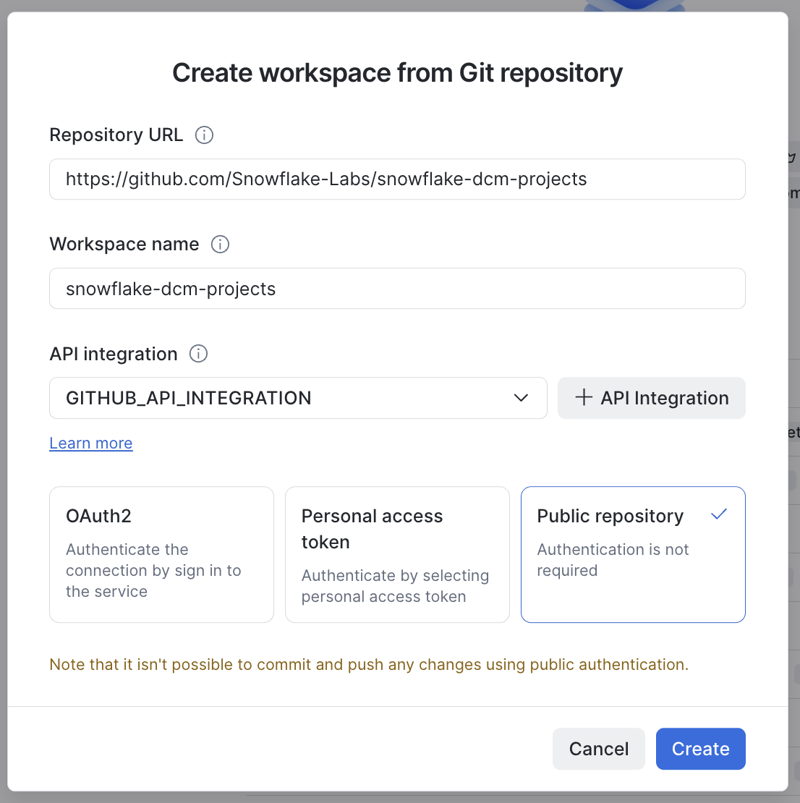
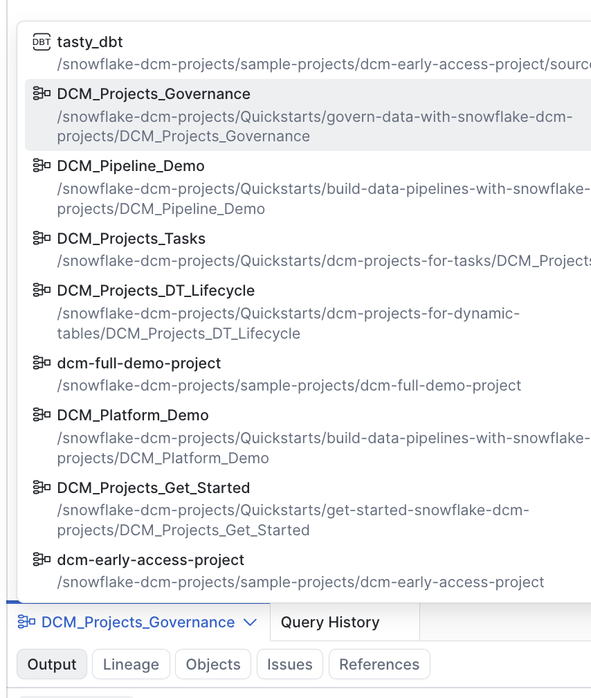
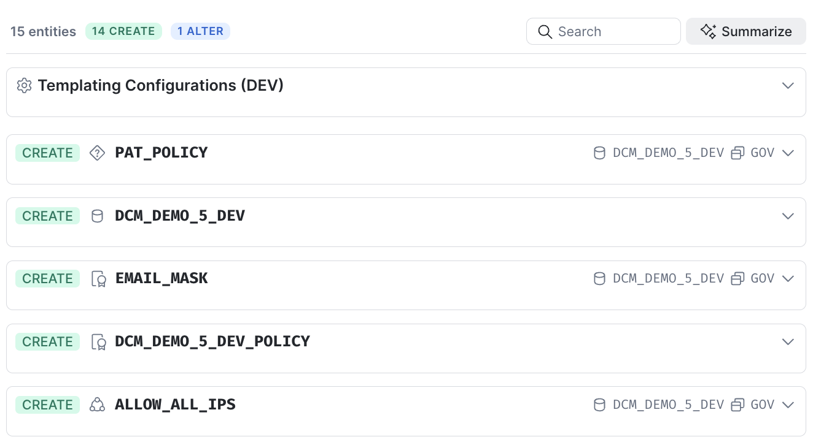
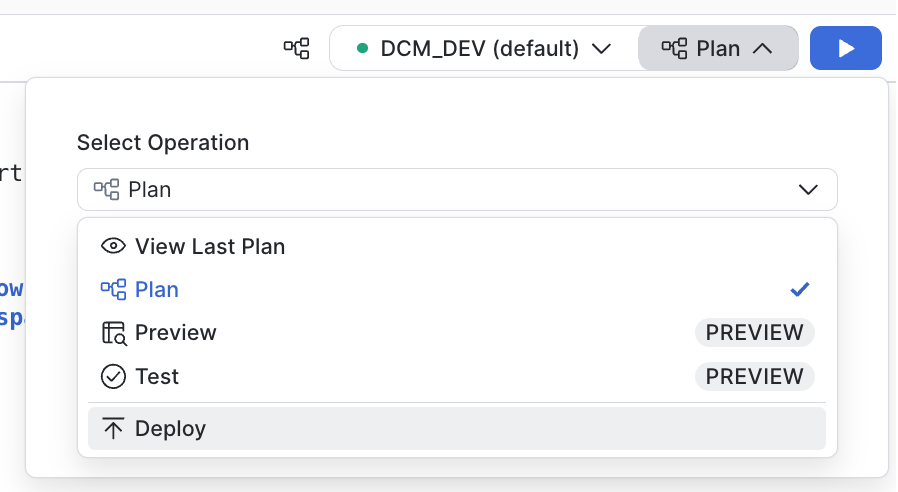
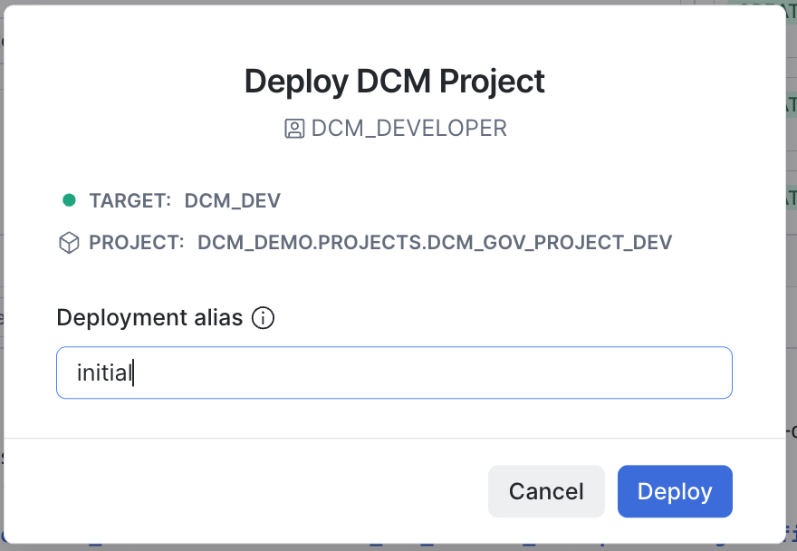
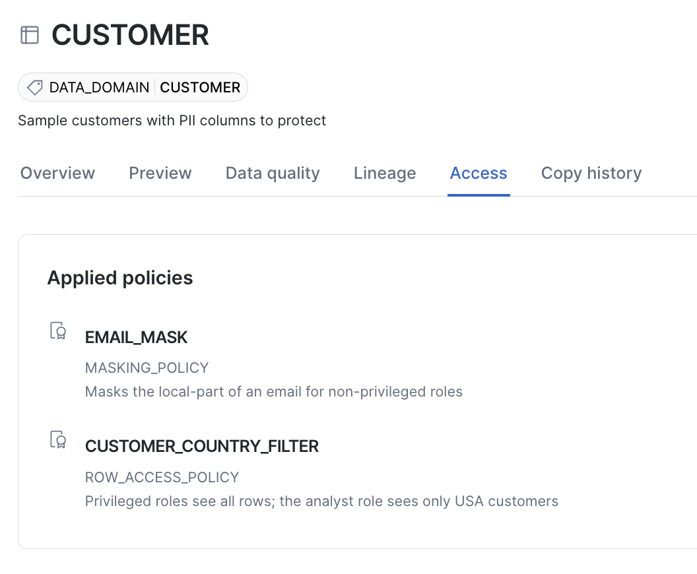

author: Yoav Ostrinsky
id: govern-data-with-snowflake-dcm-projects
summary: Learn how to manage Snowflake security and governance objects (tags, masking policies, a row access policy, and network and authentication policies) as code with DCM Projects.
categories: snowflake-site:taxonomy/solution-center/certification/quickstart, snowflake-site:taxonomy/product/platform, snowflake-site:taxonomy/product/data-engineering
environments: web
status: Published
language: en
feedback link: https://github.com/Snowflake-Labs/sfquickstarts/issues
fork repo link: https://github.com/Snowflake-Labs/snowflake-dcm-projects
tags: Getting Started, DCM, Governance, Data Engineering

# Govern Data with Snowflake DCM Projects

<!-- ------------------------ -->
## Overview

Security and governance objects, such as tags, masking policies, row access policies, and network and authentication policies, are some of the most important objects in a Snowflake account, and some of the easiest to let drift when they're created by hand. In this quickstart you'll manage them **as code** with Snowflake DCM Projects, so their full lifecycle (create, alter, drop) is version-controlled and reproducible across environments.

You'll build a small customer dataset containing PII, define its governance objects declaratively, and prove that a restricted role sees **masked emails** and a **filtered set of rows**. Then you'll change the row access policy in one line, redeploy, and watch the restricted role's result change, without touching anything by hand.

### What You'll Learn
- How to define tags and attach them to a table and a column with DCM
- How to define a masking policy and attach it to a column with ATTACH MASKING POLICY
- How to define a row access policy and attach it to a table with ATTACH ROW ACCESS POLICY
- How to define network and authentication policies as code, and set them on a dedicated demo user
- How a one-line policy change shows up in the plan as a single ALTER
- Which policy associations are still made in a post-deploy script

### Prerequisites
- Familiarity with DCM Projects basics: see [Get Started with Snowflake DCM Projects](https://www.snowflake.com/en/developers/guides/get-started-snowflake-dcm-projects/)

### What You'll Need
- A [Snowflake account](https://signup.snowflake.com/?utm_source=snowflake-devrel&utm_medium=developer-guides&utm_cta=developer-guides) with ACCOUNTADMIN access, for the one-time setup script
- (Optional) [Snowflake CLI](https://docs.snowflake.com/en/developer-guide/snowflake-cli/installation/installation) 3.24 or later, if you prefer a terminal to the Snowsight UI

### What You'll Build
- A customer table with PII, protected by a column masking policy and a row access policy that DCM attaches
- Two tags, a network rule and policy, and an authentication policy, all defined in one project
- A restricted analyst role whose view of the data you change by editing one line and redeploying

<!-- ------------------------ -->
## Create a Workspace from Git

If you want to work in Snowsight rather than locally, create a Snowsight Workspace linked to the sample repository on GitHub.

1. Navigate to **Projects > Workspaces** in Snowsight.
2. Click **Create** (+) and select **Git repository**.
3. Enter the repository URL: https://github.com/Snowflake-Labs/snowflake-dcm-projects
4. Select an API Integration for GitHub ([create one if needed](https://docs.snowflake.com/en/user-guide/ui-snowsight/workspaces-git#label-create-a-git-workspace)).
5. Select **Public repository**.



Once the workspace is created you will see the repository files in the file explorer. Navigate to **Quickstarts/govern-data-with-snowflake-dcm-projects** to find two directories.

DCM_Projects_Governance/ is the DCM Project itself. scripts/ holds numbered SQL files that you run in Snowsight worksheets at different stages of this guide. They live outside the project directory, so nothing in them is ever picked up by a plan.

| File | When to run |
|---|---|
| scripts/01_pre_deploy.sql | Once, before the first plan |
| scripts/02_guide_setup.sql | Once, after 01_pre_deploy.sql and before the first plan |
| scripts/03_post_deploy.sql | After the first successful deploy |
| scripts/04_verify_change.sql | After the second deploy |
| scripts/05_cleanup.sql | When you are finished |

Every operational step in this guide is given twice: once for Snowsight, and once for the [Snowflake CLI](https://docs.snowflake.com/en/developer-guide/snowflake-cli/installation/installation) if you would rather drive the project from a terminal against your own copy of the repository.

**With the Snowflake CLI:** clone the repository and work from the guide's folder. Run the snow dcm commands from inside DCM_Projects_Governance, and the snow sql commands from the guide's folder.

```bash
git clone https://github.com/Snowflake-Labs/snowflake-dcm-projects.git
cd snowflake-dcm-projects/Quickstarts/govern-data-with-snowflake-dcm-projects
```

<!-- ------------------------ -->
## Set Up Roles and Permissions

Run the first script. **In Snowsight:** open scripts/01_pre_deploy.sql in a worksheet and run it from top to bottom. **With the Snowflake CLI:**

```bash
snow sql -f scripts/01_pre_deploy.sql
```

The script is the same in every guide of this series. It runs as ACCOUNTADMIN and is safe to run again: if you already ran it for another guide, running it now changes nothing. It has six numbered sections.

**1. Role.** It creates the DCM_DEVELOPER role and grants it to you and to SYSADMIN. Every guide in this series uses this role as the project owner.

**2. Inherited grants opt-in.** It turns on inherited grants for the account.

**3. Account-level privileges.** A project cannot grant account-level privileges to its own owner, so they all happen here, before the first plan. DCM_DEVELOPER gets the privileges that the guides in this series need together, one grant per line, each with a comment naming the guide or feature that uses it. Some are checked at plan time, so a missing one fails the first plan rather than the deploy.

**4. Series container.** It creates the DCM_DEMO database and the DCM_DEMO.PROJECTS schema that holds the project objects of the series, and grants DCM_DEVELOPER USAGE on both and CREATE DCM PROJECT on the schema. A project cannot define the database or schema it lives in.

**5. Project object.** It creates this guide's DCM Project object, DCM_DEMO.PROJECTS.DCM_GOV_PROJECT_DEV, as DCM_DEVELOPER. This is the only section that differs between the guides of the series.

**6. Values for the manifest.** The last query returns your account identifier and user name.

When the script finishes, refresh your browser so the DCM control panel lists the new project object.

**Inherited grants.** An inherited grant covers current *and* future objects of a type inside a container. GRANT ON ALL snapshots what exists right now; GRANT ON FUTURE covers only what comes later. An inherited grant covers both, as one grant rather than one per object, which is why it is the recommended pattern in DCM Projects. It is a one-time opt-in per account ([release note](https://docs.snowflake.com/en/release-notes/2026/other/2026-09-10-inherited-grants-ga)), which the setup script turns on:

```sql
ALTER ACCOUNT SET FEATURE_RBAC_INHERITED_GRANTS = 'ENABLED';
```

An inherited grant cannot be combined with WITH GRANT OPTION, CASCADE or RESTRICT.

This project uses two of them, to let the analyst role read every table and view in the demo database.

The governance grants at the end of section 3 are there for this guide. Network policies are account-level objects, so creating one needs CREATE NETWORK POLICY, and setting an authentication policy on a user needs APPLY AUTHENTICATION POLICY. DCM_DEVELOPER owns the tags and policies it deploys and the table they protect, and ownership is enough for DCM to attach them, so the script grants no APPLY TAG or APPLY ROW ACCESS POLICY. APPLY MASKING POLICY is there for one statement: the post-deploy script sets a masking policy on a tag, which needs it at the account level.

> **Important: update the manifest before the first plan.** Copy ACCOUNT_IDENTIFIER from the last query of scripts/01_pre_deploy.sql into the account_identifier line of the DCM_DEV target in DCM_Projects_Governance/manifest.yml (line 11, marked "# update to your account names").

### Create the Demo Service User

Run the second script, still before the first plan. **In Snowsight:** open scripts/02_guide_setup.sql in a worksheet and run it. **With the Snowflake CLI:**

```bash
snow sql -f scripts/02_guide_setup.sql
```

As ACCOUNTADMIN, it creates DCM_DEMO_5_DEV_SVC, a service user, and makes DCM_DEVELOPER its owner. Users are account-level objects outside any DCM Project, and owning the user is what lets DCM_DEVELOPER set its network policy. The post-deploy script sets the demo network and authentication policies on this user. The script is safe to run again.

**Set the demo policies only on this service user.** Don't set them on your own user or on the account: a network policy set at the account level applies to every user and can lock you out.

<!-- ------------------------ -->
## Explore the Project Files

Open the DCM_Projects_Governance/sources/definitions/ folder:

- **infrastructure.sql**: warehouse, the DCM_DEMO_5 database, PUBLIC, RAW and GOV schemas, a restricted ANALYST role, and its grants
- **raw.sql**: a CUSTOMER table with PII columns (email, phone, city)
- **governance.sql**: tags, a masking policy, a row access policy, a network rule and policy, an authentication policy, and the statements that attach them

The warehouse in infrastructure.sql runs the queries in the post-deploy and verify scripts, for both roles. The analyst role needs some warehouse to query at all. Defining one in the project means you don't grant your own warehouse to a demo role, and PURGE removes it with everything else. The scripts select it with USE WAREHOUSE after every USE ROLE.

The heart of the demo is governance.sql. DCM manages the **definitions** of every object below, and also attaches the tags, the masking policy and the row access policy.

> Attaching masking and row access policies with ATTACH MASKING POLICY and ATTACH ROW ACCESS POLICY in a DCM project is in Public Preview.

Tags and a masking policy:

```sql
DEFINE TAG DCM_DEMO_5{{env_suffix}}.GOV.PII
    ALLOWED_VALUES 'PII'
    COMMENT = 'Marks columns that contain personally identifiable information';

DEFINE MASKING POLICY DCM_DEMO_5{{env_suffix}}.GOV.EMAIL_MASK
    AS (VAL STRING) RETURNS STRING ->
    CASE
        WHEN CURRENT_ROLE() IN ('ACCOUNTADMIN', 'DCM_DEVELOPER') THEN VAL
        ELSE REGEXP_REPLACE(VAL, '.+\\@', '*****@')
    END
    COMMENT = 'Masks the local-part of an email for non-privileged roles';
```

Both policies test CURRENT_ROLE(), the primary role of the session, so the result depends only on the role you switch to with USE ROLE.

A row access policy for row-level security:

```sql
DEFINE ROW ACCESS POLICY DCM_DEMO_5{{env_suffix}}.GOV.CUSTOMER_COUNTRY_FILTER
    AS (COUNTRY VARCHAR) RETURNS BOOLEAN ->
    CASE
        WHEN CURRENT_ROLE() IN ('ACCOUNTADMIN', 'DCM_DEVELOPER') THEN TRUE
        WHEN CURRENT_ROLE() = 'DCM_DEMO_5{{env_suffix}}_ANALYST' AND COUNTRY = 'USA' THEN TRUE
        ELSE FALSE
    END
    COMMENT = 'Privileged roles see all rows; the analyst role sees only USA customers';
```

Take note of the analyst line: it allows only USA customers. You'll change it later in this guide.

The EMAIL column is tagged as PII, and DCM reconciles the tag on every deploy:

```sql
ATTACH TAG DCM_DEMO_5{{env_suffix}}.GOV.PII = 'PII'
    TO TABLE DCM_DEMO_5{{env_suffix}}.RAW.CUSTOMER
        COLUMN EMAIL;
```

The masking policy is attached to the same column, and the row access policy to the table:

```sql
ATTACH MASKING POLICY DCM_DEMO_5{{env_suffix}}.GOV.EMAIL_MASK
    TO TABLE DCM_DEMO_5{{env_suffix}}.RAW.CUSTOMER
        COLUMN EMAIL;

ATTACH ROW ACCESS POLICY DCM_DEMO_5{{env_suffix}}.GOV.CUSTOMER_COUNTRY_FILTER
    TO TABLE DCM_DEMO_5{{env_suffix}}.RAW.CUSTOMER ON (COUNTRY);
```

DCM applies the masking policy with the FORCE option, so it replaces a masking policy attached to EMAIL outside DCM. If you remove the statement, DCM detaches the policy on the next deployment, and if another DCM project already manages that column's masking policy, the deployment fails.

A table has at most one row access policy, and the row access policy attachment behaves the same way. If a row access policy was attached outside DCM, the plan shows an ALTER on the table that replaces it. If you remove the statement, the next plan unsets the policy on the table. If another DCM project already manages the table's row access policy, that project's plan fails with an error naming the project that manages it.

governance.sql also defines a network rule and policy and an authentication policy. DCM creates them, and the post-deploy script sets both on the demo service user, so account-security objects are version-controlled too.

Two kinds of association are still made outside DCM, in 03_post_deploy.sql. DCM owns the tag and policy definitions in both cases:

- **Tag-based masking:** setting a masking policy on a tag, with ALTER TAG.
- **Network and authentication policies on a user or the account:** setting them with ALTER USER or ALTER ACCOUNT.

<!-- ------------------------ -->
## Plan and Deploy

**In Snowsight:** the DCM control panel is the first tab in the bottom panel of your workspace. Select the project **govern-data-with-snowflake-dcm-projects/DCM_Projects_Governance**. On the right side of the same bar, select the **DCM_DEV** target and click the play button to the right of **Plan**.



**With the Snowflake CLI:** pass the manifest's owner role for the target with --role.

```bash
snow dcm plan --target DCM_DEV --role DCM_DEVELOPER --save-output
```

The plan lists 15 entities: 14 to create and 1 to alter. The creates are the warehouse, the database and its three schemas (RAW, GOV and PUBLIC), the CUSTOMER table, both tags, the masking and row access policies, the network rule and policy, the authentication policy and the analyst role. The CUSTOMER table's entry includes the row access policy being set, and its EMAIL column the masking policy. The single alter is DCM_DEVELOPER itself, which gains ownership of everything the project creates.



When the changeset matches what you expected, deploy it.

**In Snowsight:** in the DCM control panel, set the operation to **Deploy** instead of **Plan**, add a deployment alias such as initial, and run it.





**With the Snowflake CLI:**

```bash
snow dcm deploy --target DCM_DEV --role DCM_DEVELOPER --alias initial
```

After the deployment, open the CUSTOMER table in the catalog and select the **Access** tab. Both policies DCM attached are listed:



<!-- ------------------------ -->
## Apply Governance and Load Data

Open scripts/03_post_deploy.sql and run it as DCM_DEVELOPER. It seeds sample PII data, makes the two associations that DCM doesn't make, and grants you the restricted analyst role. The masking and row access policies are already in force: DCM attached them during the deployment.

Every USE ROLE in the script is followed by USE WAREHOUSE, selecting the warehouse the project just created. Your user's default warehouse is usually not granted to these roles, so right after USE ROLE no warehouse is active and the first query would fail.

### 1. Seed Sample Customer Data

The script empties CUSTOMER with TRUNCATE TABLE, then inserts five customers across the USA, the UK and Italy. The script is safe to re-run: it leaves the same five rows, uses FORCE when it sets the tag's masking policy, and unsets the user's authentication policy before setting it again.

### 2. Tag-Based Masking

```sql
ALTER TAG DCM_DEMO_5_DEV.GOV.PII SET MASKING POLICY DCM_DEMO_5_DEV.GOV.EMAIL_MASK FORCE;
```

Any column you tag GOV.PII later is now masked by EMAIL_MASK too. EMAIL now has the same policy twice, attached directly and through the tag; when the two differ, the [directly assigned masking policy takes precedence](https://docs.snowflake.com/en/user-guide/tag-based-masking-policies). The demo uses one policy both ways, so you won't see a difference here.

### 3. Set the Network and Authentication Policies on the Demo User

```sql
ALTER USER DCM_DEMO_5_DEV_SVC SET NETWORK_POLICY = DCM_DEMO_5_DEV_POLICY;
ALTER USER DCM_DEMO_5_DEV_SVC UNSET AUTHENTICATION POLICY;
ALTER USER DCM_DEMO_5_DEV_SVC SET AUTHENTICATION POLICY DCM_DEMO_5_DEV.GOV.PAT_POLICY;
```

The script then confirms that both policies are set on the service user:

```sql
SELECT POLICY_NAME, POLICY_KIND, REF_ENTITY_NAME
    FROM TABLE(DCM_DEMO_5_DEV.INFORMATION_SCHEMA.POLICY_REFERENCES(
        REF_ENTITY_NAME => 'DCM_DEMO_5_DEV_SVC', REF_ENTITY_DOMAIN => 'USER'));
```

| POLICY_NAME | POLICY_KIND | REF_ENTITY_NAME |
|:--|:--|:--|
| PAT_POLICY | AUTHENTICATION_POLICY | DCM_DEMO_5_DEV_SVC |
| DCM_DEMO_5_DEV_POLICY | NETWORK_POLICY | DCM_DEMO_5_DEV_SVC |

To enforce a network policy for every user, a role with the global ATTACH POLICY privilege runs ALTER ACCOUNT SET NETWORK_POLICY; the same applies to ALTER ACCOUNT SET AUTHENTICATION POLICY with APPLY AUTHENTICATION POLICY. This quickstart doesn't do that, because an account-level network policy can lock users out of the account.

### 4. Grant the Analyst Role

```sql
GRANT ROLE DCM_DEMO_5_DEV_ANALYST TO USER IDENTIFIER($USER_NAME);
```

<!-- ------------------------ -->
## Verify Masking by Role

The script ends with the same query run twice. As the privileged DCM_DEVELOPER role, you see every row with clear emails:

```sql
USE ROLE DCM_DEVELOPER;
USE WAREHOUSE DCM_DEMO_5_WH_DEV;
SELECT CUSTOMER_ID, FIRST_NAME, EMAIL, COUNTRY FROM DCM_DEMO_5_DEV.RAW.CUSTOMER ORDER BY CUSTOMER_ID;
```

| CUSTOMER_ID | FIRST_NAME | EMAIL | COUNTRY |
|:--|:--|:--|:--|
| 1 | Alice | alice.johnson@example.com | USA |
| 2 | Bob | bob.smith@example.com | USA |
| 3 | Chloe | chloe.martin@example.co.uk | UK |
| 4 | David | david.nguyen@example.com | USA |
| 5 | Elena | elena.rossi@example.it | Italy |

Then as the restricted analyst role:

```sql
USE ROLE DCM_DEMO_5_DEV_ANALYST;
USE WAREHOUSE DCM_DEMO_5_WH_DEV;
SELECT CUSTOMER_ID, FIRST_NAME, EMAIL, COUNTRY FROM DCM_DEMO_5_DEV.RAW.CUSTOMER ORDER BY CUSTOMER_ID;
```

| CUSTOMER_ID | FIRST_NAME | EMAIL | COUNTRY |
|:--|:--|:--|:--|
| 1 | Alice | *****@example.com | USA |
| 2 | Bob | *****@example.com | USA |
| 4 | David | *****@example.com | USA |

The analyst sees **only USA rows**, because the row access policy filtered out the UK and Italy customers, and **masked emails**, because of the masking policy on EMAIL. Both policies, and both attachments, are managed by DCM as code.

<!-- ------------------------ -->
## Change It and Redeploy

The analytics team now covers the UK as well as the USA, so the analyst role needs to see UK customers. In a hand-managed account that means someone runs an ALTER on the policy and nobody records it. Here you change the definition and let DCM work out the difference.

### Edit the Row Access Policy

Open DCM_Projects_Governance/sources/definitions/governance.sql and change the analyst line of the CUSTOMER_COUNTRY_FILTER row access policy:

| | Analyst line |
|:--|:--|
| Before | WHEN CURRENT_ROLE() = 'DCM_DEMO_5{{env_suffix}}_ANALYST' AND COUNTRY = 'USA' THEN TRUE |
| After | WHEN CURRENT_ROLE() = 'DCM_DEMO_5{{env_suffix}}_ANALYST' AND COUNTRY IN ('USA', 'UK') THEN TRUE |

Nothing else changes: the policy name, its signature and its attachment to CUSTOMER stay the same.

### Plan the Change

**In Snowsight:** in the DCM control panel, select the project **govern-data-with-snowflake-dcm-projects/DCM_Projects_Governance** and the **DCM_DEV** target, then click the play button to the right of **Plan**.

**With the Snowflake CLI:**

```bash
snow dcm plan --target DCM_DEV --role DCM_DEVELOPER --save-output
```

Instead of fourteen creates, the plan now holds a single entity: an ALTER on CUSTOMER_COUNTRY_FILTER that changes its body from COUNTRY = 'USA' to COUNTRY IN ('USA', 'UK'). DCM compared the definition with what is deployed and found exactly one difference.

When the changeset matches what you expected, deploy it.

**In Snowsight:** in the DCM control panel, set the operation to **Deploy** instead of **Plan**, add a deployment alias such as widen-to-uk, and run it.

**With the Snowflake CLI:**

```bash
snow dcm deploy --target DCM_DEV --role DCM_DEVELOPER --alias widen-to-uk
```

### Verify as the Analyst

Open scripts/04_verify_change.sql and run it. There is nothing to refresh: a row access policy is evaluated when the query runs, so the next query already sees the new body.

```sql
USE ROLE DCM_DEMO_5_DEV_ANALYST;
USE WAREHOUSE DCM_DEMO_5_WH_DEV;
SELECT CUSTOMER_ID, FIRST_NAME, EMAIL, COUNTRY FROM DCM_DEMO_5_DEV.RAW.CUSTOMER ORDER BY CUSTOMER_ID;
```

| CUSTOMER_ID | FIRST_NAME | EMAIL | COUNTRY |
|:--|:--|:--|:--|
| 1 | Alice | *****@example.com | USA |
| 2 | Bob | *****@example.com | USA |
| 3 | Chloe | *****@example.co.uk | UK |
| 4 | David | *****@example.com | USA |

Chloe now appears, and her email is still masked: the row access policy changed, the masking policy did not. The script's last statement, DESCRIBE ROW ACCESS POLICY, shows the deployed body with the new IN list.

<!-- ------------------------ -->
## Clean Up

Before tearing anything down, know that there is a gentler option. DROP DCM PROJECT on its own, without a PURGE first, removes the project and its deployment history and leaves every entity, grant and attachment in place as an ordinary unmanaged object. To release a single entity, call SYSTEM$UNMANAGE_ENTITY_FROM_DCM_PROJECT with its type and name; to release grants or attachments, pass the rendered statements to SYSTEM$UNMANAGE_FROM_DCM_PROJECT. Then remove the matching statements from your definitions, or the next deploy takes them back.

When you're done, open scripts/05_cleanup.sql and run it as DCM_DEVELOPER. In order, it:

1. **Remove the associations made outside DCM.** The post-deploy script made these with ALTER statements, so PURGE doesn't know about them. A network policy can't be dropped while it is set on a user, and PURGE fails on a masking policy that is still set on a tag, so they go first.

    ```sql
    ALTER USER IF EXISTS DCM_DEMO_5_DEV_SVC UNSET NETWORK_POLICY;
    ALTER USER IF EXISTS DCM_DEMO_5_DEV_SVC UNSET AUTHENTICATION POLICY;
    ALTER TAG IF EXISTS DCM_DEMO_5_DEV.GOV.PII UNSET MASKING POLICY DCM_DEMO_5_DEV.GOV.EMAIL_MASK;
    ```

2. **Purge the project.** PURGE drops every entity the project manages (database, schemas, table, tags, masking and row access policies, network rule and policy, authentication policy, warehouse, the analyst role and all their data), revokes its grants and removes its attachments. It is irreversible and not transactional: if it fails, some objects may already be gone. The known cause in this guide is a masking policy still set on a tag; re-run section 1, then re-run PURGE.

    ```sql
    EXECUTE DCM PROJECT DCM_DEMO.PROJECTS.DCM_GOV_PROJECT_DEV PURGE;
    ```

3. **Drop the project object**, which PURGE leaves behind.

    ```sql
    DROP DCM PROJECT IF EXISTS DCM_DEMO.PROJECTS.DCM_GOV_PROJECT_DEV;
    ```

4. **Objects created outside the project.** The demo service user lives outside the project, so PURGE does not touch it; the script drops it.

    ```sql
    DROP USER IF EXISTS DCM_DEMO_5_DEV_SVC;
    ```

5. **Series-shared objects, left commented.** The DCM_DEMO database, its PROJECTS schema and the DCM_DEVELOPER role are shared by every guide in this series, so the script leaves them in place, commented out, with the drops running as ACCOUNTADMIN, which owns the container. Check what the schema still holds before you drop anything:

    ```sql
    SHOW DCM PROJECTS IN SCHEMA DCM_DEMO.PROJECTS;
    -- USE ROLE ACCOUNTADMIN;
    -- DROP SCHEMA IF EXISTS DCM_DEMO.PROJECTS;
    -- DROP DATABASE IF EXISTS DCM_DEMO;
    -- DROP ROLE IF EXISTS DCM_DEVELOPER;
    ```

6. **Inherited grants, left commented.** The account parameter is account-wide and the other guides need it. The script carries the commented-out line to turn it off:

    ```sql
    -- ALTER ACCOUNT SET FEATURE_RBAC_INHERITED_GRANTS = 'DISABLED';
    ```

7. **Verify.** The script ends with four SHOW statements. The first three, for the database, the warehouse and the service user, come back empty. The project list no longer contains DCM_GOV_PROJECT_DEV, but still lists the projects of any other guide in this series you ran. If PURGE fails, there is nothing scheduled to suspend first: this guide defines no tasks, alerts or dynamic tables.

<!-- ------------------------ -->
## Conclusion And Resources

You managed a full set of Snowflake governance objects as code with DCM Projects, proved that a restricted role is held back by both column masking and row-level security, and changed what that role sees with a one-line edit that the plan reported as a single ALTER.

### What You Learned
- Defining tags, a masking policy, a row access policy, and network and authentication policies with DCM
- Attaching the masking and row access policies with ATTACH MASKING POLICY and ATTACH ROW ACCESS POLICY
- Changing a policy body in a definition and deploying it as a single ALTER
- Setting network and authentication policies on a dedicated user instead of the account
- Which associations still live in a post-deploy script, and how to clean them up before PURGE

### What's Next
- Write a masking policy for PHONE and attach it with ATTACH MASKING POLICY
- Add a DCM_PROD target with its own deployer role and promote the same definitions
- [Get Started with Snowflake DCM Projects](https://www.snowflake.com/en/developers/guides/get-started-snowflake-dcm-projects/)
- [DCM Projects for Dynamic Tables](https://www.snowflake.com/en/developers/guides/dcm-projects-for-dynamic-tables/)
- [Build Data Pipelines with Snowflake DCM Projects](https://www.snowflake.com/en/developers/guides/build-data-pipelines-with-snowflake-dcm-projects/)
- [DCM Projects for Tasks](https://www.snowflake.com/en/developers/guides/dcm-projects-for-tasks/)

### Related Resources
- [Managing DCM Projects](https://docs.snowflake.com/en/user-guide/dcm-projects/dcm-projects-overview)
- [DCM Projects supported entities](https://docs.snowflake.com/en/user-guide/dcm-projects/dcm-projects-supported-entities)
- [Column-level security (masking policies)](https://docs.snowflake.com/en/user-guide/security-column-intro)
- [Row access policies](https://docs.snowflake.com/en/user-guide/security-row-intro)
- [Object tagging](https://docs.snowflake.com/en/user-guide/object-tagging)
