author: Kevin Nguyen
id: messy-data-to-instant-answers
categories: snowflake-site:taxonomy/solution-center/certification/quickstart, snowflake-site:taxonomy/product/ai, snowflake-site:taxonomy/product/analytics, snowflake-site:taxonomy/feature/cortex-ai, snowflake-site:taxonomy/feature/cortex-analyst, snowflake-site:taxonomy/feature/cortex-search, snowflake-site:taxonomy/feature/semantic-views, snowflake-site:taxonomy/feature/notebooks, snowflake-site:taxonomy/use-case/data-transformation, snowflake-site:taxonomy/use-case/business-intelligence
language: en
summary: Watch an AI agent give a confident wrong answer over messy online-store return data, then fix the data with Snowflake CoCo, translate and tag multilingual customer comments with AI functions, and ask again in Snowflake CoWork to get numbers backed by customer quotes.
environments: web
status: Published
feedback link: https://github.com/Snowflake-Labs/sfguides/issues

# From Messy Data to Instant Answers with Snowflake CoCo and CoWork

<!-- ------------------------ -->

## Overview

Pointing an AI agent at your data is easy. Getting an answer you can trust is not, because real data arrives in different formats, uses different names for the same thing, and sometimes contradicts itself.

In this lab you're the data engineer for **Northwind Outfitters**, an online store that sells shoes, clothing, accessories, and home goods in the US, Canada, and Europe. Leadership asks:

> Which products are customers returning most, and why?

You'll start by asking an agent that question over the raw data, and you'll get a quick, confident answer. Then a colleague's reply will make you doubt it, and you'll use **Snowflake CoCo** to find out why it's wrong and fix what "a return" means, use **AI_TRANSLATE** and **AI_CLASSIFY** to turn multilingual customer comments into something you can count, and build a **Cortex Search** service over those comments. Finally, in Snowsight, you'll define your business terms in a **semantic view**, give an agent both the numbers (**Cortex Analyst**) and the customers' own words (**Cortex Search**), and ask in **Snowflake CoWork** to get the real answer, with charts and customer quotes. To finish, the agent turns that answer into a polished HTML report you can share.

### What You'll Learn
- Why an agent over raw data can be confidently wrong, and how to spot it
- How to use CoCo prompts to write transformation SQL, and how to review that SQL before running it
- How to translate and classify free-text comments with `AI_TRANSLATE` and `AI_CLASSIFY`
- How Cortex Search finds text by meaning, in any language
- How a semantic view and verified queries give Cortex Analyst one definition of each business term
- How an agent combines Cortex Analyst and Cortex Search to answer with numbers and evidence

### What You'll Build
- Raw tables loaded from CSV and JSON files, kept exactly as received
- `CURATED.ORDER_LINE_RETURNS`, one row per order line with a trusted return flag
- `CURATED.RETURN_REVIEW`, the same table plus translated comments and an AI-tagged return reason
- `ANALYTICS.RETURN_COMMENTS_SEARCH`, a Cortex Search service over the comments
- `ANALYTICS.RETURNS_SV`, a semantic view with metrics and verified queries
- `ANALYTICS.RETURNS_AGENT`, a Cortex Agent you first point at the raw data, then fix to use both tools and query from CoWork
- A one-page HTML report on the footwear returns problem, built by the agent in CoWork

### Prerequisites
- A [Snowflake account](https://signup.snowflake.com/). If you sign up for a trial, choose **AWS** and **US East (Ohio)**.
- The ACCOUNTADMIN role (trial users have it by default) and the `COMPUTE_WH` warehouse
- The lab's GitHub repository, [github.com/Snowflake-Labs/sfguide-messy-data-to-instant-answers](https://github.com/Snowflake-Labs/sfguide-messy-data-to-instant-answers). You'll clone it in the next section.
- Clean-up at the end (STEP 11) is up to you. The search service keeps a small amount of compute running until you drop it.

The data is 2,000 order lines: big enough that you can't eyeball the answer, small enough that every step runs in seconds. The same steps work unchanged on millions of rows.

You'll see a lot of SQL. You don't need to understand every line: CoCo writes it, and each step ends with a check that tells you whether the numbers are right.

<!-- ------------------------ -->

## STEP 1: Set Up the Workspace

There are no setup scripts to run first. Your first action is to create a **Git-backed Workspace** that clones the lab repo. It contains the notebook you'll run (`lab.ipynb`) and the three data files (`data/`).

### Create a Git-backed Workspace

1. In Snowsight, navigate to **Projects » Workspaces**.
2. Click the **+** icon next to **Workspaces/Databases** → **Create new Git workspace**.

   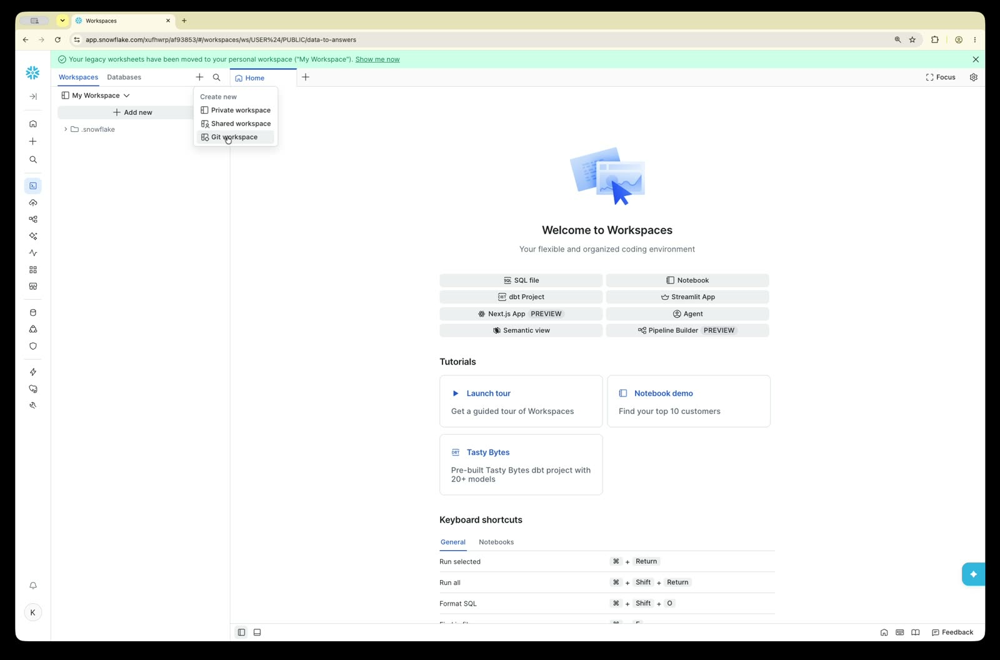

3. Fill in:
   - **Repository URL:** `https://github.com/Snowflake-Labs/sfguide-messy-data-to-instant-answers`
   - **Workspace name:** `messy-data-to-answers`
   - **API integration:** click **+ / Create new** and provide:
     - **Name:** `GITHUB_RETURNS_LAB`
     - **Allowed prefixes:** `https://github.com/Snowflake-Labs`
   - Check **Public repository**.
4. Click **Create**.


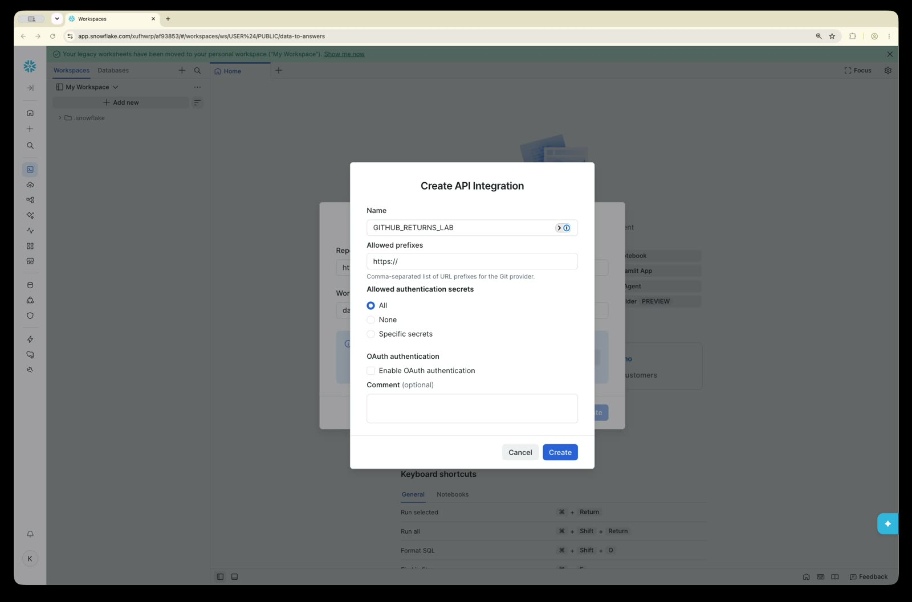


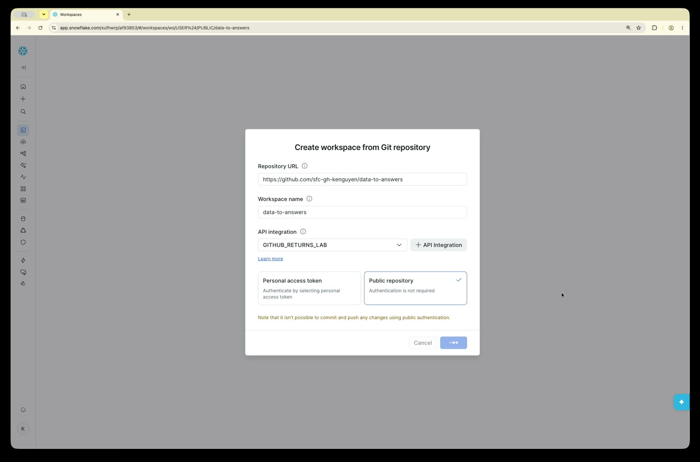

> **What just happened?** The Workspace dialog created a Git API integration for you, a one-time step that tells Snowflake which GitHub account is an allowed source for Git-backed Workspaces.

The Workspace opens with the repo's files in the file explorer on the left. Check that you see `lab.ipynb` and a `data/` folder with three files.

From here on, each step matches a step in the notebook, with the same number and title. The notebook has the same instructions, so you can follow along from either one.

### Open the notebook, connect, and run setup

You created this workspace from the lab's GitHub repo in the guide. You'll work in this notebook through STEP 7, then finish the lab in Snowsight.

1. Open **`lab.ipynb`** from the file explorer on the left, if it isn't open already.
2. Click **Connect** next to the Run button and select **Create and connect**.

   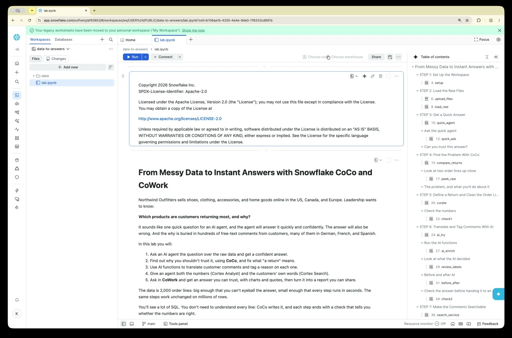

3. Wait for the status bar at the bottom of the notebook to show **Connected**. The first connection can take a few minutes while Snowflake starts the notebook's compute; read the rest of this step and STEP 2 while you wait. If it's still stuck (for example at 99%) after about 5 minutes, refresh the browser tab.

   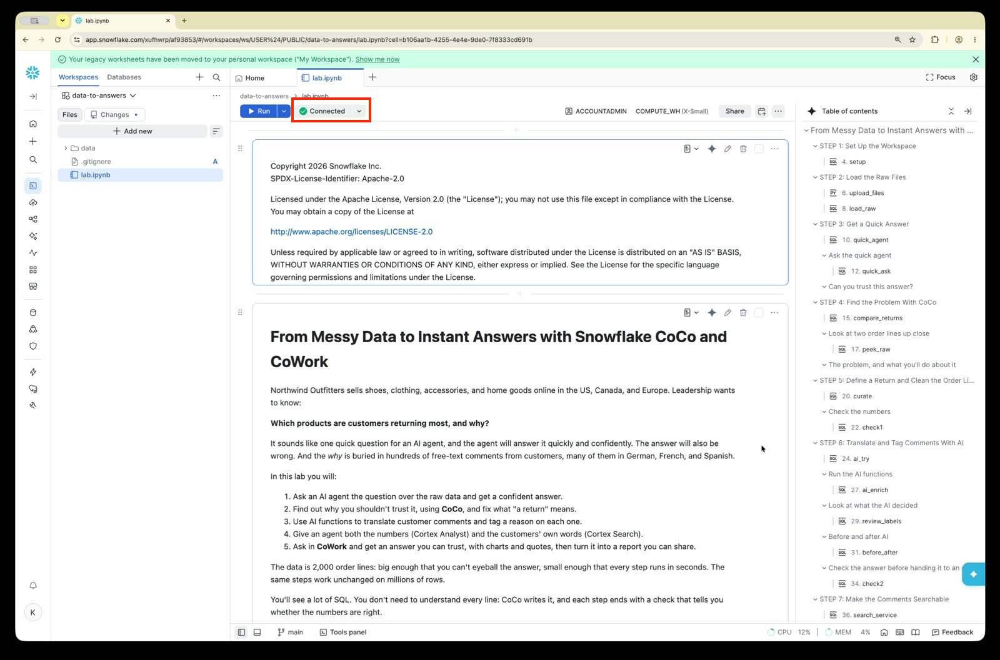


Run each cell when the instructions reach it, with **Run** on the cell or **Shift+Enter**. Every object in this lab uses a fully qualified name, so you don't need to pick a database or schema.

Now run the **`setup`** cell. It creates the lab database `ONLINE_RETURNS` with three schemas and a stage:

| Schema | Holds |
|---|---|
| `RAW` | Files exactly as received |
| `CURATED` | Cleaned tables, one row per order line |
| `ANALYTICS` | The semantic views, search service, and agents |

<!-- ------------------------ -->

## STEP 2: Load the Raw Files

Before you can fix the data, you need it in Snowflake exactly as the source systems sent it. Keeping an untouched copy means you can always check a cleaned number against the original.

The repo's `data/` folder has three files:

| File | What it is |
|---|---|
| `orders.csv` | The store's order export: 2,000 order lines, one row per item bought. Each row has the category, region, price, order date, and the store system's `order_status`. |
| `return_events.json` | The log of each return as it moves along: requested in the returns portal, received or rejected by the warehouse, and refunded or exchanged by customer support. Each step is one event with a timestamp and the system that logged it, 1,900 events in all. |
| `return_comments.json` | What customers typed in the returns portal about why they're sending the item back: 775 comments, about a third of them in German, French, or Spanish. |

Run the **`upload_files`** cell. It finds each file in your workspace and copies it, unchanged, to the stage `ONLINE_RETURNS.RAW.LAB_FILES`. You should see three `Uploaded` lines.

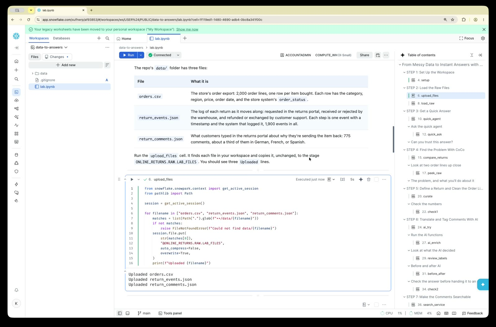


Now run the **`load_raw`** cell. It creates three raw tables and copies each file from the stage into one of them:

- `RAW.ORDERS` has one column per CSV field, and **every column is text** on purpose. Prices like `$1,049.00` and dates in four formats stay exactly as they arrived, so nothing gets lost or silently converted.
- `RAW.RETURN_EVENTS` and `RAW.RETURN_COMMENTS` each hold their whole JSON file in a single `VARIANT` column called `payload`. You'll unpack it with `FLATTEN` later.

The last query counts what landed. Expect **2,000** order lines, **1,900** return events, and **775** comments, matching the file descriptions above.

<!-- ------------------------ -->

## STEP 3: Get a Quick Answer

The fastest thing you could do is point an AI agent straight at the order export and ask. Run the **`quick_agent`** cell. It creates two objects:

- `QUICK_RETURNS_SV`, a **semantic view** that tells AI what the export's columns mean. This one counts a line as returned whenever the export's `order_status` says `returned`.
- `RETURNS_AGENT`, an **agent** that answers questions by writing SQL against that semantic view.

This is a first attempt on purpose. In STEP 8 you'll build a better semantic view, and in STEP 9 you'll edit this same agent to use it.

### Ask the quick agent

Run the **`quick_ask`** cell. It sends the agent this question and prints the answer:

*"Which product categories have the highest and lowest return rate?"*

You should get an answer like: Apparel has the highest return rate, at about **45%**, and Footwear the lowest, at about **14%**. The agent may even merge the messy category spellings for you. It sounds confident, and it's a clean, simple answer.


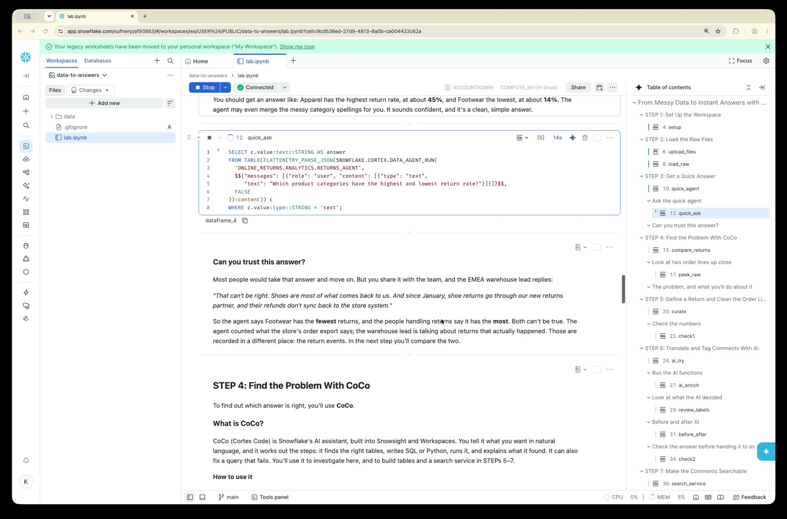

### Can you trust this answer?

Most people would take that answer and move on. But you share it with the team, and the EMEA warehouse lead replies:

*"That can't be right. Shoes are most of what comes back to us. And since January, shoe returns go through our new returns partner, and their refunds don't sync back to the store system."*

So the agent says Footwear has the **fewest** returns, and the people handling returns say it has the **most**. Both can't be true. The agent counted what the store's order export says; the warehouse lead is talking about returns that actually happened. Those are recorded in a different place: the return events. In the next step you'll compare the two.

<!-- ------------------------ -->

## STEP 4: Find the Problem With CoCo

To find out which answer is right, you'll use **CoCo**.

### What is CoCo?

CoCo (Cortex Code) is Snowflake's AI assistant, built into Snowsight and Workspaces. You tell it what you want in natural language, and it works out the steps: it finds the right tables, writes SQL or Python, runs it, and explains what it found. It can also fix a query that fails. You'll use it to investigate here, and to build tables and a search service in STEPs 5–7.

**How to use it**

- Click on the blue **CoCo** icon in the bottom right hand corner of your browser and type a request in the message box.
- Name the tables you care about, or type `@` to add a table, schema, or file to the conversation.
- Before CoCo runs anything, it shows you what it plans to do and asks for approval. You can allow that one call, allow that tool for the rest of the chat, or ask for changes instead.
- When CoCo edits a file, it shows the change side by side before it's applied.

**Why use it here**

Comparing two records means exploring unfamiliar tables, matching up different spellings, and writing joins. CoCo does that legwork in a minute, so you can spend your time deciding whether the answer makes sense.

**Why you can trust it**

- **It works under your role.** CoCo can only see and change what your role is allowed to. Snowflake's access controls and policies apply to everything it runs.
- **You approve what runs.** By default, CoCo asks before each step, and you can read the SQL first.
- **It uses your account's real context.** It reads your table and column details and Snowflake's documentation, so it isn't guessing about your data.
- **You can check its work.** Every result in this lab has an expected answer to compare against.

**Note:** CoCo and the agents phrase things differently every time. Don't compare wording; compare the numbers.

### Compare reported and completed returns

Click on the blue **CoCo** icon and send this prompt. It includes what the warehouse lead told you, so CoCo knows what to look for:

**CoCo prompt:** *"The warehouse lead says shoe returns moved to a new returns partner in January, and their refunds don't sync back to the store system. Check this. Compare ONLINE_RETURNS.RAW.ORDERS with the return events in ONLINE_RETURNS.RAW.RETURN_EVENTS. For each product category, show reported_returns (lines whose order_status says returned) and completed_returns (lines whose latest return event is a refund or an exchange). Group the different category spellings together. Don't change any data."*

**What this prompt asks for**

| Part of the prompt | Why it's there |
|---|---|
| "The warehouse lead says…" | Gives CoCo the business context, so it can tell you whether the data backs it up |
| "Compare `ONLINE_RETURNS.RAW.ORDERS` with … `RAW.RETURN_EVENTS`" | Names the exact tables, so CoCo doesn't have to guess which data you mean |
| `reported_returns` and `completed_returns`, with definitions | Says exactly what each number counts. Without them, "returned" could mean several things. |
| "Group the different category spellings together" | The export spells each category several ways (Footwear is also `Shoes`, `FOOTWEAR`, and `footwear`) |
| "Don't change any data" | Sets a limit: this step only looks, it doesn't build anything |

The two columns come from two different places:

- **`reported_returns`** counts order lines where the export's `order_status` is `returned`, in any capitalization. This is what the quick agent counted.
- **`completed_returns`** finds each order line's **latest** return event and counts it if that event is a refund or an exchange. A return that was only requested, or that the warehouse rejected, doesn't count.


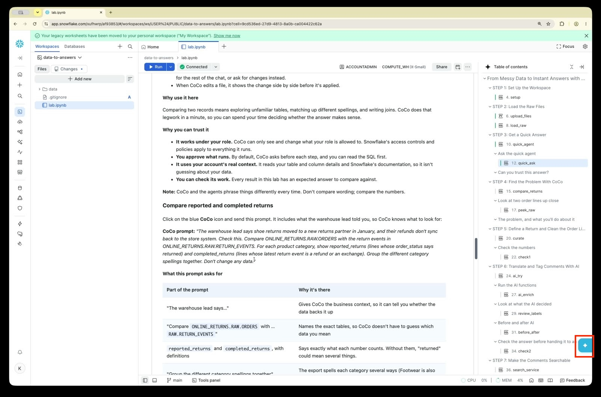


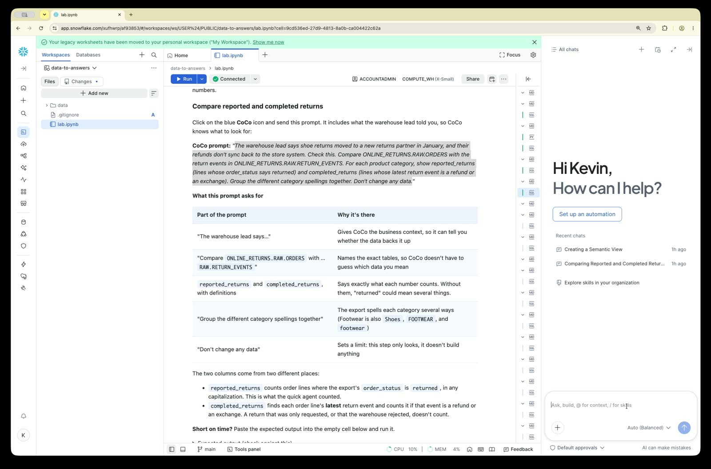

> **Short on time?** Every CoCo prompt in this lab that builds something has its expected SQL in the notebook, right under the prompt. Paste it into the empty cell below the prompt and run it.

Expected result:

| category | reported_returns | completed_returns |
|---|---:|---:|
| Accessories | 125 | 75 |
| Apparel | 250 | 150 |
| Footwear | **75** | **200** |
| Home | 125 | 75 |

The warehouse lead was right. The export reports **75** Footwear returns, but **200** were completed. That's why the quick agent called Footwear the best category. In every other category, the export reports *more* returns than were completed.

### Look at two order lines up close

Run the **`peek_raw`** cell. It shows two order lines next to the full history of their return events.

Things to notice:

- **L-2006 (Apparel):** the export says `Returned`, but the warehouse rejected the return and the customer kept the item. It is **not** a return. The export marks a line "returned" as soon as someone *asks*. That's why the export overcounts Apparel, Accessories, and Home.
- **L-2020 (Footwear, EMEA):** the export says `delivered`, but the events show the customer requested a return, the warehouse received it, and support issued a refund. It **is** a return, and the export never heard about it.
- The three systems use different words for the same thing: the warehouse says `refund_issued` where support says `refunded`.
- Some lines were never delivered (`shipped`, `cancelled`). They can't be returned, so they shouldn't count in the rate.

### The problem, and what you'll do about it

The quick agent wasn't wrong because the AI was bad. It was wrong because it counted the wrong thing: the export's `order_status` is not a reliable record of returns. To get an answer you can trust, you'll:

1. Agree on what "a return" means, and build that rule into a clean table (STEP 5).
2. Turn the customer comments into reasons you can count (STEP 6).
3. Give the agent the clean data and the comments (STEPs 7–9), then ask again (STEP 10).

<!-- ------------------------ -->

## STEP 5: Define a Return and Clean the Order Lines

The rule for this lab:

- **A return** is an order line whose **latest** return event is a refund or an exchange. Requested or rejected returns don't count.
- **Return rate** = returned lines ÷ delivered lines.
- Categories and regions get one spelling each. Prices and dates get real types.

Click on the blue **CoCo** icon and send this prompt. Compare CoCo's SQL with the expected output below. If it does the same thing, click **Allow** to run it. It doesn't have to match word for word, but the table and column names must match, because later cells use them.

**CoCo prompt:** *"Create ONLINE_RETURNS.CURATED.ORDER_LINE_RETURNS with one row per order line from ONLINE_RETURNS.RAW.ORDERS. Map category to Footwear, Apparel, Accessories, or Home, and region to US East, US West, Canada, or EMEA. Convert item_price to a number and order_date to a date column named order_dt. Using each line's latest event in ONLINE_RETURNS.RAW.RETURN_EVENTS, add latest_return_status (requested, received, refunded, exchanged, or rejected), is_returned (true only for refunded or exchanged), and is_delivered (true when the export says delivered or returned)."*

**What this prompt asks for**

| Part of the prompt | Why it's there |
|---|---|
| "Create `ONLINE_RETURNS.CURATED.ORDER_LINE_RETURNS` with one row per order line" | Names the table to build and its grain, so nothing gets duplicated or dropped |
| "Map category to Footwear, Apparel, Accessories, or Home…" | Lists the only allowed values, so every messy spelling lands in one of them |
| "Convert item_price to a number and order_date to a date column named order_dt" | Turns text into real types you can sum and filter on |
| "Using each line's latest event…" | Puts the rule for a return into the table, so no one has to apply it later |
| The exact column names (`order_dt`, `latest_return_status`, `is_returned`, `is_delivered`) | Later cells and the semantic view use these names, so they have to match |


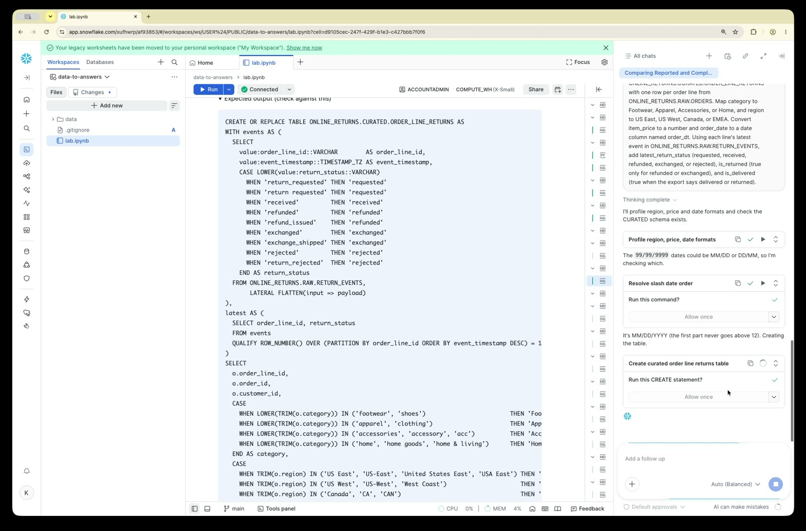

<details>
<summary>Expected output (check against this)</summary>

```sql
CREATE OR REPLACE TABLE ONLINE_RETURNS.CURATED.ORDER_LINE_RETURNS AS
WITH events AS (
  SELECT
    value:order_line_id::VARCHAR        AS order_line_id,
    value:event_timestamp::TIMESTAMP_TZ AS event_timestamp,
    CASE LOWER(value:return_status::VARCHAR)
      WHEN 'return_requested' THEN 'requested'
      WHEN 'return requested' THEN 'requested'
      WHEN 'received'         THEN 'received'
      WHEN 'refunded'         THEN 'refunded'
      WHEN 'refund_issued'    THEN 'refunded'
      WHEN 'exchanged'        THEN 'exchanged'
      WHEN 'exchange_shipped' THEN 'exchanged'
      WHEN 'rejected'         THEN 'rejected'
      WHEN 'return_rejected'  THEN 'rejected'
    END AS return_status
  FROM ONLINE_RETURNS.RAW.RETURN_EVENTS,
       LATERAL FLATTEN(input => payload)
),
latest AS (
  SELECT order_line_id, return_status
  FROM events
  QUALIFY ROW_NUMBER() OVER (PARTITION BY order_line_id ORDER BY event_timestamp DESC) = 1
)
SELECT
  o.order_line_id,
  o.order_id,
  o.customer_id,
  CASE
    WHEN LOWER(TRIM(o.category)) IN ('footwear', 'shoes')                        THEN 'Footwear'
    WHEN LOWER(TRIM(o.category)) IN ('apparel', 'clothing')                      THEN 'Apparel'
    WHEN LOWER(TRIM(o.category)) IN ('accessories', 'accessory', 'acc')          THEN 'Accessories'
    WHEN LOWER(TRIM(o.category)) IN ('home', 'home goods', 'home & living')      THEN 'Home'
  END AS category,
  CASE
    WHEN TRIM(o.region) IN ('US East', 'US-East', 'United States East', 'USA East') THEN 'US East'
    WHEN TRIM(o.region) IN ('US West', 'US-West', 'West Coast')                     THEN 'US West'
    WHEN TRIM(o.region) IN ('Canada', 'CA', 'CAN')                                  THEN 'Canada'
    WHEN TRIM(o.region) IN ('EMEA', 'Europe', 'Europe/ME/Africa')                   THEN 'EMEA'
  END AS region,
  TRY_TO_NUMBER(REPLACE(REPLACE(o.item_price, '$', ''), ',', ''), 12, 2) AS item_price,
  COALESCE(
    TRY_TO_DATE(o.order_date, 'MM/DD/YYYY'),
    TRY_TO_DATE(o.order_date, 'YYYY-MM-DD'),
    TRY_TO_DATE(o.order_date, 'MON DD YYYY'),
    TRY_TO_DATE(o.order_date, 'YYYY/MM/DD')
  ) AS order_dt,
  o.order_status AS source_order_status,
  LOWER(o.order_status) IN ('delivered', 'returned') AS is_delivered,
  l.return_status AS latest_return_status,
  COALESCE(l.return_status IN ('refunded', 'exchanged'), FALSE) AS is_returned
FROM ONLINE_RETURNS.RAW.ORDERS o
LEFT JOIN latest l USING (order_line_id);
```

</details>

### Check the numbers

Run the **`check1`** cell. Each number comes from somewhere you can trace:

| Column | Expect | Where it comes from |
|---|---:|---|
| `order_lines` | **2,000** | Every line in the export, one row each |
| `unmapped_rows` | **0** | Every category, region, price, and date was converted; anything left as NULL would show up here |
| `delivered_lines` | **1,800** | 2,000 lines minus the 100 `shipped` and 100 `cancelled` lines |
| `returned_lines` | **500** | The `completed_returns` total from STEP 4: 75 + 150 + 200 + 75. The export reported 575. |
| `return_rate_pct` | **27.8** | 500 ÷ 1,800 |
| `returned_value` | **46958.00** | The sum of `item_price` on those 500 lines |

**If a number is off,** send CoCo: *"returned_lines in ORDER_LINE_RETURNS came out as [your number] instead of 500. Find out why and fix it."* Then run the check again.

<!-- ------------------------ -->

## STEP 6: Translate and Tag Comments With AI

The numbers now say *where* returns happen. The comments say *why*, but a third of them aren't in English, and free text can't be counted. Two AI functions fix that. They run inside a normal SQL query, one call per row.

**`AI_TRANSLATE(text, source_language, target_language)`** returns the text in the target language. Passing `''` as the source language tells it to detect the language itself, so `AI_TRANSLATE(comment, '', 'en')` turns German, French, or Spanish into English and leaves English as it is.

**`AI_CLASSIFY(text, categories, config)`** picks the category that fits the text best:

- `categories` is your list of allowed answers. Each can have a short `description` that tells the model what belongs there, such as *"The item does not fit the customer: too big, too small, too tight, too loose, or too long or too short (for example sleeves or legs)"* for `Wrong size`.
- `config` can hold a `task_description`, one sentence on what you're classifying.
- It returns an object like `{"labels": ["Wrong size"]}`, so the SQL takes `:labels[0]` to get the label as text.

Because the model can only answer with one of your labels, every comment ends up in a bucket you can count. Snowflake recommends English input for `AI_CLASSIFY`, so the lab translates first and classifies `comment_english`.

AI functions are billed by the tokens they read and write. The comment, and the category list with its descriptions, all count, so 775 short comments cost very little.

### Try it on one comment

Run the **`ai_try`** cell. It takes one German comment from the lab data, translates it, and then classifies the English text into one of three labels.

```sql
SELECT
  'Die Schuhe fallen eine ganze Nummer zu klein aus.' AS comment,
  AI_TRANSLATE(comment, '', 'en') AS comment_english,
  AI_CLASSIFY(
    comment_english,
    [
      {'label': 'Wrong size', 'description': 'The item does not fit the customer: too big, too small, too tight, too loose, or too long or too short (for example sleeves or legs)'},
      {'label': 'Damaged or defective', 'description': 'The item arrived broken, scratched, or failed after little use'},
      {'label': 'Changed mind', 'description': 'Nothing is wrong with the item; the customer no longer wants it'}
    ],
    {'task_description': 'Classify the main reason a customer gives for returning an online order.'}
  ):labels[0]::STRING AS return_reason;
```

Expected result:

| comment | comment_english | return_reason |
|---|---|---|
| Die Schuhe fallen eine ganze Nummer zu klein aus. | The shoes run a whole size too small. | Wrong size |

`AI_TRANSLATE` detected German because the source language is `''`. `AI_CLASSIFY` could only answer with one of the three labels, and it picked the one whose description matched. The English wording may differ slightly; the label is what to check.

Next, CoCo applies the same two functions to all 775 comments, with the full list of six labels.

### Run the AI functions

Click on the blue **CoCo** icon and send this prompt:

**CoCo prompt:** *"Create ONLINE_RETURNS.CURATED.RETURN_COMMENT_INSIGHTS from the comments in ONLINE_RETURNS.RAW.RETURN_COMMENTS. Keep order_line_id and the original comment, translate it to English with AI_TRANSLATE into comment_english, then use AI_CLASSIFY on comment_english to set return_reason to one of these labels, each with a description: Wrong size (the item does not fit the customer: too big, too small, too tight, too loose, or too long or too short, for example sleeves or legs); Damaged or defective (the item arrived broken, scratched, or failed after little use); Not as described (the color, material, look, or listed dimensions do not match the listing or photos; not about how the item fits the customer); Arrived late (the item arrived too late to be useful); Changed mind (nothing is wrong with the item; the customer no longer wants it); Other (no return reason given, such as a question about refund status). Then create ONLINE_RETURNS.CURATED.RETURN_REVIEW: every row of ORDER_LINE_RETURNS plus comment, comment_english, and return_reason."*

**What this prompt asks for**

| Part of the prompt | Why it's there |
|---|---|
| "Keep order_line_id and the original comment" | Lets you join back to the order lines and quote customers in their own words |
| "translate it to English with AI_TRANSLATE into comment_english" | Names the function and the output column, so CoCo uses the one you just tried |
| "use AI_CLASSIFY on comment_english" | Sets the order: translate first, then classify the English |
| The six labels, each with a description | The only labels allowed, so every comment can be counted. The descriptions tell the model where the lines fall, such as *does not fit the customer* (Wrong size) versus *does not match the listing* (Not as described) |
| "every row of ORDER_LINE_RETURNS plus…" | Keeps all 2,000 lines, including ones without a comment, so the numbers from `check1` still hold |

Check that CoCo's SQL translates first and classifies the translation. The query runs AI on 775 comments, so it takes longer than a normal query (about 15–30 seconds).

<details>
<summary>Expected output (check against this)</summary>

```sql
CREATE OR REPLACE TABLE ONLINE_RETURNS.CURATED.RETURN_COMMENT_INSIGHTS AS
WITH comments AS (
  SELECT
    value:order_line_id::VARCHAR          AS order_line_id,
    value:comment_timestamp::TIMESTAMP_TZ AS comment_timestamp,
    value:comment::VARCHAR                AS comment
  FROM ONLINE_RETURNS.RAW.RETURN_COMMENTS,
       LATERAL FLATTEN(input => payload)
),
translated AS (
  SELECT order_line_id, comment_timestamp, comment,
         AI_TRANSLATE(comment, '', 'en') AS comment_english
  FROM comments
)
SELECT
  order_line_id,
  comment_timestamp,
  comment,
  comment_english,
  AI_CLASSIFY(
    comment_english,
    [
      {'label': 'Wrong size',           'description': 'The item does not fit the customer: too big, too small, too tight, too loose, or too long or too short (for example sleeves or legs)'},
      {'label': 'Damaged or defective', 'description': 'The item arrived broken, scratched, or failed after little use'},
      {'label': 'Not as described',     'description': 'The color, material, look, or listed dimensions do not match the listing or photos; not about how the item fits the customer'},
      {'label': 'Arrived late',         'description': 'The item arrived too late to be useful'},
      {'label': 'Changed mind',         'description': 'Nothing is wrong with the item; the customer no longer wants it'},
      {'label': 'Other',                'description': 'No return reason given, such as a question about refund status'}
    ],
    {'task_description': 'Classify the main reason a customer gives for returning an online order.'}
  ):labels[0]::STRING AS return_reason
FROM translated;

CREATE OR REPLACE TABLE ONLINE_RETURNS.CURATED.RETURN_REVIEW AS
SELECT
  r.*,
  c.comment,
  c.comment_english,
  c.return_reason
FROM ONLINE_RETURNS.CURATED.ORDER_LINE_RETURNS r
LEFT JOIN ONLINE_RETURNS.CURATED.RETURN_COMMENT_INSIGHTS c USING (order_line_id);
```

</details>


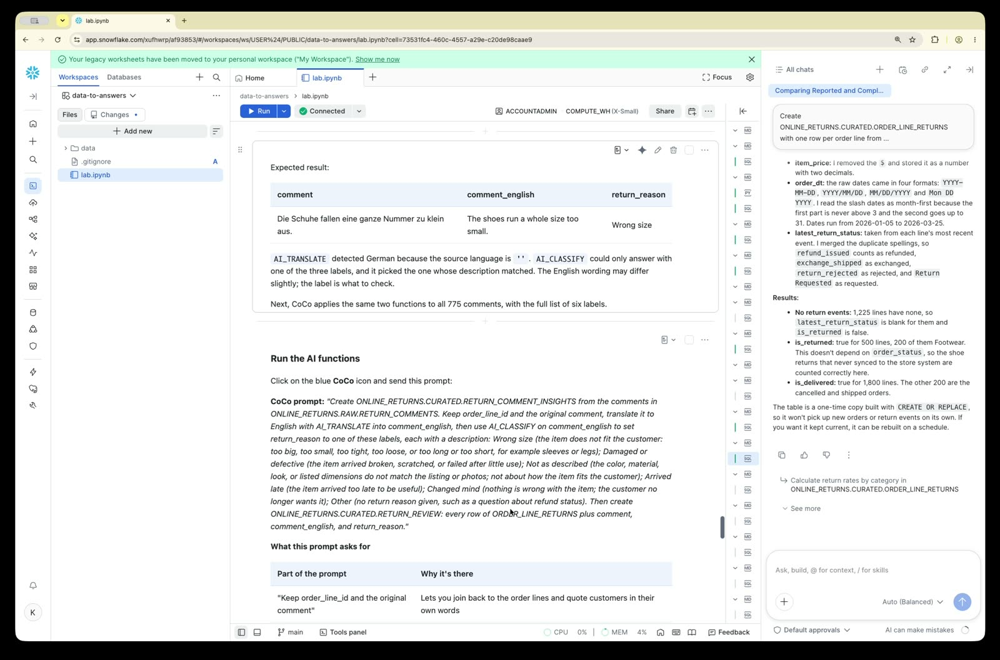

### Look at what the AI decided

The warehouse lead pointed at shoes in EMEA, so look there. Run the **`review_labels`** cell. It shows the first 10 comments on returned Footwear lines in EMEA, with each translation and label.

Every comment is in German, French, or Spanish. You should see **7** about size (*"Die Schuhe fallen eine ganze Nummer zu klein aus."*) tagged `Wrong size`, and **3** about soles coming off tagged `Damaged or defective`.

Read each translation and decide whether you agree with its label:

- **If you agree with all of them,** continue to the next cell.
- **If you disagree with a label,** the fix is in the label descriptions, not in the comment. Ask CoCo to sharpen the description of the label that should have matched, for example: *"In RETURN_COMMENT_INSIGHTS, the comment [paste it] was tagged [label] but should be [label]. Make that label's AI_CLASSIFY description clearer, then rebuild RETURN_COMMENT_INSIGHTS and RETURN_REVIEW."* Then run this cell again.

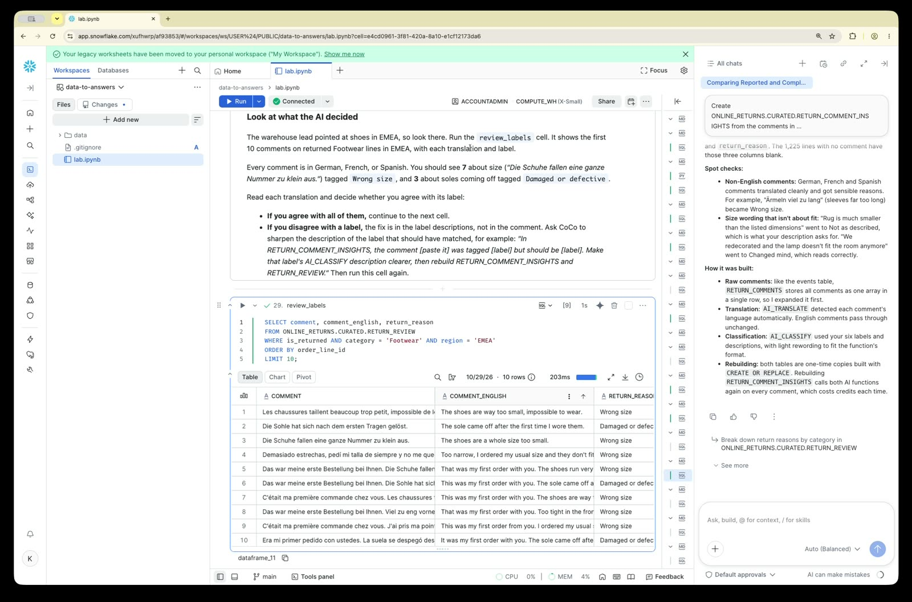


### Before and after AI

Here's what the AI bought you. Run the **`before_after`** cell. It answers one question two ways for the 100 returned Footwear lines in EMEA: *how many are about size?*

- `size_by_keyword` is what you might try without AI: search the original comments for English size words.
- `size_by_ai` counts the lines the AI labeled `Wrong size`.

```sql
-- How many returned Footwear/EMEA comments are about size? Without AI, then with AI.
SELECT
  COUNT(*) AS returned_lines,
  COUNT_IF(comment ILIKE ANY ('%size%', '%small%', '%big%', '%tight%', '%fit%')) AS size_by_keyword,
  COUNT_IF(return_reason = 'Wrong size') AS size_by_ai
FROM ONLINE_RETURNS.CURATED.RETURN_REVIEW
WHERE is_returned AND category = 'Footwear' AND region = 'EMEA';
```

Expected result:

| returned_lines | size_by_keyword | size_by_ai |
|---:|---:|---:|
| 100 | **0** | **75** |

The keyword search finds nothing, because every comment is written in another language. The AI labels show that three out of four Footwear returns in EMEA are about size.


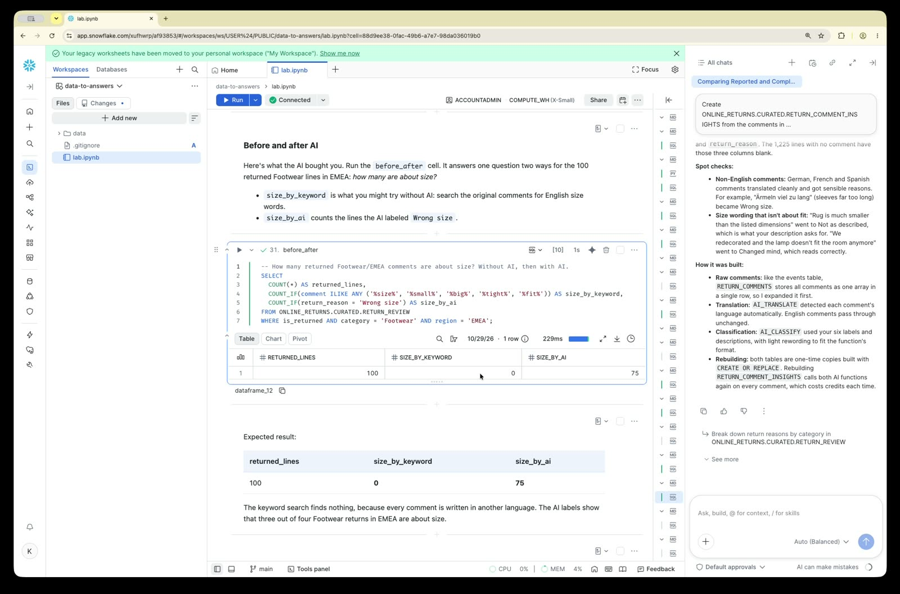

### Check the answer before handing it to an agent

If these numbers are wrong, an agent will only give you the wrong answer faster. Run the **`check2`** cell.

| Column | Expect | Where it comes from |
|---|---:|---|
| `order_lines`, `delivered_lines`, `returned_lines`, `returned_value` | **2,000 / 1,800 / 500 / 46958.00** | Same as `check1`. Joining the comments must not add or drop lines. |
| `wrong_size_returns` | **175** | Returned lines tagged `Wrong size` across all categories and regions, including the 75 you just saw in Footwear/EMEA |
| `invalid_labels` | **0** | Every label is one of your six categories |

Expect exactly **175**. If it's lower, break the count down by category and region: every combination should be a multiple of 25, so the one that's short tells you which comments got the wrong label.

**If a number is off,** send CoCo: *"wrong_size_returns in RETURN_REVIEW came out as [your number] instead of 175. Find out why and fix it."* Then run the check again.

<!-- ------------------------ -->

## STEP 7: Make the Comments Searchable

An agent needs two kinds of help. For numbers, it writes SQL. For "show me what customers said", it needs to find the right comments, and a customer who says *"Me quedan pequeñas"* never typed the English word "small".

**Cortex Search** is a search service you build over a text column. It combines meaning-based (vector) search with keyword search, then reranks the results, so a search for "shoes too small" finds comments that say the same thing in other words. You choose:

- the column to search: here `comment_text`, which holds the customer's original comment followed by its English translation in parentheses. One column means a result shows what the customer wrote and what it means, and an English query can still match comments in any language.
- the columns you can filter on (**attributes**): category, region, return reason, and latest return status

Attributes don't change which comments match a query. They let a person or an agent narrow the search first, such as `region = EMEA` or `latest_return_status = refunded`, and then rank what's left.

Snowflake keeps the service in sync with the table, refreshing on the schedule you set with `TARGET_LAG`.

Click on the blue **CoCo** icon and send this prompt:

**CoCo prompt:** *"Create Cortex Search service ONLINE_RETURNS.ANALYTICS.RETURN_COMMENTS_SEARCH over ONLINE_RETURNS.CURATED.RETURN_REVIEW, only for rows that have a comment. The searchable column is called comment_text: the original comment, followed by its English translation in parentheses when the comment is not already in English. Also include order_line_id. Use category, region, return_reason, and latest_return_status as attributes. Use warehouse COMPUTE_WH, a target lag of 1 day, and AUTO_SUSPEND = 1800."*

**What this prompt asks for**

| Part of the prompt | Why it's there |
|---|---|
| "The searchable column is called comment_text: the original comment, followed by its English translation" | The text to search and to quote. Keeping the English next to the original lets one query match comments in every language. |
| "only for rows that have a comment" | Leaves out order lines with nothing to search |
| "Also include order_line_id" | Each result comes back with its ID |
| "Use category, region, return_reason, and latest_return_status as attributes" | The columns the agent can filter on, such as region = EMEA or only refunded and exchanged lines |
| "warehouse COMPUTE_WH, a target lag of 1 day" | What runs the refreshes, and how fresh the service stays |
| "AUTO_SUSPEND = 1800" | Stops serving costs after 30 idle minutes |

The service takes a minute or so to build.

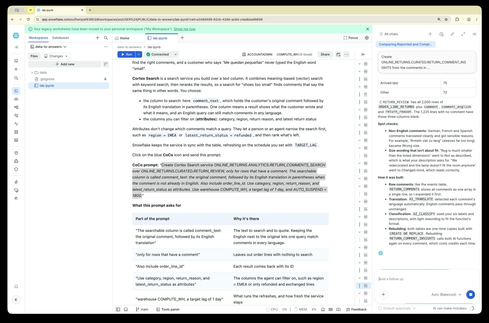


<details>
<summary>Expected output (check against this)</summary>

```sql
CREATE OR REPLACE CORTEX SEARCH SERVICE ONLINE_RETURNS.ANALYTICS.RETURN_COMMENTS_SEARCH
  ON comment_text
  ATTRIBUTES category, region, return_reason, latest_return_status
  WAREHOUSE = COMPUTE_WH
  TARGET_LAG = '1 day'
  AUTO_SUSPEND = 1800
  AS (
    SELECT order_line_id,
           IFF(comment = comment_english, comment, comment || ' (English: ' || comment_english || ')') AS comment_text,
           category, region, return_reason, latest_return_status
    FROM ONLINE_RETURNS.CURATED.RETURN_REVIEW
    WHERE comment IS NOT NULL
  );
```

</details>

### Check the search service

Run the **`check_search`** cell. It searches for *"shoes too small"* and returns the top 20 matches. Expect size complaints about shoes, with the original comment in German, French, or Spanish followed by its English translation in parentheses. Read the English part of each result: they should all be about shoes that don't fit. The customers wrote in German, French, or Spanish, and the search found them anyway, because each comment carries its English translation and Cortex Search matches by meaning as well as by words.

Many comments open with the same sentence in their language, so several results will look almost identical. That's expected. Check that the matches are about shoes that don't fit, not which one comes first.

**If the results aren't shoe size complaints,** send CoCo: *"Searching RETURN_COMMENTS_SEARCH for 'shoes too small' doesn't return shoe size complaints. Find out why and fix it."* Then run the check again.


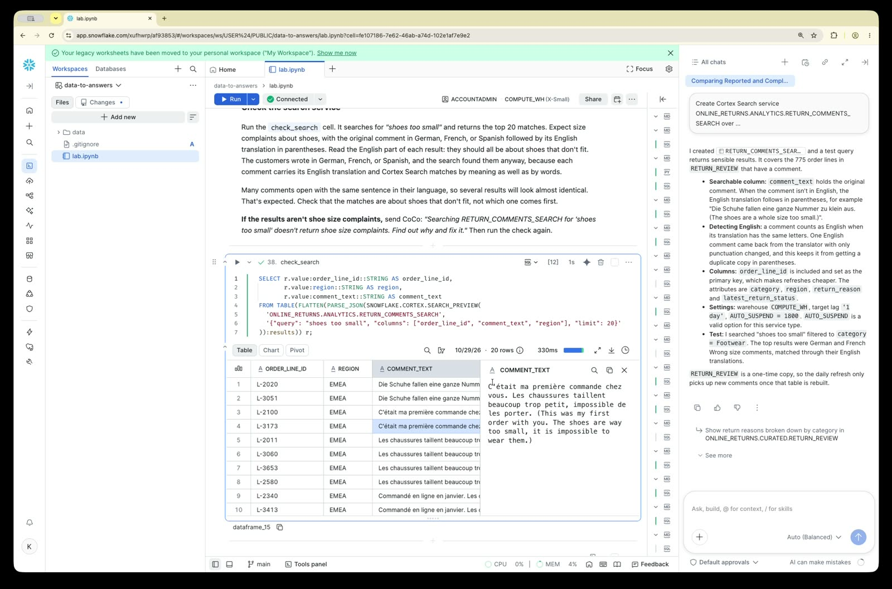

You've finished the notebook work: clean order lines, AI-tagged comments, and a search service. The rest of the lab happens in Snowsight, where you'll give it to an agent. You won't need to come back to this notebook until clean-up.

The steps continue below and in the guide; follow along from either.

<!-- ------------------------ -->

## STEP 8: Write Down Your Definitions

**Cortex Analyst** is Snowflake's text-to-SQL engine: it turns a question into SQL and runs it. To write correct SQL, it needs to know what your columns mean, and that's what a **semantic view** holds:

- **Dimensions** are what you group and filter by: category, region, return reason.
- **Metrics** are the calculations, defined once: *returned lines*, *delivered lines*, *returned value*, *return rate*.
- **Verified queries** are question-and-SQL pairs you've confirmed are right. Analyst uses them as worked examples.

The quick agent's semantic view defined a return the wrong way. This one uses the rule from STEP 5.

1. In Snowsight, navigate to **AI & ML » Analyst**.

   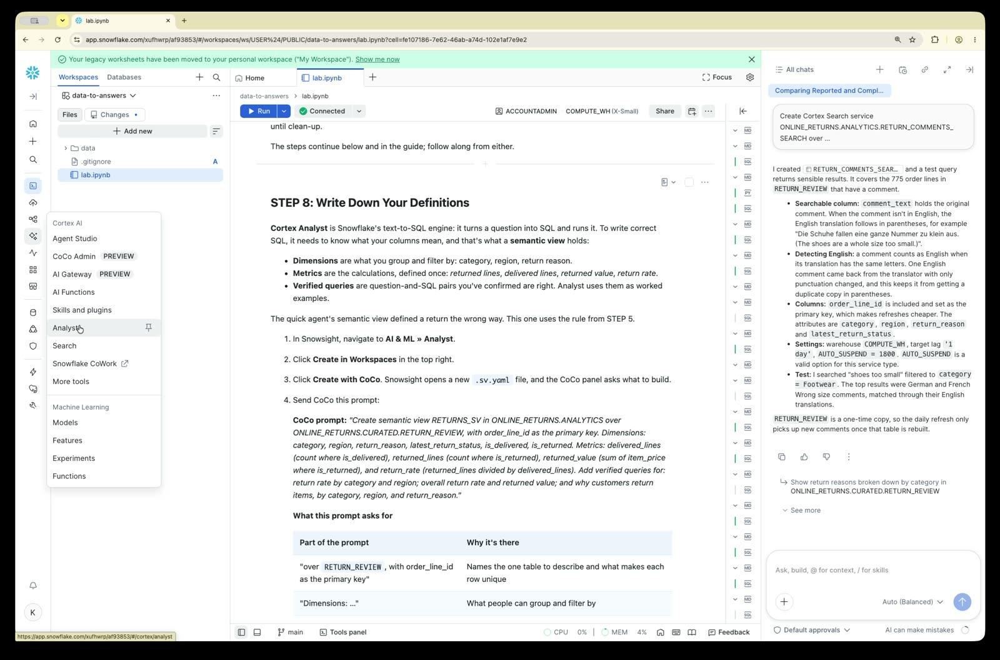

2. Click **Create in Workspaces** in the top right.
3. Click **Create with CoCo**. Snowsight opens a new `.sv.yaml` file, and the CoCo panel asks what to build.
4. Send CoCo this prompt:

   **CoCo prompt:** *"Create semantic view RETURNS_SV in ONLINE_RETURNS.ANALYTICS over ONLINE_RETURNS.CURATED.RETURN_REVIEW, with order_line_id as the primary key. Dimensions: category, region, return_reason, latest_return_status, is_delivered, is_returned. Metrics: delivered_lines (count where is_delivered), returned_lines (count where is_returned), returned_value (sum of item_price where is_returned), and return_rate (returned_lines divided by delivered_lines). Add verified queries for: return rate by category and region; overall return rate and returned value; and why customers return items, by category, region, and return_reason."*

   **What this prompt asks for**

   | Part of the prompt | Why it's there |
   |---|---|
   | "over `RETURN_REVIEW`, with order_line_id as the primary key" | Names the one table to describe and what makes each row unique |
   | "Dimensions: …" | What people can group and filter by |
   | "Metrics: … (count where is_delivered) …" | Each calculation, spelled out once, so Analyst never has to guess what "return rate" means |
   | "Add verified queries for: …" | The questions you expect most, so Analyst has checked examples to follow |


   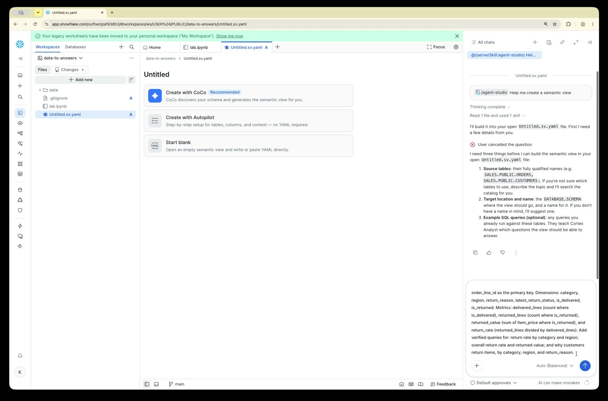

5. Allow CoCo to create the draft. This creates an editable draft; it doesn't publish the view yet.
6. Review the draft. Confirm it contains:
   - **Dimensions:** `CATEGORY`, `REGION`, `RETURN_REASON`, `LATEST_RETURN_STATUS`, `IS_DELIVERED`, `IS_RETURNED`

      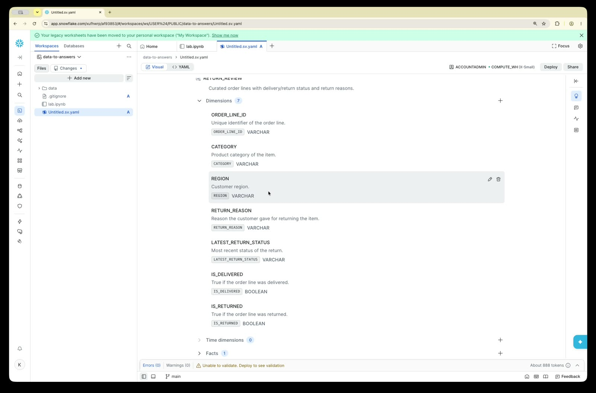

   - **Metrics:** `DELIVERED_LINES`, `RETURNED_LINES`, `RETURNED_VALUE`, `RETURN_RATE`. Open `RETURN_RATE` and check that it divides returned lines by **delivered** lines, not all lines.

      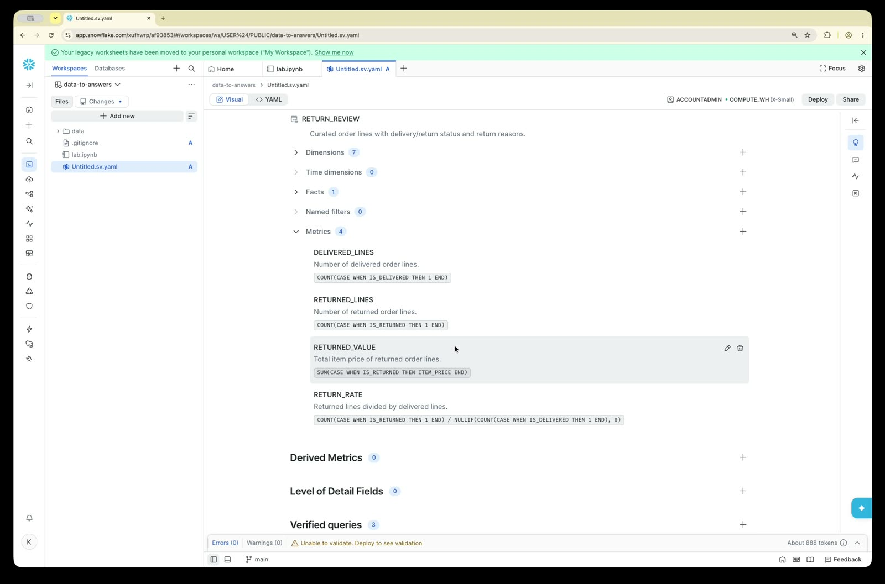

   - **Verified queries:** three, one for each question in the prompt

   CoCo may add descriptions or synonyms. That's fine. If a metric is missing or defined differently, ask CoCo to fix it before publishing (*"return_rate should divide returned_lines by delivered_lines"*).
7. Click **Publish** in the top right. Confirm **Name** `RETURNS_SV`, **Database** `ONLINE_RETURNS`, and **Schema** `ANALYTICS`, then click **Publish**.

   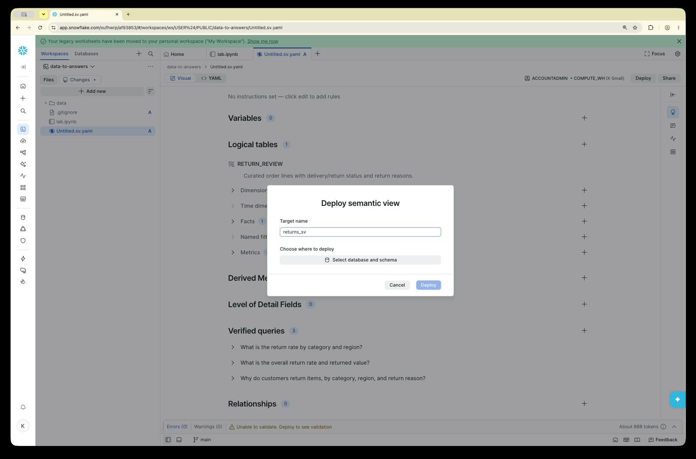

8. Test it. After publishing, open the **Playground** and ask *"How many lines were delivered and how many were returned, what is the return rate, and how much revenue was returned?"* Expect **500** returned of **1,800** delivered lines, a return rate of **0.2778** (27.8%), and **$46,958.00**, the same numbers as `check1`.

   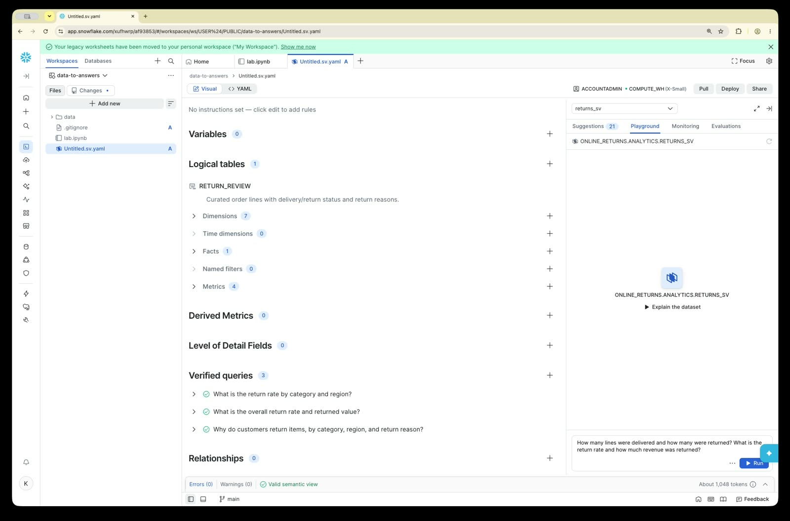


   Click the SQL to see the query Analyst wrote. It won't look like the expected definition below, and it may look odd (for example, a `NULLIF` inside another `NULLIF`). That's fine: Analyst builds SQL from the metric definitions. Judge it by the numbers, and check that the rate divides by delivered lines.

<details>
<summary>Expected definition (for comparison, or to create the view with SQL if CoCo's differs)</summary>

```sql
CREATE OR REPLACE SEMANTIC VIEW ONLINE_RETURNS.ANALYTICS.RETURNS_SV
  TABLES (
    returns AS ONLINE_RETURNS.CURATED.RETURN_REVIEW
      PRIMARY KEY (order_line_id)
      COMMENT = 'One row per Q1 2026 order line. A return is a line whose latest return status is refunded or exchanged.'
  )
  DIMENSIONS (
    returns.category AS category COMMENT = 'Footwear, Apparel, Accessories, or Home',
    returns.region AS region COMMENT = 'US East, US West, Canada, or EMEA',
    returns.latest_return_status AS latest_return_status COMMENT = 'requested, received, refunded, exchanged, or rejected',
    returns.return_reason AS return_reason COMMENT = 'AI-derived reason from the customer comment. Other means no reason given.',
    returns.is_delivered AS is_delivered COMMENT = 'TRUE if the line was delivered (shipped and cancelled lines are FALSE)',
    returns.is_returned AS is_returned COMMENT = 'TRUE only if the latest return status is refunded or exchanged'
  )
  METRICS (
    returns.delivered_lines AS COUNT_IF(is_delivered) COMMENT = 'Delivered order lines, the denominator of the return rate',
    returns.returned_lines AS COUNT_IF(is_returned) COMMENT = 'Returned order lines (refunded or exchanged only)',
    returns.returned_value AS SUM(IFF(is_returned, item_price, 0)) COMMENT = 'USD value of returned order lines',
    return_rate AS DIV0(returns.returned_lines, returns.delivered_lines) COMMENT = 'Returned lines divided by delivered lines'
  )
  COMMENT = 'Northwind Outfitters returns, Q1 2026'
  AI_VERIFIED_QUERIES (
    rate_by_category_region AS (
      QUESTION 'What is our return rate by product category and region?'
      ONBOARDING_QUESTION TRUE
      SQL 'SELECT category, region, COUNT_IF(is_delivered) AS delivered_lines, COUNT_IF(is_returned) AS returned_lines, ROUND(DIV0(COUNT_IF(is_returned), COUNT_IF(is_delivered)), 3) AS return_rate FROM returns GROUP BY category, region ORDER BY return_rate DESC'
    ),
    overall_rate AS (
      QUESTION 'What is our overall return rate and how much revenue was returned?'
      ONBOARDING_QUESTION TRUE
      SQL 'SELECT COUNT_IF(is_delivered) AS delivered_lines, COUNT_IF(is_returned) AS returned_lines, ROUND(DIV0(COUNT_IF(is_returned), COUNT_IF(is_delivered)), 3) AS return_rate, SUM(IFF(is_returned, item_price, 0)) AS returned_value FROM returns'
    ),
    reasons AS (
      QUESTION 'Why are customers returning items?'
      ONBOARDING_QUESTION TRUE
      SQL 'SELECT category, region, return_reason, COUNT(*) AS returned_lines, SUM(item_price) AS returned_value FROM returns WHERE is_returned GROUP BY category, region, return_reason ORDER BY returned_lines DESC, returned_value DESC'
    )
  );
```

</details>

<!-- ------------------------ -->

## STEP 9: Fix the Agent

An **agent** reads a question, decides which tool can answer it, calls the tool, and writes the answer. The `RETURNS_AGENT` you created in STEP 3 has one tool, pointed at the quick semantic view. You'll edit it so it has two tools and clear instructions.

1. In Snowsight, navigate to **AI & ML » Agent Studio**.
2. Select **RETURNS_AGENT** (database `ONLINE_RETURNS`, schema `ANALYTICS`).

   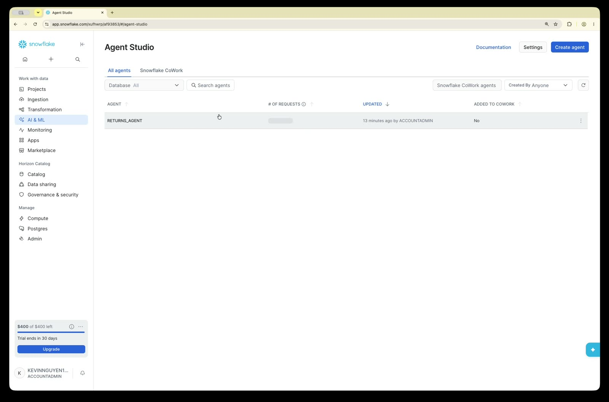

3. Click **Configuration**.
4. Under **General**, set what people see in CoWork before they ask anything. The description tells them what the agent knows about, and the example questions appear as one-click starters.
   - **Description:** `Answers questions about Northwind Outfitters returns: return rates and returned value by category and region, and what customers said about why they returned items.`
   - **Example questions:** add these as two separate questions:
     - `Which product categories have the highest and lowest return rate? Show it as a chart.`
     - `Why are customers returning footwear in EMEA? Show me what they said.`

   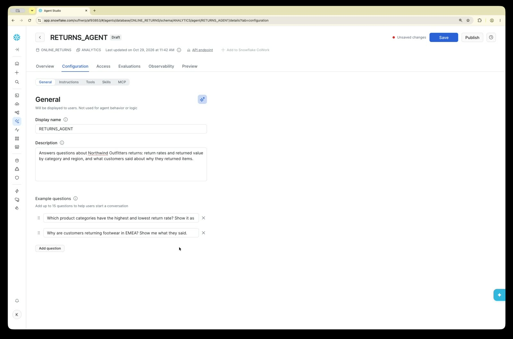

5. Under **Instructions**, tell the agent how to work, in plain English. **Instructions** guide *which tool to use*: Analyst for numbers, Search for what customers said. **Response instructions** guide *what the answer looks like*: which definitions to use, how precise to be, and how to quote customers. The definition of a return appears here as well as in the semantic view, so even a free-text answer uses it. Paste:
   - **Instructions:** `Use returns_analytics for any count, rate, value, or ranking question. Use customer_comments to find what customers said, and quote them when you explain a reason.`
   - **Response instructions:** `A return is an order line whose latest return status is refunded or exchanged. Return rate is returned lines divided by delivered lines. State counts, percentages, and USD values precisely. When you search customer_comments for quotes, filter to latest_return_status refunded or exchanged. Quote the comment text exactly as the search returns it: it holds the customer's original wording, followed by the English translation in parentheses when the original is not in English. Start with the answer and answer only the question asked.`

   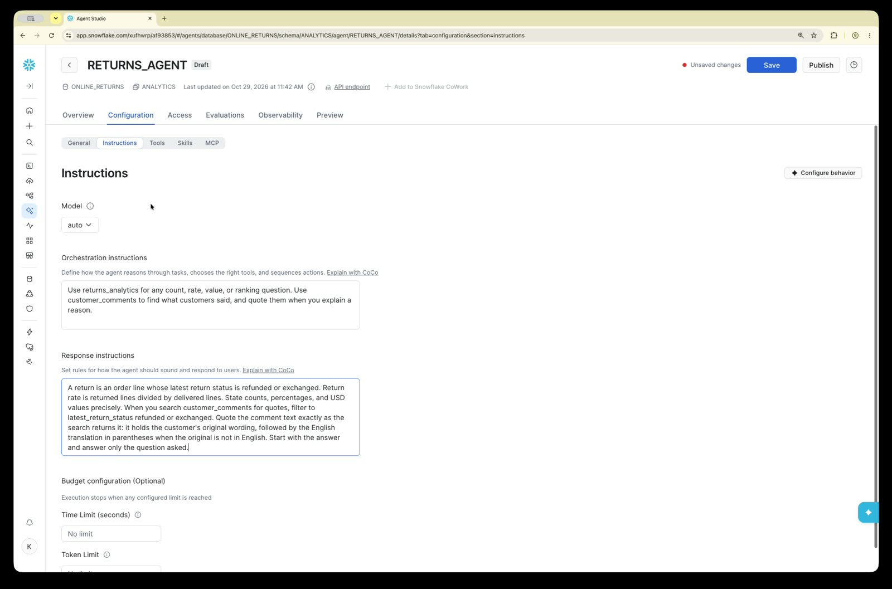


### Tools: how the agent gets its answers

The agent doesn't read your tables directly. It answers by calling **tools**, and you'll give it two:

- **Cortex Analyst** over `RETURNS_SV`, for anything with a number: counts, rates, values, rankings. It turns the question into SQL using the definitions in your semantic view.
- **Cortex Search** over `RETURN_COMMENTS_SEARCH`, for what customers actually said.

You give each tool a **name** and a **description**. The agent reads the descriptions to decide which tool fits a question, and the instructions you just pasted refer to the tools by name (`returns_analytics`, `customer_comments`). A tool's name is only a label inside the agent; it doesn't have to match the object it points to. A *why* question uses both tools: numbers from Analyst, quotes from Search.

6. Under **Tools**, remove the **QUICK_RETURNS_SV** tool (the quick semantic view from STEP 3). Then add Cortex Analyst by clicking on the **+ Add semantic view** button:
   - **Databases/Schemas:** `ONLINE_RETURNS.ANALYTICS`
   - **Select semantic view:** `RETURNS_SV`
   - **Name:** `returns_analytics`
   - **Description:** `Return counts, rates, values, and AI-tagged reasons by category and region, one row per order line.`
   - **Warehouse:** `COMPUTE_WH`

   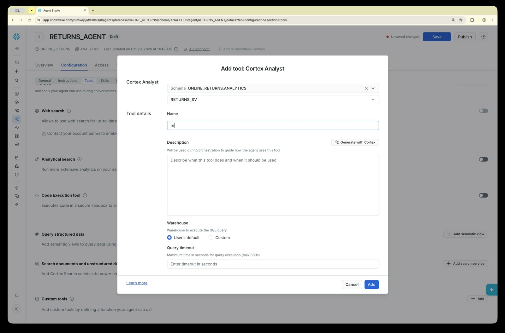

7. Under **Tools**, add a Cortex Search service by clicking the **+ Search Services** button:
   - **Database/Schema:** `ONLINE_RETURNS.ANALYTICS`
   - **Search service:** `RETURN_COMMENTS_SEARCH`
   - **Name:** `customer_comments`
   - **Description:** `Customer return comments in their original language with an English translation, filterable by category, region, and reason.`
   - **ID column** and **Title column:** `ORDER_LINE_ID`

   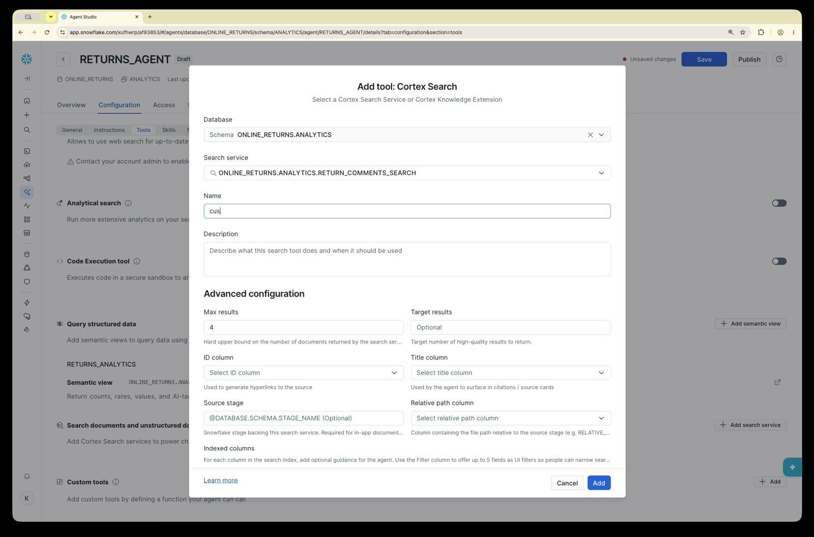

8. Under **Tools**, turn on the **Code Execution** tool. CoWork needs it to build documents and reports, such as the one you'll make at the end of STEP 10.

   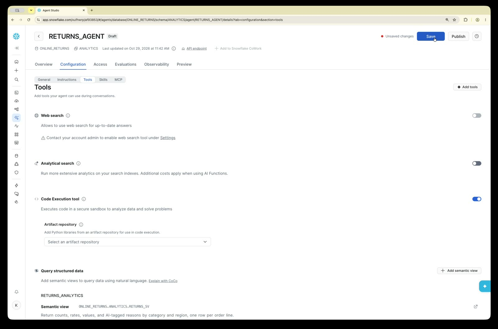

9. Click **Save**.

Before you move on, check the **Tools** list. It should show exactly:

- `returns_analytics`, pointing at **`RETURNS_SV`**, not `QUICK_RETURNS_SV`. If it still points at the quick view, the agent will repeat the wrong answers from STEP 3.
- `customer_comments`, pointing at `RETURN_COMMENTS_SEARCH`
- **Code Execution**, turned on
- no **QUICK_RETURNS_SV** tool

<!-- ------------------------ -->

## STEP 10: Ask in CoWork

**Snowflake CoWork** is where anyone on the team chats with your agents, without opening a notebook or writing SQL. Agents you can use show up there automatically.

1. In Snowsight, navigate to **AI & ML » Snowflake CoWork**.

   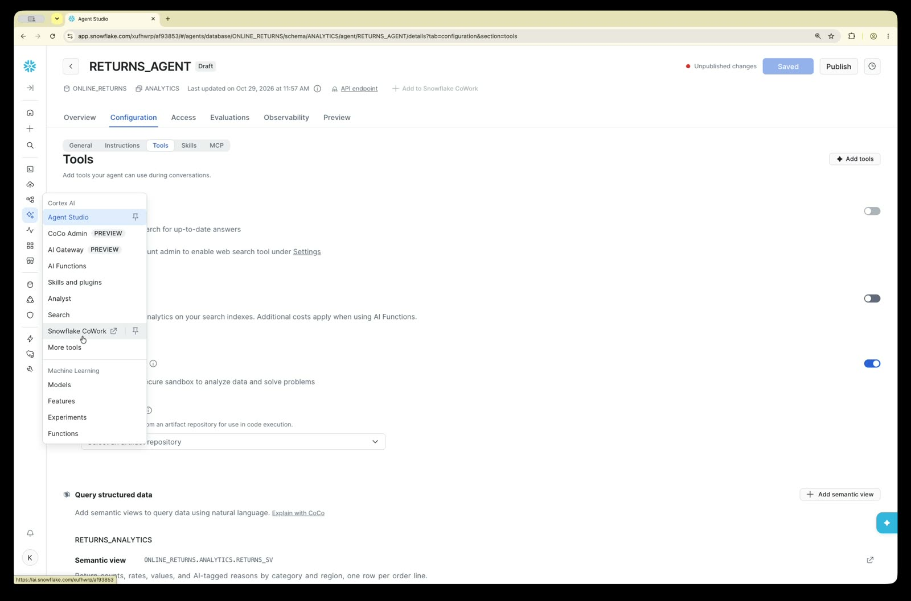

2. Select **RETURNS_AGENT** from the agent list.
3. Ask these two questions in the same conversation. The first one is the example question you added, so you can click it instead of typing it.
   1. *"Which product categories have the highest and lowest return rate? Show it as a chart."*

      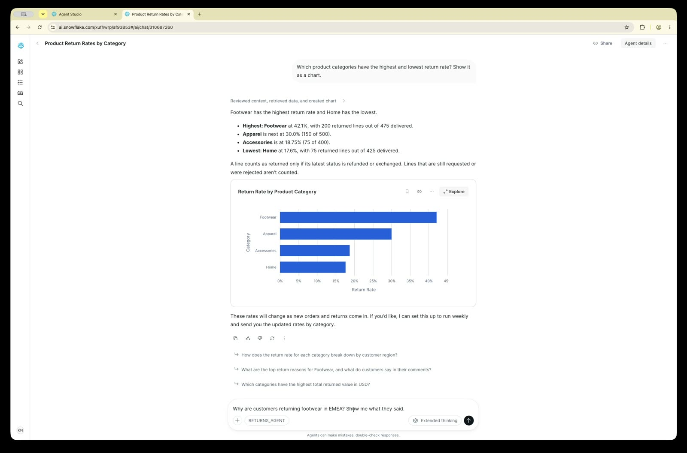

   2. *"Why are customers returning footwear in EMEA? Show me what they said."*

      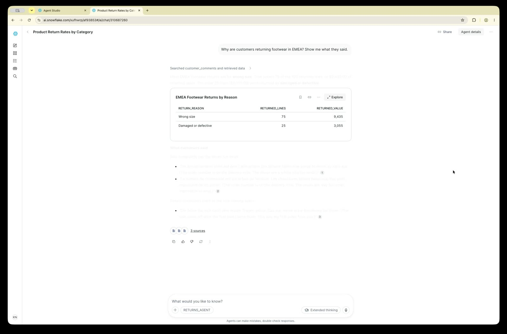


**Expected:**

| Question | Expected answer | Where it comes from |
|---|---|---|
| 1 | A chart with Footwear highest at **42.1%** (200 of 475 delivered) and Home lowest at **17.6%** | `returned_lines` ÷ `delivered_lines` per category from `RETURNS_SV` |
| 2 | About **3 in 4** are **Wrong size** (75 of 100), quoted in the original language with its English translation, such as *"Die Schuhe fallen eine ganze Nummer zu klein aus."* (*"The shoes are a whole size too small."*) | The AI labels from STEP 6, and quotes found by Cortex Search |

Click the steps in each answer to see which tool the agent used: Cortex Analyst for question 1, and both tools for question 2.

In STEP 3, the same agent said Apparel was worst (about 45%) and Footwear best (about 14%). The only difference is the work you did on the data.

### Turn the answers into a report

Answers in a chat are useful to you. A report is something you can hand to the merchandising team. Start a **new chat** with `RETURNS_AGENT` (in a long conversation the report tends to come out less polished) and send:

**CoWork prompt:** *"Build a one-page HTML report for the merchandising team on our footwear returns problem. Include: a chart of return rate by category, the EMEA footwear numbers (returned lines, return rate, and returned value, split by reason), three customer quotes in the original language with English translations, and three recommended actions. Make it look polished: a title banner, summary cards for the key numbers, a consistent color palette, and clear section headings."*

**What this prompt asks for**

| Part of the prompt | Why it's there |
|---|---|
| "one-page HTML report for the merchandising team" | The format and the audience. HTML opens in any browser, and naming the reader sets the tone. |
| "a chart of return rate by category" | The big picture from Cortex Analyst: Footwear is the outlier |
| "the EMEA footwear numbers … split by reason" | The drill-down: where the problem is and what it costs, from `RETURNS_SV` |
| "three customer quotes in the original language with English translations" | The evidence, from Cortex Search over `comment_text` |
| "three recommended actions" | The agent's own reasoning on top of the data |
| "a title banner, summary cards … clear section headings" | Without design direction you get a plain page; with it you get something you'd actually send |

The agent writes and runs code with its **Code Execution** tool to build the file, then CoWork shows a preview you can open and download. This takes a minute or two.


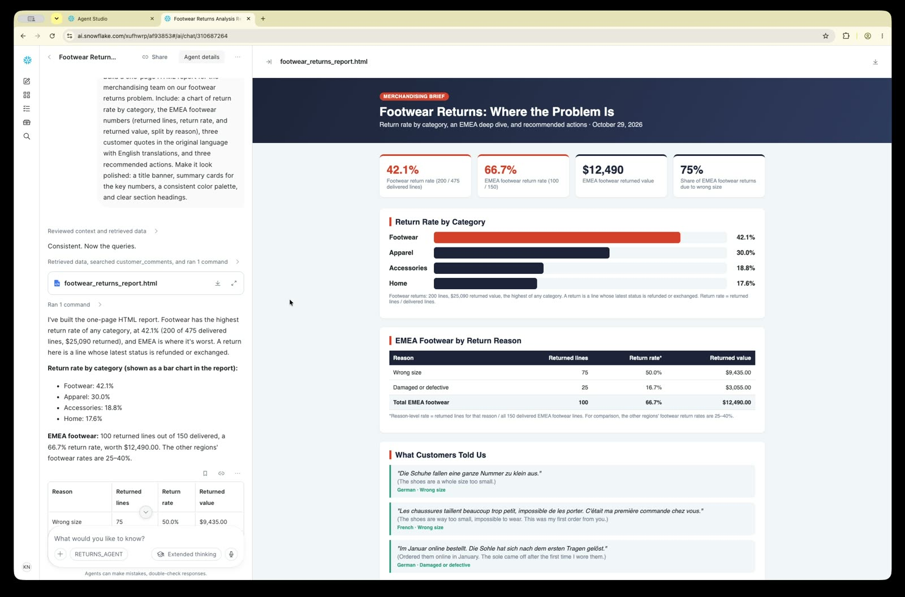

**Expected:** a styled one-page report showing Footwear highest at **42.1%**; EMEA footwear at **100** of **150** delivered lines returned (**66.7%**), worth **$12,490**, mostly Wrong size (75 lines, **$9,435**); three quotes in German, French, or Spanish with translations; and three recommendations. Layout and wording will vary, so judge the report by its numbers and quotes.

Every number in that report traces back to a definition you wrote, and every quote to a real return. That's the difference from STEP 3.

If CoWork says it can't build the report, go back to STEP 9 and confirm that **Code Execution** is turned on.

### What you built

- Raw tables that keep exactly what the source systems sent
- A curated table with one clear definition of a return
- AI-translated, AI-tagged customer comments you can count and search
- A Cortex Search service that finds comments by meaning, in any language
- A semantic view with metrics and verified queries, so every question uses the same definitions
- An agent that answers with numbers *and* customer quotes, available to anyone in CoWork
- A shareable HTML report that the agent builds from those answers

Your agent used the same AI in STEP 3 and STEP 10. What made the difference was the work you did on the data in between.

<!-- ------------------------ -->

## STEP 11: Clean Up

> **Before running teardown:** If you're running this guide as part of an Expedition workshop, run the autograder and answer key first. The autograder checks for objects created during this lab, so dropping the database beforehand will cause it to fail.

The search service keeps a small amount of compute running until you drop it. If you want to remove everything, run this only after you've finished the lab and any validation checks.

Run the **`teardown`** cell, or run the same SQL in a SQL worksheet. Dropping the database removes everything inside it: tables, semantic views, the search service, and the agent. The second statement removes the Git API integration you created in setup. After that, the workspace can no longer pull from GitHub, so run teardown last.

```sql
USE ROLE ACCOUNTADMIN;

-- Drops the tables, semantic views, search service, and agent
DROP DATABASE IF EXISTS ONLINE_RETURNS;

-- Removes the Git API integration created for the workspace
DROP API INTEGRATION IF EXISTS GITHUB_RETURNS_LAB;
```

<!-- ------------------------ -->

## Conclusion And Resources

Congratulations! You turned messy online-store return data into a trusted data product and asked questions about it in natural language with Snowflake CoWork.

Your agent first said Footwear had the *lowest* return rate, about 14%. The real answer is that Footwear has the *highest*, 42.1%, driven by customers in EMEA whose shoes run a size small. The agent used the same AI both times. The difference came from the work you did on the data first: deciding what a return is, which source to trust, and what each business word means.

### What You Learned
- Spotting a confident wrong answer from an agent over raw data
- Using **CoCo** to write transformation SQL, and checking it against written rules before running it
- Using **AI_TRANSLATE** and **AI_CLASSIFY** to turn multilingual free text into a dimension you can count
- Checking results against **known answers** before handing them to an agent
- Searching text by meaning with **Cortex Search**
- Defining business terms once in a **semantic view** with verified queries for **Cortex Analyst**
- Combining **Cortex Analyst** and **Cortex Search** in one agent so answers come with evidence
- Asking an agent in **CoWork** to turn its answers into a shareable HTML report

### Related Resources
- [Git-backed Workspaces](https://docs.snowflake.com/en/user-guide/ui-snowsight/workspaces-git)
- [AI_TRANSLATE](https://docs.snowflake.com/en/sql-reference/functions/ai_translate)
- [AI_CLASSIFY](https://docs.snowflake.com/en/sql-reference/functions/ai_classify)
- [Cortex Search](https://docs.snowflake.com/en/user-guide/snowflake-cortex/cortex-search/cortex-search-overview)
- [Semantic views](https://docs.snowflake.com/en/user-guide/views-semantic/overview)
- [Create and manage Cortex Agents](https://docs.snowflake.com/en/user-guide/snowflake-cortex/cortex-agents-manage)
- [Snowflake CoWork](https://docs.snowflake.com/en/user-guide/snowflake-cortex/snowflake-cowork/getting-started)
