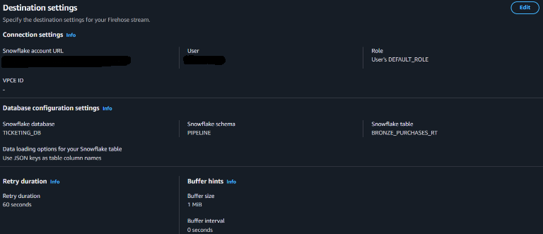
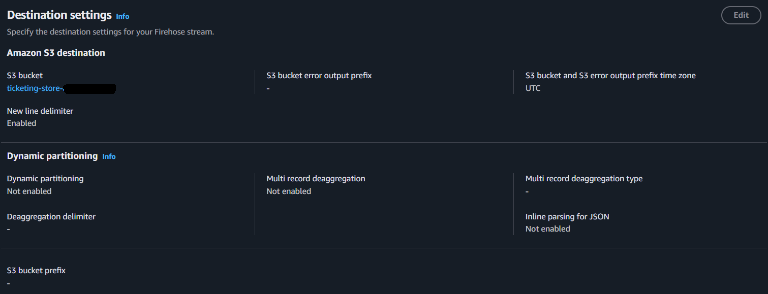
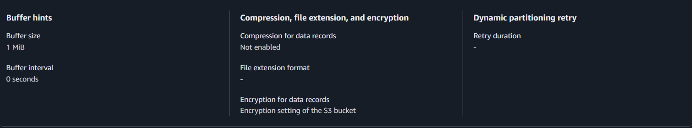
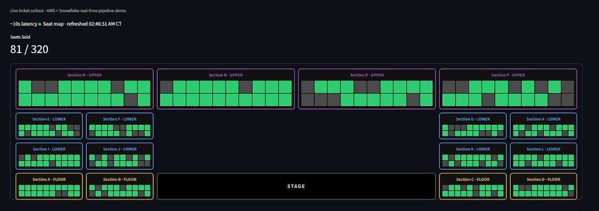
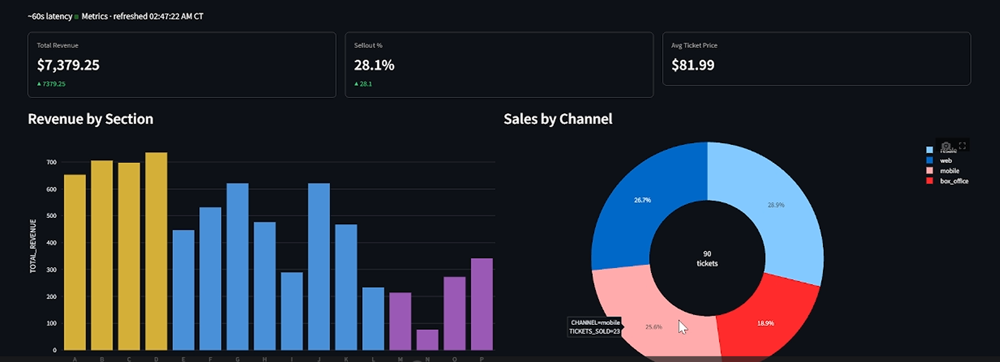
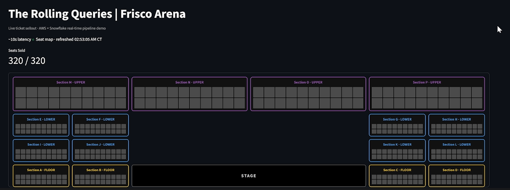
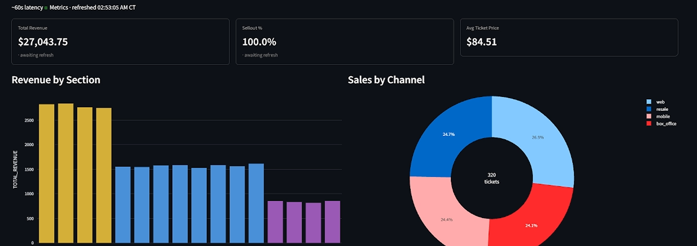

author: Aman Gill
id: real-time-ticketing-pipeline-aws-snowflake
categories: snowflake-site:taxonomy/solution-center/certification/quickstart, snowflake-site:taxonomy/product/data-engineering, snowflake-site:taxonomy/snowflake-feature/ingestion, snowflake-site:taxonomy/snowflake-feature/snowpipe-streaming, snowflake-site:taxonomy/snowflake-feature/dynamic-tables, snowflake-site:taxonomy/snowflake-feature/unistore
language: en
summary: Build a real-time ticketing pipeline where one Amazon Kinesis stream feeds Snowflake two ways, a Hybrid Table for a live seat map and Dynamic Tables for revenue analytics, with a live Streamlit dashboard.
environments: web
status: Published
feedback link: https://github.com/Snowflake-Labs/sfquickstarts/issues

# Real-Time Ticketing Pipeline with AWS and Snowflake

<!-- ------------------------ -->
## Overview

A concert goes on sale and thousands of buyers arrive at once. The venue needs two different answers at the same moment: which seats are still free right now, and how is revenue trending. Those are different workloads. The first is a stream of tiny, exact updates. The second is a rolling aggregate over everything sold so far.

In this guide you build a pipeline that serves both from a single event stream. A Python producer simulates a sellout of 320 seats and sends each purchase to Amazon Kinesis. From there, two Amazon Data Firehose delivery streams read the same Kinesis stream:

- **Fast path:** Firehose writes straight into Snowflake through its native Snowflake destination, which uses Snowpipe Streaming under the hood. A Stream and a Task then flip seats to `SOLD` in a Hybrid Table.
- **Batch path:** Firehose writes JSON files to Amazon S3, S3 notifies Snowpipe through Amazon SNS, and two Dynamic Tables turn the raw rows into per-section revenue metrics.

A local Streamlit dashboard reads both and shows a live seat map next to revenue, sell-through, and channel mix. There are no batch jobs to schedule, no manual refreshes, and no separate operational database.

### Prerequisites
- An [AWS account](https://aws.amazon.com/free/) in `us-east-1` with billing upgraded beyond the Free Plan, because Kinesis is not available on it
- A [Snowflake account](https://signup.snowflake.com/?utm_source=snowflake-devrel&utm_medium=developer-guides&utm_cta=developer-guides) where you can use the `ACCOUNTADMIN` role, in a region where [Hybrid Tables](https://docs.snowflake.com/en/user-guide/tutorials/getting-started-with-hybrid-tables-tutorial) are available
- Permission in AWS to create IAM roles and policies, Kinesis streams, Firehose delivery streams, S3 buckets, and SNS topics

### What You'll Learn
- How to fan one Kinesis stream out to two independent Firehose delivery streams
- How to stream data into Snowflake with the Firehose native Snowflake destination and key-pair authentication
- How to use a Stream and a Task to keep a Hybrid Table current with row-level `MERGE` updates
- How to auto-ingest files from S3 with Snowpipe, using SNS for notifications
- How to build Silver and Gold layers declaratively with Dynamic Tables
- How to suspend and resume the whole pipeline with stored procedures to control cost

### What You'll Need
- The [AWS CLI](https://docs.aws.amazon.com/cli/latest/userguide/getting-started-install.html) installed and configured with `aws configure`
- Python 3.9 or later with `pip`
- OpenSSL, to generate a key pair. Git for Windows includes it
- A code editor, such as VS Code (optional)

> NOTE: Some AWS resources in this guide bill while they exist, including the Kinesis stream and the Firehose delivery streams. The Snowflake warehouse is X-Small and suspends after 60 seconds. Run the **Clean Up** step when you finish.

### What You'll Build
You'll build the full pipeline end to end:

1. **Snowflake foundation:** a database, a schema, a warehouse, and two Bronze tables.
2. **AWS streaming layer:** a Kinesis stream and an S3 bucket.
3. **Key-pair authentication** for the Firehose-to-Snowflake connection and the dashboard.
4. **Fast path:** a Hybrid Table of 320 seats, a Stream, and a Task, fed by Firehose.
5. **Batch path:** a storage integration, a Snowpipe, and Silver and Gold Dynamic Tables, fed through S3 and SNS.
6. **Pipeline controls:** `reset_demo()` and `resume_demo()` procedures.
7. **A live dashboard** and a producer that sells out the venue in a few minutes.

<!-- ------------------------ -->
## How It Works

The diagram shows both paths from the producer to the dashboard.

![Architecture of the pipeline. A Python producer sends JSON purchase events to a Kinesis data stream. The stream feeds two Firehose delivery streams. The batch path writes files to S3, notifies Snowpipe through SNS, loads the bronze_purchases table, and feeds the silver_purchases and gold_section_metrics Dynamic Tables. The fast path writes directly into the bronze_purchases_rt table, where a stream and a task merge changes into the seats Hybrid Table. A local Streamlit dashboard shows a seat map from the Hybrid Table and metrics from the Gold table. Reset and resume procedures suspend and wake the task and Dynamic Tables.](assets/architecture.png)

| | Fast path | Batch path |
|---|---|---|
| **Serves** | Live seat map | Revenue, sell-through, and channel metrics |
| **AWS side** | Firehose, native Snowflake destination | Firehose, S3, SNS |
| **Snowflake side** | Bronze table, Stream, Task, Hybrid Table | Snowpipe, Bronze table, two Dynamic Tables |
| **Refresh** | Task checks about every 10 seconds | 60-second target lag, the minimum for Dynamic Tables |
| **Why this object** | Hybrid Tables handle fast, transactional point updates with row-level locking | Dynamic Tables replace hand-written ELT with declarative, incremental refresh |

Why two paths off the same stream? Dynamic Tables have a 60-second minimum target lag, so the file-based batch path costs nothing in freshness for analytics. A live seat map needs far fresher updates, so it gets its own direct path. Kinesis supports multiple consumers on one stream with no extra setup.

### The Purchase Event

Every event the producer sends has this shape:

```json
{
  "purchase_id":  "9f1c2a3e-6b7d-4c8e-9a10-2b3c4d5e6f70",
  "event_id":     "EVT001",
  "seat_id":      "A-101",
  "customer_id":  "CUST-8821",
  "price_paid":   150.00,
  "channel":      "web",
  "promo_code":   "EARLY20",
  "party_size":   4,
  "purchased_at": "2026-07-23T01:06:07.038Z"
}
```

### The Venue

The venue has 320 seats: 16 sections (A to P), 2 rows per section, and 10 seats per row. The seat ID format is `{section}-{row}{seat:02d}`, for example `A-101` or `E-205`.

| Tier | Sections | Price |
|---|---|---|
| FLOOR | A to D | $150 |
| LOWER | E to L | $85 |
| UPPER | M to P | $45 |

<!-- ------------------------ -->
## Prepare Snowflake

Open a Snowsight worksheet and run everything in this step as `ACCOUNTADMIN`. The commands create the database, the schema, a small dedicated warehouse, and the two Bronze tables.

```sql
USE ROLE ACCOUNTADMIN;

CREATE DATABASE IF NOT EXISTS ticketing_db;
CREATE SCHEMA   IF NOT EXISTS ticketing_db.pipeline;

CREATE WAREHOUSE IF NOT EXISTS ticketing_wh
  WAREHOUSE_SIZE      = 'XSMALL'
  AUTO_SUSPEND        = 60
  AUTO_RESUME         = TRUE
  INITIALLY_SUSPENDED = TRUE;

USE WAREHOUSE ticketing_wh;
USE SCHEMA ticketing_db.pipeline;
```

### Create the Bronze Tables

Each ingestion path gets its own Bronze table. They differ slightly because the two ingestion technologies have different constraints.

```sql
-- Batch path: loaded by Snowpipe from S3 files
CREATE OR REPLACE TABLE ticketing_db.pipeline.bronze_purchases (
  purchase_id    VARCHAR,
  event_id       VARCHAR,
  seat_id        VARCHAR,
  customer_id    VARCHAR,
  price_paid     NUMBER(10,2),
  channel        VARCHAR,
  promo_code     VARCHAR,
  party_size     NUMBER,
  purchased_at   TIMESTAMP_TZ,
  _loaded_at     TIMESTAMP_TZ DEFAULT CURRENT_TIMESTAMP(),
  _src_file      VARCHAR
);

-- Fast path: written directly by Firehose through Snowpipe Streaming
CREATE OR REPLACE TABLE ticketing_db.pipeline.bronze_purchases_rt (
  purchase_id    VARCHAR,
  event_id       VARCHAR,
  seat_id        VARCHAR,
  customer_id    VARCHAR,
  price_paid     NUMBER(10,2),
  channel        VARCHAR,
  promo_code     VARCHAR,
  party_size     NUMBER,
  purchased_at   TIMESTAMP_TZ
);
```

> IMPORTANT: Do not add a `_loaded_at` column, or any column with a `DEFAULT`, to `bronze_purchases_rt`. Snowpipe Streaming, which the Firehose Snowflake destination uses, rejects a table that has a column with `DEFAULT`, `AUTOINCREMENT`, `IDENTITY`, `GEO`, or a collation. It does not skip the column. It fails the entire delivery with a `Snowflake.InvalidColumns` error.

<!-- ------------------------ -->
## Create AWS Streaming Layer

In the AWS console, switch to the `us-east-1` region. You'll create the Kinesis stream and the S3 bucket now. The Firehose delivery streams come later, once Snowflake is ready to receive data.

### Create the Kinesis Data Stream

1. Open **Kinesis**, select **Data streams**, then **Create data stream**.
2. Name the stream `ticketing-stream`.
3. Choose **On-demand** capacity, so there is no shard math.
4. Leave data retention at the 1-day default and select **Create data stream**.

Both Firehose delivery streams will read from this one stream at the same time. Kinesis supports multiple consumers with no extra configuration.

### Create the S3 Bucket

1. Open **S3** and select **Create bucket**.
2. Choose a globally unique name, for example `ticketing-store-<your-initials>-<random-digits>`. S3 bucket names are shared across all AWS accounts. This guide refers to your name as `<your-bucket-name>`.
3. Choose `us-east-1`.
4. Keep the defaults: ACLs disabled, all four **Block Public Access** settings on, versioning disabled, and SSE-S3 encryption.
5. Select **Create bucket**.

<!-- ------------------------ -->
## Configure Key-Pair Auth

The Firehose delivery stream and the dashboard both connect to Snowflake with an RSA key pair instead of a password. This keeps credentials out of config files, and it works if your user has MFA enforced, because an MFA code rotates and cannot be stored for an unattended process.

Create a project folder and generate the key pair inside it. The commands produce a 2048-bit private key in PKCS8 format with no passphrase, and the matching public key.

```bash
mkdir ticketing-pipeline
cd ticketing-pipeline
mkdir firehose-snowflake-auth
cd firehose-snowflake-auth

openssl genrsa 2048 | openssl pkcs8 -topk8 -inform PEM -out rsa_key.p8 -nocrypt
openssl rsa -in rsa_key.p8 -pubout -out rsa_key.pub
```

> IMPORTANT: `rsa_key.p8` is a private key. Never commit it to Git or share it. If you put this folder under version control, add `rsa_key.p8` to `.gitignore` first.

### Register the Public Key

Open `rsa_key.pub`. Copy the base64 text between the `-----BEGIN PUBLIC KEY-----` and `-----END PUBLIC KEY-----` lines, joined into a single line with no line breaks. Then run this in Snowflake, replacing the placeholders:

```sql
ALTER USER <your_user>
  SET RSA_PUBLIC_KEY = '<paste base64 body here, no header, no footer, no line breaks>';

-- Verify: RSA_PUBLIC_KEY_FP and RSA_PUBLIC_KEY_LAST_SET_TIME should be populated
DESC USER <your_user>;
```

### Find Your Account Identifier

You need your Snowflake account identifier for Firehose and for the dashboard. In Snowsight, open the account menu, select **View account details**, and copy the identifier in `<orgname>-<account_name>` format. See [Account identifiers](https://docs.snowflake.com/en/user-guide/admin-account-identifier) for the other formats. Your account URL is `https://<orgname>-<account_name>.snowflakecomputing.com`.

<!-- ------------------------ -->
## Build the Fast Path

The fast path has a Snowflake half and an AWS half. You'll build the Snowflake objects first, then connect Firehose to them.

### Create and Seed the Seats Table

The `seats` Hybrid Table holds the live state of every seat. It requires a primary key, which gives it row-level locking and indexed point lookups. The static columns are loaded once, and only `status` and `sold_at` change afterward.

```sql
CREATE OR REPLACE HYBRID TABLE ticketing_db.pipeline.seats (
  seat_id      VARCHAR PRIMARY KEY,
  event_id     VARCHAR,
  section      VARCHAR,
  row_number   NUMBER,
  seat_number  NUMBER,
  price_tier   VARCHAR,
  price        NUMBER(10,2),
  status       VARCHAR DEFAULT 'AVAILABLE',
  sold_at      TIMESTAMP_TZ
);
```

Seed all 320 seats:

```sql
INSERT INTO ticketing_db.pipeline.seats
  (seat_id, event_id, section, row_number, seat_number, price_tier, price, status, sold_at)
SELECT
  section || '-' || (row_num::STRING) || LPAD(seat_num::STRING, 2, '0') AS seat_id,
  'EVT001', section, row_num, seat_num, price_tier, price, 'AVAILABLE', NULL
FROM (
  SELECT
    CHR(65 + FLOOR(idx / 20))         AS section,
    FLOOR(MOD(idx, 20) / 10) + 1      AS row_num,
    MOD(idx, 10) + 1                  AS seat_num,
    CASE
      WHEN FLOOR(idx / 20) <= 3  THEN 'FLOOR'   -- sections A-D
      WHEN FLOOR(idx / 20) <= 11 THEN 'LOWER'   -- sections E-L
      ELSE                            'UPPER'   -- sections M-P
    END AS price_tier,
    CASE
      WHEN FLOOR(idx / 20) <= 3  THEN 150.00
      WHEN FLOOR(idx / 20) <= 11 THEN  85.00
      ELSE                             45.00
    END AS price
  FROM (SELECT SEQ4() AS idx FROM TABLE(GENERATOR(ROWCOUNT => 320)))
);
```

Verify the seed:

```sql
SELECT COUNT(*) FROM ticketing_db.pipeline.seats;                          -- expect 320
SELECT section, price_tier, price, COUNT(*) FROM ticketing_db.pipeline.seats
  GROUP BY section, price_tier, price ORDER BY section;                    -- 20 per section
SELECT status, COUNT(*) FROM ticketing_db.pipeline.seats GROUP BY status;  -- 320 AVAILABLE
```

Check that sections A to D are `FLOOR`, E to L are `LOWER`, and M to P are `UPPER`.

### Create the Stream and the Task

A Stream is an offset pointer into a table's change log. It is not a queue that drains itself. The offset only advances when a statement reads the stream and commits, so a failed Task run leaves the backlog in place to be retried.

```sql
CREATE OR REPLACE STREAM ticketing_db.pipeline.bronze_purchases_rt_stream
  ON TABLE ticketing_db.pipeline.bronze_purchases_rt;
```

The Task runs only when the Stream has data, reads the new inserts, and merges them into `seats`.

```sql
CREATE OR REPLACE TASK ticketing_db.pipeline.seat_status_update_task
    WAREHOUSE = ticketing_wh
    USER_TASK_MINIMUM_TRIGGER_INTERVAL_IN_SECONDS = 10
    WHEN SYSTEM$STREAM_HAS_DATA('ticketing_db.pipeline.bronze_purchases_rt_stream')
AS
MERGE INTO ticketing_db.pipeline.seats AS tgt
USING (
    SELECT seat_id, purchased_at
    FROM (
        SELECT seat_id, purchased_at,
               ROW_NUMBER() OVER (PARTITION BY seat_id ORDER BY purchased_at DESC) AS rn
        FROM ticketing_db.pipeline.bronze_purchases_rt_stream
        WHERE METADATA$ACTION = 'INSERT'   -- ignore DELETE records created by TRUNCATE
    )
    WHERE rn = 1                            -- keep only the newest record per seat
) AS src
ON tgt.seat_id = src.seat_id
WHEN MATCHED THEN UPDATE SET
    tgt.status  = 'SOLD',
    tgt.sold_at = src.purchased_at;

-- Tasks are created suspended. Without this line the Task never runs.
ALTER TASK ticketing_db.pipeline.seat_status_update_task RESUME;
```

> NOTE: The Task needs both safeguards in the `MERGE`. `TRUNCATE TABLE` writes DELETE records into the Stream, and without the `METADATA$ACTION = 'INSERT'` filter a DELETE and an INSERT for the same seat collide on the primary key. A backlog from failed runs can also hold the same `seat_id` more than once, which the `ROW_NUMBER()` filter resolves.

> NOTE: 10 seconds is the minimum value for `USER_TASK_MINIMUM_TRIGGER_INTERVAL_IN_SECONDS`. The `WHEN` clause accepts only `SYSTEM$STREAM_HAS_DATA` and `SYSTEM$GET_PREDECESSOR_RETURN_VALUE`. Checking the Stream does not start the warehouse. The warehouse runs only when the Task actually fires.

### Create the Fast-Path Firehose Stream

Now connect AWS to the Snowflake table. In the AWS console, open **Amazon Data Firehose** and select **Create Firehose stream**.

| Setting | Value |
|---|---|
| Source | Amazon Kinesis Data Streams, `ticketing-stream` |
| Destination | Snowflake |
| Firehose stream name | `ticketing-firehose-snow` |
| Snowflake account URL | `https://<orgname>-<account_name>.snowflakecomputing.com` |
| Authentication | Private key. Paste the key body of `rsa_key.p8` (the base64 text between the `BEGIN` and `END` lines, without those two lines) and enter your Snowflake user |
| Role | Use the default Snowflake role of that user |
| Snowflake database | `TICKETING_DB` |
| Snowflake schema | `PIPELINE` |
| Snowflake table | `BRONZE_PURCHASES_RT` |
| Data loading option | Use JSON keys as table column names (`JSON_MAPPING`) |
| Retry duration | 60 seconds (default) |
| Buffer size and interval | 1 MiB and 0 seconds |
| Source record backup | Failed data only |
| S3 backup bucket | `<your-bucket-name>` (the bucket name only, not an `s3://` URI) |
| Error output prefix | `rt-failed/` |



Leave the service role on **Create or update IAM role**, so the console creates it for you. Leave the VPCE ID blank. Firehose reaches Snowflake over public HTTPS, even when your Snowflake account is in a different cloud region than your AWS resources.

The `JSON_MAPPING` option maps each JSON key to a column of the same name, which is why the Bronze column names match the producer's JSON keys exactly.

> NOTE: S3 here is only a dead-letter location. The active data path is Firehose to Snowflake with no files in between. If deliveries fail, check the backup location. Each failed record includes the exact error message, for example `Snowflake.InvalidColumns`, and the original payload. Enter only the bucket name in the backup field. If you enter a full `s3://` URI, Firehose nests it literally into the object key.

> NOTE: The failed-record backup shares a bucket with the batch path's JSON files. The batch path's S3 event notification covers the whole bucket, so a file written under `rt-failed/` after a failed delivery can also reach Snowpipe. In a healthy run nothing is written there. If you see unexpected rows in `bronze_purchases`, check the files under `rt-failed/` first. For a longer-lived setup, use a separate bucket for the backup.

<!-- ------------------------ -->
## Build the Batch Path

The batch path loads JSON files from S3 into `bronze_purchases` with Snowpipe, then refines the data with Dynamic Tables. The order matters here. Snowflake has to generate its AWS identity before you can write the AWS policies that trust it.

### Create the Storage Integration

A storage integration lets Snowflake read from your bucket without handling AWS keys. Snowflake generates its own AWS identity only after the integration exists, so you create it with a placeholder role first and fix it afterward.

```sql
CREATE OR REPLACE STORAGE INTEGRATION ticketing_s3_int
  TYPE                      = EXTERNAL_STAGE
  STORAGE_PROVIDER          = 'S3'
  ENABLED                   = TRUE
  STORAGE_AWS_ROLE_ARN      = 'arn:aws:iam::<aws-account-id>:role/PLACEHOLDER_WILL_UPDATE'
  STORAGE_ALLOWED_LOCATIONS = ('s3://<your-bucket-name>/');

DESC STORAGE INTEGRATION ticketing_s3_int;
```

From the output, copy two values:

- `STORAGE_AWS_IAM_USER_ARN`, which is the identity Snowflake will use. This guide calls it `<snowflake-iam-user-arn>`.
- `STORAGE_AWS_EXTERNAL_ID`, which proves the request comes from your account. This guide calls it `<storage-aws-external-id>`.

### Create the IAM Role

In the AWS console, open **IAM** and create the permissions policy first. Choose **Policies**, then **Create policy**, and paste this JSON. Name it `snowflake-ticketing-s3-policy`.

```json
{
  "Version": "2012-10-17",
  "Statement": [
    { "Effect": "Allow", "Action": ["s3:GetObject"],  "Resource": "arn:aws:s3:::<your-bucket-name>/*" },
    { "Effect": "Allow", "Action": ["s3:ListBucket"], "Resource": "arn:aws:s3:::<your-bucket-name>" }
  ]
}
```

Then choose **Roles**, then **Create role**, select **Custom trust policy**, and paste this JSON. Attach `snowflake-ticketing-s3-policy` and name the role `snowflake-ticketing-s3-role`.

```json
{
  "Version": "2012-10-17",
  "Statement": [
    {
      "Effect": "Allow",
      "Principal": { "AWS": "<snowflake-iam-user-arn>" },
      "Action": "sts:AssumeRole",
      "Condition": { "StringEquals": { "sts:ExternalId": "<storage-aws-external-id>" } }
    }
  ]
}
```

Point the integration at the real role:

```sql
ALTER STORAGE INTEGRATION ticketing_s3_int
  SET STORAGE_AWS_ROLE_ARN = 'arn:aws:iam::<aws-account-id>:role/snowflake-ticketing-s3-role';
```

> NOTE: The ARN must be a single-quoted string. An unquoted ARN is parsed as an identifier and causes a syntax error.

### Create the External Stage

```sql
CREATE OR REPLACE STAGE ticketing_db.pipeline.ticketing_s3_stage
  URL                 = 's3://<your-bucket-name>/'
  STORAGE_INTEGRATION = ticketing_s3_int
  FILE_FORMAT         = (TYPE = 'JSON');

LIST @ticketing_db.pipeline.ticketing_s3_stage;
```

If `LIST` returns without an access error, the trust chain from Snowflake to the integration, the IAM role, and the bucket is working. The result is empty until the first files arrive.

### Create the SNS Topic

Snowpipe learns about new files through an SNS topic. In the AWS console, open **SNS**, select **Topics**, then **Create topic**. Choose **Standard**, name it `ticketing-sns-topic`, and create it.

Then edit the topic's **Access policy**. Select all of the existing text, delete it, and paste this policy. It has two statements, and both are required: one lets S3 publish to the topic, the other lets Snowflake subscribe to it.

```json
{
  "Version": "2012-10-17",
  "Statement": [
    {
      "Sid": "AllowS3Publish",
      "Effect": "Allow",
      "Principal": { "Service": "s3.amazonaws.com" },
      "Action": "SNS:Publish",
      "Resource": "arn:aws:sns:us-east-1:<aws-account-id>:ticketing-sns-topic",
      "Condition": { "ArnLike": { "aws:SourceArn": "arn:aws:s3:::<your-bucket-name>" } }
    },
    {
      "Sid": "AllowSnowflakeSubscribe",
      "Effect": "Allow",
      "Principal": { "AWS": "<snowflake-iam-user-arn>" },
      "Action": ["SNS:Subscribe", "SNS:Receive"],
      "Resource": "arn:aws:sns:us-east-1:<aws-account-id>:ticketing-sns-topic"
    }
  ]
}
```

> NOTE: Always select all, delete, and paste when you replace a policy in the console. Partial edits cause brace mismatches that are hard to spot.

### Send S3 Events to SNS

1. Open your S3 bucket, select **Properties**, and scroll to **Event notifications**.
2. Select **Create event notification** and name it `ticketing-new-files`.
3. Under event types, select **All object create events** (`s3:ObjectCreated:*`).
4. Under destination, choose **SNS topic** and select `ticketing-sns-topic`.
5. Save the notification.

### Create the Batch Firehose Stream

Create a second Firehose delivery stream, this one writing files to S3. In **Amazon Data Firehose**, select **Create Firehose stream**.

| Setting | Value |
|---|---|
| Source | Amazon Kinesis Data Streams, `ticketing-stream` |
| Destination | Amazon S3 |
| Firehose stream name | `ticketing-firehose` |
| S3 bucket | `<your-bucket-name>` |
| New line delimiter | Enabled |
| Buffer size and interval | 1 MiB and 0 seconds |
| Compression | None |





> IMPORTANT: Keep the new line delimiter enabled. Without it, Firehose joins all the JSON records in a delivery into one line, and Snowpipe cannot parse them. Snowpipe expects one JSON object per line.

> NOTE: The 0-second buffer cuts transit time sharply. It also writes many small files, roughly 60 to 100 for a full run, which is fine at this scale and is not advisable at production volume.

### Create the Snowpipe

`AWS_SNS_TOPIC` takes the topic's ARN as a plain string. It is not a Snowflake integration object. Snowflake creates and manages its own SQS queue and subscribes it to your topic.

```sql
CREATE OR REPLACE PIPE ticketing_db.pipeline.ticketing_snowpipe
  AUTO_INGEST   = TRUE
  AWS_SNS_TOPIC = 'arn:aws:sns:us-east-1:<aws-account-id>:ticketing-sns-topic'
AS
COPY INTO ticketing_db.pipeline.bronze_purchases (
  purchase_id, event_id, seat_id, customer_id, price_paid,
  channel, promo_code, party_size, purchased_at, _src_file
)
FROM (
  SELECT
    $1:purchase_id::VARCHAR,
    $1:event_id::VARCHAR,
    $1:seat_id::VARCHAR,
    $1:customer_id::VARCHAR,
    $1:price_paid::NUMBER(10,2),
    $1:channel::VARCHAR,
    $1:promo_code::VARCHAR,
    $1:party_size::NUMBER,
    $1:purchased_at::TIMESTAMP_TZ,
    METADATA$FILENAME
  FROM @ticketing_db.pipeline.ticketing_s3_stage
)
FILE_FORMAT = (TYPE = 'JSON');
```

> NOTE: A staged JSON file has no declared columns, so Snowflake loads each record as one `VARIANT` value in column position 1, written `$1`. `$1:field_name` extracts a key, and the `::TYPE` suffix casts it.

> NOTE: If Snowpipe does not pick up files, the SNS subscription may be stuck. `CREATE OR REPLACE PIPE` does not force a new subscription when one already exists, even a broken one. To reset, drop the pipe, delete the SNS topic and recreate it with the same name, reapply the access policy, check that the S3 event notification still points at the topic, then create the pipe again.

### Create the Dynamic Tables

Silver cleans each row and calculates the price after any promo discount. The section comes straight from the seat ID, so no join is needed. Every column depends on the current row only, with no subqueries, which keeps the table eligible for incremental refresh.

```sql
CREATE OR REPLACE DYNAMIC TABLE ticketing_db.pipeline.silver_purchases
    TARGET_LAG = '60 seconds'
    WAREHOUSE  = ticketing_wh
AS
SELECT
    purchase_id,
    seat_id,
    LEFT(seat_id, 1) AS section,
    customer_id,
    channel,
    promo_code,
    party_size,
    price_paid,
    price_paid * CASE promo_code
        WHEN 'EARLY20' THEN 0.80
        WHEN 'VIP10'   THEN 0.90
        WHEN 'GROUP15' THEN 0.85
        ELSE 1.0
    END AS effective_price,
    purchased_at,
    _loaded_at
FROM ticketing_db.pipeline.bronze_purchases;
```

Gold aggregates Silver into one row per section and channel. This feeds the dashboard's metrics.

```sql
CREATE OR REPLACE DYNAMIC TABLE ticketing_db.pipeline.gold_section_metrics
    TARGET_LAG = '60 seconds'
    WAREHOUSE  = ticketing_wh
AS
SELECT
    section,
    channel,
    COUNT(*)                         AS tickets_sold,
    ROUND(SUM(effective_price), 2)   AS total_revenue,
    ROUND(AVG(effective_price), 2)   AS avg_effective_price,
    ROUND(COUNT(*) / 20.0 * 100, 1)  AS sell_through_pct,   -- 20 seats per section
    MAX(purchased_at)                AS last_sale_at
FROM ticketing_db.pipeline.silver_purchases
GROUP BY section, channel;
```

> NOTE: 60 seconds is the minimum target lag for a Dynamic Table. Gold is a plain `GROUP BY`, so a section appears only after its first sale. Right after a reset the table is empty, and the dashboard's metrics stay blank until the first purchases land.

<!-- ------------------------ -->
## Add Pipeline Controls

Two stored procedures turn the pipeline off and on. `reset_demo()` clears all data and suspends the Task and both Dynamic Tables, so nothing wakes the warehouse while you are idle. `resume_demo()` wakes everything back up and forces a refresh.

```sql
CREATE OR REPLACE PROCEDURE ticketing_db.pipeline.reset_demo()
RETURNS VARCHAR
LANGUAGE SQL
EXECUTE AS OWNER
AS
$$
BEGIN
    -- Reset data
    TRUNCATE TABLE ticketing_db.pipeline.bronze_purchases;
    TRUNCATE TABLE ticketing_db.pipeline.bronze_purchases_rt;

    UPDATE ticketing_db.pipeline.seats
    SET status = 'AVAILABLE', sold_at = NULL;

    -- Refresh Silver and Gold before suspending, so the dashboard shows
    -- an empty state right away instead of stale numbers.
    ALTER DYNAMIC TABLE ticketing_db.pipeline.silver_purchases REFRESH;
    ALTER DYNAMIC TABLE ticketing_db.pipeline.gold_section_metrics REFRESH;

    -- Suspend the pipeline to stop warehouse wake-ups
    ALTER DYNAMIC TABLE ticketing_db.pipeline.silver_purchases SUSPEND;
    ALTER DYNAMIC TABLE ticketing_db.pipeline.gold_section_metrics SUSPEND;
    ALTER TASK ticketing_db.pipeline.seat_status_update_task SUSPEND;

    RETURN 'Demo reset complete and pipeline suspended. Call resume_demo() to restart.';
END;
$$;

CREATE OR REPLACE PROCEDURE ticketing_db.pipeline.resume_demo()
RETURNS VARCHAR
LANGUAGE SQL
EXECUTE AS OWNER
AS
$$
BEGIN
    ALTER DYNAMIC TABLE ticketing_db.pipeline.silver_purchases RESUME;
    ALTER DYNAMIC TABLE ticketing_db.pipeline.gold_section_metrics RESUME;

    ALTER DYNAMIC TABLE ticketing_db.pipeline.silver_purchases REFRESH;
    ALTER DYNAMIC TABLE ticketing_db.pipeline.gold_section_metrics REFRESH;

    ALTER TASK ticketing_db.pipeline.seat_status_update_task RESUME;

    RETURN 'Pipeline resumed: dynamic tables refreshed and active, task running.';
END;
$$;
```

The operating pattern is simple. Between runs, call `reset_demo()`. Right before each producer run, call `resume_demo()`:

```sql
CALL ticketing_db.pipeline.reset_demo();    -- clears data, suspends everything
CALL ticketing_db.pipeline.resume_demo();   -- wakes everything up
```

> IMPORTANT: `reset_demo()` leaves the pipeline suspended on purpose. It will not wake itself up, so always call `resume_demo()` before the next run.

### If the Seat Map Stops Updating

The most common cause is a suspended Task. Check it, and look at recent runs for an error:

```sql
SHOW TASKS LIKE 'SEAT_STATUS_UPDATE_TASK' IN SCHEMA ticketing_db.pipeline;   -- state should be "started"

SELECT name, state, error_code, error_message, scheduled_time
FROM TABLE(ticketing_db.INFORMATION_SCHEMA.TASK_HISTORY(
    TASK_NAME => 'SEAT_STATUS_UPDATE_TASK',
    SCHEDULED_TIME_RANGE_START => DATEADD('hour', -1, CURRENT_TIMESTAMP())))
ORDER BY scheduled_time DESC
LIMIT 20;
```

If the state is `suspended`, run `CALL ticketing_db.pipeline.resume_demo();`. Snowflake also suspends a Task by itself after repeated failures in a row. The default is 10, set by `SUSPEND_TASK_AFTER_NUM_FAILURES`, so a persistent error in `error_message` is worth fixing before you resume.

<!-- ------------------------ -->
## Launch the Dashboard

The dashboard runs on your computer and queries Snowflake directly. It shows a seat map from the `seats` Hybrid Table and revenue metrics from the Gold table, each refreshing on its own clock.

### Download the Files

The producer and the dashboard are in this guide's `assets/` folder on GitHub:

| File | What it does |
|---|---|
| [`dashboard.py`](https://github.com/Snowflake-Labs/sfquickstarts/blob/master/site/sfguides/src/real-time-ticketing-pipeline-aws-snowflake/assets/dashboard.py) | The Streamlit dashboard |
| [`producer.py`](https://github.com/Snowflake-Labs/sfquickstarts/blob/master/site/sfguides/src/real-time-ticketing-pipeline-aws-snowflake/assets/producer.py) | The ticket purchase simulator, used in the next step |

On each file's GitHub page, select **Download raw file**. Arrange your project folder like this:

```text
ticketing-pipeline/
  firehose-snowflake-auth/
    rsa_key.p8
    rsa_key.pub
  presentation-layer/
    dashboard.py
    .streamlit/
      secrets.toml
  ticket-generator/
    producer.py
```

### Install the Packages

From the `ticketing-pipeline` folder, create a virtual environment and install the dependencies for both scripts.

```bash
python -m venv venv

# macOS and Linux
source venv/bin/activate
# Windows
venv\Scripts\activate

pip install boto3 streamlit snowflake-snowpark-python cryptography plotly
```

### Add Your Credentials

Create `presentation-layer/.streamlit/secrets.toml` with your own values. The dashboard reuses the private key you already registered.

```toml
[snowflake]
account          = "<orgname>-<account_name>"
user             = "<your_user>"
private_key_path = "../firehose-snowflake-auth/rsa_key.p8"
warehouse        = "ticketing_wh"
database         = "ticketing_db"
schema           = "pipeline"
role             = "ACCOUNTADMIN"
```

> IMPORTANT: Never commit `secrets.toml`. It names your account and the path to your private key.

### Start the Dashboard

Launch from inside the `presentation-layer` folder, so Streamlit finds `.streamlit/secrets.toml` and the relative key path resolves.

```bash
cd presentation-layer
streamlit run dashboard.py
```

Your browser opens at `localhost:8501`. You'll see 320 available seats and an empty metrics panel. Leave it open and the page refreshes itself. The seat map re-queries every 10 seconds, and the metrics every 30 seconds. The refresh interval controls how often the page asks, not how fresh the data is. The metrics can only change when the Gold table refreshes. The dashboard shows timestamps in US Central time.

<!-- VIDEO: add the YouTube link of the live demo here once published, using the embed syntax the Snowflake guides use. -->

> NOTE: The video above is a recording of a complete live run. The architecture diagram shown in it is an earlier version. Where it differs from this guide, such as the phase names or the refresh rates, the guide is current.

<!-- ------------------------ -->
## Run the Producer

The producer shuffles all 320 seats like a deck of cards, then sells them in bursts. It sends each purchase to Kinesis with the seat ID as the partition key. It reads nothing from Snowflake.

### Wake the Pipeline

In Snowflake, run `resume_demo()` so the Task and Dynamic Tables are active:

```sql
CALL ticketing_db.pipeline.resume_demo();
```

> NOTE: The first file Snowpipe sees after a quiet period can take 25 to 30 seconds to load. If you want a smooth first run, send a small throwaway batch a minute ahead, then run `reset_demo()` and `resume_demo()` again.

### Start Selling

Open a second terminal, activate the same virtual environment, and run the producer from the `ticket-generator` folder. It uses the AWS credentials from `aws configure`, which need permission to put records to `ticketing-stream`.

```bash
cd ticket-generator
python producer.py
```

The producer announces each phase as it enters it. It simulates three waves of demand:

| Phase | Tickets sold | Burst size | Pause between bursts |
|---|---|---|---|
| INITIAL RUSH | first 25% | 18 to 24 seats | 4 to 6 seconds |
| SLOWDOWN PHASE | 25% to 75% | 6 to 12 seats | 10 to 14 seconds |
| FINAL RUSH | last 25% | 18 to 24 seats | 3 to 5 seconds |

A short random delay of 0.05 to 0.15 seconds separates the individual sales inside a burst. A full run takes a few minutes. Watch the seat map turn from green to gray as the Task merges each batch into `seats`. The KPI cards and charts fill in about a minute or two behind.









<!-- ------------------------ -->
## Verify the Pipeline

If something looks off, check each component separately. Each block isolates one part of the pipeline.

### Check the Fast Path

Rows land in `bronze_purchases_rt` first. A few seconds later the Task flips the matching seats.

```sql
SELECT COUNT(*) FROM ticketing_db.pipeline.bronze_purchases_rt;                    -- grows during the run

SELECT status, COUNT(*) FROM ticketing_db.pipeline.seats GROUP BY status;          -- SOLD count rises

SELECT * FROM ticketing_db.pipeline.seats
WHERE status = 'SOLD' ORDER BY sold_at DESC LIMIT 10;                             -- recent sold_at values

SELECT COUNT(*) FROM ticketing_db.pipeline.bronze_purchases_rt_stream;            -- near zero when the Task is caught up
```

When a run finishes, the number of rows in `bronze_purchases_rt` should equal the number of `SOLD` seats. A mismatch means the Task fell behind or dropped rows.

### Check the Batch Path

Rows land in `bronze_purchases` once Snowpipe has loaded the files. Silver and Gold follow within their 60-second target lag.

```sql
SELECT COUNT(*) FROM ticketing_db.pipeline.bronze_purchases;
SELECT COUNT(*) FROM ticketing_db.pipeline.silver_purchases;
SELECT * FROM ticketing_db.pipeline.gold_section_metrics ORDER BY section, channel LIMIT 10;

SELECT * FROM TABLE(INFORMATION_SCHEMA.COPY_HISTORY(
  TABLE_NAME => 'BRONZE_PURCHASES',
  START_TIME => DATEADD(HOUR, -1, CURRENT_TIMESTAMP())));

SHOW DYNAMIC TABLES IN SCHEMA ticketing_db.pipeline;
```

If Gold looks empty or stale, check `SHOW DYNAMIC TABLES` to confirm neither table is suspended, then wait out the 60-second lag. You can also force a refresh with `ALTER DYNAMIC TABLE ticketing_db.pipeline.gold_section_metrics REFRESH;`.

### Troubleshooting

| Symptom | Likely cause | Fix |
|---|---|---|
| `bronze_purchases_rt` stays empty | The table has a column with a `DEFAULT`, or the key or account settings are wrong | Check the backup location in S3 (`rt-failed/`) for the exact error message |
| `bronze_purchases` stays empty | Stuck SNS subscription, missing newline delimiter, or a bucket policy problem | See the notes in **Build the Batch Path** |
| Task shows `suspended` | A reset was run without resuming, or repeated failures | Run `resume_demo()` and check `TASK_HISTORY` |
| Seats stay `AVAILABLE` but the Task shows `SUCCEEDED` | The `seat_id` format differs between the producer and the `seats` table, so the `MERGE` matches nothing | Compare `SELECT DISTINCT seat_id` in both tables |
| Dashboard cannot connect | The account value in `secrets.toml` is wrong or the key is not registered | Re-check the account identifier and run `DESC USER` |

<!-- ------------------------ -->
## Clean Up

When you finish, remove the resources so nothing keeps billing.

1. Stop the producer and the dashboard with `Ctrl+C` in each terminal.
2. In Snowflake, drop everything this guide created. Dropping the database also removes the pipe, the Task, the Stream, the Dynamic Tables, and the procedures.

```sql
USE ROLE ACCOUNTADMIN;

ALTER TASK IF EXISTS ticketing_db.pipeline.seat_status_update_task SUSPEND;
DROP DATABASE IF EXISTS ticketing_db;
DROP STORAGE INTEGRATION IF EXISTS ticketing_s3_int;
DROP WAREHOUSE IF EXISTS ticketing_wh;
ALTER USER <your_user> UNSET RSA_PUBLIC_KEY;
```

3. In the AWS console, delete these resources:
   - Both Firehose delivery streams, `ticketing-firehose` and `ticketing-firehose-snow`
   - The Kinesis stream `ticketing-stream`
   - The SNS topic `ticketing-sns-topic`
   - The S3 bucket. Empty it first, then delete it
   - The IAM role `snowflake-ticketing-s3-role` and the policy `snowflake-ticketing-s3-policy`
   - The IAM roles the console created for the two Firehose streams
4. Delete the local `ticketing-pipeline` folder, including `firehose-snowflake-auth/rsa_key.p8`.

<!-- ------------------------ -->
## Conclusion And Resources

You built a pipeline where a single Kinesis stream serves two very different workloads. Firehose's native Snowflake destination fed a Hybrid Table that a Stream and a Task kept current, so a seat map could flip within seconds of a purchase. In parallel, S3, SNS, and Snowpipe fed Dynamic Tables that kept revenue metrics current with no orchestration. Two stored procedures let you suspend the whole pipeline between runs to save cost.

### What You Learned
- One Kinesis stream can feed several Firehose delivery streams at once, each with a different destination
- The Firehose native Snowflake destination writes through Snowpipe Streaming, and it rejects any table with a `DEFAULT` column
- A Stream, a Task, and a `MERGE` keep a Hybrid Table current with row-level updates
- Snowpipe with an SNS topic auto-ingests files from S3, and Snowflake's AWS identity comes from a storage integration
- Dynamic Tables build Silver and Gold layers declaratively, with a 60-second minimum target lag
- Stored procedures can suspend and resume a Task and Dynamic Tables to control cost

### Related Resources
- [Snowpipe Streaming overview](https://docs.snowflake.com/en/user-guide/snowpipe-streaming/data-load-snowpipe-streaming-overview)
- [Auto-ingest Snowpipe from Amazon S3](https://docs.snowflake.com/en/user-guide/data-load-snowpipe-auto-s3)
- [Getting started with Hybrid Tables](https://docs.snowflake.com/en/user-guide/tutorials/getting-started-with-hybrid-tables-tutorial)
- [Dynamic Tables best practices](https://docs.snowflake.com/en/user-guide/dynamic-tables/best-practices)
- [Key-pair authentication](https://docs.snowflake.com/en/user-guide/key-pair-auth)
- [Amazon Data Firehose documentation](https://docs.aws.amazon.com/firehose/)
- [AWS prescriptive guidance: automate data stream ingestion into Snowflake](https://docs.aws.amazon.com/prescriptive-guidance/latest/patterns/automate-data-stream-ingestion-into-a-snowflake-database-by-using-snowflake-snowpipe-amazon-s3-amazon-sns-and-amazon-data-firehose.html)
