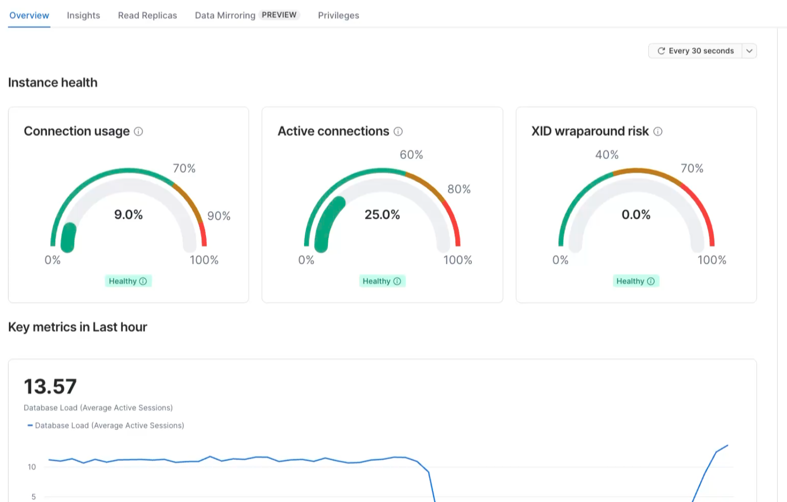
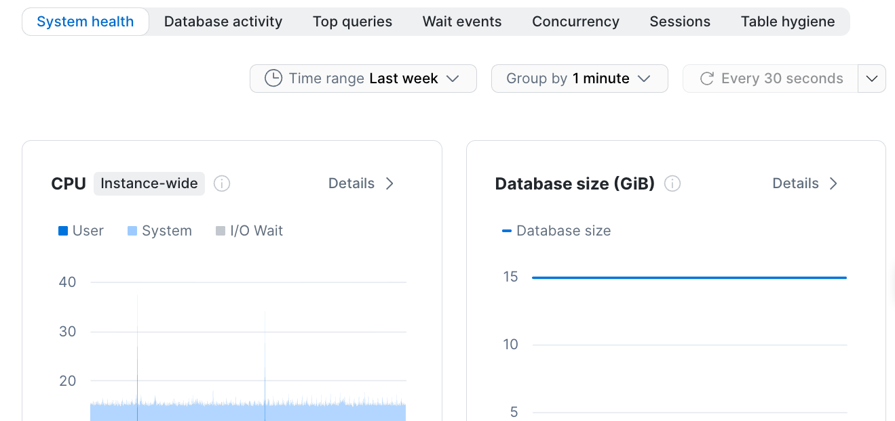
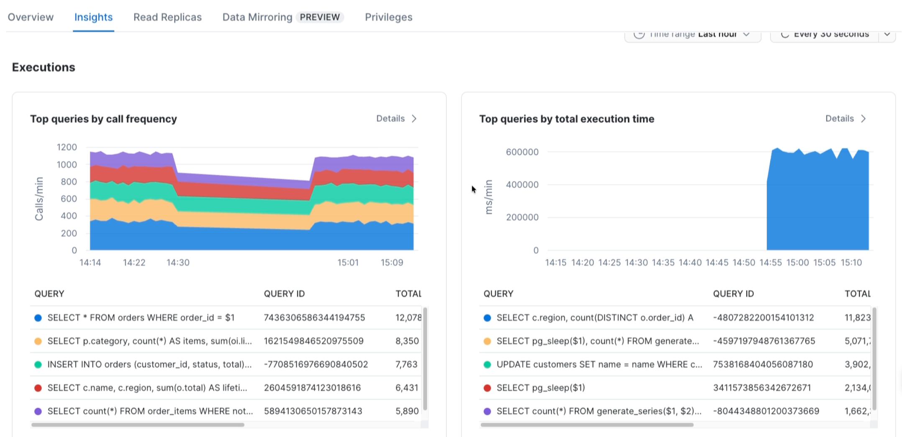

summary: Monitor Snowflake Postgres with pgInsights
id: snowflake-postgres-insights
categories: snowflake-site:taxonomy/solution-center/certification/quickstart, snowflake-site:taxonomy/product/platform, snowflake-site:taxonomy/snowflake-feature/postgres
language: en
environments: web
status: Published
feedback link: https://github.com/Snowflake-Labs/sfquickstarts/issues
authors: Elizabeth Christensen

# Monitor Snowflake Postgres with pgInsights
<!-- ------------------------ -->
## Overview

pgInsights is a built-in Postgres extension for Snowflake Postgres that continuously collects performance and health metrics from your Snowflake Postgres instance. It samples about 34 different Postgres statistics views every 30 seconds and stores the results in queryable tables inside your database. No external agents, collectors, or time-series databases are required.

In this guide you will enable pgInsights, explore the Snowsight Insights pages, and query the underlying data with plain SQL. By the end you will know how to use the "metric, interpretation, action" workflow to spot health issues, identify the queries causing them, and take action before they become application incidents.

### What You'll Need
- A Snowflake Postgres instance running **Postgres 18.6 or later**. If you don't have one, follow the [Getting Started with Snowflake Postgres](https://quickstarts.snowflake.com/guide/getting-started-with-snowflake-postgres/) quickstart first.
- `psql` installed locally and connected to your instance
- An instance that has been refreshed recently. If your instance has been running for a while, run a **Refresh** so it picks up the latest minor version, OS patches, and Snowflake Postgres features (including pgInsights). Check your current version with `SELECT version();`.
- An existing database with some table activity (queries, inserts, updates) so pgInsights has metrics to collect

### Refresh your instance

A Refresh replaces your instance without changing its configured resources. Your connection string stays the same, but there is a brief service interruption during the failover, so make sure your applications can reconnect.

To refresh from Snowsight, go to **Postgres**, select your instance, then choose **Manage** > **Refresh**. Select **Bypass maintenance window and apply immediately** if you don't want to wait for your next maintenance window.

To refresh with SQL, run `ALTER POSTGRES INSTANCE` with the instance's **current** `COMPUTE_FAMILY` value:

```sql
ALTER POSTGRES INSTANCE my_instance
  SET COMPUTE_FAMILY = STANDARD_M
  APPLY IMMEDIATELY;
```

Use `DESCRIBE POSTGRES INSTANCE my_instance;` to track progress. The refresh is complete when the instance returns to the `Ready` state. For more detail, see [Snowflake Postgres instance management](https://docs.snowflake.com/en/user-guide/snowflake-postgres/managing-instances).

### What You'll Learn
- How to enable and verify pgInsights with two SQL commands
- How to read the Snowsight Insights pages: health gauges, query rankings, wait events, and more
- How to query pgInsights tables directly with SQL for ad-hoc troubleshooting and automation


### What You'll Build
- A Snowflake Postgres instance with pgInsights enabled and actively collecting metrics
- Hands-on experience with the 8 Insights tabs in Snowsight

<!-- ------------------------ -->
## Enable pgInsights

Connect to your Snowflake Postgres instance with `psql` and enable the two extensions:

```sql
CREATE EXTENSION IF NOT EXISTS pg_stat_statements;
CREATE EXTENSION insights CASCADE;
```

`pg_stat_statements` is a standard Postgres contrib extension that tracks per-query execution statistics. The `insights` extension builds on top of it, adding continuous collection, history, rollups, baselines, and forecasts.

### Verify the installation

Confirm the extension is installed and the background workers are running:

```sql
-- Check the extension version
SELECT extname, extversion FROM pg_extension WHERE extname = 'insights';

-- Confirm the background workers are active
SELECT pid, application_name
FROM   pg_stat_activity
WHERE  application_name LIKE 'insights%';
```

You should see two workers: `insights orchestrator` and `insights scheduler: postgres`. These begin collecting metrics immediately, no restart or additional configuration is required.

### What gets created

All pgInsights objects live in the `insights` schema. Run `\dt insights.*` in psql to see the new tables. The most important ones:

| Table | Purpose |
|---|---|
| `pgi_metric` | Current value of every metric (latest snapshot) |
| `pgi_metric_history` | Raw time-series at ~30-second granularity (30-day retention) |
| `pgi_sql` | Normalized query text keyed by query ID |
| `pgi_sql_metric_history` | Per-statement execution stats per 1-minute snapshot |
| `pgi_wait_event` | Per-session wait-event samples (1-day retention) |
| `pgi_metric_trend` | Expected value range per hour-of-week (anomaly baselines) |
| `pgi_metric_forecast` | Linear-regression projections, up to 180 days out |
| `pgi_collection` | What is being collected, how often, and whether it is enabled |

For the complete table and metric reference, see the [pgInsights documentation](https://docs.snowflake.com/LIMITEDACCESS/user-guide/snowflake-postgres/postgres-insights).

<!-- ------------------------ -->
## Generate Traffic

pgInsights needs real database activity to have something to show. Run your application's normal workload, replay production queries against a staging copy, or simply run a mix of queries by hand — SELECTs, INSERTs, UPDATEs, and JOINs all contribute useful metrics.

Let the workload run for at least 5 minutes so pgInsights has time to capture multiple snapshots.

### Generate fake traffic with Cortex Code

If you don't have a workload handy, Cortex Code (CoCo) can build sample data and a load generator for you. Install either:

- [CoCo CLI](https://docs.snowflake.com/en/user-guide/cortex-code/cortex-code-cli) for macOS, Linux, and Windows
- [CoCo Desktop](https://docs.snowflake.com/en/user-guide/cortex-code/cortex-code-desktop) for macOS and Windows

Then give it a prompt like this one:

```
Connect to my Snowflake Postgres instance using psql. Create a sample e-commerce
schema (customers, products, orders, order_items) and load it with about 100,000
rows of realistic fake data. Then write and run a script that generates a mixed
workload for 10 minutes: frequent point SELECTs, a few slow JOIN/aggregate
queries, steady INSERTs and UPDATEs on orders, and occasional long-running
transactions that hold row locks so I can see blocking and wait events.
```

Adjust the row counts and duration to fit your instance size.

<!-- ------------------------ -->
## Explore the Snowsight Insights Pages

While the workload runs, open your instance in Snowsight. Go to **Data > Postgres** and click your instance name.

### Overview tab

The Overview tab is your starting point. It has three health gauges and four key metric charts.



**Health gauges:**
- **Connection usage** — what percentage of `max_connections` is in use. Green up to 70%, amber 70-90%, red 90-100%.
- **Active connections** — how many connections are actively executing queries. High active with low total means your workload is compute-heavy. High total with low active means you have idle connection buildup.
- **XID wraparound risk** — how close the database is to transaction-ID wraparound. A rising value means vacuum is falling behind.

**Key metric charts:**
- **Database Load** — estimated active sessions over time. A rising line means more work or slower queries.
- **Transaction throughput** — commits and rollbacks per second.
- **Session counts** — total, active, and blocking sessions together.
- **Database size** — on-disk growth over time.

The gauges tell you what is happening now. The charts tell you whether it is getting better or worse.

### Insights tabs

Below the Overview, there are seven Insights tabs. Use the **Time range**, **Group by**, and **Database filter** controls at the top to adjust the view.



| Tab | What it shows | When to use it |
|---|---|---|
| **System health** | CPU, memory, IOPS, load average, network, database size | "Is the instance saturated?" |
| **Database activity** | Sessions, transactions, I/O, WAL, health warnings | "What is the workload doing?" |
| **Top queries** | Rankings by call frequency, execution time, variability, WAL, I/O | "Which query should I tune?" |
| **Wait events** | Active sessions by wait-event type, blocking PIDs | "What are sessions stuck on?" |
| **Concurrency** | Lock tree, blocking hierarchy, lock types | "Who is blocking whom?" |
| **Sessions** | Session breakdown by state and database, individual session details | "Who is connected and what are they doing?" |
| **Table hygiene** | Cache hit ratio, index miss ratio, bloat, dead rows, vacuum status | "Which tables need maintenance?" |

Every chart has a **Details** link that opens a larger drill-down view.



### The metric, interpretation, action workflow

Rather than memorizing every chart, learn this three-step pattern:

1. **Metric** — the Overview gauges or a chart tells you something is off, connection usage is red, database load is spiking, a wait-event category is dominating.
2. **Interpretation** — drill into the relevant Insights tab to identify the cause, which query is slow, which session is blocking, which table has dead rows.
3. **Action** — fix the root cause, tune the query, kill the blocker, add an index, run vacuum, adjust connection pooling.

For example: Connection usage gauge is red → Sessions tab shows many idle connections from the same application → action is to enable connection pooling.

<!-- ------------------------ -->
## Query pgInsights with SQL

Everything you see in the Snowsight Insights pages is backed by the tables in the `insights` schema. You can query them directly for ad-hoc troubleshooting, create Grafana dashboards, or automated alerts.

### Current connection state

```sql
SELECT metric_name, metric_value::numeric AS value
FROM   insights.pgi_metric
WHERE  col_name = 'pg_session'
ORDER  BY metric_name;
```

### Top 10 slowest queries

This is often the most useful query. It shows exactly where your database spends its time:

```sql
SELECT s.query,
       m.calls,
       round(m.total_exec_time::numeric, 2) AS total_ms,
       round(m.mean_exec_time::numeric, 2)  AS mean_ms
FROM   insights.pgi_sql_metric_history m
JOIN   insights.pgi_sql s USING (queryid, datname, rolname)
WHERE  m.snapshot_dt = (SELECT max(snapshot_dt) FROM insights.pgi_sql_metric_history)
ORDER  BY m.total_exec_time DESC
LIMIT  10;
```

### Active wait events (last 5 minutes)

```sql
SELECT wait_event_type, wait_event, count(*) AS sessions
FROM   insights.pgi_wait_event
WHERE  snapshot_dt > now() - interval '5 minutes'
  AND  wait_event_type IS NOT NULL
GROUP  BY wait_event_type, wait_event
ORDER  BY sessions DESC;
```

### Anomaly detection

pgInsights builds an expected range for each metric at each hour of the week. This query surfaces anything outside the normal range right now:

```sql
SELECT m.col_name, m.metric_name,
       m.metric_value::numeric AS current_val,
       t.floor_val, t.ceiling_val,
       CASE WHEN m.metric_value::numeric > t.ceiling_val THEN 'HIGH' ELSE 'LOW' END AS direction
FROM   insights.pgi_metric m
JOIN   insights.pgi_metric_trend t
  ON   m.col_name    = t.col_name
 AND   m.metric_name = t.metric_name
 AND   COALESCE(m.metric_key::text, '') = COALESCE(t.metric_key::text, '')
 AND   t.dow = EXTRACT(dow  FROM now())::int
 AND   t.hr  = EXTRACT(hour FROM now())::int
WHERE  m.data_type = 'number'
  AND  (m.metric_value::numeric < t.floor_val OR m.metric_value::numeric > t.ceiling_val)
ORDER  BY m.col_name, m.metric_name;
```

> **Note:** This query only returns results after pgInsights has collected enough history to build baselines — at least a few days of data.

### Capacity forecast

```sql
SELECT forecast_dt, avg_val AS projected_connections
FROM   insights.pgi_metric_forecast
WHERE  col_name = 'pg_session'
  AND  metric_name = 'active'
ORDER  BY forecast_dt;
```

Forecasts require at least a week of historical data to compute a linear regression.

<!-- ------------------------ -->
## Practical Tips

A few things you might run into while testing:

### Storage Utilization chart appears blank

The `pg_db_size` collection (exact filesystem walk) is **disabled by default** because it can be expensive on large databases. The hourly `pg_db_size_est` estimate only fires once per hour. On a fresh instance, the Storage Utilization chart may show nothing.

To populate it immediately:

```sql
-- Enable the exact size collector
UPDATE insights.pgi_collection SET enabled = true WHERE col_name = 'pg_db_size';

-- Or force the estimate to run now
UPDATE insights.pgi_collection SET next_collect = current_timestamp WHERE col_name = 'pg_db_size_est';
```

### Database Load chart shows zero

The Database Load chart (Average Active Sessions) samples every 30 seconds. If all your queries complete in milliseconds, they won't be active when the sampler fires. This is expected for fast workloads — it means your database is under light load.

### Trend and forecast tables are empty

`pgi_metric_trend` (anomaly baselines) needs several days of data to build hour-of-week patterns. `pgi_metric_forecast` (capacity projections) needs at least a week. These tables populate automatically over time — no action required.

### Extension not available on older instances

pgInsights requires Postgres 18.6 or later. If the `insights` extension doesn't appear in `pg_available_extensions`, your instance may be on an older Postgres image. Refresh your Postgres instance to get the latest extensions.

<!-- ------------------------ -->
## Clean Up

If you are done testing and no longer want Insights metrics collection, you can remove the extension.

```sql
-- Remove the extension and all insights tables
DROP EXTENSION insights CASCADE;

```

<!-- ------------------------ -->
## Resources

- Read the [Insights extension documentation](https://docs.snowflake.com/user-guide/snowflake-postgres/insights) for the complete table and metric reference


