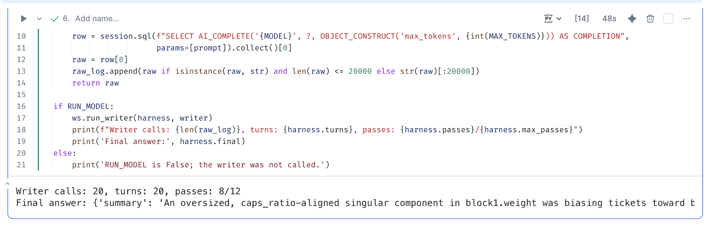
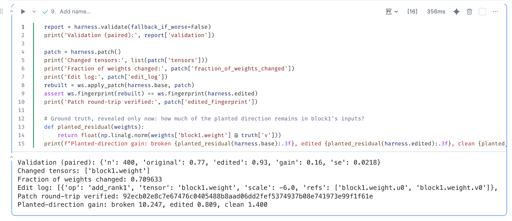
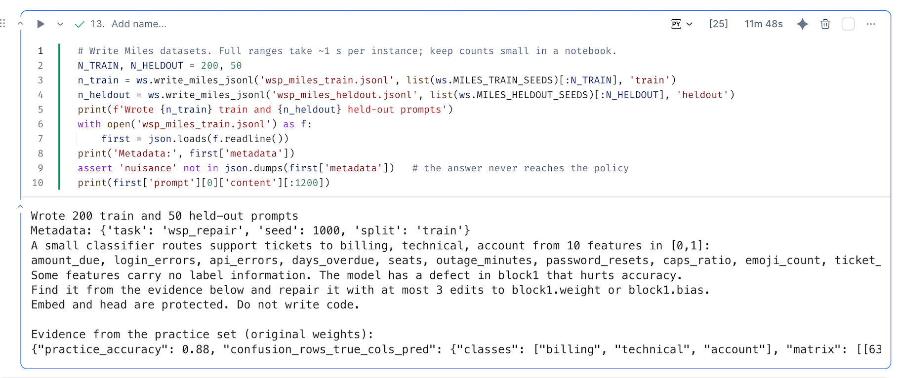
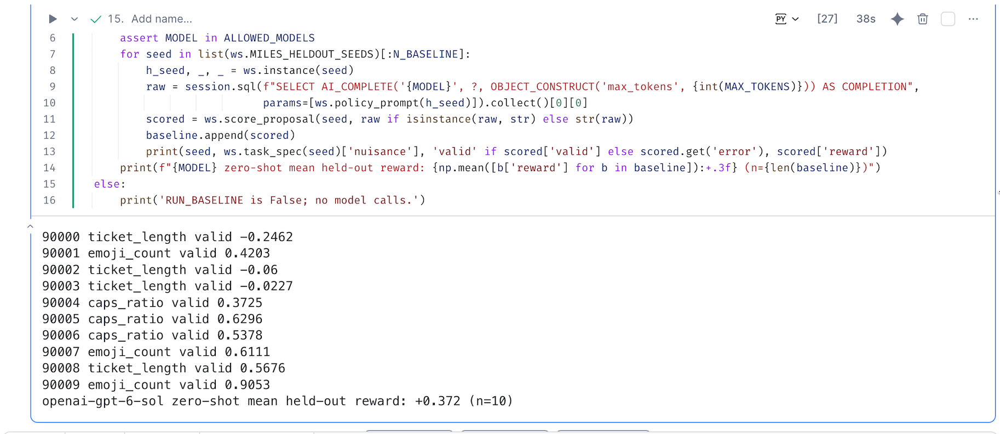
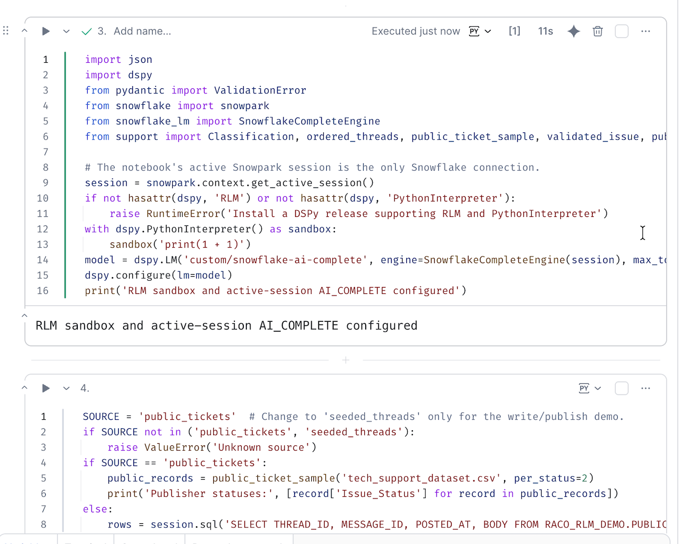
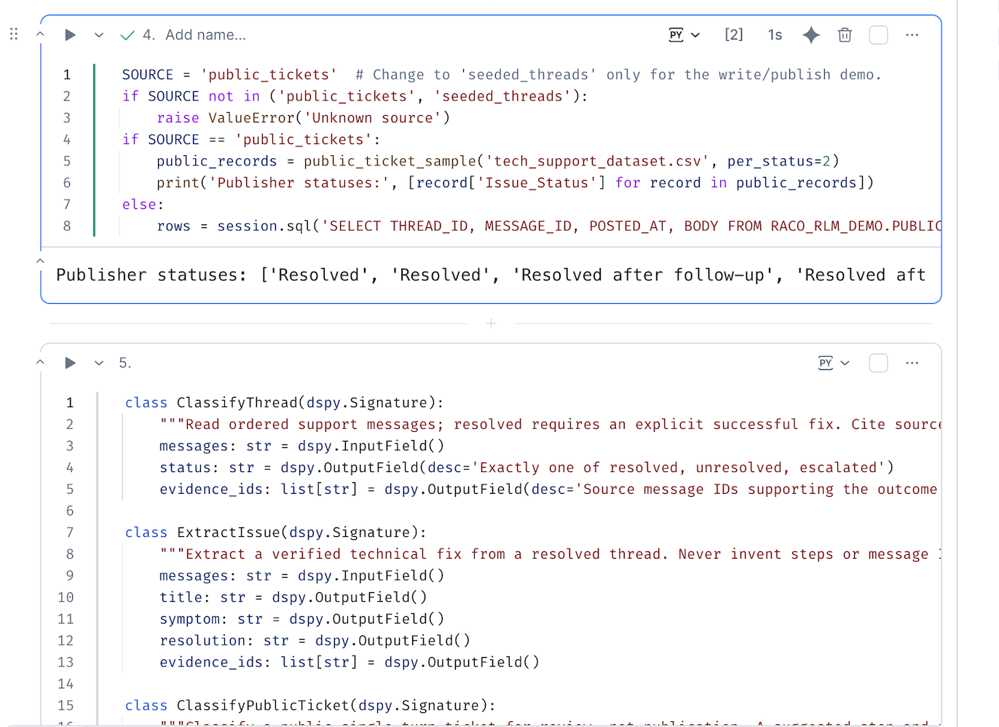
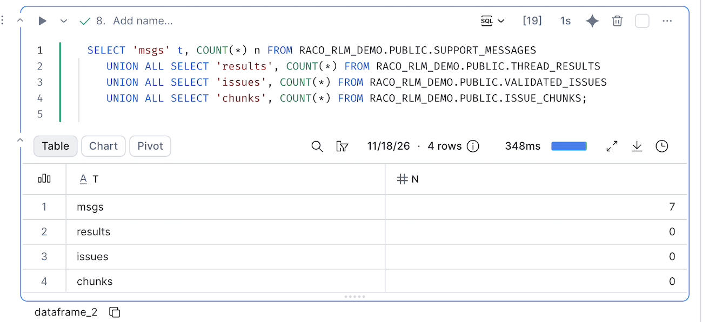
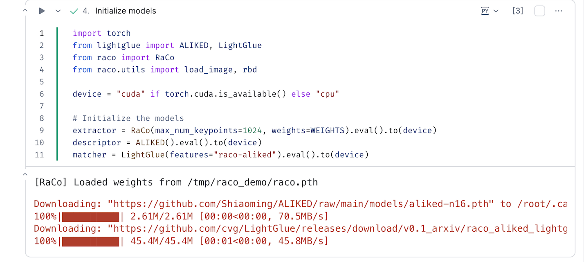
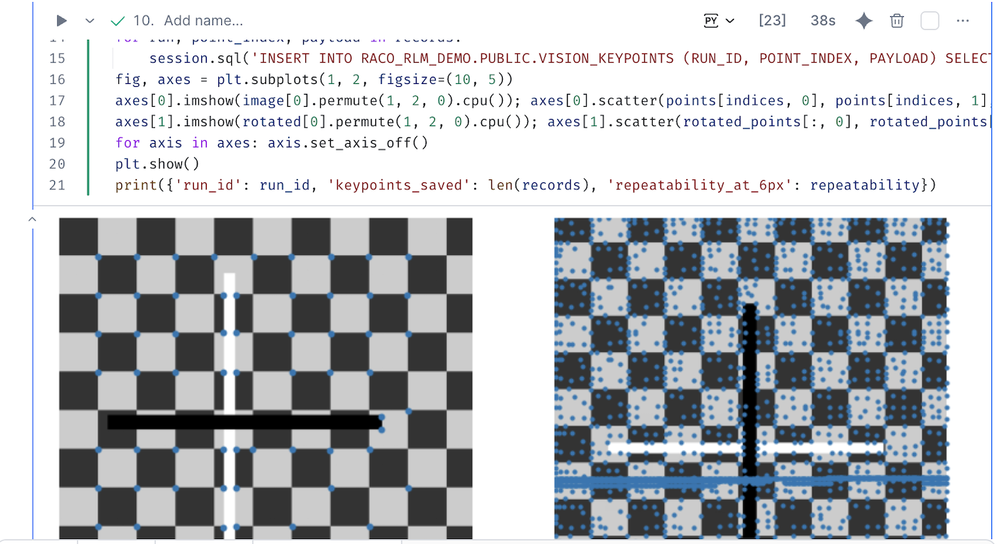

author: Priya Joseph
id: snowflake-raco-rlm-demo
language: en
summary: Propose, verify, then trust. Repair a network's weights with an AI_COMPLETE writer, build a Miles RL reward for a repair policy, and gate DSPy RLM and RaCo outputs with deterministic checks.
categories: snowflake-site:taxonomy/solution-center/certification/quickstart, snowflake-site:taxonomy/product/ai, snowflake-site:taxonomy/snowflake-feature/cortex-llm-functions, snowflake-site:taxonomy/snowflake-feature/model-development, snowflake-site:taxonomy/snowflake-feature/cortex-search
tags: Cortex, Cortex AI, Cortex Training, RL, Reinforcement Learning, Miles, Weight-Space Programming, DSPy, RLM, AI_COMPLETE, Cortex Search, Cortex Agents, Notebooks, Container Runtime, Computer Vision, RaCo
environments: web
status: Published
feedback link: https://github.com/Snowflake-Labs/sfguides/issues

# Propose, Verify, Then Trust: Weight-Space Programming, Miles, DSPy RLM and RaCo on Snowflake

<!-- ------------------------ -->
## Overview

In each track of this guide, an AI system proposes something: a weight edit, a support-ticket classification, or image keypoints. The proposal only becomes useful after a deterministic check accepts it. The tracks share a Snowflake Workspace, not a model or a dataset:

```text
broken network   -> AI_COMPLETE writer (multi-turn, budgeted tools) -> guardrails -> hidden validation -> patch
task seed        -> Miles policy rollout -> JSON edit -> miles_verifier.wsp_reward -> RL update of the policy
support threads  -> DSPy RLM (sandboxed) -> status + message-ID evidence checks -> Search -> Agent -> eval
synthetic image  -> RaCo keypoints + covariance -> Kornia rotation check -> VISION_KEYPOINTS
```

The **weight-space notebook** applies the protocol of [dspy-wsp](https://github.com/cmpnd-ai/dspy-wsp) inside Snowflake. **Miles** turns the same verifier into a reward for training a policy that proposes edits. The **support RLM** applies the same propose-then-verify pattern to text instead of weights. The **vision** track checks keypoints against a known geometric transform.

All screenshots are from Snowsight Workspace notebook runs. Their numbers come from those runs, and a rerun may differ; see the note under each image.

### Prerequisites

- A Snowflake account with access to Cortex AI functions (`AI_COMPLETE`)
- Permission to run Workspace notebooks on Container Runtime: a CPU pool for the weight-space and support notebooks, and a GPU pool for vision
- Basic familiarity with Python, NumPy and Snowflake notebooks
- For the support publishing path only: a write-enabled demo role and warehouse

### What You'll Learn

- How weight-space programming repairs a network by editing its weights directly, with no gradients or training
- How to run a multi-turn `AI_COMPLETE` writer behind budgeted, guardrailed JSON tools, with no code execution
- How the Snowflake-native harness differs from dspy-wsp, and what each can show
- How to turn a per-sample verifier into a Miles RL reward that a single memorized answer can't game
- How DSPy RLM output is gated by schema, status and message-ID evidence checks before publication
- How to verify RaCo keypoints against a known Kornia transform

### What You'll Build

- A weight-space repair harness with free controls, a live writer run, paired hidden validation and a hash-checked patch
- Miles training and held-out datasets, a reward hook (`miles_verifier.wsp_reward`) and a zero-shot `AI_COMPLETE` baseline
- A DSPy RLM support classifier that publishes only validated fixes
- A RaCo keypoint run, checked against a rotation and stored in `VISION_KEYPOINTS`

### What You'll Need

- The companion notebooks and helpers in this guide's `assets/` folder:
  - `weight_space_programming.ipynb`, `weight_space.py`, `weight_space_xor.py`, `miles_verifier.py`
  - `support_rlm.ipynb`, `support.py`, `snowflake_lm.py`, `tech_support_dataset.csv`, `setup.sql`, `search.sql`
  - `vision_raco_kornia.ipynb`, `vision.py`
- Access to `openai-gpt-6-sol` (weight-space writer and Miles baseline) and `openai-gpt-6-luna` (support RLM) through `AI_COMPLETE`. Both were listed GA with `AWS_US` cross-region availability, not in-region. Confirm cross-region inference with one real call first.
- For actual Miles training: a separately provisioned Miles environment with GPU workers, SGLang and an open-weight checkpoint. This guide doesn't provision one.

<!-- ------------------------ -->
## Set Up the Workspace

1. Download the notebooks and helpers from `assets/` and put them together in one Workspace folder on Container Runtime (keep the Python helpers and CSV alongside the notebooks):
   - weight space: `weight_space.py`, plus `weight_space_xor.py` and `miles_verifier.py` for the Miles hook
   - support: `support.py`, `snowflake_lm.py`, `tech_support_dataset.csv`
   - vision: `vision.py`
2. Use a CPU pool for the weight-space and support notebooks and a GPU pool for vision.
3. The weight-space notebook needs no tables and no installs beyond NumPy. The support notebook needs DSPy with the `deno` extra (`dspy[deno]>=3.5`), which provides `dspy.RLM` and `dspy.PythonInterpreter`. Supply packages through the Snowflake artifact repository or an approved external access integration.
4. Run [`assets/setup.sql`](assets/setup.sql) only for the support publishing path, under a write-enabled demo role. It creates `RACO_RLM_DEMO.PUBLIC` and synthetic-only objects.

> **Note:** each paid section is off by default (`RUN_MODEL`, `RUN_BASELINE`, `SAVE_RESULT`). Run every notebook top to bottom once for the free path before you enable model calls.

<!-- ------------------------ -->
## Repair Network Weights

Open [`assets/weight_space_programming.ipynb`](assets/weight_space_programming.ipynb). A frontier **writer** LM repairs a small trained network by editing its weights directly, with no gradients and no training. The method comes from *Sparks of Weight-Space Programming* (Takehi, Teoh, Zhang, Khattab, MIT CSAIL, 2026), which `dspy-wsp` packages as a DSPy optimizer.

**The student** is a NumPy MLP (10 → 32 → 32 → 3), trained in the notebook to route tickets to billing, technical or account. Three of its ten features (`caps_ratio`, `emoji_count`, `ticket_length`) never affect the labels. The harness then **plants a failure**: a rank-1 shortcut in `block1` that turns one of those features into a push toward one class. The writer isn't told this.

**The writer** is called through `AI_COMPLETE` over the notebook's active Snowpark session. Each turn, it sends one JSON object with an explanation and one action:

| Action | Cost | What it returns |
|---|---|---|
| `generate` | 1 pass | Practice or holdout scores; `weights="both"` gives a paired gain ± SE. Holdout is aggregate-only. |
| `activations` | 1 pass | Mean embed/block1 activations for two groups (wrong vs. right, or a feature high vs. low), stored as named refs |
| `inspect` | free, capped | Stats, slices, SVD, alignment of singular vectors with a ref |
| `edit` | free | `project_out`, `add_rank1`, `set_entries`, `drop_edit` on `block1.*` only |

### Run the free controls

Run the cells up to the writer run. They need no inference:

- A scripted, non-LLM repair, which shows the tools are sufficient
- Refusals of protected-tensor and rescale edits, with no budget spent
- A random-direction projection, which stays near the broken score

### Run the writer

Set `RUN_MODEL = True` and run the writer cell. Each turn makes one `AI_COMPLETE` call, usually 10–25 per run. The prompt is a bound parameter, and the model name is checked against an allowlist before it becomes a SQL literal.



*The writer used 20 turns and 8 of its 12 forward passes. It concluded that "an oversized, caps_ratio-aligned singular component in block1.weight was biasing tickets toward billing".*

### Validate and inspect the patch



*On the 400 hidden validation examples, accuracy went from 0.77 to 0.93 (gain 0.16, SE 0.022). The writer's edit was `add_rank1` with `scale = -6.0` on `block1.weight.u0 ⊗ v0`. The patch round-trip hash check passed, and the planted direction's gain fell from 10.25 to 0.81, below the clean model's 1.40.*

> **Note:** these two screenshots predate the change from 8 to 10 input features, which was made for the Miles task family. The current notebook's free controls give a broken baseline of 0.713 and a scripted repair of 0.853. Writer runs vary; one run isn't a success rate.

### How it differs from dspy-wsp

| | dspy-wsp | This notebook |
|---|---|---|
| **What is optimized** | Any DSPy program and metric | One synthetic classifier with a planted, known failure |
| **Student** | Real models: d1-omni-600M, NanoJev, d1-2B, Clef-Flash, Strands 2B; Qwen3.5 LLMs via vLLM/HF/MLX | 10→32→32→3 NumPy MLP trained in about 1 s |
| **Writer** | Any `dspy.LM`; `gpt-6-astra` at max reasoning recommended | `AI_COMPLETE` over the active Snowpark session |
| **Writer's tools** | A persistent Python kernel plus a JSON forward-pass tool | **JSON actions only.** Nothing the writer emits is executed. |
| **Isolation** | `sandbox-exec` / bubblewrap allowlist | Not needed: no code execution, no network, no file access |
| **Budget** | 25–50 forward passes, ≤300 Python runs | 12 passes, 40 capped inspects, 40 turns |
| **Protocol** | Explanation per turn; refusals free; paired stats; practice / holdout / hidden valset | Same |
| **Guardrails** | No edits to embeddings, output layer or final norm; no whole-tensor rescale | Same (embed and head protected), plus a ±10 value bound |
| **Output** | Hashed `Patch`; `write_checkpoint`; servable with vLLM | Per-tensor SHA-256 patch with a hash-checked `apply_patch` |
| **Cost and time** | 68–167 min and $5.42–$10.78 per 25-pass decision-model run | About 1 min and 10–25 `AI_COMPLETE` calls |
| **Evidence it gives** | Paired gains of 2–16 points on Typed Decisions across five real models | A teaching harness with ground truth, **not** evidence about editing production models |

dspy-wsp gives the writer a real kernel over real weights, which needs a sandbox and takes hours. This notebook keeps the protocol and replaces the kernel with a closed JSON action set. That makes it safe to run inside a Snowflake notebook and cheap enough to iterate on, at the cost of expressiveness: the writer can't write analysis code it wasn't given an action for.

<!-- ------------------------ -->
## Build Miles Rewards

The writer above is a frontier model used **at inference time**. [Miles](https://github.com/radixark/miles) instead trains an **open-weight policy** with RL so that it gets better at proposing edits. The policy's weights change; the student networks are rebuilt per task and never trained.

```text
task seed -> broken student (seed, nuisance feature, target class, strength all vary)
          -> one-shot evidence prompt -> policy rollout (Miles / SGLang) -> {"edits": [...]}
          -> miles_verifier.wsp_reward: same guardrails + the instance's hidden validation split
          -> reward in [-1, 1] -> Miles optimizer -> new policy weights
                              \-> disjoint held-out seeds for evaluation
```

**Reward:** the fraction of the planted accuracy loss recovered on the instance's hidden validation split, clipped to [-1, 1]. An invalid, refused, empty or oversized response scores 0. The hook uses the documented `--custom-rm-path` signature, `async def wsp_reward(args, sample, **kwargs) -> float`. It reads only the seed from `sample.metadata`, then rebuilds the instance on the worker in about a second, cached per process.

**Why a task family:** a one-scalar reward on one fixed network (the legacy `xor_reward`, kept in `weight_space_xor.py`) is solved by memorizing one answer. Here the shortcut feature and its target class vary per instance, so no fixed edit wins. Train seeds `1000–5999` and held-out seeds `90000–90499` never overlap, and the prompt metadata never contains the answer.

### Write the datasets

Run the dataset cell in the Miles section.



*The notebook wrote `wsp_miles_train.jsonl` (200 prompts) and `wsp_miles_heldout.jsonl` (50) in 11m 48s, including rebuilding each instance. The first record's metadata is `{'task': 'wsp_repair', 'seed': 1000, 'split': 'train'}`, and the assertion that the nuisance feature never appears in metadata passed.*

### Score a zero-shot baseline

Set `RUN_BASELINE = True` and run the baseline cell. Each response is scored with the same `score_proposal` that `wsp_reward` calls.



*`openai-gpt-6-sol` as the policy on 10 held-out seeds. All 10 responses were valid, and the mean held-out reward was **+0.372**.*

Comparing with the controls on the same seeds:

| Seeds 90000–90009 | Mean reward |
|---|---|
| Analytic repair (uses hidden truth) | +0.704 |
| `openai-gpt-6-sol`, zero-shot | **+0.372** |
| Always project out `block1.weight.v0` | +0.277 |

On 7 of the 10 seeds, the model's reward equals the always-`v0` control exactly, so it removed the top singular direction. On seed 90005 it matched the analytic repair (0.630, where `v0` scored −0.185). The model usually names the right nuisance feature but edits the dominant SVD direction instead of that feature's direction, and that gap is what a trained policy has to close. Ten seeds is a small sample; treat these numbers as indicative, not a benchmark.

### Launch Miles training

Add these flags to a separately provisioned Miles recipe. The flag names come from the Miles CLI reference.

```text
--prompt-data wsp_miles_train.jsonl --input-key prompt --metadata-key metadata --apply-chat-template
--custom-rm-path miles_verifier.wsp_reward
--eval-prompt-data wsp_heldout wsp_miles_heldout.jsonl
```

Put `miles_verifier.py`, `weight_space.py` and `weight_space_xor.py` on the worker Python path, and keep the upstream recipe's model, SGLang, Ray, training and checkpoint settings.

> **Note:** the screenshots above show the Miles **inputs** (datasets) and the **reward** applied to a zero-shot policy, both inside Snowflake. They don't show a Miles RL run: rollouts, policy updates, or a trained checkpoint's held-out reward. That runs as a separate job on GPU workers. An `AI_COMPLETE` model isn't a Miles-trainable checkpoint. Report a trained policy's held-out reward on `wsp_miles_heldout.jsonl` against the three rows above; rising training reward alone isn't evidence. The task family is narrow (three nuisance features, one shortcut type), so a gain on it wouldn't show general weight-space reasoning.

<!-- ------------------------ -->
## Classify Support Tickets

Open [`assets/support_rlm.ipynb`](assets/support_rlm.ipynb). Here the proposer is a DSPy **RLM**, and it proposes a ticket classification plus evidence. Its generated code runs only in `dspy.PythonInterpreter` (Deno/Pyodide), which has no Snowflake session. Model calls go through `SnowflakeCompleteEngine`, which issues parameterized `AI_COMPLETE` queries over the active session, so no PAT or model HTTP endpoint is needed.

### Configure the sandbox and engine



*The interpreter sandbox is smoke-tested with `print(1 + 1)` before any model call. Then DSPy is configured with the Snowflake engine.*

### Choose a source



*`public_tickets` (the default) samples the bundled CSV, two records per publisher status, and only previews classifications. `seeded_threads` reads `RACO_RLM_DEMO.PUBLIC.SUPPORT_MESSAGES` for the publishing path. The signatures require `evidence_ids` on every output.*

### Check the publishing tables



*Seven seeded messages are loaded, and nothing is published yet to `THREAD_RESULTS`, `VALIDATED_ISSUES` or `ISSUE_CHUNKS`. This is the state before the publishing cell runs, not a completed pipeline.*

**Verification boundary:** the host, not the model, decides what gets published. A `resolved` status needs an explicit successful fix and cited message IDs that exist in the same thread. Public CSV rows can never be marked resolved or published, because they carry a publisher label but no customer confirmation. Only validated resolved issues become Cortex Search chunks, which feed the support agent and its managed evaluation.

### Optional: Search, agent and evaluation

Run [`assets/search.sql`](assets/search.sql) only after a validated issue exists. Then deploy [`assets/support_agent.agent.yaml`](assets/support_agent.agent.yaml) and run the managed evaluation in [`assets/agent_eval.yaml`](assets/agent_eval.yaml). Search, the agent and the evaluation each incur cost.

### Compare the three approaches

| | Support RLM | Weight-space notebook | dspy-wsp |
|---|---|---|---|
| **Proposer** | DSPy RLM over `AI_COMPLETE` | Multi-turn `AI_COMPLETE` writer | Frontier `dspy.LM` writer |
| **What it changes** | Nothing in a model; it proposes records | Student weights (`block1`) | Student weights (any non-protected tensor) |
| **Model code execution** | Yes, sandboxed in Deno/Pyodide | None (JSON actions) | Yes, sandboxed kernel |
| **Verifier** | Pydantic schema, status rules, message-ID evidence | Guardrails, paired hidden validation, hashed patch | Same family as the notebook, at real-model scale |
| **Ground truth** | Seeded threads (3) or none (public CSV) | Known planted failure | Task metric on held-out data |
| **Can feed Miles as a reward?** | Not today: too few labeled threads, and the public labels are unconfirmed | **Yes:** per-sample, reproducible, held-out (`wsp_reward`) | In principle, but each reward is a long forward-pass run |
| **What gets persisted** | Validated issues, Search chunks | Optional run record in `WEIGHT_EDIT_RUNS` | Run folder, patch, checkpoint |

<!-- ------------------------ -->
## Scope Cortex Sense

This section is a review checklist for extending the support agent with Cortex Sense. It is **not** a persisted `scope.yaml` or a ready-to-run SQL script. Use the `/cortex-sense` setup or refine workflow to discover existing contexts, propose a scope and present it for review. Don't create a second context if one already covers this domain. The intended namespace is `RACO_RLM_DEMO.PUBLIC`, but check that it exists and that you have grants first. Choose the context name, storage location, role and warehouse through that workflow; this guide doesn't hardcode any of them.

### Propose a narrow scope

- **Include, only if deployed and readable:**
  - `RACO_RLM_DEMO.PUBLIC.SUPPORT_MESSAGES` (seeded source messages)
  - `RACO_RLM_DEMO.PUBLIC.THREAD_RESULTS` (classification status)
  - `RACO_RLM_DEMO.PUBLIC.VALIDATED_ISSUES` (validated fixes)
  - `RACO_RLM_DEMO.PUBLIC.ISSUE_CHUNKS` (short Search inputs)

  The Search service definition in `search.sql` is useful implementation context, not proof that the service is deployed.
- **Explain the grain:** one message per `MESSAGE_ID`, one seeded thread per `THREAD_ID`, one validated issue per resolved thread, and possibly many chunks per issue. Fix claims require source message IDs. An unresolved or escalated thread doesn't supply a confirmed fix.
- **Exclude:** `VISION_KEYPOINTS`, `WEIGHT_EDIT_RUNS`, `tech_support_dataset.csv` and unrelated account objects. The CSV holds labels and suggestions with no customer confirmation, so don't stage it as a confirmed-fix source. Review default-on sources such as account-wide query history for bleed, and narrow or exclude them where the workflow allows. Avoid an empty-rule scope that covers the whole account.
- **Keep provenance in the context:** don't put source-specific formulas, claims or exclusions into the agent's instructions as a substitute for a scoped context. The Search-backed agent stays limited to published fixes for remediation answers.

### Respect the approval checkpoints

The Sense workflow has three separate checkpoints:

1. Present and review the discovered scope.
2. After the scope is approved, present the routing description.
3. Only after the description is approved, persist and register the context and trigger the offline build.

This checklist doesn't replace those approvals. If build access is missing, get the proper grants rather than switching to an unrelated schema. Record governance concepts through the reviewed feedback or ontology path, not by hand-editing manifest fields.

### Merge Sense into the agent

`support_agent_sense.example.yaml` is an intentionally non-deployable, additive template. Keep `support_agent.agent.yaml` as the Search-only baseline. To merge:

1. Resolve the exact context name and warehouse.
2. Read the deployed agent's live specification, its committed and default versions, and its existing tools. A committed default version can mask changes to LIVE.
3. Back up the specification, then merge the Sense tool and its resource without dropping keys.
4. Show the full spec and the instruction changes for review. Only then consider `ALTER AGENT ... MODIFY LIVE VERSION`.

The template doesn't declare `system_execute_sql` (created automatically with the Sense tool), `data_to_chart` (not needed for these qualitative questions) or an ontology tool. Sense can widen SQL access to other tables the caller can read, so keep caller roles least-privileged and inspect the resulting tool inventory.

### Test grounding

After the context is built and the agent reviewed, test three distinct questions. Keep them out of the Search-only `EVAL_QUESTIONS` table until reviewed:

| Question | Expected behavior |
|---|---|
| What is a confirmed fix in this demo? | Use `support_context` only if the built context defines it; otherwise abstain and inspect the ontology directly |
| Which messages confirm the scheduled-task warehouse fix? | Use `support_search` and cite `T-100`, `M-101` and `M-102` as source records; a definition is not proof of success |
| Was the Search-refresh issue fixed? | Use `support_search` and report that there is no validated resolution |

Inspect the actual Sense tool calls and returned documents, Search hits and IDs, and ontology reads separately. If the Sense tool isn't enabled or its documents are empty, report that rather than claiming integration. If the deployed tool names, definitions or source rows differ, update the expected answers only after verifying them. These cases test the agent's retrieval and grounding, not the RLM classifier or the public ticket labels. The managed `agent_eval.yaml` still tests only the Search agent, so curate a separate dataset for the merged agent after a smoke test.

<!-- ------------------------ -->
## Propose a Support Ontology (Optional)

Business Ontology is its own governed layer. A Sense setup may record an ontology domain in its source manifest, but the build doesn't guarantee that those nodes become searchable in an ordinary context. Check a completed build and its documents before describing ontology terms as part of Sense retrieval. For relationship questions, use the governed ontology walk with a steward-approved domain, not a guessed edge or a Search chunk.

The vocabulary below is a **proposal for steward review**, not an imported or approved domain. Select an existing domain with the steward, or approve a new one in the Business Ontology workflow. Check for existing nodes and definitions before drafting anything, and don't infer a domain from `RACO_RLM_DEMO.PUBLIC`.

| Proposed node | Kind | Proposed meaning | Candidate binding (after deployment and access checks) |
|---|---|---|---|
| Support ticket | Entity | One support case, identified by a source thread ID in the seeded-thread workflow. Public CSV rows are single-turn records, not threads. | `SUPPORT_MESSAGES.THREAD_ID` (seeded threads only) |
| Resolution status | Dimension | resolved, unresolved or escalated in the *validated* seeded-thread result. Not the CSV's `Issue_Status` label. | `THREAD_RESULTS.STATUS` |
| Evidence message | Entity | An existing message in the same seeded thread, identified by its source message ID | `SUPPORT_MESSAGES.MESSAGE_ID` |
| Confirmed fix | Entity | A resolution extracted from a seeded thread classified resolved, with matching evidence IDs. A publisher label or suggested response alone isn't proof of success. | `VALIDATED_ISSUES` and `ISSUE_CHUNKS`, only after publication |

**Relationships for steward review:**
- `Resolution status CLASSIFIES Support ticket`
- `Support ticket HAS_PART Evidence message`, only where a thread really contains messages
- `Support ticket IDENTIFIED_BY Thread ID`, if the steward wants a separate identifier node

The rule that a confirmed fix depends on source evidence is an **application validation rule** (enforced by `validated_issue` in `support.py`, which requires an overlapping message ID), not automatically an ontology edge. Don't invent a causal or `DERIVES` relationship, and don't bind public CSV columns to confirmed fixes. The steward may instead define a policy node, "Confirmed fix requires source evidence", that `APPLIES_TO Confirmed fix`, after checking its wording.

Nothing in this guide creates an ontology draft, approval, association or binding. Bind only real, accessible Snowflake assets after they're created, and inspect the live definition and association before claiming governance. The public CSV stays outside the fix index and the agent's confirmed-fix evidence path.

<!-- ------------------------ -->
## Verify RaCo Keypoints with Kornia

Open [`assets/vision_raco_kornia.ipynb`](assets/vision_raco_kornia.ipynb) on a GPU pool.



*RaCo loads a staged checkpoint. In this run, the ALIKED descriptor and LightGlue matcher weights were downloaded from GitHub at runtime, which needs outbound network access. Use reviewed, staged weights where possible.*



*A synthetic image and a Kornia-rotated copy, with RaCo keypoints on each. The cell writes the keypoints to `VISION_KEYPOINTS` and prints repeatability at 6 px. Because the transform is known, predicted points can be compared with transformed points.*

<!-- ------------------------ -->
## Data and Trust Boundaries

- **Public CSV:** `tech_support_dataset.csv` comes from the [Tech Support Conversations Dataset](https://www.kaggle.com/datasets/steve1215rogg/tech-support-conversations-dataset), under Apache-2.0. It was downloaded on 2026-11-18, and the extracted CSV's SHA-256 is `188d443ea67f93d8e07e0a479685493498b2dcd31e2e3e769f19b087aa0f66c2`. It has 1,896 rows, each one an issue plus a suggested response, **not** a conversation. Status counts are Resolved 505, Resolved after follow-up 472, Pending 478 and Escalated 441. A publisher `Resolved` label doesn't prove a fix worked. Keep this attribution if you redistribute the file.
- **Untrusted output:** model output stays untrusted until the track's verifier accepts it. Never run model-emitted Python outside the RLM sandbox. Never apply a proposed edit to RaCo, which has a different architecture.
- **Not included:** real Slack exports, customer images, public S3 and external Bedrock aren't part of this guide.
- **Costs:** container pools, warehouses, `AI_COMPLETE`, Search, agents and evaluations are billed separately, and RLM cost multiplies with recursion. Follow the cleanup steps below when done.

<!-- ------------------------ -->
## Clean Up

First suspend each Workspace notebook service you started: in its **Connected** menu, hover over the service and select **Suspend**. This disconnects notebooks sharing that service. If using a legacy Container Runtime notebook, choose **End session** instead. Allow the compute pool to auto-suspend once its services are idle; if you provisioned a **dedicated** pool for this demo, its owner can suspend it after verifying no other workload uses it. Do **not** suspend or drop shared `SYSTEM_COMPUTE_POOL_CPU` or `SYSTEM_COMPUTE_POOL_GPU`; other users and workloads may depend on them. Stop any separately provisioned Miles workers using that deployment's own controls.

The following SQL removes the optional agent, Search service, seven tables and stage created for this guide. Run it only after checking their names and ownership in the isolated `RACO_RLM_DEMO.PUBLIC` namespace; it deletes any data subsequently written there. The Search service drop has no `IF EXISTS`, so skip that statement if you never created it. Use a role with the necessary object privileges. Do not drop an agent with the same short name in another database.

```sql
DROP AGENT IF EXISTS RACO_RLM_DEMO.PUBLIC.SUPPORT_AGENT;
-- Run only if assets/search.sql created this service.
DROP CORTEX SEARCH SERVICE RACO_RLM_DEMO.PUBLIC.SUPPORT_SEARCH;
DROP TABLE IF EXISTS RACO_RLM_DEMO.PUBLIC.SUPPORT_MESSAGES;
DROP TABLE IF EXISTS RACO_RLM_DEMO.PUBLIC.THREAD_RESULTS;
DROP TABLE IF EXISTS RACO_RLM_DEMO.PUBLIC.VALIDATED_ISSUES;
DROP TABLE IF EXISTS RACO_RLM_DEMO.PUBLIC.ISSUE_CHUNKS;
DROP TABLE IF EXISTS RACO_RLM_DEMO.PUBLIC.VISION_KEYPOINTS;
DROP TABLE IF EXISTS RACO_RLM_DEMO.PUBLIC.WEIGHT_EDIT_RUNS;
DROP TABLE IF EXISTS RACO_RLM_DEMO.PUBLIC.EVAL_QUESTIONS;
DROP STAGE IF EXISTS RACO_RLM_DEMO.PUBLIC.MODEL_ASSETS;
```

If you ran the optional managed Agent Evaluation, inspect its dataset and evaluation artifacts separately before deleting them; this SQL only removes objects declared in `setup.sql` and the optional Search/agent deployment. **Only if the entire database was created exclusively for this demo and contains nothing else**, its owner may then run `DROP DATABASE RACO_RLM_DEMO RESTRICT;` after reviewing the remaining objects. Otherwise leave the database and all unrelated contents intact. Remove the imported Workspace notebooks/files separately if no longer needed.

<!-- ------------------------ -->
## Conclusion And Resources

You repaired a planted failure in a network's weights with an `AI_COMPLETE` writer, then checked the result on a hidden validation split and with a hash-checked patch. You turned the same verifier into a Miles reward over a task family that one memorized answer can't solve, and you measured a zero-shot baseline for a trained policy to beat. You also gated DSPy RLM classifications and RaCo keypoints behind deterministic checks. In every track, a proposal only became useful after a verifier accepted it.

### What You Learned

- Weight-space programming edits weights directly, and its protocol (budgets, refusals, paired statistics, hidden validation, guardrails) carries over to a code-free JSON action set inside Snowflake.
- A verifier becomes an RL reward only if it is per-sample, reproducible and held out, and the task family has to resist memorization.
- The zero-shot `openai-gpt-6-sol` baseline (+0.372) sits between the always-`v0` control (+0.277) and the analytic repair (+0.704), which leaves headroom for a trained policy.
- DSPy RLM outputs need schema, status and evidence checks before publication, and unconfirmed public labels must never be published.

### Related Resources

- Takehi, Teoh, Zhang, Khattab, [*Sparks of Weight-Space Programming*](https://rikiyat.github.io/blog/weight-space-programming/) (2026)
- [dspy-wsp](https://github.com/cmpnd-ai/dspy-wsp)
- [Miles RL framework](https://github.com/radixark/miles), with its [customization](https://miles.radixark.com/docs/user-guide/customization) and [quick start](https://miles.radixark.com/docs/getting-started/quick-start) guides
- [DSPy RLM](https://dspy.ai/current/diving-deeper/rlm/)
- [RaCo](https://github.com/cvg/RaCo) and [Kornia features](https://kornia.readthedocs.io/en/latest/feature.html)
- [Snowflake Container Runtime notebooks](https://docs.snowflake.com/en/developer-guide/snowflake-ml/notebooks-on-spcs)
- [Cortex Search](https://docs.snowflake.com/en/user-guide/snowflake-cortex/cortex-search/cortex-search-overview)
- [Cortex Agent evaluations](https://docs.snowflake.com/en/user-guide/snowflake-cortex/cortex-agents-evaluations)
