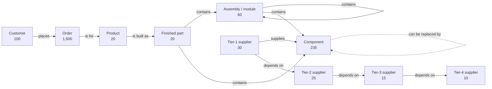
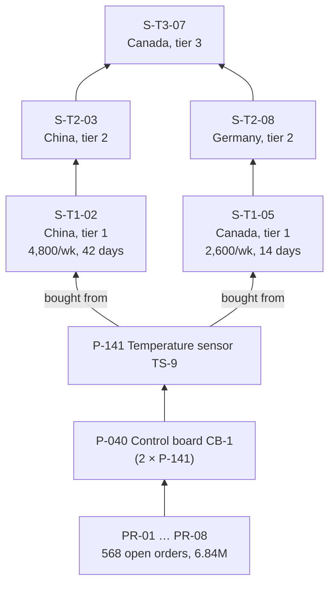

# Data overview: what's in the synthetic supply chain

A plain-language tour of the sample data, for understanding before building the notebook. All numbers come from the files in `data/`. The planted test cases are described separately in `data/README.md`.

## 1. The story in one paragraph

A fictional manufacturer builds **20 connected IoT devices**: trackers, sensors, controllers and meters. Each device is assembled from **modules** (sensor module, power module, main board…), which are assembled from **components** (sensors, chips, fuses, screws…). Components are bought from **30 tier-1 suppliers**. Those suppliers rely on **50 further suppliers** in tiers 2–4, spread over three regions. Customers have placed **1,500 open orders** for the devices, worth 15.2 million in total, due between November 2026 and January 2027.

## 2. How it fits together



Two networks meet at the component:
- **The product structure (bill of materials).** It runs downward: product → modules → sub-modules → components, 3 to 5 levels deep. Modules are reused across products, so it is a network, not a set of separate trees.
- **The supply network.** It runs upward: component → tier-1 supplier → tier 2 → tier 3 → tier 4.

Most interesting questions cross from one network into the other. For example: "a tier-3 supplier fails, which products and orders are hit?"

## 3. Products

| Product | Price | BOM depth | Distinct parts | Open orders | Order value |
|---|---|---|---|---|---|
| `PR-01` Cold-chain tracker | 354.87 | 4 | 53 | 78 | 736,710 |
| `PR-02` Factory gateway | 636.10 | 4 | 98 | 78 | 1,199,048 |
| `PR-03` Smart thermostat | 636.74 | 5 | 55 | 70 | 1,128,940 |
| `PR-04` Fleet telematics unit | 330.58 | 3 | 23 | 69 | 509,754 |
| `PR-05` Air quality monitor | 592.39 | 5 | 66 | 75 | 1,193,073 |
| `PR-06` Smart meter | 226.99 | 4 | 65 | 70 | 407,447 |
| `PR-07` Asset tag | 767.91 | 3 | 31 | 62 | 1,284,713 |
| `PR-08` Edge controller | 201.83 | 4 | 46 | 66 | 380,450 |
| `PR-09` Vibration monitor | 680.64 | 3 | 28 | 84 | 1,515,105 |
| `PR-10` Leak detector | 211.83 | 3 | 40 | 73 | 409,679 |
| `PR-11` Smart lock | 208.93 | 5 | 54 | 76 | 390,072 |
| `PR-12` Warehouse scanner | 202.89 | 4 | 50 | 73 | 365,811 |
| `PR-13` Solar inverter monitor | 274.94 | 5 | 59 | 78 | 530,909 |
| `PR-14` EV charger board | 275.80 | 3 | 25 | 68 | 466,378 |
| `PR-15` Medical cooler monitor | 325.14 | 3 | 22 | 83 | 738,068 |
| `PR-16` Rail sensor node | 528.05 | 5 | 54 | 86 | 1,219,796 |
| `PR-17` Water flow meter | 277.31 | 4 | 44 | 75 | 549,074 |
| `PR-18` Greenhouse controller | 668.68 | 3 | 28 | 72 | 1,190,250 |
| `PR-19` Pallet tracker | 350.37 | 4 | 33 | 83 | 691,630 |
| `PR-20` Wind turbine monitor | 150.74 | 4 | 54 | 81 | 282,939 |

"Distinct parts" counts every module and component anywhere in the product's tree. The largest is the Factory gateway at 98; the smallest is the Medical cooler monitor at 22.

## 4. Parts

| Level | Count | Examples | Unit cost (min / median / max) |
|---|---|---|---|
| Finished part | 20 | One per product, e.g. "Fleet telematics unit final assembly" | 40.52 / 67.88 / 111.37 |
| Assembly (module) | 60 | Main board (9), Radio module (8), Power module (8), Battery pack (7), Interface board (6), Display module (5), Sensor module (5), Antenna assembly (4), Cooling unit (4), Housing assembly (3), Control board CB-1 (1) | 12.29 / 36.96 / 59.87 |
| Component | 235 | Fuses (16), pressure sensors (14), resistor arrays (13), fans (12), enclosure shells (11), capacitor banks, heat sinks, speakers, microphones, switches, connectors, memory chips, radio chips, … | 0.21 / 12.46 / 24.98 |

**Sharing:**
- **72 parts are used in 5 or more products.** The most shared is heat sink `P-178` (15 products), then pressure sensors `P-302` (14), `P-106` and `P-275` (13 each).
- **80 parts belong to a single product.**
- **41 parts are not used in any product.** They're a by-product of random generation, but harmless; real catalogues contain obsolete parts too.

**Stock:**
- **222 of 235 components are in stock; 13 have zero stock.** Examples: radio chip `P-121`, antenna `P-145`, cable harness `P-175`.
- **23 of 60 assemblies have finished stock.** The other 37 must be built from their components.

**Substitutes:** 60 approved replacement pairs between components.

**A note on realism:** module and component *names* are drawn at random from a list, so a smart lock may contain a fan. The structure is what matters here: depth, sharing, stock, sourcing. The names are only labels.

### Example: what goes into a Fleet telematics unit (`PR-04`)

The smallest-depth product, shown in full (quantity × part, stock on hand):

```
PR-04 Fleet telematics unit  (P-004)
├── 1 × P-040 Control board CB-1            [assembly, stock 0]
│   ├── 2 × P-141 Temperature sensor TS-9   (2,960)
│   ├── 1 × P-192 Memory chip               (930)
│   ├── 3 × P-254 Enclosure shell           (2,900)
│   ├── 1 × P-276 Fuse                      (650)
│   └── 2 × P-306 Resistor array            (340)
├── 1 × P-047 Sensor module A2-07           [assembly, stock 0]
│   ├── 1 × P-073 Sensor module A4-03       [assembly, stock 25]
│   │   ├── 1 × P-087 Humidity sensor       (1,810)
│   │   ├── 2 × P-204 Humidity sensor       (1,160)
│   │   └── 2 × P-242 Label set             (230)
│   ├── 1 × P-196 Microcontroller           (1,340)
│   ├── 2 × P-208 Switch                    (2,080)
│   ├── 3 × P-262 Gasket                    (980)
│   ├── 2 × P-273 Resistor array            (1,380)
│   └── 1 × P-309 Battery cell              (1,450)
├── 1 × P-059 Display module A3-04          [assembly, stock 60]
│   ├── 3 × P-106 Pressure sensor           (2,480)
│   ├── 4 × P-195 Enclosure shell           (1,190)
│   └── 2 × P-217 Switch                    (2,510)
├── 2 × P-087 Humidity sensor               (1,810)   ← also used inside P-073
├── 1 × P-102 Microcontroller               (2,070)
├── 1 × P-121 Radio chip RC-2               (0)       ← out of stock; substitute P-122 has 2,500
└── 3 × P-253 Heat sink                     (920)
```

This one tree already shows three things the notebook works with:
- **Shared parts:** the control board `P-040` is also in 7 other products (case 1). Humidity sensor `P-087` appears at two levels in the same product.
- **Mixed stock:** some modules have finished stock and some must be built from components.
- **A missing component** that a substitute can cover (case 3).

## 5. Suppliers

| Tier | AMER | APAC | EMEA | Total | Role |
|---|---|---|---|---|---|
| 1 | 10 | 12 | 8 | 30 | Sell components to us |
| 2 | 11 | 8 | 6 | 25 | Supply tier-1 suppliers |
| 3 | 6 | 3 | 6 | 15 | Supply tier-2 suppliers |
| 4 | 1 | 4 | 5 | 10 | Supply tier-3 suppliers |

Countries: Canada (13), Poland (10), Japan (9), United States (9), Netherlands (7), China (6), Mexico (6), Germany (5), Malaysia (5), Taiwan (4), Italy (3), Vietnam (3).

**Sourcing of components:**
- **Number of tier-1 suppliers per component:** 49 components have one (single-sourced), 124 have two, 62 have three.
- **Range per supplier:** a tier-1 supplier sells 1–24 components, about 17 on average.
- **Terms per supplier–component pair:** each has a weekly capacity (200–5,000 units), a lead time (7, 14, 21, 28, 42 or 56 days) and a unit price.

**Dependencies (81 links):**

| From | To | Links |
|---|---|---|
| Tier 1 | Tier 2 | 37 |
| Tier 2 | Tier 3 | 33 |
| Tier 3 | Tier 4 | 9 |
| Tier 2 | Tier 2 | 2 (the cycle, case 4) |

### Example: the hidden shared supplier (case 2)



## 6. Customers and orders

- **Customers:** 100 in total, split EMEA 37, APAC 34, AMER 29.
- **Orders:** 1,500 open orders.
  - 1–50 units each, due between 2 November 2026 and 31 January 2027.
  - Total value 15,189,847.
  - Spread evenly across products, 62–86 orders each.

## 7. Can we model or visualise this?

**Modelling:** yes. `notebooks/supply_chain_ontology.py` is exactly that model. Section 2 above is its picture: six concepts (`Part`, `Product`, `Supplier`, `Supply`, `Customer`, `Order`) and three links (`contains`, `substitute`, `depends_on`). It's validated against the loaded tables; see `design/synthetic_supply_chain.md` §4.

**Visualising:** a few views would help, both in this document and in the notebook.

| View | Shows | How |
|---|---|---|
| Domain model | How the concepts connect (section 2) | Mermaid in Markdown; or `inspect.schema(model)` printed in the notebook |
| One product's BOM tree | Depth, quantities, stock gaps | Indented tree (as above), or a sunburst/treemap with Plotly in the notebook |
| BOM network across products | Shared modules and components | Graph of parts with NetworkX, drawn with matplotlib; highlight `P-040` and its 8 products |
| Supply network by tier | Tiers, regions, the cycle, the shared tier-3 supplier | Layered graph (tiers as columns), coloured by region |
| Impact of a failure | Supplier → part → products → orders | Sankey diagram, with flow width = order value. Good for the chapter 3 result |
| Order exposure | Value at risk per product or region | Bar chart from SQL; chapter 7 reporting |

Suggestions for the notebook:
- **Add a short "Explore the data" chapter 0** with three pictures: the domain model, the `PR-04` tree, and the supply network by tier. Readers then see the shape of the problem before any SQL or PyRel.
- **Draw the graphs** from plain SQL/pandas results in that chapter. The notebook's Python environment already has pandas and matplotlib; NetworkX and Plotly need checking in Container Runtime, and could be installed via pip with the same external access integration.
- **Reuse the same views in later chapters** to show results, for example highlighting the affected products after a supplier failure, so the pictures tie back to the planted cases.
